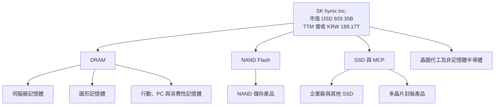
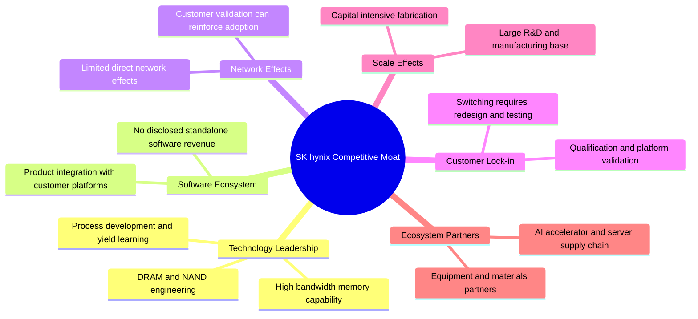
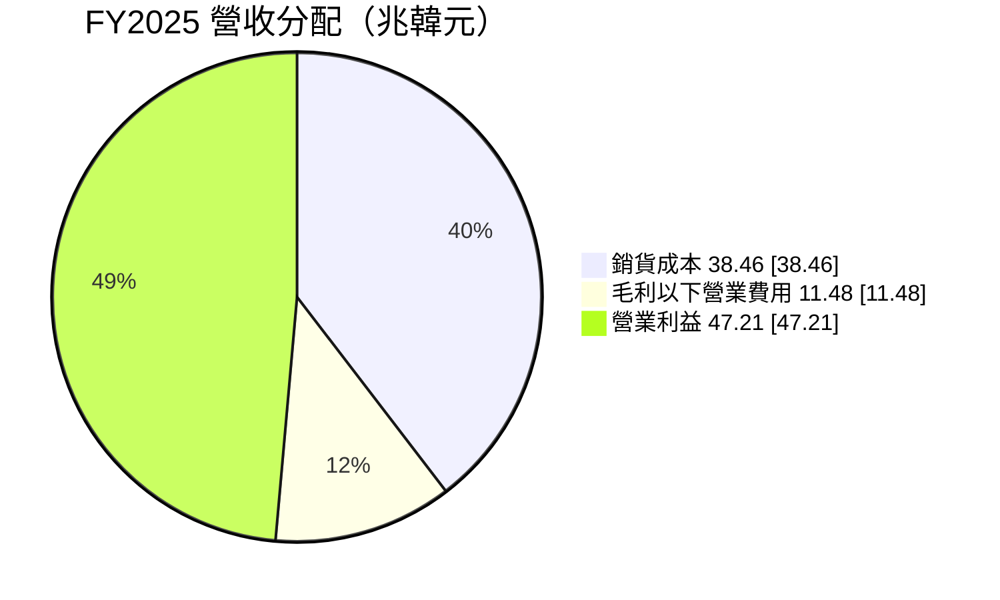
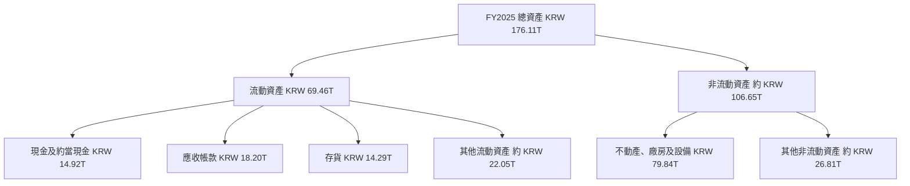
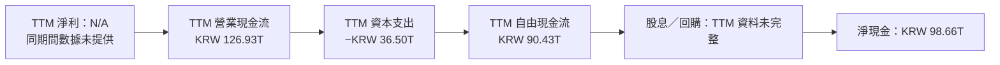
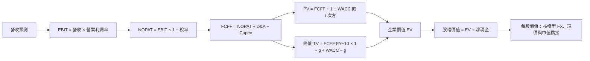
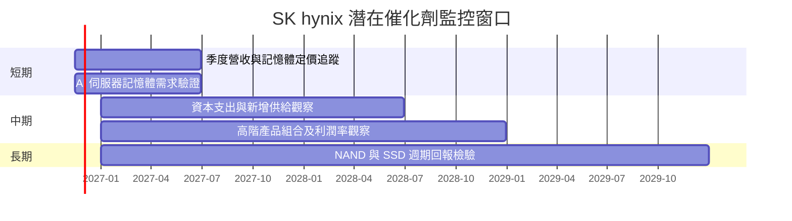
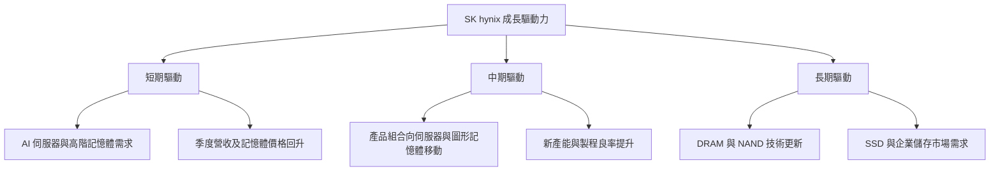
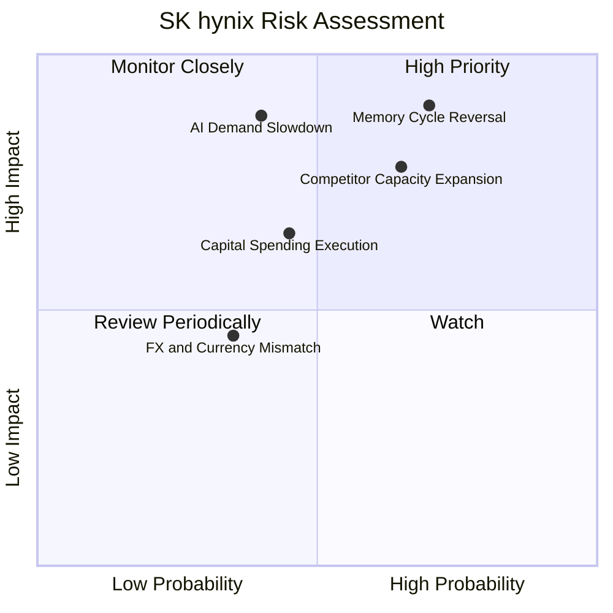
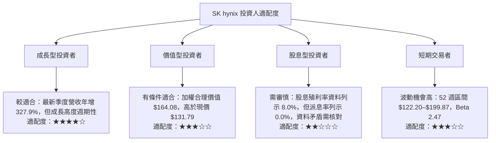

# SKHY 基本面深度分析報告
> **報告日期**：2026-11-15 ｜ **語言**：繁體中文 ｜ **數據來源**：Yahoo Finance、Finviz、StockAnalysis、Roic.ai ｜ **分析師**：CFA 級機構研究

> **資料口徑提示**：SK hynix 為韓國半導體公司，報價以美元呈現，財報以韓元呈現。以下涉及即時估值與 DCF 的核心財務數字，優先採用截至 2026-06-30 的 TTM 財報數據；匯率使用 2026-11-13 收盤的 **1 美元 = 1,333.78 韓元**。其他來源出現不同期間或不同數字時，會明確指出，不混用成同一期間。

## 目錄

| # | 章節 | 核心結論 |
|---|------|----------|
| 1 | 執行摘要 | 買入；加權合理價值 $164.08；MOS +19.7% |
| 2 | 公司概覽與商業模式 | DRAM、NAND 與高頻寬記憶體構成核心；市場份額數據未提供 |
| 3 | 損益表深度分析 | 最新季度營收年增 327.9%；TTM 營業利益率 68.0%，但盈餘品質有需釐清之處 |
| 4 | 資產負債表分析 | TTM 淨現金 98.66 兆韓元；營運資金天數偏長 |
| 5 | 現金流量深度分析 | TTM FCF 90.43 兆韓元、FCF Yield 7.30% |
| 6 | 獲利能力與資本效率 | WACC 採用 14.00%；目前 ROIC 未提供，無法確認當期價值創造幅度 |
| 7 | 相對估值分析 | Forward P/E 3.19x；相對估值方法隱含價值約 $128.64–$132.98 |
| 8 | DCF 內在價值評估 | 基準 DCF 每股 $182.36；加權合理價值 $164.08、MOS +19.7% |
| 9 | 成長催化劑 | AI 記憶體需求與產品組合是主要潛在催化劑；TAM 數據未提供 |
| 10 | 風險矩陣 | 記憶體週期、競爭擴產與 AI 需求變化為主要風險 |
| 11 | 投資建議 | 買入；建議區間 $122.20–$147.67，並嚴格監控利潤率、資本支出與現金流 |

---

## 1. 執行摘要

SK hynix 截至 2026-06-30 的 TTM 營收為 **189.17 兆韓元（約 1,418.3 億美元）**，最新一季營收年增率為 **327.9%**，TTM 營業利益率為 **68.0%**，TTM FCF 為 **90.43 兆韓元**、FCF Yield 為 **7.30%**。另一方面，最新 ROIC 未提供、記憶體產業週期性高，且不同來源的季度損益期間有不一致。估值方面，程式計算的基準 DCF 為 **$182.36**，三角驗證後加權合理價值為 **$164.08**；以 2026-11-13 收盤價 **$131.79** 計，MOS 為 **+19.7%**。依 MOS 門檻評級為 **買入**；沒有進行質化調整。

### 1.0 一頁式投資儀表板

| 項目 | 內容 |
|------|------|
| **投資論點（3 句）** | ① 最新一季營收年增 **327.9%**，顯示需求與價格週期處於高位，但該增速不能視為長期 TTM 成長率。② TTM 營業利益率 **68.0%**、FCF **90.43 兆韓元**，反映目前營運槓桿與現金創造力很高。③ 加權合理價值 **$164.08** 高於現價 **$131.79**，MOS **+19.7%**，但投資結果高度取決於記憶體價格與資本支出。 |
| **綜合評分** | **8.0/10**（引用 1.1 評分卡） |
| **財務健康** | 🟢 TTM 淨現金 **98.66 兆韓元**；但營運資金週期 **214 天**，現金轉換效率仍需追蹤。 |
| **ROIC vs WACC** | 最新 ROIC：**N/A**；WACC：**14.00%**。目前無法確認當期是否高於資本成本。 |
| **FCF 趨勢** | TTM FCF **90.43 兆韓元**；FCF Yield **7.30%**。年度 FCF 由 2023 年負值轉為 2024、2025 年正值。 |
| **估值** | Forward P/E **3.19x** ｜ EV/EBITDA：**N/A**（財報與報價幣別不同，未作混幣計算）｜ FCF Yield **7.30%** |
| **DCF 內在價值（基準）** | **$182.36** ｜ 現價相對 DCF 折價 **27.7%**（現價 ÷ DCF 價值 − 1） |
| **安全邊際（MOS）** | **+19.7%**＝($164.08 − $131.79) ÷ $164.08（基準為 8.8 加權合理價值）｜ 🟡 有限 |
| **預期報酬（基準情境 12M）** | DCF 基準情境相對現價 **+38.4%**；此為模型情境值，不等同確定的 12 個月報酬預測。 |
| **關鍵風險（前二）** | 記憶體供需反轉使價格及利潤率下滑；競爭者擴產與 AI 需求變化。 |
| **評級 + 信心度** | 🟢 **買入** ｜ 信心：中（高週期性、資料期間與盈餘項目有不一致） |

### 1.1 綜合評分卡（全報告唯一）

| 維度 | 評分（1–10） | 主要依據（引用數字與其來源章節） |
|------|--------------|----------------------------------|
| 成長性 | 9 | 最新一季營收年增 **327.9%**，但 TTM 成長率為 N/A，且半導體記憶體具有週期性（第 3 章）。 |
| 獲利能力 | 9 | TTM 營業利益率 **68.0%**、FCF **90.43 兆韓元**；最新 ROIC 與 F-Score 未提供（第 3、5、6 章）。 |
| 財務健康 | 9 | TTM 淨現金 **98.66 兆韓元**；CCC **214 天**，營運資金效率並非無風險（第 4 章）。 |
| 估值 | 7 | MOS **+19.7%**；相對估值方法約 $128.64–$132.98，部分接近現價（第 7、8 章）。 |
| 護城河 | 8 | DRAM、NAND 與伺服器記憶體的產品能力、規模與客戶驗證形成進入門檻；但市場份額數字及客戶集中度未提供（第 2 章）。 |
| 管理層與資本配置 | 6 | 2025 年資本支出 **28.58 兆韓元**、股息支付 **1.68 兆韓元**；未提供回購與完整資本配置目標資料（第 5 章）。 |
| **綜合評分** | **8.0** | 六項算術平均：(9 + 9 + 9 + 7 + 8 + 6) ÷ 6 = **8.0**。 |

### 1.2 五大投資論點 + 三大核心風險

| 類型 | 項目 | 具體依據 | 信心度 |
|------|------|----------|--------|
| 🟢 **投資論點①** | AI／伺服器記憶體需求帶動景氣 | 最新一季營收年增 **327.9%**；公司產品包括伺服器與圖形記憶體。高增速支持近期景氣強度，但不可直接外推至長期。 | 🟢 高 |
| 🟢 **投資論點②** | 高營業槓桿 | TTM 營業利益率 **68.0%**，最新一季營業利益率 **74.5%**；在需求強、平均售價上升時，固定成本吸收能力增加。 | 🟢 高 |
| 🟢 **投資論點③** | 現金流與資產負債表提供緩衝 | TTM FCF **90.43 兆韓元**，淨現金 **98.66 兆韓元**；能支援高資本密集度產業的投資與週期低谷。 | 🟢 高 |
| 🟢 **投資論點④** | DCF 對現價有折價 | 基準 DCF **$182.36**，對比現價 **$131.79**；但加權合理價值較低，僅 **$164.08**。 | 🟡 中 |
| 🟢 **投資論點⑤** | Forward P/E 顯示市場預期盈餘大增 | Forward P/E **3.1873x**，Forward EPS **$41.35**；低倍數同時代表市場預期可能處於週期高點。 | 🟡 中 |
| 🟡 **風險①** | 供給擴張導致記憶體價格反轉 | 最新季度營業利益率 **74.5%** 高於 TTM **68.0%**；若供給增加使平均售價下跌，利潤率可能迅速回落。 | 🔴 高衝擊 |
| 🔴 **風險②** | DCF 對長期假設敏感 | WACC 14.00%、終值成長率 3.0%；敏感度表中 WACC 由 14% 升至 16%、g 仍為 3% 時，每股值由 **$182.36 降至 $154.11**。 | 🔴 高 |
| 🟡 **風險③** | 財報資料期間與盈餘品質需核對 | VERIFIED TTM 收入為 **189.17 兆韓元**，其他彙整來源另顯示 **269.34 兆韓元**；最新 EPS 驚喜數據為 N/A。 | 🟡 中 |

### 1.3 快速統計卡片

| 指標 | 公司實際值（期間） | 同業中位數 | 狀態 |
|------|--------------------|------------|------|
| 營收成長（TTM） | **N/A** | — | 🟡 無法評估 |
| 營收成長（最新一季年增） | **327.9%** | **377.9%** | 🟢 高增長，但低於同業中位數 |
| 毛利率（TTM） | **77.4%** | **80.0%** | 🟢 接近同業中位數 |
| 營業利益率（TTM） | **68.0%** | — | 🟢 高 |
| ROIC（TTM） | **N/A** | — | 🟡 數據未提供 |
| Forward P/E | **3.1873x** | **3.7x** | 🟢 低於同業中位數，亦反映週期盈餘風險 |
| FCF Yield（TTM） | **7.30%** | — | 🟢 |
| Piotroski F-Score | **N/A** | — | 🟡 需兩個相隔一年的 TTM SEC 申報資料 |

> 同業中位數以 MU、SNDK、WDC 的已列倍數計算；公司 TTM 收入成長率與 F-Score 不以其他期間數據替代。

### 1.4 投資結論

```text
╔══════════════════════════════════════════════════════════════════╗
║                    📊 投資結論摘要                               ║
╠══════════════════════════════════════════════════════════════════╣
║  評級：買入（MOS 19.7%，符合 10%–25% 買入門檻）                 ║
║  價格（2026-11-13 收盤）：$131.79                                ║
║  DCF 內在價值（基準）：$182.36（現價折價 27.7%）                 ║
║  安全邊際 MOS：+19.7%＝(加權合理價值−現價)÷加權合理價值        ║
║  加權合理價值（8.8）：$164.08                                    ║
║  DCF 情境價值：                                                   ║
║    悲觀情境：$89.12（-32.4%）                                    ║
║    基準情境：$182.36（+38.4%）                                   ║
║    樂觀情境：$358.64（+172.1%）                                  ║
║  綜合評分：8.0/10（引用 1.1）                                    ║
║  適合投資人：能承受高波動、願意追蹤半導體週期的成長型投資人      ║
╚══════════════════════════════════════════════════════════════════╝
```

---

## 2. 公司概覽與商業模式

### 2.1 業務結構與收入來源

SK hynix 研發、製造及銷售 DRAM、NAND Flash、SSD、MCP，亦從事晶圓代工及非記憶體半導體業務。公司總營收及產品組合占比未在所列財務資料中按部門拆分；因此不對各產品線填入未提供的收入金額或百分比。



產品線收入占比及軟體／服務收入未提供。整體商業模式以半導體產品銷售為主，盈利受到產品組合、售價、產能利用率與資本支出的共同影響。

### 2.2 市場份額

市場份額數據未提供，因此不製作市場份額圖或填入推估比例。以公司財務表現觀察，TTM 營收為 **189.17 兆韓元**、最新一季營收年增 **327.9%**；同業 MU、SNDK 的最新一季營收年增分別為 **379.3%**、**377.9%**，反映整體記憶體產業正處於強勁上行階段，不能將單季增速視為長期競爭地位的直接證據。

### 2.3 競爭護城河分析



### 2.4 護城河強度

| 護城河項目 | 強度（強／中／弱） | 證據（引用數字或事實） | 會削弱它的情況 |
|------------|--------------------|------------------------|----------------|
| 技術與產品 | 強 | DRAM、NAND、SSD、伺服器記憶體與圖形記憶體多產品線；FY2025 研發費用 **6.47 兆韓元**。 | 競爭者追上製程、良率或高階產品量產能力。 |
| 客戶驗證與切換成本 | 中 | 高階記憶體需通過客戶系統驗證；特定客戶與產品收入占比未提供。 | 客戶建立第二供應來源、產品世代更替或需求轉向。 |
| 規模效應 | 強 | 半導體製造資本密集；TTM 資本支出 **36.50 兆韓元**。 | 供給過度擴張、低利用率導致折舊與固定成本負擔上升。 |
| 軟體生態系統 | 弱 | 未披露獨立軟體或服務收入。 | 若產品差異化不足，競爭更容易回到價格與供貨能力。 |
| 網路效應 | 弱 | 記憶體產品本身沒有明確直接網路效應數據。 | 客戶需求可在符合規格的供應商間轉移。 |
| 生態夥伴 | 中 | 公司供應伺服器、網路、行動等市場；特定夥伴與合約數據未提供。 | 主要終端平台需求下修或客戶供應鏈策略改變。 |

**1.1 護城河分數 8/10**，主要基於研發投入、製造規模與產品驗證門檻；未給更高分是因市場份額、客戶集中度與產品線收入拆分未提供，且記憶體具強週期性。

---

## 3. 損益表深度分析

### 3.1 年度收入成長趨勢（近 4 年）

年度營收依 StockAnalysis 年度資料，金額為兆韓元；YoY 由同一年度序列計算。FY2022–FY2025 累計 CAGR 約 **29.6%**，但過程包含 2023 年景氣下行與 2024–2025 年復甦，不能視為平滑成長趨勢。

```text
╔══════════════════════════════════════════════════════════════════╗
║              SK hynix 年度收入趨勢（FY2022-FY2025）             ║
╠══════════════════════════════════════════════════════════════════╣
║  FY2022  KRW 44.62T  █████████░░░░░░░░░░░  YoY：+3.78%          ║
║  FY2023  KRW 32.77T  ███████░░░░░░░░░░░░░  YoY：-26.57%         ║
║  FY2024  KRW 66.19T  ██████████████░░░░░░  YoY：+102.02%        ║
║  FY2025  KRW 97.15T  ████████████████████  YoY：+46.76%         ║
╠══════════════════════════════════════════════════════════════════╣
║  FY2022-FY2025 累計 CAGR：約 +29.6%                              ║
║  計算：(97.15 ÷ 44.62)^(1/3) − 1；周期低點與反彈使年際波動很大。║
╚══════════════════════════════════════════════════════════════════╝
```

### 3.2 季度收入趨勢分析

下表採用財報季度營收；QoQ 以相鄰季度營收計算。最新季度年增率採 VERIFIED FIGURES 的 **327.9%**，但彙整資料中「最新季度日期」存在期間差異：該年增率與另一來源 2026-09 季度相符，而截至 2026-06 的季度序列另列出 256.78%。此處不將兩者混為同一期間。

| 季度 | 營收（兆韓元） | QoQ | YoY | 備註 |
|------|----------------|-----|-----|------|
| 2025-09-30 | 24.45 | N/A | N/A | 缺少同源 2024-09 數據以一致比較。 |
| 2025-12-31 | 32.83 | +34.3% | +66.07% | 年增率由 StockAnalysis 季度資料列示。 |
| 2026-03-31 | 52.58 | +60.2% | +198.07% | 年增率由 StockAnalysis 季度資料列示。 |
| 2026-06-30 | 79.32 | +50.9% | **+327.9%** | 採 VERIFIED FIGURES 最新季度年增率；其他來源同期間顯示 256.78%，期間口徑不一致。 |

連續季度營收擴張與更高營業利益率符合景氣與產品組合改善時的營業槓桿特徵。不過營收已處於快速增長階段，後續基期提高，單季增速自然可能回落；評估時應同時看平均售價、出貨量、庫存與資本支出，而非只看營收百分比。

### 3.3 利潤率演變分析

年度比率由年度毛利、營業利益、淨利除以營收計算；TTM 數據則引用財務資料中的 TTM 指標。

| 利潤率指標 | FY2022 | FY2023 | FY2024 | FY2025 | TTM（至 2026-06） | 趨勢與評估 |
|------------|--------|--------|--------|--------|------------------|------------|
| **毛利率** | 35.0% | -1.6% | 48.1% | 60.4% | 77.4% | 由週期低點大幅反彈；🟢 但高點有均值回歸風險 |
| **營業利益率** | 15.3% | -23.6% | 35.5% | 48.6% | 68.0% | 產品價格與產能利用率回升推動利潤擴張；🟢 |
| **淨利率** | 5.0% | -27.8% | 29.9% | 44.2% | 70.3% | TTM 高於營業利益率，且季度淨利波動大，需查明非營業項目；🟡 |

利潤率由 2023 年負值反彈，與半導體記憶體價格、產品組合及產能利用率週期相符。TTM 毛利率 **77.4%**、營業利益率 **68.0%** 顯著高於 FY2025 年度數值，顯示最近幾季利潤提升速度快。TTM 淨利率 **70.3%** 高於營業利益率，且 2026-06 季淨利 **93.82 兆韓元** 高於營業利益 **60.54 兆韓元**；目前資料不足以辨認差額來自稅務、匯兌或其他一次性項目，因此不宜把 TTM 淨利率直接外推。

### 3.4 費用結構分析

FY2025 營收為 **97.146675 兆韓元**，毛利 **58.690790 兆韓元**，營業利益 **47.206319 兆韓元**。以下拆分是由上述財報數字相減計算的收入分配，並非完整費用明細。



```text
╔══════════════════════════════════════════════════════════════════╗
║                 FY2025 營收分配（KRW 兆）                       ║
╠══════════════════════════════════════════════════════════════════╣
║  銷貨成本     38.46T  ████████░░░░░░░░░░░░  39.6%                ║
║  營業費用     11.48T  ██░░░░░░░░░░░░░░░░░░  11.8%                ║
║  營業利益     47.21T  ██████████░░░░░░░░░░  48.6%                ║
╚══════════════════════════════════════════════════════════════════╝
```

### 3.5 季度 EPS 趨勢與盈餘品質（Quality of Earnings）

最近兩個季度 EPS 預估值及實際值均為 N/A；近四季完整的盈餘超預期／不及預期序列未提供，故不能判定 beat/miss。季度淨利資料仍顯示獲利快速增加，但季度數值波動較大。

| 盈餘品質項目 | 數值/佔比 | 評估 |
|--------------|-----------|------|
| 股權薪酬 SBC / 營收 | FY2025：414.11B ÷ 97.146675T = **約 0.43%** | 🟢 FY2025 佔比偏低；非 TTM，不能代表最新期間。 |
| SBC / 營業現金流 | FY2025：414.11B ÷ 53.37T = **約 0.78%** | 🟢 FY2025 現金流相對 SBC 覆蓋高；最新年度 SBC 資料未完整。 |
| FCF / 淨利（現金轉換率） | TTM：N/A；FY2025：24.79T ÷ 42.92T = **57.8%** | 🟡 FY2025 FCF 低於淨利，資本支出是主要現金流扣項之一。 |
| 一次性／非經常性損益 | **N/A** | 2026-06 季淨利高於營業利益，非營業損益拆分未提供，不能判定是否有一次性收益。 |
| 有效稅率異常 | DCF 採用 **14.9%**；TTM 各季稅務明細未提供 | 🟡 需核對年度申報；單季淨利高於營業利益亦增加檢視必要性。 |
| 資本化支出 vs 費用化 | TTM Capex **36.50T 韓元**；費用化／資本化明細 N/A | 🟡 半導體設備投資重大，折舊及未來利用率會影響經濟盈餘。 |

**盈餘品質結論**：FY2025 已披露 SBC 佔營收約 **0.43%**，對當年稀釋的壓力看來有限；但最新 TTM SBC 缺少完整數據，無法把此結論直接延伸至 TTM。TTM FCF 對 TTM 淨利的轉換率因同口徑淨利數據未提供而列 N/A。淨利高於營業利益的現象也需要以完整損益表拆分確認，因此估值應較重視營業現金流與 FCF，而非單一季度淨利。

---

## 4. 資產負債表分析

### 4.1 資產結構分解

以下採 FY2025 年度資產負債表，避免把不同日期的資產項目拼成同一期。非流動資產為總資產減流動資產的計算值。



FY2025 現金及約當現金為 **14.92 兆韓元**；截至最新 TTM 的現金與短期投資為 **114.46 兆韓元**。兩個數字日期及資產範圍不同，資產負債表顯示現金資產近期大幅增加，但其變化需以一致日期的完整報表及投資分類核對。

### 4.2 流動性與營運資金分析

| 指標 | FY2022 | FY2023 | FY2024 | FY2025 | 解讀 |
|------|--------|--------|--------|--------|------|
| 流動資產（兆韓元） | 28.73 | 30.47 | 42.28 | 69.46 | 2025 年增加，與營運擴張及現金累積相符。 |
| 流動負債（兆韓元） | 19.84 | 21.01 | 24.97 | 37.38 | 2025 年亦增加；單看流動資產不能取代現金流分析。 |
| 淨現金（TTM） | — | — | — | **98.66** | 依最新 TTM 數據；不與年度表中現金及債務混用。 |

**營運資金天數**（Quality Figures，最新 TTM 至 2026-06-30）：

| 指標 | 最新 TTM | 一年前 TTM | 變化 | 解讀 |
|------|----------|------------|------|------|
| DSO 應收帳款天數 | 92 天 | N/A | N/A | 一年前比較值未提供，無法判斷收款速度是否惡化。 |
| DIO 存貨天數 | 146 天 | N/A | N/A | 存貨占用時間較長，週期轉弱時可能增加減值或降價風險。 |
| DPO 應付帳款天數 | 25 天 | N/A | N/A | 缺少歷史對照，不能推論供應商議價力變化。 |
| CCC 現金轉換週期 | 214 天 | N/A | N/A | 現金被營運資金占用時間長；需與庫存周轉和應收款變化共同監控。 |

### 4.3 債務結構分析

```text
╔══════════════════════════════════════════════════════════════════╗
║                 SK hynix 債務健康診斷                           ║
╠══════════════════════════════════════════════════════════════════╣
║  總債務（TTM）：       KRW 15.80T（約 USD 11.85B）               ║
║  現金及短期投資：      KRW 114.46T（約 USD 85.82B）              ║
║  淨現金：              KRW 98.66T（約 USD 73.97B）  🟢           ║
║                                                                  ║
║  Debt/EBITDA：         N/A（未提供同口徑幣別可比值）             ║
║  利息保障倍數：        N/A（利息費用與營業利益口徑未完整提供）   ║
║  財務槓桿結論：        淨現金提供景氣下行緩衝，但高資本支出仍在 ║
╚══════════════════════════════════════════════════════════════════╝
```

淨現金約 **73.97B 美元**，明顯高於總債務約 **11.85B 美元**，有利於承受低谷期與持續投資。資料中另有 Debt/Equity **5.111** 及流動比率 **26.882**，與年度資產負債表表格未能直接一致核對，因此不將其作為核心結論依據。

### 4.4 股東權益趨勢

```text
╔══════════════════════════════════════════════════════════════════╗
║               FY2022-FY2025 股東權益（KRW 兆）                  ║
╠══════════════════════════════════════════════════════════════════╣
║  FY2022  63.27T  ██████████░░░░░░░░░░  基期                     ║
║  FY2023  53.50T  ████████░░░░░░░░░░░░  年度下滑                 ║
║  FY2024  73.90T  ████████████░░░░░░░░  復甦                     ║
║  FY2025 120.52T  ████████████████████  大幅增加                 ║
╚══════════════════════════════════════════════════════════════════╝
```

FY2025 權益 **120.52 兆韓元**，高於 FY2024 的 **73.90 兆韓元**，與獲利恢復及資產負債表擴張一致。年度權益上升能提升承受週期波動的能力，但不代表資本報酬率會永久維持高位。

---

## 5. 現金流量深度分析

### 5.1 現金流量瀑布圖



營業現金流減資本支出可直接得到 TTM FCF；股息、回購與期內淨現金變動缺少同口徑完整資料，故不推導資金瀑布的後續金額。

### 5.2 FCF 轉換率趨勢

| 年度 | FCF（兆韓元） | 淨利（兆韓元） | FCF / 淨利 | 評估 |
|------|---------------|---------------|-----------|------|
| FY2022 | -4.97 | 2.23 | -222.9% | 負 FCF，投資支出高於營業現金流。 |
| FY2023 | -4.50 | -9.11 | 49.4%* | 分子、分母均為負，比例不代表正常現金轉換效率。 |
| FY2024 | 13.13 | 19.79 | 66.3% | FCF 恢復為正，仍低於淨利。 |
| FY2025 | 24.79 | 42.92 | 57.8% | FCF 增加，但淨利仍高於 FCF。 |
| TTM 至 2026-06 | 90.43 | N/A | N/A | 同口徑 TTM 淨利未提供。 |

\* FY2023 的比率為負數相除，僅展示算術結果，不適合用作單獨的獲利品質評價。

### 5.3 自由現金流趨勢

```text
╔══════════════════════════════════════════════════════════════════╗
║               自由現金流趨勢（KRW 兆）                          ║
╠══════════════════════════════════════════════════════════════════╣
║  FY2022  -4.97T  ◀██░░░░░░░░░░░░░░░░░░  FCF 為負               ║
║  FY2023  -4.50T  ◀██░░░░░░░░░░░░░░░░░░  FCF 為負               ║
║  FY2024  13.13T   █████░░░░░░░░░░░░░░░  轉為正值               ║
║  FY2025  24.79T   ██████████░░░░░░░░░░  持續增加               ║
║  TTM      90.43T   ████████████████████  FCF Yield：7.30%       ║
╚══════════════════════════════════════════════════════════════════╝
```

TTM FCF 使用指定定義 **營業現金流 − 資本支出**，等於 **126.93 − 36.50 = 90.43 兆韓元**。TTM FCF 明顯高於 FY2025，代表最近景氣回升期間的現金創造能力改善；但半導體資本支出大且週期性高，不能把單一 TTM 水準視為穿越週期的常態。

### 5.4 資本配置評估

完整 TTM 回購、股息、併購及留存資金用途拆分未提供，不製作包含推估比例的資本配置圓餅圖。

| 項目 | 已披露數據 | 分析 |
|------|------------|------|
| 資本支出 | TTM **36.50 兆韓元**；FY2025 **28.58 兆韓元** | 資本密集度高；持續投資可擴大供給與技術能力，也加深景氣下行時的固定成本風險。 |
| 股息 | FY2025 現金股息支付 **1.68 兆韓元** | 有現金回饋，但 TTM 股息與回購拆分未提供。 |
| 回購 | N/A | 未提供可確認的回購金額。 |
| 留存與其他投資 | N/A | 無法計算完整資本配置比例。 |

---

## 6. 獲利能力與資本效率

### 6.1 ROE / ROA / ROIC 趨勢

| 指標 | FY2023 | FY2024 | FY2025／TTM | 評估 |
|------|--------|--------|--------------|------|
| ROE | N/A | N/A | TTM **92.5%** | 高 ROE 反映近期景氣與利潤率回升；杜邦拆解資料未提供，不能判斷槓桿貢獻。 |
| ROA | N/A | N/A | TTM **46.4%** | 高於通常成熟資產密集企業的常態，但需防止以週期高點外推。 |
| ROIC | N/A | N/A | **N/A** | 當期 ROIC 未提供；Roic.ai 可見較早歷史數據，最新可見 2018 年 Return on Invested Capital 為 31.27%，不代表目前。 |
| WACC | — | — | **14.00%** | 依資本成本區塊採用，計算值 14.91% 被限制在 7%–14% 區間。 |

### 6.2 ROIC vs WACC 分析（核心價值創造判斷）

```text
╔══════════════════════════════════════════════════════════════════╗
║                ROIC vs WACC 深度分析                            ║
╠══════════════════════════════════════════════════════════════════╣
║  WACC（採用值）：14.00%                                          ║
║  ├── 無風險利率（10Y 美債）：5.15%                               ║
║  ├── 市場風險溢酬 ERP：5.00%                                     ║
║  ├── 原始 Beta：2.47；調整後 Beta：1.98                         ║
║  ├── 股權成本：15.04%（採成本資本資料列示值）                   ║
║  ├── 稅前債務成本：5.85%；稅後約 4.98%                           ║
║  ├── 股權／債務權重：98.7%／1.3%                                ║
║  ├── 未限制計算 WACC：14.91%                                     ║
║  └── 因設定 7%–14% 區間上限，採用 WACC：14.00%                  ║
║                                                                  ║
║  最新 ROIC：N/A（數據未提供）                                    ║
║  歷史參考：Roic.ai 2018 年 ROIC 31.27%，非當期數字              ║
║                                                                  ║
║  結論：無法以可比期間 ROIC 與 WACC 判斷當期經濟價值增減。       ║
╚══════════════════════════════════════════════════════════════════╝
```

計算值依資本成本資料列示為 **14.91%**，經 7%–14% 區間限制後採用 **14.00%**。ROIC 缺少最新期間數據，故不將歷史 2018 年的 **31.27%** 當成目前 ROIC。結論是：公司目前擁有高營業利益率和 FCF，但「ROIC 高於 WACC」這項股東價值創造判斷仍需最新投入資本回報數據驗證。

### 6.3 杜邦三因素分解

| 因素 | 數值（TTM） | 解讀 |
|------|-------------|------|
| 淨利率 | N/A | QUALITY FIGURES 判定缺少可用淨利、營收或其他必要資料。 |
| 資產週轉率 | N/A | 同上。 |
| 權益乘數 | N/A | 同上。 |
| **ROE** | **N/A** | DuPont 數據未能計算；另有 ROE TTM **92.5%** 的彙整指標，但不以其反推杜邦項目。 |

### 6.4 財務體質：Piotroski F-Score

Piotroski F-Score 為 **N/A**：缺少兩個相隔一年的 TTM SEC 申報資料。九項測試各自結果未提供，因此不將未能判定的項目視為通過或不通過。

| 測試 | 結果 | 解讀 |
|------|------|------|
| 九項 Piotroski 測試 | N/A | 缺少可比較的 SEC 申報資料；不能將 N/A 解讀為零分或低分。 |

---

## 7. 相對估值分析

### 7.1 同業估值比較

公司倍數採用估值資料；同業倍數按 Peer multiples 區塊引用。由於公司報價為 USD、財報為 KRW，P/S 與 EV/EBITDA 公司值不作混幣計算，列為 N/A。

| 估值指標 | **SK hynix** | **MU** | **SNDK** | **WDC** | 本公司評估 |
|----------|--------------|--------|---------|--------|-----------|
| **Trailing P/E** | **8.405x** | 10.5x | 7.1x | 10.4x | 🟢 低於 MU、WDC，高於 SNDK；週期高點盈餘可能令 P/E 偏低。 |
| **Forward P/E** | **3.187x** | 3.7x | 3.1x | 7.3x | 🟢 低於 MU、WDC，接近 SNDK；遠期 EPS 預測可能反映週期峰值。 |
| **P/S（TTM）** | **N/A** | 6.6x | 4.3x | 7.6x | 🟡 公司值因幣別口徑不能比較。 |
| **EV/EBITDA（TTM）** | **N/A** | 7.7x | 5.7x | 17.5x | 🟡 公司值因報價與財報幣別不同不計算。 |
| **最新一季營收年增** | **327.9%** | 379.3% | 377.9% | 55.5% | 🟢 同屬高成長記憶體周期；SK hynix 低於 MU 與 SNDK 的同一欄列示值。 |
| **毛利率（TTM）** | **77.4%** | 80.7% | 80.0% | 52.6% | 🟢 接近 MU、SNDK，明顯高於 WDC。 |

### 7.2 歷史估值區間分析

Valuation vs own history 的歷史區間與百分位數據未提供，不能推定目前處於歷史估值區間的哪個位置。

### 7.3 情境價值（Bear / Base / Bull）

以下情境價值與假設直接引用 DCF MODEL；相對現價使用該模型列示值。

| 情境 | 第 1 年營收成長 | 期末營業利潤率 | WACC | 每股價值 | 相對現價 | 機率 | 會發生的條件 |
|------|----------------|----------------|------|----------|----------|------|--------------|
| 🔴 悲觀 | 15.0% | 30.1% | 15.00% | **$89.12** | -32.4% | 25% | AI／伺服器記憶體需求降溫，供給擴張使價格、利潤率低於基準。 |
| 🟡 基準 | 30.0% | 35.5% | 14.00% | **$182.36** | +38.4% | 50% | 近期成長逐步減速，利潤率隨週期成熟回落至模型終年假設。 |
| 🟢 樂觀 | 45.0% | 39.0% | 13.00% | **$358.64** | +172.1% | 25% | AI 記憶體需求與供貨緊張持續，成長、利潤率高於基準且風險折現率較低。 |

### 7.4 相對估值隱含價格區間

```text
╔══════════════════════════════════════════════════════════════════╗
║                  相對估值隱含價格（USD／股）                    ║
╠══════════════════════════════════════════════════════════════════╣
║  $128.64 ───────── $131.79 ───── $132.98 ───────── $182.36       ║
║  EV/EBITDA       現價            P/S              基準 DCF        ║
╚══════════════════════════════════════════════════════════════════╝
```

| 方法 | 每股價值 | 相對現價 | 依據 |
|------|----------|----------|------|
| 同業 EV/EBITDA | **$128.64** | -2.4% | MU、SNDK、WDC 的同業中位數倍數 **7.7x** × TTM EBITDA，加回淨現金；照估值方法區塊列示。 |
| 同業 P/S | **$132.98** | +0.9% | 同業中位數倍數 **6.6x** × TTM 營收；照估值方法區塊列示。 |
| 分析師共識目標價 | **$259.50** | +96.9% | 14 位分析師平均目標價，作為參考而非單獨估值結論。 |

---

## 8. DCF 內在價值評估（Discounted Cash Flow）

### 8.0 估值推理鏈（Thinking Logic）

**Step 1 — 價值來源與主導變數**

SK hynix 的價值主要由記憶體業務現金流、產品組合與再投資需求決定。公司整體 TTM 營收為 **189.17 兆韓元**，但 DRAM、NAND、高頻寬記憶體等分部營收占比未提供，因此不能為各子業務分配虛構比重。模型中最主導估值的變數是**營收成長與營業利潤率的路徑**；敏感度矩陣也顯示終值假設與 WACC 對每股價值有明顯影響。

**Step 2 — 模型選擇**

| 決策點 | 本報告採用 | 理由（含數字） | 曾考慮但否決 | 否決理由 |
|--------|-----------|----------------|--------------|----------|
| 現金流定義 | FCFF | 以 NOPAT、D&A、Capex 計算，並由 WACC 折現至 EV。 | FCFE | 債務結構及資金成本以 WACC 設定，模型已採 FCFF。 |
| 預測期 N | 10 年 | DCF MODEL 固定列示 FY+1 至 FY+10。 | 5 年 | 不符合程式模型設定；不可自行更改。 |
| 終值方法 | Gordon Growth | 程式模型採永續成長率 3.0%。 | 退出倍數作為主方法 | DCF MODEL 未提供退出倍數終值，故不自建。 |
| EBIT 基礎 | GAAP EBIT | 模型採 GAAP EBIT；SBC 已作為費用計入。 | 非 GAAP EBIT | 可能加回 SBC，與模型口徑不一致。 |

**Step 3 — 關鍵假設推導鏈**

- **營收成長**：錨點＝最新一季年增 **327.9%**，但 TTM 成長率為 N/A → 調整＝單季高增速不直接外推，模型第一年成長限制在 0%–30% → **採用第 1 年 30.0%，逐年線性降至第 10 年 3.0%** → 曾考慮直接套用 327.9%，因單季年增不能代表長期可持續成長而否決。
- **營業利潤率**：錨點＝TTM **68.0%** → 調整＝模型假設週期與高利潤率逐步正常化 → **FY+1 68.0%，FY+10 35.5%** → 曾考慮維持 68.0% 十年，因半導體價格與產能利用率高度週期性而否決。
- **終值成長率 g**：錨點＝長期成熟企業需低於折現率且不能無限高於經濟成長 → **採用 3.0%** → 不採用接近 WACC 的較高成長率，避免終值因分母過小而被不成比例放大。
- **預測期 N**：模型錨點＝程式模型明列 **10 年** → **採用 10 年** → 不另改為 5 年或 15 年，以免改動程式已計算的估值。
- **Capex／營收**：錨點＝TTM 口徑約 **19.3%** → 模型令資本支出率逐步降低至第 10 年 **8.7%**，並以 D&A 的 1.1 倍作為遠期下限依據 → **採用 FY+1 19.3%、FY+10 8.7%** → 不採用長期固定在 19.3%，因模型假設成熟期資本支出強度下降。
- **EBIT 與 SBC**：錨點＝GAAP EBIT 已含費用化 SBC → **採用組合 (A)：GAAP EBIT、固定股數、不再另扣 SBC、年稀釋率 0%** → 不採用再扣 SBC 或另放大股數，避免重複計入稀釋成本。
- **有效稅率**：錨點＝最近年度有效稅率 **14.9%** → 模型採 **14.9%**。
- **D&A／營收**：錨點＝TTM **7.9%** → 模型保持 **7.9%**。
- **營運資金**：模型明確未建模，故不額外加入 ΔWC；不是假設其影響為零，而是模型限制。
- **WACC**：錨點＝資本成本資料列示計算值 **14.91%** → 因 7%–14% 上限採用 **14.00%** → 不採用未限制的 14.91%，以遵守成本資本資料列示規則。

**Step 4 — 最脆弱假設**

最脆弱的一環是高成長與利潤率下降路徑仍能同時實現；若記憶體價格或 AI 需求轉弱，營收與營業利潤率可能雙向低於基準，模型情境價值已示範悲觀情境為 **$89.12**，低於現價 32.4%。

**Step 5 — 計算路徑圖**



### 8.1 模型假設總表（Model Inputs）

| 假設項目 | 採用值 | 依據／來源 | 敏感度 |
|----------|--------|-------------|--------|
| 預測期長度 N | **10 年** | DCF MODEL 固定預測期。 | 🟡 中 |
| 營收成長路徑 | FY+1 **30.0%** 線性降至 FY+10 **3.0%** | 最新季度年增 **327.9%**，但未採用單季極值外推；模型採 0%–30% 限制。 | 🔴 高 |
| 營業利潤率 | FY+1 **68.0%** 至 FY+10 **35.5%** | TTM 營業利益率 68.0%，遠期收斂至近五個財年中位數（TTM 包含在內）。 | 🔴 高 |
| 有效稅率 | **14.9%** | 最近年度有效稅率。 | 🟢 低 |
| Capex／營收 | FY+1 **19.3%** 至 FY+10 **8.7%** | TTM 水準逐步淡化；遠期依 1.1×D&A 下限規則。 | 🟡 中 |
| D&A／營收 | **7.9%** | TTM 比率，模型保持固定。 | 🟢 低 |
| 營運資金變動／營收增額 | 未建模 | DCF MODEL 明確不含營運資金變動，非自行假設比例。 | 🟢 低 |
| EBIT 基礎 | GAAP EBIT | DCF MODEL 指定 GAAP EBIT。 | 🟡 中 |
| SBC 處理 | 組合 (A)：不另扣 SBC、股數固定 | SBC 已計入 GAAP EBIT；年稀釋率 0%。 | 🟡 中 |
| 永續成長率 g | **3.0%** | DCF MODEL 固定設定，且低於 WACC 14.0%。 | 🔴 高 |
| 終值方法 | Gordon Growth | DCF MODEL 提供 Gordon Growth 終值。 | 🔴 高 |
| WACC | **14.00%** | 成本資本資料：計算 14.91%，依 7%–14% 範圍上限採用 14.00%。 | 🔴 高 |

本模型使用 **FCFF = NOPAT + D&A − Capex**，不含 ΔWC。**本模型採用 (A)，故 SBC 影響已計入一次**；固定股數，不再扣 SBC，也不另加年稀釋率。

### 8.2 折現率推導（WACC）

```text
╔══════════════════════════════════════════════════════════════════╗
║                    WACC 推導（折現率）                           ║
╠══════════════════════════════════════════════════════════════════╣
║  股權成本 Ke（CAPM）：                                           ║
║  ├── 無風險利率 Rf：5.15%                                        ║
║  ├── 市場風險溢酬 ERP：5.00%                                     ║
║  ├── 原始 Beta（Yahoo）：2.47                                    ║
║  ├── 調整 Beta：⅔ × 2.47 + ⅓ × 1 = 1.98                        ║
║  ├── 股權成本資料列示值：15.04%                                  ║
║  └── 按列示輸入計算：5.15% + 1.98 × 5.00% ≈ 15.05%；              ║
║      成本資本資料列示 15.04%，採其原值。                         ║
║                                                                  ║
║  債務成本 Kd：                                                   ║
║  ├── 稅前 Kd：5.85%                                              ║
║  ├── 有效稅率：14.9%                                             ║
║  └── 稅後 Kd = 5.85% × (1 − 14.9%) = 4.97835% ≈ 4.98%          ║
║                                                                  ║
║  資本結構權重：                                                  ║
║  ├── 股權 E 權重：98.7%                                          ║
║  ├── 債務 D 權重：1.3%                                           ║
║  ├── 股權與債務權重合計：98.7% + 1.3% = 100.0%                 ║
║  ├── 未限制 WACC：98.7%×15.04% + 1.3%×4.98% ≈ 14.91%           ║
║  └── 限制採用 WACC：14.00%（7%–14% 區間上限）                   ║
╚══════════════════════════════════════════════════════════════════╝
```

逐步演算：

1. **Ke（CAPM）**：原始 Beta **2.47**，採調整 Beta **1.98**；成本資本資料列示股權成本 **15.04%**。直接以輸入算術核對為 `5.15% + 1.98 × 5.00% = 15.05%`，與列示值差 **0.01 個百分點**，屬輸入精度／四捨五入差異，模型按規則採列示 **15.04%**。
2. **稅前 Kd**：成本資本資料列示 **5.85%**；利息費用與平均計息負債分項未提供，故無法獨立重算其分子、分母。
3. **稅後 Kd**：`5.85% × (1 − 14.9%) = 4.97835% ≈ 4.98%`。
4. **權重**：股權 **98.7%**，債務 **1.3%**；`98.7% + 1.3% = 100.0%`。市值及負債的權重沿用成本資本資料。
5. **WACC**：`98.7% × 15.04% + 1.3% × 4.98% = 14.84448% + 0.06474% = 14.90922% ≈ 14.91%`；再按資料所列上限採用 **14.00%**。

10 年期美債利率與 ERP 的觀察日期細節未另列；模型沒有額外加入規模／國別溢酬。第 6.2 節與本節均採 WACC **14.00%**。

### 8.3 逐年自由現金流預測（基準情境）

以下金額單位為 **KRW 十億**，數字照 DCF MODEL 列示。DCF 模型內部使用未四捨五入的假設；表列比率僅顯示一位小數，因此直接以表列百分比重算會有極小差異。折現因子列示三位小數。

| 年度 | FY+1 | FY+2 | FY+3 | FY+4 | FY+5 | FY+6 | FY+7 | FY+8 | FY+9 | FY+10 |
|------|------:|------:|------:|------:|------:|------:|------:|------:|------:|-------:|
| 營收 | 245,921.80 | 312,320.69 | 387,277.65 | 468,605.96 | 552,955.03 | 635,898.28 | 712,206.08 | 776,304.62 | 822,882.90 | 847,569.39 |
| 營收 YoY | 30.0% | 27.0% | 24.0% | 21.0% | 18.0% | 15.0% | 12.0% | 9.0% | 6.0% | 3.0% |
| 營業利潤率 | 68.0% | 64.4% | 60.8% | 57.2% | 53.6% | 49.9% | 46.3% | 42.7% | 39.1% | 35.5% |
| 營業利益 EBIT（GAAP） | 167,317.61 | 201,185.96 | 235,449.41 | 267,928.15 | 296,135.78 | 317,533.78 | 329,852.79 | 331,433.84 | 321,527.83 | 300,487.86 |
| − 稅（14.9%） | (24,924.63) | (29,969.86) | (35,073.95) | (39,912.18) | (44,114.15) | (47,301.73) | (49,136.84) | (49,372.36) | (47,896.71) | (44,762.47) |
| = NOPAT | 142,392.98 | 171,216.10 | 200,375.46 | 228,015.98 | 252,021.62 | 270,232.05 | 280,715.95 | 282,061.48 | 273,631.13 | 255,725.40 |
| + D&A | 19,356.34 | 24,582.55 | 30,482.37 | 36,883.66 | 43,522.72 | 50,051.13 | 56,057.27 | 61,102.42 | 64,768.57 | 66,711.63 |
| − Capex | (47,446.34) | (56,566.18) | (65,565.63) | (73,796.93) | (80,546.15) | (85,113.70) | (86,911.26) | (85,559.74) | (80,969.37) | (73,382.79) |
| **= FCFF** | **114,302.99** | **139,232.48** | **165,292.20** | **191,102.71** | **214,998.20** | **235,169.48** | **249,861.96** | **257,604.16** | **257,430.32** | **249,054.24** |
| 折現因子 @14.00% | 0.877 | 0.769 | 0.675 | 0.592 | 0.519 | 0.456 | 0.400 | 0.351 | 0.308 | 0.270 |
| **FCFF 現值 PV** | **100,265.78** | **107,134.87** | **111,567.53** | **113,148.15** | **111,663.33** | **107,140.05** | **99,854.16** | **90,305.47** | **79,161.87** | **67,180.84** |

預測期 FCF 現值合計：

`100,265.78 + 107,134.87 + 111,567.53 + 113,148.15 + 111,663.33 + 107,140.05 + 99,854.16 + 90,305.47 + 79,161.87 + 67,180.84 = 987,422.05`

DCF MODEL 列示總和為 **987,422.04**；相差 **0.01 KRW 十億**，低於 1% 容許尾差，後續橋接依模型列示值 **987,422.04**。

**FY+1 逐步演算**（單位：KRW 十億）：

1. **營收**：`189,170.61 × (1 + 30.0%)`，模型列示 **245,921.80**；表列假設已四捨五入，精確底層值有微小差異。
2. **EBIT**：模型以未四捨五入的 GAAP 利潤率計算，列示 **167,317.61**；顯示利潤率為 **68.0%**。
3. **稅**：`167,317.61 × 14.9% ≈ 24,924.63`。
4. **NOPAT**：`167,317.61 − 24,924.63 = 142,392.98`。
5. **D&A**：模型依 TTM 比率計算，列示 **19,356.34**；顯示比率為 **7.9%**。
6. **Capex**：模型依逐年資本支出率計算，列示 **47,446.34**；顯示比率為 **19.3%**。
7. **ΔWC**：模型未建模，沒有扣除項；不以未提供數字補值。
8. **FCFF**：`142,392.98 + 19,356.34 − 47,446.34 = 114,302.98`；模型以未四捨五入底層值列示 **114,302.99**，差額 **0.01**。
9. **折現**：`1 ÷ (1 + 14.00%)^1 = 0.87719298`；`114,302.99 × 0.87719298 = 100,265.78`。

合理性自檢：

- 預測 FCFF 從 FY+1 **114,302.99** 增至 FY+10 **249,054.24 KRW 十億**；歷史 FY2022–FY2025 FCF 為 -4.97、-4.50、13.13、24.79 兆韓元。因歷史序列跨越景氣谷底，且 TTM FCF 為 90.43 兆韓元，不以單一 CAGR 作為可靠可比。
- FY+10 FCFF 利潤率：`249,054.24 ÷ 847,569.39 ≈ 29.4%`；目前 TTM FCF／營收：`90.43 ÷ 189.17 ≈ 47.8%`。同業最佳值未以同口徑提供，不能判斷是否超越產業最佳。
- 模型每年 FCFF 均為正值；模型未納入營運資金變化，這會使營運資金占用上升時的現金流預估偏高。

```text
╔══════════════════════════════════════════════════════════════════╗
║            自由現金流：歷史實際 vs 模型預測                      ║
╠══════════════════════════════════════════════════════════════════╣
║  FY2023(實)  KRW -4.50T  ◀██░░░░░░░░░░░░░░░░  FCF 為負          ║
║  FY2024(實)  KRW 13.13T   █████░░░░░░░░░░░░░  FCF 轉正          ║
║  FY2025(實)  KRW 24.79T   ████████░░░░░░░░░░  FCF 增長          ║
║  FY+1 (預)   KRW 114.30T  ███████████████░░░  模型預測          ║
║  FY+10(預)   KRW 249.05T  ████████████████████                 ║
╠══════════════════════════════════════════════════════════════════╣
║  ⚠️ FY+1 預測 FCF 已高於 FY2025 約 4.6 倍；近期景氣延續是關鍵。║
╚══════════════════════════════════════════════════════════════════╝
```

### 8.4 終值計算（Terminal Value）

適用性檢查：**WACC 14.00% vs g 3.00% → WACC > g？✅**

| 方法 | 計算式 | 終值 TV（KRW 十億） | TV 現值（KRW 十億） | 佔總 EV 比重 |
|------|--------|--------------------:|-------------------:|-------------:|
| Gordon Growth | 249,054.24 × (1 + 3.0%) ÷ (14.00% − 3.0%) | 2,332,053.29 | 629,056.94 | 38.9% |
| 退出倍數法 | N/A | N/A | N/A | N/A |

退出倍數法未由 DCF MODEL 計算；依本報告估值規則，不另建第二套 DCF 終值模型。

逐步演算：

1. **FY+10 FCFF** = **249,054.24 KRW 十億**。
2. **分子**：`249,054.24 × (1 + 3.0%) = 256,525.87 KRW 十億`。
3. **分母**：`14.00% − 3.00% = 11.00%`；`256,525.87 ÷ 11.00% = 2,332,053.29 KRW 十億`。
4. **PV(TV)**：`2,332,053.29 × 0.270 = 629,056.94 KRW 十億`；DCF MODEL 使用未四捨五入折現因子。
5. **終值佔比**：`629,056.94 ÷ 1,616,478.98 = 38.9%`。

### 8.5 企業價值 → 每股內在價值（Bridge）

```text
╔══════════════════════════════════════════════════════════════════╗
║              企業價值 → 每股內在價值 橋接表                      ║
╠══════════════════════════════════════════════════════════════════╣
║  預測期 FCF 現值合計            +KRW 987,422.04B                ║
║  終值現值 PV(TV)                +KRW 629,056.94B                ║
║  ─────────────────────────────────────────────                  ║
║  = 企業價值 EV                   KRW 1,616,478.98B               ║
║  + 淨現金                        +KRW 98,661.00B                 ║
║  = 股權價值                      KRW 1,715,139.98B               ║
║  ─────────────────────────────────────────────                  ║
║  每股價值按模型幣別轉換及市值橋接：                              ║
║  1,715,139.98 × 0.000749749 × $131.79 ÷ $929.35B = $182.36      ║
║  當前股價（2026-11-13 收盤）    $131.79                          ║
║  折溢價（現價÷DCF內在價值−1）   -27.7%（現價折價）              ║
╚══════════════════════════════════════════════════════════════════╝
```

逐步演算：

1. **EV**：`987,422.04 + 629,056.94 = 1,616,478.98 KRW 十億`。
2. **股權價值**：`1,616,478.98 + 98,661.00 = 1,715,139.98 KRW 十億`。淨現金為最新 TTM 數據；模型未另列少數股東權益，故未額外扣除。
3. **每股內在價值**：`股權價值 × FX × 現價 ÷ 市值`；`1,715,139.98 × 0.000749749 × 131.79 ÷ 929.35 = $182.36`。匯率因子與市場校準方式照 DCF MODEL 列示。模型未另外列出可獨立核對的稀釋股數。
4. **折溢價**：`131.79 ÷ 182.36 − 1 = -27.7%`。
5. **本節不計算 MOS**：安全邊際只使用 8.8 加權合理價值作分母。

### 8.6 敏感性分析（WACC × 永續成長率）

下表數值照 DCF MODEL；括號內為相對 **$131.79** 現價的上行空間。

| g（列）／WACC（欄） | 12.00% | 13.00% | **14.00%（基準）** | 15.00% | 16.00% |
|-----------|------|------|------------------|------|------|
| **2.0%** | $212.64（+61.3%） | $192.73（+46.2%） | $176.19（+33.7%） | $162.22（+23.1%） | $150.28（+14.0%） |
| **2.5%** | $217.66（+65.2%） | $196.55（+49.1%） | $179.14（+35.9%） | $164.54（+24.9%） | $152.12（+15.4%） |
| **3.0%（基準）** | $223.25（+69.4%） | $200.75（+52.3%） | **$182.36（+38.4%）** | $167.05（+26.8%） | $154.11（+16.9%） |
| **3.5%** | $229.49（+74.1%） | $205.39（+55.9%） | $185.88（+41.1%） | $169.77（+28.8%） | $156.25（+18.6%） |
| **4.0%** | $236.51（+79.5%） | $210.54（+59.8%） | $189.76（+44.0%） | $172.75（+31.1%） | $158.57（+20.3%） |

逐步演算示範非基準格：**所選格 WACC 15.00% > g 3.00% ✅**。程式未提供該格的預測期 PV 總和及終值中間值，只提供最終每股價值 **$167.05**。依規則不自行重建或改動敏感度模型；因此此格的中間推導數字列為 N/A，保留模型結果作交叉檢查，而不聲稱完成獨立複算。

**三情境 DCF（營運假設變動）**

| 情境 | 第 1 年營收成長 | 期末營業利潤率 | WACC | 每股內在價值 | 相對現價 | 主觀機率 |
|------|----------------|----------------|------|--------------|----------|----------|
| 🔴 悲觀 | 15.0% | 30.1% | 15.00% | $89.12 | -32.4% | 25% |
| 🟡 基準 | 30.0% | 35.5% | 14.00% | $182.36 | +38.4% | 50% |
| 🟢 樂觀 | 45.0% | 39.0% | 13.00% | $358.64 | +172.1% | 25% |
| **機率加權** | — | — | — | **$203.12** | **+54.1%** | 100% |

三情境的 FY+10 營收、FCFF 與終值中間值未列於 DCF MODEL。為避免自建另一套模型，這些中間步驟不推估；每股結果及其營運假設照模型原值引用。成立條件分別為：悲觀—需求轉弱或競爭供給增加；基準—成長與利潤率逐步正常化；樂觀—需求、定價與產品組合長期優於基準。

機率加權檢核：`$89.12 × 25% + $182.36 × 50% + $358.64 × 25% = $203.12`（依未四捨五入底層值，模型列示 **$203.12**；概率合計 100%）。

**敏感度結論**

- **g 每 +1pp**：在 WACC 14% 下，g 由 2.0% 至 3.0%，價值由 **$176.19** 至 **$182.36**，即 **+$6.17、約 +3.5%**。
- **WACC 每 +1pp**：在 g 3.0% 下，WACC 由 13.0% 至 14.0%，價值由 **$200.75** 至 **$182.36**，即 **−$18.39、約 −9.2%**。
- **期末營業利潤率每 +1pp**：DCF MODEL 未提供逐 1pp 的敏感度數字，故為 **N/A**，不自建重算。
- 在提供的敏感度測試中，WACC 的影響幅度明顯；這與 8.0 所指「營收與利潤率路徑主導營運價值」並不矛盾，因敏感度表只改變折現率與 g，而未測試營收、利潤率單變數。

### 8.7 反推 DCF（Reverse DCF：市場在預期什麼）

程式反推結果固定其他基準輸入，逐次只解一個變數。已提供的解為第 1 年營收成長率與固定營業利潤率；永續成長率及預測期 N 未計算。

| 求解的變數（一次一個） | 其餘變數設定 | 市場隱含值 | 公司歷史實際 | 判斷 |
|------------------------|--------------|--------------|--------------|------|
| 第 1 年營收成長率 | 其餘基準模型設定固定 | **19.7%** | 最新一季年增 327.9%；TTM 成長 N/A | 🟡 現價隱含成長低於基準假設 30.0%，但單季增速不可當歷史常態。 |
| 固定營業利潤率 | 其餘基準模型設定固定 | **32.5%** | TTM 68.0%；FY2025 48.6% | 🟡 市場隱含利潤率低於目前高景氣水準。 |
| 永續成長率 g | 未計算 | **未計算** | — | N/A |
| 預測期長度 N | 未計算 | **未計算** | — | N/A |

求解軌跡：程式提供最終反推值，但未提供試算點、對應 FY+N 營收、FCFF 或每股價格；不另以新模型製作虛構迭代表。反推結論是：以基準模型其他輸入不變，現價所隱含的首年成長 **19.7%** 低於基準 **30.0%**，但固定營業利潤率隱含值 **32.5%** 也顯著低於當前週期高點。現價並非要求未來長期維持 68.0% 利潤率，但市場對高景氣的耐久度仍有折價。

### 8.8 估值三角驗證與安全邊際

| 估值方法 | 隱含每股價值 | 上行空間（÷現價） | 權重 | 說明 |
|----------|--------------|-------------------|------|------|
| DCF（基準） | $182.36 | +38.4% | 40% | 10 年 FCFF、WACC 14.00%、終值成長 3.0%。 |
| 同業 EV/EBITDA | $128.64 | -2.4% | 30% | MU、SNDK、WDC 同業中位數 7.7x × TTM EBITDA，加回淨現金。 |
| 同業 P/S | $132.98 | +0.9% | 20% | 同業中位數 6.6x × TTM 營收。 |
| 分析師共識目標價 | $259.50 | +96.9% | 10% | 14 位分析師目標價平均值，作參考。 |
| **加權合理價值** | **$164.08** | **+24.5%** | **100%** | 公司類型為週期型；權重依估值方法區塊固定。 |

逐步演算：

`$182.36 × 40% + $128.64 × 30% + $132.98 × 20% + $259.50 × 10%`
`= $72.944 + $38.592 + $26.596 + $25.950`
`= $164.082 ≈ $164.08`

權重：`40% + 30% + 20% + 10% = 100%`。方法未有剔除；DCF、同業 EV/EBITDA、同業 P/S 與分析師共識均按列示方法納入。分析師目標價分散度較大，且其權重固定為 10%。

```text
╔══════════════════════════════════════════════════════════════════╗
║                  估值區間與安全邊際                              ║
╠══════════════════════════════════════════════════════════════════╣
║  $89.12 ─────── $131.79 ─────── [$164.08] ─────── $182.36       ║
║  悲觀 DCF       現價             加權合理值       基準 DCF        ║
║                                                                  ║
║  安全邊際 MOS = (164.08 − 131.79) ÷ 164.08 = +19.7%            ║
║  MOS 評估：🟡 10%–25% 有限                                       ║
║  上行空間 = (164.08 − 131.79) ÷ 131.79 = +24.5%                ║
║  建議買入區間：$122.20 – $147.67                                ║
║  合理持有區間：$147.67 – $182.36                                ║
║  減碼考慮區間：高於 $358.64（樂觀 DCF 情境值）                 ║
╚══════════════════════════════════════════════════════════════════╝
```

買入區間上限 **$147.67** 的推導為 `164.08 × (1 − 10%) = $147.672`；價格不高於此值時，以加權合理價值計算的 MOS 至少為 10%。區間下限採已知 52 週低點 **$122.20**，是觀察區間而非對該價位的保證。

> 🔎 **程式複算（Python，依本節各項自動重算）**
>
> 加權合理價值 = $182.36 × 40% + $128.64 × 30% + $132.98 × 20% + $259.50 × 10% = **$164.08**（權重合計 100%）
>
> 以價格 $131.79 計：MOS = **+19.7%**，上行空間 = **+24.5%**
>
> ✅ 與本節所寫數值一致。

### 8.9 DCF 模型的局限與失效條件

- **終值依賴度**：終值現值佔 EV **38.9%**，估值對 FY+10 後的成長與折現假設有實質依賴，但未超過 75% 警戒線。
- **最脆弱假設**：首年營收成長 **30.0%** 與 TTM 營業利益率由 **68.0%** 逐步回落至 **35.5%** 的路徑。模型悲觀情境價值為 **$89.12**，代表需求、競爭與折現率同時不利時的下檔。
- **模型限制**：記憶體獲利具週期性，模型未納入營運資金變動；CCC **214 天** 顯示營運資金並非可忽略項目。DCF 可靠度低於週期平穩企業，應搭配 EV/EBITDA、P/S、資產負債表與週期位置判斷。
- **失效情境**：AI／伺服器需求放緩會下修營收成長；產能過剩會壓低 ASP 與營業利潤率；高資本支出而利用率下降會使 FCFF 低於模型路徑。這些風險與第 10 章相互對應。

### 8.10 複算檢核表（Audit Trail）

| # | 檢核項目 | 檢查方式 | 結果 |
|---|----------|----------|------|
| 1 | 所有高／中敏感度輸入都有推導 | 逐項對照 8.0、8.1；對未提供稽核路徑的模型內部假設已標明資料限制。 | ⚠️ |
| 2 | 每個假設都有來歷 | 8.1 依據列出 TTM、最新季度、成本資本資料或模型設定。 | ✅ |
| 3 | WACC 五步算式及權重 | 權重合計 100%；未限制 WACC 約 14.91%，採用值 14.00%。 | ✅ |
| 4 | Kd 分母與債務權重範圍一致 | Kd 及 E/D 權重沿用成本資本資料；計息負債分項與平均餘額未提供，無法獨立核對範圍。 | ⚠️ |
| 5 | WACC 與第 6.2 節同值 | 兩節均採 **14.00%**。 | ✅ |
| 6 | 逐年表格年度數等於 N | FY+1 至 FY+10，共 10 年，無省略年度。 | ✅ |
| 7 | 代表年度算式 | FY+1 稅、NOPAT、FCFF 與 PV 已示範；四捨五入存在 0.01 KRW 十億尾差。 | ✅ |
| 8 | 預測期 PV 加總 | 表列相加 987,422.05；程式列示 987,422.04，差 0.01，低於 1%。 | ✅ |
| 9 | WACC > g | 14.00% > 3.00%。 | ✅ |
| 10 | 終值基期及折現期 | 使用 FY+10 FCFF，折現 10 期。 | ✅ |
| 11 | EV 至每股價值橋接 | EV、淨現金、股權價值及模型每股換算式均列示；模型未單列股數。 | ⚠️ |
| 12 | SBC 組合相容性 | 組合 (A)：GAAP EBIT、不另扣 SBC、年稀釋率 0%。 | ✅ |
| 13 | 敏感度基準格與 DCF | g 3.0%、WACC 14.0% 格為 **$182.36**，與基準 DCF 一致。 | ✅ |
| 14 | 矩陣格有效性 | 全部列示 g 均低於最低 WACC 12.0%，矩陣有效。 | ✅ |
| 15 | 三情境機率與加權 | 25% + 50% + 25% = 100%；加權值列示 $203.12。 | ✅ |
| 16 | 反推 DCF 單變數及軌跡 | 已提供單變數反推值，但程式未提供迭代軌跡與中間點。 | ⚠️ |
| 17 | MOS 分母與折溢價基準 | MOS 使用 8.8 加權價值 $164.08；折溢價使用 DCF $182.36。 | ✅ |
| 18 | 報告完整至第 11 章 | 已包含 1–11 章。 | ✅ |
| 19 | 加權合理價值與權重 | 各方法價值乘權重合計 $164.082，四捨五入 $164.08。 | ✅ |
| 20 | 評級符合 MOS 門檻 | MOS +19.7%，對應買入；沒有質化調整。 | ✅ |

⚠️ 項目原因：成本資本分項、DCF 敏感度中間路徑、反推迭代軌跡與模型股數未完整列示；不以自行創造的數字填補，估值信心度因此維持中等。

---

## 9. 成長催化劑

### 9.1 催化劑時間軸

以下時間軸為研究監控窗口，不是公司已公布的交付日期或財測承諾。



### 9.2 TAM 市場規模分析

**N/A（TAM 數據未提供）**。公司資料列出伺服器、網路、行動、PC、消費性記憶體及 SSD 等市場，但未提供可引用的市場規模、年份或滲透率。以公司數據觀察，TTM 營收 **189.17 兆韓元**，最新一季年增 **327.9%**；成長空間主要來自 AI／伺服器需求及產品組合提升，但需求規模不能由公司營收反推。

### 9.3 成長驅動力結構圖



近期數據顯示需求與利潤率同步改善，但未提供各業務的收入貢獻與市場規模，故催化劑是否足以抵銷新增供給，仍需以後續季度出貨、ASP、Capex 與庫存數據驗證。

---

## 10. 風險矩陣

### 10.1 風險評分矩陣

機率與衝擊座標為分析師主觀風險排序，不是公司公布的精確發生機率；風險名稱採英文以符合 quadrantChart 語法要求。



### 10.2 風險清單詳細分析

| # | 風險項目 | 發生機率 | 財務衝擊 | 風險評分 | 緩解措施 |
|---|----------|----------|----------|----------|----------|
| 1 | 🔴 **記憶體週期反轉** | 高（分析師估計 70%） | 高；TTM 營業利益率 68.0% 若回落，營業利益及 DCF 現金流可能同步下降；可量化收入衝擊 N/A。 | 🔴 9.0/10 | 每季追蹤 ASP、出貨量、存貨天數、客戶庫存及管理層供需描述；避免以單季年增率外推。 |
| 2 | 🔴 **競爭者擴產造成供給過剩** | 中高（估計 65%） | 高；若供給增速超過需求，價格下跌可能使利潤率由高檔迅速正常化。新聞提及 Samsung 的 HBM 投資增加競爭供給風險，但產能數字未提供。 | 🔴 8.5/10 | 監控同業 Capex、產品良率、供應合約與公司自身資本支出；要求新增產能的客戶需求與回報可驗證。 |
| 3 | 🟡 **AI 需求或平台需求放緩** | 中（估計 40%） | 高；模型悲觀情境每股 **$89.12**，較現價低 **32.4%**。 | 🔴 8.0/10 | 追蹤主要客戶資本支出、伺服器出貨、產品訂單與高階記憶體占比。 |
| 4 | 🟡 **Capex 高於現金回收速度** | 中（估計 45%） | 中高；TTM Capex **36.50 兆韓元**，若利用率不足，折舊與固定成本壓力會侵蝕 FCF。 | 🟠 7.0/10 | 對照資本支出、產能利用率、FCF Yield 與新增資產投入後的利潤貢獻。 |
| 5 | 🟡 **資料口徑與外幣估值風險** | 中（估計 35%） | 中；TTM 營收來源出現 **189.17 兆**與 **269.34 兆韓元**兩種期間數字，若混用會造成估值偏差。 | 🟡 5.5/10 | 財報公布後以公司申報資料核對期間；所有估值模型固定幣別與財報期間。 |

---

## 11. 投資建議

### 11.1 最終評級與評分

依 8.8 加權合理價值 **$164.08** 及現價 **$131.79** 計算，MOS 為 **+19.7%**，依評級規則為 **買入**；未作質化調整。綜合評分為 **8.0/10**，六項分數依 1.1 為：成長性 9、獲利能力 9、財務健康 9、估值 7、護城河 8、管理層與資本配置 6。

### 11.2 合理價值與隱含報酬率

| 估值項目 | 每股價值 | 相對現價 $131.79 | 機率／權重 | 解讀 |
|----------|----------|------------------|------------|------|
| 加權合理價值（8.8） | **$164.08** | **+24.5%** 上行空間 | 估值方法權重 100% | MOS **+19.7%**；評級判斷基礎。 |
| 悲觀 DCF 情境 | **$89.12** | **-32.4%** | 25% | 記憶體需求弱化、利潤率及 WACC 均較基準不利。 |
| 基準 DCF 情境 | **$182.36** | **+38.4%** | 50% | 基準營收與利潤率逐步正常化。 |
| 樂觀 DCF 情境 | **$358.64** | **+172.1%** | 25% | 成長與利潤率高於基準且 WACC 較低。 |
| 機率加權 DCF（僅參考） | **$203.12** | **+54.1%** | 100% | 不取代 8.8 的加權合理價值與 MOS。 |

### 11.3 買入時機與觸發因素

```text
╔══════════════════════════════════════════════════════════════════╗
║                  ✅ 買入觸發因素 Checklist                      ║
╠══════════════════════════════════════════════════════════════════╣
║  立即買入觸發條件（多數符合）：                                  ║
║  ✅ 股價低於 $147.67，對應加權合理價值至少 10% MOS               ║
║  ✅ 最新季度營業利益率維持在 60% 以上，且營收年增仍為正          ║
║  ✅ TTM FCF 維持正值，且資本支出沒有持續快於營業現金流增長      ║
║                                                                  ║
║  加碼觸發條件（出現以下任一並經財報驗證）：                      ║
║  ☐ 股價回落至 $122.20 附近但需求、訂單與利潤率未破壞基準論點    ║
║  ☐ 連續兩季營業利益率維持 60% 以上、FCF 持續正值                ║
║  ☐ 存貨天數或 CCC 改善，且沒有以延長付款條件支撐現金流          ║
║                                                                  ║
║  減碼／停損觸發條件（出現以下任一）：                            ║
║  ☐ 股價高於 $182.36 且基本面未上修，DCF 折價已消失              ║
║  ☐ 營業利益率連續兩季低於 35%，或 FCF 轉負                       ║
║  ☐ 需求、出貨與 ASP 同時下滑，並伴隨存貨天數進一步增加           ║
╚══════════════════════════════════════════════════════════════════╝
```

### 11.4 投資人適配度分析



股息殖利率 **8.0%** 與派息率 **0.0%** 的彙整數據彼此不一致，不應在核對公司股息公告前把 8.0% 當成可持續現金收益率。

### 11.5 每季財報監控清單（Quarterly Watch List）

| 監控指標 | 當前基準 | 加碼觀察門檻 | 減碼／重估門檻 |
|----------|----------|--------------|----------------|
| 營收年增 | 最新一季 **327.9%**；TTM 成長 N/A | 年增仍為正，且季度收入未連續下滑 | 年增轉負且連續兩季收入 QoQ 下滑 |
| 營業利益率 | TTM **68.0%**；最新季度 **74.5%** | 維持 **60% 以上**，並由出貨／組合支持 | 連續兩季低於 **35%** |
| TTM FCF | **90.43 兆韓元** | 維持正值，且不只依賴應收／應付款變動 | FCF 轉負，或營業現金流無法覆蓋 Capex |
| Capex | TTM **36.50 兆韓元** | 新投資伴隨產能利用與現金流回報改善 | Capex 持續上升而 FCF、利潤率同步下降 |
| CCC | **214 天** | DIO 或 CCC 逐季改善 | CCC 延長並伴隨庫存積壓、ASP 下跌 |
| 淨現金 | **98.66 兆韓元** | 維持淨現金與資本投資彈性 | 淨現金快速消耗且新增投資回報不明 |
| 高階記憶體需求 | 分部營收占比 N/A | 公司披露需求、出貨與產品組合持續改善 | 客戶削減訂單、供應鏈庫存增加 |
| 指引與盈餘品質 | EPS beat/miss 數據 N/A | 財測獲營收、現金流與訂單共同支持 | 淨利大幅高於營業利益且未能解釋來源 |

### 11.6 反面論證：什麼會證明論點錯誤（What Would Change My Mind）

```text
╔══════════════════════════════════════════════════════════════════╗
║              ⚠️ 論點失效條件（Disconfirming Evidence）           ║
╠══════════════════════════════════════════════════════════════════╣
║  本投資論點在下列情況成立時應重新檢視或退出：                    ║
║  ☐ 營收年增連續兩季低於 0%，且出貨與 ASP 同步轉弱                ║
║  ☐ 營業利益率連續兩季低於 35%                                    ║
║  ☐ TTM FCF 轉負，或營業現金流無法覆蓋資本支出                    ║
║  ☐ 最新 ROIC 可得後低於 WACC 14.00%                              ║
║  ☐ CCC 高於目前 214 天並持續惡化，尤其是 DIO 增加                ║
║  ☐ AI／伺服器記憶體需求減速，同時競爭者新增供給使價格下跌        ║
║  ☐ 管理層無法解釋淨利高於營業利益的重大差額                      ║
╚══════════════════════════════════════════════════════════════════╝
```

> **免責聲明**：本報告為 AI 自動生成，僅供研究參考，不構成投資建議。投資有風險，入市需謹慎。

---

## 資料與來源

| 項目 | 內容 |
|------|------|
| 價格 | 131.79 USD，2026-11-13 收盤（Yahoo Finance 日線） |
| 財務報表 | Yahoo quarterly statements (no SEC filing data)，最新季度 2026-06-30（TTM = four quarters to this date） |
| 有回應的資料來源 | Yahoo Finance、Finviz、StockAnalysis、Roic.ai |
| 未回應的資料來源 | SEC 申報資料 (XBRL) |
| 由程式計算 | TTM 數字、WACC、DCF 模型、估值方法與權重、加權合理價值、MOS、評級門檻、F-Score、杜邦分解、營運資金天數、綜合評分 |
| 撰寫模型 | openai / gpt-6-luna |

> 本區塊由產生報告的程式依實際取得的資料填寫，非模型撰寫。「由程式計算」的數字不是模型的估計；其餘判斷（評分、情境、策略）是模型的分析。
