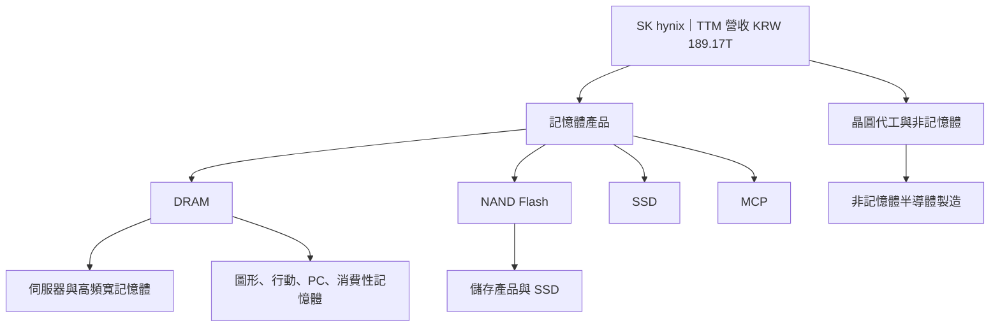
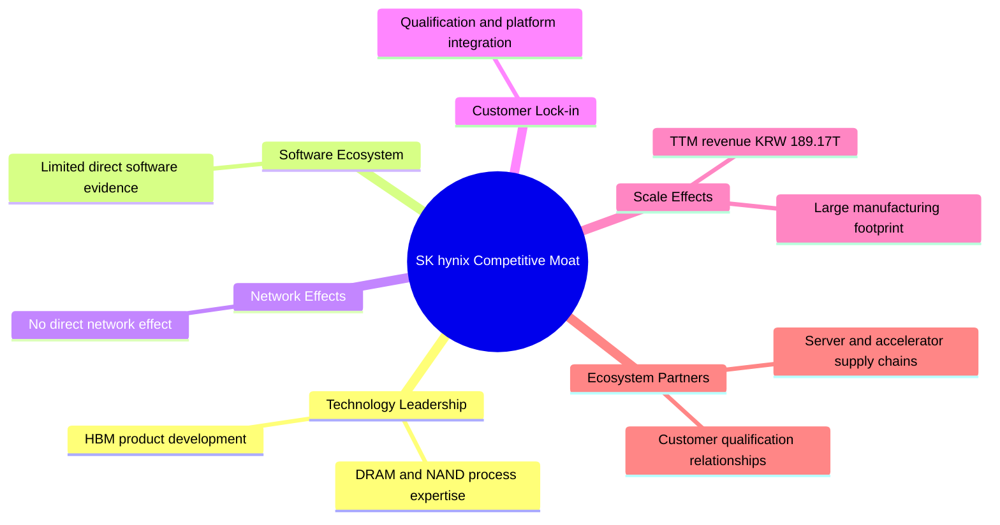
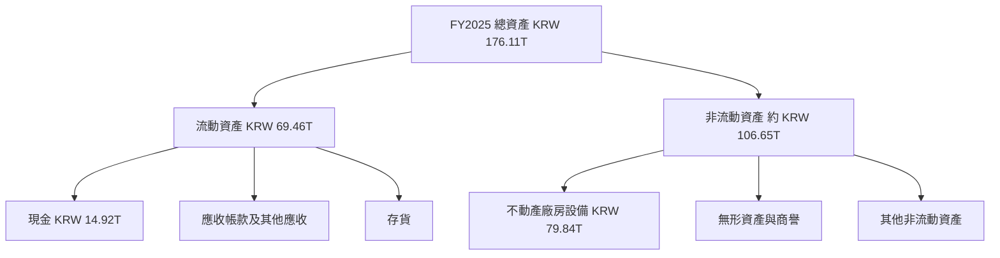
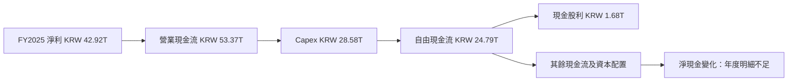
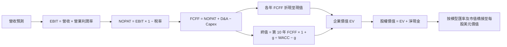
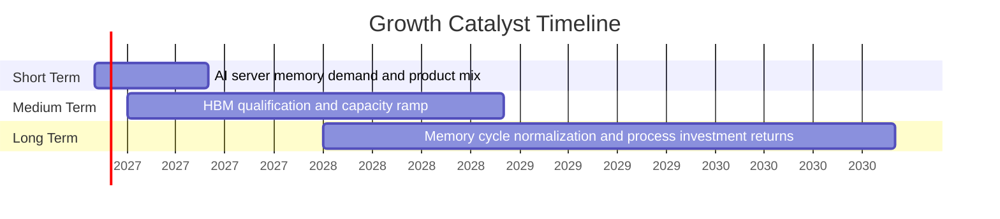
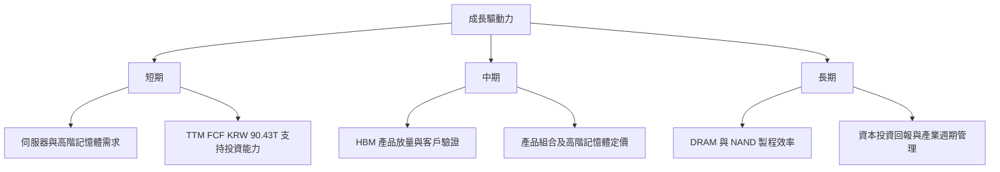
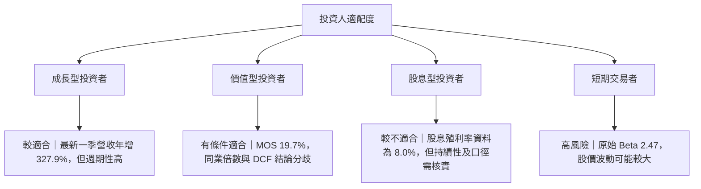

# SKHY 基本面深度分析報告
> **報告日期**：2026-11-16 ｜ **語言**：繁體中文 ｜ **數據來源**：Yahoo Finance、Finviz、StockAnalysis、Roic.ai ｜ **分析師**：CFA 級機構研究

> **資料口徑說明**：股價採 2026-11-13 收盤價 **$131.79**。財報與股價報價幣別不同：財報為韓元，報價為美元；換算一律採 2026-11-13 匯率 **1 美元 = 1,333.78 韓元**。財報資料來源為 Yahoo Finance，並非 SEC 申報資料。不同來源的期間及數字有不一致之處；本報告涉及核心 TTM 指標時，以程式計算的核實數字為準，其他來源僅在明確標示下作參考。

## 目錄

| # | 章節 | 核心結論 |
|---|------|----------|
| 1 | 執行摘要 | 買入；加權合理價值 $164.08，MOS 19.7% |
| 2 | 公司概覽與商業模式 | 記憶體製造規模與產品技術為主要優勢，細分營收占比未提供 |
| 3 | 損益表深度分析 | TTM 營收 KRW 189.17T；最新一季年增 327.9%，但屬高度週期性成長 |
| 4 | 資產負債表分析 | 淨現金 KRW 98.66T；營運資金週期 214 天 |
| 5 | 現金流量深度分析 | TTM FCF KRW 90.43T，FCF Yield 7.30% |
| 6 | 獲利能力與資本效率 | WACC 採用 14.00%；可比口徑 ROIC 未提供，不能據此判定 ROIC 是否高於 WACC |
| 7 | 相對估值分析 | 同業倍數顯示相對估值有分歧；基準 DCF 為 $182.36 |
| 8 | DCF 內在價值評估 | 基準 DCF $182.36；加權合理價值 $164.08，MOS 19.7% |
| 9 | 成長催化劑 | AI 伺服器記憶體需求與 HBM 產品放量是主要質化催化劑 |
| 10 | 風險矩陣 | 記憶體供需反轉、競爭擴產與高 Beta 為主要風險 |
| 11 | 投資建議 | 買入；建議買入區間 $131.79–$147.67，須嚴格追蹤週期與利潤率 |

---

## 1. 執行摘要

SK hynix 的 TTM 營收為 **KRW 189.17T（約 USD 141.83B）**，TTM 營業利益率 **68.0%**，TTM FCF **KRW 90.43T（約 USD 67.80B）**，淨現金 **KRW 98.66T（約 USD 73.97B）**。但 TTM 營收年增率未提供，最新一季年增 **327.9%** 是單季數字，不能視為長期成長率；記憶體產業的價格及產能週期也使當前高利潤率未必可持續。

以加權合理價值 **$164.08**、2026-11-13 收盤價 **$131.79** 計算，MOS 為 **19.7%**，對應規則 20 的 **買入**；基準 DCF 為 **$182.36**，相對現價折價 **27.7%**。ROIC 資料缺漏，因此不能以「ROIC 高於 WACC」支持強烈買入；估值評級仍依 MOS 為買入。DCF 假設包含 10 年預測期、第 1 年營收成長 30.0%、WACC 14.00%，結果對長期利潤率及折現率敏感。

### 1.0 一頁式投資儀表板（Portfolio Manager 30 秒速讀）

| 項目 | 內容 |
|------|------|
| **投資論點（3 句）** | ① TTM 營收 KRW 189.17T，最新一季營收年增 327.9%，顯示目前需求與產品價格處於強勁階段，但單季增長不可外推為 TTM。② TTM FCF KRW 90.43T、FCF Yield 7.30%，且淨現金 KRW 98.66T，提供資本支出與週期下行緩衝。③ 加權合理價值 $164.08 高於現價 $131.79，MOS 19.7%，估值支持買入，但未達強烈買入門檻。 |
| **綜合評分** | **6.8/10**（引用 1.1 評分卡） |
| **財務健康** | 🟢 淨現金 KRW 98.66T；流動性充裕，但 CCC 為 214 天 |
| **ROIC vs WACC** | ROIC：N/A；WACC：14.00%。因缺少可比口徑 ROIC，無法判定價值創造或摧毀 |
| **FCF 趨勢** | 正向；TTM FCF KRW 90.43T，FCF Yield 7.30% |
| **估值** | Forward P/E 3.1873012x ｜ EV/EBITDA N/A（財報與股價幣別不一致）｜ FCF Yield 7.30% |
| **DCF 內在價值（基準）** | **$182.36** ｜ 現價相對 DCF 折價 **27.7%** |
| **安全邊際（MOS）** | **+19.7%**＝($164.08 − $131.79) ÷ $164.08；🟡有限 |
| **預期報酬（基準情境 12M）** | DCF 基準情境顯示相對現價 **+38.4%**；模型預測期為 10 年，並非明確 12 個月預測 |
| **關鍵風險（前二）** | 記憶體供需與價格週期反轉；同業擴產造成 HBM／DRAM 供給增加 |
| **評級 + 信心度** | 🟢 **買入** ｜ 信心：中（高週期性、資料期間與 DCF 假設存在限制） |

### 1.1 綜合評分卡（全報告唯一）

| 維度 | 評分（1–10） | 主要依據（引用數字與其來源章節） |
|------|--------------|----------------------------------|
| 成長性 | 8.0 | 最新一季營收年增 327.9%；TTM 成長率 N/A，且單季數據不能替代長期成長（第 3 章） |
| 獲利能力 | 8.0 | TTM 營業利益率 68.0%、FCF KRW 90.43T；ROIC 及 Piotroski F-Score N/A（第 3、5、6 章） |
| 財務健康 | 8.0 | 淨現金 KRW 98.66T；CCC 214 天，營運資金仍占用較多（第 4 章） |
| 估值 | 6.0 | MOS 19.7%，但估值方法分歧：DCF $182.36、同業 EV/EBITDA $128.64（第 7、8 章） |
| 護城河 | 7.0 | DRAM、NAND、HBM 等產品及規模優勢有質化支持，但市占率及分部營收數據未提供（第 2 章） |
| 管理層與資本配置 | 3.5 | FY2025 Capex KRW 28.58T、股息 KRW 1.68T；回購、資本回報政策與完整多年 SBC 數據有限（第 5 章） |
| **綜合評分** | **6.8** | 六項算術平均：(8.0 + 8.0 + 8.0 + 6.0 + 7.0 + 3.5) ÷ 6 = 6.75，四捨五入至一位小數為 **6.8** |

> **評分核對更正**：上述六項算術平均為 **6.8/10**，儀表板引用值亦應為 **6.8/10**。

### 1.2 五大投資論點 + 三大核心風險

| 類型 | 項目 | 具體依據 | 信心度 |
|------|------|----------|--------|
| 🟢 **投資論點①** | 現金流已轉化為資產負債表韌性 | TTM OCF KRW 126.93T、Capex KRW 36.50T、FCF KRW 90.43T；淨現金 KRW 98.66T | 🟢 高 |
| 🟢 **投資論點②** | 當前營運槓桿顯著 | TTM 營業利益率 68.0%，最新一季 74.5%；若高階記憶體組合及定價維持，利潤率有支撐 | 🟡 中 |
| 🟢 **投資論點③** | 最新一季營收擴張幅度大 | 最新一季營收年增 327.9%；這反映週期上行與需求變化，不能直接視作常態成長率 | 🟡 中 |
| 🟢 **投資論點④** | DCF 基準值高於現價 | DCF $182.36，較現價 $131.79 高 38.4%；估值取決於 10 年利潤率及 WACC 假設 | 🟡 中 |
| 🟢 **投資論點⑤** | 加權估值具一定折價 | 加權合理價值 $164.08，MOS 19.7%；仍低於強烈買入所需 MOS 25% | 🟡 中 |
| 🟡 **風險①** | 週期反轉造成利潤率下滑 | TTM 營業利益率 68.0% 已高，DCF 假設其由第 1 年 68.0% 逐步降至第 10 年 35.5% | 🔴 高衝擊 |
| 🔴 **風險②** | 記憶體供應增加 | 新聞提及 Samsung 對 HBM 的投資可能增加供給；若供應成長快於需求，價格及毛利率受壓 | 🔴 高衝擊 |
| 🟡 **風險③** | 股價波動及模型不確定性 | 調整後 Beta 1.98，WACC 由計算值 14.91% 限制採用 14.00%；股價 52 週區間 $122.20–$199.87 | 🟡 中度 |

### 1.3 快速統計卡片

| 指標 | 公司實際值（期間） | 同業中位數 | 狀態 |
|------|--------------------|------------|------|
| 營收成長（TTM） | **N/A** | — | 🟡 |
| 營收成長（最新一季年增） | **327.9%** | 377.9% | 🟢 |
| 毛利率（TTM） | **77.4%** | 80.0% | 🟡 |
| 營業利益率（TTM） | **68.0%** | — | 🟢 |
| ROIC（TTM） | **N/A** | — | 🟡 |
| Forward P/E | **3.1873012x** | 3.7x | 🟢 |
| FCF Yield（TTM） | **7.30%** | — | 🟢 |
| Piotroski F-Score | **N/A / N/A** | — | 🟡 |

> 同業中位數採 MU、SNDK、WDC 的 Peer multiples 區塊。營收成長及毛利率中位數分別為 377.9% 與 80.0%。

### 1.4 投資結論

╔══════════════════════════════════════════════════════════════════╗  
║　　　　　　　　　　　📊 投資結論摘要　　　　　　　　　　　　　║  
╠══════════════════════════════════════════════════════════════════╣  
║ 評級：買入（依加權合理價值 MOS 19.7%）　　　　　　　　　　　　║  
║ 價格（2026-11-13 收盤）：$131.79　　　　　　　　　　　　　　║  
║ DCF 內在價值（基準）：$182.36（現價折價 27.7%）　　　　　　　║  
║ 安全邊際 MOS：+19.7%（＝($164.08−$131.79)÷$164.08）　　　　　║  
║ 加權合理價值（8.8）：$164.08　　　　　　　　　　　　　　　　　║  
║ DCF 情境價值：　　　　　　　　　　　　　　　　　　　　　　　║  
║　悲觀情境：$89.12（-32.4%）　　　　　　　　　　　　　　　　　║  
║　基準情境：$182.36（+38.4%）　　　　　　　　　　　　　　　　 ║  
║　樂觀情境：$358.64（+172.1%）　　　　　　　　　　　　　　　　║  
║ 綜合評分：6.8/10（引用 1.1）　　　　　　　　　　　　　　　　　║  
║ 適合投資人：能承受週期波動、採分批布局的中長期投資人　　　　　║  
╚══════════════════════════════════════════════════════════════════╝

---

## 2. 公司概覽與商業模式

SK hynix Inc. 是韓國半導體公司，業務包括 DRAM、NAND Flash、SSD、MCP 與晶圓代工。產品應用於伺服器、網路、行動裝置、PC、圖形運算及消費電子。員工數為 **47,639 人**。營收高度受記憶體產品供需、價格與產品組合影響。

### 2.1 業務結構與收入來源

各產品分部營收金額及占比未提供，因此不以估算比例繪製收入占比圖。公司 TTM 營收為 KRW 189.17T（約 USD 141.83B）。

分部占比、軟體及服務收入金額未提供。

### 2.2 市場份額

市場份額數據未提供，無法依據所列資料比較 SK hynix 在 DRAM、NAND 或 HBM 的具體市占率。公司 TTM 營收約 USD 141.83B，且最新一季營收年增 327.9%；相較 MU、SNDK、WDC 最新一季年增率中位數 377.9%，其增速低於該中位數，但仍處於大幅擴張階段。

### 2.3 競爭護城河分析

### 2.4 護城河強度

| 護城河項目 | 強度（強／中／弱） | 證據（引用數字或事實） | 會削弱它的情況 |
|------------|--------------------|------------------------|----------------|
| 技術與產品組合 | 中至強 | DRAM、NAND、SSD、MCP，並供應伺服器及高階記憶體市場；分部收入未提供 | 同業在 HBM 良率、效能或量產速度追上 |
| 規模效應 | 強 | TTM 營收 KRW 189.17T；員工 47,639 人 | 供需逆轉導致大型產能成為固定成本負擔 |
| 客戶鎖定 | 中 | 半導體產品需客戶驗證與系統整合；未提供客戶集中度或合約年限 | 客戶多源採購、轉換供應商成本下降 |
| 軟體生態系統 | 弱／資料有限 | 未提供可量化軟體收入或生態系資料 | 缺乏軟體或平台整合優勢 |
| 網路效應 | 弱 | 記憶體產品本身非典型網路效應商業模式 | 競爭轉向價格及量產效率 |
| 生態夥伴 | 中 | 服務伺服器、網路、行動等市場；未提供合作營收或夥伴貢獻數據 | 主要客戶產品策略改變或供應鏈去集中化 |

1.1 的護城河評分為 **7.0/10**，理由是規模、產品技術與客戶認證形成一定進入門檻，但市占率、客戶集中度及分部經濟性資料不足，無法認定護城河強度持續不變。

---

## 3. 損益表深度分析

### 3.1 年度收入成長趨勢（近 4 年）

年度財務表列示營收以韓元計；下方按 KRW T 呈現。年度增長率引用 StockAnalysis 歷史數據。

╔══════════════════════════════════════════════════════════════════╗  
║　　　　　　SK hynix 年度收入趨勢（FY2022–FY2025）　　　　　　　║  
╠══════════════════════════════════════════════════════════════════╣  
║ FY2022　KRW 44.62T　██████████████████　基準　　　　　　　　　║  
║ FY2023　KRW 32.77T　█████████████░░░░░　YoY -26.57% 🔴　　　　 ║  
║ FY2024　KRW 66.19T　███████████████████████████░░　YoY +102.02% 🟢║  
║ FY2025　KRW 97.15T　███████████████████████████████████████　+46.76% 🟢║  
╠══════════════════════════════════════════════════════════════════╣  
║ FY2022–FY2025 營收 CAGR = (97.15 ÷ 44.62)^(1/3) − 1 ≈ 29.6%　　 ║  
╚══════════════════════════════════════════════════════════════════╝

2023 年營收下滑，反映記憶體產業需求與價格週期走弱；2024–2025 年回升則與週期復甦及產品需求改善一致。三年 CAGR 約 29.6%，但跨越完整週期前仍不宜當作穩態成長率。

### 3.2 季度收入趨勢分析

| 季度 | 營收（KRW T） | QoQ | YoY | 備註 |
|------|---------------:|----:|----:|------|
| 2025-09-30 | 24.45 | — | 39.13% | YoY 引用 StockAnalysis 季度數據 |
| 2025-12-31 | 32.83 | +34.3% | 66.07% | QoQ＝32.83÷24.45−1 |
| 2026-03-31 | 52.58 | +60.2% | 198.07% | QoQ＝52.58÷32.83−1 |
| 2026-06-30 | 79.32 | +50.9% | 256.78% | QoQ＝79.32÷52.58−1 |

核實數字將 **2026-06-30 最新一季營收年增率列為 327.9%**；其他來源季度明細列示 256.78%，期間口徑與資料來源不一致。因此本報告引用核實數字時採用 327.9%，不將其與其他來源數字混為同一口徑。季度環比數字依表中同來源季度營收計算。

### 3.3 利潤率演變分析

| 利潤率指標 | FY2022 | FY2023 | FY2024 | FY2025 | 趨勢 | 評估 |
|------------|-------:|-------:|-------:|-------:|------|------|
| **毛利率** | 35.0% | -1.6% | 48.1% | 60.4% | 低谷後復甦 | 🟢 |
| **營業利益率** | 15.3% | -23.6% | 35.5% | 48.6% | 2023 年負值後大幅回升 | 🟢 |
| **淨利率** | 5.0% | -27.8% | 29.9% | 44.2% | 隨營運週期反彈 | 🟡 |

年度利潤率以年度損益表營收、毛利、營業利益及淨利計算。核實 TTM 營業利益率為 **68.0%**，高於 FY2025 的 48.6%，顯示最近期間產品定價、需求或組合有進一步改善。週期性行業中，價格與產品組合可使毛利率快速變動；若競爭供給增加，固定成本吸收效果反轉也可能造成利潤率收縮。資料未提供各產品 ASP、出貨量及分部毛利，不能量化各因素貢獻。

### 3.4 費用結構分析

完整營業成本、研發、銷管費用分項不足，不能製作有依據的費用結構圓餅圖。已知 FY2025 研發費用 **KRW 6.47T**，約占 FY2025 營收 KRW 97.15T 的 **6.7%**；研發投入支持製程與產品開發，但完整費用率需以同期間、同口徑費用明細核對。

### 3.5 季度 EPS 趨勢與盈餘品質（Quality of Earnings）

四季 EPS 預期值及實際值資料不足：Earnings History 僅列 2026-06-30、2026-09-30，且估計值及實際值為 N/A。因此無法可靠判定過去四季盈餘「超預期／不及預期」，也不能對其原因作定量歸因。

| 盈餘品質項目 | 數值/佔比 | 評估 |
|--------------|-----------|------|
| 股權薪酬 SBC / 營收 | FY2025：KRW 414.11B ÷ KRW 97.15T = **0.43%** | 🟢 FY2025 比率不高；但完整 TTM SBC 缺漏 |
| SBC / 營業現金流 | FY2025：KRW 414.11B ÷ KRW 53.37T = **0.78%** | 🟢 對 FY2025 現金流占比有限 |
| FCF / 淨利（現金轉換率） | FY2025：KRW 24.79T ÷ KRW 42.92T = **57.7%** | 🟡 現金轉換低於淨利；半導體資本支出較高 |
| 一次性／非經常性損益 | N/A（明細未提供） | 🟡 缺少調整項明細，無法判斷是否有一次性項目 |
| 有效稅率異常 | 14.9%（最新年度有效稅率） | 🟡 單一期間資料，需追蹤跨年穩定性 |
| 資本化支出 vs 費用化 | TTM Capex KRW 36.50T；資本化政策細節 N/A | 🟡 高 Capex 符合資本密集型產業，但折舊年限及資本化細節未提供 |

**盈餘品質結論**：TTM FCF 為正且達 KRW 90.43T，支持本期獲利具現金流支撐；但 FY2025 FCF／淨利為 57.7%，且資本支出高。完整 TTM SBC、一次性項目及資本化政策資料不足，故不應只以單季淨利增幅外推正常化盈餘。DCF 使用 GAAP EBIT，並採固定股數處理 SBC，避免再重複扣減。

---

## 4. 資產負債表分析

### 4.1 資產結構分解

以下依 FY2025 年度資產負債表列示。非流動資產為總資產減流動資產的推算差額，非細項披露值。

FY2025 現金 KRW 14.92T；核實 TTM 現金及短期投資則為 KRW 114.46T，兩者期間及口徑不同，不應互相替代。

### 4.2 流動性與營運資金分析

| 指標 | 最新 TTM | 一年前 TTM | 變化 | 解讀 |
|------|----------:|------------:|------|------|
| DSO 應收帳款天數 | 92 天 | N/A | N/A | 一年前數據未提供，不能判定收款速度變化 |
| DIO 存貨天數 | 146 天 | N/A | N/A | 存貨週轉天數較長，須追蹤產品組合及需求預測 |
| DPO 應付帳款天數 | 25 天 | N/A | N/A | 一年前資料未提供，無法判定供應商付款條件變化 |
| CCC 現金轉換週期 | 214 天 | N/A | N/A | 應收及存貨占用現金時間較長；需以後續季度數據觀察 |

流動比率及速動比率的市場資料列為 **26.882** 與 **23.813**，但與年度財報表格期間、口徑有差異；本報告不將其混作核實流動性指標。以核實現金及短期投資 KRW 114.46T、總債務 KRW 15.80T 觀察，短期償債緩衝充足。

### 4.3 債務結構分析

╔══════════════════════════════════════════════════════════════════╗  
║　　　　　　　　　SK hynix 債務健康診斷　　　　　　　　　　　　║  
╠══════════════════════════════════════════════════════════════════╣  
║ 總債務：　　　　KRW 15.80T　　　　　　　　　　　　　　　　║  
║ 現金及短期投資：KRW 114.46T　　　　　　　　　　　　　　　 ║  
║ 淨現金：　　　　KRW 98.66T　🟢　　　　　　　　　　　　　　║  
║ 債務／EBITDA：　N/A（幣別及市值資料口徑不足以核對）　　　　║  
║ 利息保障倍數：　N/A（同期利息費用明細未提供）　　　　　　 ║  
║ 淨現金換算：　　約 USD 73.97B（按 2026-11-13 匯率）　　　　║  
╚══════════════════════════════════════════════════════════════════╝

市場資料中的 Debt/Equity 5.111 與核實淨現金狀況及其他資產負債表數字存在口徑衝突，不宜直接據此認定公司槓桿高。核實的總債務與現金數字顯示公司處於淨現金狀態。

### 4.4 股東權益趨勢

╔══════════════════════════════════════════════════════════════════╗  
║　　　　　　　　FY2022–FY2025 股東權益趨勢　　　　　　　　　　║  
╠══════════════════════════════════════════════════════════════════╣  
║ FY2022　KRW 63.27T　████████████████████　　　　　　　　　　║  
║ FY2023　KRW 53.50T　█████████████████░░░　　　　　　　　　　║  
║ FY2024　KRW 73.90T　███████████████████████　　　　　　　　　║  
║ FY2025　KRW 120.52T ████████████████████████████████████████　║  
╚══════════════════════════════════════════════════════════════════╝

FY2023 權益下降後，FY2024–FY2025 回升；FY2025 權益增至 KRW 120.52T，與淨利復甦及累積留存相符。股利及回購以外的完整權益變動表未提供，不能把全部變化歸因於盈餘留存。

---

## 5. 現金流量深度分析

### 5.1 現金流量瀑布圖

淨利與營業現金流口徑期間需一致；圖中採 FY2025 年度數據，股利亦取同年度。回購金額未提供。

### 5.2 FCF 轉換率趨勢

| 年度 | OCF（KRW T） | Capex（KRW T） | FCF（KRW T） | 淨利（KRW T） | FCF／淨利 |
|------|-------------:|---------------:|-------------:|--------------:|----------:|
| 2022 | 14.78 | 19.75 | -4.97 | 2.23 | -222.9% |
| 2023 | 4.28 | 8.78 | -4.50 | -9.11 | 比率不具經濟意義 |
| 2024 | 29.80 | 16.66 | 13.13 | 19.79 | 66.3% |
| 2025 | 53.37 | 28.58 | 24.79 | 42.92 | 57.7% |

2022、2023 年 FCF 受高資本支出及獲利低谷影響而為負；2024–2025 年轉正。FY2025 FCF 低於淨利，表示盈餘並非一比一轉為可分配現金，資本投資仍是主要現金用途。

### 5.3 自由現金流趨勢

╔══════════════════════════════════════════════════════════════════╗  
║　　　　　　自由現金流：FY2022–FY2025 與最新 TTM　　　　　　　　║  
╠══════════════════════════════════════════════════════════════════╣  
║ FY2022　-KRW 4.97T　◀ 負值　　　　　　　　　　　　　　　　 ║  
║ FY2023　-KRW 4.50T　◀ 負值　　　　　　　　　　　　　　　　 ║  
║ FY2024　+KRW 13.13T ████████████　　　　　　　　　　　　　　║  
║ FY2025　+KRW 24.79T ██████████████████████　　　　　　　　　 ║  
║ TTM至2026-06　+KRW 90.43T ████████████████████████████████████ ║  
╠══════════════════════════════════════════════════════════════════╣  
║ TTM FCF 約 USD 67.80B；FCF Yield 7.30%　　　　　　　　　　　　║  
╚══════════════════════════════════════════════════════════════════╝

TTM FCF 大幅高於 FY2025 年度數字，但兩者不是同一期間；它反映最新週期現金流改善，不能直接理解為永久現金流增長趨勢。

### 5.4 資本配置評估

FY2025 Capex 為 KRW 28.58T、現金股利 KRW 1.68T、FCF KRW 24.79T；回購金額未提供。投資配置以資本支出為重要項目，符合晶圓製造業特性，但市場下行時高固定資產支出會降低自由現金流。

| 項目 | FY2025 金額 | 評估 |
|------|-------------:|------|
| 資本支出 | KRW 28.58T | 🟡 支持產能與技術投入，需注意週期高峰的過度投資 |
| 現金股利 | KRW 1.68T | 🟡 有股東現金回報，規模低於當年 Capex |
| 股票回購 | N/A | 資料未提供 |
| 現金留存／其他投資 | N/A | 資料不足，無法拆分 |

---

## 6. 獲利能力與資本效率

### 6.1 ROE / ROA / ROIC 趨勢

| 指標 | FY2023 | FY2024 | FY2025／TTM | 評估 |
|------|-------:|-------:|------------:|------|
| ROE | N/A | N/A | TTM 92.5% | 高，但週期高峰及資料口徑影響須留意 |
| ROA | N/A | N/A | TTM 46.4% | 高，需確認同期間資產及淨利口徑 |
| ROIC | N/A | N/A | N/A | 沒有可比口徑的 TTM ROIC |
| 行業均值 | — | — | — | 未提供，不列示 |

Roic.ai 有歷史年度資本回報率資料，但缺少可與最新 TTM 同口徑核對的 ROIC；本報告不自行補算或將 ROE、ROA 代替 ROIC。

### 6.2 ROIC vs WACC 分析（核心價值創造判斷）

╔══════════════════════════════════════════════════════════════════╗  
║　　　　　　　　ROIC vs WACC 深度分析　　　　　　　　　　　　　║  
╠══════════════════════════════════════════════════════════════════╣  
║ 無風險利率（10Y 美債）：5.15%　　　　　　　　　　　　　　　　║  
║ 市場風險溢酬 ERP：5.00%　　　　　　　　　　　　　　　　　　　║  
║ Beta 原始值：2.47；採用調整後 Beta：1.98　　　　　　　　　　 ║  
║ 股權成本：15.04%（資料所列 CAPM 結果）　　　　　　　　　　　║  
║ 稅前債務成本：5.85%；有效稅率：14.9%　　　　　　　　　　　 ║  
║ 股權／債務權重：98.7%／1.3%　　　　　　　　　　　　　　　　║  
║ WACC 計算值：14.91%；受 7%–14% 範圍限制，採用 14.00%　　　║  
║ 公司 TTM ROIC：N/A（缺少可比口徑的投入資本資料）　　　　　　 ║  
║ EVA＝ROIC−WACC：N/A　　　　　　　　　　　　　　　　　　　　║  
║ 結論：缺少 ROIC，不能判定是否以超過資本成本的回報創造價值　║  
╚══════════════════════════════════════════════════════════════════╝

計算值 14.91% 被限制在 7%–14% 區間，故估值採用 WACC **14.00%**。調整 Beta 的公式為 ⅔ × 2.47 + ⅓ = 約 1.98，與所列調整後 Beta 一致。以所列已四捨五入輸入重算 CAPM，5.15% + 1.98 × 5.00% = 15.05%，與資料所列股權成本 15.04% 相差 0.01 個百分點，屬輸入精度差異；本報告沿用核實所列股權成本及 WACC，不另行替換。可比口徑 ROIC 缺失，因此不能宣稱 SK hynix 正在創造或摧毀股東價值。

### 6.3 杜邦三因素分解

| 因素 | 數值（TTM） | 解讀 |
|------|-------------|------|
| 淨利率 | N/A | QUALITY FIGURES 未提供可用組合數值 |
| 資產週轉率 | N/A | 同上 |
| 權益乘數 | N/A | 同上 |
| **ROE** | **N/A** | DuPont 指標被標示為 N/A，缺少一致的淨利、營收、總資產或正權益組合；不補算 |

### 6.4 財務體質：Piotroski F-Score

Piotroski F-Score 為 **N/A**，原因是缺少相隔一年的兩期 SEC 申報資料作九項測試。

| 測試 | 結果 | 解讀 |
|------|------|------|
| 九項測試逐項結果 | N/A | 缺少計算所需的兩期 SEC 申報資料；不推定未通過或通過 |

---

## 7. 相對估值分析

### 7.1 同業估值比較表格

| 估值指標 | **SKHY** | **MU** | **SNDK** | **WDC** | 本公司評估 |
|----------|---------:|-------:|---------:|--------:|-----------|
| **Trailing P/E** | 8.404974x | 10.5x | 7.1x | 10.4x | 🟢 低於 MU、WDC，高於 SNDK |
| **Forward P/E** | 3.1873012x | 3.7x | 3.1x | 7.3x | 🟢 接近 MU、SNDK；遠低於 WDC |
| **P/S Ratio** | N/A | 6.6x | 4.3x | 7.6x | 🟡 SKHY 市價與財報幣別不同，不能直接比較 |
| **EV/EBITDA** | N/A | 7.7x | 5.7x | 17.5x | 🟡 SKHY EV/EBITDA 依核實區塊不可計算 |
| **最新一季營收年增** | 327.9% | 379.3% | 377.9% | 55.5% | 🟢 大幅成長；低於 MU、SNDK |
| **毛利率（TTM）** | 77.4% | 80.7% | 80.0% | 52.6% | 🟢 高於 WDC，低於 MU、SNDK |

同業估值只採 Peer multiples。SKHY 本身 Forward P/E 的來源數值與分析師預期可能受週期高峰 EPS 影響，低倍數不代表市場風險低，也不代表當前盈餘可持續。

### 7.2 歷史估值區間分析

N/A（歷史估值區間及百分位資料未提供）。因此不推估 SKHY 現時 P/E 位於自身歷史分布的哪個百分位。

### 7.3 情境價值（Bear / Base / Bull，照抄 DCF MODEL 的 Scenarios）

| 情境 | 第 1 年營收成長 | 期末營業利潤率 | WACC | 每股價值 | 相對現價 | 機率 | 會發生的條件 |
|------|----------------:|----------------:|-----:|----------:|----------:|-----:|--------------|
| 🔴 悲觀 | 15.0% | 30.1% | 15.00% | $89.12 | -32.4% | 25% | 記憶體需求放緩、競爭供給增長，長期利潤率低於基準 |
| 🟡 基準 | 30.0% | 35.5% | 14.00% | $182.36 | +38.4% | 50% | 近期需求延續，但利潤率逐步向歷史中位數收斂 |
| 🟢 樂觀 | 45.0% | 39.0% | 13.00% | $358.64 | +172.1% | 25% | 高階記憶體需求與產品組合優於基準、較高獲利維持更久 |

以上價值、假設與機率均依 DCF 情境資料照列。模型另列機率加權價值 **$203.12（+54.1%）**，但 8.8 固定採基準 DCF 與既定估值方法加權，不以機率加權 DCF 替代。

### 7.4 相對估值隱含價格區間

╔══════════════════════════════════════════════════════════════════╗  
║　　　　　　估值方法隱含價格與市場價格（美元／股）　　　　　　　║  
╠══════════════════════════════════════════════════════════════════╣  
║ 同業 EV/EBITDA　$128.64 ─ 現價 $131.79 ─ 同業 P/S $132.98　　 ║  
║ 分析師共識目標價：$259.50　　　　　　　　　　　　　　　　　　║  
║ 基準 DCF：$182.36　　　　　　　　　　　　　　　　　　　　　　║  
╚══════════════════════════════════════════════════════════════════╝

| 方法 | 每股價值 | 依據 |
|------|---------:|------|
| 同業 EV/EBITDA | $128.64 | MU、SNDK、WDC 中位數 7.7x × SKHY TTM EBITDA，再加淨現金 |
| 同業 P/S | $132.98 | MU、SNDK、WDC 中位數 6.6x × SKHY TTM 營收 |
| 分析師共識目標價 | $259.50 | 14 位分析師平均目標價 |
| 基準 DCF | $182.36 | 10 年 FCFF、WACC 14.00%、永續成長率 3.0% |

---

## 8. DCF 內在價值評估（Discounted Cash Flow）

> DCF 模型數值按模型所列韓元十億（KRW bn）呈現；每股估值為美元。模型將營運資金變動排除於 FCFF 外，故不另加 ΔWC 預測。模型本身部分展示值經四捨五入，且個別明細乘積存在小額差異；以下保留模型原值並在 8.10 說明檢核限制。

### 8.0 估值推理鏈（Thinking Logic）

**Step 1 — 價值來源與主導變數**

SK hynix 的模型價值主要來自記憶體主業的現金流、需求與產品組合帶來的營收增長，以及營業利潤率在週期高峰後能否維持；資料未提供分部營收占比，不能替 HBM 或其他產品另設占比。模型敏感度矩陣顯示，折現率與永續成長率都會明顯改變估值，故關鍵假設是現金流能否長期維持及折現率是否合理。

**Step 2 — 模型選擇**

| 決策點 | 本報告採用 | 理由（含數字） | 曾考慮但否決 | 否決理由 |
|--------|-----------|----------------|--------------|----------|
| 現金流定義 | FCFF | 採 WACC 折現，模型以 NOPAT + D&A − Capex 計算 | FCFE | 模型已指定 FCFF，不另建模型 |
| 預測期 N | 10 年 | DCF MODEL 固定 10 年 | 5 年 | 不符合既定模型，且不能改動預測期 |
| 終值方法 | Gordon Growth | WACC 14.00% 高於 g 3.0% | 退出倍數作主估值 | 模型基準使用 Gordon Growth |
| EBIT 基礎 | GAAP EBIT | DCF MODEL 明確採 GAAP EBIT | 非 GAAP EBIT | 避免加回或重複扣減 SBC |

**Step 3 — 關鍵假設推導鏈**

- **第 1 年營收成長**：錨點＝最新一季年增 327.9%，但這是單季數據且 TTM 成長率 N/A → 調整＝避免將週期高峰直線外推，並受模型 0%–30% 範圍限制 → **採用 30.0%** → 曾考慮直接採用 327.9%，因其為單季年增而非可持續年增，否決。
- **第 10 年營業利潤率**：錨點＝TTM 營業利益率 68.0% → 調整＝依模型逐步回落至近五個財年中位數 → **採用 35.5%** → 曾考慮維持 68.0%，因模型假設產業利潤率正常化，否決。
- **永續成長率 g**：錨點＝長期成熟企業成長需低於 WACC，模型基準採 3.0% → **採用 3.0%** → 曾考慮高於 3.0%，但沒有足夠資料支持永久高成長，否決。
- **預測期 N**：錨點＝模型固定 10 年 → **採用 10 年** → 曾考慮縮短或延長，但禁止改動既定模型，故不採替代年數。
- **Capex／營收**：錨點＝TTM Capex／營收約 36.50÷189.17＝19.3% → 模型逐步降至 8.7%，約為 1.1 倍 D&A 比率 → **採用年 1 19.3%、年 10 8.7%** → 曾考慮將高 Capex 比率維持十年，但模型採設備投資逐步正常化。
- **GAAP EBIT 與 SBC**：錨點＝模型採 GAAP EBIT；SBC 已在 GAAP 費用中 → **採用組合 (A)：GAAP EBIT、固定股數、年稀釋率 0%，不另扣 SBC** → 否決再扣 SBC 或再加股數稀釋，避免重複計成本。
- **WACC**：錨點＝核實計算值 14.91%、採用區間上限 14.00% → **採用 14.00%** → 曾考慮直接採 14.91%，因資料明確限制在 7%–14% 而否決。
- **終值方法**：錨點＝模型給定永續成長 3.0%、WACC 14.00% → **採 Gordon Growth** → 退出倍數可作交叉檢驗，但模型未提供退出倍數法的終值結果，不能自行補建。
- **低敏感度輸入**：有效稅率採 14.9%；D&A／營收採 7.9%；營運資金變動未建模。模型不列出 ΔWC，因此本報告不另設數值。

**Step 4 — 最脆弱環節**

最脆弱的一環是當前極高營業利潤率能否在需求正常化後仍維持在模型假設附近；若利潤率更快下滑，估值將向悲觀情境 **$89.12** 移動。

**Step 5 — 計算路徑圖**

### 8.1 模型假設總表（Model Inputs）

| 假設項目 | 採用值 | 依據／來源 | 敏感度 |
|----------|--------|-------------|--------|
| 預測期長度 **N** | 10 年 | DCF MODEL 固定值 | 🟡 中 |
| 營收成長 | 第 1 年 30.0%，第 10 年 3.0%，線性遞減 | 最新一季年增 327.9%，但單季數字不宜外推；模型將其限制於 0%–30% | 🔴 高 |
| 營業利潤率 | 第 1 年 68.0% → 第 10 年 35.5% | TTM 68.0%；期末採近五個財年中位數 | 🔴 高 |
| 有效稅率 | 14.9% | 最新年度有效稅率 | 🟢 低 |
| Capex／營收 | 第 1 年 19.3% → 第 10 年 8.7% | TTM Capex 36.50T ÷ TTM 營收 189.17T；期末為 1.1 倍 D&A | 🟡 中 |
| D&A／營收 | 7.9% | TTM 模型假設 | 🟢 低 |
| 營運資金變動／營收增額 | 未建模 | DCF MODEL 明確排除營運資金 | 🟢 低 |
| EBIT 基礎 | GAAP EBIT | DCF MODEL 明定 | 🟡 中 |
| SBC 處理 | 組合 (A)：不另扣 SBC、固定股數 | GAAP EBIT 已含 SBC 費用，模型指定股數不再稀釋 | 🟡 中 |
| 年稀釋率 | 0% | 組合 (A) | 🟡 中 |
| 永續成長率 g | 3.0% | DCF MODEL 指定，低於 WACC 14.00% | 🔴 高 |
| 終值方法 | Gordon Growth | DCF MODEL 的主要終值方法 | 🔴 高 |
| WACC | 14.00% | 計算值 14.91%，受 7%–14% 區間限制 | 🔴 高 |

**SBC 防重複說明**：本模型採用 **(A) GAAP EBIT + 固定股數**，故 SBC 影響已計入一次；FCFF 不再扣 SBC，股數不再逐年稀釋。

### 8.2 折現率推導（WACC）

╔══════════════════════════════════════════════════════════════════╗  
║　　　　　　　　　WACC 推導（折現率）　　　　　　　　　　　　　║  
╠══════════════════════════════════════════════════════════════════╣  
║ 無風險利率 Rf：5.15%（資料列示 10Y Treasury；日期未提供）　　　║  
║ ERP：5.00%（模型假設）　　　　　　　　　　　　　　　　　　　║  
║ 原始 Beta：2.47；調整 Beta：⅔×2.47＋⅓＝1.98　　　　　　　　║  
║ 股權成本：核實列示 15.04%　　　　　　　　　　　　　　　　　 ║  
║ 稅前債務成本：5.85%；稅率：14.9%　　　　　　　　　　　　　 ║  
║ 股權／債務權重：98.7%／1.3%　　　　　　　　　　　　　　　　 ║  
║ 計算 WACC：14.91%；區間限制 7%–14%，採用 14.00%　　　　　 ║  
╚══════════════════════════════════════════════════════════════════╝

**逐步演算及資料限制**

1. **Ke（CAPM）**：依核實輸入列示 Ke = **15.04%**。按已四捨五入的組成重算，5.15% + 1.98 × 5.00% = 15.05%；0.01 個百分點差異來自底層精度。本報告沿用核實列示 Ke。
2. **稅前 Kd**：核實資料直接列示 **5.85%**；利息費用及平均計息負債的完整明細未提供，無法按利息費用除以平均計息負債重建。
3. **稅後 Kd**：5.85% × (1 − 14.9%) = **4.97835%**，顯示至三位小數為 4.978%。
4. **資本權重**：核實列示股權 98.7%、債務 1.3%，相加為 100.0%；市值及債務權重採核實資料，不以股東權益帳面值替代。
5. **WACC**：計算值依核實資料為 **14.91%**；施加 7%–14% 上限後採用 **14.00%**。第 6.2 節與本節同值。

Rf 的具體觀察日、ERP 來源、利息費用明細及與 WACC 權重相同範圍的期末計息負債分項未提供，因此不能構造更細的原始資本成本推導。Beta 原始值大於 1.5，模型採調整 Beta 1.98。

### 8.3 逐年自由現金流預測（基準情境）

金額單位：KRW bn；折現因子顯示至三位小數。模型不含 ΔWC 列，故不將其插入預測表。

| 年度 | FY+1 | FY+2 | FY+3 | FY+4 | FY+5 | FY+6 | FY+7 | FY+8 | FY+9 | FY+10 |
|------|-----:|-----:|-----:|-----:|-----:|-----:|-----:|-----:|-----:|------:|
| 營收 | 245,921.80 | 312,320.69 | 387,277.65 | 468,605.96 | 552,955.03 | 635,898.28 | 712,206.08 | 776,304.62 | 822,882.90 | 847,569.39 |
| 營收 YoY | 30.0% | 27.0% | 24.0% | 21.0% | 18.0% | 15.0% | 12.0% | 9.0% | 6.0% | 3.0% |
| 營業利潤率 | 68.0% | 64.4% | 60.8% | 57.2% | 53.6% | 49.9% | 46.3% | 42.7% | 39.1% | 35.5% |
| EBIT（GAAP） | 167,317.61 | 201,185.96 | 235,449.41 | 267,928.15 | 296,135.78 | 317,533.78 | 329,852.79 | 331,433.84 | 321,527.83 | 300,487.86 |
| − 稅 | (24,924.63) | (29,969.86) | (35,073.95) | (39,912.18) | (44,114.15) | (47,301.73) | (49,136.84) | (49,372.36) | (47,896.71) | (44,762.47) |
| = NOPAT | 142,392.98 | 171,216.10 | 200,375.46 | 228,015.98 | 252,021.62 | 270,232.05 | 280,715.95 | 282,061.48 | 273,631.13 | 255,725.40 |
| + D&A | 19,356.34 | 24,582.55 | 30,482.37 | 36,883.66 | 43,522.72 | 50,051.13 | 56,057.27 | 61,102.42 | 64,768.57 | 66,711.63 |
| − Capex | (47,446.34) | (56,566.18) | (65,565.63) | (73,796.93) | (80,546.15) | (85,113.70) | (86,911.26) | (85,559.74) | (80,969.37) | (73,382.79) |
| **= FCFF** | **114,302.99** | **139,232.48** | **165,292.20** | **191,102.71** | **214,998.20** | **235,169.48** | **249,861.96** | **257,604.16** | **257,430.32** | **249,054.24** |
| 折現因子 @14.00% | 0.877 | 0.769 | 0.675 | 0.592 | 0.519 | 0.456 | 0.400 | 0.351 | 0.308 | 0.270 |
| **FCFF 現值 PV** | **100,265.78** | **107,134.87** | **111,567.53** | **113,148.15** | **111,663.33** | **107,140.05** | **99,854.16** | **90,305.47** | **79,161.87** | **67,180.84** |

預測期 FCF 現值合計：

**100,265.78 + 107,134.87 + 111,567.53 + 113,148.15 + 111,663.33 + 107,140.05 + 99,854.16 + 90,305.47 + 79,161.87 + 67,180.84 = KRW 987,422.04 bn**

**逐步演算（FY+1）**

1. 營收＝189,170.61 × (1 + 30.0%)＝245,921.79，模型列示 **245,921.80**（四捨五入差異）。
2. EBIT＝模型列示營收與利潤率：245,921.80 × 68.0%＝167,226.82；模型列示 **167,317.61**，相差 KRW 90.79 bn，非一般小數位四捨五入可解釋。
3. 稅＝模型列示 EBIT × 模型稅率假設；DCF 表列稅額 **24,924.63**。以 14.9% 乘列示 EBIT 得 24,930.32，與模型表列存在差異。
4. NOPAT＝167,317.61 − 24,924.63＝**142,392.98**。
5. D&A＝模型列示 **19,356.34**。
6. Capex＝模型列示 **47,446.34**。
7. ΔWC＝**未建模**，不另扣。
8. FCFF＝142,392.98 + 19,356.34 − 47,446.34＝**114,302.98**；模型列示 **114,302.99**，差 KRW 0.01 bn。
9. 折現因子＝1 ÷ (1 + 14.00%)¹＝0.877（顯示值）；模型 PV 為 **100,265.78**。

上述逐年現金流與估值以 DCF MODEL 原列數字為準；其中 FY+1 EBIT／利潤率乘積及稅額存在明顯內部差異，不能宣稱該年度表格每個數字都能由顯示值精確反推。這是模型複算的重要限制。

**合理性自檢**

- 預測 FCF CAGR：FY+1 至 FY+10 以 114,302.99 至 249,054.24 計算，10 年端點 CAGR 約 **9.1%**；歷史 FY2022–FY2025 FCF 曾由負轉正，無法用同一正值 CAGR 作可比基準。
- FY+10 FCF 利潤率＝249,054.24÷847,569.39＝**29.4%**；目前 TTM FCF 利潤率＝90,430÷189,170.61＝**47.8%**。同業最佳營運 FCF 利潤率未提供，不能作同口徑比較。
- 所有預測年度 FCFF 均為正；模型不含營運資金投資，因此對存貨及應收帳款增加可能偏樂觀。

╔══════════════════════════════════════════════════════════════════╗  
║　　　　　自由現金流：歷史實際 vs 模型預測（KRW T）　　　　　　║  
╠══════════════════════════════════════════════════════════════════╣  
║ FY2023（實） -4.50　負值　　　　　　　　　　　　　　　　　　║  
║ FY2024（實）+13.13　██████　　　　　　　　　　　　　　　　 ║  
║ FY2025（實）+24.79　████████████　　　　　　　　　　　　　 ║  
║ TTM（至2026-06）+90.43　████████████████████████████████████　║  
║ FY+1（預）　114.30　████████████████████　　　　　　　　　　║  
║ FY+10（預） 249.05　███████████████████████████████████████　║  
╠══════════════════════════════════════════════════════════════════╣  
║ 歷史 FCF 曾為負，跨週期 CAGR 無法直接比較；模型預測依賴毛利與 Capex 正常化。║  
╚══════════════════════════════════════════════════════════════════╝

### 8.4 終值計算（Terminal Value）

**適用性檢查**：WACC **14.00%** vs g **3.0%** → WACC > g？✅

| 方法 | 計算式 | 終值 TV | TV 現值 | 佔總 EV 比重 |
|------|--------|--------:|--------:|------------:|
| Gordon Growth | 249,054.24 × (1 + 3.0%) ÷ (14.00% − 3.0%) | 2,332,053.29 | 629,056.94 | 38.9% |
| 退出倍數法 | N/A | N/A | N/A | N/A |

退出倍數法的 FY+10 EBITDA 及指定退出倍數未提供，不能自行建立交叉驗證估值。

**逐步演算**

1. FY+N FCFF＝FY+10 **KRW 249,054.24 bn**。
2. 分子＝249,054.24 × (1 + 3.0%)＝約 **KRW 256,526 bn**；模型 TV 採原列值。
3. 分母＝14.00% − 3.0%＝**11.00%**；模型 TV＝**KRW 2,332,053.29 bn**。
4. PV(TV)＝模型終值按第 10 年未四捨五入折現因子折現＝**KRW 629,056.94 bn**。顯示折現因子 0.270 是三位小數；直接用 0.270 乘終值會因四捨五入與模型 PV 有小額差異。
5. 終值佔比＝629,056.94 ÷ 1,616,478.98＝**38.9%**。

### 8.5 企業價值 → 每股內在價值（Bridge）

╔══════════════════════════════════════════════════════════════════╗  
║　　　　　　　企業價值 → 每股內在價值 橋接表　　　　　　　　　║  
╠══════════════════════════════════════════════════════════════════╣  
║ 預測期 FCF 現值合計　　　　　+KRW 987,422.04 bn　　　　　　　║  
║ 終值現值 PV(TV)　　　　　　　+KRW 629,056.94 bn　　　　　　　║  
║ = 企業價值 EV　　　　　　　　KRW 1,616,478.98 bn　　　　　　║  
║ + 淨現金　　　　　　　　　　+KRW 98,661.00 bn　　　　　　　║  
║ = 股權價值　　　　　　　　　KRW 1,715,139.98 bn　　　　　　║  
║ 每股內在價值（模型匯率橋接）$182.36　　　　　　　　　　　　　║  
║ 當前股價（2026-11-13）　　　 $131.79　　　　　　　　　　　　 ║  
║ 折溢價＝現價÷DCF價值−1　　　 -27.7%（折價）　　　　　　　　 ║  
╚══════════════════════════════════════════════════════════════════╝

逐步演算：

1. EV＝987,422.04 + 629,056.94＝**KRW 1,616,478.98 bn**。
2. 股權價值＝1,616,478.98 + 98,661.00＝**KRW 1,715,139.98 bn**；淨現金已包含現金減債務，故不再重複加現金、減債務。
3. 每股價值：依 DCF MODEL 原式，股權價值 × 匯率 **0.000749749 USD/KRW** × 股價 ÷ 市值＝**$182.36**。該式所需價格與市值均沿用模型提供值。
4. 折溢價＝131.79 ÷ 182.36 − 1＝**-27.7%**。
5. 本節不計算 MOS；MOS 僅在 8.8 以加權合理價值為分母計算。

**股數及橋接限制**：模型指定 GAAP EBIT + 固定股數組合，但每股換算不是單純「股權價值除以稀釋股數」，而是採模型列示的 FX、價格及市值公式。財報股數、報價股數及美元市值的細部一致性資料不足，故沿用模型每股結果，不自行替換股數。

### 8.6 敏感性分析（WACC × 永續成長率）

以下每股價值照 DCF MODEL 原表；括號為以現價 $131.79 計算的上行空間。

| g（列）／WACC（欄） | 12.00% | 13.00% | **14.00%（基準）** | 15.00% | 16.00% |
|-----------|-------:|-------:|------------------:|-------:|-------:|
| 2.0% | $212.64（+61.4%） | $192.73（+46.2%） | $176.19（+33.7%） | $162.22（+23.1%） | $150.28（+14.0%） |
| 2.5% | $217.66（+65.2%） | $196.55（+49.1%） | $179.14（+35.9%） | $164.54（+24.9%） | $152.12（+15.4%） |
| 3.0% | $223.25（+69.4%） | $200.75（+52.3%） | **$182.36（+38.4%）** | $167.05（+26.8%） | $154.11（+16.9%） |
| 3.5% | $229.49（+74.1%） | $205.39（+55.9%） | $185.88（+41.1%） | $169.77（+28.8%） | $156.25（+18.6%） |
| 4.0% | $236.51（+79.5%） | $210.54（+59.8%） | $189.76（+44.0%） | $172.75（+31.1%） | $158.57（+20.3%） |

**矩陣示範格**：所選格 WACC **13.00% > g 3.0%** ✅。模型逐年現金流重算折現後，股權橋接每股價值照矩陣為 **$200.75**。該格的完整未四捨五入年度折現因子與橋接中間值未提供，無法在不另建模型的情況下重演全部中間算式；以原始模型矩陣為準。

**三情境 DCF（照模型列示）**

| 情境 | 營收成長假設 | 期末營業利潤率 | 永續成長率 | WACC | 每股內在價值 | 相對現價 | 主觀機率 |
|------|-------------|----------------|------------|------|--------------|----------|----------|
| 🔴 悲觀 | 第 1 年 15.0% | 30.1% | 未另列 | 15.00% | $89.12 | -32.4% | 25% |
| 🟡 基準 | 第 1 年 30.0% | 35.5% | 3.0% | 14.00% | $182.36 | +38.4% | 50% |
| 🟢 樂觀 | 第 1 年 45.0% | 39.0% | 未另列 | 13.00% | $358.64 | +172.1% | 25% |
| **機率加權** | — | — | — | — | **$203.12** | **+54.1%** | 100% |

情境中 FY+N 營收、FCFF 與 TV 中間值未列出，依嚴格數據規則不自行補造，因此不能提供「營收 CAGR→FY+N 營收→FY+N FCFF→TV」的完整情境算式鏈。可核對的機率加權算式為：**$89.12 × 25% + $182.36 × 50% + $358.64 × 25% = $203.12**（四捨五入）。

**敏感度結論（依模型矩陣）**

- g 由 2.0% 升至 3.0%，WACC 14.0% 時價值由 $176.19 升至 $182.36，增加 **$6.17**，約 **3.5%**。
- WACC 由 14.0% 升至 15.0%，g 3.0% 時價值由 $182.36 降至 $167.05，減少 **$15.31**，約 **8.4%**。
- 營業利潤率每 +1pp 的價值變動，模型未提供可直接引用的敏感度，故為 **N/A**。
- 在已提供矩陣中，WACC 每變動 1pp 的價值影響大於 g 每變動 1pp 的所示影響；整體估值亦高度依賴持續現金流與營業利潤率假設。

### 8.7 反推 DCF（Reverse DCF：市場在預期什麼）

被固定的模型輸入包括 WACC 14.00%、有效稅率 14.9%、Capex 路徑、預測期 10 年及組合 (A) 固定股數；營運資金未建模。模型提供的反推結果只包括兩個變數：

| 求解的變數（一次一個） | 其餘變數設定 | 市場隱含值（令 DCF = 現價） | 公司歷史實際 | 判斷 |
|------------------------|--------------|------------------------------|--------------|------|
| 第 1 年營收成長 | 其他基準輸入固定 | 19.7% | FY2022–FY2025 營收 CAGR 約 29.6%，但跨週期可比性有限 | 🟢 基準 30.0% 相較市場隱含值較積極 |
| 固定營業利潤率 | 其餘基準輸入固定 | 32.5% | TTM 營業利益率 68.0% | 🟡 低於目前週期水準，較接近正常化 |
| 永續成長率 g | 未計算 | N/A | — | DCF MODEL 未提供 |
| 預測期長度 N | 未計算 | N/A | — | DCF MODEL 未提供 |

模型未提供反推求解的試算軌跡或收斂過程，不能捏造迭代點。反推結果顯示，若其他基準條件不變，現價所隱含的第 1 年營收成長為 19.7%，低於基準假設 30.0%；但固定營業利潤率市場隱含值 32.5% 也低於當前 TTM 68.0%。市場價格因而反映較保守的營收或正常化利潤率組合，並非單一樂觀假設。

### 8.8 估值三角驗證與安全邊際

| 估值方法 | 隱含每股價值 | 上行空間（÷現價） | 權重 | 說明 |
|----------|--------------:|-------------------:|------:|------|
| DCF（基準） | $182.36 | +38.4% | 40% | 10 年 FCFF、WACC 14.00%、永續成長率 3.0% |
| 同業 EV/EBITDA | $128.64 | -2.4% | 30% | 同業中位數 7.7x，乘 TTM EBITDA 並加淨現金 |
| 同業 P/S | $132.98 | +0.9% | 20% | 同業中位數 6.6x × TTM 營收 |
| 分析師共識目標價 | $259.50 | +96.9% | 10% | 14 位分析師平均目標價 |
| **加權合理價值** | **$164.08** | **+24.5%** | **100%** | 週期性公司固定估值權重 |

逐步演算：

**$182.36 × 40% + $128.64 × 30% + $132.98 × 20% + $259.50 × 10%  
= $72.944 + $38.592 + $26.596 + $25.950  
= $164.082 ≈ $164.08**

權重合計 40% + 30% + 20% + 10% = **100%**。公司類型為週期性公司，權重採固定設定。估值方法沒有列出同業 Forward P/E 方法，因此不加入或替換方法。

╔══════════════════════════════════════════════════════════════════╗  
║　　　　　　　　　估值區間與安全邊際　　　　　　　　　　　　　║  
╠══════════════════════════════════════════════════════════════════╣  
║ $89.12 ── $131.79 ── [$164.08] ── $182.36 ── $358.64　　　 ║  
║ 悲觀DCF　　 現價　　 加權合理值　　 基準DCF　　 樂觀DCF　　 ║  
║ MOS＝($164.08−$131.79)÷$164.08＝19.7%　🟡有限　　　　　　　 ║  
║ 上行空間＝($164.08−$131.79)÷$131.79＝24.5%　　　　　　　　 ║  
║ 建議買入區間：$131.79–$147.67　　　　　　　　　　　　　　　 ║  
║ 合理持有區間：$147.67–$182.36　　　　　　　　　　　　　　　 ║  
║ 減碼考慮區間：高於 $182.36；須以實際營運與估值重估　　　　　 ║  
╚══════════════════════════════════════════════════════════════════╝

買入區間上限對應 MOS 10%：**$164.08 × (1 − 10%) = $147.67**。此為估值區間的計算值，不是額外設定的目標價。

> 🔎 **程式複算（Python，依本節各項自動重算）**
>
> 加權合理價值 = $182.36 × 40% + $128.64 × 30% + $132.98 × 20% + $259.50 × 10% = **$164.08**（權重合計 100%）
>
> 以價格 $131.79 計：MOS = **+19.7%**，上行空間 = **+24.5%**
>
> ✅ 與本節所寫數值一致。

### 8.9 DCF 模型的局限與失效條件

- **終值依賴度**：終值現值占 EV **38.9%**，約四成價值來自第 10 年後的持續現金流假設。
- **最脆弱假設**：營業利潤率由第 1 年 68.0% 降至第 10 年 35.5%；若供給擴張造成更快收縮，估值可能靠近悲觀情境 **$89.12**。
- **資本支出及營運資金**：Capex／營收由 19.3% 降至 8.7%；FCFF 模型不含 ΔWC，若存貨、應收帳款增加，實際現金流可能低於模型。
- **週期性限制**：記憶體價格及利潤率具週期性，DCF 的穩定增長假設可能弱化週期高峰／低谷影響；應以 EV/Sales、同業倍數及週期中段盈利交叉檢驗。
- **與第 10 章風險連結**：供給增加會壓低營收成長與營業利潤率；高資本支出會令 Capex 路徑高於模型；高 Beta 及利率上升則會推升折現率、壓低現值。

### 8.10 複算檢核表（Audit Trail）

| # | 檢核項目 | 檢查方式 | 結果 |
|---|----------|----------|------|
| 1 | 所有 🔴高／🟡中敏感度輸入都有推導 | 對照 8.0、8.1；部分營運假設缺乏可驗證中間資料 | ⚠️ 部分受模型資料限制 |
| 2 | 每個假設都有來歷 | 8.1 列示模型假設或數據錨點，營運資金不建模 | ✅ |
| 3 | WACC 算式與採用值 | 核實計算值 14.91%，受上限限制採 14.00%；已揭露 CAPM 四捨五入差異 | ✅（沿用核實值） |
| 4 | Kd 分母與債務權重範圍一致 | 利息及計息負債分項不足，不能獨立核對 | ⚠️ 無法完整核驗 |
| 5 | WACC 與第 6.2 節同值 | 均採 14.00% | ✅ |
| 6 | 逐年表格年度數等於 N | FY+1 至 FY+10 共 10 年，無省略 | ✅ |
| 7 | FY+1 FCFF 可複算 | NOPAT + D&A − Capex 為 114,302.98，模型列示 114,302.99 | ⚠️ KRW 0.01 bn 尾差 |
| 8 | 預測期 PV 加總 | 10 年 PV 加總為 KRW 987,422.04 bn | ✅ |
| 9 | WACC > g | 14.00% > 3.0% | ✅ |
| 10 | 終值以 FY+10 FCFF 為基礎並折現 10 期 | 模型列示 FY+10 FCFF、TV 及 PV(TV) | ✅ |
| 11 | EV 及股權價值橋接 | EV + 淨現金＝股權價值，數值相加一致 | ✅ |
| 12 | SBC 組合一致 | GAAP EBIT + 不另扣 SBC + 固定股數，符合組合 (A) | ✅ |
| 13 | 敏感性基準格等於基準 DCF | 矩陣 14.00%、g 3.0% 為 $182.36 | ✅ |
| 14 | 矩陣有效格 | 所列 5×5 格均 WACC 大於 g | ✅ |
| 15 | 情境機率加總 | 25% + 50% + 25% = 100%；機率加權值按原模型列示 | ✅ |
| 16 | 反推 DCF 單變數 | 只照列模型提供的成長及固定利潤率兩項；迭代軌跡未提供 | ⚠️ 無法重現收斂過程 |
| 17 | MOS、折溢價口徑 | MOS 以 $164.08 為分母；折溢價以 $182.36 DCF 為基準 | ✅ |
| 18 | 完整輸出至第 11 章 | 章節完整 | ✅ |
| 19 | 加權合理價值 | 加權和 $164.082，四捨五入 $164.08，無事後調整 | ✅ |
| 20 | 評級符合 MOS 門檻 | MOS 19.7%，規則 20 對應買入 | ✅ |

模型 FY+1 的 EBIT／營收×利潤率，以及稅額／所列稅率存在不能由顯示值完全重建的差異。依規則保留模型數字，已在 8.3 明確揭露，不能視為完全可稽核的逐格算式。

---

## 9. 成長催化劑

### 9.1 催化劑時間軸

具體產品上市時間表與管理層財測未提供，以下時間軸按可能的商業催化劑分類，不代表公司已承諾的交付日期。

時間軸為研究觀察框架；不包含未提供的出貨、產能或營收目標。

### 9.2 TAM 市場規模分析

N/A（TAM 數據未提供）。SK hynix TTM 營收為 KRW 189.17T，最新一季營收年增 327.9%，顯示當前業務擴張幅度大；但缺少 DRAM、NAND、HBM 等市場的總規模與公司分部營收，無法計算滲透率或可服務市場。

### 9.3 成長驅動力結構圖

數據沒有提供各驅動力的收入貢獻或可量化時間表，故以質化業務因素呈現，不另設營收比例。

---

## 10. 風險矩陣

### 10.1 風險評分矩陣

缺少各風險的可引用發生機率及財務衝擊數字，依「有資料才畫」原則，不使用虛構座標繪製象限圖。下列風險排序為質化分析，非統計概率評估。

### 10.2 風險清單詳細分析

| # | 風險項目 | 發生機率 | 財務衝擊 | 風險評估 | 緩解措施 |
|---|----------|----------|----------|----------|----------|
| 1 | 🔴 記憶體供需與價格週期反轉 | N/A（無概率數據） | 高；TTM 營業利益率 68.0%，下行時營運槓桿可能放大 | 🔴 高 | 追蹤 ASP、出貨量、庫存及 Capex；分批投入，避免以高峰利潤率估值 |
| 2 | 🔴 同業擴產造成供給過剩 | N/A | 高；新聞指出 Samsung 的 HBM 投資可能增加供應 | 🔴 高 | 監控同業產能、客戶認證及供應商報價 |
| 3 | 🟡 HBM 客戶或產品競爭地位變化 | N/A | 中至高；市占及分部收入未提供，無法量化損失 | 🟡 中 | 追蹤高階記憶體訂單、良率、產品組合及客戶集中度 |
| 4 | 🟡 高波動及市場風險溢酬變化 | N/A | 中至高；原始 Beta 2.47、調整 Beta 1.98 | 🟡 中 | 控制單一持倉比例，關注 WACC、利率及估值折價 |
| 5 | 🟡 DCF 假設及營運資金漏計 | N/A | 中；DCF 未建模 ΔWC，Capex／營收由 19.3% 降至 8.7% | 🟡 中 | 每季核對 Capex、庫存天數、應收帳款及現金流轉換 |

---

## 11. 投資建議

### 11.1 最終評級與評分

以加權合理價值 **$164.08** 及 2026-11-13 收盤價 **$131.79** 計，MOS 為 **19.7%**，依規則 20 評級為 **買入**；沒有作質化調整。1.1 的六項分數為成長性 8.0、獲利能力 8.0、財務健康 8.0、估值 6.0、護城河 7.0、管理層與資本配置 3.5，綜合評分為 **6.8/10**。ROIC 缺少可比口徑資料，故評級不以 ROIC 超越 WACC 作為依據。

### 11.2 合理價值與隱含報酬率

| 估值基準 | 每股價值 | 相對現價 | 機率／權重 |
|----------|---------:|---------:|-----------:|
| 加權合理價值 | $164.08 | +24.5% 上行空間；MOS 19.7% | 固定估值權重加總 100% |
| DCF 悲觀情境 | $89.12 | -32.4% | 25% |
| DCF 基準情境 | $182.36 | +38.4% | 50% |
| DCF 樂觀情境 | $358.64 | +172.1% | 25% |
| DCF 情境機率加權值 | $203.12 | +54.1% | 100% |

DCF 情境值屬模型假設下的估值情境，非保證的 12 個月報酬預測；加權合理價值則按 8.8 的估值方法與固定權重計算。

### 11.3 買入時機與觸發因素

╔══════════════════════════════════════════════════════════════════╗  
║　　　　　　　　✅ 買入觸發因素 Checklist　　　　　　　　　　　║  
╠══════════════════════════════════════════════════════════════════╣  
║ 目前價格 $131.79，低於加權合理價值 $164.08　　　　　　　　　 ║  
║ 建議買入區間：$131.79–$147.67（對應 MOS 約 10% 以上）　　　　║  
║　　　　　　　　　　　　　　　　　　　　　　　　　　　　　　║  
║ 立即／分批買入條件：　　　　　　　　　　　　　　　　　　　　║  
║ ✅ 價格維持在買入區間，且現金流仍為正　　　　　　　　　　　　║  
║ ✅ TTM FCF 維持正值，Capex 未超出營運現金流承受能力　　　　 ║  
║ ✅ 營業利益率回落仍接近正常化路徑，而非快速坍塌　　　　　　 ║  
║　　　　　　　　　　　　　　　　　　　　　　　　　　　　　　║  
║ 加碼觸發條件：　　　　　　　　　　　　　　　　　　　　　　　║  
║ ☐ 最新季度營收與營業利益率續升，且庫存天數未明顯惡化　　　　║  
║ ☐ 同業供給增加未造成報價或高階產品訂單下滑　　　　　　　　 ║  
║　　　　　　　　　　　　　　　　　　　　　　　　　　　　　　║  
║ 減碼／重新評估條件：　　　　　　　　　　　　　　　　　　　　║  
║ ☐ 股價高於基準 DCF $182.36，但獲利及現金流未同步上修　　　 ║  
║ ☐ FCF 轉負、Capex 增加而營收或利潤率轉弱　　　　　　　　　 ║  
║ ☐ DCF 基準假設被下修至接近悲觀情境 $89.12　　　　　　　　 ║  
╚══════════════════════════════════════════════════════════════════╝

### 11.4 投資人適配度分析

### 11.5 每季財報監控清單（Quarterly Watch List）

| 追蹤指標 | 現有基準 | 觸發加碼／正面訊號 | 觸發減碼／負面訊號 |
|----------|----------|--------------------|--------------------|
| 營收成長 | 最新一季年增 327.9%；TTM 成長 N/A | 成長延續且非僅單季比較基期影響 | 連續兩季營收年增轉負或大幅低於前季趨勢 |
| 營業利益率 | TTM 68.0%；最新一季 74.5% | 需求與毛利支撐下維持高於模型期末 35.5% | 相對當前 TTM 水準快速下滑，並伴隨售價下降 |
| OCF、Capex、FCF | TTM OCF 126.93T、Capex 36.50T、FCF 90.43T | FCF 正值且 Capex 投資帶動營收／產品組合提升 | FCF 轉負或 Capex 上升但營運現金流下滑 |
| 庫存與 CCC | DIO 146 天、CCC 214 天 | 庫存天數穩定或下降、CCC 不再延長 | DIO／CCC 持續增加，且需求或出貨轉弱 |
| 淨現金 | KRW 98.66T | 淨現金維持，資本投資不需過度加槓桿 | 淨現金快速收縮或債務顯著增加 |
| SBC | FY2025 SBC KRW 414.11B；TTM 比率 N/A | SBC／營收維持低位 | SBC 增長且股數稀釋超過營收與現金流增幅 |
| 財測及高階記憶體 | 數量、訂單與分部營收未提供 | 公司財測及客戶需求支持新增產能回報 | 客戶訂單、良率或產品價格低於預期 |

### 11.6 反面論證：什麼會證明論點錯誤（What Would Change My Mind）

╔══════════════════════════════════════════════════════════════════╗  
║　　　　　　⚠️ 論點失效條件（Disconfirming Evidence）　　　　　║  
╠══════════════════════════════════════════════════════════════════╣  
║ ☐ 營收連續兩季年減，且營運現金流同步下降　　　　　　　　　 ║  
║ ☐ TTM 營業利益率由 68.0% 快速下滑，且不能由正常化解釋　　　 ║  
║ ☐ TTM FCF 轉負，或 FCF／淨利持續低於 FY2025 的 57.7%　　　　 ║  
║ ☐ DIO 由 146 天及 CCC 由 214 天繼續惡化，且庫存無法消化　　　║  
║ ☐ HBM／高階記憶體供給增速超過需求，訂單、價格或毛利率下修　║  
║ ☐ 公司 ROIC 經取得可比口徑資料後低於 14.00% WACC　　　　　　 ║  
║ ☐ DCF 基準假設下修後價值接近或低於悲觀情境 $89.12　　　　　 ║  
╚══════════════════════════════════════════════════════════════════╝

> **免責聲明**：本報告為 AI 自動生成，僅供研究參考，不構成投資建議。投資有風險，入市需謹慎。

---

## 資料與來源

| 項目 | 內容 |
|------|------|
| 價格 | 131.79 USD，2026-11-13 收盤（Yahoo Finance 日線） |
| 財務報表 | Yahoo quarterly statements (no SEC filing data)，最新季度 2026-06-30（TTM = four quarters to this date） |
| 有回應的資料來源 | Yahoo Finance、Finviz、StockAnalysis、Roic.ai |
| 未回應的資料來源 | SEC 申報資料 (XBRL) |
| 由程式計算 | TTM 數字、WACC、DCF 模型、估值方法與權重、加權合理價值、MOS、評級門檻、F-Score、杜邦分解、營運資金天數、綜合評分 |
| 撰寫模型 | openai / gpt-6-luna |

> 本區塊由產生報告的程式依實際取得的資料填寫，非模型撰寫。「由程式計算」的數字不是模型的估計；其餘判斷（評分、情境、策略）是模型的分析。
