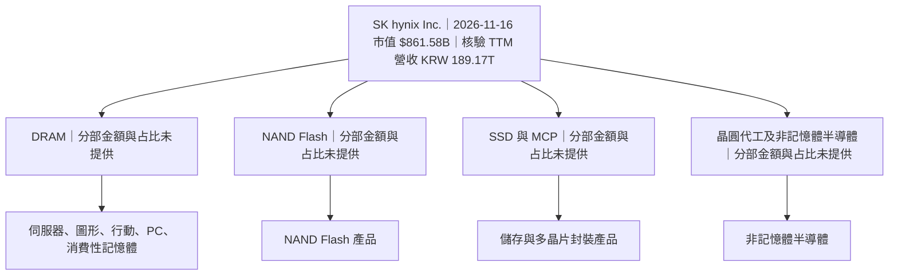
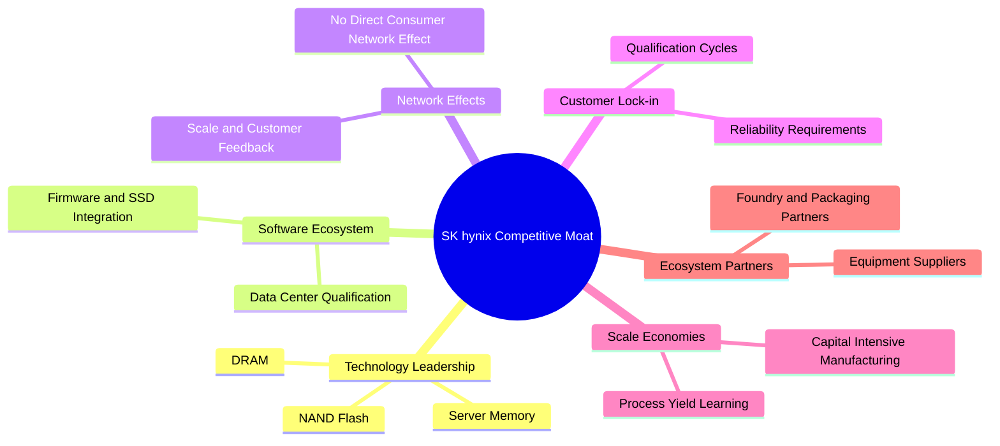
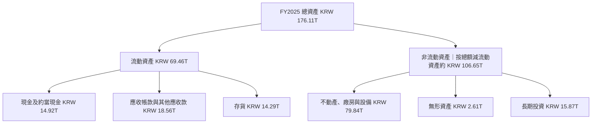
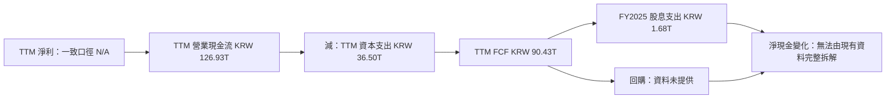
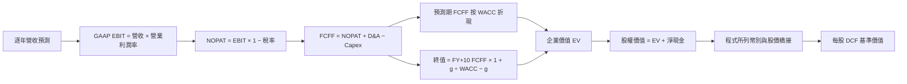
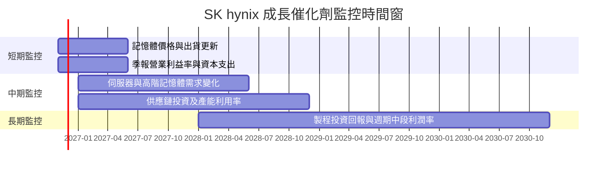
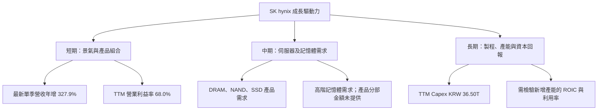
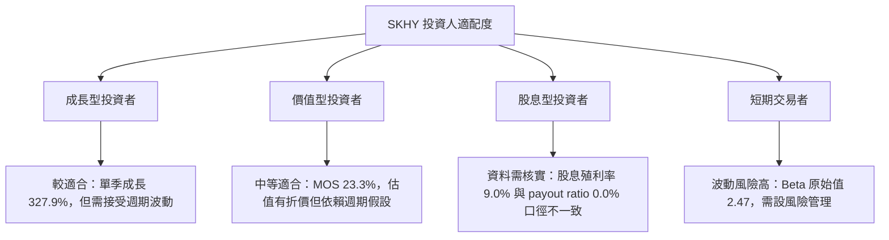

# SKHY 基本面深度分析報告
> **報告日期**：2026-11-17 ｜ **語言**：繁體中文 ｜ **數據來源**：Yahoo Finance、Finviz、StockAnalysis、Roic.ai ｜ **分析師**：CFA 級機構研究

> **重要資料品質註記**：本報告優先採用經核驗的股價、TTM 財務數據、資本成本、同業倍數及 DCF 模型。原始資料另有期間與金額不一致：例如 TTM 營收同時出現 KRW 189.17T 與 KRW 269.34T，季度成長率亦有不同版本。因此，涉及強制引用的估值與評級，採用經核驗數值；其他互相矛盾的歷史表格則只作背景，並明確標示限制。報價為美元、財報為韓圜；換算使用 **2026-11-16 匯率 1 USD = 1,333.25 KRW**，不混用兩種幣別計算比率。

## 目錄

| # | 章節 | 核心結論 |
|---|------|----------|
| 1 | 執行摘要 | 買入；加權合理價值 $159.29；MOS 23.3% |
| 2 | 公司概覽與商業模式 | DRAM、NAND、SSD 等業務；營收分部占比未提供 |
| 3 | 損益表深度分析 | 單季成長快速，但營收 TTM 成長率缺失，循環波動高 |
| 4 | 資產負債表分析 | 經核驗淨現金 KRW 98.66T；營運資金週期 214 天 |
| 5 | 現金流量深度分析 | TTM FCF KRW 90.43T；資本支出仍高 |
| 6 | 獲利能力與資本效率 | TTM 營業利益率 68.0%；當期 ROIC 缺失，不能下當期價值創造結論 |
| 7 | 相對估值分析 | 同業倍數推算價值約 $119.29–$122.90；景氣循環造成倍數失真 |
| 8 | DCF 內在價值評估 | DCF 基準 $182.43；加權合理價值 $159.29 |
| 9 | 成長催化劑 | AI／伺服器記憶體需求是重要觀察方向；TAM 數據未提供 |
| 10 | 風險矩陣 | 週期反轉、資本支出與地緣政治為主要風險 |
| 11 | 投資建議 | 買入；以 $122.18–$143.36 作為依 MOS 推導的觀察區間 |

## 1. 執行摘要

### 1.0 一頁式投資儀表板（Portfolio Manager 30 秒速讀）

| 項目 | 內容 |
|------|------|
| **投資論點（3 句）** | ① 經核驗 TTM 營收為 KRW 189.17T，最新單季年增率 327.9%，但該成長率不能代表可持續 TTM 成長。② TTM FCF 為 KRW 90.43T，FCF Yield 7.87%，現金流為估值提供支撐。③ DCF 基準價值 $182.43，惟加權合理價值因同業估值較低而為 $159.29。 |
| **綜合評分** | **7.8/10**（引用 1.1 六項算術平均） |
| **財務健康** | 🟢 淨現金 KRW 98.66T；最新流動比率 26.882，但 CCC 214 天，營運資金效率仍需監控。 |
| **ROIC vs WACC** | 當期 ROIC：N/A；WACC：14.00%。資料不足，無法判定當期是否創造經濟價值。 |
| **FCF 趨勢** | TTM FCF KRW 90.43T；FCF Yield 7.87%。年度歷史 FCF 由 2023 年負值轉正，但循環性強。 |
| **估值** | Forward P/E 2.95x ｜ EV/EBITDA：N/A（幣別與口徑未提供可核驗比率）｜ FCF Yield 7.87% |
| **DCF 內在價值（基準）** | $182.43 ｜現價相對 DCF 折價 **33.0%**（折溢價基準為 DCF） |
| **安全邊際（MOS）** | **23.3%**＝($159.29 − $122.18) ÷ $159.29；🟡 有限 |
| **預期報酬（基準情境 12M）** | +49.3%（DCF 基準情境價值相對現價；非承諾報酬） |
| **關鍵風險（前二）** | 記憶體價格與供需反轉；高資本支出及出口管制 |
| **評級 + 信心度** | 🟢 **買入** ｜ 信心：中（資料期間／金額有不一致，ROIC 與 EPS 驚喜資料缺失） |

評級依據是 MOS 23.3%，落在 10%–25% 的「買入」範圍。這不是「強烈買入」：當期 ROIC 未提供，且 DCF 基準 $182.43 與加權合理價值 $159.29 有明顯差距，故不以單一 DCF 推導更積極的評級。

### 1.1 綜合評分卡（全報告唯一）

| 維度 | 評分（1–10） | 主要依據（引用數字與其來源章節） |
|------|--------------|----------------------------------|
| 成長性 | 9.0 | 最新一季年增率 327.9%；但 TTM 成長率 N/A，且循環高峰可能使單季增速外推失真（第 3 章） |
| 獲利能力 | 9.0 | TTM 營業利益率 68.0%、TTM FCF KRW 90.43T；當期 ROIC 與 Piotroski F-Score 未提供（第 3、5、6 章） |
| 財務健康 | 8.0 | 淨現金 KRW 98.66T、流動比率 26.882；CCC 214 天（第 4 章） |
| 估值 | 6.0 | MOS 23.3%，但 EV/EBITDA 相對同業回推值 $119.29、P/S 回推值 $122.90，均低於 DCF 基準（第 7、8 章） |
| 護城河 | 8.0 | 記憶體製造需要高研發與資本投入，且產品涵蓋 DRAM、NAND、SSD；但市占與客戶集中度數據未提供（第 2 章） |
| 管理層與資本配置 | 7.0 | 2025 年資本支出 KRW 28.58T、股息支出 KRW 1.68T；回購、長期稀釋與資本報酬目標資料不足（第 5 章） |
| **綜合評分** | **7.8** | 六項算術平均：(9.0 + 9.0 + 8.0 + 6.0 + 8.0 + 7.0) ÷ 6 = 7.7 |

### 1.2 五大投資論點 + 三大核心風險

| 類型 | 項目 | 具體依據 | 信心度 |
|------|------|----------|--------|
| 🟢 **投資論點①** | 現金流已轉強 | TTM OCF KRW 126.93T、Capex KRW 36.50T，按固定定義得到 FCF KRW 90.43T。現金轉化提供資本支出與週期下行緩衝。 | 🟢 高 |
| 🟢 **投資論點②** | 利潤率處於高位 | TTM 營業利益率 68.0%，最新單季 74.5%；若產品組合與價格維持，營業槓桿可支撐盈餘。 | 🟡 中 |
| 🟢 **投資論點③** | 資產負債表有緩衝 | 現金及短期投資 KRW 114.46T、總債務 KRW 15.80T，淨現金 KRW 98.66T。 | 🟢 高 |
| 🟢 **投資論點④** | 估值仍有折價空間 | 加權合理價值 $159.29，相對 $122.18 現價的上行空間 30.4%；MOS 23.3%。 | 🟡 中 |
| 🟢 **投資論點⑤** | 單季需求仍快增 | 最新一季年增率 327.9%；同業 Micron 最新一季年增率 379.3%，顯示產業需求旺盛但公司並非唯一受惠者。 | 🟡 中 |
| 🟡 **風險①** | 記憶體週期反轉 | 最新單季營業利益率 74.5% 高於 TTM 68.0%；若價格下跌，固定成本與高資本密集度可能放大利潤下滑。 | 🔴 高衝擊 |
| 🔴 **風險②** | DCF 對長期假設敏感 | DCF 終值現值占 EV 38.9%；WACC、長期利潤率及資本支出收斂假設改變會明顯影響估值。 | 🔴 高衝擊 |
| 🟡 **風險③** | 資料口徑與地緣政治 | TTM 營收有 KRW 189.17T 與 KRW 269.34T 兩種報表值；新聞亦提及更嚴格的中國晶片限制。 | 🟡 中度 |

### 1.3 快速統計卡片

| 指標 | 公司實際值（期間） | 同業中位數 | 狀態 |
|------|--------------------|------------|------|
| 營收成長（TTM） | **N/A** | — | 🟡 未提供可核驗比較值 |
| 營收成長（最新一季年增） | **327.9%** | 377.9% | 🟢 高增長，但略低於同業中位數 |
| 毛利率（TTM） | **77.4%** | 80.0% | 🟡 低於同業中位數 |
| 營業利益率（TTM） | **68.0%** | — | 🟢 高 |
| ROIC（TTM） | **N/A** | — | 🟡 資料不足 |
| Forward P/E | **2.95x** | 3.5x | 🟢 低於同業中位數 |
| FCF Yield（TTM） | **7.87%** | — | 🟢 提供現金流估值支撐 |
| Piotroski F-Score | **N/A** | — | 🟡 缺少兩個相隔一年的 SEC TTM 期間 |

### 1.4 投資結論

╔══════════════════════════════════════════════════════════════════╗  
║                    📊 投資結論摘要                               ║  
╠══════════════════════════════════════════════════════════════════╣  
║  評級：買入（MOS 23.3%，依規則 20；未作一級調整）                ║  
║  價格（2026-11-16 收盤）：$122.18                                ║  
║  DCF 內在價值（基準）：$182.43（現價折價 33.0%）                 ║  
║  安全邊際 MOS：23.3%（以加權合理價值 $159.29 為分母）            ║  
║  加權合理價值（8.8）：$159.29                                    ║  
║  DCF 情境價值：                                                   ║  
║    悲觀情境：$89.15（-27.0%）                                    ║  
║    基準情境：$182.43（+49.3%）                                   ║  
║    樂觀情境：$358.78（+193.6%）                                  ║  
║  綜合評分：7.8/10（引用 1.1）                                    ║  
║  適合投資人：能承受半導體週期波動、以中長期持有為主的投資人      ║  
╚══════════════════════════════════════════════════════════════════╝

## 2. 公司概覽與商業模式

### 2.1 業務結構與收入來源

產品線包括 DRAM（伺服器、圖形、行動、PC、消費性記憶體）、NAND Flash、SSD、MCP，以及晶圓代工與非記憶體半導體。各產品營收占比及分部金額未提供，不能以圖表虛構比例。

### 2.2 市場份額

市場份額數據未提供，無法量化 DRAM、NAND 或 HBM 的市占率。經核驗 TTM 營收為 KRW 189.17T，最新一季年增率 327.9%；Micron 與 SanDisk 最新一季年增率分別為 379.3% 與 377.9%，顯示公司處於快速增長的記憶體景氣環境，但不能單憑營收成長推定市占提升。

### 2.3 競爭護城河分析

### 2.4 護城河強度

| 護城河項目 | 強度（強／中／弱） | 證據（引用數字或事實） | 會削弱它的情況 |
|------------|--------------------|------------------------|----------------|
| 技術與製程能力 | 強 | DRAM、NAND、SSD 等多產品線，TTM 營業利益率 68.0%；產品市占及良率資料未提供 | 技術落後、良率不佳或競爭者擴產 |
| 規模與資本門檻 | 強 | FY2025 Capex KRW 28.58T；TTM Capex KRW 36.50T，資本投入規模大 | 產能過剩與價格競爭使投資回報下降 |
| 客戶認證與轉換成本 | 中 | 伺服器及企業級記憶體對可靠度有要求；客戶集中度及認證時間未提供 | 客戶多源供應、規格標準化 |
| 軟體生態系 | 弱至中 | SSD 產品需要韌體與系統整合；軟體收入數據未提供 | 競品功能趨同 |
| 網路效應 | 弱 | 半導體產品非典型雙邊網路平台 | 不適用 |
| 生態夥伴 | 中 | 產品鏈涉及設備、封裝與客戶協作；夥伴收入占比未提供 | 供應瓶頸、出口限制 |

**1.1 護城河分數 8.0/10** 的理由是高資本投入與多類記憶體產品形成規模及技術門檻，但市占、客戶集中度、良率與產品分部數據不足，限制了判斷強度。

## 3. 損益表深度分析

### 3.1 年度收入成長趨勢（近 4 年）

年度營收以財報所列 KRW 為準；年度值與核驗 TTM 營收口徑並不完全一致。

╔══════════════════════════════════════════════════════════════════╗  
║              SK hynix 年度收入趨勢（FY2022–FY2025）              ║  
╠══════════════════════════════════════════════════════════════════╣  
║  FY2022  KRW 44.62T  █████████░░░░░░░░░░░░░  YoY：基期           ║  
║  FY2023  KRW 32.77T  ███████░░░░░░░░░░░░░░░  YoY：-26.57% 🔴     ║  
║  FY2024  KRW 66.19T  ██████████████░░░░░░░  YoY：+102.02% 🟢    ║  
║  FY2025  KRW 97.15T  █████████████████████  YoY：+46.76% 🟢     ║  
╠══════════════════════════════════════════════════════════════════╣  
║  FY2022–FY2025 CAGR：(97.15 ÷ 44.62)^(1/3) − 1 = 約 29.6%        ║  
╚══════════════════════════════════════════════════════════════════╝

2023 年營收下滑後，2024–2025 年回升，符合記憶體需求及價格具週期性的特徵。FY2022–FY2025 的約 29.6% CAGR 是跨週期歷史結果，不宜直接當作未來長期成長率。

### 3.2 季度收入趨勢分析

下表以財報所列單季數字計算 QoQ；YoY 以 StockAnalysis 季報表的單季資料為參考。最新一季年增率另有核驗值 327.9%，與季報明細列出的 256.78% 不一致，因此分開列示，不混為同一口徑。

| 季度 | 營收（KRW T） | QoQ | YoY（季度） | 備註 |
|------|---------------:|----:|------------:|------|
| 2025 Q3 | 24.45 | — | 39.13% | 季度參考值 |
| 2025 Q4 | 32.83 | +34.3% | 66.07% | 需求與產品組合改善的可能性增加，但資料未提供分部解釋 |
| 2026 Q1 | 52.58 | +60.2% | 198.07% | 同比增幅擴大 |
| 2026 Q2 | 79.32 | +50.9% | 256.78%（季報明細）；327.9%（核驗值） | 來源間有期間／口徑差異，勿視為同一數值 |

營收快速上升帶來高營業槓桿，但若價格或出貨成長回落，固定成本會使營業利益率反向波動。

### 3.3 利潤率演變分析

以下年度比率以年度損益表中的毛利、營業利益及淨利除以營收推導，並非核驗 TTM 指標。

| 利潤率指標 | FY2022 | FY2023 | FY2024 | FY2025 | 趨勢 | 評估 |
|------------|-------:|-------:|-------:|-------:|------|------|
| **毛利率** | 約 35.0% | 約 -1.6% | 約 48.1% | 約 60.4% | 先急降後回升 | 🟡 高週期性 |
| **營業利益率** | 約 15.3% | 約 -23.6% | 約 35.5% | 約 48.6% | 2023 谷底後擴張 | 🟢 但具循環風險 |
| **淨利率** | 約 5.0% | 約 -27.8% | 約 29.9% | 約 44.2% | 同步反彈 | 🟡 受稅項與非營業因素影響 |

年度毛利率回升可能反映產品價格、產能利用率及高階產品組合改善；資料沒有分產品價格、出貨量或良率資料，不能把回升精確歸因於單一因素。核驗 TTM 營業利益率 68.0%、最新單季 74.5%，高於 FY2025 年度比率，顯示本輪週期的盈利能力仍在高檔。

### 3.4 費用結構分析

完整費用結構及各項占營收比例未提供，因此不繪製費用圓餅圖。可見 FY2025 研發費用 KRW 6.47T、FY2024 KRW 4.44T，按年度營收計算，研發投入約由 6.7% 上升至 6.8%。資本支出屬現金流／資產投資，不應與費用化研發混為一談。

### 3.5 季度 EPS 趨勢與盈餘品質（Quality of Earnings）

四季 EPS「預估值／實際值」資料未提供，現有盈餘驚喜表亦只有 2026-06-30、2026-09-30 兩列且 EPS 數值為 NaN，因此無法判斷最近四季是超預期或不及預期。季度實際盈餘仍顯著波動：2026 Q2 淨利 KRW 93.82T，2026 Q1 KRW 40.33T；2026 Q3 季報另一來源列 KRW 39.78T，與其他資料所示收入期間也有差異，不能直接拼接成一致序列。

| 盈餘品質項目 | 數值／佔比 | 評估 |
|--------------|-----------|------|
| 股權薪酬 SBC / 營收 | TTM N/A；FY2025 SBC KRW 414.11B，FY2025 營收 KRW 97.15T，約 0.43% | 🟢 FY2025 年度佔比低；但 TTM SBC 明細不足 |
| SBC / 營業現金流 | TTM N/A；FY2025 約 0.78%（414.11B ÷ 53.37T） | 🟢 年度代理值低；不能取代 TTM |
| FCF / 淨利（現金轉換率） | N/A | TTM 淨利未能以一致口徑核驗，不反推 |
| 一次性／非經常性損益 | N/A | 未提供明細，不能判斷是否有重大一次性損益 |
| 有效稅率異常 | 14.9%（資本成本輸入採最新年度有效稅率） | 🟡 未提供年度稅項明細，無法確認是否有特殊稅務利益 |
| 資本化支出 vs 費用化 | TTM Capex KRW 36.50T；資本化明細 N/A | Capex 高，會形成未來折舊；需留意資產利用率與減損風險 |

**盈餘品質結論**：可核驗的 FY2025 SBC 約占營收 0.43%，目前看不出其是主要稀釋來源；但缺少完整 TTM SBC、淨利與一次性損益明細，無法完整核驗 TTM 盈餘品質。TTM FCF 明顯為正，為獲利提供現金流佐證；高額 Capex 仍使週期下行時的現金流可能快速收縮。

## 4. 資產負債表分析

### 4.1 資產結構分解

以下使用 FY2025 年度資產負債表。非流動資產細項有資料，但部分其他長期資產項目存在報表口徑異常，故僅展示有來源數字且不將未提供項目推估補齊。

### 4.2 流動性與營運資金分析

| 指標 | 最新 TTM／期末 | 歷史資料 | 評估 |
|------|---------------:|----------|------|
| 流動比率 | 26.882 | FY2025 流動資產 KRW 69.46T、流動負債 KRW 37.38T | 🟢 提供短期償債緩衝；報表來源口徑需核對 |
| 速動比率 | 23.813 | N/A | 🟢 高，但同樣受資料期間差異限制 |
| 現金及短期投資 | KRW 114.46T | FY2025 表列現金與短期投資 KRW 35.14T | 🟢 期間變化很大，需確認口徑與期間 |
| 淨現金 | KRW 98.66T | 核驗 TTM 數值 | 🟢 |
| DSO 應收帳款天數 | 92 天 | 一年前 N/A | 🟡 收款週期偏長；變化無從判斷 |
| DIO 存貨天數 | 146 天 | 一年前 N/A | 🟡 存貨占用資金高；需看產品世代與需求變化 |
| DPO 應付帳款天數 | 25 天 | 一年前 N/A | 供應商付款天數較短；議價能力方向無法由單一期數確定 |
| CCC 現金轉換週期 | 214 天 | 一年前 N/A | 🟡 資金從投入到回收的時間長，若需求轉弱需關注存貨風險 |

品質指標僅提供最新 TTM 天數，缺少一年前同口徑數值，因此不能聲稱 DSO、DIO 或 CCC 正在改善或惡化。

### 4.3 債務結構分析

╔══════════════════════════════════════════════════════════════════╗  
║                   SK hynix 債務健康診斷                          ║  
╠══════════════════════════════════════════════════════════════════╣  
║  總債務：        KRW 15.80T（≈ $11.85B）                         ║  
║  現金及短期投資：KRW 114.46T（≈ $85.85B）                        ║  
║  淨現金：        KRW 98.66T（≈ $74.00B） 🟢                      ║  
║  流動比率：      26.882 🟢                                       ║  
║  Debt/EBITDA：   N/A（同口徑幣別／企業價值資料未提供）            ║  
║  利息保障倍數：  N/A（利息費用與同口徑 EBIT 未提供）              ║  
╚══════════════════════════════════════════════════════════════════╝

核驗淨現金相對總債務有充足緩衝；但資料中的年度債務 KRW 24.76T 與 TTM 債務 KRW 15.80T 不同，必須以期間一致的季度資產負債表再確認。

### 4.4 股東權益趨勢

╔══════════════════════════════════════════════════════════════════╗  
║                 股東權益趨勢（年度）                             ║  
╠══════════════════════════════════════════════════════════════════╣  
║  2022  KRW 63.27T  █████████████████░░░                          ║  
║  2023  KRW 53.50T  ██████████████░░░░░                          ║  
║  2024  KRW 73.90T  ████████████████████                         ║  
║  2025  KRW 120.52T ██████████████████████████████                ║  
╚══════════════════════════════════════════════════════════════════╝

股東權益在 2023 年下滑後回升，與年度淨利由 2023 年虧損 KRW 9.11T 回復至 2025 年獲利 KRW 42.92T 的方向一致。股數、回購及其他權益變動明細不足，不能把權益增加全數歸因於留存盈餘。

## 5. 現金流量深度分析

### 5.1 現金流量瀑布圖

### 5.2 FCF 轉換率趨勢

| 年度 | OCF（KRW T） | Capex（KRW T） | FCF（KRW T） | FCF / 淨利 |
|------|-------------:|---------------:|-------------:|-----------:|
| 2022 | 14.78 | 19.75 | -4.97 | 約 -223% |
| 2023 | 4.28 | 8.78 | -4.50 | 約 49% |
| 2024 | 29.80 | 16.66 | 13.13 | 約 66% |
| 2025 | 53.37 | 28.58 | 24.79 | 約 58% |
| TTM 至 2026-06-30 | 126.93 | 36.50 | 90.43 | N/A |

年度 FCF／淨利比率按年度現金流及淨利計算；2023 年淨利為負，因此比率的正值沒有一般「轉換率」意義。TTM 淨利缺少同口徑核驗值，故不計算 TTM 轉換率。TTM FCF 亦不可與 FY2025 年度 FCF 混為同一期間。

### 5.3 自由現金流趨勢

╔══════════════════════════════════════════════════════════════════╗  
║                 FCF：年度實際與最新 TTM                          ║  
╠══════════════════════════════════════════════════════════════════╣  
║  FY2022  -KRW 4.97T  ░░░░░░░░░░░░░░░░░░░░ 🔴                    ║  
║  FY2023  -KRW 4.50T  ░░░░░░░░░░░░░░░░░░░░ 🔴                    ║  
║  FY2024   KRW 13.13T █████░░░░░░░░░░░░░░░ 🟡                    ║  
║  FY2025   KRW 24.79T ██████████░░░░░░░░░░ 🟢                    ║  
║  TTM      KRW 90.43T ████████████████████ FCF Yield 7.87%       ║  
╚══════════════════════════════════════════════════════════════════╝

年度歷史顯示 FCF 從負值轉正；TTM FCF 明顯高於 FY2025 年度值，反映景氣及現金流期間快速變化。由於財務數據存在期間不一致，不能把 TTM 相對 FY2025 的差額視為單純增長率。

### 5.4 資本配置評估

各用途金額未能完整分解為同一期間的圓餅圖；因此不畫資本配置比例圖。

| 資本配置項目 | 可核驗數字 | 評估 |
|--------------|------------|------|
| 資本支出 | TTM KRW 36.50T；FY2025 KRW 28.58T | 🟡 維持製程與產能需要高投入，但需確保投資回報 |
| 股息 | FY2025 KRW 1.68T | 占年度 OCF 約 3.1%（1.68 ÷ 53.37），但資料另列股息殖利率 9.0%，來源可能不一致 |
| 股票回購 | N/A | 無法評估回購效率 |
| 留存現金 | 核驗現金及短期投資 KRW 114.46T | 🟢 增加週期下行緩衝；期間口徑需核對 |

## 6. 獲利能力與資本效率

### 6.1 ROE / ROA / ROIC 趨勢

| 指標 | 最新／可核驗值 | 歷史資料 | 評估 |
|------|---------------:|----------|------|
| ROE | TTM 92.5% | FY2025 權益與淨利數據可見，但無一致期間品質分解 | 🟢 高，但可能處於週期高峰 |
| ROA | TTM 46.4% | 歷史同口徑序列未提供 | 🟢 高，仍須考慮週期性 |
| ROIC | TTM N/A | Roic.ai 顯示 2018 年 Return on Capital 34.64%，不是當期值 | 當期無法與 WACC 作有效比較 |
| Piotroski F-Score | N/A | 需要兩個相隔一年的 SEC TTM 期間 | 無法作整體基本面品質確認 |

### 6.2 ROIC vs WACC 分析（核心價值創造判斷）

╔══════════════════════════════════════════════════════════════════╗  
║                ROIC vs WACC 深度分析                            ║  
╠══════════════════════════════════════════════════════════════════╣  
║  資本成本輸入（依資本成本模型）：                                ║  
║  ├── 無風險利率（10Y 美債）：             5.12%                 ║  
║  ├── 市場風險溢酬 ERP：                   5.00%                 ║  
║  ├── 原始 Beta：                           2.47                  ║  
║  ├── 調整後 Beta：                         1.98                  ║  
║  ├── 股權成本 Ke：                         15.01%                ║  
║  ├── 稅前債務成本：                        5.85%                 ║  
║  ├── 有效稅率：                            14.9%                 ║  
║  ├── 股權／債務權重：                      98.6%／1.4%           ║  
║  └── 採用 WACC：                           14.00%                ║  
║                                                                  ║  
║  當期 ROIC：N/A（當期投入資本與 NOPAT 無法一致核驗）              ║  
║  結論：無法以當期 ROIC 與 14.00% WACC 比較，故不下價值創造判斷。 ║  
╚══════════════════════════════════════════════════════════════════╝

Beta 調整方式為 ⅔ × 原始 Beta 2.47 + ⅓ × 1 = 1.98；Ke = 5.12% + 1.98 × 5.00% = 15.01%。模型計算 WACC 為 14.87%，但資本成本區塊註明受 7%–14% 範圍限制，因此本報告採用 14.00%。第 8.2 節使用同一 WACC。

不得用 2018 年 34.64% 的 Return on Capital 代替當期 ROIC；該歷史資料與當期資本成本並非同一期間，也不足以證明目前仍有正 EVA。

### 6.3 杜邦三因素分解

| 因素 | 數值（TTM） | 解讀 |
|------|-------------|------|
| 淨利率 | N/A | QUALITY FIGURES 因淨利、營收、資產或正權益資料不足而未計算 |
| 資產週轉率 | N/A | 同上 |
| 權益乘數 | N/A | 同上 |
| **ROE** | **N/A（杜邦分解）** | 不補算、不用其他期間數據拼湊 |

雖然其他彙整欄列有 TTM ROE 92.5%，但杜邦品質指標明確無法計算，故不以不一致期間或缺失資料推算三因素。

### 6.4 財務體質：Piotroski F-Score

**Piotroski F-Score：N/A**。缺少 SEC 申報資料中相隔一年的兩個 TTM 期間；九項測試結果皆未提供，因此逐項結果不可判定，不能以空缺當作通過或未通過。

## 7. 相對估值分析

### 7.1 同業估值比較表格

| 估值指標 | **SKHY** | **MU** | **SNDK** | **WDC** | SKHY 評估 |
|----------|---------:|-------:|---------:|--------:|-----------|
| **Trailing P/E** | 7.79x | 9.7x | 6.5x | 9.9x | 🟡 接近同業區間；同業中位數 9.7x |
| **Forward P/E** | 2.95x | 3.5x | 2.8x | 7.0x | 🟢 低於同業中位數 3.5x |
| **P/S Ratio** | N/A | 6.1x | 4.0x | 7.3x | 🟡 公司值因幣別／財報口徑未核驗 |
| **EV/EBITDA** | N/A | 7.1x | 5.2x | 16.6x | 🟡 公司值不可比；同業中位數 7.1x |
| **最新單季營收年增** | 327.9% | 379.3% | 377.9% | 55.5% | 🟢 高增長；低於 MU、SNDK |
| **毛利率（TTM）** | 77.4% | 80.7% | 80.0% | 52.6% | 🟢 高於 WDC，略低於 MU、SNDK |

低 Forward P/E 不代表週期高峰的盈餘必然可持續；若未來 EPS 回落，前瞻 P/E 可能因分母下降而迅速上升。公司 P/S、EV/EBITDA 未提供可核驗同幣別值，不以公司自身倍數代替同業倍數。

### 7.2 歷史估值區間分析

N/A（未提供「Valuation vs own history」的歷史估值區間或百分位資料，不能推估當前位置）。

### 7.3 情境價值（Bear / Base / Bull，照抄 DCF MODEL）

| 情境 | 第 1 年營收成長 | 期末營業利潤率 | WACC | 每股價值 | 相對現價 | 機率 | 會發生的條件 |
|------|----------------:|----------------:|-----:|----------:|---------:|-----:|--------------|
| 🔴 悲觀 | 15.0% | 30.1% | 15.00% | $89.15 | -27.0% | 25% | 記憶體供需轉弱、價格回落，利潤率向較低水平收斂 |
| 🟡 基準 | 30.0% | 35.5% | 14.00% | $182.43 | +49.3% | 50% | 短期維持增長，十年內利潤率逐步回歸歷史中位數 |
| 🟢 樂觀 | 45.0% | 39.0% | 13.00% | $358.78 | +193.6% | 25% | 高階記憶體需求持續、產品組合與資本回報優於基準 |

模型給出的機率加權值為 $203.20（+66.3%），僅作情境參考；第 8.8 節依規定採基準 DCF 值 $182.43。

### 7.4 相對估值隱含價格區間

╔══════════════════════════════════════════════════════════════════╗  
║             相對估值與市場參考每股價值                           ║  
╠══════════════════════════════════════════════════════════════════╣  
║  同業 EV/EBITDA：$119.29  ─ 現價 $122.18 ─ 同業 P/S：$122.90     ║  
║  分析師共識：$259.50                                             ║  
║  基準 DCF：$182.43                                               ║  
╚══════════════════════════════════════════════════════════════════╝

| 方法 | 每股價值 | 相對現價 | 依據 |
|------|---------:|---------:|------|
| 同業 EV/EBITDA | $119.29 | -2.4% | MU、SNDK、WDC 中位數 7.1x × TTM EBITDA，再加淨現金 |
| 同業 P/S | $122.90 | +0.6% | 同業 P/S 中位數 6.1x × TTM 營收 |
| 分析師共識 | $259.50 | +112.4% | 14 位分析師平均目標價 |
| DCF 基準 | $182.43 | +49.3% | 10 年 FCFF、WACC 14.00%、永續成長率 3.0% |

分析師共識目標價高於其他方法，應視為市場參考而非基本面保證。相對估值法使用同業中位數倍數，並非 SKHY 自身目前倍數。

## 8. DCF 內在價值評估（Discounted Cash Flow）

### 8.0 估值推理鏈（Thinking Logic）

#### Step 1 — 價值由哪些變數決定？

模型價值主要來自記憶體主業的營收與毛利／營業利潤率、資本支出收斂後的自由現金流，以及終值。業務分部占比未提供，因此不能把 DRAM、NAND、SSD 或新產品分別估值。估值對**營業利潤率、營收成長與 WACC**敏感；DCF 敏感度矩陣顯示 WACC 與終值成長率變動會改變每股價值。

#### Step 2 — 模型選擇

| 決策點 | 本報告採用 | 理由 | 曾考慮但否決 | 否決理由 |
|--------|-----------|------|--------------|----------|
| 現金流定義 | FCFF | 以企業自由現金流折現至 EV，再加淨現金 | FCFE | 模型已提供 FCFF、WACC 與 EV 橋接 |
| 預測期 N | 10 年 | DCF 模型固定採 10 年，逐年淡化成長與利潤率 | 5 年 | 不符合已核驗模型設定 |
| 終值方法 | Gordon Growth | 模型提供永續成長率 3.0% 及終值數字 | 退出倍數 | 模型未提供退出倍數終值，不自行補建 |
| EBIT 基礎 | GAAP | 模型明示使用 GAAP EBIT | 非 GAAP | 缺少調整項且會改變模型 |

#### Step 3 — 關鍵假設推導鏈

- **營收成長**：錨點＝最新單季年增率 327.9%，但 TTM 成長率 N/A → 調整＝單季高增長不可直接外推，模型把第一年增長限制在 0%–30% → **採用 FY+1 30.0%，之後線性降至 FY+10 3.0%** → 曾考慮直接採用 327.9%，因單季基期與週期不適合外推而否決。
- **期末營業利潤率**：錨點＝TTM 68.0%，過去五個財政年度中位數為模型採用的收斂參考 → 調整＝預期記憶體價格與利潤率回歸循環中值 → **FY+1 68.0% 線性降至 FY+10 35.5%** → 曾考慮長期維持 68.0%，因模型認為該水平不可視為穩態而否決。
- **永續成長率 g**：錨點＝成熟企業長期名目成長通常低於高增長階段 → 調整＝模型採用 3.0%，低於 14.00% WACC → **採用 3.0%** → 不採用接近 WACC 的高 g，因會放大終值並降低模型穩健性。
- **預測期 N**：錨點＝DCF 程式模型提供 10 年 → 調整＝依模型逐步淡化成長及利潤率 → **採用 10 年** → 未改用 5 年或其他期限，避免另建模型。
- **Capex／營收**：錨點＝TTM Capex／營收約 19.3% → 調整＝模型假設高資本投入隨成熟及折舊負擔下降，逐步降至 8.7% → **FY+1 19.3% 至 FY+10 8.7%** → 不採用固定 19.3%，因模型預期資本支出比率逐步收斂。
- **GAAP EBIT、SBC 與股數**：錨點＝模型已採 GAAP EBIT，且 SBC 已在費用中 → **使用組合 (A)：GAAP EBIT、不另扣 SBC、固定股數／年稀釋率 0%** → 不採用再扣 SBC 或再放大股數，以避免重複計入或漏計。
- **有效稅率**：錨點＝最新年度有效稅率 14.9% → 採用 14.9%。營運資金在模型中不建模，D&A／營收採模型輸入 7.9%。
- **WACC**：錨點＝資本成本模型計算值 14.87%，但模型限制於 7%–14% → **採用 14.00%** → 不採用未封頂 14.87%，以遵守模型規定及統一折現率。
- **退出倍數**：模型未提供退出倍數法的終值，故不新增終值數字；相對估值只在第 7 章引用經核驗的估值方法。

#### Step 4 — 最脆弱的一環

最脆弱假設是營業利潤率長期收斂速度與終值參數；若高利潤率比模型假設更快回落，基準 DCF 可能高估，而情境模型中的悲觀價值為 $89.15。

#### Step 5 — 計算路徑圖

### 8.1 模型假設總表（Model Inputs）

| 假設項目 | 採用值 | 依據／來源 | 敏感度 |
|----------|--------|-------------|--------|
| 預測期長度 **N** | 10 年 | DCF 模型設定 | 🟡 中 |
| 營收成長路徑 | FY+1 30.0% 線性降至 FY+10 3.0% | 單季年增 327.9%，但採 0%–30% 上限；TTM 成長率 N/A | 🔴 高 |
| 營業利潤率 | FY+1 68.0% 降至 FY+10 35.5% | TTM 68.0%；終值利潤率依最近五個財政年度中位數 | 🔴 高 |
| 有效稅率 | 14.9% | 最新年度有效稅率 | 🟢 低 |
| Capex／營收 | FY+1 19.3% 降至 FY+10 8.7% | TTM 比率，後續按模型向 1.1 × D&A 收斂 | 🟡 中 |
| D&A／營收 | 7.9% | TTM 模型輸入，固定 | 🟢 低 |
| 營運資金變動 | 未建模 | DCF 模型明示不納入 | 🟢 低；但構成模型限制 |
| EBIT 基礎 | GAAP | 模型使用 GAAP EBIT | 🟡 中 |
| SBC 處理 | GAAP EBIT 已含 SBC；不另扣 | 與固定股數組合 (A) 一致 | 🟡 中 |
| 年稀釋率 | 0%（固定股數） | 組合 (A)；稀釋成本由 GAAP 費用反映 | 🟡 中 |
| 永續成長率 g | 3.0% | 模型設定，低於 WACC 14.00% | 🔴 高 |
| 終值方法 | Gordon Growth | DCF 模型已提供終值；未提供退出倍數終值 | 🔴 高 |
| WACC | 14.00% | 資本成本模型封頂後採用 | 🔴 高 |

本模型採用 **(A) GAAP EBIT + 固定股數**，因此 SBC 影響已透過費用計入一次；FCFF 不再扣 SBC，也不再加入年稀釋率。FCFF 定義為 NOPAT + D&A − Capex；營運資金變動按模型設定不納入。

### 8.2 折現率推導（WACC）

╔══════════════════════════════════════════════════════════════════╗  
║                    WACC 推導（折現率）                           ║  
╠══════════════════════════════════════════════════════════════════╣  
║  股權成本 Ke（CAPM）：                                           ║  
║  ├── 無風險利率 Rf：                   5.12%                     ║  
║  ├── 市場風險溢酬 ERP：                 5.00%                     ║  
║  ├── 原始 Beta：                        2.47                      ║  
║  ├── 調整後 Beta：                      1.98                      ║  
║  └── Ke = 5.12% + 1.98 × 5.00% =       15.01%                    ║  
║                                                                  ║  
║  債務成本：                                                      ║  
║  ├── 稅前 Kd（資料來源計算值）：        5.85%                     ║  
║  ├── 有效稅率：                         14.9%                     ║  
║  └── 稅後 Kd = 5.85% × (1 − 14.9%) =   4.98%                     ║  
║                                                                  ║  
║  資本結構：                                                      ║  
║  ├── 股權權重 E：                       98.6%                     ║  
║  ├── 債務權重 D：                       1.4%                      ║  
║  ├── 模型未封頂計算值：                 14.87%                    ║  
║  └── 採用 WACC（限制在 7%–14%）：        14.00%                    ║  
╚══════════════════════════════════════════════════════════════════╝

**逐步演算與資料限制：**

1. **Ke（CAPM）** = 5.12% + 1.98 × 5.00% = **15.01%**。原始 Beta 2.47 高，故採用調整後 Beta 1.98；Beta 公式為 ⅔ × 2.47 + ⅓ × 1 = 1.98。
2. **稅前 Kd**：經核驗輸入為 5.85%；利息費用與平均計息負債的明細未提供，不能自行重建其分子、分母。
3. **稅後 Kd** = 5.85% × (1 − 14.9%) = **4.98%**。
4. **資本權重**：模型提供股權／債務權重 98.6%／1.4%，合計 100%。股權基於市值、債務依資本成本模型；逐項權重計算明細未提供。
5. **未封頂 WACC** = 98.6% × 15.01% + 1.4% × 4.98% = **14.87%**（採模型列示計算值）；因模型限制在 7%–14%，**採用 14.00%**。

本章 WACC 與第 6.2 節相同。無風險利率的精確觀測日期及 ERP 的外部依據未附，按模型輸入引用，不另加國別或規模溢酬。

### 8.3 逐年自由現金流預測（基準情境）

下表金額均為 **KRW billions**，折現因子按模型列示三位小數，PV 採模型計算值。營運資金變動不建模，故不列 ΔWC；SBC 不另扣。

| 年度 | FY+1 | FY+2 | FY+3 | FY+4 | FY+5 | FY+6 | FY+7 | FY+8 | FY+9 | FY+10 |
|------|-----:|-----:|-----:|-----:|-----:|-----:|-----:|-----:|-----:|------:|
| 營收 | 245,921.80 | 312,320.69 | 387,277.65 | 468,605.96 | 552,955.03 | 635,898.28 | 712,206.08 | 776,304.62 | 822,882.90 | 847,569.39 |
| 營收 YoY | 30.0% | 27.0% | 24.0% | 21.0% | 18.0% | 15.0% | 12.0% | 9.0% | 6.0% | 3.0% |
| 營業利潤率 | 68.0% | 64.4% | 60.8% | 57.2% | 53.6% | 49.9% | 46.3% | 42.7% | 39.1% | 35.5% |
| EBIT（GAAP） | 167,317.61 | 201,185.96 | 235,449.41 | 267,928.15 | 296,135.78 | 317,533.78 | 329,852.79 | 331,433.84 | 321,527.83 | 300,487.86 |
| − 稅（14.9%） | (24,924.63) | (29,969.86) | (35,073.95) | (39,912.18) | (44,114.15) | (47,301.73) | (49,136.84) | (49,372.36) | (47,896.71) | (44,762.47) |
| = NOPAT | 142,392.98 | 171,216.10 | 200,375.46 | 228,015.98 | 252,021.62 | 270,232.05 | 280,715.95 | 282,061.48 | 273,631.13 | 255,725.40 |
| + D&A | 19,356.34 | 24,582.55 | 30,482.37 | 36,883.66 | 43,522.72 | 50,051.13 | 56,057.27 | 61,102.42 | 64,768.57 | 66,711.63 |
| − Capex | (47,446.34) | (56,566.18) | (65,565.63) | (73,796.93) | (80,546.15) | (85,113.70) | (86,911.26) | (85,559.74) | (80,969.37) | (73,382.79) |
| **= FCFF** | **114,302.99** | **139,232.48** | **165,292.20** | **191,102.71** | **214,998.20** | **235,169.48** | **249,861.96** | **257,604.16** | **257,430.32** | **249,054.24** |
| 折現因子 @14.00% | 0.877 | 0.769 | 0.675 | 0.592 | 0.519 | 0.456 | 0.400 | 0.351 | 0.308 | 0.270 |
| **FCFF 現值 PV** | **100,265.78** | **107,134.87** | **111,567.53** | **113,148.15** | **111,663.33** | **107,140.05** | **99,854.16** | **90,305.47** | **79,161.87** | **67,180.84** |

預測期現值逐項加總：

**100,265.78 + 107,134.87 + 111,567.53 + 113,148.15 + 111,663.33 + 107,140.05 + 99,854.16 + 90,305.47 + 79,161.87 + 67,180.84 = 987,422.05 KRW billions**；模型列示合計 **987,422.04**，差異 0.01，為四捨五入尾差。

**FY+1 逐步演算：**

1. 營收 = KRW 189,170.61B × (1 + 30.0%) = **KRW 245,921.80B**。
2. EBIT = KRW 245,921.80B × 68.0% = **KRW 167,317.61B**。
3. 稅 = KRW 167,317.61B × 14.9% = **KRW 24,924.63B**。
4. NOPAT = KRW 167,317.61B − KRW 24,924.63B = **KRW 142,392.98B**。
5. D&A = KRW 245,921.80B × 7.9% = **KRW 19,356.34B**。
6. Capex = KRW 245,921.80B × 19.3% = **KRW 47,446.34B**。
7. ΔWC = **未建模**，不作零值推估。
8. FCFF = KRW 142,392.98B + KRW 19,356.34B − KRW 47,446.34B = KRW 114,302.98B；模型列示 **KRW 114,302.99B**，尾差 0.01B。
9. 折現因子 = 1 ÷ (1 + 14.00%)¹ = 0.877（模型列示）；PV = **KRW 100,265.78B**（採未四捨五入折現因子計算）。

**合理性自檢**

- 預測 FCFF FY+1 至 FY+10 約由 KRW 114.30T 增至 KRW 249.05T，九年間年化增幅約 9.1%；歷史 FY2022–FY2025 FCF CAGR 因起始值為負而無法定義。
- FY+10 FCF 利潤率 = 249,054.24 ÷ 847,569.39 = **29.4%**；核驗 TTM FCF 利潤率 = 90.43 ÷ 189.17 = **47.8%**。預測假設十年後低於目前高檔現金流率。
- 模型預測 FCFF 各年皆為正；這建立在利潤率仍高且營收繼續成長的前提上。

╔══════════════════════════════════════════════════════════════════╗  
║            自由現金流：歷史實際 vs 模型預測                      ║  
╠══════════════════════════════════════════════════════════════════╣  
║  FY2023（實） -KRW 4.50T  ░░░░░░░░░░░░░░░░░░░░                  ║  
║  FY2024（實）  KRW 13.13T █████░░░░░░░░░░░░░░░                  ║  
║  FY2025（實）  KRW 24.79T ██████████░░░░░░░░░░                  ║  
║  FY+1（預）    KRW 114.30T ███████████████░░░░░                  ║  
║  FY+10（預）   KRW 249.05T ████████████████████                  ║  
╠══════════════════════════════════════════════════════════════════╣  
║  預測期 FCF 年化增幅約 9.1%；與歷史負值起點不可直接比較。       ║  
╚══════════════════════════════════════════════════════════════════╝

### 8.4 終值計算（Terminal Value）

**適用性檢查**：WACC 14.00% vs g 3.0% → **WACC > g？✅**

| 方法 | 計算式 | 終值 TV（KRW B） | TV 現值（KRW B） | 佔總 EV |
|------|--------|----------------:|-----------------:|--------:|
| Gordon Growth | 249,054.24 × (1 + 3.0%) ÷ (14.00% − 3.0%) | 2,332,053.29 | 629,056.94 | 38.9% |
| 退出倍數法 | N/A | N/A（模型未提供） | N/A | N/A |

逐步演算：

1. FY+N 的 FCFF = **KRW 249,054.24B**。
2. 分子 = 249,054.24 × (1 + 3.0%) = **KRW 256,525.87B**。
3. 分母 = 14.00% − 3.0% = **11.00%**；TV = 256,525.87 ÷ 11.00% = **KRW 2,332,053.29B**。
4. PV(TV) = 2,332,053.29 × 0.270（模型列示折現因子）= **KRW 629,056.94B**（模型使用未四捨五入折現因子）。
5. 終值佔比 = 629,056.94 ÷ 1,616,478.98 = **38.9%**。

模型沒有提供退出倍數法的 EBITDA 及倍數，不自行補建第二種終值。終值占 EV 38.9%，低於 75% 警示門檻，但仍是 EV 的重要組成。

### 8.5 企業價值 → 每股內在價值（Bridge）

╔══════════════════════════════════════════════════════════════════╗  
║              企業價值 → 每股內在價值 橋接表                      ║  
╠══════════════════════════════════════════════════════════════════╣  
║  預測期 FCF 現值合計            +KRW 987,422.04B                 ║  
║  終值現值 PV(TV)                +KRW 629,056.94B                 ║  
║  = 企業價值 EV                   KRW 1,616,478.98B               ║  
║  + 淨現金                       +KRW 98,661.00B                  ║  
║  = 股權價值                      KRW 1,715,139.98B               ║  
║  ★ 每股 DCF 基準價值             $182.43                          ║  
║    2026-11-16 收盤價             $122.18                          ║  
║    折溢價                       -33.0%（現價相對 DCF 折價）       ║  
╚══════════════════════════════════════════════════════════════════╝

逐步演算：

1. EV = KRW 987,422.04B + KRW 629,056.94B = **KRW 1,616,478.98B**。
2. 股權價值 = KRW 1,616,478.98B + KRW 98,661.00B = **KRW 1,715,139.98B**。
3. 每股內在價值 = 模型列示股權價值及幣別／價格／市值橋接公式，結果 **$182.43**。模型公式為股權價值 × 匯率因子 0.000750047 USD per KRW × 價格／美元市值；不可將 KRW 股權價值直接除以美元股價。
4. 折溢價 = $122.18 ÷ $182.43 − 1 = **-33.0%**。
5. **本節不計算 MOS**；MOS 僅在 8.8 以加權合理價值為分母。

現金與債務橋接採模型淨現金 KRW 98,661B。其與核驗現金 KRW 114.46T 減總債務 KRW 15.80T 所得 KRW 98.66T 有 KRW 1B 尾差。模型依程式提供數值照用。SBC 股數採固定股數處理；模型每股價值使用其指定匯率與市值橋接，不另以不同口徑重算股數。

### 8.6 敏感性分析（WACC × 永續成長率）

以下每股價值照抄 DCF 模型；括號為相對 $122.18 現價的上行空間，按每股價值與現價計算，四捨五入至一位小數。

| g（列）／WACC（欄） | 12.00% | 13.00% | **14.00%（基準）** | 15.00% | 16.00% |
|-----------|-------:|-------:|------------------:|-------:|-------:|
| 2.0% | $212.72（+74.1%） | $192.81（+57.8%） | $176.26（+44.3%） | $162.28（+32.8%） | $150.34（+23.1%） |
| 2.5% | $217.75（+78.2%） | $196.63（+60.9%） | $179.21（+46.7%） | $164.60（+34.7%） | $152.18（+24.6%） |
| **3.0%（基準）** | $223.34（+82.8%） | $200.83（+64.4%） | **$182.43（+49.3%）** | $167.11（+36.8%） | $154.17（+26.2%） |
| 3.5% | $229.58（+87.9%） | $205.47（+68.2%） | $185.95（+52.2%） | $169.84（+39.0%） | $156.31（+27.9%） |
| 4.0% | $236.61（+93.7%） | $210.63（+72.4%） | $189.83（+55.4%） | $172.82（+41.4%） | $158.63（+29.8%） |

**逐步演算限制**：模型提供敏感性矩陣結果，但未提供每個新 WACC 下的預測期 PV 逐年值、未四捨五入折現因子及終值中间值。依規定不另建模型，故不能完整重算非基準格的 EV 與股權價值；矩陣數值照抄，非基準格的全套算式為 N/A（模型未提供中間項）。

**三情境 DCF（模型提供值）**

| 情境 | 第一年營收成長 | 期末營業利潤率 | 永續成長 g | WACC | 每股內在價值 | 相對現價 | 主觀機率 |
|------|----------------:|----------------:|------------:|-----:|--------------:|---------:|---------:|
| 🔴 悲觀 | 15.0% | 30.1% | 未另列 | 15.00% | $89.15 | -27.0% | 25% |
| 🟡 基準 | 30.0% | 35.5% | 3.0% | 14.00% | $182.43 | +49.3% | 50% |
| 🟢 樂觀 | 45.0% | 39.0% | 未另列 | 13.00% | $358.78 | +193.6% | 25% |
| **機率加權** | — | — | — | — | **$203.20** | **+66.3%** | 100% |

模型僅提供情境輸入與每股結果，沒有提供悲觀、樂觀情境的 FY+10 營收、FCFF、TV 中間值，因此不反推或填入未提供的情境演算鏈。機率加權計算為 **$89.15 × 25% + $182.43 × 50% + $358.78 × 25% = $203.1975，四捨五入 $203.20**。

**敏感度結論**：基準 g 3.0% 下，WACC 由 13.0% 升至 14.0%，價值由 $200.83 降至 $182.43，減少 **$18.40／9.2%**；WACC 由 14.0% 升至 15.0%，價值由 $182.43 降至 $167.11，減少 **$15.32／8.4%**。基準 WACC 14.0% 下，g 由 2.0% 升至 3.0%，價值由 $176.26 升至 $182.43，增加 **$6.17／3.5%**；由 3.0% 升至 4.0%，增加 **$7.40／4.1%**。期末利潤率每變動 1pp 的獨立彈性未提供，不能自行補算。WACC 與長期經營假設均重要，與 8.0 所述估值依賴一致。

### 8.7 反推 DCF（Reverse DCF：市場在預期什麼）

基準固定輸入包括 WACC 14.00%、稅率 14.9%、Capex／營收依模型逐年路徑、營運資金不建模、預測期 10 年、GAAP EBIT、固定股數。模型已解出兩個單變數結果；其他反推項目未提供。

| 求解的變數（一次一個） | 其餘變數設定 | 市場隱含值（令 DCF = 現價） | 公司歷史實際 | 判斷 |
|------------------------|--------------|------------------------------|--------------|------|
| 第一年營收成長率 | 其餘採基準值 | 17.3%（基準 30.0%） | 最新單季年增 327.9%；TTM 成長 N/A | 🟢 相對基準保守，但高週期資料不可直接比 |
| 固定營業利潤率 | 其餘採基準值 | 30.3% | TTM 68.0%；歷史低谷曾虧損 | 🟡 對應較低長期獲利假設 |
| 永續成長率 g | 未計算 | N/A | — | N/A |
| 預測期長度 N | 未計算 | N/A | — | N/A |

反推模型只提供解出的 17.3% 與 30.3%，未提供逐級試算軌跡與各級每股價值，不自行杜撰迭代表。模型所暗示的市場門檻是：相較基準，第一年營收成長只需 17.3% 或固定營業利潤率約 30.3%，即可支持現價；能否實現仍取決於記憶體景氣和長期價格。

### 8.8 估值三角驗證與安全邊際

| 估值方法 | 隱含每股價值 | 上行空間（÷現價） | 權重 | 說明 |
|----------|--------------:|-------------------:|-----:|------|
| DCF（基準） | $182.43 | +49.3% | 40% | 10 年 FCFF、WACC 14.00%、g 3.0% |
| 同業 EV/EBITDA | $119.29 | -2.4% | 30% | MU、SNDK、WDC 中位數 7.1x × TTM EBITDA，加淨現金 |
| 同業 P/S | $122.90 | +0.6% | 20% | 同業 P/S 中位數 6.1x × TTM 營收 |
| 分析師共識目標價 | $259.50 | +112.4% | 10% | 14 位分析師平均目標價 |
| **加權合理價值** | **$159.29** | **+30.4%** | **100%** | 週期性公司固定方法及權重 |

逐步演算：

**加權合理價值**  
= $182.43 × 40% + $119.29 × 30% + $122.90 × 20% + $259.50 × 10%  
= $72.972 + $35.787 + $24.580 + $25.950  
= $159.289  
= **$159.29**（四捨五入至美分；權重合計 100%）。

方法與權重對應週期性公司類型，均照估值模型提供，不調整權重、不刪減方法。

╔══════════════════════════════════════════════════════════════════╗  
║                  估值區間與安全邊際                              ║  
╠══════════════════════════════════════════════════════════════════╣  
║  $89.15 ───── $122.18 ───── [$159.29] ───── $182.43 ───── $358.78║  
║  悲觀 DCF      現價          加權合理值       基準 DCF      樂觀 DCF║  
║                                                                  ║  
║  MOS = (159.29 − 122.18) ÷ 159.29 = 23.3%                       ║  
║  MOS 評估：🟡 10%–25%，安全邊際有限                              ║  
║  上行空間 = (159.29 − 122.18) ÷ 122.18 = 30.4%                  ║  
║  DCF 折溢價 = 122.18 ÷ 182.43 − 1 = -33.0%                      ║  
║                                                                  ║  
║  建議買入區間：$122.18–$143.36                                  ║  
║  合理持有區間：$143.36–$159.29                                  ║  
║  減碼考慮區間：高於 $159.29；須再與盈利與週期確認              ║  
╚══════════════════════════════════════════════════════════════════╝

買入區間上限由 MOS 10% 門檻推導：$159.29 × (1 − 10%) = **$143.36**；現價低於此上限。持有區間對應現價高於 $143.36 但不超過加權合理價值；並非保證價格目標。

> 🔎 **程式複算（Python，依本節各項自動重算）**
>
> 加權合理價值 = $182.43 × 40% + $119.29 × 30% + $122.90 × 20% + $259.50 × 10% = **$159.29**（權重合計 100%）
>
> 以價格 $122.18 計：MOS = **+23.3%**，上行空間 = **+30.4%**
>
> ✅ 與本節所寫數值一致。

### 8.9 DCF 模型的局限與失效條件

- **終值依賴度**：終值現值占 EV **38.9%**，約四成企業價值依賴 FY+10 後假設。
- **最脆弱假設**：長期營業利潤率可維持在 35.5%、營收增長可由 30.0% 緩降至 3.0%。若記憶體價格快速下跌，悲觀情境每股價值為 **$89.15**。
- **資本支出假設**：Capex／營收從 19.3% 降至 8.7%，若產業必須持續高投資，FCFF 會低於模型。
- **未建模營運資金**：CCC 為 214 天，但 DCF 未扣除營運資金變動，若營收擴張需大量應收款或存貨支持，模型可能高估現金流。
- **循環性限制**：公司年度 FCF 曾由負值轉正，單一週期的 TTM FCF 不一定是穩態基礎；應以 EV/EBITDA、P/S 與週期中段獲利交叉檢驗。
- **與第 10 章風險連結**：記憶體供需反轉會打擊營收增長與 EBIT margin；出口限制可能影響市場與產品組合；供應鏈瓶頸或擴產需求會使 Capex 高於模型假設。

### 8.10 複算檢核表（Audit Trail）

| # | 檢核項目 | 檢查方式 | 結果 |
|---|----------|----------|------|
| 1 | 所有高／中敏感度輸入有推導 | 逐項核對 8.0 與 8.1；部分模型未提供替代情境中間值 | 🟡 已說明缺口 |
| 2 | 每個假設都有來歷 | 8.1 依據欄均列模型值、歷史錨點或資料限制 | ✅ |
| 3 | WACC 五步算式與資本權重 | 權重 98.6% + 1.4% = 100%；模型採用封頂 14.00% | 🟡 Kd 底層明細未提供 |
| 4 | Kd 分母與權重 D 同範圍 | 原始平均計息負債明細未提供，不能完整核對 | 🟡 |
| 5 | WACC 與第 6.2 節一致 | 兩處均為 14.00% | ✅ |
| 6 | 年度欄數與 N | FY+1 至 FY+10 共 10 年，無省略 | ✅ |
| 7 | FY+1 九步算式 | 可核對；FCFF 有 KRW 0.01B 四捨五入尾差 | ✅（尾差已揭露） |
| 8 | 預測期 PV 加總 | 逐項得 987,422.05，模型列示 987,422.04，差 0.01 | ✅（尾差低於 1%） |
| 9 | WACC > g | 14.00% > 3.0% | ✅ |
| 10 | 終值基期與折現期 | 使用 FY+10 FCFF，折現 10 期 | ✅ |
| 11 | 橋接 EV 至每股價值 | EV 加淨現金可核對；每股值依模型指定幣別橋接 | 🟡 不另建股數換算 |
| 12 | SBC 組合一致 | GAAP EBIT、無額外 SBC 扣除、固定股數 | ✅ |
| 13 | 敏感性基準格 | g 3.0%、WACC 14.0% 為 $182.43 | ✅ |
| 14 | 敏感性矩陣重算 | 模型提供矩陣，但無非基準格中間值供完整重算 | 🟡 已標示 |
| 15 | 三情境機率 | 25% + 50% + 25% = 100%；加權值 $203.20 | ✅ |
| 16 | 反推變數與迭代軌跡 | 僅解出 17.3% 與 30.3%，沒有試算軌跡 | 🟡 不虛構 |
| 17 | MOS 分母及折溢價基準 | MOS 使用 $159.29；折溢價使用 DCF $182.43 | ✅ |
| 18 | 完整輸出至第 11 章 | 已列出全部 11 章 | ✅ |
| 19 | 加權合理價值 | 四方法加權為 $159.289，四捨五入 $159.29 | ✅ |
| 20 | 評級門檻 | MOS 23.3% 對應買入，未調整一級 | ✅ |

未能完整複算的項目，是模型未提供的 Kd 底層資料、敏感性非基準格中間值與反推迭代軌跡；不以自行估算替代。

## 9. 成長催化劑

### 9.1 催化劑時間軸

下列為研究監控時間窗，不代表公司已公布的正式交付日期。

### 9.2 TAM 市場規模分析

N/A（TAM 金額、來源及年份未提供）。核驗 TTM 營收為 KRW 189.17T，最新一季年增 327.9%，可觀察公司目前規模與短期動能，但不能由此推導市場規模或滲透率。

### 9.3 成長驅動力結構圖

## 10. 風險矩陣

### 10.1 風險評分矩陣

沒有具可核驗來源的風險發生機率與量化財務損失數據，依「有資料才畫」原則不以主觀機率製作數值象限圖。主要風險的相對優先級以 10.2 表格呈現。

### 10.2 風險清單詳細分析

| # | 風險項目 | 發生機率 | 財務衝擊 | 風險評級 | 緩解措施 |
|---|----------|----------|----------|----------|----------|
| 1 | 🔴 記憶體供需／價格反轉 | 中高；屬產業週期風險 | TTM 營業利益率 68.0%，若售價下滑，營業槓桿可能放大下行；缺乏敏感度財務情境明細 | 🔴 高 | 每季監控營收、毛利率、存貨、利用率與訂單；避免用峰值 EPS 設估值 |
| 2 | 🔴 Capex 維持高檔、回報下降 | 中 | TTM Capex KRW 36.50T；模型假設 Capex／營收由 19.3% 降至 8.7% | 🔴 高 | 比較 Capex、折舊、FCF 與產能利用率；若投資回報下滑需下修長期模型 |
| 3 | 🔴 出口管制與地緣政治 | 中 | 新聞提及對中國晶片限制；營收地區拆分未提供，無法量化影響 | 🔴 高 | 追蹤管制範圍、授權與供應鏈調整；避免把地區風險視為已消除 |
| 4 | 🟡 客戶與產品集中風險 | N/A | 客戶集中度及分部收入未提供 | 🟡 中高 | 追蹤前幾大客戶占比、產品集中度及長約條款 |
| 5 | 🟡 資料品質與期間口徑 | 已發生的報表差異 | TTM 營收出現 KRW 189.17T、KRW 269.34T；最新單季成長率亦有不同值 | 🟡 中 | 投資決策前以公司公告與正式財報核對數字，避免把不同期間混算 |
| 6 | 🟡 高 CCC 與庫存風險 | 中 | CCC 214 天、DIO 146 天 | 🟡 中 | 追蹤存貨周轉、庫存跌價、應收款回收與產品世代轉換 |

## 11. 投資建議

### 11.1 最終評級與評分

依加權合理價值 $159.29、現價 $122.18 計算，MOS 為 23.3%，對應 **買入**，不作質化一級調整。1.1 綜合評分為 **7.8/10**；六項分數依序為成長性 9.0、獲利能力 9.0、財務健康 8.0、估值 6.0、護城河 8.0、管理層與資本配置 7.0。

### 11.2 合理價值與隱含報酬率

| 價值參考 | 每股價值 | 相對 2026-11-16 收盤價 | 機率／權重 |
|----------|---------:|----------------------:|-----------:|
| 加權合理價值 | $159.29 | +30.4% 上行空間 | 估值方法權重合計 100% |
| DCF 悲觀情境 | $89.15 | -27.0% | 25% |
| DCF 基準情境 | $182.43 | +49.3% | 50% |
| DCF 樂觀情境 | $358.78 | +193.6% | 25% |
| DCF 機率加權參考值 | $203.20 | +66.3% | 100% 情境機率 |

MOS 與上行空間定義不同：MOS 以加權合理價值作分母為 23.3%；上行空間以現價作分母為 30.4%。

### 11.3 買入時機與觸發因素

╔══════════════════════════════════════════════════════════════════╗  
║                  ✅ 買入觸發因素 Checklist                      ║  
╠══════════════════════════════════════════════════════════════════╣  
║  目前條件：                                                      ║  
║  ✅ 2026-11-16 收盤價 $122.18，低於加權合理價值 $159.29         ║  
║  ✅ MOS 23.3%，符合規則 20 的買入區間                           ║  
║  ✅ TTM FCF KRW 90.43T，FCF Yield 7.87%                          ║  
║                                                                  ║  
║  加碼前確認：                                                    ║  
║  ☐ 最新財報仍能維持正 FCF，且 Capex 沒有失控上升                ║  
║  ☐ 營業利益率未出現連續季度快速收縮                             ║  
║  ☐ 存貨與 CCC 沒有在營收放緩時進一步惡化                        ║  
║                                                                  ║  
║  減碼／重新估值觸發：                                            ║  
║  ☐ FCF 轉負，或營業利益率較最新 TTM 68.0% 大幅下滑              ║  
║  ☐ 需求與出貨下修，同時存貨增加、產品價格走弱                   ║  
║  ☐ 出口限制對核心產品或主要市場造成可量化收入損失               ║  
╚══════════════════════════════════════════════════════════════════╝

建議依估值區間分批評估，而非將單一 DCF 目標價視為確定結果。$122.18–$143.36 是依加權合理價值與至少 10% MOS 門檻推導的買入觀察區間，不代表低於區間即必然便宜或高於區間即必然高估。

### 11.4 投資人適配度分析

### 11.5 每季財報監控清單（Quarterly Watch List）

| 監控指標 | 目前基準 | 加碼觀察條件 | 減碼／重估條件 |
|----------|----------|--------------|----------------|
| 營收成長 | 最新一季年增率核驗值 327.9%，但其他季報口徑不一致 | 官方財報確認高增長延續，並能辨別價格與出貨貢獻 | 連續兩季營收年增轉負或低於公司原先指引 |
| 營業利益率 | TTM 68.0%；最新單季 74.5% | 維持高位且非只由短期價格造成 | 連續兩季下滑，或從 68.0% 顯著收縮 |
| 毛利率 | TTM 77.4% | 高階產品組合改善且毛利率穩定 | 下滑並伴隨存貨增加 |
| Capex | TTM KRW 36.50T；Capex／營收模型起點 19.3% | 投資後產能利用率與 FCF 同步改善 | Capex 上升、FCF 同時轉弱 |
| FCF | TTM KRW 90.43T；Yield 7.87% | 保持正值且現金轉換可持續 | 轉負或連續下降，重新檢視 DCF |
| 存貨與營運資金 | DIO 146 天、CCC 214 天 | DIO／CCC 下降且營收持續增長 | DIO、CCC 上升並伴隨需求放緩 |
| SBC／股數 | FY2025 SBC KRW 414.11B；TTM SBC N/A | 年報及季報披露完整、稀釋受控 | SBC 占比上升或流通股數顯著增加 |
| 財測與出口限制 | 公司指引未提供；新聞提及中國晶片限制 | 指引穩定、出口規則影響可控 | 管制直接限制核心產品出貨或市場准入 |

### 11.6 反面論證：什麼會證明論點錯誤（What Would Change My Mind）

╔══════════════════════════════════════════════════════════════════╗  
║              ⚠️ 論點失效條件（Disconfirming Evidence）           ║  
╠══════════════════════════════════════════════════════════════════╣  
║  下列情況出現時，應重新估值並考慮降低曝險：                    ║  
║  ☐ 核心營收連續兩季年增為負，且並非單純比較基期因素            ║  
║  ☐ TTM 營業利益率由 68.0% 持續收縮，並伴隨毛利率下降            ║  
║  ☐ FCF 轉負，或 TTM FCF Yield 顯著低於目前 7.87%                 ║  
║  ☐ Capex／營收長期高於模型 FY+10 的 8.7%，但產能利用率未改善    ║  
║  ☐ DIO 高於目前 146 天、CCC 高於目前 214 天且營收放緩            ║  
║  ☐ 可靠的當期 ROIC 低於 14.00% WACC，且趨勢持續惡化              ║  
║  ☐ 出口限制或客戶替代導致核心產品市場准入或出貨量下滑            ║  
║  ☐ 公司公告與資料庫數字持續不一致，無法核對營收與現金流口徑      ║  
╚══════════════════════════════════════════════════════════════════╝

---

> **免責聲明**：本報告為 AI 自動生成，僅供研究參考，不構成投資建議。投資有風險，入市需謹慎。

---

## 資料與來源

| 項目 | 內容 |
|------|------|
| 價格 | 122.18 USD，2026-11-16 收盤（Yahoo Finance 日線） |
| 財務報表 | Yahoo quarterly statements (no SEC filing data)，最新季度 2026-06-30（TTM = four quarters to this date） |
| 有回應的資料來源 | Yahoo Finance、Finviz、StockAnalysis、Roic.ai |
| 未回應的資料來源 | SEC 申報資料 (XBRL) |
| 由程式計算 | TTM 數字、WACC、DCF 模型、估值方法與權重、加權合理價值、MOS、評級門檻、F-Score、杜邦分解、營運資金天數、綜合評分 |
| 撰寫模型 | openai / gpt-6-luna |

> 本區塊由產生報告的程式依實際取得的資料填寫，非模型撰寫。「由程式計算」的數字不是模型的估計；其餘判斷（評分、情境、策略）是模型的分析。
