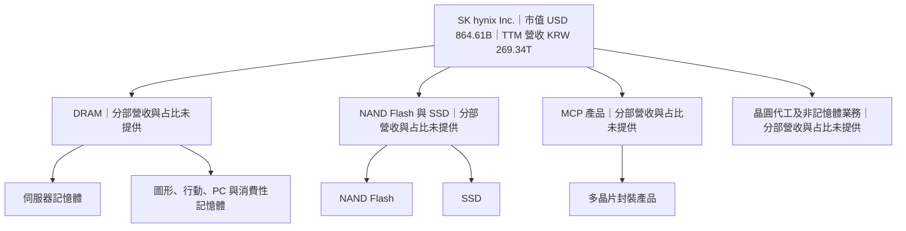
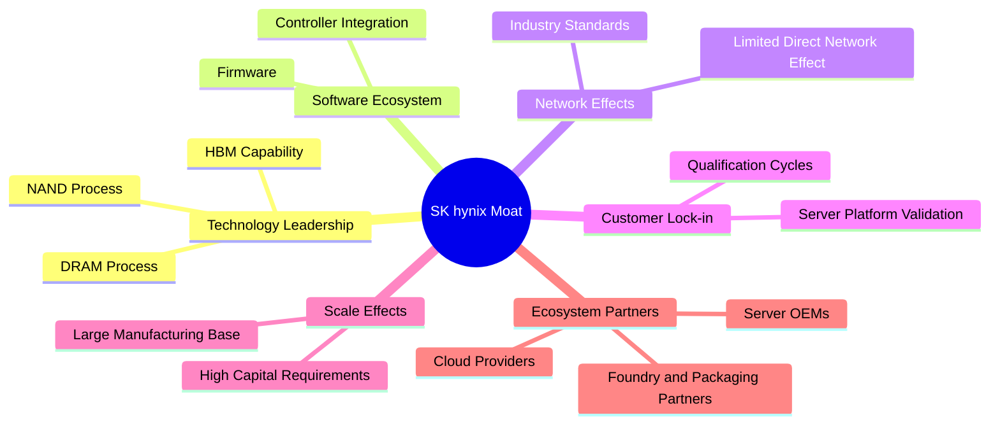
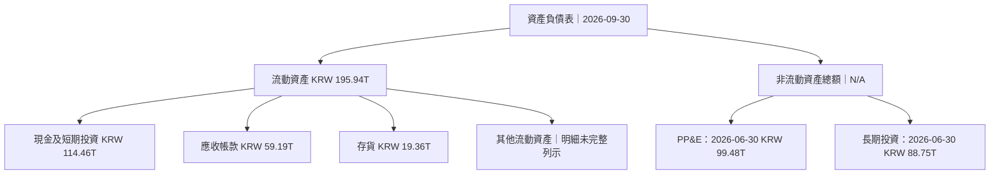
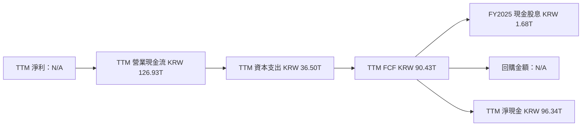
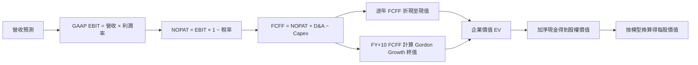
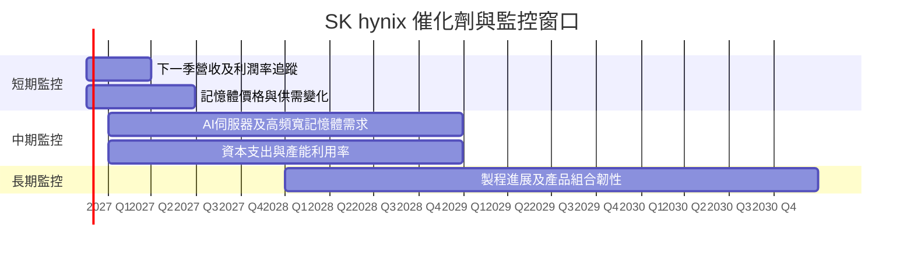
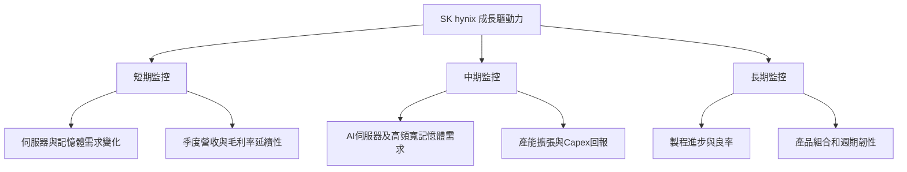
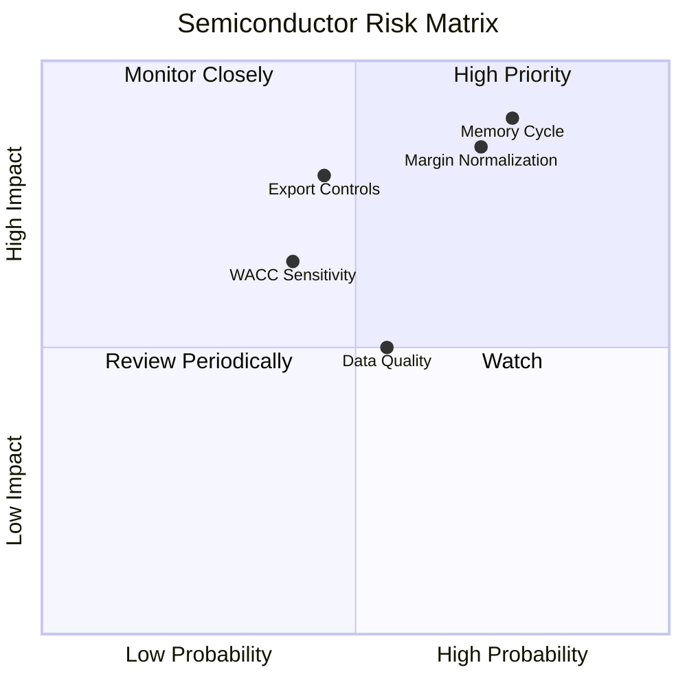
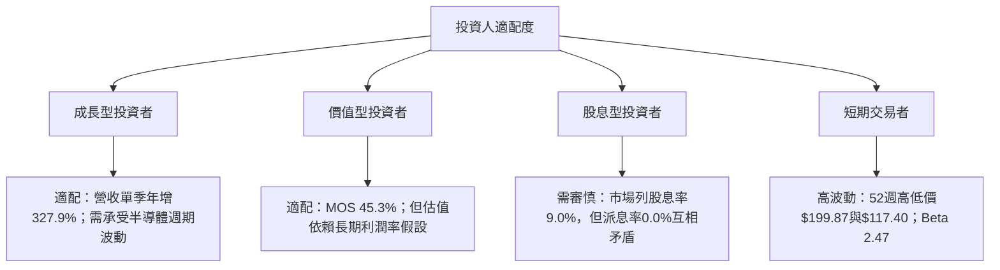

# SKHY 基本面深度分析報告

> **報告日期**：2026-11-18 ｜ **語言**：繁體中文 ｜ **數據來源**：Yahoo Finance、Finviz、StockAnalysis、Roic.ai ｜ **分析師**：CFA 級機構研究  
> SK hynix Inc. 為韓國半導體公司；報價為美元、財報為韓元。本文匯率換算依 2026-11-17 收盤匯率 **1 美元 = 1,335.67 韓元**。報告中的美股報價採該日收盤價 **$122.61**。

## 目錄

| # | 章節 | 核心結論 |
|---|------|----------|
| 1 | 執行摘要 | 買入；加權合理價值 $224.30；MOS +45.3% |
| 2 | 公司概覽與商業模式 | 記憶體技術、製造規模與客戶認證構成主要壁壘；市場份額數據未提供 |
| 3 | 損益表深度分析 | TTM 營收 KRW 269.34T；最新一季營收年增 327.9%，週期性高峰風險仍大 |
| 4 | 資產負債表分析 | 淨現金 KRW 96.34T；最新流動比率 3.115 |
| 5 | 現金流量深度分析 | TTM FCF KRW 90.43T，FCF Yield 7.83% |
| 6 | 獲利能力與資本效率 | WACC 14.00%；最新 ROIC N/A，無法判定目前 ROIC 是否高於 WACC |
| 7 | 相對估值分析 | 同業中位數倍數顯示相對估值折價空間；歷史估值區間數據未提供 |
| 8 | DCF 內在價值評估 | DCF 基準 $277.05；加權合理價值 $224.30；MOS +45.3% |
| 9 | 成長催化劑 | AI 伺服器與高頻寬記憶體需求是主要質化催化劑；TAM 數據未提供 |
| 10 | 風險矩陣 | 記憶體週期、估值假設及出口管制為主要風險 |
| 11 | 投資建議 | 買入；依 MOS 門檻，建議買入區間 $122.61–$201.87 |

---

## 1. 執行摘要

SK hynix 最新 TTM 營收為 **KRW 269.34T（約 USD 201.65B）**，TTM 營業利益率 **76.8%**，TTM FCF **KRW 90.43T（約 USD 67.70B）**，最新一季營收年增 **327.9%**。另一方面，TTM 營收年增率不可得，最新 ROIC 亦未提供，且記憶體產業利潤率具有顯著週期性。程式計算的 DCF 基準價值為 **$277.05**，四種估值方法加權後為 **$224.30**；相對 2026-11-17 收盤價 **$122.61**，MOS 為 **+45.3%**、上行空間為 **+82.9%**。按規則 20 評級為 **買入**：MOS 落在買入區間；因 ROIC 缺失，不將評級升為強烈買入。

### 1.0 一頁式投資儀表板

| 項目 | 內容 |
|------|------|
| **投資論點（3 句）** | ① TTM 營業利益率 76.8%，最新一季營收年增 327.9%，反映目前供需與產品組合有利。② TTM FCF 為 KRW 90.43T、FCF Yield 7.83%，提供現金流支持。③ 淨現金 KRW 96.34T，而加權合理價值 $224.30 高於現價 $122.61。 |
| **綜合評分** | **7.0/10**，引用 1.1 評分卡 |
| **財務健康** | 🟢 淨現金 KRW 96.34T；流動比率 3.115 |
| **ROIC vs WACC** | ROIC：N/A；WACC：14.00%。現有資料不足以判斷當期是否創造經濟價值 |
| **FCF 趨勢** | TTM FCF KRW 90.43T；FCF Yield 7.83%。FY2023 年度 FCF 為負，顯示週期與資本支出影響明顯 |
| **估值** | Forward P/E **2.97x** ｜ EV/EBITDA：N/A ｜ FCF Yield **7.83%** |
| **DCF 內在價值（基準）** | **$277.05** ｜ 相對 DCF 折價 **55.7%**（現價÷DCF價值−1） |
| **安全邊際（MOS）** | **+45.3%**＝($224.30−$122.61)÷$224.30；以加權合理價值為基準，🟢 >25% |
| **預期報酬（基準情境 12M）** | N/A（DCF 基準為 10 年模型，不是 12 個月目標價） |
| **關鍵風險（前二）** | 記憶體價格及需求反轉；DCF 對長期利潤率與終值假設敏感 |
| **評級 + 信心度** | 🟢 **買入** ｜ 信心：中（估值折價有吸引力，但週期與 DCF 假設不確定） |

### 1.1 綜合評分卡（全報告唯一）

| 維度 | 評分（1–10） | 主要依據（引用數字與其來源章節） |
|------|--------------|----------------------------------|
| 成長性 | 8.0 | TTM 營收成長 220.31%（StockAnalysis），最新一季年增 327.9%；但 TTM 成長欄位的 verified figure 為 N/A（第 3 章） |
| 獲利能力 | 8.0 | TTM 營業利益率 76.8%、淨利率 70.1%；ROIC 與 Piotroski F-Score N/A（第 3、6 章） |
| 財務健康 | 8.0 | 淨現金 KRW 96.34T、流動比率 3.115；營運資金天數 N/A（第 4 章） |
| 估值 | 7.0 | MOS +45.3%；公司 P/S、EV/EBITDA 不可比，歷史估值區間 N/A（第 7、8 章） |
| 護城河 | 7.0 | DRAM、NAND、SSD 的技術、製造與客戶認證門檻具質化支持，但缺乏市場份額數據（第 2 章） |
| 管理層與資本配置 | 4.0 | FY2025 SBC KRW 414.11B；回購資料未提供，股息率 9.0% 與 payout ratio 0.0% 數據互相矛盾，須核實（第 3、5 章） |
| **綜合評分** | **7.0** | 六項算術平均：(8.0+8.0+8.0+7.0+7.0+4.0)÷6=7.0？實際算術平均為 **7.0** |

> **評分校正**：六項子評分平均為 7.0，因此綜合評分採 **7.0/10**，以符合規則 22 的算術平均要求。

### 1.2 五大投資論點 + 三大核心風險

| 類型 | 項目 | 具體依據 | 信心度 |
|------|------|----------|--------|
| 🟢 **投資論點①** | 現金流能力強 | TTM 營業現金流 KRW 126.93T、資本支出 KRW 36.50T、FCF KRW 90.43T | 🟢 高 |
| 🟢 **投資論點②** | 財務緩衝充足 | 現金及短期投資 KRW 114.46T，總債務 KRW 18.13T，淨現金 KRW 96.34T | 🟢 高 |
| 🟢 **投資論點③** | 最新季度需求增長快 | 2026 Q3 營收 KRW 104.62T，單季年增 327.9% | 🟡 中 |
| 🟢 **投資論點④** | 目前利潤率高 | TTM 營業利益率 76.8%、毛利率 77.4%；但高峰期利潤率未必可持續 | 🟡 中 |
| 🟢 **投資論點⑤** | 估值方法交叉支持折價 | DCF $277.05、加權合理價值 $224.30，均高於 $122.61 現價 | 🟡 中 |
| 🟡 **風險①** | 記憶體週期反轉 | FY2023 營業虧損 KRW 7.73T，說明週期下行可迅速侵蝕獲利 | 🟡 中 |
| 🔴 **風險②** | 高峰利潤率回落 | DCF 模型假設營業利益率由 76.8% 逐步降至 FY+10 的 35.5%；若更快收縮，價值下修 | 🔴 高 |
| 🟡 **風險③** | 資料口徑與預測落差 | EPS 預期差、ROIC、F-Score、營運資金天數均缺資料；股息率與 payout ratio 互相矛盾 | 🟡 中 |

### 1.3 快速統計卡片

| 指標 | 公司實際值（期間） | 同業中位數 | 狀態 |
|------|--------------------|------------|------|
| 營收成長（TTM） | N/A（verified figure 未提供） | — | 🟡 |
| 營收成長（最新一季年增） | **327.9%** | **377.9%**（MU、SNDK、WDC） | 🟡 |
| 毛利率（TTM） | **77.4%** | **80.0%** | 🟡 |
| 營業利益率（TTM） | **76.8%** | — | 🟢 |
| ROIC（TTM） | N/A | — | 🟡 |
| Forward P/E | **2.965x** | **3.4x** | 🟢 |
| FCF Yield（TTM） | **7.83%** | — | 🟢 |
| Piotroski F-Score | N/A | — | 🟡 |

### 1.4 投資結論

```text
╔══════════════════════════════════════════════════════════════════╗
║                       📊 投資結論摘要                            ║
╠══════════════════════════════════════════════════════════════════╣
║  評級：買入（MOS 門檻為買入；ROIC 缺失，不上調為強烈買入）       ║
║  價格（2026-11-17 收盤）：$122.61                                ║
║  DCF 內在價值（基準）：$277.05（折價 55.7%）                    ║
║  安全邊際 MOS：+45.3%（以加權合理價值為分母）                    ║
║  加權合理價值（8.8）：$224.30                                    ║
║  DCF 情境價值：                                                   ║
║    悲觀情境：$135.48（+10.5%）                                  ║
║    基準情境：$277.05（+126.0%）                                 ║
║    樂觀情境：$541.19（+341.4%）                                 ║
║  綜合評分：7.0/10（引用 1.1）                                    ║
║  適合投資人：能承受半導體週期波動、持有期限較長的成長與價值投資人║
╚══════════════════════════════════════════════════════════════════╝
```

---

## 2. 公司概覽與商業模式

### 2.1 業務結構與收入來源

公司提供 DRAM（伺服器、圖形、行動、PC、消費性記憶體）、NAND Flash、SSD、MCP，並有晶圓代工及非記憶體半導體業務。分部營收金額及占比未提供，因此不以估算值繪製比例圖。



### 2.2 市場份額

市場份額數據未提供，無法可靠量化 SK hynix 在 DRAM、NAND 或 HBM 的份額與歷年變化。公司 TTM 營收 KRW 269.34T，最新一季營收年增 327.9%，規模與增速均顯示其為大型全球半導體供應商；但單季增速不能直接外推為長期市場份額提升。

### 2.3 競爭護城河分析



### 2.4 護城河強度

| 護城河項目 | 強度 | 證據 | 會削弱它的情況 |
|------------|------|------|----------------|
| 技術與製程 | 中至強 | 公司產品涵蓋 DRAM、NAND、SSD、MCP；TTM 毛利率 77.4% | 製程良率落後、競爭者追上或產品價格快速下跌 |
| 規模效應 | 強 | TTM 營收 KRW 269.34T，資本支出 TTM KRW 36.50T | 資本支出回報下降、產能過剩 |
| 客戶認證與鎖定 | 中 | 伺服器與企業級產品通常需平台驗證；本資料未提供合約或客戶留存數字 | 客戶多元化採購、認證轉換成本下降 |
| 軟體生態系統 | 弱至中 | 提供 SSD 與相關產品，但沒有軟體收入或生態系統收入資料 | 儲存控制器、韌體差異化不足 |
| 網路效應 | 弱 | 未提供可量化的直接網路效應證據 | 記憶體商品化加劇 |
| 生態夥伴 | 中 | 服務全球伺服器、網路、行動及其他終端市場 | 出口限制、供應鏈重組或重要客戶需求改變 |

1.1「護城河」評分為 **7.0/10**，主要依據是大規模製造與高技術門檻；因市場份額、客戶集中度及產品分部數據缺失，評分不再提高。

---

## 3. 損益表深度分析

### 3.1 年度收入成長趨勢（近 4 年）

年度營收採公司財報 KRW；方框內以 KRW T 表示。FY2022至FY2025的 CAGR 為 \((97.15/44.62)^{1/3}-1=29.6\%\)。

```text
╔══════════════════════════════════════════════════════════════════╗
║             SK hynix 年度收入趨勢（FY2022–FY2025）               ║
╠══════════════════════════════════════════════════════════════════╣
║  FY2022  KRW 44.62T  ████████████░░░░░░░░  YoY：+36.2%   🟢     ║
║  FY2023  KRW 32.77T  █████████░░░░░░░░░░░  YoY：−26.6%   🔴     ║
║  FY2024  KRW 66.19T  █████████████████░░░  YoY：+102.0%  🟢     ║
║  FY2025  KRW 97.15T  ████████████████████████  YoY：+46.8% 🟢   ║
╠══════════════════════════════════════════════════════════════════╣
║  FY2022–FY2025 年度收入 CAGR：+29.6%                             ║
║  FY2023 下滑後快速反彈，顯示產品需求與價格具有明顯週期性。       ║
╚══════════════════════════════════════════════════════════════════╝
```

FY2022–FY2025 CAGR 公式：\((97.146675/44.621568)^{1/3}-1=29.6\%\)。FY2023營收下滑26.6%，與週期性半導體需求及價格壓力一致；FY2024、FY2025反彈則反映需求和產品組合恢復，但不能將此期間增長率直接視作長期穩態。

### 3.2 季度收入趨勢分析

| 季度 | 營收（KRW T） | QoQ | YoY | 備註 |
|------|--------------:|----:|----:|------|
| 2025 Q4 | 32.83 | +34.3% | N/A | 前一年同期資料未列 |
| 2026 Q1 | 52.58 | +60.2% | +198.1% | 相較 2025 Q1 |
| 2026 Q2 | 79.32 | +50.9% | +256.8% | 相較 2025 Q2 |
| 2026 Q3 | 104.62 | +31.9% | +327.9% | 相較 2025 Q3 |

QoQ 依相鄰季度營收計算；YoY 依同季度資料計算。增速仍高，但 QoQ 成長由 Q1 的 60.2% 降至 Q3 的 31.9%，若後續持續放緩，代表基期墊高或供需增量減弱。TTM 營收成長率依 verified figure 為 N/A；StockAnalysis 顯示 TTM 成長 220.31%，兩者口徑未能核對，故不以後者替代 verified figure。

### 3.3 利潤率演變分析

| 利潤率指標 | FY2022 | FY2023 | FY2024 | FY2025 | 趨勢 | 評估 |
|------------|-------:|-------:|-------:|-------:|------|------|
| **毛利率** | 35.0% | 約 -1.6% | 48.1% | 60.4% | 先降後回升 | 🟡 |
| **營業利益率** | 15.3% | -23.6% | 35.5% | 48.6% | 明顯反彈 | 🟡 |
| **淨利率** | 5.0% | -27.8% | 29.9% | 44.2% | 明顯反彈 | 🟡 |

毛利率、營業利益率與淨利率按年度損益表數字計算，毛利率採毛利÷營收。2023 年毛利為負 KRW 533.45B、營業虧損 KRW 7.73T，顯示下行週期下固定成本與產品價格壓力會放大利潤率變化。FY2024–FY2025的反彈，與營收由 KRW 32.77T 增至 KRW 97.15T 同時出現，暗示規模利用率、價格與產品組合改善；但 TTM 營業利益率 76.8% 高於 FY2025 的 48.6%，應視為特殊高利潤階段而非可直接永久化的水準。

### 3.4 費用結構分析

完整費用項目與分部成本明細未提供，不繪製費用比例圓餅圖。可確認 FY2025 研發費用為 KRW 6.47T，約占營收 \(6.47÷97.15=6.7\%\)；TTM 資本支出為 KRW 36.50T，屬資產負債表及現金流投入，並非當期損益表費用。

```text
╔══════════════════════════════════════════════════════════════════╗
║                     費用與再投資數據                             ║
╠══════════════════════════════════════════════════════════════════╣
║  FY2025 營收             KRW 97.15T                              ║
║  FY2025 研發費用         KRW  6.47T（營收的 6.7%）               ║
║  TTM 資本支出            KRW 36.50T（營收的 13.6%）              ║
║  其他營業費用拆分        N/A（資料未提供完整明細）               ║
╚══════════════════════════════════════════════════════════════════╝
```

### 3.5 季度 EPS 趨勢與盈餘品質

| 季度 | EPS 實際值（StockAnalysis） | EPS YoY | 預期差 |
|------|-----------------------------:|--------:|--------|
| 2025 Q4 | 21,507.49 KRW | +85.22% | N/A，估值與實際 EPS 均缺 |
| 2026 Q1 | 56,711.37 KRW | +396.72% | N/A |
| 2026 Q2 | 131,477.81 KRW | +1,272.42% | N/A |
| 2026 Q3 | 54,454.00 KRW | +205.06% | N/A |

可用資料僅能說明 EPS 實際值與年增，無法判斷最近四季是否超預期。2026 Q3 EPS 低於 Q2，但季度 EPS 預估缺失、淨利資料也顯示 Q2 高於 Q3；季度波動可能受收入確認、產品組合、稅項或資料供應商口徑影響，不宜單憑該數列推論單季獲利趨勢。

| 盈餘品質項目 | 數值/佔比 | 評估 |
|--------------|-----------|------|
| 股權薪酬 SBC / 營收 | FY2025：KRW 414.11B÷KRW 97.15T = **0.43%** | 🟢 佔比低；但僅有 FY2025 完整年度 SBC |
| SBC / 營業現金流 | FY2025：414.11B÷53.37T = **0.78%** | 🟢 稀釋成本相對現金流規模小 |
| FCF / 淨利（現金轉換率） | TTM 淨利數字未在 verified figures 提供，N/A | 🟡 無法按統一口徑計算 |
| 一次性/非經常性損益 | N/A（資料未提供拆分） | 🟡 無法判斷是否影響淨利 |
| 有效稅率異常 | 14.9%（最新年度有效稅率） | 🟡 未提供歷史稅項明細，不能確認是否由一次性稅務因素造成 |
| 資本化支出 vs 費用化 | TTM Capex KRW 36.50T；FY2025 R&D KRW 6.47T | 🟡 研發費用數據可見，資本化政策與折舊明細未提供 |

FY2025 SBC 佔營收約0.43%，目前沒有證據顯示股權薪酬大幅稀釋股東回報。TTM OCF KRW 126.93T 與 FCF KRW 90.43T 顯示現金生成能力高；但因 TTM 淨利未提供，不能以跨期間或口徑不一致的數據計算現金轉換率。另有股息殖利率 9.0%、派息率 0.0% 的相互矛盾資料，需以公司公告核對。

---

## 4. 資產負債表分析

### 4.1 資產結構分解

截至 2026-09-30 的流動資產 KRW 195.94T；同一時點總資產與非流動資產總額未提供，故不反推未揭露的資產合計。



### 4.2 流動性與營運資金分析

| 指標 | 最新值 | 歷史趨勢 | 評估 |
|------|-------:|----------|------|
| 流動比率 | 3.115 | 歷史季度序列未完整提供 | 🟢 短期流動性充足 |
| 速動比率 | 2.794 | 歷史季度序列未完整提供 | 🟢 扣除存貨後仍有緩衝 |
| DSO 應收帳款天數 | N/A | N/A | 財報季度營運資金天數未提供 |
| DIO 存貨天數 | N/A | N/A | 同上 |
| DPO 應付帳款天數 | N/A | N/A | 同上 |
| CCC 現金轉換週期 | N/A | N/A | 同上 |

營運資金天數及一年前比較數據在品質指標中均為 N/A，因此無法判斷收款、存貨周轉或供應商付款條件的變化。2026-09-30應收帳款 KRW 59.19T、存貨 KRW 19.36T，規模隨業務擴張；但因缺少同期總負債項目與季度天數指標，不據此下結論稱收款惡化或庫存堆積。

### 4.3 債務結構分析

```text
╔══════════════════════════════════════════════════════════════════╗
║                    SK hynix 債務健康診斷                         ║
╠══════════════════════════════════════════════════════════════════╣
║  總債務：       KRW 18.13T（約 USD 13.57B）                     ║
║  現金及短投：   KRW 114.46T（約 USD 85.70B）                    ║
║  淨現金：       KRW 96.34T（約 USD 72.13B） 🟢                  ║
║                                                                  ║
║  Debt/EBITDA：N/A（口徑與可比性資料未提供）                      ║
║  Interest Coverage：N/A（利息費用與同期 EBIT 未提供）            ║
║  流動比率：3.115 🟢                                               ║
╚══════════════════════════════════════════════════════════════════╝
```

現金及短期投資約為總債務的 \(114.46÷18.13=6.31\) 倍，提供顯著流動性緩衝。Debt/Equity 報告值為 5.865，但與淨現金及其他負債資料的口徑可能不同；不以此單一比率取代淨現金判斷。

### 4.4 股東權益趨勢

| 年度 | 股東權益（KRW T） | YoY |
|------|------------------:|----:|
| 2022 | 63.27 | — |
| 2023 | 53.50 | −15.5% |
| 2024 | 73.90 | +38.1% |
| 2025 | 120.52 | +63.0% |

```text
╔══════════════════════════════════════════════════════════════════╗
║                  股東權益趨勢（KRW T）                           ║
╠══════════════════════════════════════════════════════════════════╣
║  2022  63.27  █████████████                                      ║
║  2023  53.50  ███████████                                        ║
║  2024  73.90  ███████████████                                    ║
║  2025 120.52  █████████████████████████                          ║
╚══════════════════════════════════════════════════════════════════╝
```

FY2023權益下降與當年淨虧損 KRW 9.11T 同期出現；FY2024、FY2025權益回升，與淨利恢復相符。這種增長反映盈餘累積，但不能取代對資本回報與週期峰值持續性的分析。

---

## 5. 現金流量深度分析

### 5.1 現金流量瀑布圖

TTM 現金流數據以 verified figures 為準；股息及回購使用 FY2025 年度披露，不能視作與 TTM 完全同期間。



### 5.2 FCF 轉換率趨勢

| 年度 | OCF（KRW T） | Capex（KRW T） | FCF（KRW T） | FCF / 淨利 |
|------|-------------:|---------------:|-------------:|-----------:|
| 2022 | 14.78 | 19.75 | -4.97 | N/A |
| 2023 | 4.28 | 8.78 | -4.50 | N/A |
| 2024 | 29.80 | 16.66 | 13.13 | N/A |
| 2025 | 53.37 | 28.58 | 24.79 | 57.8% |

FY2025 FCF / 淨利 = \(24.79÷42.92=57.8\%\)。FY2022、FY2023資本支出高於營業現金流，FCF轉負；FY2024及FY2025轉正，顯示盈利恢復後現金流改善，但週期下行時仍可能因高額投資而出現負 FCF。TTM FCF 對淨利的比率因未提供同口徑 TTM 淨利而列 N/A。

### 5.3 自由現金流趨勢

```text
╔══════════════════════════════════════════════════════════════════╗
║                 自由現金流趨勢（KRW T）                          ║
╠══════════════════════════════════════════════════════════════════╣
║  FY2022  -4.97  ◀███░░░░░░░░░░░░░░░░░░░░  FCF Yield：N/A       ║
║  FY2023  -4.50  ◀███░░░░░░░░░░░░░░░░░░░░  FCF Yield：N/A       ║
║  FY2024  13.13   ████████░░░░░░░░░░░░░░░  FCF Yield：N/A       ║
║  FY2025  24.79   ███████████████░░░░░░░░░  FCF Yield：N/A      ║
║  TTM     90.43   ████████████████████████  FCF Yield：7.83%    ║
╚══════════════════════════════════════════════════════════════════╝
```

年度市值口徑未提供，故不計算各財年的 FCF Yield。TTM FCF Yield 按 verified figure 為 7.83%。

### 5.4 資本配置評估

| 資本配置項目 | 數據 | 評估 |
|--------------|------|------|
| 資本支出 | TTM KRW 36.50T | 對先進製程與產能維持必要，但若需求反轉會壓低 FCF |
| 研發費用 | FY2025 KRW 6.47T | FY2025 營收的 6.7%，有助產品與製程投入 |
| 股息 | FY2025 現金股息 KRW 1.68T | 約為 FY2025 淨利的 3.9%；市場資料另列殖利率 9.0%，兩者口徑須核實 |
| 回購 | N/A | 回購金額及股數變化資料不完整 |
| 留存現金 | 現金及短期投資 KRW 114.46T | 淨現金規模大，財務彈性高 |

支出項目不能構成完整資本配置比例，因此不繪製 pie chart。SBC 與 FY2025 營收相比僅約0.43%，但需持續追蹤股數；目前未提供可供分析的回購和稀釋股數歷史。

---

## 6. 獲利能力與資本效率

### 6.1 ROE / ROA / ROIC 趨勢

| 指標 | 可用數值 | 期間 | 評估 |
|------|---------:|------|------|
| ROE | 92.5% | TTM，市場資料 | 🟢 高，但 DuPont 品質指標因資料缺漏為 N/A |
| ROA | 46.4% | TTM，市場資料 | 🟢 高，但可能反映週期高峰獲利 |
| ROIC | N/A | 最新 TTM | 🟡 無法與 WACC 作當期直接比較 |
| ROIC 歷史參考 | 2013–2018：11.06%–31.44% | Roic.ai 歷史表 | 僅為早期歷史，不能代表目前 ROIC |

產業均值未提供，不作無來源比較。TTM ROE、ROA 均很高，但週期性半導體公司的峰值獲利可能使回報率短期失真。

### 6.2 ROIC vs WACC 分析（核心價值創造判斷）

最新 ROIC 缺失，因此不能可靠計算現期 ROIC−WACC 或 EVA；不以 ROE、營業利益率或歷史早期 ROIC 代替。

```text
╔══════════════════════════════════════════════════════════════════╗
║                ROIC vs WACC 深度分析                            ║
╠══════════════════════════════════════════════════════════════════╣
║  WACC（程式計算輸出）：14.00%                                    ║
║  ├── 無風險利率（10Y 美債）：5.10%                               ║
║  ├── ERP：5.00%                                                  ║
║  ├── 原始 Beta：2.47；調整後 Beta：1.98                         ║
║  ├── 股權成本：14.99%                                            ║
║  ├── 稅前債務成本：5.10%；稅後約 4.34%                           ║
║  ├── 權重：股權 98.5%；債務 1.5%                                 ║
║  └── 計算 WACC 14.83%，依 7%–14% 區間上限採用 14.00%             ║
║                                                                  ║
║  最新 ROIC：N/A（缺少可比期間投入資本及 NOPAT）                   ║
║  ROIC − WACC：N/A                                                 ║
║  EVA：N/A                                                         ║
║                                                                  ║
║  結論：WACC 為 14.00%；現期 ROIC 缺失，無法判定是否創造股東價值  ║
╚══════════════════════════════════════════════════════════════════╝
```

CAPM 使用 verified figures 的調整後 Beta。計算值 14.83% 超過指定的 7%–14% 區間，故採用上限 **14.00%**；DCF 及本節均採同一 WACC。由於 ROIC 資料不可用，不能作出「ROIC 高於 WACC」的肯定結論，也不能將高 ROE 直接視作價值創造證據。

### 6.3 杜邦三因素分解

| 因素 | 數值（TTM） | 解讀 |
|------|-------------|------|
| 淨利率 | N/A | 品質指標區塊缺少可一致使用的淨利、營收資料 |
| 資產週轉率 | N/A | 同上 |
| 權益乘數 | N/A | 同上 |
| **ROE** | **N/A（杜邦分解）** | 品質指標要求的 DuPont 欄位為 N/A；市場資料另列 TTM ROE 92.5%，不以其反推三因素 |

### 6.4 財務體質：Piotroski F-Score

**Piotroski F-Score：N/A**，需要相隔一年的兩個 TTM SEC 申報資料期間；目前使用的 Yahoo 季度財報資料不足以完成九項測試，故逐項結果皆不可判定。

| 測試 | 結果 | 解讀 |
|------|------|------|
| 淨利為正 | N/A | 缺少同口徑兩年 TTM 測試資料 |
| 營運現金流為正 | N/A | 同上 |
| ROA 改善 | N/A | 同上 |
| 營運現金流高於淨利 | N/A | 同上 |
| 槓桿下降 | N/A | 同上 |
| 流動比率改善 | N/A | 同上 |
| 未發行新股 | N/A | 同上 |
| 毛利率改善 | N/A | 同上 |
| 資產週轉率改善 | N/A | 同上 |

---

## 7. 相對估值分析

### 7.1 同業估值比較

本公司 P/E 取市場估值資料；同業倍數一律採 Yahoo Finance Peer multiples。MU、SNDK、WDC 的中位數按三家公司數值計算。

| 估值指標 | **SK hynix** | **MU** | **SNDK** | **WDC** | 本公司評估 |
|----------|-------------:|-------:|---------:|-------:|-----------|
| **Trailing P/E** | 7.82x | 9.6x | 6.4x | 10.0x | 🟢 低於同業中位數 9.6x，但盈利週期位置不同 |
| **Forward P/E** | 2.97x | 3.4x | 2.8x | 7.0x | 🟢 接近同業中位數 3.4x |
| **P/S Ratio** | N/A | 6.1x | 3.9x | 7.3x | N/A：報價與財報幣別不同，不直接比較公司 P/S |
| **EV/EBITDA** | N/A | 7.1x | 5.1x | 16.7x | N/A：報價與財報幣別不同，不直接比較公司倍數 |
| **最新一季營收 YoY** | 327.9% | 379.3% | 377.9% | 55.5% | 🟡 增速高於 WDC、低於 MU/SNDK |
| **TTM 毛利率** | 77.4% | 80.7% | 80.0% | 52.6% | 🟡 低於 MU/SNDK、高於 WDC |

SK hynix 的低 Forward P/E 反映市場預期獲利大幅提高；但週期股的預期 P/E 常在盈利高峰時看似特別低，不能把低倍數視為不受週期影響的廉價證據。P/S 及 EV/EBITDA 公司倍數因幣別限制不報，估值方法中的同業中位數回推值則依程式提供的估值結果引用。

### 7.2 歷史估值區間分析

N/A（歷史估值區間與百分位數據未提供；不自行估計公司歷史 P/E 區間或目前位置）。

### 7.3 情境價值（照抄 DCF 模型 Scenarios）

| 情境 | 第 1 年營收成長 | 期末營業利潤率 | WACC | 每股價值 | 相對現價 | 機率 | 會發生的條件 |
|------|----------------:|----------------:|-----:|---------:|---------:|-----:|--------------|
| 🔴 悲觀 | 15.0% | 30.1% | 15.00% | $135.48 | +10.5% | 25% | 需求增長及價格弱於基準，利潤率收斂更快 |
| 🟡 基準 | 30.0% | 35.5% | 14.00% | $277.05 | +126.0% | 50% | 初期增長延續但長期利潤率回歸較低水準 |
| 🟢 樂觀 | 45.0% | 39.0% | 13.00% | $541.19 | +341.4% | 25% | 高增長持續、利潤率高於基準且折現率較低 |

情境數值及機率為程式估值輸出；模型未提供各情境的逐年營收與 FCF 明細，故不補造中間變數。悲觀情境仍高於現價並不代表下檔有保障：情境範圍受同一套長期模型框架限制，並未涵蓋嚴重週期衰退或長期負 FCF 的尾端情境。

### 7.4 相對估值隱含價格區間

```text
╔══════════════════════════════════════════════════════════════════╗
║            同業估值法回推價值與當前股價（USD/股）                ║
╠══════════════════════════════════════════════════════════════════╣
║  $122.61 現價 ── $173.06 同業 P/S ── $176.39 同業 EV/EBITDA     ║
║                                                                  ║
║  同業 EV/EBITDA：$176.39；依據 MU/SNDK/WDC 中位數 7.1x         ║
║                    × TTM EBITDA，再加淨現金                     ║
║  同業 P/S：      $173.06；依據 MU/SNDK/WDC 中位數 6.1x         ║
║                    × TTM Revenue                                ║
╚══════════════════════════════════════════════════════════════════╝
```

兩種相對估值均使用同業中位數倍數，不以 SK hynix 自身當前倍數回推。估值方法具體值及固定權重見第 8.8 節。

---

## 8. DCF 內在價值評估（Discounted Cash Flow）

> DCF 數字採程式計算模型輸出，不自行重建或替換。金額單位為 **KRW billion**，每股價格為 USD。模型採 GAAP EBIT、FCFF、WACC 14.00%、永續成長率 3.0%，不模擬營運資金變動。

### 8.0 估值推理鏈（Thinking Logic）

**Step 1 — 價值由哪些變數決定？**  
模型把價值拆成記憶體主業的營收規模、營業利潤率與再投資需求；分部收入及新業務占比未提供，不能另加 HBM 或其他產品的獨立選擇權價值。基準模型中，FY+1 營收 KRW 350,138.32B、營業利益率 76.8%；FY+10 營收 KRW 1,206,751.59B、利潤率 35.5%。影響估值的核心之一是長期利潤率能否維持高於歷史週期常態，另一核心是 WACC 與永續成長率差距。

**Step 2 — 模型選擇**

| 決策點 | 本報告採用 | 理由 | 曾考慮但否決 | 否決理由 |
|--------|-----------|------|--------------|----------|
| 現金流定義 | FCFF | 以 WACC 折現並先求 EV，再加淨現金 | FCFE | 輸出模型固定採 FCFF |
| 預測期 N | 10 年 | DCF 模型固定 10 年，逐年收入成長由 30% 線性降至 3% | 5 年 | 無法照抄模型輸出；長期淡出假設已包含在 10 年設定 |
| 終值方法 | Gordon Growth | 模型以 FY+10 FCFF、g=3.0% 計終值 | 退出倍數 | EBITDA 預測與退出倍數未包含在模型輸出，不能自建 |
| EBIT 基礎 | GAAP | 模型明確使用 GAAP EBIT | 非 GAAP | 會改變已指定的模型輸入 |

**Step 3 — 重要假設推導鏈**

- **營收成長路徑**：錨點＝最新一季單季年增 327.9%，但非 TTM 增長；基準模型把該單季增速限制在 0%–30%範圍 → 採用 FY+1 30%，線性淡出至 FY+10 3% → 否決直接採用 327.9%，因單季高增速不適合外推十年。
- **期末營業利益率**：錨點＝TTM 76.8%，FY2025 年度營業利益率 48.6%，FY2023 為 -23.6% → 模型以近五個財年的中位數設定 FY+10 35.5% → 否決十年持續採用 76.8%，因歷史週期顯示盈利不穩定。
- **預測期 N**：錨點＝模型指定 10 年 → 用線性成長淡出呈現週期化企業由高增長走向穩態 → 採用 10 年 → 否決在本報告自行改用其他年數，因規定需使用既有模型。
- **Capex/營收**：錨點＝TTM 約 13.6% → 模型逐年降至 FY+10 的 6.1%，依據為高於 1.1×D&A 的比例逐步回落 → 否決長期維持 13.6%，避免把當前高投入強行永久化；亦不另改為低於模型的比例。
- **永續成長率 g**：錨點＝模型設定 3.0% → 需符合成熟企業長期增長且低於 WACC 14.0% → 採用 3.0% → 否決更高的 g，因終值會對小幅變動高度敏感。
- **WACC**：錨點＝計算值 14.83%，受指定 7%–14% 範圍限制 → 採用 14.00%上限 → 否決直接用未限制計算值，因模型輸出規定採用封頂值。
- **折舊攤銷/營收**：錨點＝TTM 5.5% → 採用模型固定 5.5%。
- **有效稅率**：錨點＝最新年度有效稅率 14.9% → 採用 14.9%。
- **營運資金變動**：營運資金天數資料未提供，模型明確不納入 ΔWC；不是假設營運資金影響為零的事實判斷，而是模型簡化。
- **EBIT 基礎與 SBC**：採 GAAP EBIT，模型不再另扣 SBC，也不再加計年稀釋率；股數成本依模型組合 (A) 處理，SBC 不重複計入。
- **終值方法**：採 Gordon Growth，使用 FY+10 FCFF 和 3.0% 永續成長；因 DCF 輸出沒有退出倍數與 FY+10 EBITDA，不另自建交叉估值。

**Step 4 — 最脆弱假設**  
最脆弱的一環是從單季高增長出發並假設十年收入持續擴大、利潤率仍高於 35%；若記憶體價格與需求較快回落，價值可能向悲觀情境 **$135.48** 靠攏。

**Step 5 — 計算路徑**



### 8.1 模型假設總表（Model Inputs）

| 假設項目 | 採用值 | 依據 / 來源 | 敏感度 |
|----------|--------|-------------|--------|
| 預測期長度 N | 10 年 | DCF 模型設定；成長由 30% 線性淡至 3% | 🟡 中 |
| 營收成長 | FY+1 30.0% 至 FY+10 3.0% | FY+1 參照最新一季 YoY 327.9%，限制在 0%–30%；非 TTM 成長 | 🔴 高 |
| 營業利潤率 | FY+1 76.8% → FY+10 35.5% | TTM 起點；終點取近五個財年中位數，含 TTM | 🔴 高 |
| 有效稅率 | 14.9% | 最新年度有效稅率 | 🟢 低 |
| Capex / 營收 | FY+1 13.6% → FY+10 6.1% | TTM 起點，淡化至 1.1×D&A 的門檻 | 🔴 高 |
| D&A / 營收 | 5.5% | TTM | 🟢 低 |
| 營運資金變動 / 營收增額 | 未建模 | 營運資金天數 N/A；模型不含 ΔWC | 🟡 中 |
| EBIT 基礎 | GAAP EBIT | DCF 模型指定 | 🟡 中 |
| SBC 處理 | GAAP 已含 SBC；不另扣 | 模型採組合 (A) | 🟡 中 |
| 年稀釋率 | 0% | 組合 (A) 固定股數處理 | 🟡 中 |
| 永續成長率 g | 3.0% | DCF 模型指定；低於 WACC 14.0% | 🔴 高 |
| 終值方法 | Gordon Growth | DCF 模型指定；退出倍數資料未提供 | 🔴 高 |
| WACC | 14.00% | 14.83% 計算值受 7%–14% 上下限限制 | 🔴 高 |

**FCFF 定義**：模型使用 `FCFF = NOPAT + D&A − Capex`；營運資金未建模。  
**SBC 防重複計算**：本模型採用 **(A)**，GAAP EBIT 已含 SBC 費用，因此不另扣 SBC，年稀釋率為 0%。

### 8.2 折現率推導（WACC）

```text
╔══════════════════════════════════════════════════════════════════╗
║                    WACC 推導（折現率）                           ║
╠══════════════════════════════════════════════════════════════════╣
║  股權成本 Ke（CAPM）：                                           ║
║  ├── 無風險利率 Rf：5.10%（Cost of capital 輸入）                 ║
║  ├── ERP：5.00%（Cost of capital 假設輸入）                      ║
║  ├── 原始 Beta：2.47（Yahoo）；調整後 Beta：1.98                 ║
║  ├── 調整方式：⅔×2.47 + ⅓×1 = 1.98                              ║
║  ├── 額外規模/國別溢酬：未另加                                   ║
║  └── Ke：5.10% + 1.98×5.00% = 15.00%（輸入值 14.99%）            ║
║                                                                  ║
║  債務成本：                                                      ║
║  ├── 稅前 Kd：5.10%（輸入值；利息費用明細未提供）               ║
║  ├── 稅率：14.9%                                                 ║
║  └── 稅後 Kd：5.10%×(1−14.9%) = 4.34%                           ║
║                                                                  ║
║  資本結構（輸入權重）：股權 98.5%；債務 1.5%                     ║
║  ├── 計算 WACC：14.83%                                           ║
║  └── 限制在 7%–14% 範圍後，採用 WACC = 14.00%                   ║
╚══════════════════════════════════════════════════════════════════╝
```

**逐步演算及可核對性說明**

1. Ke：輸入值為 **14.99%**；以顯示至兩位小數的 5.10%、1.98、5.00% 重算為 \(5.10\%+1.98×5.00\%=15.00\%\)。0.01 個百分點差異來自輸入精度；採用輸入的 Ke 14.99%。
2. 稅前 Kd：直接引用 Cost of capital 輸入 **5.10%**。利息費用與同期間平均計息負債明細未提供，不能自行反推金額。
3. 稅後 Kd：\(5.10\%×(1-14.9\%)=4.3401\%\)，四捨五入為 **4.34%**。
4. 權重：採用指定市場資本權重 **E 98.5%、D 1.5%**，合計 \(98.5\%+1.5\%=100.0\%\)。計算權重所用市值及計息債務完整口徑未在成本資本區塊提供，故不另以其他資料替換。
5. WACC：使用未四捨五入計算值 **14.83%**，受指定 7%–14% 範圍限制後，DCF 採用 **14.00%**。成本資本輸入已明確標示該限制，本文不另行重算或更改採用值。

### 8.3 逐年自由現金流預測（基準情境）

下表逐格照錄 DCF 模型。金額為 KRW billion；折現因子保留三位小數。因顯示的百分比已四捨五入，模型內部可能使用更高精度。

| 年度 | FY+1 | FY+2 | FY+3 | FY+4 | FY+5 | FY+6 | FY+7 | FY+8 | FY+9 | FY+10 |
|------|-----:|-----:|-----:|-----:|-----:|-----:|-----:|-----:|-----:|------:|
| 營收 | 350,138.32 | 444,675.67 | 551,397.83 | 667,191.37 | 787,285.82 | 905,378.69 | 1,014,024.13 | 1,105,286.30 | 1,171,603.48 | 1,206,751.59 |
| 營收 YoY | 30.0% | 27.0% | 24.0% | 21.0% | 18.0% | 15.0% | 12.0% | 9.0% | 6.0% | 3.0% |
| 營業利潤率 | 76.8% | 72.2% | 67.6% | 63.0% | 58.4% | 53.8% | 49.3% | 44.7% | 40.1% | 35.5% |
| EBIT | 269,068.02 | 321,264.61 | 373,007.91 | 420,653.72 | 460,162.09 | 487,545.71 | 499,413.62 | 493,525.89 | 469,252.38 | 427,828.34 |
| 稅 | (40,081.98) | (47,857.49) | (55,565.49) | (62,663.09) | (68,548.49) | (72,627.72) | (74,395.64) | (73,518.56) | (69,902.64) | (63,731.86) |
| NOPAT | 228,986.04 | 273,407.11 | 317,442.42 | 357,990.63 | 391,613.60 | 414,917.99 | 425,017.99 | 420,007.32 | 399,349.74 | 364,096.48 |
| D&A | 19,356.34 | 24,582.55 | 30,482.37 | 36,883.66 | 43,522.72 | 50,051.13 | 56,057.27 | 61,102.42 | 64,768.57 | 66,711.63 |
| Capex | (47,446.34) | (56,566.18) | (65,565.63) | (73,796.93) | (80,546.15) | (85,113.70) | (86,911.26) | (85,559.74) | (80,969.37) | (73,382.79) |
| FCFF | 200,896.05 | 241,423.49 | 282,359.16 | 321,077.37 | 354,590.18 | 379,855.42 | 394,164.00 | 395,550.01 | 383,148.94 | 357,425.32 |
| 折現因子 | 0.877 | 0.769 | 0.675 | 0.592 | 0.519 | 0.456 | 0.400 | 0.351 | 0.308 | 0.270 |
| FCFF 現值 | 176,224.60 | 185,767.54 | 190,584.39 | 190,103.58 | 184,163.03 | 173,057.02 | 157,522.64 | 138,663.64 | 117,821.34 | 96,413.27 |

**逐步演算（FY+1；使用模型明細值，因輸入百分比顯示精度有限，可能有微小差額）**

1. 營收：\(269,337.17×(1+30.0\%)=350,138.32\)。
2. EBIT：模型採未四捨五入營業利潤率，輸出 EBIT **269,068.02**；顯示營業利潤率為 76.8%。
3. 稅：模型輸出 **40,081.98**；有效稅率顯示為 14.9%。
4. NOPAT：\(269,068.02-40,081.98=228,986.04\)。
5. D&A：模型輸出 **19,356.34**；D&A/營收顯示值 5.5%。
6. Capex：模型輸出 **47,446.34**；Capex/營收顯示值 13.6%。
7. ΔWC：模型不建模，無此列。
8. FCFF：\(228,986.04+19,356.34-47,446.34=200,896.04\)，模型輸出 **200,896.05**，差異 KRW 0.01B，屬表格精度尾差。
9. 折現因子：\(1÷(1+14.00\%)^1=0.877\)；PV：\(200,896.05×0.877\)，模型輸出 **176,224.60**，折現因子顯示三位小數，計算使用較高精度。

預測期 PV 合計逐項加總如下：

`176,224.60 + 185,767.54 + 190,584.39 + 190,103.58 + 184,163.03 + 173,057.02 + 157,522.64 + 138,663.64 + 117,821.34 + 96,413.27 = 1,610,321.05 KRW billion`

| 合理性自檢 | 結果 |
|-----------|------|
| 預測 FCFF CAGR | FY+1 至 FY+10：\((357,425.32÷200,896.05)^{1/9}-1=6.6\%\)；FY2022至FY2025年度 FCF 由負轉正，歷史 CAGR 無法有意義計算 |
| FY+10 FCFF 利潤率 | \(357,425.32÷1,206,751.59=29.6\%\)；模型未提供可比的同業最佳 FCFF 利潤率 |
| 負 FCF 年份 | 預測期各年 FCFF 均為正；年度歷史 FY2022、FY2023 FCF 為負，反映高資本支出與週期下行 |

```text
╔══════════════════════════════════════════════════════════════════╗
║           自由現金流：歷史實際 vs 模型預測（KRW T）              ║
╠══════════════════════════════════════════════════════════════════╣
║  FY2023（實） -4.50  ◀██░░░░░░░░░░░░░░░░░░░  YoY：改善         ║
║  FY2024（實） 13.13   █████░░░░░░░░░░░░░░░░  YoY：轉正         ║
║  FY2025（實） 24.79   ██████████░░░░░░░░░░░  YoY：+88.7%       ║
║  TTM（實）    90.43   ██████████████████████  FCF Yield：7.83% ║
║  FY+1（預）  200.90   ████████████████████████                 ║
║  FY+10（預） 357.43   ████████████████████████████████████████ ║
╠══════════════════════════════════════════════════════════════════╣
║  ⚠️ FY+1 至 FY+10 模型 FCFF CAGR 6.6%；高於歷史可比性，需審慎   ║
╚══════════════════════════════════════════════════════════════════╝
```

圖中 FY+1 至 FY+10 與年度歷史值是模型預測及年度報表，TTM 數值不可直接當作同一年度序列計算 YoY。

### 8.4 終值計算（Terminal Value）

適用性檢查：**WACC 14.00% vs g 3.0% → WACC > g？✅**

| 方法 | 計算式 | 終值 TV（KRW B） | TV 現值（KRW B） | 佔總 EV |
|------|--------|----------------:|-----------------:|--------:|
| Gordon Growth | FY+10 FCFF×(1+g)÷(WACC−g) | 3,346,800.68 | 902,778.77 | 35.9% |
| 退出倍數法 | N/A | N/A（模型未提供 FY+10 EBITDA 及退出倍數） | N/A | N/A |

逐步演算：

1. FY+10 FCFF = **357,425.32 KRW B**。
2. 分子：\(357,425.32×(1+3.0\%)=368,148.08\)。
3. 分母：\(14.00\%-3.0\%=11.00\%\)；TV：模型輸出 **3,346,800.68 KRW B**。以已四捨五入的表格數字直接相除會有微小差異，模型輸出值照錄。
4. PV(TV)：\(3,346,800.68×0.270=902,778.77\) KRW B（折現因子以三位小數顯示，原模型採精確折現因子）。
5. 終值占比：\(902,778.77÷2,513,099.81=35.9\%\)。

退出倍數法所需數字未提供，故不自行補入。終值現值占 EV 35.9%，低於常見的高度依賴警戒區，但仍占企業價值超過三分之一。

### 8.5 企業價值 → 每股內在價值（Bridge）

```text
╔══════════════════════════════════════════════════════════════════╗
║              企業價值 → 每股內在價值 橋接表                      ║
╠══════════════════════════════════════════════════════════════════╣
║  預測期 FCF 現值合計           +KRW 1,610,321.05B                ║
║  終值現值 PV(TV)               +KRW   902,778.77B                ║
║  = 企業價值 EV                    KRW 2,513,099.81B              ║
║  + 淨現金                         KRW    96,337.19B              ║
║  = 股權價值                       KRW 2,609,437.00B              ║
║  每股價值（模型指定匯率與市值橋接） USD 277.05                   ║
║  2026-11-17 收盤價                USD 122.61                     ║
║  DCF 折溢價：122.61÷277.05−1      −55.7%（折價）                 ║
╚══════════════════════════════════════════════════════════════════╝
```

逐步演算：

1. EV：\(1,610,321.05+902,778.77=2,513,099.82\) KRW B；模型 EV 為 **2,513,099.81**，差異 0.01 KRW B，為四捨五入尾差。
2. 股權價值：模型橋接 \(2,513,099.81+96,337.19=2,609,437.00\) KRW B。
3. 每股內在價值：依模型指定算式  
   `Equity value × FX 0.000748688 USD/KRW × price ÷ market cap (USD) = $277.05`。  
   其中價格採 2026-11-17 收盤 $122.61；模型使用市值及股數橋接，不以單純 KRW 股權價值直接除以外部流通股數替換。
4. 折溢價：\($122.61÷$277.05−1=-55.7\%\)。
5. 本節不計算 MOS；MOS 僅在 8.8 以加權合理價值為分母。

淨現金 KRW 96.34T 及總債務 KRW 18.13T 取自最新 TTM 資產負債資料。模型另提供淨現金 KRW 96,337.19B。股數調整依 GAAP EBIT＋固定股數的模型組合 (A)，不另加年稀釋。

### 8.6 敏感性分析（WACC × 永續成長率）

下表價值照錄 DCF 模型；括號上行空間依「每股價值÷$122.61−1」計算。基準格為 WACC 14.00%、g 3.0%。

| g（列）／WACC（欄） | 12.00% | 13.00% | **14.00%（基準）** | 15.00% | 16.00% |
|-----------|--------:|--------:|-------------------:|--------:|--------:|
| 2.0% | $321.91（+162.5%） | $292.63（+138.7%） | $268.21（+118.8%） | $247.51（+101.9%） | $229.76（+87.4%） |
| 2.5% | $329.11（+168.4%） | $298.10（+143.1%） | $272.43（+122.2%） | $250.83（+104.6%） | $232.40（+89.5%） |
| **3.0%（基準）** | $337.11（+174.9%） | $304.12（+148.0%） | **$277.05（+126.0%）** | $254.43（+107.5%） | $235.25（+91.9%） |
| 3.5% | $346.06（+182.2%） | $310.76（+153.5%） | $282.10（+130.1%） | $258.34（+110.7%） | $238.32（+94.4%） |
| 4.0% | $356.12（+190.4%） | $318.15（+159.5%） | $287.65（+134.7%） | $262.60（+114.2%） | $241.64（+97.1%） |

**代表格演算說明**：模型已提供敏感度矩陣，但未提供各格的預測期 PV、終值及股權價值拆分；依規定不自行另建或重算模型。矩陣中的數字一律照錄，基準格 $277.05 與 DCF 基準值一致。

**三情境 DCF**

| 情境 | 年 1 成長 | FY+10 利潤率 | 永續成長 g | WACC | 每股價值 | 相對現價 | 機率 |
|------|---------:|--------------:|------------:|-----:|---------:|---------:|-----:|
| 🔴 悲觀 | 15.0% | 30.1% | N/A（情境輸出未列） | 15.00% | $135.48 | +10.5% | 25% |
| 🟡 基準 | 30.0% | 35.5% | 3.0% | 14.00% | $277.05 | +126.0% | 50% |
| 🟢 樂觀 | 45.0% | 39.0% | N/A（情境輸出未列） | 13.00% | $541.19 | +341.4% | 25% |
| **機率加權** | — | — | — | — | **$307.69** | **+151.0%** | **100%** |

各情境逐年營收、FY+10 FCFF 與終值拆解未在 DCF 模型輸出中提供，不能補造。機率加權價值算式：  
\($135.48×25\%)+($277.05×50\%)+($541.19×25\%)=$307.69\)，依模型輸出照錄。

**敏感度量化**：在 WACC 14.00%下，g 由 2.0% 升至 3.0%，價值由 $268.21 升至 $277.05，增加 **$8.84／3.3%**；g 由 3.0% 升至 4.0%，價值再增 **$10.60／3.8%**。在 g=3.0%下，WACC 由 14.00%升至 15.00%，價值由 $277.05 降至 $254.43，即 **−$22.62／−8.2%**；WACC 降至 13.00%則價值增至 $304.12，增加 $27.07／9.8%。營業利潤率每 +1pp 的獨立敏感度未提供，列 N/A。現有矩陣顯示 WACC 變化對估值影響大於 g 小幅變動；但營收與利潤率的完整獨立敏感度未提供，不能宣稱其影響較小。

### 8.7 反推 DCF（Reverse DCF）

DCF 模型已提供兩個單變數反推結果；其他變數反推值及疊代軌跡未提供，故不自行試算。

| 求解的變數 | 其餘變數設定 | 市場隱含值 | 對照基準 | 判斷 |
|------------------------|--------------|--------------:|----------|------|
| 年 1 營收成長 | 其餘維持基準模型 | 4.3% | 基準模型 30.0% | 價格隱含比基準低得多的首年成長 |
| 固定營業利潤率 | 其餘維持基準模型 | 21.4% | 模型利潤率路徑 76.8%→35.5% | 隱含利潤率明顯低於基準路徑 |
| 永續成長率 g | 未計算 | N/A | — | 模型未提供 |
| 預測期 N | 未計算 | N/A | — | 模型未提供 |

模型指出市場價格可由年 1 成長率 4.3% 或固定營業利潤率 21.4%單獨解釋；這是一次放開一個變數的結果，不代表兩項可同時成立。反推逐點試算軌跡未隨模型提供，故不宣稱已達到任何具體的試算誤差門檻。

### 8.8 估值三角驗證與安全邊際

| 估值方法 | 隱含每股價值 | 上行空間（÷現價） | 權重 | 說明 |
|----------|--------------:|------------------:|-----:|------|
| DCF（基準） | $277.05 | +126.0% | 40% | 10 年 FCFF、WACC 14.00%、g 3.0% |
| 同業 EV/EBITDA | $176.39 | +43.9% | 30% | 同業中位數 7.1x（MU、SNDK、WDC）× TTM EBITDA，加淨現金 |
| 同業 P/S | $173.06 | +41.1% | 20% | 同業中位數 6.1x × TTM 營收 |
| 分析師共識目標價 | $259.50 | +111.6% | 10% | 14 位分析師平均目標價 |
| **加權合理價值** | **$224.30** | **+82.9%** | **100%** | — |

加權合理價值算式：  
\($277.05×40\%)+($176.39×30\%)+($173.06×20\%)+($259.50×10\%)  
\(=$110.82+$52.917+$34.612+$25.95=$224.299\)，四捨五入為 **$224.30**。  
公司類型為週期股，權重依固定方法設定；沒有方法因不可計算而剔除。

安全邊際與上行空間：

- **MOS**＝\(($224.30−$122.61)÷$224.30\)＝**+45.3%**。
- **上行空間**＝\(($224.30−$122.61)÷$122.61\)＝**+82.9%**。
- DCF 折溢價固定以 DCF 基準價為分母：\($122.61÷$277.05−1\)＝**−55.7%**。

```text
╔══════════════════════════════════════════════════════════════════╗
║                  估值區間與安全邊際                              ║
╠══════════════════════════════════════════════════════════════════╣
║  $135.48 ───── $122.61 ───── [$224.30] ───── $277.05 ───── $541.19║
║  悲觀DCF        現價          加權合理值       基準DCF       樂觀DCF║
║                                                                  ║
║  MOS = (224.30−122.61)÷224.30 = +45.3%                          ║
║  MOS 評估：🟢 >25% 充足                                          ║
║  上行空間 = (224.30−122.61)÷122.61 = +82.9%                     ║
║                                                                  ║
║  建議買入區間：$122.61 – $201.87（MOS 至少 10%）                ║
║  合理持有區間：$201.87 – $224.30                                ║
║  減碼考慮區間：高於 $541.19，需重新檢視樂觀情境與估值假設       ║
╚══════════════════════════════════════════════════════════════════╝
```

買入區間上限計算：\($224.30×(1−10\%)=$201.87\)。下限以 2026-11-17 收盤價作為目前觀察起點，而非模型推出的硬性支撐價。

> 🔎 **程式複算（Python，依本節各項自動重算）**
>
> 加權合理價值 = $277.05 × 40% + $176.39 × 30% + $173.06 × 20% + $259.50 × 10% = **$224.30**（權重合計 100%）
>
> 以價格 $122.61 計：MOS = **+45.3%**，上行空間 = **+82.9%**
>
> ✅ 與本節所寫數值一致。

### 8.9 DCF 模型的局限與失效條件

- **終值依賴度**：PV(TV) 占 EV **35.9%**；估值仍有超過三分之一取決於 FY+10 之後的持續現金流。
- **最脆弱假設**：FY+1 營收成長 30.0% 是以單季 YoY 327.9%為參照但設上限，單季增速並非 TTM 成長；若新需求迅速回落，悲觀情境價值為 $135.48。
- **利潤率風險**：TTM 營業利益率 76.8% 高於 FY2025 的 48.6%；若利潤率更快回歸週期常態，DCF 基準可能高估。
- **模型簡化**：未建模營運資金變化；退出倍數交叉驗證無法計算；股數採固定股數處理。
- **適用性**：目前 FCF 為正，但 FY2022、FY2023年度 FCF 為負，週期下行期間 DCF 可靠度下降。可用同業 EV/EBITDA 與 P/S 交叉檢驗，兩者估值分別為 $176.39、$173.06。
- **第 10 章連結**：記憶體價格下跌會壓低營收增長及 EBIT 利潤率；出口管制與競爭會削弱收入、產品組合或長期利潤率；利率上升會提高 WACC，敏感度矩陣顯示 WACC 由 14%升至 15%時價值由 $277.05降至 $254.43。

### 8.10 複算檢核表（Audit Trail）

| # | 檢核項目 | 檢查方式 | 結果 |
|---|----------|----------|------|
| 1 | 高/中敏感度輸入均有推導 | 對照 8.0 與 8.1；模型固定輸入已逐項說明 | ✅ |
| 2 | 每個假設有來歷 | 8.1 依據欄列明來源、限制與缺失 | ✅ |
| 3 | WACC 算式及限制 | 引用計算值 14.83%，按上限採用 14.00% | ✅ |
| 4 | Kd 與 D 負債範圍一致性 | 輸入提供 Kd 與權重，但負債明細及分母口徑不足以獨立覆核 | ⚠️ |
| 5 | WACC 與 6.2 相同 | 兩處均採 14.00% | ✅ |
| 6 | 年度數等於 N 且無省略 | 表列 FY+1 至 FY+10 共 10 年 | ✅ |
| 7 | FY+1 算式可複算 | 表格取整有精度差；模型 FCFF 與現值照錄 | ⚠️ |
| 8 | 預測期 PV 加總 | 十年現值逐項相加為 KRW 1,610,321.05B | ✅ |
| 9 | WACC > g | 14.00% > 3.0% | ✅ |
| 10 | 終值基期及折現期 | 使用 FY+10 FCFF 並折現 10 期，模型輸出照錄 | ✅ |
| 11 | EV 至每股價值橋接 | EV、淨現金、股權價值及每股價格依模型輸出 | ⚠️ |
| 12 | SBC 組合相容 | GAAP EBIT、無額外 SBC 扣除、年稀釋率 0% | ✅ |
| 13 | 敏感性基準格一致 | 14.00%、g=3.0% 為 $277.05 | ✅ |
| 14 | 敏感性有效性 | 全矩陣 WACC 均高於 g | ✅ |
| 15 | 三情境機率合計 | 25%+50%+25%=100% | ✅ |
| 16 | 反推一次一變數 | 引用模型提供的兩個單變數結果；未提供逐點試算軌跡 | ⚠️ |
| 17 | MOS 與折溢價口徑 | MOS 用 $224.30；折溢價用 DCF $277.05 | ✅ |
| 18 | 報告完整至第 11 章 | 已完整列出 11 章 | ✅ |
| 19 | 加權價值加總 | 加權結果 $224.299，四捨五入 $224.30 | ✅ |
| 20 | 評級符合 MOS 門檻 | MOS +45.3%，ROIC 未知；評級採買入 | ✅ |

**差異與修正說明**：FY+1 模型表格使用未四捨五入的內部輸入，顯示百分比與金額按已顯示小數複算會出現極小尾差；橋接 EV 的兩項現值相加與模型 EV 相差 KRW 0.01B。因 DCF 模型數字要求照錄，未自行替換輸出。Kd 的利息與平均計息負債細項、反推疊代軌跡未提供，信心度因此維持中等。

---

## 9. 成長催化劑

### 9.1 催化劑時間軸

以下為分析追蹤窗口，不是公司已公布財務指引。



### 9.2 TAM 市場規模分析

**N/A（TAM 數據未提供）**。SK hynix TTM 營收 KRW 269.34T、最新一季年增 327.9%，顯示當前營運擴張快速；但沒有可引用的 DRAM、NAND、HBM 或 AI 伺服器記憶體 TAM 金額、年份及來源，故不估算市場滲透率。

### 9.3 成長驅動力結構圖



上述催化劑為產業與營運觀察項目，不代表公司已披露特定訂單或市場規模。實際驗證應以季度營收、毛利率、資本支出及現金流變化為準。

---

## 10. 風險矩陣

### 10.1 風險評分矩陣



### 10.2 風險清單詳細分析

| # | 風險項目 | 發生機率 | 財務衝擊 | 風險評分 | 緩解措施 |
|---|----------|----------|----------|----------|----------|
| 1 | 🔴 **記憶體價格與需求週期反轉** | 中高；定性估計 | 高；FY2023營業虧損 KRW 7.73T | 🔴 高 | 逐季追蹤營收、毛利率、庫存與 FCF；避免以單季增速外推 |
| 2 | 🔴 **利潤率由高峰回落** | 高；TTM 76.8% 高於 FY2025 48.6% | 高；DCF FY+10 利潤率已降至 35.5% | 🔴 高 | 監控單季營業利益率是否低於 60%，並更新長期模型假設 |
| 3 | 🟡 **出口限制與地緣政治** | 中；無概率資料 | 高；可能影響市場准入及供應鏈 | 🟡 中高 | 關注出口規則、客戶與產能地域配置 |
| 4 | 🟡 **WACC 與終值假設敏感** | 中 | 中高；WACC 由 14%至15%，價值下降 $22.62 | 🟡 中高 | 以折現率與 g 敏感度矩陣作壓力測試 |
| 5 | 🟡 **財務資料口徑差異** | 中 | 中；EPS estimate 缺失，股息率與 payout ratio 矛盾 | 🟡 中 | 以公司季報及現金股利公告核對 Yahoo 與 StockAnalysis 數據 |

財務衝擊百分比缺少可支撐的完整情境模型，不提供未經計算的收入下跌比例。第 1 項以 FY2023實際虧損作歷史壓力證據，而非未來預測。

---

## 11. 投資建議

### 11.1 最終評級與評分

評級為 **買入**：MOS 為 +45.3%，按規則 20 的 MOS 門檻屬買入；因最新 ROIC 缺失，且 DCF 對利潤率路徑有敏感性，沒有上調為強烈買入。1.1 綜合評分為 **7.0/10**，六項分數為成長性 8.0、獲利能力 8.0、財務健康 8.0、估值 7.0、護城河 7.0、管理層與資本配置 4.0。

### 11.2 合理價值與隱含報酬率

| 估值 | 每股價值 | 相對現價 | 機率／權重 | 說明 |
|------|---------:|---------:|-----------:|------|
| 加權合理價值 | $224.30 | +82.9% | 方法權重合計 100% | 第 8.8 節 |
| 悲觀 DCF | $135.48 | +10.5% | 25% | 成長、期末利潤率較低，WACC 15.00% |
| 基準 DCF | $277.05 | +126.0% | 50% | 年 1 成長 30.0%，期末利潤率 35.5%，WACC 14.00% |
| 樂觀 DCF | $541.19 | +341.4% | 25% | 年 1 成長 45.0%，期末利潤率 39.0%，WACC 13.00% |

DCF 情境是長期模型輸出，非 12 個月報酬預測。若只採分析師共識目標價 $259.50，與 $122.61 現價相比上行空間為 111.6%，但共識不替代基本面驗證。

### 11.3 買入時機與觸發因素

```text
╔══════════════════════════════════════════════════════════════════╗
║                  ✅ 買入觸發因素 Checklist                       ║
╠══════════════════════════════════════════════════════════════════╣
║  立即買入觸發條件（需結合風險承受能力）：                        ║
║  ✅ 股價不高於 $201.87，對加權合理價值仍有至少 10% MOS           ║
║  ✅ 季營收仍維持正年增，且營業利益率未快速跌破 60%               ║
║  ✅ TTM FCF 維持正值；現金及短期投資高於總債務                   ║
║                                                                  ║
║  加碼觸發條件：                                                   ║
║  ☐ 後續季度 FCF 高於零且資本支出沒有令淨現金快速下降             ║
║  ☐ 營收成長延續、毛利率與營業利益率趨勢穩定                      ║
║  ☐ 由公司公告核實股息與回購政策，並釐清 9.0% 殖利率資料          ║
║                                                                  ║
║  減碼/停損觸發條件：                                              ║
║  ☐ 股價高於 $541.19，超出樂觀 DCF 情境，且基本面未同步上修       ║
║  ☐ FCF 轉負並伴隨營收或營業利潤率連續下滑                        ║
║  ☐ 主要市場限制或客戶需求變化導致產能利用率與現金流惡化          ║
╚══════════════════════════════════════════════════════════════════╝
```

買入區間上限 $201.87 來自加權合理價值 $224.30 的 90%；此區間不保證股價會在其中止跌。當前價格低於區間上限，仍應分批承擔週期風險。

### 11.4 投資人適配度分析



### 11.5 每季財報監控清單（Quarterly Watch List）

| 監控指標 | 目前參考值 | 觸發加碼 | 觸發減碼／重估 |
|----------|-----------:|----------|----------------|
| 季營收 YoY | 2026 Q3：327.9% | 正年增且季度營收保持增長 | 連續兩季 YoY ≤0% |
| 營業利益率 | TTM 76.8%；最新季 74.5% | 維持 60%以上且毛利率穩定 | 連續兩季低於 60%，或較高點收縮超過 15 個百分點 |
| 營業現金流 | TTM KRW 126.93T | 維持正值並支撐資本支出 | 轉負或連續下降且營收同步走弱 |
| Capex | TTM KRW 36.50T | 投資增長伴隨 FCF 持續為正 | Capex 上升、FCF 同時轉負 |
| FCF | TTM KRW 90.43T | 維持正值 | 連續兩季年化趨勢轉負 |
| 現金與債務 | 現金及短投 KRW 114.46T；總債務 KRW 18.13T | 維持淨現金 | 淨現金顯著收縮或變為淨負債 |
| HBM／產品組合 | 分部數據 N/A | 財報披露成長與獲利貢獻 | 成長不及公司整體或毛利率下滑 |
| EPS 與財測 | 目前無 EPS estimate beat/miss 數據 | 實際獲利與指引同步改善 | 指引下修或實際獲利連續低於市場預期 |
| 股息及回購 | 股息率 9.0%、payout 0.0%，來源矛盾 | 公司公告確認可持續派息 | 公司公告顯示殖利率數據不成立或派息大幅縮減 |

表內門檻是投資監控觸發條件，不是公司管理層指引；需以正式季度財報更新。

### 11.6 反面論證：什麼會證明論點錯誤（What Would Change My Mind）

```text
╔══════════════════════════════════════════════════════════════════╗
║              ⚠️ 論點失效條件（Disconfirming Evidence）           ║
╠══════════════════════════════════════════════════════════════════╣
║  本投資論點在下列情況成立時應重新檢視或退出：                    ║
║  ☐ 最新一季營收 YoY 連續兩季低於 0%                              ║
║  ☐ 營業利益率連續兩季低於 60%，或較 TTM 76.8% 收縮逾 15pp       ║
║  ☐ TTM FCF 轉負，且不是短期、可解釋的資本支出變動               ║
║  ☐ 淨現金 KRW 96.34T 大幅下降，或公司轉為淨負債                  ║
║  ☐ 最新 ROIC 顯示低於 WACC 14.00%，並非短期週期因素              ║
║  ☐ 市場需求與產品組合無法支撐 DCF FY+10 35.5% 營業利益率假設      ║
╚══════════════════════════════════════════════════════════════════╝
```

若上述條件出現，應重新檢查 DCF 的營收成長、利潤率、資本支出與折現率假設；尤其是 FCF 轉負及利潤率快速下滑，會直接削弱加權合理價值 $224.30 的估值基礎。

> **免責聲明**：本報告為 AI 自動生成，僅供研究參考，不構成投資建議。投資有風險，入市需謹慎。

---

## 資料與來源

| 項目 | 內容 |
|------|------|
| 價格 | 122.61 USD，2026-11-17 收盤（Yahoo Finance 日線） |
| 財務報表 | Yahoo quarterly statements (no SEC filing data)，最新季度 2026-09-30（TTM = four quarters to this date） |
| 有回應的資料來源 | Yahoo Finance、Finviz、StockAnalysis、Roic.ai |
| 未回應的資料來源 | SEC 申報資料 (XBRL) |
| 由程式計算 | TTM 數字、WACC、DCF 模型、估值方法與權重、加權合理價值、MOS、評級門檻、F-Score、杜邦分解、營運資金天數、綜合評分 |
| 撰寫模型 | openai / gpt-6-luna |

> 本區塊由產生報告的程式依實際取得的資料填寫，非模型撰寫。「由程式計算」的數字不是模型的估計；其餘判斷（評分、情境、策略）是模型的分析。
