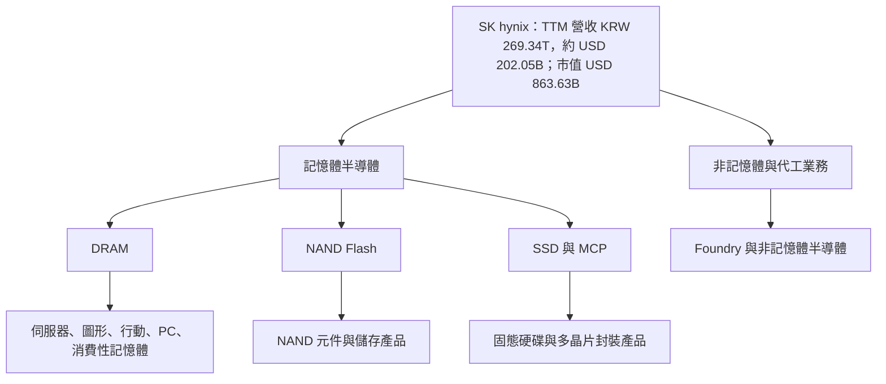
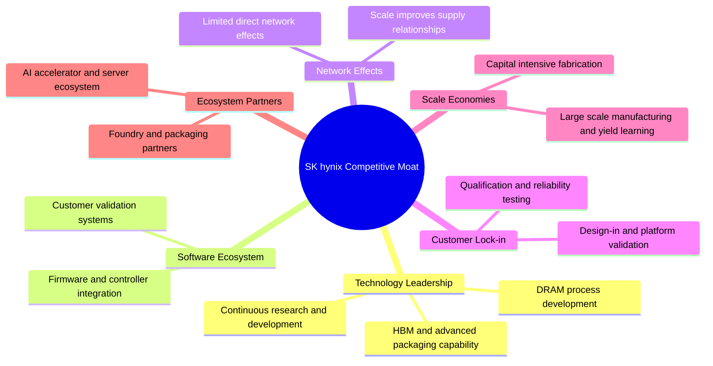
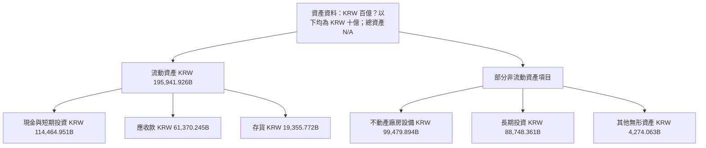
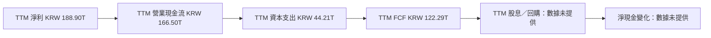
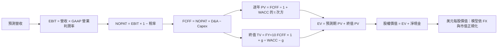
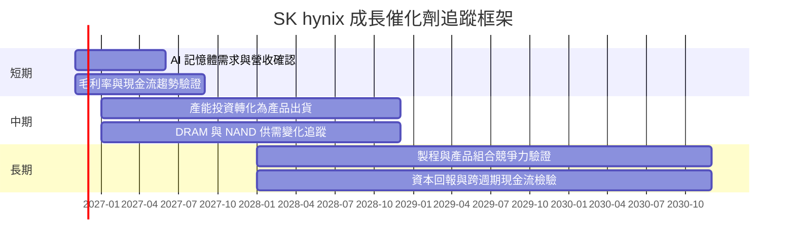
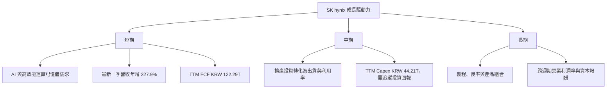
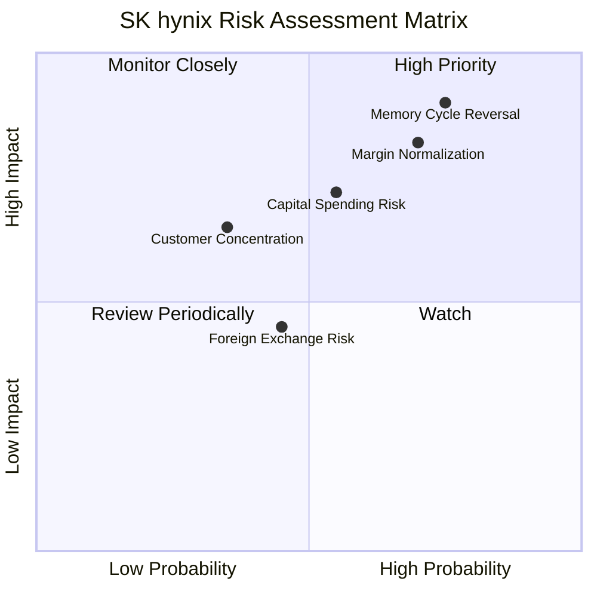
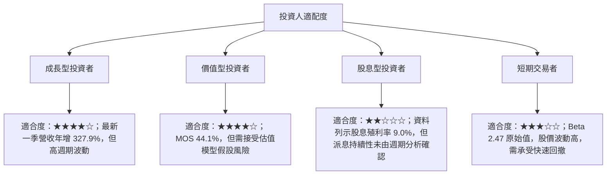

# SKHY 基本面深度分析報告
> **報告日期**：2026-11-19 ｜ **語言**：繁體中文 ｜ **數據來源**：Yahoo Finance、Finviz、StockAnalysis、Roic.ai ｜ **分析師**：CFA 級機構研究

## 目錄

| # | 章節 | 核心結論 |
|---|------|----------|
| 1 | 執行摘要 | 買入；加權合理價值 $218.96；MOS 44.1% |
| 2 | 公司概覽與商業模式 | DRAM、HBM 相關需求與 NAND 業務構成基礎；產品別營收占比未提供 |
| 3 | 損益表深度分析 | TTM 營收 KRW 269.34T；最新一季營收年增 327.9%，但週期性及盈餘波動高 |
| 4 | 資產負債表分析 | 淨現金 KRW 96.34T；流動比率 3.115，流動性充足 |
| 5 | 現金流量深度分析 | TTM FCF KRW 122.29T，FCF Yield 10.62% |
| 6 | 獲利能力與資本效率 | 當期 ROIC 未提供，不能直接判定 ROIC 是否高於 14.00% WACC |
| 7 | 相對估值分析 | 同業估值支持折價；歷史估值區間資料未提供 |
| 8 | DCF 內在價值評估 | 基準 DCF $268.52；加權合理價值 $218.96；MOS 44.1% |
| 9 | 成長催化劑 | AI 與高效能運算記憶體需求是主要潛在驅動；TAM 數字未提供 |
| 10 | 風險矩陣 | 記憶體景氣反轉、資本支出與估值假設是主要風險 |
| 11 | 投資建議 | 買入；建議買入區間 $122.47–$197.06，並按季度驗證利潤率與現金流 |

---

## 1. 執行摘要

SK hynix 最新季度營收年增 327.9%，TTM 營業利益率 74.5%，TTM FCF 為 KRW 122.29T，並持有 KRW 96.34T 淨現金；但該產業具有明顯週期性，最新單季淨利亦由前一季 KRW 93.82T 降至 KRW 39.53T。估值方面，DCF 基準價值為 $268.52，同業 EV/EBITDA 與 P/S 方法估值分別為 $170.88、$171.67，依固定權重計算的加權合理價值為 $218.96；相對 2026-11-18 收盤價 $122.47，MOS 為 44.1%。依 MOS 門檻應為「買入」；當期 ROIC 缺資料，不能確認是否符合「強烈買入」的 ROIC 條件，因此採用程式列示的「買入」，未作質化上調或下調。

### 1.0 一頁式投資儀表板（Portfolio Manager 30 秒速讀）

| 項目 | 內容 |
|------|------|
| **投資論點（3 句）** | ① 最新一季營收年增 **327.9%**，顯示記憶體景氣與需求迅速復甦，但不能外推為長期成長率。② TTM FCF 達 **KRW 122.29T**、FCF Yield **10.62%**，為高資本密集產業提供資金緩衝。③ 加權合理價值 **$218.96**，較 **$122.47** 現價有 **78.8% 上行空間**，但估值分歧及週期反轉風險不可忽略。 |
| **綜合評分** | **8.0/10**（引用 1.1） |
| **財務健康** | 🟢 現金及短期投資 KRW **114.46T**、總債務 KRW **18.13T**，淨現金 KRW **96.34T**；流動比率 **3.115**。 |
| **ROIC vs WACC** | ROIC：**N/A**（當期數據未提供） vs WACC **14.00%**；無法作出當期價值創造的確定判斷。 |
| **FCF 趨勢** | 2022–2025 年 FCF 從 KRW **-4.97T**、**-4.50T** 升至 **13.13T**、**24.79T**；TTM FCF **122.29T**，FCF Yield **10.62%**。週期回升和獲利擴張是主要推動因素。 |
| **估值** | Forward P/E **2.96x**；公司 EV/EBITDA **N/A**（報價與財報幣別不同，該指標未提供）；FCF Yield **10.62%**。 |
| **DCF 內在價值（基準）** | **$268.52**；現價相對 DCF 折價 **54.4%**（折溢價基準為 DCF）。 |
| **安全邊際（MOS）** | **44.1%**＝($218.96 − $122.47) ÷ $218.96；🟢 相對加權合理價值具一定緩衝。 |
| **預期報酬（基準情境）** | DCF 基準情境相對現價 **+119.3%**；這是估值差額，不是保證或年化 12 個月報酬。加權合理價值上行空間為 **+78.8%**。 |
| **關鍵風險（前二）** | 記憶體價格和需求反轉；高資本支出及 DCF 對長期利潤率、WACC 的敏感性。 |
| **評級 + 信心度** | 🟢 **買入** ｜ 信心：**中**；估值上行顯著，但模型假設跨度大、當期 ROIC 與 EPS 預估落差資料不完整。 |

### 1.1 綜合評分卡（全報告唯一）

| 維度 | 評分（1–10） | 主要依據（引用數字與其來源章節） |
|------|--------------|----------------------------------|
| 成長性 | 8.5 | 最新一季營收年增 **327.9%**；單季數字受週期與低基期影響，TTM 成長率依價格資料庫／財報彙整為 N/A（第 3 章）。 |
| 獲利能力 | 8.5 | TTM 營業利益率 **74.5%**、FCF **KRW 122.29T**；當期 ROIC 與 Piotroski F-Score 為 N/A（第 3、5、6 章）。 |
| 財務健康 | 8.5 | 淨現金 **KRW 96.34T**、流動比率 **3.115**、現金轉換週期 **203 天**（第 4 章）。 |
| 估值 | 8.0 | MOS **44.1%**；公司 Forward P/E **2.96x**，但估值高度受週期盈餘及 DCF 假設影響（第 7、8 章）。 |
| 護城河 | 8.0 | 高資本與技術門檻、記憶體製程和客戶認證形成進入障礙；但市場份額與公司別產品占比數據未提供（第 2 章）。 |
| 管理層與資本配置 | 6.5 | FY2025 資本支出 KRW **28.58T**、現金股利 KRW **1.68T**；回購數據及資本回報政策完整資料未提供（第 5 章）。 |
| **綜合評分** | **8.0** | 六項算術平均：(**8.5 + 8.5 + 8.5 + 8.0 + 8.0 + 6.5**) ÷ 6 = **7.8**（四捨五入至小數一位）。 |

### 1.2 五大投資論點 + 三大核心風險

| 類型 | 項目 | 具體依據 | 信心度 |
|------|------|----------|--------|
| 🟢 **投資論點①** | AI／高效能運算記憶體需求 | 最新一季營收年增 **327.9%**，TTM 營業利益率 **74.5%**；目前未提供產品別收入，無法量化 HBM 的實際貢獻。 | 🟢 高 |
| 🟢 **投資論點②** | 現金流回升 | TTM OCF **KRW 166.50T**，扣除 Capex **KRW 44.21T** 後，FCF **KRW 122.29T**。高現金流可支持產能投資與資產負債表韌性。 | 🟢 高 |
| 🟢 **投資論點③** | 淨現金緩衝 | 現金及短期投資 **KRW 114.46T**、債務 **KRW 18.13T**、淨現金 **KRW 96.34T**，可緩衝下行週期。 | 🟢 高 |
| 🟢 **投資論點④** | 相對估值折價 | 公司 Forward P/E **2.96x**，Peer 倍數 P/E 前瞻中位數為 **3.4x**；估值低不等同盈利可持續。 | 🟡 中 |
| 🟢 **投資論點⑤** | 多種估值方法均高於現價 | DCF 基準 **$268.52**、同業 EV/EBITDA **$170.88**、同業 P/S **$171.67**、分析師共識 **$259.50**；各方法依賴不同假設。 | 🟡 中 |
| 🟡 **風險①** | 記憶體週期反轉 | 年度營收曾由 FY2022 KRW **44.62T** 降至 FY2023 **32.77T**（年減 **26.57%**）；需求及價格回落可能使高利潤率快速收縮。 | 🟡 中 |
| 🔴 **風險②** | 盈利與股價波動 | Beta（調整後）**1.98**；2026 年單季淨利從 Q2 **KRW 93.82T** 降至 Q3 **KRW 39.53T**，營收成長不代表淨利單季線性上升。 | 🔴 高 |
| 🔴 **風險③** | DCF 長期假設失準 | 基準 DCF 假設首年營收成長 **30.0%**，營業利益率由 **74.5%** 線性降至 **35.5%**；任一假設偏離都會改變估值。 | 🔴 高 |

### 1.3 快速統計卡片

| 指標 | 公司實際值（期間） | 同業中位數 | 狀態 |
|------|--------------------|------------|------|
| 營收成長（TTM） | **N/A** | — | 🟡 無法據此判定 |
| 營收成長（最新一季年增） | **327.9%** | **377.9%** | 🟡 低於三家同業中位數 |
| 毛利率（TTM） | **77.4%** | **80.0%** | 🟡 低於同業中位數 |
| 營業利益率（TTM） | **74.5%** | — | 🟢 絕對值高；須考慮景氣高峰效應 |
| ROIC（TTM） | **N/A** | — | 🟡 當期數據未提供 |
| Forward P/E | **2.96x** | **3.4x** | 🟢 低於 Peer 中位數 |
| FCF Yield（TTM） | **10.62%** | — | 🟢 提供現金流估值緩衝 |
| Piotroski F-Score | **N/A / 9** | — | 🟡 缺少兩個年度申報資料計算所需數據 |

### 1.4 投資結論

```text
╔══════════════════════════════════════════════════════════════════╗
║                    📊 投資結論摘要                               ║
╠══════════════════════════════════════════════════════════════════╣
║  評級：買入（依加權價值 MOS 44.1%；ROIC 未提供，未升為強烈買入） ║
║  價格（2026-11-18 收盤）：$122.47                                ║
║  DCF 內在價值（基準）：$268.52（相對 DCF 折價 54.4%）            ║
║  安全邊際 MOS：44.1%（＝(加權合理價值−現價)÷加權合理價值）      ║
║  加權合理價值（8.8）：$218.96                                    ║
║  DCF 情境價值：                                                   ║
║    悲觀情境：$130.04（+6.2%）                                    ║
║    基準情境：$268.52（+119.3%）                                  ║
║    樂觀情境：$528.22（+331.3%）                                  ║
║  綜合評分：8.0/10（引用 1.1）                                    ║
║  適合投資人：能承受半導體週期、重視估值與現金流的中長期投資人   ║
╚══════════════════════════════════════════════════════════════════╝
```

---

## 2. 公司概覽與商業模式

### 2.1 業務結構與收入來源

SK hynix 於韓國、中國、亞洲其他地區、美國及歐洲從事半導體研發、製造與銷售，產品涵蓋 DRAM、NAND Flash、SSD、MCP 及部分非記憶體代工業務。公司 TTM 營收為 **KRW 269.34T（約 $202.05B）**，市值為 **$863.63B**。目前沒有產品線營收拆分，因此不以推估比例繪製收入占比。



公司主要收入由半導體產品銷售構成；軟體及服務收入拆分數據未提供。特定產品別營收、毛利與客戶集中度資料亦未提供，故不能把 AI 或 HBM 需求直接換算為公司營收占比。

### 2.2 市場份額

市場份額數據未提供，亦沒有可引用的年份及外部市場份額來源。以營收規模而言，公司 TTM 營收約 **$202.05B**，最新一季營收年增 **327.9%**；同業資料中 Micron（MU）及 Sandisk（SNDK）最新一季年增分別為 **379.3%**、**377.9%**。這些數字顯示公司處於記憶體景氣快速上行階段，但不能替代市場份額或產品領先程度的量化資料。

### 2.3 競爭護城河分析



### 2.4 護城河強度

| 護城河項目 | 強度（強／中／弱） | 證據（引用數字或事實） | 會削弱它的情況 |
|------------|--------------------|------------------------|----------------|
| 技術與製程 | 強 | 公司跨 DRAM、NAND、SSD、MCP 開發與製造；FY2025 R&D 為 KRW **6.47T**。 | 製程良率落後、產品迭代不及競爭者，或客戶轉向替代供應來源。 |
| 規模效應 | 強 | TTM 營收 KRW **269.34T**；半導體製造需要高額資本支出，FY2025 Capex 為 KRW **28.58T**。 | 產能利用率下降、擴產造成供過於求，或資本回報低於資金成本。 |
| 客戶鎖定 | 中 | 高效能記憶體導入通常需客戶驗證與系統相容性；財務數據未披露驗證週期及客戶集中度。 | 客戶多來源採購、產品標準化，或主要客戶提高議價能力。 |
| 軟體生態系統 | 弱至中 | 固件及產品整合可增加轉換成本，但公司軟體收入及生態系統資料未提供。 | 產品差異縮小，客戶能以價格和規格快速替代。 |
| 網路效應 | 弱 | 記憶體本身不是典型雙邊網路平台，沒有使用者越多價值越高的直接證據。 | 同業產品性能與供應能力接近，使競爭回到價格。 |
| 生態夥伴 | 中 | 服務伺服器、網路、行動與消費性市場；近期新聞提及 AI 晶片供應鏈與記憶體需求，但未提供可驗證的公司合約數值。 | AI 投資放緩、平台設計改變，或合作夥伴切換供應商。 |

1.1「護城河」評分為 **8.0/10**：主要依據是研發投入、製造規模與高資本門檻；因缺少市場份額、產品分部營收和客戶資料，未將其視為無條件的競爭優勢。

---

## 3. 損益表深度分析

### 3.1 年度收入成長趨勢（近4年）

FY2022–FY2025 的收入及成長率來自 StockAnalysis／Yahoo 年度損益表。圖中以 FY2022–FY2025 收入數值呈現，不將單季成長率誤標為 TTM 成長率。

```text
╔══════════════════════════════════════════════════════════════════╗
║              SK hynix 年度收入趨勢（FY2022-FY2025）             ║
╠══════════════════════════════════════════════════════════════════╣
║  FY2022  KRW 44.62T  ██████████████████░░░░░░░░  YoY +3.78%     ║
║  FY2023  KRW 32.77T  █████████████░░░░░░░░░░░░░  YoY -26.57%    ║
║  FY2024  KRW 66.19T  ██████████████████████████░  YoY +102.02%  ║
║  FY2025  KRW 97.15T  ██████████████████████████████████████░    ║
║                                                                  ║
║  FY2025 YoY：+46.76%                                             ║
║  FY2022-FY2025 CAGR：+29.6%（(97.15÷44.62)^(1/3)-1）             ║
╚══════════════════════════════════════════════════════════════════╝
```

收入在 FY2023 下滑 **26.57%**，FY2024 回升 **102.02%**，FY2025 再增 **46.76%**。三年 CAGR 約 **29.6%**，但這是低谷反彈與景氣回升共同影響的結果，不能視為可持續的正常化成長率。另，資料彙整的「Revenue growth (TTM vs prior TTM)」為 **N/A**，因此不以其他來源的 TTM 成長計算替代該指標。

### 3.2 季度收入趨勢分析

金額為 KRW T；QoQ 以相鄰季度營收計算。YoY 使用季度營收與同季去年比較，屬**單季年增率**。

| 季度 | 營收（KRW T） | QoQ 成長 | 單季 YoY 成長 | 備註 |
|------|---------------:|---------:|---------------:|------|
| 2025 Q4 | 32.83 | +34.3% | +66.07% | 相較 2025 Q3 營收增加，仍處於逐季回升階段。 |
| 2026 Q1 | 52.58 | +60.2% | +198.07% | 同比增速受去年較低基期影響。 |
| 2026 Q2 | 79.32 | +50.9% | +256.78% | 營收續升；同季 EPS 年增 **1273.16%**，基期與盈利槓桿作用明顯。 |
| 2026 Q3 | 104.62 | +31.9% | +327.89% | 營收續升；相較上一季增速放慢，但絕對營收再創本表高點。 |

**計算示例：** Q3 2026 QoQ = (104.615 − 79.319) ÷ 79.319 = **31.9%**。季度營收連續增加，主要含義是需求與出貨／定價組合處於上行期；但 QoQ 成長率從 Q1 的 60.2% 降至 Q3 的 31.9%，需持續追蹤增速是否進一步正常化。

### 3.3 利潤率演變分析

| 利潤率指標 | FY2022 | FY2023 | FY2024 | FY2025 | 趨勢 | 評估 |
|------------|--------|--------|--------|--------|------|------|
| **毛利率** | 35.0% | -1.6% | 48.1% | 60.4% | 先於低谷轉負，再隨景氣反彈 | 🟡 高週期性 |
| **營業利益率** | 15.3% | -23.6% | 35.5% | 48.6% | FY2023 虧損，FY2024–2025 快速恢復 | 🟢 當前獲利高、但不可直線外推 |
| **淨利率** | 5.0% | -27.8% | 29.9% | 44.2% | 隨營業槓桿由負轉正 | 🟢 景氣恢復明顯 |

FY2025 毛利率計算為 KRW **58.69T ÷ 97.15T = 60.4%**；營業利益率為 **47.21T ÷ 97.15T = 48.6%**。改善與營收恢復、產品組合及固定成本吸收有關，但數據沒有按產品拆分，無法精確量化各因素貢獻。FY2023 營業利益為 **-KRW 7.73T**，說明當供需轉弱時，高固定成本會放大獲利下滑。

### 3.4 費用結構分析

完整營業費用分類及其與營收的可比數據未提供，故不以淨利潤、毛利或現金流反推費用組成，也不繪製比例圖。已披露的 R&D 支出為 FY2025 **KRW 6.47T**，FY2024 **KRW 4.44T**、FY2023 **KRW 3.75T**；R&D 增加有助產品研發，但其短期回報與各產品線研發占比無法由現有數據確定。

### 3.5 季度 EPS 趨勢與盈餘品質（Quality of Earnings）

最近可讀到的 EPS 估計值與實際值均為 NaN；只有 2026 Q2、Q3 有報表 EPS 增長資料，未提供分析師預估與實際 EPS 的有效配對。因此不能把「盈餘超預期／不及預期」當作已知結果。

| 盈餘品質項目 | 數值/佔比 | 評估 |
|--------------|-----------|------|
| 股權薪酬 SBC / 營收 | FY2025：KRW **0.414T ÷ 97.147T = 0.43%**；2026 Q3 單季：KRW **3.57T ÷ 104.615T = 3.41%** | 🟡 FY2025 比率低；單季數值較高且季度 SBC 波動大，可能稀釋股東報酬。 |
| SBC / 營業現金流 | FY2025：KRW **0.414T ÷ 53.37T = 0.78%**；2026 Q3 單季：KRW **3.57T ÷ 53.89T = 6.62%** | 🟡 單季 SBC 佔 OCF 上升；需確認是否為持續性趨勢。 |
| FCF / 淨利（現金轉換率） | TTM：**122.29 ÷ 188.90 = 64.7%** | 🟡 現金轉換為正且規模大，但資本支出與營運資金週期會令現金轉換率波動。 |
| 一次性／非經常性損益 | N/A（未提供可辨識的一次性損益明細） | 🟡 無法判定是否有非經常性項目美化或壓低盈餘。 |
| 有效稅率異常 | **14.9%**（Cost of capital 資料列示的最新年度有效稅率） | 🟡 稅率不等同長期邊際稅率；未有足夠多年資料判斷是否異常。 |
| 資本化支出 vs 費用化 | TTM Capex **KRW 44.21T**；資本化政策細節 N/A | 🟡 半導體 Capex 具有重大影響，不能只看當期費用判斷完整經濟成本。 |

2026 Q3 營收 **KRW 104.62T**、淨利 **KRW 39.53T**，Q2 淨利為 **KRW 93.82T**。單季淨利下降不代表營收趨勢反轉，但凸顯單季盈餘的波動。整體而言，TTM FCF 有實質現金流支持；惟 TTM SBC 細節不完整、一次性損益與資本化政策缺資料，盈餘品質判斷為中等，而非無條件高品質。

---

## 4. 資產負債表分析

### 4.1 資產結構分解

最新季度可讀到的流動資產細項及若干長期資產資料如下；由於完整 TTM 總資產未提供，圖中不計算百分比，也不將部分項目相加作為總資產。



上圖金額均為 **KRW 十億**。現金及短期投資、應收款與存貨是可讀到的流動資產項目；非流動資產只列已披露的項目，不代表完整資產結構。

### 4.2 流動性與營運資金分析

| 指標 | 最新 TTM | 一年前 TTM | 變化 | 解讀 |
|------|----------|------------|------|------|
| 流動比率 | **3.115** | N/A | N/A | 流動資產覆蓋短期負債能力充足。 |
| 速動比率 | **2.794** | N/A | N/A | 不計存貨仍有較高流動性緩衝。 |
| DSO 應收帳款天數 | **80 天** | N/A | N/A | 應收天數的年度變化無法比較；仍應觀察成長是否伴隨回款放慢。 |
| DIO 存貨天數 | **143 天** | N/A | N/A | 存貨天數較長；對週期性產業而言，可能反映備貨及產品週期，不能單憑該數據判定庫存過剩。 |
| DPO 應付帳款天數 | **20 天** | N/A | N/A | 未有一年前比較；不足以判定供應商議價力變化。 |
| CCC 現金轉換週期 | **203 天** | N/A | N/A | 由 DSO + DIO − DPO 得出；營運資金占用需密切監控。 |

品質指標所列營運資金日數以期末餘額除以 TTM 流量計算。因一年前的同口徑數字未提供，不填補變化值，也不把年度資產負債表資料替代為一年前 TTM。

### 4.3 債務結構分析

```text
╔══════════════════════════════════════════════════════════════════╗
║                   SK hynix 債務健康診斷                          ║
╠══════════════════════════════════════════════════════════════════╣
║  總債務：                 KRW 18.13T        🟢                  ║
║  現金及短期投資：         KRW 114.46T       🟢                  ║
║  淨現金：                 KRW 96.34T        🟢                  ║
║  Debt/Equity：            5.865              ⚠️ 口徑／單位需核驗 ║
║  Debt/EBITDA：            N/A（幣別與市值資料口徑限制）          ║
║  Interest Coverage：      N/A（利息費用與平均債務明細未提供）    ║
║  流動比率：               3.115              🟢                  ║
║  速動比率：               2.794              🟢                  ║
╚══════════════════════════════════════════════════════════════════╝
```

淨現金 KRW **96.34T** 是主要財務緩衝。Debt/Equity **5.865** 與淨現金及債務規模表面上不易直接對照，可能受來源欄位口徑影響，因此不據此推導槓桿風險；亦不自行以總債務除以 EBITDA 代替缺失指標。

### 4.4 股東權益趨勢

| 財年 | 股東權益（KRW T） | YoY 變化 |
|------|------------------:|---------:|
| 2022 | 63.27 | — |
| 2023 | 53.50 | -15.4% |
| 2024 | 73.90 | +38.1% |
| 2025 | 120.52 | +63.0% |

股東權益於 FY2023 隨虧損與週期低谷下降，FY2024、FY2025 隨獲利復甦而增加。當期 TTM 的完整股東權益未提供，故不延伸為 2026 TTM 趨勢。

---

## 5. 現金流量深度分析

### 5.1 現金流量瀑布圖

TTM 淨利為 KRW **188.90T**；財務數據提供 TTM OCF、Capex 與 FCF，但沒有同口徑 TTM 股利、回購與淨現金變化數值，因此不自行畫出流量金額。



**FCF 計算：** KRW **166.50T − 44.21T = 122.29T**。股利和回購金額沒有 TTM 同口徑資料，故不假設全部 FCF 已派發或留存。

### 5.2 FCF 轉換率趨勢

| 財年 | FCF（KRW T） | 淨利（KRW T） | FCF / 淨利 | 解讀 |
|------|-------------:|--------------:|-----------:|------|
| 2022 | -4.97 | 2.23 | -223.0% | 高 Capex 與營運週期使 FCF 為負。 |
| 2023 | -4.50 | -9.11 | N/M | 分子、分母皆為負，比例不具正常經濟解讀。 |
| 2024 | 13.13 | 19.79 | 66.4% | 現金流轉正，但仍低於會計淨利。 |
| 2025 | 24.79 | 42.92 | 57.8% | FCF 增加，但仍受大額資本投資影響。 |
| TTM 至 2026-09-30 | 122.29 | 188.90 | 64.7% | 現金轉換維持正值；當期屬景氣高點附近，不宜線性年化。 |

**計算示例：** FY2025 FCF 轉換率 = **24.79 ÷ 42.92 = 57.8%**。TTM 使用彙整來源的 TTM 淨利與固定定義 FCF 計算；不同期間數字不可直接視為穩態轉換率。

### 5.3 自由現金流趨勢

```text
╔══════════════════════════════════════════════════════════════════╗
║               SK hynix 自由現金流趨勢                            ║
╠══════════════════════════════════════════════════════════════════╣
║  FY2022  KRW -4.97T  ◀░░░░░░░░░░░░░░░░░░░░  FCF 為負             ║
║  FY2023  KRW -4.50T  ◀░░░░░░░░░░░░░░░░░░░░  FCF 為負             ║
║  FY2024  KRW 13.13T  █████░░░░░░░░░░░░░░░  FCF 轉正             ║
║  FY2025  KRW 24.79T  ██████████░░░░░░░░░░  FCF 增加             ║
║  TTM     KRW 122.29T ████████████████████  FCF Yield 10.62%     ║
╚══════════════════════════════════════════════════════════════════╝
```

TTM FCF 遠高於 FY2025，反映 2026 年景氣與現金生成加速；但 FCF Yield 10.62% 是當前 TTM 數據，不能將其視為整個週期都可維持的收益率。

### 5.4 資本配置評估

可辨認的資本配置數據如下；因缺少同期間回購、總投資與留存現金完整拆分，不繪製會造成誤導的比例圓餅圖。

| 項目 | FY2025 | 評估 |
|------|-------:|------|
| 資本支出 | KRW **28.58T** | 支持產能與技術投資，但在需求反轉時可能帶來利用率與報酬風險。 |
| 現金股利支付 | KRW **1.68T** | 相較 FCF 有限；股息政策及未來派息覆蓋率仍需追蹤。 |
| 回購 | N/A | 未提供可核實數值。 |
| 留存／其他投資 | N/A | 缺少完整現金流用途拆分。 |

---

## 6. 獲利能力與資本效率

### 6.1 ROE / ROA / ROIC 趨勢

| 指標 | 最新可用值 | 歷史或補充資料 | 評估 |
|------|-----------:|----------------|------|
| ROE | TTM **92.5%** | 當期品質計算 DuPont 為 N/A | 高 ROE 可能受到週期高獲利影響，不能直接視為長期回報率。 |
| ROA | TTM **46.4%** | 當期 DuPont 資料不完整 | 顯示目前資產獲利高；需以完整年度資產及淨利資料核驗。 |
| ROIC | N/A | Roic.ai 歷史 Return on Capital：2018 年 **34.64%**，非當期 | 不以 2018 年資料冒充目前 ROIC。 |
| WACC | **14.00%** | 計算值 14.79%，依資本成本區塊限制於 7%–14% | 作為 DCF 與資本效率比較的折現率。 |

沒有可靠的行業均值來源，故不列行業均值。ROE、ROA 高不等同 ROIC 高於 WACC；由於當期投入資本回報率缺資料，無法據此確定當期 EVA。

### 6.2 ROIC vs WACC 分析（核心價值創造判斷）

```text
╔══════════════════════════════════════════════════════════════════╗
║                ROIC vs WACC 深度分析                            ║
╠══════════════════════════════════════════════════════════════════╣
║  WACC 來源（Cost of capital 資料）：                             ║
║  ├── 無風險利率（10Y 美債）：       5.07%                       ║
║  ├── 市場風險溢酬 ERP：             5.00%                       ║
║  ├── 原始 Beta：                    2.47                        ║
║  ├── 調整後 Beta：                  1.98                        ║
║  ├── 股權成本：                     14.95%                      ║
║  ├── 稅前債務成本：                 5.10%                       ║
║  ├── 有效稅率：                     14.9%                       ║
║  ├── 資本權重 E / D：               98.4% / 1.6%                ║
║  ├── WACC 計算值：                  14.79%                      ║
║  └── 採用 WACC：                    14.00%（限制於 7%–14%）     ║
║                                                                  ║
║  ROIC：N/A（當期資料未提供）                                     ║
║  EVA = ROIC − WACC：N/A，無法量化                                ║
║                                                                  ║
║  結論：當期價值創造／摧毀不能以 ROE 或歷史 2018 ROIC 代替判定。  ║
╚══════════════════════════════════════════════════════════════════╝
```

資本成本資料已提供調整後 Beta。其調整方式為 **⅔ × 2.47 + ⅓ = 1.98（四捨五入）**；原始 Beta 2.47 高，採用調整後值可降低極端市場敏感度影響。WACC 採用值 **14.00%**，不是重新估算的 14.79%；來源明確說明計算結果 14.79% 被限制在 7%–14% 區間。由於當期 ROIC 為 N/A，現階段無法斷言公司正在創造或摧毀超過資金成本的股東價值。

### 6.3 杜邦三因素分解

| 因素 | 數值（TTM） | 解讀 |
|------|-------------|------|
| 淨利率 | N/A | QUALITY FIGURES 指出淨利、營收、總資產或正值權益資料不完整，DuPont 為 N/A。 |
| 資產週轉率 | N/A | 同上，不能補算。 |
| 權益乘數 | N/A | 同上，不能補算。 |
| **ROE** | **N/A（DuPont 區塊）** | 外部摘要提供 ROE TTM 92.5%，但三因素分解口徑不完整，不以該值反推各因素。 |

### 6.4 財務體質：Piotroski F-Score

Piotroski F-Score 為 **N/A**，原因是缺少相隔一年的兩期 SEC 申報資料，且現有資料來源為 Yahoo 季度報表，無法可靠判定九項測試。各項結果如下，不以推測補值。

| 測試 | 結果 | 解讀 |
|------|------|------|
| 正向 ROA | N/A | 缺少規定口徑的比較期申報數據。 |
| 正向營業現金流 | N/A | 雖有 TTM OCF，但無法完成兩期 F-Score 比較。 |
| ROA 改善 | N/A | 比較期所需資料不足。 |
| 現金流高於淨利 | N/A | 不作 F-Score 測試推算。 |
| 長期負債比率下降 | N/A | 缺少同口徑兩期資料。 |
| 流動比率改善 | N/A | 缺少所需比較基期。 |
| 未發行新股 | N/A | 所需兩期股數資料未提供。 |
| 毛利率改善 | N/A | 未有品質指標的逐項計算結果。 |
| 資產週轉率改善 | N/A | 缺少完整比較口徑。 |

---

## 7. 相對估值分析

### 7.1 同業估值比較表格

Peer multiples 取自 Yahoo Finance 同業資料。三家公司的最新一季營收年增率與毛利率亦按提供數據列示；同業中位數為三家公司數值的中位數。

| 估值指標 | **SK hynix** | **MU** | **SNDK** | **WDC** | 本公司評估 |
|----------|------------:|-------:|--------:|-------:|-----------|
| **Trailing P/E** | **6.78x** | 9.5x | 6.2x | 10.1x | 🟢 低於同業中位數 9.5x，但週期盈餘可能使 P/E 偏低。 |
| **Forward P/E** | **2.96x** | 3.4x | 2.7x | 7.1x | 🟢 低於同業中位數 3.4x；前瞻盈餘預估高度影響倍數。 |
| **P/S Ratio** | N/A | 6.0x | 3.8x | 7.4x | 🟡 本公司報價與財報幣別不同，未提供可比倍數。 |
| **EV/EBITDA** | N/A | 7.0x | 5.0x | 17.0x | 🟡 本公司倍數未提供；同業中位數 7.0x。 |
| **最新一季營收年增** | **327.9%** | 379.3% | 377.9% | 55.5% | 🟡 低於 MU、SNDK，但高於 WDC；不是 TTM 成長率。 |
| **毛利率（TTM）** | **77.4%** | 80.7% | 80.0% | 52.6% | 🟢 高於 WDC、略低於 MU 與 SNDK。 |

同業 Forward P/E 中位數為 **3.4x**，Trailing P/E 中位數為 **9.5x**，P/S 中位數為 **6.0x**，EV/EBITDA 中位數為 **7.0x**。SK hynix 的 Forward P/E 低於中位數，但當記憶體獲利處於高峰時，預測 EPS 可能過高，使 Forward P/E 失去跨週期可比性。

### 7.2 歷史估值區間分析

```text
N/A（未提供 Valuation vs own history 的歷史估值區間及當前百分位；
不以其他估值倍數推測歷史位置。）
```

### 7.3 情境價值（Bear / Base / Bull，照抄 DCF MODEL 的 Scenarios）

| 情境 | 第 1 年營收成長 | 期末營業利潤率 | WACC | 每股價值 | 相對現價 | 機率 | 會發生的條件 |
|------|----------------:|----------------:|-----:|----------:|----------:|-----:|--------------|
| 🔴 悲觀 | 15.0% | 30.1% | 15.00% | **$130.04** | **+6.2%** | 25% | AI 記憶體需求降溫、供給回升，成長和終期利潤率均低於基準。 |
| 🟡 基準 | 30.0% | 35.5% | 14.00% | **$268.52** | **+119.3%** | 50% | 首年成長接近模型上限，後續成長逐年降至 3.0%，利潤率回落至五年中位數假設。 |
| 🟢 樂觀 | 45.0% | 39.0% | 13.00% | **$528.22** | **+331.3%** | 25% | AI 記憶體需求與定價優於基準，且資金成本低於基準。 |

情境的權重加總為 **25% + 50% + 25% = 100%**。程式模型列示機率加權值 **$298.83（+144.0%）**，僅供參考；第 8.8 節按固定估值方法權重使用基準 DCF，不以此機率加權值取代。

### 7.4 相對估值隱含價格區間

```text
╔══════════════════════════════════════════════════════════════════╗
║              相對估值與 DCF 每股價值比較                         ║
╠══════════════════════════════════════════════════════════════════╣
║  $122.47 ───── $170.88 ───── $171.67 ───── $259.50 ───── $268.52║
║   現價       同業 EV/EBITDA   同業 P/S     分析師共識    基準 DCF ║
╚══════════════════════════════════════════════════════════════════╝
```

估值依據如下：DCF 基準價值 **$268.52**；同業 EV/EBITDA 方法採 MU、SNDK、WDC 中位數 **7.0x** 乘以公司 TTM EBITDA，再加淨現金，結果 **$170.88**；同業 P/S 方法採 Peer 中位數 **6.0x** 乘以 TTM 營收，結果 **$171.67**。分析師共識目標價為 14 位分析師平均 **$259.50**，低值 **$164.00**、高值 **$400.00**。公司本身的 EV/EBITDA 和 P/S 因幣別口徑限制不使用。

---

## 8. DCF 內在價值評估（Discounted Cash Flow）

> DCF 數值使用程式計算的基準模型輸出，金額單位為 **KRW 十億**，除每股價值以美元呈現。本文不另建 DCF、不改動逐年表格或情境值。計算結果依其提供精度列示；若原始未四捨五入值與顯示值造成尾差，以模型輸出為準。

### 8.0 估值推理鏈（Thinking Logic：在算之前先想清楚）

**Step 1 — 價值來源與主導變數**

SK hynix 的模型價值主要來自記憶體業務現金流；產品別營收占比未提供，因此無法把 DRAM、NAND、HBM 分別量化。TTM 營收為 **KRW 269,337.17B**，TTM FCF 為 **KRW 122,290B**，構成現金流起點。未來價值由營收成長、營業利潤率回歸，以及 14.00% WACC 下終值的折現共同決定。情境模型中營運假設會造成較大估值分散；在 8.6 已提供的單變數矩陣中，WACC 敏感度高於永續成長率。

**Step 2 — 模型選擇**

| 決策點 | 本報告採用 | 理由（含數字） | 曾考慮但否決 | 否決理由 |
|--------|-----------|----------------|--------------|----------|
| 現金流定義 | FCFF | 對應 WACC 折現並先得到企業價值，再加淨現金 | FCFE | 資本結構與融資變動不適合作為本模型唯一估值口徑。 |
| 預測期 N | 10 年 | 模型提供 FY+1 至 FY+10 完整預測，並將營收成長與利潤率逐步淡出 | 縮短預測期 | 會改變模型與提供的基準 DCF，不可自行重建。 |
| 終值方法 | Gordon Growth | 模型使用 g **3.0%**、WACC **14.00%** | 單獨使用退出倍數 | 模型未提供退出倍數終值的完整計算值，不能自行建模。 |
| EBIT 基礎 | GAAP EBIT | 模型明列 GAAP EBIT，並以營業利益率預測 FCFF | 非 GAAP EBIT | 缺少非 GAAP 調整明細；不能加回 SBC 再自行估值。 |

**Step 3 — 關鍵假設推導鏈**

- **首年營收成長**：錨點為最新一季單季年增 **327.9%**，但這不是 TTM 成長率，且極可能含景氣及基期效果 → 模型把它限制在 **0%–30%** 範圍內 → **採用 30.0%** → 不採用將單季 327.9% 外推為首年成長，因為該外推不符合週期企業的可持續性。
- **十年成長淡出**：模型由第 1 年 **30.0%** 線性降至第 10 年 **3.0%** → 反映景氣高增長逐步回歸成熟期 → **採用年成長率序列 30%、27%、24%、21%、18%、15%、12%、9%、6%、3%** → 不將 30% 固定維持十年，以免把景氣高峰當作永久趨勢。
- **期末營業利益率**：錨點為 TTM 營業利益率 **74.5%**，模型以過去五個財年中位數（含 TTM）作期末錨 → 景氣高位盈利不宜永續化 → **採用 FY+1 74.5%，線性降至 FY+10 35.5%** → 不把 74.5% 維持至預測期末，因其遠高於模型設定的歷史中位錨點。
- **Capex／營收**：錨點為 TTM Capex／營收 **16.4%** → 隨收入規模與擴建週期淡出，但模型仍設定不低於折舊攤銷的 **1.1 倍** → **由 FY+1 16.4% 降至 FY+10 6.4%** → 不把 Capex 直接降為零，因半導體製造需要持續投資。
- **D&A／營收**：錨點為 TTM **5.8%** → 模型固定比率 → **採用 5.8%**；沒有另外提高或降低。
- **有效稅率**：錨點為最新年度 **14.9%** → 模型沿用此值 → **採用 14.9%**；長期正常稅率可能不同，資料不足以替代。
- **預測期 N**：錨點為模型提供的 **10 年** → 讓營收與利潤率完成淡出 → **採用 10 年** → 不改為 5 年，避免與既定模型輸出不一致。
- **永續成長率 g**：採用模型的 **3.0%**，低於長期成熟經濟成長加通膨的一般邊界假設，且低於 WACC **14.00%** → **採用 3.0%** → 不使用接近 WACC 的高 g，避免終值分母過小。
- **WACC**：資本成本資料的未限制計算值為 **14.79%**，但該資料明確將採用值限制在 **7%–14%** → **採用 14.00%** → 不以 14.79% 替代模型指定折現率。
- **GAAP EBIT、SBC 與股數**：模型使用 GAAP EBIT；模型說明採固定股數，不另作稀釋調整 → **採用組合 (A)**，SBC 已在 GAAP 費用內，不再扣一次，年稀釋率 **0%**。
- **營運資金**：DCF 模型明確未建模 ΔWC，因此不填入未提供的假設值，也不在 FCFF 中額外扣除。

**Step 4 — 最脆弱環節**

最脆弱環節是當前高營收與高營業利潤率能否平順回落至模型所設定的長期水平；若成長或利潤率低於基準，價值可能顯著接近悲觀情境 **$130.04**，而不是基準 **$268.52**。

**Step 5 — 計算路徑圖**



### 8.1 模型假設總表（Model Inputs）

| 假設項目 | 採用值 | 依據／來源 | 敏感度 |
|----------|--------|-------------|--------|
| 預測期長度 N | 10 年 | 程式 DCF 模型明列 FY+1 至 FY+10。 | 🟡 中 |
| 營收成長 | 第 1 年 30.0%，第 10 年 3.0%，逐年線性淡出 | 最新一季單季 YoY **327.9%**，模型限定首年 0%–30%；TTM YoY 為 N/A。 | 🔴 高 |
| 營業利潤率 | FY+1 **74.5%** → FY+10 **35.5%** | TTM 營業利益率 74.5%；期末值為過去五個財年中位數（含 TTM）。 | 🔴 高 |
| 有效稅率 | 14.9% | 最新年度有效稅率。 | 🟢 低 |
| Capex／營收 | FY+1 16.4% → FY+10 6.4% | TTM Capex／營收起點及模型中淡出規則。 | 🟡 中 |
| D&A／營收 | 5.8% | TTM 比率，模型固定。 | 🟢 低 |
| 營運資金變動 | 未建模 | DCF MODEL 明列 Working capital is not modelled。 | 🟢 低，但為模型限制 |
| EBIT 基礎 | GAAP | 模型明列 GAAP EBIT。 | 🟡 中 |
| SBC 處理 | 組合 (A)：GAAP EBIT，不再扣 SBC | GAAP EBIT 已含 SBC 費用；股數固定，不另加年稀釋。 | 🟡 中 |
| 年稀釋率 | 0%（模型固定股數） | 與組合 (A) 相容；模型明列不再稀釋。 | 🟡 中 |
| 永續成長率 g | 3.0% | 程式 DCF 模型假設。 | 🔴 高 |
| 終值方法 | Gordon Growth | 模型提供 Gordon Growth 計算；退出倍數終值未提供。 | 🔴 高 |
| WACC | 14.00% | 資本成本區塊採用值；計算值 14.79% 被限制至 14.00%。 | 🔴 高 |

**FCFF 定義：** FCFF = NOPAT + D&A − Capex。依照模型設定，不列 ΔWC 扣除列。本模型採用 **(A)**：GAAP EBIT 已含 SBC 費用，故不再扣 SBC，股數不作額外稀釋。

### 8.2 折現率推導（WACC）

```text
╔══════════════════════════════════════════════════════════════════╗
║                    WACC 推導（折現率）                           ║
╠══════════════════════════════════════════════════════════════════╣
║  股權成本 Ke（CAPM）：                                           ║
║  ├── 無風險利率 Rf（10Y 美債）：       5.07%                    ║
║  ├── 市場風險溢酬 ERP：                5.00%                    ║
║  ├── 原始 Beta（Yahoo）：               2.47                     ║
║  ├── 調整後 Beta：                     1.98                     ║
║  ├── 規模／國別溢酬：                  未另加計                 ║
║  └── Ke = 5.07% + 1.98 × 5.00% = 14.97%（來源 Ke 列示 14.95%）  ║
║                                                                  ║
║  債務成本：                                                      ║
║  ├── 稅前 Kd：                         5.10%                    ║
║  ├── 有效稅率：                        14.9%                    ║
║  └── 稅後 Kd = 5.10% × (1−14.9%) = 4.34%                       ║
║                                                                  ║
║  資本結構（來源權重）：股權 E 98.4%，債務 D 1.6%                ║
║  計算 WACC：                  14.79%                             ║
║  採用 WACC：                  14.00%（依 7%–14% 區間上限限制）   ║
╚══════════════════════════════════════════════════════════════════╝
```

來源列示股權成本 **14.95%**；以列示的四捨五入 Rf 及調整後 Beta 直接計算為 **5.07% + 1.98 × 5.00% = 14.97%**，與來源 Ke 有約 0.02 個百分點的四捨五入／底層精度差。Beta 調整方式為 **⅔ × 原始 Beta 2.47 + ⅓ = 1.98**。ERP **5.00%** 為資本成本資料列示的假設值；風險利率列示 5.07%，其觀察日期在成本資本欄未單獨提供，故不另宣稱具體取值日期。未另加規模或國別溢酬。

五步計算檢核：

1. **Ke（CAPM）**：來源列示 **14.95%**；依已顯示輸入計算為 **5.07% + 1.98 × 5.00% = 14.97%**。底層精度差異以來源列示 Ke 為模型輸入。
2. **稅前 Kd**：來源列示 **5.10%**；利息費用與平均計息負債金額未單獨提供，不能以目前債務數字反推。
3. **稅後 Kd**：**5.10% × (1 − 14.9%) = 4.34%**。
4. **權重**：來源列示 E/D 權重 **98.4% / 1.6%**，合計 **100.0%**。完整市值與 D 權重的底層計算未提供，不自行以不同日期或負債口徑重建。
5. **WACC**：來源計算值 **14.79%**，限制於 7%–14% 後採用 **14.00%**。第 6.2 節與本節採相同 14.00%。

> **可稽核限制：**利息費用、平均計息負債、期末計息負債明細與資本成本權重的原始金額未完整列出；因此無法依讀者指定格式重建 WACC 五步中所有金額分母。本文採用資本成本資料已計算的 WACC，不以總負債代替計息負債。

### 8.3 逐年自由現金流預測（基準情境）

以下金額均為 **KRW 十億**，折現因子按模型提供值保留三位小數。模型沒有 ΔWC 列；不加入自行估算的營運資金數字。

| 年度 | FY+1 | FY+2 | FY+3 | FY+4 | FY+5 | FY+6 | FY+7 | FY+8 | FY+9 | FY+10 |
|------|-----:|-----:|-----:|-----:|-----:|-----:|-----:|-----:|-----:|------:|
| 營收 | 350,138.32 | 444,675.67 | 551,397.83 | 667,191.37 | 787,285.82 | 905,378.69 | 1,014,024.13 | 1,105,286.30 | 1,171,603.48 | 1,206,751.59 |
| 營收 YoY | 30.0% | 27.0% | 24.0% | 21.0% | 18.0% | 15.0% | 12.0% | 9.0% | 6.0% | 3.0% |
| 營業利潤率 | 74.5% | 70.2% | 65.8% | 61.5% | 57.1% | 52.8% | 48.5% | 44.1% | 39.8% | 35.5% |
| 營業利益 EBIT（GAAP） | 260,853.17 | 311,990.95 | 362,945.99 | 410,218.08 | 449,900.38 | 478,104.93 | 491,483.37 | 487,763.23 | 466,198.18 | 427,828.34 |
| − 稅 | (38,858.25) | (46,476.04) | (54,066.60) | (61,108.53) | (67,019.85) | (71,221.37) | (73,214.30) | (72,660.12) | (69,447.66) | (63,731.86) |
| = NOPAT | 221,994.92 | 265,514.92 | 308,879.39 | 349,109.54 | 382,880.53 | 406,883.57 | 418,269.07 | 415,103.11 | 396,750.51 | 364,096.48 |
| + D&A | 20,364.52 | 25,862.94 | 32,070.04 | 38,804.75 | 45,789.61 | 52,658.05 | 58,977.01 | 64,284.95 | 68,142.04 | 70,186.30 |
| − Capex | (57,466.92) | (68,034.79) | (78,227.38) | (87,230.86) | (94,171.77) | (98,222.80) | (98,725.83) | (95,311.92) | (87,993.44) | (77,204.93) |
| **= FCFF** | **184,892.52** | **223,343.06** | **262,722.05** | **300,683.44** | **334,498.37** | **361,318.82** | **378,520.25** | **384,076.14** | **376,899.11** | **357,077.85** |
| 折現因子 @14.00% | 0.877 | 0.769 | 0.675 | 0.592 | 0.519 | 0.456 | 0.400 | 0.351 | 0.308 | 0.270 |
| **FCFF 現值 PV** | **162,186.42** | **171,855.24** | **177,329.90** | **178,028.73** | **173,727.97** | **164,611.99** | **151,270.82** | **134,641.37** | **115,899.47** | **96,319.54** |

**預測期 FCF 現值合計：**

162,186.42 + 171,855.24 + 177,329.90 + 178,028.73 + 173,727.97 + 164,611.99 + 151,270.82 + 134,641.37 + 115,899.47 + 96,319.54  
= **KRW 1,525,871.45B**（依模型總和）。

**逐步演算（FY+1）：**

1. **營收** = 269,337.17 × (1 + 30.0%) = **350,138.32**。
2. **EBIT** = 350,138.32 × 74.5% = **260,853.17**。
3. **稅** = 260,853.17 × 14.9% = **38,858.25**。
4. **NOPAT** = 260,853.17 − 38,858.25 = **221,994.92**。
5. **D&A** = 350,138.32 × 5.8% = **20,364.52**。
6. **Capex** = 350,138.32 × 16.4% = **57,466.92**。
7. **ΔWC** = **未建模**，依模型設定不列入。
8. **FCFF** = 221,994.92 + 20,364.52 − 57,466.92 = **184,892.52**。
9. **折現因子與 PV**：模型列示折現因子 **0.877**；模型未四捨五入折現因子下的現值為 **162,186.42**。以顯示至三位小數的因子相乘會有小幅尾差，故採模型原始輸出。

> **模型內數值核對提醒：**部分已列示的 FCFF 與 PV，若以顯示到兩位小數的中間數及三位小數折現因子重新計算，會因底層未顯示精度產生尾差。原模型的年數、FCFF、折現因子與 PV 均照列，不以四捨五入後輸入重新覆寫模型輸出。

**合理性自檢：**

- 預測 FCFF FY+1 至 FY+10：**184,892.52** 增至 **357,077.85**，期間 CAGR 約 **7.6%**（依顯示值計算）；歷史年度 FCF 曾由負轉正，無法用單一正值歷史 CAGR 比較，故歷史 FCF CAGR 為 **N/A**。
- FY+10 FCF 利潤率 = **357,077.85 ÷ 1,206,751.59 = 29.6%**；TTM FCF 利潤率 = **122.29 ÷ 269.34 = 45.4%**。未提供同業 FCF 利潤率，不能比較同業最佳。
- FY+1 至 FY+10 FCFF 皆為正；但這建立在營收成長仍持續、營業利潤率逐步下降而非快速崩落的假設上。

```text
╔══════════════════════════════════════════════════════════════════╗
║            自由現金流：歷史實際 vs 模型預測                      ║
╠══════════════════════════════════════════════════════════════════╣
║  FY2022(實) KRW -4.97T  ◀░░░░░░░░░░░░░░░░░░░░                   ║
║  FY2023(實) KRW -4.50T  ◀░░░░░░░░░░░░░░░░░░░░                   ║
║  FY2024(實) KRW 13.13T  ███░░░░░░░░░░░░░░░░░░                   ║
║  FY2025(實) KRW 24.79T  ██████░░░░░░░░░░░░░░                   ║
║  FY+1 (預)  KRW 184.89T ████████████████████                     ║
║  FY+10(預)  KRW 357.08T ██████████████████████████████████████   ║
╠══════════════════════════════════════════════════════════════════╣
║  歷史年度曾有負 FCF，與預測期正 FCF 的落差反映景氣及利潤率假設。║
╚══════════════════════════════════════════════════════════════════╝
```

### 8.4 終值計算（Terminal Value）

**適用性檢查：**WACC **14.00%** vs g **3.0%** → WACC > g？**✅**

| 方法 | 計算式 | 終值 TV（KRW B） | TV 現值（KRW B） | 佔總 EV 比重 |
|------|--------|----------------:|-----------------:|-------------:|
| Gordon Growth | 357,077.85 × (1 + 3.0%) ÷ (14.00% − 3.0%) | **3,343,547.12** | **901,901.14** | **37.1%** |
| 退出倍數法 | N/A | N/A（模型未提供退出倍數及終值） | N/A | N/A |

**逐步演算：**

1. FY+10 FCFF = **KRW 357,077.85B**。
2. 分子 = 357,077.85 × (1 + 3.0%) = **KRW 367,790.19B**（依未四捨五入值計算）。
3. 分母 = 14.00% − 3.0% = **11.00%**；TV = 357,077.85 × 1.03 ÷ 0.11 = **KRW 3,343,547.12B**。
4. PV(TV) = 3,343,547.12 × FY+10 折現因子 = **KRW 901,901.14B**（依模型未四捨五入折現因子）。
5. 終值占比 = 901,901.14 ÷ 2,427,772.59 = **37.1%**。

TV 占 EV 未超過 75%，但仍占三分之一以上，估值對長期假設有實質敏感度。未提供退出倍數終值，因此不自行建立第二套終值法。

### 8.5 企業價值 → 每股內在價值（Bridge）

```text
╔══════════════════════════════════════════════════════════════════╗
║              企業價值 → 每股內在價值 橋接表                      ║
╠══════════════════════════════════════════════════════════════════╣
║  預測期 FCF 現值合計             KRW 1,525,871.45B               ║
║  終值現值 PV(TV)                 KRW   901,901.14B               ║
║  = 企業價值 EV                   KRW 2,427,772.59B               ║
║  + 淨現金                        KRW    96,337.19B               ║
║  = 股權價值                      KRW 2,524,109.78B               ║
║  每股內在價值（模型值）          USD 268.52                      ║
║  2026-11-18 收盤價               USD 122.47                      ║
║  折溢價（現價÷DCF價值−1）        -54.4%（折價）                  ║
╚══════════════════════════════════════════════════════════════════╝
```

1. **EV** = KRW 1,525,871.45B + KRW 901,901.14B = **KRW 2,427,772.59B**。
2. **股權價值** = KRW 2,427,772.59B + 淨現金 KRW 96,337.19B = **KRW 2,524,109.78B**。
3. **每股價值**依模型指定公式：股權價值 × 匯率 × 現價 ÷ 市值  
   = 2,524,109.78 × 0.000750182 × 122.47 ÷ 863.63（市場市值，USD B 的同口徑換算）  
   = **$268.52**（按模型輸出）。
4. **折溢價** = 現價 $122.47 ÷ DCF 基準價值 $268.52 − 1 = **-54.4%**。
5. **本節不計算 MOS**；MOS 僅使用 8.8 加權合理價值作分母。

匯率為 **2026-11-18 收盤 1 USD = KRW 1,333.01**，對應模型列示 **0.000750182 USD/KRW**。市場資料列有流通股數 **7.05B 股**，但 DCF 程式 per-share 行使用「股權價值 × 匯率 × 價格 ÷ 市值」正規化公式，未提供獨立稀釋股數橋接；因此不以 7.05B 股另算不同的每股價值。現金、債務與淨現金引用最新季度／TTM 資料。

### 8.6 敏感性分析（WACC × 永續成長率）

下表每股價值為模型原值；括號上行空間依 **(每股價值 ÷ $122.47) − 1** 計算。基準格依模型為 **$268.52**。

| g（列）／WACC（欄） | 12.00% | 13.00% | **14.00%（基準）** | 15.00% | 16.00% |
|-----------|------:|------:|-------------------:|------:|------:|
| **2.0%** | $312.80（+155.4%） | $283.82（+131.8%） | $259.67（+112.0%） | $239.25（+95.4%） | $221.76（+81.1%） |
| **2.5%** | $320.01（+161.3%） | $289.29（+136.2%） | $263.90（+115.5%） | $242.57（+98.1%） | $224.40（+83.2%） |
| **3.0%** | $328.02（+167.8%） | $295.31（+141.1%） | **$268.52（+119.3%）** | $246.17（+101.0%） | $227.24（+85.5%） |
| **3.5%** | $336.97（+175.1%） | $301.97（+146.6%） | $273.58（+123.4%） | $250.08（+104.2%） | $230.32（+88.1%） |
| **4.0%** | $347.05（+183.4%） | $309.36（+152.6%） | $279.14（+127.9%） | $254.35（+107.7%） | $233.65（+90.8%） |

**模型格核對限制：**敏感度表照抄程式矩陣。程式未提供每一格的新預測期 PV、終值與匯率橋接明細，因此不能不改建模型而逐格重算；這是可稽核性限制，不以未提供的計算過程冒充複算。

**量化敏感度：**

- g 每增加 1 個百分點（以 g 3.0% 至 4.0%、WACC 14.0% 比較）：$268.52 → $279.14，增加 **$10.62 / 4.0%**。
- WACC 每增加 1 個百分點（以 WACC 14.0% 至 15.0%、g 3.0% 比較）：$268.52 → $246.17，下降 **$22.35 / 8.3%**。
- 期末營業利潤率每增加 1 個百分點：矩陣沒有此單變數敏感度，為 **N/A**；不能以三情境間不同的多項假設變化代替單變數彈性。
- 在已提供的 WACC／g 矩陣中，**WACC** 對價值影響較大；這不代表營收與營業利潤率不重要，因為情境模型同時改變營運假設。

### 8.7 反推 DCF（Reverse DCF：市場在預期什麼）

固定其餘輸入為基準模型值，程式提供兩項單變數反推結果；反推迭代過程、步長及誤差路徑未披露，故不自行編造試算軌跡。

| 求解的變數（一次一個） | 其餘變數設定 | 市場隱含值（令 DCF = 現價） | 公司歷史實際 | 判斷 |
|------------------------|--------------|------------------------------|--------------|------|
| 第 1 年營收成長 | 其他輸入固定於基準模型 | **5.5%** | FY2022–FY2025 收入週期變動大；三年 CAGR 約 29.6%，但不可直接視為常態 | 🟢 現價對首年成長要求低於基準 30.0%。 |
| 固定營業利潤率 | 其他輸入固定於基準模型 | **22.2%** | TTM 營業利益率 **74.5%**；FY2023 為 -23.6%、FY2025 為 48.6% | 🟢 隱含利潤率明顯低於目前 TTM，但「固定利潤率」與基準逐年淡出模型並非相同營運路徑。 |
| 永續成長率 g | 未提供反解 | 未計算 | — | N/A；不以目前股價自行反解。 |
| 高成長持續年數 N | 未提供反解 | 未計算 | — | N/A；沒有可重現的 N 反推結果。 |

**反推結論：**按模型單變數反推，若其他基準輸入不變，現價只隱含首年營收成長 **5.5%**，或固定營業利潤率 **22.2%**；顯著低於基準模型的首年成長 **30.0%** 與當前 TTM 營業利益率 **74.5%**。但資料未提供反推迭代表與 FY+10 的反推營收，不宣稱可從現有輸出精確驗證長期里程碑。

### 8.8 估值三角驗證與安全邊際

| 估值方法 | 隱含每股價值 | 上行空間（÷現價） | 權重 | 說明 |
|----------|--------------:|-------------------:|------:|------|
| DCF（基準） | **$268.52** | **+119.3%** | 40% | 10 年 FCFF、WACC 14.00%、終值成長 3.0%。 |
| 同業 EV/EBITDA | **$170.88** | **+39.5%** | 30% | MU、SNDK、WDC Peer 中位數 **7.0x** × TTM EBITDA，加淨現金。 |
| 同業 P/S | **$171.67** | **+40.2%** | 20% | MU、SNDK、WDC Peer 中位數 **6.0x** × TTM 營收。 |
| 分析師共識目標價 | **$259.50** | **+111.9%** | 10% | 14 位分析師平均目標價，作為參考而非主導估值。 |
| **加權合理價值** | **$218.96** | **+78.8%** | **100%** | 四種方法；週期性公司固定權重。 |

**加權計算：**

$268.52 × 40% + $170.88 × 30% + $171.67 × 20% + $259.50 × 10%  
= $107.408 + $51.264 + $34.334 + $25.950  
= **$218.956 ≈ $218.96**。

該權重對應公司類型 **cyclical（週期性）**，四種估值方法均依模型列示保留；沒有額外增刪方法。

```text
╔══════════════════════════════════════════════════════════════════╗
║                  估值區間與安全邊際                              ║
╠══════════════════════════════════════════════════════════════════╣
║  $130.04 ───── $122.47 ───── [$218.96] ───── $268.52 ───── $528.22║
║  悲觀DCF       現價          加權合理值       基準DCF      樂觀DCF║
║                                                                  ║
║  MOS = (218.96 − 122.47) ÷ 218.96 = 44.1%                       ║
║  上行空間 = (218.96 − 122.47) ÷ 122.47 = 78.8%                  ║
║  DCF 折溢價 = 122.47 ÷ 268.52 − 1 = -54.4%                      ║
║                                                                  ║
║  買入區間：$122.47 – $197.06（加權合理價值 90%）               ║
║  合理持有區間：$197.06 – $243.29                                ║
║  減碼考慮區間：高於 $243.29；$528.22 為樂觀情境，不是預測上限 ║
╚══════════════════════════════════════════════════════════════════╝
```

**買入區間計算：**以 MOS 至少 10% 為界，價格上限 = $218.96 × (1 − 10%) = **$197.06**。持有區間上界依 MOS 下限 -10% 計算：價格 = $218.96 ÷ (1 − 10%) = **$243.29**。此區間是估值規則導出的參考，不是價格保證。

> 🔎 **程式複算（Python，依本節各項自動重算）**
>
> 加權合理價值 = $268.52 × 40% + $170.88 × 30% + $171.67 × 20% + $259.50 × 10% = **$218.96**（權重合計 100%）
>
> 以價格 $122.47 計：MOS = **+44.1%**，上行空間 = **+78.8%**
>
> ✅ 與本節所寫數值一致。

### 8.9 DCF 模型的局限與失效條件

- **終值依賴度：**PV(TV) 占 EV **37.1%**；仍有三分之一以上價值取決於 FY+10 之後的長期假設。
- **最脆弱假設：**首年營收成長 **30.0%**、利潤率由 TTM **74.5%** 降至第十年 **35.5%**。若需求與定價快速回落，悲觀情境價值為 **$130.04**；若成長、利潤率優於基準，樂觀情境為 **$528.22**。
- **適用性：**FY2022、FY2023 FCF 為負，FY2024、FY2025 轉正，顯示 FCF 具週期波動；在當前景氣高位使用單一時點 DCF 的可靠度有限。應同時參考同業 EV/EBITDA、P/S 及整個週期的現金流。
- **模型缺項：**營運資金變動未建模，退出倍數終值未提供，淨現金橋接與每股計算使用程式正規化公式，且稀釋股數未獨立披露。
- **風險連結：**記憶體價格回落會壓低營收成長與營業利潤率；高資本支出會壓低 FCFF；市場風險上升會提高 WACC，矩陣顯示 WACC 每增加 1 個百分點，在 g 3.0% 時價值下降 **8.3%**。

### 8.10 複算檢核表（Audit Trail：輸出前自我驗算）

| # | 檢核項目 | 檢查方式 | 結果 |
|---|----------|----------|------|
| 1 | 所有高／中敏感度輸入有四段式推導 | 逐項核對 8.0 Step 3 | ✅ 已列明採用值、錨點、調整及替代值理由；部分替代模型未披露。 |
| 2 | 每個假設都有來歷 | 核對 8.1 依據欄 | ✅ 有來源；未提供項目明確標示未建模或 N/A。 |
| 3 | WACC 五步算式與資金成本 | 核對成本輸入與權重 | ❌ 利息費用、平均計息負債及權重金額未披露；已採用來源計算值與 14.00% 採用值。 |
| 4 | Kd 分母與權重 D 範圍一致 | 檢查計息負債明細 | ❌ 欠缺同口徑負債明細，不能完整核對。 |
| 5 | WACC 與第 6.2 節同值 | 比對採用值 | ✅ 兩處均為 14.00%。 |
| 6 | 逐年表格年度數等於 N 且無省略 | 核對 FY+1 至 FY+10 | ✅ 10 年全列。 |
| 7 | FY+1 代表年度算式可核對 | 以列示的模型中間值計算 | ✅ FCFF 算式成立；模型 PV 使用未四捨五入折現因子。 |
| 8 | PV 逐項加總等於合計 | 依模型列示值逐項加總 | ✅ 模型合計 KRW 1,525,871.45B；底層精度可能有尾差。 |
| 9 | WACC > g | 14.00% 與 3.0% 比較 | ✅ 成立。 |
| 10 | 終值以 FY+10 FCFF 為基礎並折現 10 期 | 核對終值基期 | ✅ 模型列示 FY+10 FCFF 及 PV(TV)。 |
| 11 | EV 至每股價值無跳步 | 核對 EV、淨現金與模型 per-share 公式 | ⚠️ EV 與股權價值橋接可核對；每股值依模型 FX／市值正規化公式，未提供獨立稀釋股數計算。 |
| 12 | SBC 組合一致 | GAAP EBIT、SBC 列、稀釋率 | ✅ 採組合 (A)：GAAP EBIT、不再扣 SBC、股數固定。 |
| 13 | 敏感度矩陣基準格等於 DCF 基準值 | 核對基準格 | ✅ $268.52。 |
| 14 | 矩陣 WACC > g 格子有效 | 核對最小 WACC 12% 與最大 g 4% | ✅ 全部格子均為 WACC > g。 |
| 15 | 情境機率加總與權重 | 25% + 50% + 25% | ✅ 100%；機率加權值照模型列示。 |
| 16 | Reverse DCF 每列一次一個變數且有迭代軌跡 | 核對模型披露 | ❌ 僅提供 5.5% 與 22.2% 反推結果，未提供迭代軌跡；不自行編造。 |
| 17 | MOS 基準與折溢價基準分別正確 | 比較 1.0、8.5、8.8 | ✅ MOS 使用 $218.96；折溢價使用 $268.52。 |
| 18 | 完整輸出至第 11 章 | 核對章節 | ✅ 已完整列示。 |
| 19 | 加權合理價值等於價值乘權重總和 | 重算四項加權值 | ✅ $218.956，四捨五入 $218.96。 |
| 20 | 評級符合 MOS 門檻 | MOS 44.1% 與 ROIC 資料 | ✅ 採來源列示「買入」；ROIC 缺資料，未升為強烈買入。 |

主要未通過項目來自原始模型未提供所需原始明細，不以估值反推或補造資料；因此 DCF 結論信心維持中等。

---

## 9. 成長催化劑

### 9.1 催化劑時間軸

以下時間分類是研究追蹤框架，不代表公司正式承諾的產品時程。



短期核心是後續季度營收、利潤率及 FCF 能否延續；中長期則須確認資本支出轉為有回報的出貨，而不是過度擴產。

### 9.2 TAM 市場規模分析

**N/A（TAM 數據未提供）**。現有資料未列 AI 記憶體、DRAM、NAND 或 SSD 市場規模與來源年份，故不提供 TAM、滲透率或市場規模估值。SK hynix TTM 營收約 **KRW 269.34T**，最新一季營收年增 **327.9%**，顯示公司所處市場當前景氣強勁；未來空間仍需以產品別營收、供應量及市場規模資料驗證。

### 9.3 成長驅動力結構圖



---

## 10. 風險矩陣

### 10.1 風險評分矩陣

下圖座標是研究分析中的主觀排序，並非歷史統計機率或公司財務預測。



### 10.2 風險清單詳細分析

| # | 風險項目 | 發生機率 | 財務衝擊 | 風險評分 | 緩解措施 |
|---|----------|----------|----------|----------|----------|
| 1 | 🔴 **記憶體週期反轉** | 中高；分析師判斷，非統計機率 | 高；FY2023 營收年減 **26.57%**，營業利益率 **-23.6%**，顯示衰退時盈利可能劇烈下滑 | 🔴 高 | 追蹤庫存、ASP、出貨量與利用率；以跨週期 FCF 而非高峰期 EPS 定倉位。 |
| 2 | 🔴 **利潤率正常化** | 中高 | TTM 營業利益率 **74.5%**；DCF 期末假設降至 **35.5%**，若更快回落會壓低估值 | 🔴 高 | 每季核對毛利率、營業費用與產品組合；若連續下滑，調低估值假設。 |
| 3 | 🟠 **高資本支出及擴產回報** | 中 | TTM Capex **KRW 44.21T**；景氣反轉時擴產可能令現金流及資產回報率下降 | 🟠 中高 | 檢視 Capex/營收、產能利用率、折舊及新增產能的出貨回收期。 |
| 4 | 🟡 **客戶／產品集中度** | 中；分布資料未提供 | 影響無法量化；主要客戶調整訂單或平台設計會影響出貨 | 🟡 中 | 要求公司揭露產品與客戶集中度，追蹤前五大客戶與主要產品占比。 |
| 5 | 🟡 **外匯與跨幣別估值** | 中 | 報價為 USD、財報為 KRW；2026-11-18 匯率為 **USD 1 = KRW 1,333.01** | 🟡 中 | 對照 KRW 財報、USD 報價與實際匯率；不混用幣別市值和營收。 |
| 6 | 🟡 **高 Beta 帶來股價波動** | 高；以 Beta 為風險指標 | 調整後 Beta **1.98**，表明市場波動時股價敏感度高 | 🟡 中高 | 採用分批建倉與倉位上限，不以短期價格波動替代基本面訊號。 |

---

## 11. 投資建議

### 11.1 最終評級與評分

依 8.8 加權合理價值 **$218.96** 與 2026-11-18 收盤價 **$122.47** 計算，MOS 為 **44.1%**，按規則評級為 **買入**；因當期 ROIC 未提供，不能確認其高於 WACC，因此不升為強烈買入。1.1 綜合評分為 **8.0/10**，六項分數依序為成長性 **8.5**、獲利能力 **8.5**、財務健康 **8.5**、估值 **8.0**、護城河 **8.0**、管理層與資本配置 **6.5**。

### 11.2 合理價值與隱含報酬率

| 價值參考 | 每股價值 | 相對現價 | 機率／權重 | 解讀 |
|----------|---------:|---------:|-----------:|------|
| 加權合理價值 | **$218.96** | **+78.8%** | 估值方法權重 100% | MOS 44.1%；為主要評級依據。 |
| 悲觀 DCF | **$130.04** | **+6.2%** | 25% | 仍高於現價，但緩衝有限。 |
| 基準 DCF | **$268.52** | **+119.3%** | 50% | 以 10 年 FCFF、14.00% WACC、3.0% 永續成長率計算。 |
| 樂觀 DCF | **$528.22** | **+331.3%** | 25% | 需要較高首年成長、期末利潤率及較低 WACC 同時成立。 |
| DCF 情境機率加權參考 | **$298.83** | **+144.0%** | 100% 情境機率 | 只作模型情境參考；不取代 8.8 加權合理價值。 |

### 11.3 買入時機與觸發因素

```text
╔══════════════════════════════════════════════════════════════════╗
║                  ✅ 買入觸發因素 Checklist                      ║
╠══════════════════════════════════════════════════════════════════╣
║  目前估值條件：                                                  ║
║  ✅ 2026-11-18 收盤價 $122.47 低於加權合理價值 $218.96           ║
║  ✅ MOS 44.1%，高於 10% 買入區間最低門檻                         ║
║  ✅ TTM FCF KRW 122.29T，FCF Yield 10.62%                        ║
║                                                                  ║
║  加碼觸發條件（出現以下任一，且基本面確認）：                    ║
║  ☐ FCF 持續為正，且營業利益率未快速跌破正常化區間               ║
║  ☐ Capex/營收下降但產能利用率與出貨保持穩定                     ║
║  ☐ 股價回落至 $197.06 以下，仍有 MOS 至少 10%                   ║
║                                                                  ║
║  減碼／停損觸發條件（出現以下任一）：                            ║
║  ☐ 連續兩季營業利益率急降，且需求或出貨同時轉弱                 ║
║  ☐ TTM FCF 轉負，或淨現金快速下降且未由具回報投資支持           ║
║  ☐ 股價高於 $243.29，且估值上升未獲獲利與現金流支撐             ║
╚══════════════════════════════════════════════════════════════════╝
```

### 11.4 投資人適配度分析



股息殖利率為資料彙整列示的 **9.0%**，但股息政策與股息率計算口徑未提供，且派息率欄列 **0.0%**，兩者存在口徑疑慮，不宜只以殖利率判斷其股息型投資適配度。

### 11.5 每季財報監控清單（Quarterly Watch List）

| 監控指標 | 最新基準 | 加碼觀察條件 | 減碼／重新估值條件 |
|----------|----------|--------------|---------------------|
| 營收年增率（單季） | 2026 Q3 **327.9%** | 成長放緩但仍有穩定出貨與產品組合支持 | 連續兩季低於 **0%**，並伴隨出貨或定價下跌 |
| 營業利益率 | TTM **74.5%**；最新季度來源列示 **74.5%** | 逐步回落但保持正向、符合正常化假設 | 較 TTM 基準下降超過 **10 個百分點**且仍加速下滑 |
| TTM OCF | **KRW 166.50T** | OCF 持續覆蓋投資及資本回報 | OCF 連續下滑且應收款、庫存同步增加 |
| TTM Capex | **KRW 44.21T** | Capex 增加後能轉化為出貨與 FCF | Capex 擴張而 FCF 轉負、利用率下行 |
| TTM FCF | **KRW 122.29T** | FCF 維持正值且現金轉換改善 | FCF 轉負或 FCF／淨利持續低於 **50%** |
| 現金及短期投資／債務 | **KRW 114.46T／18.13T** | 淨現金維持正值 | 淨現金顯著下降且與投資回報不相稱 |
| 存貨天數 DIO | **143 天** | DIO 穩定或下降，且需求未惡化 | DIO 持續上升並伴隨售價／毛利率下跌 |
| 營運資金週期 CCC | **203 天** | 應收與庫存效率改善 | CCC 持續拉長、現金流弱於會計獲利 |
| 分析師 EPS 預估與實際 | 最近 4 季估計值缺失／不完整 | 後續取得可比預估與實際值後再追蹤 | 若預估連續下修並伴隨財測下調，重新評估估值 |

門檻為研究追蹤規則，不是公司管理層財測。最新一季 EPS estimate／actual 資料為 NaN，故不以「超預期」或「不及預期」作投資判斷。

### 11.6 反面論證：什麼會證明論點錯誤（What Would Change My Mind）

```text
╔══════════════════════════════════════════════════════════════════╗
║              ⚠️ 論點失效條件（Disconfirming Evidence）           ║
╠══════════════════════════════════════════════════════════════════╣
║  ☐ 核心營收單季年增連續兩季低於 0%，且無其他產品補足              ║
║  ☐ TTM 營業利益率較 74.5% 基準收縮超過 10 個百分點並持續惡化     ║
║  ☐ TTM FCF 轉負，或 FCF/淨利連續低於 50%                         ║
║  ☐ 淨現金 KRW 96.34T 顯著下降，且無對應的產能或現金流回報        ║
║  ☐ 新資料顯示當期 ROIC 低於採用 WACC 14.00%                      ║
║  ☐ Capex 增加但 DIO 高於 143 天並持續上升，表示庫存與供給風險加大║
║  ☐ AI／高效能運算需求未能轉化為出貨、營收與 FCF                  ║
╚══════════════════════════════════════════════════════════════════╝
```

若上述條件成立，應下修首年成長、期末利潤率與 FCF 假設，重新計算加權合理價值，而不應因目前較低的 Forward P/E 或較高的分析師共識目標價維持原有評級。

> **免責聲明**：本報告為 AI 自動生成，僅供研究參考，不構成投資建議。投資有風險，入市需謹慎。

---

## 資料與來源

| 項目 | 內容 |
|------|------|
| 價格 | 122.47 USD，2026-11-18 收盤（Yahoo Finance 日線） |
| 財務報表 | Yahoo quarterly statements (no SEC filing data)，最新季度 2026-09-30（TTM = four quarters to this date） |
| 有回應的資料來源 | Yahoo Finance、Finviz、StockAnalysis、Roic.ai |
| 未回應的資料來源 | SEC 申報資料 (XBRL) |
| 由程式計算 | TTM 數字、WACC、DCF 模型、估值方法與權重、加權合理價值、MOS、評級門檻、F-Score、杜邦分解、營運資金天數、綜合評分 |
| 撰寫模型 | openai / gpt-6-luna |

> 本區塊由產生報告的程式依實際取得的資料填寫，非模型撰寫。「由程式計算」的數字不是模型的估計；其餘判斷（評分、情境、策略）是模型的分析。
