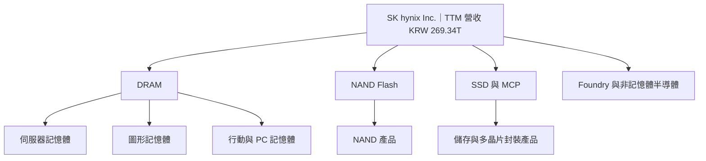
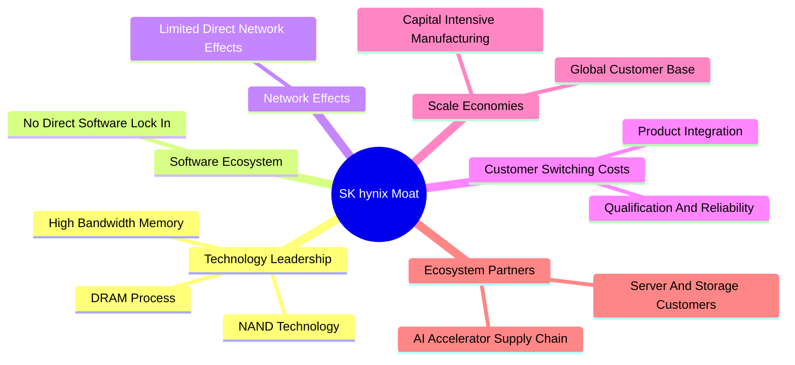
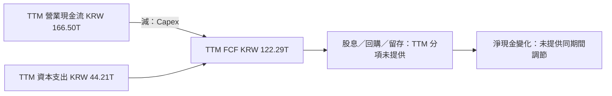
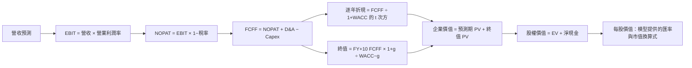
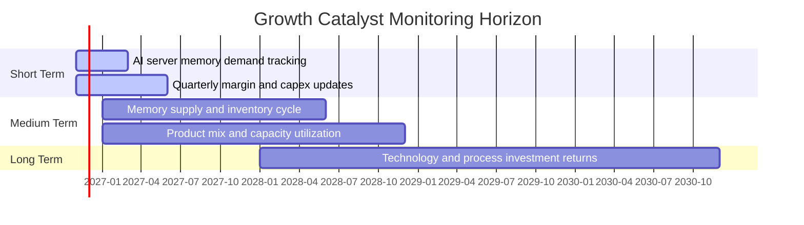
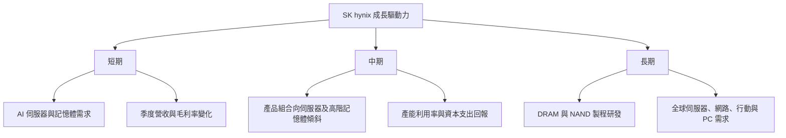
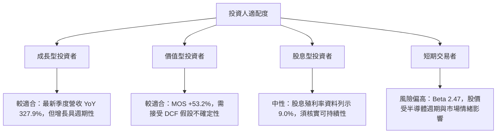

# SKHY 基本面深度分析報告
> **報告日期**：2026-11-20 ｜ **語言**：繁體中文 ｜ **數據來源**：Yahoo Finance、Finviz、StockAnalysis、Roic.ai ｜ **分析師**：CFA 級機構研究

> **資料口徑說明**：SK hynix 為韓國半導體公司，財報以 KRW 計價、股價以 USD 報價；匯率採 2026-11-19 收盤的 **1 USD = 1,330.40 KRW**。除特別標示外，金額均沿用原始資料幣別。公司分部營收、最新季度稀釋股數、TTM 與前一年度 ROIC、EPS 預期值及歷史估值區間均未提供，相關處標示 N/A，不自行補造。

## 目錄

| # | 章節 | 核心結論 |
|---|------|----------|
| 1 | 執行摘要 | 買入；加權合理價值 $254.60；MOS +53.2% |
| 2 | 公司概覽與商業模式 | DRAM、NAND 與 SSD 業務受益於高效能記憶體需求；產品別營收占比未提供 |
| 3 | 損益表深度分析 | TTM 營收 KRW 269.34T；最新單季年增 327.9%，利潤率處於週期高位 |
| 4 | 資產負債表分析 | 淨現金 KRW 96.34T；流動比率 3.115，CCC 203 天 |
| 5 | 現金流量深度分析 | TTM FCF KRW 122.29T，FCF Yield 10.94% |
| 6 | 獲利能力與資本效率 | WACC 採用 14.00%；ROIC 缺少可比 TTM 數據，無法判定利差 |
| 7 | 相對估值分析 | 同業倍數顯示估值不一；估值方法加權結果高於現價 |
| 8 | DCF 內在價值評估 | 基準 DCF 每股 $269.05；高度依賴週期高峰利潤率假設 |
| 9 | 成長催化劑 | AI 伺服器記憶體需求是主要機會；可引用 TAM 數據未提供 |
| 10 | 風險矩陣 | 週期反轉、競爭與資本支出是核心風險 |
| 11 | 投資建議 | 買入；現價 $119.20，需嚴格追蹤利潤率、Capex 與現金流 |

---

## 1. 執行摘要

2026-11-19 收盤價為 **$119.20**。TTM 營收為 **KRW 269.34T**，最新季度營收年增 **327.9%**，TTM 營業利益率 **74.5%**、FCF **KRW 122.29T**，淨現金 **KRW 96.34T**。DCF 基準價值 **$269.05**，而 DCF 以外的估值方法納入後，加權合理價值為 **$254.60**，安全邊際 **MOS +53.2%**。依程式計算的 MOS 門檻評級為 **買入**；惟 ROIC 缺少可比的 TTM 數據，無法確認 ROIC 是否高於 14.00% WACC，因此不評為強烈買入。股價折讓與強勁當期現金流提供支持，但 74.5% 營業利益率處於高位、記憶體產業週期性強，估值對利潤率正常化速度相當敏感。

### 1.0 一頁式投資儀表板（Portfolio Manager 30 秒速讀）

| 項目 | 內容 |
|------|------|
| **投資論點（3 句）** | ① TTM FCF 為 KRW 122.29T、FCF Yield 10.94%，當前現金創造能力提供估值支撐。② 最新季度營收年增 327.9%，同時最新 TTM 營業利益率達 74.5%，反映 AI／伺服器記憶體需求與價格、產品組合對獲利的推升。③ 加權合理價值 $254.60 高於 $119.20 收盤價，MOS +53.2%，但須留意高峰利潤率正常化。 |
| **綜合評分** | **8.0/10**（引用 1.1 評分卡；六項平均） |
| **財務健康** | 🟢 淨現金 KRW 96.34T、流動比率 3.115；CCC 203 天仍須關注營運資金占用。 |
| **ROIC vs WACC** | ROIC：N/A；WACC：14.00%。ROIC 資料缺漏，無法判定是否創造經濟價值。 |
| **FCF 趨勢** | TTM FCF KRW 122.29T；FY2023 曾為負、FY2024–FY2025 回正。FCF Yield：10.94%。 |
| **估值** | Forward P/E 2.88x（Yahoo Finance）；EV/EBITDA：N/A（幣別口徑不一致）；FCF Yield 10.94%。 |
| **DCF 內在價值（基準）** | $269.05；相對現價折價 **55.7%**，即折溢價為 **−55.7%**（基準：第 8.5 節 DCF 值）。 |
| **安全邊際（MOS）** | **+53.2%**＝($254.60 − $119.20) ÷ $254.60；🟢 充足。分母採第 8.8 節加權合理價值。 |
| **預期報酬（基準情境 12M）** | 以加權合理價值作為估值參考，上行空間 **+113.6%**；並非保證的 12 個月報酬。 |
| **關鍵風險（前二）** | 記憶體價格及庫存週期反轉；AI 需求或供給擴張低於市場預期。 |
| **評級 + 信心度** | 🟢 **買入** ｜ 信心：中。MOS 具吸引力，但 DCF 的高起始利潤率及長期週期假設存在顯著模型風險。 |

### 1.1 綜合評分卡（全報告唯一）

| 維度 | 評分（1–10） | 主要依據（引用數字與其來源章節） |
|------|--------------|----------------------------------|
| 成長性 | 9.0 | 最新季度營收年增 327.9%，TTM 營收成長率資料 N/A；2025 年營收 KRW 97.15T（第 3 章）。 |
| 獲利能力 | 9.0 | TTM 營業利益率 74.5%、淨利率 70.1%、TTM FCF KRW 122.29T；ROIC 及 F-Score 缺資料（第 3、5、6 章）。 |
| 財務健康 | 8.0 | 淨現金 KRW 96.34T、流動比率 3.115、CCC 203 天（第 4 章）。 |
| 估值 | 8.0 | MOS +53.2%；DCF $269.05、加權合理價值 $254.60；股價資料雖有吸引力，但 DCF 對峰值利潤率敏感（第 7、8 章）。 |
| 護城河 | 8.0 | DRAM／NAND 製造與研發規模、產品跨伺服器／行動裝置／PC 等市場；可量化市占及分部資料未提供（第 2 章）。 |
| 管理層與資本配置 | 6.0 | FY2025 股息支付 KRW 1.68T、Capex KRW 28.58T、SBC KRW 414.11B；可用回購與資本配置長期紀錄不足（第 5 章）。 |
| **綜合評分** | **8.0** | 六項算術平均：(9.0 + 9.0 + 8.0 + 8.0 + 8.0 + 6.0) ÷ 6 = **8.0**。 |

### 1.2 五大投資論點 + 三大核心風險

| 類型 | 項目 | 具體依據 | 信心度 |
|------|------|----------|--------|
| 🟢 **投資論點①** | 高速成長帶動獲利 | 最新季度營收年增 327.9%、營業利益 KRW 83.33T；需求擴張及產品組合提升可能使固定成本吸收改善。 | 🟢 高 |
| 🟢 **投資論點②** | 現金流規模支持估值 | TTM OCF KRW 166.50T、Capex KRW 44.21T、FCF KRW 122.29T；有能力支持研發、擴產與股東回報。 | 🟢 高 |
| 🟢 **投資論點③** | 資產負債表具緩衝 | 現金及短期投資 KRW 114.46T、債務 KRW 18.13T，淨現金 KRW 96.34T。 | 🟢 高 |
| 🟢 **投資論點④** | 相對現價估值折讓 | 加權合理價值 $254.60，相對 $119.20 的 MOS 為 +53.2%。 | 🟡 中 |
| 🟢 **投資論點⑤** | 伺服器記憶體與 AI 投資 | 公司提供伺服器記憶體、圖形記憶體等產品；AI 資料中心需求可形成增量，但分部收入未提供。 | 🟡 中 |
| 🟡 **風險①** | 週期反轉與利潤率回落 | TTM 營業利益率 74.5%，遠高於 FY2025 的 48.6%；價格或需求正常化會使獲利與 DCF 同步下修。 | 🟡 中度 |
| 🔴 **風險②** | 供給擴張與資本支出負擔 | FY2025 Capex KRW 28.58T；TTM Capex KRW 44.21T。若擴產後供給先於需求，折舊與庫存將增加下行風險。 | 🔴 高衝擊 |
| 🟡 **風險③** | 現金轉換週期偏長 | CCC 203 天，其中 DIO 143 天、DSO 80 天，週期放緩可能使營運資金與庫存風險上升。 | 🟡 中度 |

### 1.3 快速統計卡片

| 指標 | 公司實際值（期間） | 同業中位數 | 狀態 |
|------|--------------------|------------|------|
| 營收成長（TTM） | **N/A** | — | 🟡 未提供可用的 TTM 比較值 |
| 營收成長（最新一季年增） | **327.9%** | 377.9% | 🟢 高增長，略低於同業中位數 |
| 毛利率（TTM） | **77.4%** | 80.0% | 🟡 低於同業中位數 |
| 營業利益率（TTM） | **74.5%** | — | 🟢 高，但可能處於週期高位 |
| ROIC（TTM） | **N/A** | — | 🟡 缺少可比投入資本資料 |
| Forward P/E | **2.88x** | 7.3x | 🟢 低於 MU、SNDK、WDC 中位數 |
| FCF Yield（TTM） | **10.94%** | — | 🟢 現金流收益率具吸引力 |
| Piotroski F-Score | **N/A** | — | 🟡 缺少兩個相隔一年的 SEC 申報 TTM 期間 |

同業中位數：最新季度營收成長率為 377.9%（MU、SNDK、WDC 中位數）；毛利率中位數為 80.0%；Forward P/E 中位數為 7.3x。

### 1.4 投資結論

```text
╔══════════════════════════════════════════════════════════════════╗
║                    📊 投資結論摘要                               ║
╠══════════════════════════════════════════════════════════════════╣
║  評級：買入（依 MOS 門檻；ROIC 缺漏，未升為強烈買入）            ║
║  價格（2026-11-19 收盤）：$119.20                                ║
║  DCF 內在價值（基準）：$269.05（折價 55.7%）                    ║
║  安全邊際 MOS：+53.2%（＝(加權合理價值−現價)÷加權合理價值）     ║
║  加權合理價值（8.8）：$254.60                                    ║
║  DCF 情境價值：                                                  ║
║    悲觀情境：$130.30（+9.3%）                                    ║
║    基準情境：$269.05（+125.7%）                                  ║
║    樂觀情境：$529.26（+344.0%）                                  ║
║  綜合評分：8.0/10（引用 1.1）                                    ║
║  適合投資人：能承受半導體景氣波動、並願意追蹤季度指標的投資人    ║
╚══════════════════════════════════════════════════════════════════╝
```

---

## 2. 公司概覽與商業模式

### 2.1 業務結構與收入來源

公司提供 DRAM、NAND flash、SSD、MCP 及非記憶體晶圓代工相關產品。公司整體 TTM 營收為 **KRW 269.34T**，但產品別營收與占比未提供，因此下圖不表示各產品的收入權重。



### 2.2 市場份額

市場份額數據未提供。以營收和增速衡量，SK hynix TTM 營收達 KRW 269.34T，最新季度營收年增 327.9%；同業 MU 最新季度營收年增 379.3%，SNDK 為 377.9%，WDC 為 55.5%。這些增速反映近期業務復甦與基期影響，不能替代市場份額資料。

### 2.3 競爭護城河分析



### 2.4 護城河強度

| 護城河項目 | 強度（強／中／弱） | 證據（引用數字或事實） | 會削弱它的情況 |
|------------|--------------------|------------------------|----------------|
| 技術與製造能力 | 強 | 產品涵蓋 DRAM、NAND、SSD、MCP，服務伺服器、網路、行動裝置與 PC 市場；員工 47,639 人。 | 技術轉換落後、良率不及競爭對手或新製程投資回報降低。 |
| 規模效應 | 強 | TTM 營收 KRW 269.34T、TTM Capex KRW 44.21T，屬高度資本密集產業。 | 記憶體價格長期下跌、產能利用率下降，造成固定成本攤提惡化。 |
| 客戶關係與認證 | 中 | 產品用於伺服器、網路與行動等應用；特定客戶收入與合約資料未提供。 | 主要客戶轉單、採購集中或客戶自行設計替代方案。 |
| 軟體生態系統 | 弱 | 未提供可證明軟體平台鎖定或經常性服務收入的資料。 | 同業產品性能或價格更具競爭力。 |
| 網路效應 | 弱 | 記憶體產品本身未見直接網路效應證據。 | 技術標準或產業生態轉移至其他解決方案。 |
| 生態夥伴 | 中 | AI、伺服器與儲存供應鏈為產品需求來源；合作營收與合約量未提供。 | AI 資本支出放緩或供應鏈庫存調整。 |

1.1「護城河」評分為 **8.0/10**：主要依據資本密集製造、產品技術與跨應用供應能力；由於市場份額、客戶集中度及分部營收未提供，評分不代表可量化的定價權測試。

---

## 3. 損益表深度分析

### 3.1 年度收入成長趨勢（近 4 年）

年度營收使用 Yahoo／StockAnalysis 公布值；柱狀長度僅作年度營收視覺化，金額皆為 KRW。

```text
╔══════════════════════════════════════════════════════════════════╗
║                 SK hynix 年度收入趨勢（FY2022-FY2025）           ║
╠══════════════════════════════════════════════════════════════════╣
║ FY2022  KRW 44.62T  ████████████░░░░░░░░░░░░  YoY: N/A        ║
║ FY2023  KRW 32.77T  █████████░░░░░░░░░░░░░░░  YoY: -26.6% 🔴 ║
║ FY2024  KRW 66.19T  ██████████████████░░░░░░  YoY: +102.0% 🟢║
║ FY2025  KRW 97.15T  ████████████████████████  YoY: +46.8% 🟢 ║
╠══════════════════════════════════════════════════════════════════╣
║ FY2022-FY2025 營收 CAGR：約 +29.6%                               ║
╚══════════════════════════════════════════════════════════════════╝
```

FY2023 營收下滑與產業供需低迷一致，FY2024 年增 102.0%、FY2025 年增 46.8% 則反映復甦及需求改善。FY2022 至 FY2025 CAGR 約 29.6%，但這段期間含完整下行與復甦，不能直接視為未來穩態增長率。

### 3.2 季度收入趨勢分析

| 季度 | 營收（KRW T） | QoQ 成長率 | YoY 成長率 | 備註 |
|------|---------------:|-----------:|-----------:|------|
| 2025 Q4 | 32.83 | +34.3% | +66.1% | 復甦延續，季增仍高。 |
| 2026 Q1 | 52.58 | +60.2% | +198.1% | 與去年低基期相比，年增率顯著放大。 |
| 2026 Q2 | 79.32 | +50.9% | +256.8% | 季增與年增均高，需追蹤供需及售價。 |
| 2026 Q3 | 104.62 | +31.9% | +327.9% | 季增放緩，但營收規模續創表中高點；年增率仍受基期影響。 |

YoY 數據引用 StockAnalysis 季度序列；最新季度 327.9% 與 Yahoo 財務數據一致。由於 TTM 營收成長率被標為 N/A，本報告不將單季增速替代為 TTM 增速。

### 3.3 利潤率演變分析

| 利潤率指標 | FY2022 | FY2023 | FY2024 | FY2025 | TTM 至 2026-09-30 | 趨勢與評估 |
|------------|--------:|--------:|--------:|--------:|------------------:|------------|
| **毛利率** | 35.0% | -1.6% | 48.1% | 60.4% | 77.4% | 從景氣谷底快速反彈；🟢 但 TTM 高位恐難線性外推。 |
| **營業利益率** | 15.3% | -23.6% | 35.5% | 48.6% | 74.5% | 產能利用率、價格及產品組合共同推升；🟡 須重視週期性。 |
| **淨利率** | 5.0% | -27.8% | 29.9% | 44.2% | 70.1% | 最新 TTM 大幅高於 FY2025，可能含高峰獲利與季度波動。 |

FY2023 毛利為負 KRW 0.53T、營業虧損 KRW 7.73T；FY2025 營業利益轉為 KRW 47.21T。最新 TTM 營業利益 KRW 200.66T、利潤率 74.5%。變化方向顯示營收回升與高毛利產品組合改善帶來營運槓桿；但財報沒有分部 ASP、出貨量、產能利用率或費用明細，不能將全部改善歸因於單一產品。FY2026 Q2 淨利 KRW 93.82T 明顯高於前後季度，亦需以正式申報資料核實其組成及一次性項目。

### 3.4 費用結構分析

產品成本、研發、銷售及管理費用的 TTM 詳細分項未完整提供，故不繪製費用占比圓餅圖。可確認 FY2025 研發費用為 **KRW 6.47T**，約占 FY2025 營收 **6.7%**；該費用支持製程與產品開發，但不能據此推算未提供的其他費用占比。

### 3.5 季度 EPS 趨勢與盈餘品質（Quality of Earnings）

| 盈餘品質項目 | 數值／佔比 | 評估 |
|--------------|-----------|------|
| 股權薪酬 SBC / 營收 | TTM N/A；FY2025 約 0.43%（KRW 414.11B ÷ KRW 97.15T） | 🟢 FY2025 比例低；但最新季度 SBC 數據不完整，不能將該年度比例直接視為當前值。 |
| SBC / 營業現金流 | FY2025 約 0.78%（KRW 414.11B ÷ KRW 53.37T） | 🟢 年度資料顯示占比有限；股數稀釋明細不足。 |
| FCF / 淨利（現金轉換率） | TTM 約 64.7%（KRW 122.29T ÷ KRW 188.90T） | 🟡 現金轉換率可觀，但低於 100%；資本支出及營運資金需求消耗部分淨利。 |
| 一次性／非經常性損益 | N/A（季度淨利波動大，缺少調節表） | 🟡 FY2026 Q2 淨利 KRW 93.82T 高於 Q1 KRW 40.33T、Q3 KRW 39.53T，需核實非經常項目。 |
| 有效稅率 | 14.9%（成本資本資料採用的最新年度有效稅率） | 🟡 未提供季度稅率序列，無法確認單季是否由稅務利益帶動。 |
| 資本化支出 vs 費用化 | TTM Capex KRW 44.21T；費用化研發 FY2025 KRW 6.47T | 🟡 高資本支出為產業模式所需；未提供資本化利息與支出分類細節。 |
| EPS 預期差 | 過去四季實際每股盈餘約 KRW 54,454、131,457、56,711、21,507；分析師預期值 N/A | N/A，無法判定超預期或不及預期。所提供 EPS beat/miss 區塊僅列出 2026 Q2、Q3 且估計與實際均為 nan。 |

**盈餘品質結論**：TTM OCF KRW 166.50T、FCF KRW 122.29T，說明獲利有實質現金流支持；但 FCF／淨利約 64.7%，且 CCC 為 203 天，現金轉換並非完全無摩擦。SBC FY2025 相對營收低，但 TTM SBC 缺資料；一次性損益與季度 EPS surprise 也無法驗證。故現有獲利的現金含量具支持，但不宜把單季淨利或 TTM 74.5% 營業利潤率直接視為可持續水準。

---

## 4. 資產負債表分析

### 4.1 資產結構分解

最新季度提供現金、短期投資、應收帳款、存貨、流動資產與 PPE 等資料，但未提供同一時點的完整總資產及各資產科目加總；不以不完整項目繪製比例圖。FY2025 年末總資產為 KRW 176.11T，流動資產 KRW 69.46T，應收帳款 KRW 18.20T、存貨 KRW 14.29T、PPE KRW 79.84T。

### 4.2 流動性與營運資金分析

| 指標 | 最新 TTM／2026-09-30 | 一年前 TTM | 變化 | 解讀 |
|------|---------------------:|------------:|------:|------|
| 流動比率 | 3.115 | N/A | N/A | 🟢 短期資產高於短期負債；歷史同口徑未提供。 |
| 速動比率 | 2.794 | N/A | N/A | 🟢 排除存貨後流動性仍高。 |
| DSO 應收帳款天數 | 80 天 | N/A | N/A | 無一年前品質指標，無法判定收款是否變慢。 |
| DIO 存貨天數 | 143 天 | N/A | N/A | 存貨天數為 CCC 最大構成項，應追蹤產品庫存與需求匹配。 |
| DPO 應付帳款天數 | 20 天 | N/A | N/A | 缺乏歷史比較，不能推斷供應商議價力變化。 |
| CCC 現金轉換週期 | 203 天 | N/A | N/A | DSO + DIO − DPO = 80 + 143 − 20 = 203 天；週轉時間較長，景氣轉弱時需留意庫存現金占用。 |

### 4.3 債務結構分析

```text
╔══════════════════════════════════════════════════════════════════╗
║                   SK hynix 債務健康診斷                          ║
╠══════════════════════════════════════════════════════════════════╣
║  總債務：        KRW 18.13T   ██░░░░░░░░░░░░░░░░░░░  🟢        ║
║  現金+短期投資： KRW114.46T   ████████████████████░  🟢        ║
║  淨現金：        KRW 96.34T   █████████████████░░░░  🟢        ║
║  Debt/EBITDA：   N/A（未提供相同口徑的債務 EBITDA 指標）        ║
║  利息保障倍數：  N/A（未提供利息費用與營業利益口徑）             ║
║  流動比率：      3.115        🟢                                ║
╚══════════════════════════════════════════════════════════════════╝
```

TTM 總債務 KRW 18.13T 低於現金及短期投資 KRW 114.46T，形成 KRW 96.34T 淨現金。FY2025 年末債務 KRW 24.76T，與最新 TTM 債務數字的期間不同，不能直接視為完整債務趨勢。

### 4.4 股東權益趨勢

```text
╔══════════════════════════════════════════════════════════════════╗
║                   股東權益變化（年度）                           ║
╠══════════════════════════════════════════════════════════════════╣
║ 2022 年末  KRW 63.27T  ████████████░░░░░░░░░░░░                ║
║ 2023 年末  KRW 53.50T  ██████████░░░░░░░░░░░░░░                ║
║ 2024 年末  KRW 73.90T  ██████████████░░░░░░░░░░                ║
║ 2025 年末  KRW120.52T  ████████████████████████                ║
╚══════════════════════════════════════════════════════════════════╝
```

FY2023 股東權益隨虧損下降，FY2024–FY2025 隨獲利回升而增加；最新季度權益未提供，不延伸推算。

---

## 5. 現金流量深度分析

### 5.1 現金流量瀑布圖

缺少 TTM 淨利、股息、回購與淨現金變化的同期間完整調節數字，以下僅呈現可確認的 TTM OCF、Capex 與 FCF，不填未提供項目。



### 5.2 FCF 轉換率趨勢

| 財年 | FCF（KRW T） | 淨利（KRW T） | FCF／淨利 | 解讀 |
|------|-------------:|-------------:|----------:|------|
| 2022 | -4.97 | 2.23 | -222.9% | 獲利未轉為正 FCF，Capex 高於 OCF。 |
| 2023 | -4.50 | -9.11 | 不具一般解讀性 | 淨利與 FCF 同為負，景氣低谷期間現金流承壓。 |
| 2024 | 13.13 | 19.79 | 66.4% | 復甦後轉正，但仍需投入大量資本支出。 |
| 2025 | 24.79 | 42.92 | 57.8% | FCF 增加，淨利增速高於現金流。 |
| TTM 至 2026-09-30 | 122.29 | 188.90 | 64.7% | 數據引用 TTM FCF 與 StockAnalysis TTM 淨利。 |

### 5.3 自由現金流趨勢

```text
╔══════════════════════════════════════════════════════════════════╗
║                   自由現金流趨勢（年度與 TTM）                   ║
╠══════════════════════════════════════════════════════════════════╣
║ FY2022  -KRW 4.97T  ◀██░░░░░░░░░░░░░░░░░░░░  負 FCF           ║
║ FY2023  -KRW 4.50T  ◀██░░░░░░░░░░░░░░░░░░░░  負 FCF           ║
║ FY2024   KRW13.13T   ███░░░░░░░░░░░░░░░░░░░  轉正              ║
║ FY2025   KRW24.79T   █████░░░░░░░░░░░░░░░░░  持續改善          ║
║ TTM      KRW122.29T  ████████████████████████  FCF Yield 10.94%║
╚══════════════════════════════════════════════════════════════════╝
```

年度 FCF 顯示週期性明顯；TTM FCF 急升與營收、營業利益同步擴張，但數據未提供 TTM 對應的回購及股息完整分配。

### 5.4 資本配置評估

股息與 Capex 有資料，回購、留存及投資的完整同期間分配未提供，故不繪製比例圓餅圖。

| 項目 | 數值 | 評估 |
|------|------:|------|
| FY2025 資本支出 | KRW 28.58T | 擴產與技術投入可支持未來產能，但也提高景氣反轉時的固定成本風險。 |
| TTM 資本支出 | KRW 44.21T | 高於 FY2025 全年值，顯示近期投資規模上升；需與新增產能利用率配合觀察。 |
| FY2025 股息支付 | KRW 1.68T | 現金回報低於當年 FCF，保留較多現金彈性。 |
| 回購 | N/A | 未提供。 |
| FY2025 SBC | KRW 414.11B | 約占 FY2025 營收 0.43%，但 TTM SBC 不完整。 |

---

## 6. 獲利能力與資本效率

### 6.1 ROE / ROA / ROIC 趨勢

| 指標 | FY2023 | FY2024 | FY2025／最新 | 評估 |
|------|-------:|-------:|-------------:|------|
| ROE | N/A | N/A | TTM 92.5% | 當前獲利高，缺少逐年一致口徑數據。 |
| ROA | N/A | N/A | TTM 46.4% | 高 TTM 報酬率受週期高峰利潤影響。 |
| ROIC | N/A | N/A | TTM N/A | 最新 TTM 投入資本資料與品質指標皆缺，不能作歷史趨勢比較。 |

未提供可引用的行業均值，故不列行業均值。ROIC.ai 的歷史資料顯示過往若干年份 Return on Invested Capital，但不是本期 TTM 數據，不應與 TTM WACC 作同期間直接比較。

### 6.2 ROIC vs WACC 分析（核心價值創造判斷）

```text
╔══════════════════════════════════════════════════════════════════╗
║                 ROIC vs WACC 深度分析                            ║
╠══════════════════════════════════════════════════════════════════╣
║  WACC 估算：採用成本資本資料的 WACC 14.00%                       ║
║  ├── 無風險利率（10Y 美債）：       5.05%                        ║
║  ├── 市場風險溢酬 ERP：             5.00%                        ║
║  ├── 原始 Beta：                    2.47                         ║
║  ├── 調整後 Beta：                  1.98                         ║
║  ├── 股權成本（資料值）：           14.94%                       ║
║  ├── 稅前債務成本：                 5.10%                        ║
║  ├── 股權／債務權重：               98.4%／1.6%                  ║
║  ├── 未封頂計算 WACC：              14.77%                       ║
║  └── 採用 WACC：                    14.00%（限制於 7%–14%）     ║
║                                                                  ║
║  ROIC（TTM）：N/A，缺少可比投入資本數據                         ║
║  EVA = ROIC − WACC：N/A，不可據現有資料判定                     ║
╠══════════════════════════════════════════════════════════════════╣
║  結論：公司 TTM 營業利益率與 FCF 強勁，但 ROIC 缺值；             ║
║        暫不下「ROIC 高於 WACC、創造價值」結論。                  ║
╚══════════════════════════════════════════════════════════════════╝
```

本節與 DCF 折現率採用同一 **14.00% WACC**。未封頂計算值為 14.77%，依資料所述限制在 7%–14% 區間後採用 14.00%。Beta 調整方式為 \( \frac{2}{3}\times2.47+\frac{1}{3}\times1=1.98 \)。資料中的 CAPM 股權成本為 14.94%；以已四捨五入的 Rf、Beta、ERP 代入得 14.95%，差異為輸入值精度所致。ROIC 缺失使經濟利差無法計算。

### 6.3 杜邦三因素分解

| 因素 | 數值（TTM） | 解讀 |
|------|-------------|------|
| 淨利率 | N/A（QUALITY FIGURES 標示 N/A） | 本分析不以其他口徑替代品質指標。 |
| 資產週轉率 | N/A | 同上。 |
| 權益乘數 | N/A | 同上。 |
| **ROE** | **N/A** | QUALITY FIGURES：缺少淨利、營收、總資產或正權益的必要同口徑資料；不重新計算。 |

### 6.4 財務體質：Piotroski F-Score

Piotroski F-Score 為 **N/A**：缺少相隔一年的兩個 SEC 申報 TTM 期間。九項測試各自結果亦未提供，故不另行補列或推定。

---

## 7. 相對估值分析

### 7.1 同業估值比較表格

本公司自身倍數依 Yahoo Finance；同業倍數依指定 Peer multiples。SKHY P/S、EV/EBITDA 因報價與財報幣別口徑不一致而未提供，保留 N/A。

| 估值指標 | **SKHY** | **MU** | **SNDK** | **WDC** | 本公司評估 |
|----------|---------:|-------:|--------:|-------:|-----------|
| **Trailing P/E** | 6.60x | 9.3x | 48.3x | 10.4x | 🟢 低於三家同業。 |
| **Forward P/E** | 2.88x | 3.3x | 20.9x | 7.3x | 🟢 低於同業；前瞻 EPS 估計可能受週期高峰影響。 |
| **P/S Ratio** | N/A | 5.9x | 3.7x | 7.7x | 🟡 SKHY 無同幣別可比數據。 |
| **EV / EBITDA** | N/A | 6.8x | 0.4x | 17.5x | 🟡 SKHY 無可比數據；SNDK 的 0.4x 對同業中位數造成偏態影響。 |
| **最新季度營收 YoY** | 327.9% | 379.3% | 377.9% | 55.5% | 🟢 高增長，但低於 MU 與 SNDK。 |
| **毛利率（TTM）** | 77.4% | 80.7% | 80.0% | 52.6% | 🟡 低於 MU、SNDK，高於 WDC。 |

SKHY 的 P/E 倍數較低，但記憶體獲利具週期性；高峰 EPS 分母可能使 P/E 暫時偏低，不能單獨視為低估證據。

### 7.2 歷史估值區間分析

歷史 P/E 區間與估值百分位資料未提供，故無法判斷 SKHY 當前估值位於自身歷史的何種位置。

```text
╔══════════════════════════════════════════════════════════════════╗
║                   歷史估值區間                                  ║
╠══════════════════════════════════════════════════════════════════╣
║  N/A（未提供 Valuation vs own history 的歷史倍數與百分位資料）  ║
╚══════════════════════════════════════════════════════════════════╝
```

### 7.3 情境價值（Bear / Base / Bull）

以下數字直接引用 DCF MODEL 情境結果。情境概率與每股價值為模型假設，不代表已實現概率。

| 情境 | 第 1 年營收成長 | 期末營業利潤率 | WACC | 每股價值 | 相對現價 | 機率 | 會發生的條件 |
|------|----------------:|---------------:|-----:|---------:|---------:|-----:|--------------|
| 🔴 悲觀 | 15.0% | 30.1% | 15.00% | $130.30 | +9.3% | 25% | AI 與伺服器需求增長降溫、記憶體價格回落，利潤率向較低週期水準收斂。 |
| 🟡 基準 | 30.0% | 35.5% | 14.00% | $269.05 | +125.7% | 50% | 近期需求延續，但十年期增速逐步降至 3.0%，營業利潤率降至 35.5%。 |
| 🟢 樂觀 | 45.0% | 39.0% | 13.00% | $529.26 | +344.0% | 25% | AI 記憶體需求與價格持續優於基準，且資本成本與利潤率較有利。 |

### 7.4 相對估值隱含價格區間

```text
╔══════════════════════════════════════════════════════════════════╗
║                   估值方法隱含每股價值                          ║
╠══════════════════════════════════════════════════════════════════╣
║ $119.20 現價 ─ $168.39 P/S ─ $259.50 共識 ─ $269.05 DCF         ║
║                              └── $291.16 EV/EBITDA              ║
╚══════════════════════════════════════════════════════════════════╝
```

- **同業 EV/EBITDA：$291.16**，依 MU、WDC 的同業中位數 **12.2x** 乘以 SKHY TTM EBITDA，再加回淨現金。
- **同業 P/S：$168.39**，依 MU、SNDK、WDC 的同業中位數 **5.9x** 乘以 TTM 營收。
- P/E 同業倍數回推股價未列於指定估值方法中，不自行新增方法或價格。

---

## 8. DCF 內在價值評估（Discounted Cash Flow）

> 本節遵循 DCF MODEL 已提供的十年模型；預測與估值數字沿用模型結果。由於原始資料缺少完整股數與若干模型輸入底稿，部分步驟只能照錄模型輸出，不能從報告披露內容獨立重建。此限制於 8.10 明確列出。

### 8.0 估值推理鏈（Thinking Logic）

**Step 1 — 價值來源與主導變數**

SKHY 價值主要來自 DRAM／NAND 主業現金流與 AI、伺服器記憶體需求帶來的增量；前者支撐 TTM 營收 KRW 269.34T，後者可能提升高階產品組合，但產品別營收占比未提供，不能拆分量化。模型中對估值最具影響的變數是營業利潤率及 WACC：基準 TTM 營業利潤率為 74.5%，模型期末降至 35.5%；WACC 為 14.00%，終值成長率為 3.0%。

**Step 2 — 模型選擇**

| 決策點 | 本報告採用 | 理由（含數字） | 曾考慮但否決 | 否決理由 |
|--------|-----------|----------------|--------------|----------|
| 現金流定義 | FCFF | 與 WACC 折現、先估企業價值，再橋接淨現金一致。 | FCFE | 估值方法指定使用 FCFF。 |
| 預測期 N | 10 年 | DCF MODEL 固定列示 FY+1 至 FY+10。 | 5 年 | 模型已設定 10 年，不能自行更改。 |
| 終值方法 | Gordon Growth | 模型提供永續成長率 3.0% 及 Gordon 終值。 | 退出倍數主法 | DCF MODEL 未提供退出倍數估值輸出；不另建模型。 |
| EBIT 基礎 | GAAP EBIT | 模型明示 GAAP EBIT。 | 非 GAAP EBIT | 缺乏模型依據，且會改變 SBC 處理。 |

**Step 3 — 關鍵假設的推導鏈**

- **營收增長路徑**：錨點＝最新單季 YoY 327.9%，但該值不是 TTM 成長率；模型將其限制在 30.0% 作 FY+1 起點，之後線性降至第 10 年 3.0% → 調整理由＝單季增速受低基期與週期反彈放大，不能直接外推 → **採用 FY+1 30.0%、FY+10 3.0%** → 否決將 327.9% 當作長期增速，因其與 TTM 增速 N/A、且是單季數據不相容。
- **期末營業利潤率**：錨點＝TTM 74.5%，FY2025 約 48.6%；模型稱以近五個財年中位數為目標 → 調整理由＝記憶體價格與產能利用率具週期性，利潤率需正常化 → **採用 FY+10 35.5%** → 否決維持 74.5%，因其假設高峰利潤率長期不退。
- **有效稅率**：錨點＝資料採用最新年度有效稅率 14.9% → **採用 14.9%**；稅率歷史範圍資料不足，不進一步自建預測。
- **Capex／營收**：錨點＝TTM 16.4% → 模型將比率由 FY+1 的 16.4% 降至 FY+10 的 6.4%，依據是模型設定漸進回落至 D&A 的 1.1 倍（若高於該值）→ **採用 16.4% 緩降至 6.4%** → 否決永久維持 16.4%，因模型假設成熟期投資強度回落；但模型披露未提供每年比率逐項欄位。
- **D&A／營收**：錨點＝TTM 5.8% → **採用 5.8% 並維持固定**；模型未提供替代比率。
- **ΔWC**：DCF MODEL 明示不建模營運資金；因此模型現金流不扣 ΔWC。此處不是宣稱營運資金需求為零，而是模型省略，存在偏樂觀風險。
- **SBC 與股數**：模型採 **(A) GAAP EBIT + 固定股數**，不另減 SBC、不另增加股數稀釋率；理由是 GAAP EBIT 已將 SBC 列作費用。即使經濟上避免重複扣除，若未來股數因 SBC 增加，固定股數仍可能低估稀釋。
- **終值成長率 g**：錨點＝模型採用 3.0%；此值低於 WACC 14.00%，且模型列示高於 3.0% 的情境不作基準 → **採用 3.0%** → 否決採用接近 WACC 的長期成長率，避免終值發散。
- **WACC**：錨點＝未封頂計算值 14.77%；因模型成本資本設定將 WACC 限於 7%–14% → **採用 14.00%** → 否決採用 14.77% 作為模型折現率，原因是成本資本區塊明示採用上限 14.00%。
- **預測期及終值方法**：錨點＝DCF MODEL 列示 10 年及 Gordon Growth → **採用 10 年、Gordon Growth** → 否決另選退出倍數，因模型未提供該法計算輸出。

**Step 4 — 最脆弱的一環**

最脆弱假設是由 FY+1 **74.5%** TTM 營業利潤率開始，再逐步降至 FY+10 **35.5%**；若價格週期反轉使利潤率更快收縮，現金流與終值都會下降。情境表顯示悲觀情境價值為 **$130.30**，接近現價，與 8.9 的週期風險判斷一致。

**Step 5 — 計算路徑圖**



### 8.1 模型假設總表（Model Inputs）

| 假設項目 | 採用值 | 依據／來源 | 敏感度 |
|----------|--------|-------------|--------|
| 預測期長度 **N** | 10 年 | DCF MODEL 明列 FY+1 至 FY+10。 | 🟡 中 |
| 營收增長路徑 | FY+1 30.0%，FY+10 3.0%，線性遞減 | FY+1 參考最新單季 YoY 327.9% 並限制在 0%–30%；非 TTM 增速。 | 🔴 高 |
| 營業利潤率 | FY+1 74.5% → FY+10 35.5% | TTM 營業利潤率 74.5%；模型終點採近五財年中位數設定。 | 🔴 高 |
| 有效稅率 | 14.9% | 最新年度有效稅率。 | 🟢 低 |
| Capex／營收 | FY+1 16.4% → FY+10 6.4% | TTM 起點 16.4%；模型依 D&A 1.1 倍規則漸降。 | 🟡 中 |
| D&A／營收 | 5.8% | TTM 比率，模型維持固定。 | 🟢 低 |
| 營運資金變動 | 未建模 | DCF MODEL 明示 Working capital is not modelled；非零需求假設。 | 🟡 中 |
| EBIT 基礎 | GAAP | 模型明示 GAAP EBIT。 | 🟡 中 |
| SBC 處理 | 組合 A：GAAP EBIT、不再扣 SBC | GAAP EBIT 已含 SBC 費用；模型不另加 SBC 扣除。 | 🟡 中 |
| 年稀釋率 | 0%（模型固定股數） | 組合 A 的模型處理方式；實際股數變動資料未提供。 | 🟡 中 |
| 永續成長率 g | 3.0% | DCF MODEL 假設；小於 14.00% WACC。 | 🔴 高 |
| 終值方法 | Gordon Growth | DCF MODEL 已提供 Gordon 終值；未提供退出倍數結果。 | 🔴 高 |
| WACC | 14.00% | 成本資本區塊提供，未封頂計算值 14.77%，採用值受 7%–14% 限制。 | 🔴 高 |

**FCFF 定義與 SBC 防呆**：模型使用 FCFF = NOPAT + D&A − Capex；營運資金不建模。採用 **(A) GAAP EBIT + 固定股數**，因此 FCFF 不另扣 SBC，且股數不逐年擴大。SBC 影響在 GAAP 費用中計入一次；固定股數的長期稀釋風險未另反映。

### 8.2 折現率推導（WACC）

```text
╔══════════════════════════════════════════════════════════════════╗
║                    WACC 推導（折現率）                           ║
╠══════════════════════════════════════════════════════════════════╣
║  股權成本 Ke（CAPM）：                                           ║
║  ├── 無風險利率 Rf：                  5.05%（日期未單列）        ║
║  ├── 市場風險溢酬 ERP：               5.00%（假設值）            ║
║  ├── 原始 Beta：                      2.47（Yahoo Finance）      ║
║  ├── 調整後 Beta：                    1.98                      ║
║  ├── 調整：                           ⅔×2.47 + ⅓×1 = 1.98      ║
║  └── 資料所列 Ke：                    14.94%                    ║
║                                                                  ║
║  債務成本 Kd：                                                    ║
║  ├── 稅前 Kd：                        5.10%（資料所列）          ║
║  ├── 有效稅率：                       14.9%                     ║
║  └── 稅後 Kd：                        5.10%×(1−14.9%)=4.34%     ║
║                                                                  ║
║  資本結構：                                                       ║
║  ├── 股權權重 E：                     98.4%                     ║
║  ├── 債務權重 D：                     1.6%                      ║
║  ├── 未封頂 WACC：                    14.77%                    ║
║  └── 採用 WACC：                      14.00%（封頂）            ║
╚══════════════════════════════════════════════════════════════════╝
```

逐步演算與可核查性：

1. **Ke（CAPM）**：資料列示 Rf 5.05%、調整後 Beta 1.98、ERP 5.00%，並列示 Ke **14.94%**。以已四捨五入輸入計算為 \(5.05\%+1.98\times5.00\%=14.95\%\)；0.01 個百分點差異來自來源輸入精度。成本資本資料未提供規模／國別溢酬，未另加。
2. **稅前 Kd**：資料直接提供 **5.10%**；利息費用及平均計息負債明細未提供，不能獨立重算其分子、分母。
3. **稅後 Kd**：\(5.10\%\times(1-14.9\%)=4.3401\%\)，四捨五入為 **4.34%**。
4. **權重**：成本資本資料列示股權／債務權重 **98.4%／1.6%**；對應市場權重基礎。由於完整稀釋股數及計息負債分類底稿未提供，本報告不從其他口徑另算權重。
5. **未封頂 WACC**：資料列示 **14.77%**；採用區間為 7%–14%，故 **WACC = 14.00%**。按已四捨五入的權重、Ke、稅後 Kd 計算，約為 \(98.4\%\times14.94\%+1.6\%\times4.34\%=14.77\%\)，再依上限採 14.00%。

### 8.3 逐年自由現金流預測（基準情境）

下表金額單位為 **KRW billions**，數值照錄 DCF MODEL；折現因子保留模型提供的三位小數。

| 年度 | FY+1 | FY+2 | FY+3 | FY+4 | FY+5 | FY+6 | FY+7 | FY+8 | FY+9 | FY+10（N） |
|------|-----:|-----:|-----:|-----:|-----:|-----:|-----:|-----:|-----:|-----------:|
| 營收 | 350,138.32 | 444,675.67 | 551,397.83 | 667,191.37 | 787,285.82 | 905,378.69 | 1,014,024.13 | 1,105,286.30 | 1,171,603.48 | 1,206,751.59 |
| 營收 YoY | 30.0% | 27.0% | 24.0% | 21.0% | 18.0% | 15.0% | 12.0% | 9.0% | 6.0% | 3.0% |
| 營業利潤率 | 74.5% | 70.2% | 65.8% | 61.5% | 57.1% | 52.8% | 48.5% | 44.1% | 39.8% | 35.5% |
| EBIT | 260,853.17 | 311,990.95 | 362,945.99 | 410,218.08 | 449,900.38 | 478,104.93 | 491,483.37 | 487,763.23 | 466,198.18 | 427,828.34 |
| − 稅 | (38,858.25) | (46,476.04) | (54,066.60) | (61,108.53) | (67,019.85) | (71,221.37) | (73,214.30) | (72,660.12) | (69,447.66) | (63,731.86) |
| = NOPAT | 221,994.92 | 265,514.92 | 308,879.39 | 349,109.54 | 382,880.53 | 406,883.57 | 418,269.07 | 415,103.11 | 396,750.51 | 364,096.48 |
| + D&A | 20,364.52 | 25,862.94 | 32,070.04 | 38,804.75 | 45,789.61 | 52,658.05 | 58,977.01 | 64,284.95 | 68,142.04 | 70,186.30 |
| − Capex | (57,466.92) | (68,034.79) | (78,227.38) | (87,230.86) | (94,171.77) | (98,222.80) | (98,725.83) | (95,311.92) | (87,993.44) | (77,204.93) |
| **= FCFF** | **184,892.52** | **223,343.06** | **262,722.05** | **300,683.44** | **334,498.37** | **361,318.82** | **378,520.25** | **384,076.14** | **376,899.11** | **357,077.85** |
| 折現因子 | 0.877 | 0.769 | 0.675 | 0.592 | 0.519 | 0.456 | 0.400 | 0.351 | 0.308 | 0.270 |
| **FCFF 現值 PV** | **162,186.42** | **171,855.24** | **177,329.90** | **178,028.73** | **173,727.97** | **164,611.99** | **151,270.82** | **134,641.37** | **115,899.47** | **96,319.54** |

**預測期 FCF 現值加總**：

KRW 162,186.42 + 171,855.24 + 177,329.90 + 178,028.73 + 173,727.97 + 164,611.99 + 151,270.82 + 134,641.37 + 115,899.47 + 96,319.54 = **KRW 1,525,871.45 billion**。

**FY+1 逐步演算（依模型輸出）**

1. 營收：KRW 269,337.17 billion × (1 + 30.0%) = **KRW 350,138.32 billion**。
2. EBIT：KRW 350,138.32 billion × 74.5% = **KRW 260,853.17 billion**。
3. 稅：KRW 260,853.17 billion × 14.9% = **KRW 38,858.25 billion**。
4. NOPAT：KRW 260,853.17 − KRW 38,858.25 = **KRW 221,994.92 billion**。
5. D&A：KRW 350,138.32 billion × 5.8% ≈ **KRW 20,364.52 billion**。
6. Capex：模型 FY+1 比率 16.4%，輸出為 **KRW 57,466.92 billion**。
7. ΔWC：**未建模**，本模型未扣除營運資金變動。
8. FCFF：KRW 221,994.92 + KRW 20,364.52 − KRW 57,466.92 = **KRW 184,892.52 billion**。
9. 折現：模型折現因子 0.877；依未四捨五入因子計算的 PV 為 **KRW 162,186.42 billion**。因展示折現因子已四捨五入至三位小數，直接以 0.877 相乘不會精確復現 PV。

**合理性自檢**

- 預測 FCFF 由 FY+1 KRW 184,892.52 billion 增至 FY+10 KRW 357,077.85 billion；兩端十年 CAGR 以模型輸出推算約 **6.8%**。歷史年度 FCF 從 FY2023 負值轉為 FY2025 KRW 24.79T，無法用一般正值 CAGR 比較；TTM FCF KRW 122.29T 是週期高位，不能直接當作長期增長錨。
- FY+10 FCFF 利潤率約 29.6%（357,077.85 ÷ 1,206,751.59）；TTM FCF 利潤率約 45.4%（KRW 122.29T ÷ KRW 269.34T）。比較反映模型利潤率已大幅正常化；同業最佳 FCF 利潤率資料未提供。
- 模型預測各年 FCFF 為正；但因未建模 ΔWC，若營收擴張需要額外營運資金，實際 FCFF 可能低於預測。

```text
╔══════════════════════════════════════════════════════════════════╗
║             自由現金流：歷史實際 vs 模型預測                    ║
╠══════════════════════════════════════════════════════════════════╣
║ FY2023(實) -KRW 4.50T  ◀██░░░░░░░░░░░░░░░░░░░░  負值          ║
║ FY2024(實)  KRW13.13T   ███░░░░░░░░░░░░░░░░░░░  YoY +191.8%   ║
║ FY2025(實)  KRW24.79T   █████░░░░░░░░░░░░░░░░░  YoY +88.7%    ║
║ FY+1 (預)   KRW184.89T  ████████████░░░░░░░░░░  模型輸出      ║
║ FY+10(預)   KRW357.08T  ████████████████████████ 模型輸出     ║
╠══════════════════════════════════════════════════════════════════╣
║ 注意：FY+1 至 FY+10 未扣營運資金變動；模型輸出不等同業績指引。  ║
╚══════════════════════════════════════════════════════════════════╝
```

### 8.4 終值計算（Terminal Value）

**適用性檢查**：WACC **14.00%** vs g **3.0%** → WACC > g？✅

| 方法 | 計算式 | 終值 TV（KRW bn） | TV 現值（KRW bn） | 佔 EV 比重 |
|------|--------|------------------:|------------------:|-----------:|
| Gordon Growth | 357,077.85 × (1 + 3.0%) ÷ (14.00% − 3.0%) | 3,343,547.12 | 901,901.14 | 37.1% |
| 退出倍數法 | N/A | N/A | N/A | N/A |

**Gordon Growth 逐步演算**

1. FY+N FCFF：**KRW 357,077.85 billion**。
2. 分子：357,077.85 × 1.03 = **KRW 367,790.19 billion**。
3. 分母：14.00% − 3.0% = **11.00%**；模型列示 TV **KRW 3,343,547.12 billion**。以顯示精度直接計算會產生約 KRW 0.02 billion 的尾差，屬模型內部未四捨五入輸入差異。
4. PV(TV)：模型列示 **KRW 901,901.14 billion**。模型展示的 FY+10 折現因子 0.270 已四捨五入；實際計算使用更高精度折現因子，因此不能用 0.270 精確復算。
5. 終值占比：901,901.14 ÷ 2,427,772.59 = **37.1%**。

退出倍數法所需 DCF 模型輸出未提供；不使用同業倍數另建一個終值，以免改變指定模型。

### 8.5 企業價值 → 每股內在價值（Bridge）

```text
╔══════════════════════════════════════════════════════════════════╗
║              企業價值 → 每股內在價值 橋接表                      ║
╠══════════════════════════════════════════════════════════════════╣
║  預測期 FCF 現值合計             KRW 1,525,871.45B               ║
║  終值現值 PV(TV)                 KRW   901,901.14B               ║
║  = 企業價值 EV                   KRW 2,427,772.59B               ║
║  + 淨現金                        KRW    96,337.19B               ║
║  = 股權價值                      KRW 2,524,109.78B               ║
║  稀釋後流通股數                  N/A（模型未列股數）              ║
║  每股價值：照錄模型換算           $269.05                         ║
║  2026-11-19 收盤價                $119.20                         ║
║  折溢價（現價÷DCF價值−1）         -55.7%（折價）                  ║
╚══════════════════════════════════════════════════════════════════╝
```

逐步橋接：

1. **EV** = KRW 1,525,871.45B + KRW 901,901.14B = **KRW 2,427,772.59B**。
2. **股權價值** = KRW 2,427,772.59B + 淨現金 KRW 96,337.19B = **KRW 2,524,109.78B**。
3. **每股價值**：DCF MODEL 指定公式為「股權價值 × FX 0.000751654 USD per KRW × 價格 ÷ 市值」= **$269.05**。模型未提供該換算式完整的稀釋股數／市值底稿，因此此每股價值可照錄，但不能以股數除法獨立重建。
4. **折溢價**：\(($119.20 ÷ $269.05)-1\) = **−55.7%**，即現價相對 DCF 基準值折價 55.7%。
5. **本節不計算 MOS**：MOS 只在 8.8 以加權合理價值為分母計算。

現金、債務及淨現金採用 2026-09-30 TTM 財務資料。換算匯率為 2026-11-19 收盤 1 USD = 1,330.40 KRW；模型採用 FX 0.000751654 USD/KRW，與該匯率的直接倒數顯示值存在精度差異，故照錄模型公式與結果。

### 8.6 敏感性分析（WACC × 永續成長率）

下表每格為 DCF MODEL 原列每股價值。括號上行空間按現價 $119.20 計算並取一位小數。

| g（列）／WACC（欄） | 12.00% | 13.00% | **14.00%（基準）** | 15.00% | 16.00% |
|-----------|-------:|-------:|-------------------:|-------:|-------:|
| **2.0%** | $313.41（+163.1%） | $284.37（+138.6%） | $260.18（+118.3%） | $239.72（+101.1%） | $222.19（+86.4%） |
| **2.5%** | $320.64（+169.0%） | $289.86（+143.2%） | $264.42（+121.8%） | $243.05（+103.9%） | $224.84（+88.6%） |
| **3.0%（基準）** | $328.66（+175.7%） | $295.89（+148.2%） | **$269.05（+125.7%）** | $246.65（+107.1%） | $227.69（+91.0%） |
| **3.5%** | $337.64（+183.3%） | $302.56（+153.8%） | $274.11（+129.8%） | $250.58（+110.2%） | $230.77（+93.6%） |
| **4.0%** | $347.73（+191.7%） | $309.97（+160.0%） | $279.69（+134.7%） | $254.85（+113.8%） | $234.11（+96.4%） |

矩陣基準格與 8.5 DCF 每股價值均為 **$269.05**。提供的 DCF MODEL 敏感度矩陣已包含最終結果，但沒有提供各 WACC 下逐年 PV 的未四捨五入中間表；因此本報告不另建替代模型，也不宣稱能從已披露的三位小數折現因子逐格復算。代表性非基準格的完整中間數字未提供，屬可稽核性限制。

**三情境 DCF**：營收、利潤率、WACC 均移動；情境終值成長率沿用模型基準設定，DCF MODEL 未另列情境 g，故不自行補設。

| 情境 | 營收假設 | 期末營業利潤率 | WACC | 每股內在價值 | 相對現價 | 主觀機率 |
|------|-----------|----------------:|-----:|--------------:|---------:|---------:|
| 🔴 悲觀 | FY+1 15.0% | 30.1% | 15.00% | $130.30 | +9.3% | 25% |
| 🟡 基準 | FY+1 30.0% | 35.5% | 14.00% | $269.05 | +125.7% | 50% |
| 🟢 樂觀 | FY+1 45.0% | 39.0% | 13.00% | $529.26 | +344.0% | 25% |
| **機率加權** | — | — | — | **$299.41** | **+151.2%** | 100% |

機率加權結果：$130.30 × 25% + $269.05 × 50% + $529.26 × 25% = **$299.415**，按模型列示為 **$299.41**。此數字僅作情境參考；第 8.8 節依規定採用 DCF 基準值，不使用機率加權值。

**敏感度結論（依矩陣原值）**

- **g +1.0 個百分點**：以 14% WACC 欄從 g 2.5% 的 $264.42 到 g 3.5% 的 $274.11，價值增加 **$9.69／+3.7%**。
- **WACC +1.0 個百分點**：以 g 3.0% 列從 14% 的 $269.05 到 15% 的 $246.65，價值減少 **$22.40／−8.3%**。
- **期末營業利潤率每 +1pp**：DCF MODEL 未提供利潤率單變數敏感度，故為 **N/A**，不自行推算。
- 在已提供的矩陣範圍中，WACC 由 14% 升至 15% 的影響大於 g 上下 0.5pp 的單側影響；這與 8.0 所述折現率及利潤率是重要估值變數一致，但利潤率量化彈性未提供。

### 8.7 反推 DCF（Reverse DCF：市場在預期什麼）

DCF MODEL 提供兩個單變數反推結果。其他輸入應固定於基準模型，但原始資料沒有列出完整反推求解底稿與迭代路徑；按規則只照錄已有結果，其他變數不自行求解。

| 求解的變數（一次一個） | 其餘變數設定 | 市場隱含值（令 DCF = 現價） | 公司歷史實際 | 判斷 |
|------------------------|--------------|------------------------------:|--------------|------|
| 年 1 營收成長率 | 其餘維持基準設定 | 4.6% | FY2022–FY2025 年度營收 CAGR 約 29.6%；但不同週期區段不可直接比較 | 🟢 市場定價隱含的起始增長較保守，但模型解缺迭代底稿 |
| 固定營業利潤率 | 其餘維持基準設定 | 21.6% | TTM 74.5%，FY2023 曾為 -23.6% | 🟢 隱含利潤率低於當前高峰，反映週期回落 |
| 永續成長率 g | N/A | 未提供 | — | N/A（模型未解出） |
| 高成長持續年數 N | N/A | 未提供 | — | N/A（模型未解出） |

營收 CAGR 的試算軌跡、逐步迭代點、反推時的營收及 FCFF 未提供，不能用模型外推數字補齊。反推結果的方向顯示，若其餘基準假設成立，現價對應的增長／利潤率要求低於 DCF 基準；但估算精度受模型底稿缺漏限制。

### 8.8 估值三角驗證與安全邊際

| 估值方法 | 隱含每股價值 | 上行空間（÷現價） | 權重 | 說明 |
|----------|--------------:|-------------------:|------:|------|
| DCF（基準） | $269.05 | +125.7% | 40% | 10 年 FCFF、WACC 14.00%、g 3.0%。 |
| 同業 EV/EBITDA | $291.16 | +144.3% | 30% | MU、WDC 中位數 12.2x × TTM EBITDA，加回淨現金。 |
| 同業 P/S | $168.39 | +41.3% | 20% | MU、SNDK、WDC 中位數 5.9x × TTM 營收。 |
| 分析師共識目標價 | $259.50 | +117.7% | 10% | 14 位分析師平均目標價。 |
| **加權合理價值** | **$254.60** | **+113.6%** | **100%** | 週期性公司固定權重；方法與權重照錄估值資料。 |

逐步演算：

\[
\$269.05\times40\%+\$291.16\times30\%+\$168.39\times20\%+\$259.50\times10\%
=\$107.62+\$87.348+\$33.678+\$25.95
=\$254.596\approx\mathbf{\$254.60}
\]

公司類型為週期性公司，權重由估值方法設定固定。四種方法均有資料，沒有方法被剔除。

**MOS 與上行空間**

- MOS = \((\$254.60-\$119.20)÷\$254.60\) = \( \$135.40÷\$254.60\) = **+53.2%**。
- 上行空間 = \((\$254.60-\$119.20)÷\$119.20\) = \( \$135.40÷\$119.20\) = **+113.6%**。
- 折溢價固定以 DCF 基準值為分母：\((\$119.20÷\$269.05)-1\) = **−55.7%**。

```text
╔══════════════════════════════════════════════════════════════════╗
║                  估值區間與安全邊際                              ║
╠══════════════════════════════════════════════════════════════════╣
║ $119.20 現價 ─── $130.30 悲觀DCF ─── [$254.60 加權合理價值]     ║
║                              $269.05 基準DCF ─── $529.26 樂觀DCF║
║                                                                  ║
║ 安全邊際 MOS = (加權合理價值 − 現價) ÷ 加權合理價值 = +53.2%  ║
║ MOS 評估：🟢 >25% 充足 ｜ 🟡 10–25% 有限 ｜ 🔴 <10% 無          ║
║ 上行空間 = (合理價值 − 現價) ÷ 現價 = +113.6%                  ║
║                                                                  ║
║ 建議買入區間：$119.20–$229.14（以 MOS ≥10% 的上限為估值界線）  ║
║ 合理持有參考區：$229.14–$282.89（MOS 約 +10% 至 −11%）         ║
║ 減碼考慮：高於 $529.26（超過模型樂觀情境，仍應檢視基本面）     ║
╚══════════════════════════════════════════════════════════════════╝
```

買入區間上限按「股價不高於加權合理價值的 90%」推算：$254.60 × 90% = **$229.14**。此為估值門檻，不代表股價必然回到該區間。

> 🔎 **程式複算（Python，依本節各項自動重算）**
>
> 加權合理價值 = $269.05 × 40% + $291.16 × 30% + $168.39 × 20% + $259.50 × 10% = **$254.60**（權重合計 100%）
>
> 以價格 $119.20 計：MOS = **+53.2%**，上行空間 = **+113.6%**
>
> ✅ 與本節所寫數值一致。

### 8.9 DCF 模型的局限與失效條件

- **終值依賴度**：終值現值占 EV **37.1%**，即企業價值有逾三分之一取決於第 10 年後的現金流假設。
- **最脆弱假設**：一是 FY+1 以 74.5% TTM 營業利潤率為起點；二是模型不扣 ΔWC。若需求反轉使營業利潤率快速下滑，悲觀情境價值為 **$130.30**；若營運資金需求增加，模型價值將再降低，但缺少 ΔWC 敏感度，無法量化幅度。
- **適用性**：公司最近獲利與 FCF 大幅反彈，記憶體週期使單一年度現金流不穩定。DCF 應與 EV/EBITDA、P/S 及歷史週期盈利交叉檢驗，不宜依賴單一基準值。
- **風險連結**：AI 資本支出降溫會壓低營收增長與終值；記憶體供給擴張會壓縮營業利潤率；Capex 維持高位會壓低 FCFF；利率上升會提高 WACC、降低估值。

### 8.10 複算檢核表（Audit Trail）

| # | 檢核項目 | 檢查方式 | 結果 |
|---|----------|----------|------|
| 1 | 所有 🔴 高／🟡 中敏感度輸入均有推導 | 8.0 Step 3 已逐項列出；部分模型底稿缺少，已披露限制。 | 🟡 |
| 2 | 每個假設都有來歷 | 8.1 逐項列出來源；ΔWC 明示未建模。 | ✅ |
| 3 | WACC 五步算式與權重 | 權重 98.4%+1.6%=100%；採用 14.00%，依提供上限。原始利息費用／平均負債底稿缺失。 | 🟡 |
| 4 | Kd 分母與債務權重範圍一致 | Kd 5.10% 與權重均照成本資本資料；底層負債明細不足，無法獨立核對範圍。 | 🟡 |
| 5 | WACC 與第 6.2 節一致 | 兩處均為 14.00%。 | ✅ |
| 6 | 逐年表格年度數等於 N | N=10，列 FY+1 至 FY+10，沒有省略年度。 | ✅ |
| 7 | FY+1 FCFF 與 PV 可複算 | FCFF 算式可核對；PV 因展示折現因子四捨五入，無法精確復算未四捨五入值。 | 🟡 |
| 8 | 預測期 PV 加總 | 十個 PV 相加為 KRW 1,525,871.45B。 | ✅ |
| 9 | WACC > g | 14.00% > 3.0%。 | ✅ |
| 10 | 終值基於 FY+N 並折現 N 期 | 模型以 FY+10 FCFF、10 年折現；精確折現因子底稿未提供。 | 🟡 |
| 11 | Bridge EV 至每股價值 | EV、股權價值加總可核對；模型每股換算缺稀釋股數／市值底稿。 | 🟡 |
| 12 | SBC 組合相容 | GAAP EBIT、不另扣 SBC、固定股數，符合組合 A；實際未來股數稀釋仍有風險。 | ✅ |
| 13 | 敏感度基準格與 8.5 一致 | 14.00%、g 3.0% 為 $269.05。 | ✅ |
| 14 | 敏感度格有效性 | 矩陣所列各格 WACC 均大於 g。 | ✅ |
| 15 | 三情境機率加總 | 25%+50%+25%=100%；加權結果照錄模型。 | ✅ |
| 16 | 反推每列只放開一變數且有迭代軌跡 | 已提供兩個單變數結果，但未提供完整迭代軌跡。 | 🟡 |
| 17 | MOS 與折溢價基準一致 | MOS 用 $254.60；DCF 折溢價用 $269.05。 | ✅ |
| 18 | 報告完整至第 11 章 | 已輸出。 | ✅ |
| 19 | 加權合理價值未事後調整 | 加權總和 $254.596，四捨五入 $254.60。 | ✅ |
| 20 | 評級符合 MOS 門檻 | MOS +53.2%，採用提供的「買入」評級；ROIC 缺值，不升級。 | ✅ |

未完全可複算之處包括：WACC 的底層利息與平均計息負債、DCF 折現因子未四捨五入值、每股換算股數底稿、反推迭代路徑。已保留來源模型輸出，沒有自行補造。

---

## 9. 成長催化劑

### 9.1 催化劑時間軸

財務數據與新聞沒有提供可確認的產品上市日期或公司財測時間表，因此以下為觀察期分類，不把未披露事件包裝成已確認日期。



### 9.2 TAM 市場規模分析

N/A（TAM 數據未提供）。SK hynix TTM 營收為 KRW 269.34T，最新季度營收年增 327.9%，顯示近期營收規模與增速均大；但未提供 DRAM、NAND、HBM 或 SSD 的 TAM、公司市場份額與分部營收，不能計算滲透率。

### 9.3 成長驅動力結構圖



近期數字可見 FY2026 Q3 營收 KRW 104.62T、營業利益 KRW 83.33T；真正的成長持續性將由後續產品組合、ASP、產能利用率與 Capex 回報驗證。公司並未提供可量化分部占比，本報告不將 AI 需求貢獻單獨估算。

---

## 10. 風險矩陣

### 10.1 風險評分矩陣

來源未提供量化發生機率與財務衝擊的估計，因此不以虛構數值繪製象限圖。風險排序以公司週期性、TTM 利潤率、Capex 與 CCC 等已知財務證據為基礎。

### 10.2 風險清單詳細分析

| # | 風險項目 | 發生機率 | 財務衝擊 | 風險評估 | 緩解措施 |
|---|----------|----------|----------|----------|----------|
| 1 | 🔴 **記憶體週期反轉** | 中高；產業具週期性，精確概率 N/A | 高；TTM 營業利益率 74.5%，若售價回落，營業槓桿會放大盈利下滑 | 🔴 高 | 追蹤 DRAM／NAND 合約價、庫存、產能利用率及兩季以上營業利益率變化。 |
| 2 | 🔴 **AI 需求與客戶資本支出降溫** | 中；近期新聞出現 AI 市場賣壓，但公司訂單資料 N/A | 高；基準 DCF 對營收增長和利潤率高度敏感 | 🔴 高 | 對照季度營收成長率、產品組合與客戶資本支出，不以單一題材推論長期需求。 |
| 3 | 🟡 **資本支出過度與產能利用不足** | 中 | 高；TTM Capex KRW 44.21T，若新增供給先於需求，FCF 受壓 | 🔴 高 | 追蹤 Capex／營收、折舊、產能利用率及新產能投產節奏。 |
| 4 | 🟡 **庫存與營運資金占用** | 中 | 中高；DIO 143 天、CCC 203 天 | 🟡 中高 | 追蹤 DIO、DSO、存貨跌價與應收帳款天數；若 DIO 持續上升，降低估值假設。 |
| 5 | 🟡 **估值模型過度外推高峰盈利** | 中高 | 高；TTM 營業利益率 74.5%，DCF 基準價值 $269.05 | 🔴 高 | 同時參考悲觀 DCF $130.30 及同業倍數；季度獲利下修時重新估值。 |
| 6 | 🟡 **匯率與跨市場定價口徑** | 中；報價 USD、財報 KRW | 中；匯率變動影響美元投資者的換算價值 | 🟡 中 | 使用同一日匯率重新換算，不混用財報與報價幣別。 |

---

## 11. 投資建議

### 11.1 最終評級與評分

採用 **買入**，依據是加權合理價值 $254.60 對比 $119.20 現價所產生的 **MOS +53.2%**；依 MOS 門檻原可支持買入評級。評級未調整一級；由於 ROIC 資料缺漏，不能驗證 ROIC 是否高於 14.00% WACC，故不評為強烈買入。1.1 綜合評分為 **8.0/10**，六項分數依序為成長性 9.0、獲利能力 9.0、財務健康 8.0、估值 8.0、護城河 8.0、管理層與資本配置 6.0。

### 11.2 合理價值與隱含報酬率

| 估值依據 | 每股價值 | 相對現價 | 機率／權重 | 解讀 |
|----------|---------:|---------:|-----------:|------|
| 加權合理價值 | $254.60 | +113.6% | 方法權重合計 100% | MOS +53.2%；使用於評級與安全邊際。 |
| 🔴 悲觀 DCF | $130.30 | +9.3% | 25% | FY+1 增長 15.0%、期末營業利潤率 30.1%、WACC 15.00%。 |
| 🟡 基準 DCF | $269.05 | +125.7% | 50% | FY+1 增長 30.0%、期末營業利潤率 35.5%、WACC 14.00%。 |
| 🟢 樂觀 DCF | $529.26 | +344.0% | 25% | FY+1 增長 45.0%、期末營業利潤率 39.0%、WACC 13.00%。 |
| DCF 機率加權參考值 | $299.41 | +151.2% | 100% | 情境參考值，不取代 8.8 的加權合理價值。 |

### 11.3 買入時機與觸發因素

```text
╔══════════════════════════════════════════════════════════════════╗
║                  ✅ 買入觸發因素 Checklist                      ║
╠══════════════════════════════════════════════════════════════════╣
║  立即買入觸發條件（需同時考量估值與週期）：                      ║
║  ✅ 股價低於 $229.14，符合以加權合理價值計算的 MOS ≥10% 上限     ║
║  ✅ 季度營收仍維持正成長，且營業利潤率未連續兩季急速收縮        ║
║  ✅ FCF 為正，Capex 增長未持續快於營收增長                      ║
║                                                                  ║
║  加碼觸發條件：                                                  ║
║  ☐ DIO 從 143 天改善，CCC 從 203 天下降                          ║
║  ☐ FCF 轉換率改善，且非僅由延後 Capex 或營運資金釋放造成        ║
║  ☐ AI／伺服器記憶體需求能由公司營收與產品組合數據驗證           ║
║                                                                  ║
║  減碼／停損觸發條件：                                            ║
║  ☐ 營業利益率連續兩季低於 50%，且營收年增同步轉負               ║
║  ☐ FCF 轉負，或 Capex 維持高位而產能利用率下降                  ║
║  ☐ DIO 高於 160 天且存貨金額持續增加                             ║
║  ☐ 公司盈利展望使合理價值低於市價，或 ROIC 跌破 WACC            ║
╚══════════════════════════════════════════════════════════════════╝
```

### 11.4 投資人適配度分析



股息殖利率 9.0% 為資料所列值，過去五年平均殖利率未提供；半導體週期與股價波動使其不宜僅以單一殖利率判斷股息型適配度。

### 11.5 每季財報監控清單（Quarterly Watch List）

| 監控指標 | 當前參考值 | 觸發加碼條件 | 觸發減碼／重估條件 |
|----------|-----------:|--------------|--------------------|
| 營收 YoY | 最新單季 +327.9% | 成長維持正值且未連續兩季急劇放緩 | 連續兩季營收年增轉負 |
| 營業利益率 | TTM 74.5%；最新季 74.5% | 在營收成長下維持高於 50% | 連續兩季低於 50% 或單季下降超過 10 個百分點 |
| 毛利率 | TTM 77.4% | 高毛利產品組合帶動毛利率穩定 | 連續兩季收縮，且收入下滑 |
| Capex | TTM KRW 44.21T | Capex 增長低於營收增長且 FCF 保持正值 | Capex 高位延續、FCF 轉負或產能利用不足 |
| FCF | TTM KRW 122.29T | FCF／淨利率高於目前約 64.7% | FCF 轉負或現金轉換率低於 50% |
| DIO／CCC | 143 天／203 天 | DIO 或 CCC 連續季度下降 | DIO 高於 160 天且 CCC 持續拉長 |
| 現金與債務 | 淨現金 KRW 96.34T | 淨現金維持正值 | 淨現金快速下降且 Capex、股東回報均上升 |
| EPS surprise | 實際與預期值 N/A | 財報發布後補齊並持續超預期 | 連續兩季低於市場預期；先取得可靠預期數據再判斷 |
| AI／伺服器產品需求 | 分部數據 N/A | 公司披露分部成長及訂單能支持需求論點 | 分部成長低於整體營收或客戶訂單縮減 |

### 11.6 反面論證：什麼會證明論點錯誤（What Would Change My Mind）

```text
╔══════════════════════════════════════════════════════════════════╗
║              ⚠️ 論點失效條件（Disconfirming Evidence）           ║
╠══════════════════════════════════════════════════════════════════╣
║ 本投資論點在下列條件成立時應重新檢視或退出：                    ║
║ ☐ 核心營收連續兩季年增低於 0%，且管理層無法提出需求回升證據      ║
║ ☐ 營業利益率連續兩季低於 50%，或較 74.5% TTM 高位收縮逾 20pp   ║
║ ☐ TTM FCF 轉負，或 FCF／淨利連續兩期低於 50%                    ║
║ ☐ DIO 高於 160 天且存貨連續增加，顯示供需或庫存失衡             ║
║ ☐ ROIC 經同口徑數據確認低於 14.00% WACC                         ║
║ ☐ AI／伺服器記憶體需求未能轉化為營收、產品組合或現金流改善      ║
║ ☐ 新增 Capex 未帶來營收與產能利用率改善，且淨現金持續快速下降   ║
╚══════════════════════════════════════════════════════════════════╝
```

> **免責聲明**：本報告為 AI 自動生成，僅供研究參考，不構成投資建議。投資有風險，入市需謹慎。

---

## 資料與來源

| 項目 | 內容 |
|------|------|
| 價格 | 119.20 USD，2026-11-19 收盤（Yahoo Finance 日線） |
| 財務報表 | Yahoo quarterly statements (no SEC filing data)，最新季度 2026-09-30（TTM = four quarters to this date） |
| 有回應的資料來源 | Yahoo Finance、Finviz、StockAnalysis、Roic.ai |
| 未回應的資料來源 | SEC 申報資料 (XBRL) |
| 由程式計算 | TTM 數字、WACC、DCF 模型、估值方法與權重、加權合理價值、MOS、評級門檻、F-Score、杜邦分解、營運資金天數、綜合評分 |
| 撰寫模型 | openai / gpt-6-luna |

> 本區塊由產生報告的程式依實際取得的資料填寫，非模型撰寫。「由程式計算」的數字不是模型的估計；其餘判斷（評分、情境、策略）是模型的分析。
