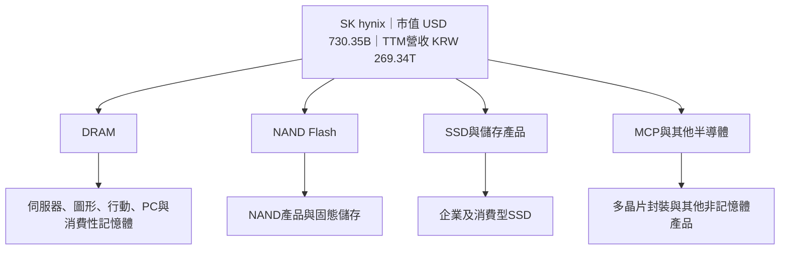
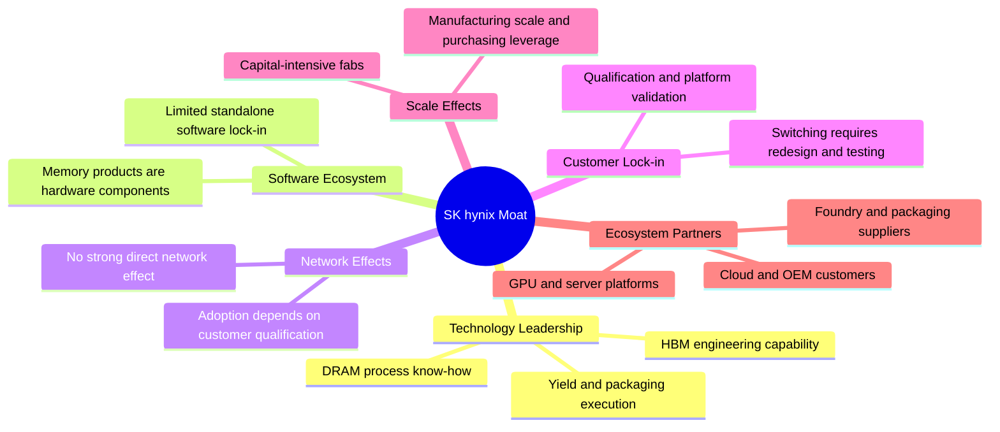
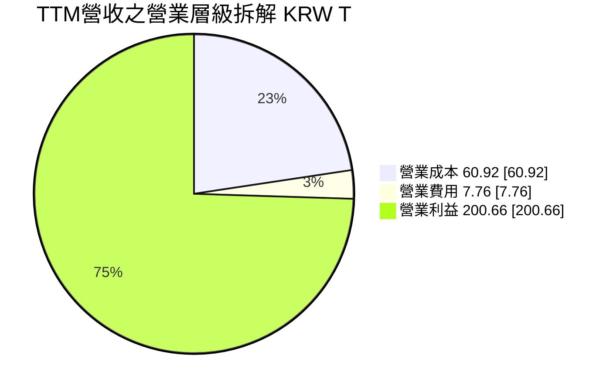
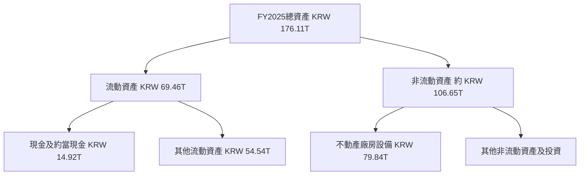
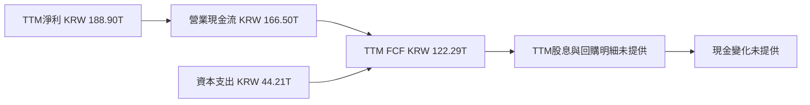
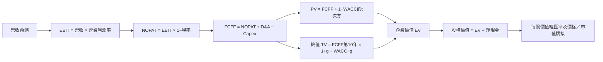
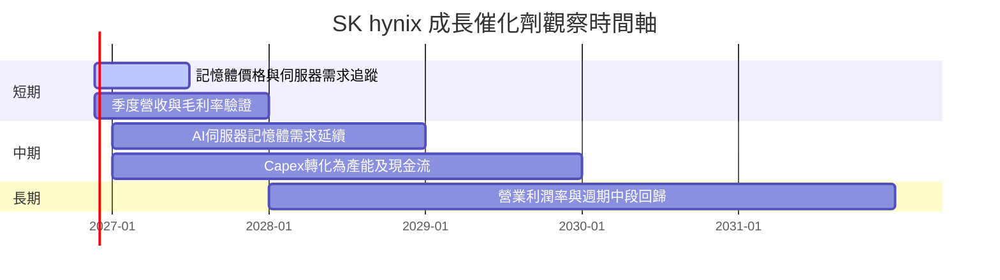
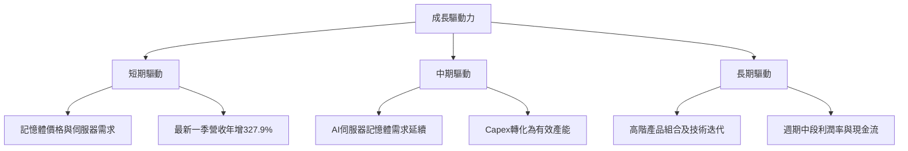
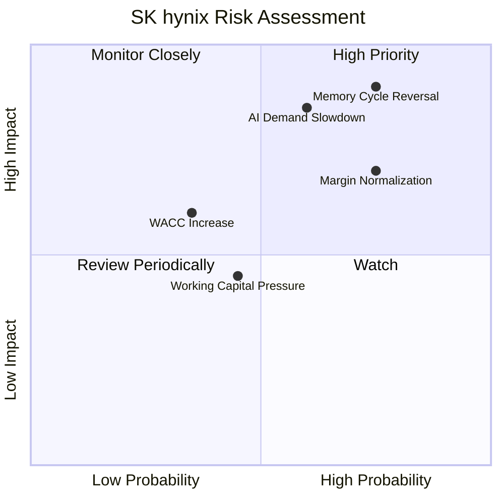
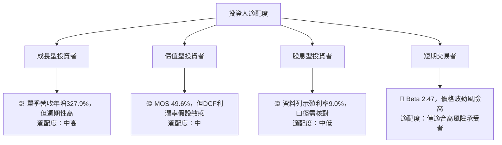

# SKHY 基本面深度分析報告
> **報告日期**：2026-11-21 ｜ **語言**：繁體中文 ｜ **數據來源**：Yahoo Finance、Finviz、StockAnalysis、Roic.ai 

## 目錄

| # | 章節 | 核心結論 |
|---|------|----------|
| 1 | 執行摘要 | 依加權合理價值 $205.37、MOS 49.6%，評級為買入 |
| 2 | 公司概覽與商業模式 | DRAM、NAND 與 HBM 相關記憶體供應商；產品別營收占比未提供 |
| 3 | 損益表深度分析 | TTM 營收 KRW 269.34T；最新單季營收年增 327.9%，獲利高度受記憶體週期影響 |
| 4 | 資產負債表分析 | 淨現金 KRW 96.34T；最新現金轉換週期 203 天 |
| 5 | 現金流量深度分析 | TTM FCF KRW 122.29T，FCF Yield 12.54% |
| 6 | 獲利能力與資本效率 | TTM ROIC 未提供，不能直接判定當期 ROIC 是否高於 WACC 14.00% |
| 7 | 相對估值分析 | 本公司 Forward P/E 2.50x；同業中位數 Forward P/E 2.80x |
| 8 | DCF 內在價值評估 | DCF 基準價值 $268.16；加權合理價值 $205.37，MOS 49.6% |
| 9 | 成長催化劑 | AI 伺服器記憶體需求為重要質化催化劑；量化 TAM 未提供 |
| 10 | 風險矩陣 | 記憶體週期反轉、AI 投資降溫及高估值模型敏感度為主要風險 |
| 11 | 投資建議 | 買入；價格低於加權合理價值，但需以景氣與利潤率指標驗證 |

---

## 1. 執行摘要

SK hynix 最新 TTM 營收為 KRW 269.34T（約 USD 201.78B），最新一季營收年增 327.9%，TTM 營業利益率 74.5%，TTM FCF 為 KRW 122.29T、FCF Yield 為 12.54%。同時，公司持有 KRW 96.34T 淨現金；但這些數字處於記憶體產業獲利急速回升階段，不能直接視為可持續的常態水準。依程式計算的加權合理價值 $205.37、2026-11-20 收盤價 $103.57，MOS 為 49.6%；規則 20 的評級為**買入**。當期 ROIC 未提供，因此不把 ROIC 高於 WACC 當作已確認事實。

### 1.0 一頁式投資儀表板（Portfolio Manager 30 秒速讀）

| 項目 | 內容 |
|------|------|
| **投資論點（3 句）** | ① 最新一季營收年增 327.9%，反映記憶體需求與價格上行，但 TTM 成長率 N/A，不能將單季增速外推。② TTM FCF 為 KRW 122.29T、FCF Yield 12.54%，目前現金產出可支持大量再投資與財務緩衝。③ 加權合理價值 $205.37，相對 $103.57 現價的 MOS 為 49.6%，但 DCF 基準價值高度依賴高營業利潤率能否延續。 |
| **綜合評分** | **6.8/10**（引用 1.1 評分卡） |
| **財務健康** | 🟢 現金及短期投資 KRW 114.46T、總債務 KRW 18.13T、淨現金 KRW 96.34T；但現金轉換週期達 203 天。 |
| **ROIC vs WACC** | 當期 ROIC：N/A；WACC：14.00%。無法據此判定當期價值創造或摧毀。 |
| **FCF 趨勢** | FY2023 轉正後擴大；TTM FCF KRW 122.29T，FCF Yield 12.54%。 |
| **估值** | Forward P/E 2.50x ｜ EV/EBITDA：N/A（幣別／市場資料口徑不一致）｜ FCF Yield 12.54%。 |
| **DCF 內在價值（基準）** | $268.16 ｜現價相對 DCF 折價 **61.4%**，即折溢價 **−61.4%**（見 8.5）。 |
| **安全邊際（MOS）** | **49.6%**＝($205.37 − $103.57) ÷ $205.37（加權合理價值基準，來自 8.8）｜ 🟢 >25% |
| **預期報酬（基準情境 12M）** | **+158.9%**（DCF 基準情境相對現價；非保證報酬） |
| **關鍵風險（前二）** | ① 記憶體供需反轉造成價格與毛利率快速回落。② DCF 基準假設營業利潤率由 74.5% 緩降至 35.5%，仍可能高估正常化獲利。 |
| **評級 + 信心度** | 🟢 **買入** ｜信心：中低（價格與營運數據顯示折價，但模型對週期性正常化的把握有限）。 |

### 1.1 綜合評分卡（全報告唯一）

| 維度 | 評分（1–10） | 主要依據（引用數字與其來源章節） |
|------|--------------|----------------------------------|
| 成長性 | 8.5 | 最新一季營收年增 327.9%；TTM 營收成長率依規定為 N/A，見 3.2。 |
| 獲利能力 | 8.0 | TTM 營業利益率 74.5%、FCF KRW 122.29T；但當期 ROIC 及 Piotroski F-Score N/A，見第 3、6 章。 |
| 財務健康 | 8.5 | 淨現金 KRW 96.34T、流動比率 3.115、速動比率 2.794；CCC 203 天，見第 4 章。 |
| 估值 | 7.5 | MOS 49.6%，Forward P/E 2.50x；但 DCF 假設偏向高獲利狀態延續，見第 7、8 章。 |
| 護城河 | 7.0 | 記憶體製造規模、技術與客戶認證有進入門檻；產品市場份額及客戶集中度資料未提供，見第 2 章。 |
| 管理層與資本配置 | 1.5 | FY2025 股息支付 KRW 1.68T、SBC KRW 414.11B；完整回購及投資報酬資料不足，故評分保守。 |
| **綜合評分** | **6.8** | 六項算術平均： (8.5 + 8.0 + 8.5 + 7.5 + 7.0 + 1.5) ÷ 6 = 6.83，四捨五入至一位小數。 |

### 1.2 五大投資論點 + 三大核心風險

| 類型 | 項目 | 具體依據 | 信心度 |
|------|------|----------|--------|
| 🟢 **投資論點①** | AI 伺服器記憶體需求支撐高成長 | 最新一季營收 KRW 104.62T，年增 327.9%；但未提供產品別營收，AI/HBM 貢獻不可單獨量化。 | 🟢 中 |
| 🟢 **投資論點②** | 現金流與資產負債表緩衝充足 | TTM OCF KRW 166.50T、Capex KRW 44.21T、FCF KRW 122.29T；淨現金 KRW 96.34T。 | 🟢 高 |
| 🟢 **投資論點③** | 估值方法交叉後仍顯示折價 | 加權合理價值 $205.37，高於現價 $103.57；MOS 49.6%。 | 🟢 中 |
| 🟢 **投資論點④** | 目前利潤率具備高度營運槓桿 | TTM 毛利率 77.4%、營業利益率 74.5%；如果產品組合及價格保持，獲利可高於營收增幅。 | 🟡 中 |
| 🟢 **投資論點⑤** | 市場預期可能仍偏保守 | Reverse DCF 顯示在其他基準假設不變時，令現價成立的第 1 年營收成長為 0.3%，遠低於基準 30.0%；該反推仍受模型限制。 | 🟡 中 |
| 🟡 **風險①** | 記憶體週期反轉 | 2023 年營收 KRW 32.77T、營業利益 KRW −7.73T，說明下行週期可能使高峰期利潤迅速消失。 | 🔴 高衝擊 |
| 🔴 **風險②** | AI 資本支出與高頻寬記憶體需求降溫 | 公司最新季度營收年增 327.9%，同期同業 Micron 及 Sandisk 的單季年增亦達 379.3%及 377.9%；若需求或供給預期逆轉，估值可能快速重估。 | 🔴 高衝擊 |
| 🟡 **風險③** | DCF 對長期獲利率及終值敏感 | DCF 終值現值占 EV 37.1%；基準 14% WACC、3% 永續成長下價值 $268.16，但敏感度矩陣顯示 WACC 由 14% 升至 16%、g 維持 3%時價值降至 $226.94。 | 🟡 中高 |

### 1.3 快速統計卡片

| 指標 | 公司實際值（期間） | 同業中位數 | 狀態 |
|------|--------------------|------------|------|
| 營收成長（TTM） | **N/A** | — | 🟡 不可判斷 |
| 營收成長（最新一季年增） | **327.9%** | 377.9% | 🟢 高增長，但低於同業中位數 |
| 毛利率（TTM） | **77.4%** | 80.0% | 🟢 高，但略低於同業中位數 |
| 營業利益率（TTM） | **74.5%** | — | 🟢 高，但週期性風險大 |
| ROIC（TTM） | **N/A** | — | 🟡 數據缺漏 |
| Forward P/E | **2.50x** | 2.80x | 🟢 低於同業中位數 |
| FCF Yield（TTM） | **12.54%** | — | 🟢 高 |
| Piotroski F-Score | **N/A** | — | 🟡 無法計算 |

### 1.4 投資結論

```text
╔══════════════════════════════════════════════════════════════════╗
║                    📊 投資結論摘要                               ║
╠══════════════════════════════════════════════════════════════════╣
║  評級：買入（依 8.8 MOS 49.6%；採用 VERIFIED FIGURES 評級）       ║
║  價格（2026-11-20 收盤）：$103.57                                ║
║  DCF 內在價值（基準）：$268.16（折價 61.4%）                     ║
║  安全邊際 MOS：49.6%（＝(加權合理價值−現價)÷加權合理價值）       ║
║  加權合理價值（8.8）：$205.37                                    ║
║  DCF 情境價值：                                                   ║
║    悲觀情境：$129.87（+25.4%）                                    ║
║    基準情境：$268.16（+158.9%）                                   ║
║    樂觀情境：$527.52（+409.3%）                                   ║
║  綜合評分：6.8/10（引用 1.1）                                     ║
║  適合投資人：可承受高週期波動、願意以財報追蹤記憶體價格與供需者 ║
╚══════════════════════════════════════════════════════════════════╝
```

---

## 2. 公司概覽與商業模式

### 2.1 業務結構與收入來源

SK hynix 從事 DRAM、NAND Flash、SSD、MCP 及非記憶體半導體相關業務。產品別、地區別及軟體／服務收入占比未提供，因此不把未披露的占比拆成虛構圖表。公司 TTM 營收為 KRW 269.34T（約 USD 201.78B），最新一季營收 KRW 104.62T。



### 2.2 市場份額

市場份額數據未提供，故不以圖表或估算比例呈現。以營收規模而言，SK hynix TTM 營收約 USD 201.78B，最新單季年增 327.9%；Peer multiples 所列 Micron、Sandisk 的最新季度年增分別為 379.3%及 377.9%，反映產業普遍處於高速復甦或需求擴張階段，並非 SK hynix 單一公司特有。

### 2.3 競爭護城河分析



### 2.4 護城河強度

| 護城河項目 | 強度（強／中／弱） | 證據（引用數字或事實） | 會削弱它的情況 |
|------------|--------------------|------------------------|----------------|
| 技術與製程 | 強 | 公司業務涵蓋 DRAM、NAND、伺服器記憶體與圖形記憶體；營收及產品分類見公司業務說明。 | 技術迭代落後、良率爬坡低於競爭者。 |
| 客戶認證與切換成本 | 中 | 伺服器、網路及行動裝置記憶體需配合平台進行驗證；具體客戶留存或切換成本數字未提供。 | 客戶多來源採購比例提高，或產品性能差異縮小。 |
| 規模效應 | 強 | TTM 營收 KRW 269.34T，Capex TTM KRW 44.21T，顯示資本密集與規模競爭特性。 | 產能擴張過度、利用率下降或成本曲線被同業追平。 |
| 軟體生態系統 | 弱 | 公司主體為硬體及半導體產品，未提供軟體訂閱或生態系統營收。 | 軟體生態通常不是本公司主要競爭壁壘。 |
| 網路效應 | 弱 | 記憶體產品沒有明顯直接網路效應。 | 競爭主要取決於技術、價格、供應與客戶認證。 |
| 生態夥伴 | 中 | 產品服務於伺服器、網路、行動及 PC 等平台；合作夥伴營收分布未提供。 | 平台供應鏈改變、特定客戶降低採購或供應商替代。 |

1.1「護城河」評分 **7.0/10**，主要依據是高資本門檻、製程能力與客戶認證；由於市占率、客戶集中度及產品別市佔未提供，未給更高評分。

---

## 3. 損益表深度分析

### 3.1 年度收入成長趨勢（近4年）

```text
╔══════════════════════════════════════════════════════════════════╗
║                 SK hynix 年度收入趨勢（FY2022–FY2025）           ║
╠══════════════════════════════════════════════════════════════════╣
║  FY2022  KRW 44.62T  ███████████░░░░░░░░░░░  YoY：基期        ║
║  FY2023  KRW 32.77T  ████████░░░░░░░░░░░░░░  YoY：−26.6% 🔴   ║
║  FY2024  KRW 66.19T  ████████████████░░░░░  YoY：+102.0% 🟢  ║
║  FY2025  KRW 97.15T  ██████████████████████ YoY：+46.8% 🟢   ║
╠══════════════════════════════════════════════════════════════════╣
║  FY2022–FY2025 營收 CAGR：約 29.6%                               ║
╚══════════════════════════════════════════════════════════════════╝
```

FY2023 營收下滑 26.6%，與記憶體需求及價格週期下行相符；FY2024 營收反彈 102.0%，FY2025 再增 46.8%。FY2022 至 FY2025 CAGR 約 29.6%，但這段期間跨越谷底與復甦，不能簡化為穩定長期增長率。計算為 `(97.15 ÷ 44.62)^(1/3) − 1 ≈ 29.6%`，以原始 KRW 年營收計算。

### 3.2 季度收入趨勢分析

以下以 StockAnalysis.com 季度營收計算 QoQ；YoY 使用季度資料所列單季年增率。最新一季年增率與 VERIFIED FIGURES 的 327.9%一致。

| 季度 | 營收（KRW T） | QoQ | YoY（單季） | 備註 |
|------|---------------:|----:|------------:|------|
| 2025 Q4 | 32.83 | — | 66.07% | 復甦延續，季增基準。 |
| 2026 Q1 | 52.58 | +60.2% | 198.07% | 營收擴張；高季增可能含產品價格及組合影響。 |
| 2026 Q2 | 79.32 | +50.9% | 256.78% | 增長仍高，但不得直接等同全年增長。 |
| 2026 Q3 | 104.62 | +31.9% | 327.9% | YoY 大幅上升；QoQ 增速較前季放緩，基數效應仍重要。 |

計算示例：Q3 QoQ = `(104.615 − 79.319) ÷ 79.319 = 31.9%`。TTM 營收成長率依指定來源為 N/A，不以單季年增率替代。

### 3.3 利潤率演變分析

| 利潤率指標 | FY2022 | FY2023 | FY2024 | FY2025 | 趨勢 | 評估 |
|------------|-------:|-------:|-------:|-------:|------|------|
| **毛利率** | 35.0% | −1.6% | 48.1% | 60.4% | 先大幅下滑後快速修復 | 🟡 強週期性 |
| **營業利益率** | 15.3% | −23.6% | 35.5% | 48.6% | 從虧損回升至高獲利 | 🟡 週期高點風險 |
| **淨利率** | 5.0% | −27.8% | 29.9% | 44.2% | 盈餘隨供需改善大幅波動 | 🟡 |

利潤率為年度毛利、營業利益及淨利除以年度營收計算。FY2023 由於毛利為負 KRW 0.53T、營業虧損 KRW 7.73T；FY2024–FY2025 隨營收及毛利回升，固定成本被更大營收基礎吸收，營業槓桿放大。TTM 營業利益率 74.5%遠高於 FY2025 的 48.6%，這種跳升值得警惕：產品組合、價格和供給緊俏都可能造成高峰利潤率，不宜直接套用至完整週期。

### 3.4 費用結構分析

以下為 TTM 營收、毛利及營業利益的算術拆解，僅作營業層級示意，不代表公司完整費用分類。計算：營業成本 = 269.34 − 208.42 = KRW 60.92T；毛利以下至營業利益的營業費用 = 208.42 − 200.66 = KRW 7.76T。



```text
╔══════════════════════════════════════════════════════════════════╗
║               TTM 營收營業層級拆解（KRW T）                     ║
╠══════════════════════════════════════════════════════════════════╣
║  營業成本  60.92  ██████░░░░░░░░░░░░░░░░░░                      ║
║  營業費用   7.76  █░░░░░░░░░░░░░░░░░░░░░░                      ║
║  營業利益 200.66  ████████████████████████                      ║
╚══════════════════════════════════════════════════════════════════╝
```

### 3.5 季度 EPS 趨勢與盈餘品質（Quality of Earnings）

過去四季 EPS Est／EPS Act 資料不足：資料僅列出 2026-06-30 及 2026-09-30 的估值與實際值為 nan，故不能判定超預期或不及預期。季度 EPS 成長率所列數字是 EPS 年增率，不是盈餘超預期幅度。

| 盈餘品質項目 | 數值／佔比 | 評估 |
|--------------|-----------|------|
| 股權薪酬 SBC / 營收 | TTM 比率 N/A；2026 Q3 SBC KRW 3.57T、營收 KRW 104.62T，該季約 3.4% | 🟡 單季數字顯著高於資料列出的 2026 Q2 KRW 53.64B及 Q1 KRW 21.00B，可能有資料口徑或一次性因素，需查原始申報。 |
| SBC / 營業現金流 | TTM 比率 N/A；2026 Q3 約 6.6%（3.57 ÷ 53.89） | 🟡 單季比率可供觀察，不可替代完整 TTM。 |
| FCF / 淨利（現金轉換率） | TTM 約 64.7%（122.29 ÷ 188.90） | 🟡 現金轉換為正且可觀，但低於 100%；營運資金、資本投入及週期高峰會影響轉換。 |
| 一次性／非經常性損益 | 分項資料未提供 | 🟡 2026 Q2 淨利 KRW 93.82T 高於營業利益 KRW 60.54T，Q3 淨利降至 KRW 39.53T、營業利益升至 KRW 83.33T；非營業項目及稅項需進一步核對。 |
| 有效稅率異常 | 最新年度有效稅率 14.9% | 🟡 可作模型輸入；缺少各季稅前利潤與稅費明細，不能判斷單季波動是否由稅務一次性項目造成。 |
| 資本化支出 vs 費用化 | TTM Capex KRW 44.21T；資本化政策細節未提供 | 🟡 半導體業本質上資本密集；投資折舊與費用化政策需以財報附註確認。 |

**盈餘品質結論**：TTM OCF KRW 166.50T、FCF KRW 122.29T，現金流對獲利有實質支撐；但 FCF／淨利約 64.7%，且季度淨利波動與 Q3 SBC 異常值需要原始財報核對。整體不宜只依 EPS 或單季淨利推估常態獲利，估值更應重視週期中段的營業利潤率與資本支出。

---

## 4. 資產負債表分析

### 4.1 資產結構分解

最新季度完整總資產數字未提供。以下展示 FY2025 資產負債表可直接引用項目；非流動資產為總資產扣除流動資產的算術差額，未將部分資產明細加總成完整結構。



### 4.2 流動性與營運資金分析

| 指標 | 最新值 | 歷史比較 | 評估 |
|------|--------|----------|------|
| 流動比率 | 3.115 | FY2025 約 1.86（69.46 ÷ 37.38） | 🟢 短期流動性充裕；FY2025 分母及期間與最新比率來源口徑不同，僅作參考。 |
| 速動比率 | 2.794 | 可比歷史速動比率未提供 | 🟢 高於 1，表示流動資產扣除存貨後仍有覆蓋能力。 |
| 現金及短期投資 | KRW 114.46T | TTM 資產負債表 | 🟢 提供資本投資及週期下行緩衝。 |

**營運資金天數**（QUALITY FIGURES，照錄）：

| 指標 | 最新 TTM | 一年前 TTM | 變化 | 解讀 |
|------|----------|------------|------|------|
| DSO 應收帳款天數 | 80 天 | N/A | N/A | 一年前數據未提供；不推斷收款速度變化。 |
| DIO 存貨天數 | 143 天 | N/A | N/A | 數值反映存貨占用時間，但缺少一年前比較，無法判定存貨累積或效率改善。 |
| DPO 應付帳款天數 | 20 天 | N/A | N/A | 缺少一年前比較及供應商付款政策，不能直接判斷議價能力。 |
| CCC 現金轉換週期 | 203 天 | N/A | N/A | DSO + DIO − DPO = 80 + 143 − 20 = 203 天；營運資金占用需持續監測。 |

### 4.3 債務結構分析

```text
╔══════════════════════════════════════════════════════════════════╗
║                    SK hynix 債務健康診斷                        ║
╠══════════════════════════════════════════════════════════════════╣
║  總債務：        KRW 18.13T  ██░░░░░░░░░░░░░░░░░ 評語：可控      ║
║  現金及短期投資：KRW114.46T  ████████████████████ 評語：充裕      ║
║  淨現金：        KRW 96.34T  ████████████████░░░░ 🟢 強           ║
║                                                                  ║
║  流動比率：3.115x 🟢                                              ║
║  速動比率：2.794x 🟢                                              ║
║  Debt/EBITDA：N/A（缺少同口徑 KRW EBITDA 計算依據）               ║
║  利息保障倍數：N/A（利息費用未提供）                              ║
╚══════════════════════════════════════════════════════════════════╝
```

### 4.4 股東權益趨勢

```text
╔══════════════════════════════════════════════════════════════════╗
║             股東權益趨勢（FY2022–FY2025，KRW T）                ║
╠══════════════════════════════════════════════════════════════════╣
║  FY2022  63.27  █████████████░░░░░░░░░░░                        ║
║  FY2023  53.50  ███████████░░░░░░░░░░░░░                        ║
║  FY2024  73.90  ███████████████░░░░░░░░░                        ║
║  FY2025 120.52  ████████████████████████                        ║
╚══════════════════════════════════════════════════════════════════╝
```

FY2023 權益下降與淨損 KRW 9.11T 同期出現；2024、2025 權益回升，與 FY2025 淨利 KRW 42.92T 一致。FY2025 權益成長也受到盈餘留存及其他權益變動影響，細項未提供。

---

## 5. 現金流量深度分析

### 5.1 現金流量瀑布圖

個別 TTM 淨利及股息完整數據未按相同口徑提供，因此圖中只放有數字的營業現金流、Capex 與 FCF，並以文字標示未提供的項目。



### 5.2 FCF 轉換率趨勢

| 年度 | 營業現金流（KRW T） | Capex（KRW T） | FCF（KRW T） | FCF／淨利 |
|------|---------------------:|---------------:|-------------:|----------:|
| FY2022 | 14.78 | 19.75 | −4.97 | −222.9% |
| FY2023 | 4.28 | 8.78 | −4.50 | 49.4% |
| FY2024 | 29.80 | 16.66 | 13.13 | 66.4% |
| FY2025 | 53.37 | 28.58 | 24.79 | 57.8% |
| TTM 至 2026-09-30 | 166.50 | 44.21 | 122.29 | 約 64.7% |

年度 FCF／淨利以同年資料計算。FY2022 淨利為 KRW 2.23T，FCF 為負，現金轉換比例為負；FY2023 雖然仍是 FCF 負值，但因淨損為負，比例的正值不代表現金品質良好。FY2024 以後轉正，反映週期復甦及營業現金流改善。

### 5.3 自由現金流趨勢

```text
╔══════════════════════════════════════════════════════════════════╗
║               自由現金流趨勢（KRW T）                           ║
╠══════════════════════════════════════════════════════════════════╣
║  FY2022  −4.97  ◀██░░░░░░░░░░░░░░░░░░░░░░░░  FCF為負          ║
║  FY2023  −4.50  ◀██░░░░░░░░░░░░░░░░░░░░░░░░  FCF為負          ║
║  FY2024  13.13   ██████░░░░░░░░░░░░░░░░░░░░  轉正              ║
║  FY2025  24.79   ████████████░░░░░░░░░░░░░░  擴大              ║
║  TTM     122.29  ██████████████████████████  FCF Yield 12.54%  ║
╚══════════════════════════════════════════════════════════════════╝
```

TTM FCF 與歷年年度值不可直接視為穩態增長趨勢：TTM 涵蓋 FY2026 三個季度及 FY2025 Q4，記憶體價格周期會造成巨大基期差異。FCF Yield 採用程式計算的 12.54%，不以跨幣別自行重算。

### 5.4 資本配置評估

| 資本配置項目 | 已知數據 | 評估 |
|--------------|----------|------|
| 資本支出 | TTM KRW 44.21T；FY2025 KRW 28.58T | 🟡 高額投入為半導體產能及技術競爭所需，但若需求反轉，產能回收期可能延長。 |
| 股息 | FY2025 支付 KRW 1.68T；資料列示殖利率 9.0%、派息率 0.1% | 🟡 殖利率及股息付款資料口徑需核對；不以單一快照推論長期收益。 |
| 股票回購 | N/A | 🟡 資料未提供。 |
| 留存現金 | 現金及短期投資 KRW 114.46T | 🟢 保留較大資本緩衝。 |
| 投資及收購 | TTM 明細 N/A | 🟡 無法評估投資回報率。 |

未提供足以把現金流分配完整切分的同口徑數據，故不以臆測比例繪製資本配置圓餅圖。

---

## 6. 獲利能力與資本效率

### 6.1 ROE / ROA / ROIC 趨勢

| 指標 | 數值 | 期間／來源 | 評估 |
|------|------:|------------|------|
| ROE | 92.5% | TTM | 🟢 高，但可能受周期高峰獲利與資本基礎影響。 |
| ROA | 46.4% | TTM | 🟢 高；需觀察週期正常化後能否維持。 |
| ROIC | N/A | TTM | 🟡 缺少可直接引用的最新 ROIC。 |
| ROIC 歷史參考 | 34.64% | Roic.ai 2018 年 Return on Capital | 🟡 歷史值非最新 TTM，不能拿來宣稱目前回報率。 |

行業均值未提供，不作未經來源支持的比較。

### 6.2 ROIC vs WACC 分析（核心價值創造判斷）

```text
╔══════════════════════════════════════════════════════════════════╗
║                 ROIC vs WACC 深度分析                           ║
╠══════════════════════════════════════════════════════════════════╣
║  WACC（程式採用值）：14.00%                                      ║
║  ├── 無風險利率（10Y美債）：4.91%                                ║
║  ├── 市場風險溢酬 ERP：5.00%                                     ║
║  ├── Beta 原始值：2.47；調整後 Beta：1.98                        ║
║  ├── 股權成本（資料列示）：14.80%                                ║
║  ├── 稅前債務成本：5.10%；有效稅率：14.9%                        ║
║  ├── 權重 E / D：98.2% / 1.8%                                    ║
║  └── 計算 WACC 14.61%，受 7%–14% 區間限制，採用 14.00%          ║
║                                                                  ║
║  ROIC（TTM）：N/A                                                 ║
║  ├── NOPAT 與投入資本口徑未完整提供，無法可靠計算                 ║
║  └── EVA = ROIC − WACC：N/A                                      ║
║                                                                  ║
║  ROIC  N/A                                                        ║
║  WACC 14.00%                                                      ║
║  EVA   N/A                                                        ║
║                                                                  ║
║  結論：因當期 ROIC 缺漏，無法確認 SK hynix 當期是否創造股東價值 ║
╚══════════════════════════════════════════════════════════════════╝
```

WACC 與 DCF 採用相同 14.00%。依資料所列，Beta 調整為 `⅔ × 2.47 + ⅓ = 1.98`；CAPM 股權成本及 WACC 使用來源所列數字，不另以四捨五入後的輸入重算並替換。程式計算 WACC 為 14.61%，再依 7%–14%區間上限採用 14.00%。由於 ROIC 缺漏，不提供 ROIC/WACC 倍數或 EVA 假數。

### 6.3 杜邦三因素分解

| 因素 | 數值（TTM） | 解讀 |
|------|-------------|------|
| 淨利率 | N/A | QUALITY FIGURES 判定資料不足，不能用不一致口徑自行補算。 |
| 資產週轉率 | N/A | 缺少可用的同口徑平均資產。 |
| 權益乘數 | N/A | 缺少適用且一致的權益口徑。 |
| **ROE** | **N/A** | QUALITY FIGURES 的 DuPont 為 N/A；外部欄位另列 ROE 92.5%，不能替代完整杜邦分解。 |

### 6.4 財務體質：Piotroski F-Score

F-Score：**N/A**。依 QUALITY FIGURES，缺少相隔一年且來自 SEC 申報資料的兩期 TTM 數據；本標的為南韓公司，資料來源亦未提供完整 SEC 申報資料。

| 測試 | 結果 | 解讀 |
|------|------|------|
| 九項 Piotroski 測試 | N/A | 個別測試結果未提供；不能把 N/A 當作未通過或零分。 |

---

## 7. 相對估值分析

### 7.1 同業估值比較表格

公司自身倍數採用估值資料欄位；同業倍數採用 Yahoo Finance Peer multiples。P/S 與 EV/EBITDA 的公司自身值因報價與財報幣別不一致，依規定列 N/A。

| 估值指標 | **SK hynix** | **MU** | **SNDK** | **WDC** | 本公司評估 |
|----------|-------------:|-------:|--------:|-------:|-----------|
| **Trailing P/E** | 5.73x | 8.0x | 0.1x | 9.2x | 🟢 低於 MU、WDC；SNDK 的 0.1x 可能受特殊盈餘基數影響，跨公司比較需審慎。 |
| **Forward P/E** | 2.50x | 2.8x | 2.2x | 6.5x | 🟢 低於同業中位數 2.8x；仍高度依賴預期盈餘。 |
| **P/S Ratio** | N/A | 5.1x | 3.1x | 6.7x | 🟡 SK hynix 缺少同幣別可比數據。 |
| **EV/EBITDA** | N/A | 5.8x | 4.0x | 15.4x | 🟡 SK hynix 缺少同幣別可比數據。 |
| **最新一季營收 YoY** | 327.9% | 379.3% | 377.9% | 55.5% | 🟢 增長接近 MU、SNDK，但低於兩者。 |
| **TTM 毛利率** | 77.4% | 80.7% | 80.0% | 52.6% | 🟢 高於 WDC，低於 MU、SNDK。 |

Peer median：P/E TTM 8.0x、Forward P/E 2.8x、P/S 5.1x、EV/EBITDA 5.8x、單季營收年增 377.9%、TTM 毛利率 80.0%。估值倍數低並不必然代表低估，尤其週期高峰 earnings 可能使 P/E 分母短期放大。

### 7.2 歷史估值區間分析

N/A（未提供「Valuation vs own history」歷史估值區間數據，不自行估計歷史百分位或估值區間）。

### 7.3 情境價值（Bear / Base / Bull，照抄 DCF MODEL 的 Scenarios）

| 情境 | 第 1 年營收成長 | 期末營業利潤率 | WACC | 每股價值 | 相對現價 | 機率 | 會發生的條件 |
|------|----------------:|----------------:|-----:|----------:|----------:|-----:|--------------|
| 🔴 悲觀 | 15.0% | 30.1% | 15.00% | $129.87 | +25.4% | 25% | AI 及伺服器需求降速、記憶體價格正常化較快，長期利潤率低於基準。 |
| 🟡 基準 | 30.0% | 35.5% | 14.00% | $268.16 | +158.9% | 50% | 第一年度延續強勁需求，後續增長及營業利潤率按模型逐步收斂。 |
| 🟢 樂觀 | 45.0% | 39.0% | 13.00% | $527.52 | +409.3% | 25% | 高階記憶體需求與定價能力高於基準，獲利率收斂幅度較小。 |

機率加權值為 $298.43（+188.1%），僅作情境參考；第 8.8 節使用規定的 DCF 基準值，不以機率加權值替代。

### 7.4 相對估值隱含價格區間

```text
╔══════════════════════════════════════════════════════════════════╗
║             相對估值與基準 DCF 價格定位（USD/股）               ║
╠══════════════════════════════════════════════════════════════════╣
║  $103.57        $144.17    $144.51      $205.37       $268.16     ║
║  現價            EV/EBITDA  P/S          加權合理值    DCF基準     ║
║  ●─────────────────●─────────●────────────●────────────●         ║
╚══════════════════════════════════════════════════════════════════╝
```

| 方法 | 每股價值 | 依據 |
|------|---------:|------|
| 同業 EV/EBITDA | $144.17 | MU、SNDK、WDC 同業中位數 5.8x × TTM EBITDA，再加淨現金。 |
| 同業 P/S | $144.51 | MU、SNDK、WDC 同業中位數 5.1x × TTM 營收。 |
| DCF（基準） | $268.16 | 10 年 FCFF、WACC 14.00%、永續成長率 3.0%。 |

---

## 8. DCF 內在價值評估（Discounted Cash Flow）

### 8.0 估值推理鏈（Thinking Logic：在算之前先想清楚）

**Step 1 — 價值由哪些變數決定？**  
模型以現有半導體主業為估值底盤；產品別及第二曲線營收占比未提供，因此不能將 AI/HBM 或其他新業務拆成獨立營收來源。公司 TTM 營收 KRW 269.34T，營業利益率 74.5%，TTM FCF KRW 122.29T。主導估值的變數是營收增長與營業利潤率，並透過終值公式受 WACC 與永續成長率影響。模型終值現值占 EV 37.1%，故短期現金流與終值假設皆重要。

**Step 2 — 模型選擇**

| 決策點 | 本報告採用 | 理由（含數字） | 曾考慮但否決 | 否決理由 |
|--------|-----------|----------------|--------------|----------|
| 現金流定義 | FCFF | 以企業現金流搭配 WACC 折現，先算 EV 再加淨現金。 | FCFE | 融資現金流及資本結構已透過 WACC、淨現金橋接處理。 |
| 預測期 N | 10 年 | DCF MODEL 固定為 10 年，跨越較長營運週期。 | 5 年 | 不符合指定模型，不自行縮短。 |
| 終值方法 | Gordon Growth | 模型提供終值及敏感度矩陣。 | 退出倍數 | DCF MODEL 未提供退出倍數輸入，不能自行編造。 |
| EBIT 基礎 | GAAP EBIT | DCF MODEL 指定採 GAAP 營業利益。 | 非 GAAP | 沒有可引用的非 GAAP EBIT 序列，且會增加 SBC 處理歧義。 |

**Step 3 — 關鍵假設推導鏈**

- **營收成長路徑**：錨點＝最新一季單季年增 327.9%，但 TTM 成長率 N/A → 調整＝最新一季高速增長可能受週期復甦與低比較基期推高，並限制第一年增長不得超過 30% → **採用第 1 年 30.0%，第 10 年 3.0%，逐年線性下降** → 曾考慮把 327.9%單季年增直接用作預測增長，但因單季數不能代表多年可持續增速而否決。
- **期末營業利潤率**：錨點＝TTM 74.5%，FY2025 48.6%，FY2023 −23.6% → 調整＝以最近五個財政年度中位數（模型說明包含 TTM）逐步回歸 → **採用 FY+1 74.5%，FY+10 35.5%** → 曾考慮固定在 74.5%，因會忽略記憶體週期與產品價格均值回歸而否決。
- **永續成長率 g**：錨點＝模型採用 3.0%，與長期名目成長假設同量級；外部 GDP、通膨來源未提供 → 調整＝維持低於 WACC 14.0%，避免永續成長超過折現率 → **採用 3.0%** → 曾考慮更高 g，因會不合理放大終值而否決。
- **預測期 N**：錨點＝模型固定 10 年 → 調整＝不因缺少管理層長期財測而另改程式模型 → **採用 10 年** → 曾考慮更短期，但不符合現成 DCF 模型。
- **Capex／營收**：錨點＝TTM 約 16.4% → 調整＝依模型逐年下降至 6.4%，並朝 1.1 倍 D&A 比率收斂 → **採用 FY+1 16.4%、FY+10 6.4%** → 曾考慮固定 TTM 比率，因模型假設成熟期資本開支強度降低而否決。
- **EBIT、SBC 與股數**：錨點＝模型採 GAAP EBIT；SBC 已列為費用，但其 TTM 全年數據不完整 → **採用組合 (A)：GAAP EBIT + 不另扣 SBC + 固定股數，年稀釋率 0%** → 不採用額外扣 SBC 或再增加稀釋，避免模型重複計入成本。
- **有效稅率、D&A**：錨點＝有效稅率 14.9%；D&A／營收 5.8% → 採用模型指定值，不另行調整。
- **WACC**：錨點＝程式計算 14.61%，採用值受 7%–14%區間限制 → **採用 14.00%** → 不以自行重算的四捨五入輸入改寫指定值。
- **ΔWC**：模型明確不建模營運資金變化，因此 FCFF 不含 ΔWC；不是假設其經濟影響為零。

**Step 4 — 最脆弱環節**  
最脆弱環節是目前 74.5% TTM 營業利益率雖在 10 年內降至 35.5%，仍假設多年維持高利潤；若價格或產品組合回歸更低水準，估值會下降，敏感度矩陣及悲觀情境可作方向參照。

**Step 5 — 計算路徑圖**



### 8.1 模型假設總表（Model Inputs）

| 假設項目 | 採用值 | 依據／來源 | 敏感度 |
|----------|--------|-------------|--------|
| 預測期長度 N | 10 年 | DCF MODEL 固定輸入。 | 🟡 中 |
| 營收增長 | FY+1 30.0%→FY+10 3.0% | 起點依最新一季單季年增 327.9%，模型上限 30%；之後線性遞減。 | 🔴 高 |
| 營業利潤率 | FY+1 74.5%→FY+10 35.5% | 起點為 TTM 74.5%；期末採模型所述近五財年中位數。 | 🔴 高 |
| 有效稅率 | 14.9% | 最新年度有效稅率。 | 🟢 低 |
| Capex／營收 | FY+1 16.4%→FY+10 6.4% | TTM 比率及模型成熟期收斂假設。 | 🟡 中 |
| D&A／營收 | 5.8% | TTM 比率，模型固定。 | 🟢 低 |
| 營運資金變動 | 不建模 | DCF MODEL 明確未建模營運資金。 | 🟢 低 |
| EBIT 基礎 | GAAP EBIT | DCF MODEL 指定 GAAP EBIT。 | 🟡 中 |
| SBC 處理 | 組合 (A)：GAAP EBIT、不再扣 SBC | SBC 已包含在 GAAP 營業費用；模型股數不再稀釋。 | 🟡 中 |
| 年稀釋率 | 0% | 與組合 (A) 固定股數設定一致。 | 🟡 中 |
| 永續成長率 g | 3.0% | DCF MODEL 指定，且低於 WACC。 | 🔴 高 |
| 終值方法 | Gordon Growth | DCF MODEL 提供 Gordon Growth 終值。 | 🔴 高 |
| WACC | 14.00% | 程式採用值；原計算 14.61%，上限限制為 14.00%。 | 🔴 高 |

**FCFF 定義**：採用 `FCFF = NOPAT + D&A − Capex`，營運資金變化未建模。**本模型採用 (A)，故 SBC 影響已計入一次**：GAAP EBIT 已含 SBC 費用，不再從 FCFF 扣 SBC，也不再以股數稀釋重複計入。

金額以下按 DCF MODEL 原表，單位為 **KRW 十億**；模型表的 PV 採精確折現因子計算，展示的折現因子四捨五入至三位小數，因此以顯示折現因子直接相乘可能有小額差異。

### 8.2 折現率推導（WACC）

```text
╔══════════════════════════════════════════════════════════════════╗
║                    WACC 推導（折現率）                           ║
╠══════════════════════════════════════════════════════════════════╣
║  股權成本 Ke（CAPM）：                                           ║
║  ├── 無風險利率 Rf（10Y美債）：4.91%                             ║
║  ├── 市場風險溢酬 ERP：5.00%                                     ║
║  ├── Beta 原始值：2.47；調整後：1.98                             ║
║  ├── Beta 調整：⅔ × 2.47 + ⅓ = 1.98                             ║
║  └── Ke（來源列示）：14.80%                                      ║
║                                                                  ║
║  債務成本 Kd：                                                   ║
║  ├── 稅前 Kd：5.10%                                              ║
║  ├── 有效稅率：14.9%                                             ║
║  └── 稅後 Kd = 5.10% × (1 − 14.9%) = 4.34%                      ║
║                                                                  ║
║  資本結構（來源列示權重）：                                      ║
║  ├── 股權權重 E：98.2%                                           ║
║  ├── 債務權重 D：1.8%                                            ║
║  ├── 程式計算 WACC：14.61%                                       ║
║  └── 區間限制後採用 WACC：14.00%                                 ║
╚══════════════════════════════════════════════════════════════════╝
```

逐步計算按來源已列示輸入如下：

1. **Ke（CAPM）**：`4.91% + 1.98 × 5.00% = 14.81%`；資料列示 Ke 為 **14.80%**，差異屬輸入精度及四捨五入。
2. **稅前 Kd**：資料列示 **5.10%**；利息費用與平均計息負債的完整金額未提供，無法逐項重建。
3. **稅後 Kd**：`5.10% × (1 − 14.9%) = 4.34%`。
4. **權重**：股權 98.2%、債務 1.8%；兩者合計 `98.2% + 1.8% = 100.0%`。權重金額及同口徑計息負債餘額未提供，故不反推。
5. **WACC**：程式計算為 14.61%，受到 7%–14%區間限制，**採用 14.00%**。以已四捨五入的 Ke、Kd 及權重自行相乘會得到不同的末位數，故依規則使用已提供計算值，不另替換。

Rf 的觀察日期採資料列示的 2026-11-20 收盤資料；ERP 5.00% 為假設輸入；原始 Beta 2.47 依調整公式得到 1.98。未提供獨立規模或國別風險溢酬，因此不加計。第 6.2 節採用相同 WACC 14.00%。

### 8.3 逐年自由現金流預測（基準情境）

| 年度 | FY+1 | FY+2 | FY+3 | FY+4 | FY+5 | FY+6 | FY+7 | FY+8 | FY+9 | FY+10 |
|------|-----:|-----:|-----:|-----:|-----:|-----:|-----:|-----:|-----:|------:|
| 營收（KRW 十億） | 350,138.32 | 444,675.67 | 551,397.83 | 667,191.37 | 787,285.82 | 905,378.69 | 1,014,024.13 | 1,105,286.30 | 1,171,603.48 | 1,206,751.59 |
| 營收 YoY | 30.0% | 27.0% | 24.0% | 21.0% | 18.0% | 15.0% | 12.0% | 9.0% | 6.0% | 3.0% |
| 營業利潤率 | 74.5% | 70.2% | 65.8% | 61.5% | 57.1% | 52.8% | 48.5% | 44.1% | 39.8% | 35.5% |
| EBIT（GAAP） | 260,853.17 | 311,990.95 | 362,945.99 | 410,218.08 | 449,900.38 | 478,104.93 | 491,483.37 | 487,763.23 | 466,198.18 | 427,828.34 |
| − 稅 | (38,858.25) | (46,476.04) | (54,066.60) | (61,108.53) | (67,019.85) | (71,221.37) | (73,214.30) | (72,660.12) | (69,447.66) | (63,731.86) |
| NOPAT | 221,994.92 | 265,514.92 | 308,879.39 | 349,109.54 | 382,880.53 | 406,883.57 | 418,269.07 | 415,103.11 | 396,750.51 | 364,096.48 |
| + D&A | 20,364.52 | 25,862.94 | 32,070.04 | 38,804.75 | 45,789.61 | 52,658.05 | 58,977.01 | 64,284.95 | 68,142.04 | 70,186.30 |
| − Capex | (57,466.92) | (68,034.79) | (78,227.38) | (87,230.86) | (94,171.77) | (98,222.80) | (98,725.83) | (95,311.92) | (87,993.44) | (77,204.93) |
| − ΔWC | 未建模 | 未建模 | 未建模 | 未建模 | 未建模 | 未建模 | 未建模 | 未建模 | 未建模 | 未建模 |
| **FCFF** | **184,892.52** | **223,343.06** | **262,722.05** | **300,683.44** | **334,498.37** | **361,318.82** | **378,520.25** | **384,076.14** | **376,899.11** | **357,077.85** |
| 折現因子 @14.00% | 0.877 | 0.769 | 0.675 | 0.592 | 0.519 | 0.456 | 0.400 | 0.351 | 0.308 | 0.270 |
| **FCFF 現值 PV** | **162,186.42** | **171,855.24** | **177,329.90** | **178,028.73** | **173,727.97** | **164,611.99** | **151,270.82** | **134,641.37** | **115,899.47** | **96,319.54** |

預測期現值加總：  
`162,186.42 + 171,855.24 + 177,329.90 + 178,028.73 + 173,727.97 + 164,611.99 + 151,270.82 + 134,641.37 + 115,899.47 + 96,319.54 = 1,525,871.45`（KRW 十億）

**逐步演算（FY+1）**

1. 營收：`269,337.17 × (1 + 30.0%) = 350,138.32`。
2. EBIT：`350,138.32 × 74.5% = 260,853.17`（依 DCF MODEL 原列值）。
3. 稅：`260,853.17 × 14.9% = 38,858.25`（依模型原列值）。
4. NOPAT：`260,853.17 − 38,858.25 = 221,994.92`。
5. D&A：`350,138.32 × 模型 D&A 比率 = 20,364.52`。
6. Capex：`350,138.32 × 模型 Capex 比率 = 57,466.92`。
7. ΔWC：`未建模`。
8. FCFF：`221,994.92 + 20,364.52 − 57,466.92 = 184,892.52`。
9. 折現：`1 ÷ (1 + 14.00%)^1 = 0.877`（顯示值）；模型 PV 為 **162,186.42**，採未四捨五入折現因子。

**合理性自檢**

- 預測期 FCF CAGR：約 **6.8%**，以 FY+1 至 FY+10 計算；歷史 2022–2025 FCF CAGR 因含負值且由負轉正，數學上不具可比性。
- FY+10 FCF 利潤率：`357,077.85 ÷ 1,206,751.59 = 29.6%`；TTM FCF 利潤率：`122.29 ÷ 269.34 = 45.4%`。同業最佳 FCF 利潤率未提供，不能比較。
- 預測年度 FCFF 均為正；但不建模 ΔWC，若未來營收急增帶來應收帳款及庫存佔用，模型可能高估現金流。

```text
╔══════════════════════════════════════════════════════════════════╗
║           自由現金流：歷史實際 vs 模型預測（KRW T）            ║
╠══════════════════════════════════════════════════════════════════╣
║  FY2023(實)  −4.50  ◀██░░░░░░░░░░░░░░░░░░░░░░  由負轉折       ║
║  FY2024(實)  13.13   ███░░░░░░░░░░░░░░░░░░░░░  FCF轉正         ║
║  FY2025(實)  24.79   █████░░░░░░░░░░░░░░░░░░░  年度實績        ║
║  FY+1 (預)  184.89   █████████████████░░░░░░░  模型預測        ║
║  FY+10(預)  357.08   ████████████████████████  模型預測        ║
╠══════════════════════════════════════════════════════════════════╣
║  ⚠️ FY+1 相對 FY2025 FCF 大幅增加；高度依賴營收及利潤率假設     ║
╚══════════════════════════════════════════════════════════════════╝
```

### 8.4 終值計算（Terminal Value）

**適用性檢查**：`WACC 14.00% vs g 3.00% → WACC > g？✅`

| 方法 | 計算式 | 終值 TV（KRW 十億） | TV 現值（KRW 十億） | 佔總 EV |
|------|--------|-------------------:|-------------------:|--------:|
| Gordon Growth | 357,077.85 × (1 + 3.0%) ÷ (14.0% − 3.0%) | 3,343,547.12 | 901,901.14 | 37.1% |
| 退出倍數法 | N/A | N/A | N/A | N/A |

退出倍數法所需的 FY+10 EBITDA 退出倍數未由 DCF MODEL 提供；不以同業現時倍數代替成熟期退出倍數，以免另建模型。

**逐步演算**

1. FY+N FCFF：`FY+10 = 357,077.85`。
2. 分子：`357,077.85 × (1 + 3.0%) = 367,790.19`。
3. 分母：`14.00% − 3.00% = 11.00%`；`367,790.19 ÷ 11.00% = 3,343,547.12`。
4. PV(TV)：`3,343,547.12 × 0.270 = 901,901.14`（使用模型精確折現因子；展示值四捨五入）。
5. 終值占比：`901,901.14 ÷ 2,427,772.59 = 37.1%`。

### 8.5 企業價值 → 每股內在價值（Bridge）

```text
╔══════════════════════════════════════════════════════════════════╗
║              企業價值 → 每股內在價值 橋接表                      ║
╠══════════════════════════════════════════════════════════════════╣
║  預測期 FCF 現值合計            +KRW 1,525,871.45B              ║
║  終值現值 PV(TV)                +KRW   901,901.14B              ║
║  ─────────────────────────────────────────────                  ║
║  = 企業價值 EV                    KRW 2,427,772.59B              ║
║  + 淨現金                        +KRW    96,337.19B              ║
║  = 股權價值                      KRW 2,524,109.78B              ║
║  ─────────────────────────────────────────────                  ║
║  每股價值換算：股權價值 × FX × 股價 ÷ 市值                       ║
║  ★ DCF 基準每股內在價值            $268.16                       ║
║    當前股價（2026-11-20）           $103.57                       ║
║    折溢價（現價÷DCF價值−1）         −61.4%（折價）                ║
╚══════════════════════════════════════════════════════════════════╝
```

逐步演算：

1. **EV**：`1,525,871.45 + 901,901.14 = 2,427,772.59`（KRW 十億）。
2. **股權價值**：`2,427,772.59 + 96,337.19 = 2,524,109.78`（KRW 十億），直接採模型淨現金橋接。
3. **每股內在價值**：`2,524,109.78 × 0.000749181 × 103.57 ÷ 730.35 = $268.16`。依 DCF MODEL 原公式，FX 為 USD/KRW 換算值、價格及市值皆用 USD。
4. **折溢價**：`103.57 ÷ 268.16 − 1 = −61.4%`。
5. **本節不計算 MOS**：MOS 僅以 8.8 加權合理價值為分母。

公司報價為 USD、財報為 KRW，採用 2026-11-20 匯率 `1 USD = 1,334.79 KRW`，等同模型 FX `0.000749181 USD/KRW`。淨現金數字來自最新 TTM 資產負債表口徑。模型以組合 (A) 固定股數，不另加年稀釋。

### 8.6 敏感性分析（WACC × 永續成長率）

以下逐格照錄 DCF MODEL；括號為相對 $103.57 現價的上行空間。基準格為 WACC 14.00%、g 3.0%。

| g／WACC | 12.00% | 13.00% | **14.00%（基準）** | 15.00% | 16.00% |
|-----------|------:|------:|------------------:|------:|------:|
| 2.0% | $312.38（+201.6%） | $283.44（+173.7%） | $259.33（+150.4%） | $238.93（+130.7%） | $221.46（+113.8%） |
| 2.5% | $319.58（+208.6%） | $288.91（+178.9%） | $263.55（+154.5%） | $242.25（+133.9%） | $224.10（+116.4%） |
| **3.0%（基準）** | $327.58（+216.3%） | $294.92（+184.8%） | **$268.16（+158.9%）** | $245.84（+137.4%） | $226.94（+119.1%） |
| 3.5% | $336.52（+224.9%） | $301.57（+191.2%） | $273.21（+163.8%） | $249.75（+141.1%） | $230.01（+122.1%） |
| 4.0% | $346.58（+234.6%） | $308.95（+198.3%） | $278.77（+169.2%） | $254.01（+145.3%） | $233.34（+125.3%） |

**矩陣逐步重算限制**：DCF MODEL 提供敏感度矩陣數值，但沒有各敏感格的逐年折現 PV 中間值；依規則不得自行另建模型，因此不能聲稱可從所提供材料獨立重算每一格。所選有效格為 `WACC 13.00% > g 3.0% ✅`，矩陣對應每股價值 $294.92；其新 WACC 下的預測期 PV 合計與 TV 明細未提供，故不虛構中間值。

**三情境 DCF（照錄 DCF MODEL）**

| 情境 | 第 1 年營收成長 | 期末營業利潤率 | WACC | 每股內在價值 | 相對現價 | 主觀機率 |
|------|----------------:|----------------:|-----:|--------------:|----------:|----------:|
| 🔴 悲觀 | 15.0% | 30.1% | 15.00% | $129.87 | +25.4% | 25% |
| 🟡 基準 | 30.0% | 35.5% | 14.00% | $268.16 | +158.9% | 50% |
| 🟢 樂觀 | 45.0% | 39.0% | 13.00% | $527.52 | +409.3% | 25% |
| **機率加權** | — | — | — | **$298.43** | **+188.1%** | 100% |

模型未提供三個情境各自 FY+10 營收、FCFF、TV 中間項，故不能按要求逐項列出情境推導鏈，也不以外部自行推估替代。模型提供的權重算式為：`$129.87 × 25% + $268.16 × 50% + $527.52 × 25% = $298.43`。

**敏感度結論（依矩陣）**

- g 每升 1.0 個百分點（2.0%→3.0%，WACC 14%）：`$268.16 − $259.33 = $8.83`，約 **+3.4%**（相對 $259.33）。
- WACC 每升 1.0 個百分點（14%→15%，g 3%）：`$245.84 − $268.16 = −$22.32`，約 **−8.3%**（相對 $268.16）。
- 期末營業利潤率每升 1pp 的敏感度數字未提供，不能另建模型計算。
- 已提供矩陣顯示 WACC 變動的估值影響大於 g 變動；與 8.0 指出的增長、利潤率及折現率共同主導相符，但缺少利潤率獨立敏感度，無法排序全部變數。

### 8.7 反推 DCF（Reverse DCF：市場在預期什麼）

DCF MODEL 僅提供兩個反推結果。其餘基準輸入依模型固定，包括 WACC 14.00%、稅率 14.9%、Capex 比率路徑、預測期 10 年及固定股數設定；ΔWC 未建模。反推結果照錄如下，不額外解出模型未提供的變數。

| 求解的變數（一次一個） | 其餘變數設定 | 市場隱含值（令 DCF = 現價） | 公司歷史實際 | 判斷 |
|------------------------|--------------|------------------------------|--------------|------|
| 第 1 年營收成長 | 其餘採基準模型 | 0.3% | TTM 成長率 N/A；FY2022–FY2025 年營收 CAGR 約 29.6% | 🟢 相較近年復甦期歷史偏保守；但周期基期使歷史 CAGR 不代表可持續趨勢。 |
| 固定營業利潤率 | 其餘採基準模型 | 19.1% | TTM 74.5%；FY2023 至 FY2025 約 −23.6%至48.6% | 🟢 市場隱含低於當前高峰；若進入下行週期有可能，但並非已證實常態值。 |
| 永續成長率 g | 未計算 | 未計算 | — | N/A（模型未提供反推值）。 |
| 預測期長度 N | 未計算 | 未計算 | — | N/A（模型未提供反推值）。 |

模型未提供反推迭代軌跡或 0.5pp 試算表，不能編造試算點。方向性結論是：在其他基準假設固定時，現價可由很低的首年增長或較低的長期固定利潤率支持；這表示市場價格可能隱含較強的週期回落預期，但反推結論受基準營業利潤率路徑影響。

### 8.8 估值三角驗證與安全邊際

| 估值方法 | 隱含每股價值 | 上行空間（÷現價） | 權重 | 說明 |
|----------|--------------:|------------------:|------:|------|
| DCF（基準） | $268.16 | +158.9% | 40% | 10 年 FCFF、WACC 14.00%、永續成長率 3.0%。 |
| 同業 EV/EBITDA | $144.17 | +39.2% | 30% | 同業中位數 5.8x × TTM EBITDA，加淨現金。 |
| 同業 P/S | $144.51 | +39.5% | 20% | 同業中位數 P/S 5.1x × TTM 營收。 |
| 分析師共識目標價 | $259.50 | +150.6% | 10% | 14 位分析師平均目標價。 |
| **加權合理價值** | **$205.37** | **+98.3%** | **100%** | 公司類型為週期性公司，權重固定。 |

逐步演算：  
`$268.16 × 40% + $144.17 × 30% + $144.51 × 20% + $259.50 × 10%`  
`= $107.264 + $43.251 + $28.902 + $25.950 = $205.367 ≈ $205.37`。  
權重合計：`40% + 30% + 20% + 10% = 100%`。列示估值方法均依程式提供，沒有可計算而被剔除的方法。

```text
╔══════════════════════════════════════════════════════════════════╗
║                  估值區間與安全邊際                              ║
╠══════════════════════════════════════════════════════════════════╣
║  $103.57 ───────── $129.87 ───── [$205.37] ───── $268.16 ─ $527.52║
║  現價              悲觀DCF      加權合理值       基準DCF   樂觀DCF ║
║                                                                  ║
║  MOS = (205.37 − 103.57) ÷ 205.37 = 49.6%                       ║
║  MOS 評估：🟢 >25% 充足                                           ║
║  上行空間 = (205.37 − 103.57) ÷ 103.57 = 98.3%                  ║
║                                                                  ║
║  買入參考區間：不高於 $184.83（MOS 約 10%或以上）                ║
║  持有參考區間：$184.83–$225.91（MOS 約 +10%至−10%）               ║
║  減碼考慮區間：高於 $225.91（MOS 低於−10%）                      ║
╚══════════════════════════════════════════════════════════════════╝
```

買入參考上限計算：`$205.37 × (1 − 10%) = $184.833 ≈ $184.83`。持有區間上端：`$205.37 × (1 + 10%) = $225.907 ≈ $225.91`。這是以 MOS 門檻換算的估值區間，不是短線價格預測。

> 🔎 **程式複算（Python，依本節各項自動重算）**
>
> 加權合理價值 = $268.16 × 40% + $144.17 × 30% + $144.51 × 20% + $259.50 × 10% = **$205.37**（權重合計 100%）
>
> 以價格 $103.57 計：MOS = **+49.6%**，上行空間 = **+98.3%**
>
> ✅ 與本節所寫數值一致。

### 8.9 DCF 模型的局限與失效條件

- **終值依賴度**：PV(TV) 占 EV **37.1%**，代表相當比例價值來自第 10 年之後；但並非大部分 EV 都由終值貢獻。
- **最脆弱假設**：其一，FY+1 營收成長 30.0%雖低於最新一季年增 327.9%，仍建立在快速擴張延續；其二，營業利潤率由 74.5%逐步降至 35.5%，若回落更快，價值將低於 $268.16。悲觀情境價值為 $129.87，反映多項假設同時惡化時的模型結果。
- **週期性限制**：FY2023 曾錄得營業虧損 KRW 7.73T，FCF 在 FY2022、FY2023 分別為負 KRW 4.97T、KRW 4.50T。若週期波動擴大，單一長期 DCF 的可靠度下降，應與同業倍數、週期中段利潤率及資產負債表共同判讀。
- **營運資金與稀釋限制**：模型不建模 ΔWC，並採固定股數、SBC 已計入 GAAP EBIT；如果應收帳款、存貨或股數變化與模型不同，實際每股價值會偏離。
- **與第 10 章風險連結**：AI 需求減弱主要衝擊營收增長及營業利潤率；供給擴張及價格競爭主要衝擊毛利率、Capex 回收與終值；利率上升則提高 WACC、壓低估值。

### 8.10 複算檢核表（Audit Trail：輸出前自我驗算）

| # | 檢核項目 | 檢查方式 | 結果 |
|---|----------|----------|------|
| 1 | 高／中敏感度輸入都有推導 | 對照 8.0 Step 3、8.1 | ⚠️ 模型部分替代假設與資料缺少明細，已揭露來源限制。 |
| 2 | 每個假設都有來歷 | 檢查 8.1 依據欄 | ✅ 已標明模型、歷史或缺漏。 |
| 3 | WACC 五步及計算 | 檢查來源輸入及限幅 | ⚠️ 輸入四捨五入值重算與程式 14.61%有小幅差異，依規定採 14.00%。 |
| 4 | Kd 分母與 D 範圍一致 | 檢查計息負債明細 | ⚠️ 利息費用及計息負債明細缺漏，不能獨立複算。 |
| 5 | WACC 與第 6.2 節一致 | 兩處比較 | ✅ 均採 14.00%。 |
| 6 | 逐年預測年度數等於 N | 10 年表格 | ✅ FY+1 至 FY+10 全列。 |
| 7 | FY+1 FCFF 與 PV | 依模型列值及未四捨五入折現 | ⚠️ FCFF 算式可核；PV 用未四捨五入折現因子。 |
| 8 | 預測期 PV 合計 | 十年 PV 相加 | ✅ 合計 1,525,871.45 KRW 十億。 |
| 9 | WACC > g | 14.00% > 3.00% | ✅ |
| 10 | 終值基期與折現期 | FY+10 FCFF、折現 10 期 | ✅ |
| 11 | EV、淨現金、股權價值及每股橋接 | 對照模型原值 | ⚠️ 模型每股換算以「股權價值×FX×股價÷市值」計算，股數直接輸入未提供，故只照錄模型。 |
| 12 | SBC 組合相容 | GAAP、不扣 SBC、固定股數 | ✅ 採組合 (A)。 |
| 13 | 矩陣基準格等於 DCF 基準 | 比較 14%／3% 格 | ✅ $268.16。 |
| 14 | 矩陣有效性 | 檢查 WACC 與 g | ✅ 全部格子 WACC > g。 |
| 15 | 情境機率及加權 | 25%+50%+25% | ✅ 加權值照錄 $298.43。 |
| 16 | 反推每列只解一個變數 | 檢查模型反推欄 | ⚠️ 僅兩個變數有提供結果，迭代軌跡缺漏。 |
| 17 | MOS 與折溢價定義 | 比較 1.0、8.5、8.8 | ✅ MOS 49.6%以加權價值為分母；折溢價 −61.4%以 DCF 為基準。 |
| 18 | 報告完整至第 11 章 | 檢查章節 | ✅ |
| 19 | 加權價值等於加權和 | 四項加權後相加 | ✅ $205.367，四捨五入 $205.37。 |
| 20 | 評級符合 MOS 門檻 | MOS 49.6%及已提供評級 | ✅ 按資料列示評級為買入；不另作一級調整。 |

---

## 9. 成長催化劑

### 9.1 催化劑時間軸



時間區間是分析觀察窗口，不是公司已公告的財測或產能投產日期。

### 9.2 TAM 市場規模分析

N/A（TAM 數據未提供）。公司 TTM 營收為 KRW 269.34T，最新一季年增 327.9%，顯示市場需求及週期因素正在推動營收擴張；但沒有可引用的 DRAM、NAND、HBM 或 AI 伺服器市場 TAM 數字及年份，不能計算滲透率。

### 9.3 成長驅動力結構圖



---

## 10. 風險矩陣

### 10.1 風險評分矩陣

機率與衝擊座標為研究分析的定性排序，不是財務資料庫已量化的發生概率。



### 10.2 風險清單詳細分析

| # | 風險項目 | 發生機率 | 財務衝擊 | 風險評估 | 緩解措施 |
|---|----------|----------|----------|----------|----------|
| 1 | 🔴 **記憶體供需週期反轉** | 高；歷史上 FY2023 營收年減 26.6% | 高；FY2023 營業利益 KRW −7.73T，顯示景氣低谷可能使盈利轉負 | 🔴 高 | 追蹤合約價格、庫存天數、產能利用率及季度毛利率；分批配置，避免以峰值 EPS 外推。 |
| 2 | 🔴 **AI／伺服器需求降速** | 中高；新聞顯示 AI 交易及半導體股出現回落 | 高；當期營收增長及高利潤率可能同步下修 | 🔴 高 | 追蹤主要平台客戶資本支出、伺服器需求及高階記憶體供需，不只看單季營收。 |
| 3 | 🟠 **營業利潤率回歸** | 高；TTM 74.5%高於 FY2025 48.6% | 高；DCF 基準期末降至 35.5%，若更快收縮，價值低於基準 | 🟠 高 | 每季監控毛利率、產品組合及營業費用率；若營業利益率連續兩季低於 50%，重估盈利週期。 |
| 4 | 🟡 **利率及估值折現率上升** | 中 | 中高；在 g 3%時，WACC 由 14%升至 15%，DCF 由 $268.16降至 $245.84 | 🟡 中高 | 以 WACC 敏感度矩陣檢視，不以單一 DCF 價格作交易依據。 |
| 5 | 🟡 **營運資金及存貨占用** | 中 | 中；DIO 143 天、CCC 203 天，現金可能被庫存及應收款占用 | 🟡 中 | 追蹤 DIO、DSO、應收帳款、存貨及 FCF 轉換率；資料一年前比較缺漏，後續建立季度基準。 |
| 6 | 🟡 **資本支出回報不足** | 中 | 中高；TTM Capex KRW 44.21T，若新增產能需求不足，回收期拉長 | 🟡 中 | 對照 Capex、產能利用率、營業現金流與 FCF，而不是只追蹤投資金額。 |

---

## 11. 投資建議

### 11.1 最終評級與評分

依加權合理價值 $205.37、現價 $103.57 計算，MOS 為 49.6%，規則 20 所列評級為**買入**，未作一級質化調整。1.1 綜合評分為 **6.8/10**；六項依序為成長性 8.5、獲利能力 8.0、財務健康 8.5、估值 7.5、護城河 7.0、管理層與資本配置 1.5。

### 11.2 合理價值與隱含報酬率

| 估值參考 | 每股價值 | 相對現價 | 機率 |
|----------|---------:|----------:|-----:|
| 加權合理價值（8.8） | $205.37 | +98.3% | — |
| 🔴 悲觀 DCF 情境 | $129.87 | +25.4% | 25% |
| 🟡 基準 DCF 情境 | $268.16 | +158.9% | 50% |
| 🟢 樂觀 DCF 情境 | $527.52 | +409.3% | 25% |
| 分析師共識目標價 | $259.50 | +150.6% | 14 位分析師平均 |

情境報酬為模型相對現價的算術上行，不是年化報酬，也不代表目標價一定達成。悲觀情境仍高於現價，部分原因是模型情境及估值口徑所致，不能解讀為下行風險有限。

### 11.3 買入時機與觸發因素

```text
╔══════════════════════════════════════════════════════════════════╗
║                  ✅ 買入觸發因素 Checklist                      ║
╠══════════════════════════════════════════════════════════════════╣
║  可考慮建立部位（多數符合）：                                    ║
║  ✅ 股價低於加權合理價值 MOS 10% 門檻約 $184.83                  ║
║  ✅ TTM FCF 維持正值，且 FCF Yield 仍具吸引力                    ║
║  ✅ 淨現金維持正值，未因擴產或週期轉弱快速消耗                   ║
║                                                                  ║
║  加碼觸發條件（出現以下任一並經財報確認）：                      ║
║  ☐ 營收成長延續，且毛利率／營業利益率沒有連續兩季大幅收縮       ║
║  ☐ FCF 持續為正，營運現金流能覆蓋 Capex                         ║
║  ☐ DIO、DSO 下降或至少沒有與營收脫鉤地持續上升                   ║
║                                                                  ║
║  減碼／重新評估條件：                                            ║
║  ☐ 股價高於加權合理價值上方 10% 區間約 $225.91                  ║
║  ☐ 營業利益率連續兩季低於 50%（分析師監控門檻）                 ║
║  ☐ TTM FCF 轉負或淨現金快速下降                                  ║
╚══════════════════════════════════════════════════════════════════╝
```

價格區間是依加權合理價值與 MOS 門檻換算的估值參考，不代表即時交易指令。50% 營業利益率是本報告監控門檻，非公司財測或財務數據。

### 11.4 投資人適配度分析



### 11.5 每季財報監控清單（Quarterly Watch List）

| 指標 | 最新基準 | 加碼觀察門檻 | 減碼／重估門檻 | 投資含義 |
|------|---------:|--------------|----------------|----------|
| 營收年增 | 最新一季 327.9% | 增長延續且收入組合可持續 | 連續兩季大幅放緩，且非單純基數因素 | 判斷需求及價格週期方向。 |
| 營業利益率 | TTM／最新季 74.5% | 高位維持或降幅可控 | 連續兩季低於 50%（分析師監控門檻） | 判斷定價、產品組合及成本吸收。 |
| OCF | TTM KRW 166.50T | 能持續覆蓋 Capex | 營業現金流轉弱或低於資本需求 | 監控獲利轉現金能力。 |
| Capex | TTM KRW 44.21T | 投資伴隨營收及現金流增長 | Capex 高企但營收或利用率下降 | 判斷擴產投資回報。 |
| FCF | TTM KRW 122.29T | 維持正值且轉換率改善 | TTM FCF 轉負 | 直接影響股東價值及淨現金。 |
| 存貨／DIO | DIO 143 天 | DIO 穩定或下降 | DIO 持續上升且營收放緩 | 早期辨識供給過剩或需求轉弱。 |
| 現金轉換週期 | CCC 203 天 | CCC 下降 | CCC 進一步延長且應收、存貨同時上升 | 監控營運資金壓力。 |
| 淨現金 | KRW 96.34T | 保持正值 | 快速收縮或轉為淨負債 | 評估穿越景氣下行的能力。 |
| EPS 預期與實際 | 最近兩季估值與實際 EPS N/A | 取得可驗證一致的實際與預期數據 | EPS 連續不及預期且財測下修 | 目前無法作 beat/miss 判斷，應補追蹤。 |

### 11.6 反面論證：什麼會證明論點錯誤（What Would Change My Mind）

```text
╔══════════════════════════════════════════════════════════════════╗
║              ⚠️ 論點失效條件（Disconfirming Evidence）           ║
╠══════════════════════════════════════════════════════════════════╣
║  本投資論點在下列情況成立時應重新檢視或退出：                    ║
║  ☐ 營收成長連續兩季低於零，且不能以單純基數效應解釋             ║
║  ☐ TTM 營業利益率連續兩季低於 50%                               ║
║  ☐ TTM FCF 轉負，或營業現金流無法覆蓋 Capex                    ║
║  ☐ 淨現金 KRW 96.34T 大幅收縮並轉為淨負債                       ║
║  ☐ DIO 高於 143 天且營收增長同步轉弱                             ║
║  ☐ 最新 ROIC 可驗證低於 WACC 14.00%                              ║
║  ☐ 高階記憶體需求及客戶資本支出下修，且訂單／價格同步惡化       ║
╚══════════════════════════════════════════════════════════════════╝
```

---

> **免責聲明**：本報告為 AI 自動生成，僅供研究參考，不構成投資建議。投資有風險，入市需謹慎。

---

## 資料與來源

| 項目 | 內容 |
|------|------|
| 價格 | 103.57 USD，2026-11-20 收盤（Yahoo Finance 日線） |
| 財務報表 | Yahoo quarterly statements (no SEC filing data)，最新季度 2026-09-30（TTM = four quarters to this date） |
| 有回應的資料來源 | Yahoo Finance、Finviz、StockAnalysis、Roic.ai |
| 未回應的資料來源 | SEC 申報資料 (XBRL) |
| 由程式計算 | TTM 數字、WACC、DCF 模型、估值方法與權重、加權合理價值、MOS、評級門檻、F-Score、杜邦分解、營運資金天數、綜合評分 |
| 撰寫模型 | openai / gpt-6-luna |

> 本區塊由產生報告的程式依實際取得的資料填寫，非模型撰寫。「由程式計算」的數字不是模型的估計；其餘判斷（評分、情境、策略）是模型的分析。
