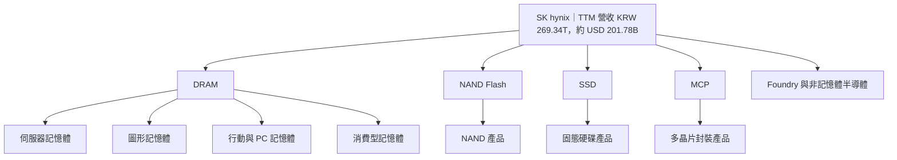
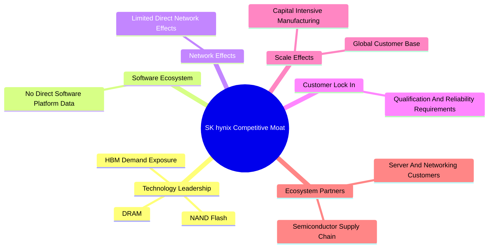
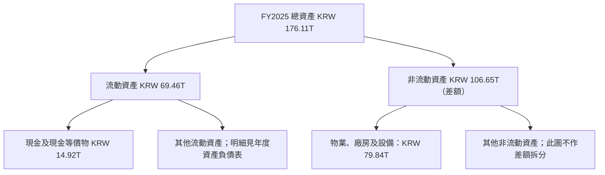
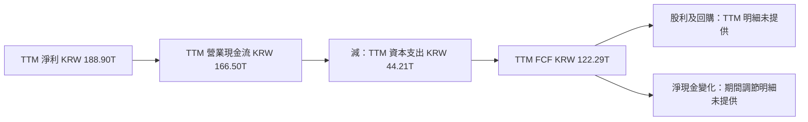
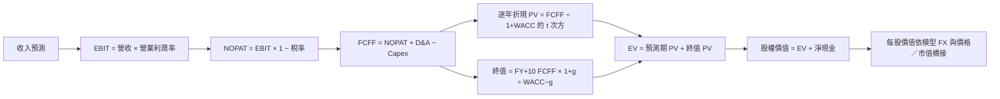
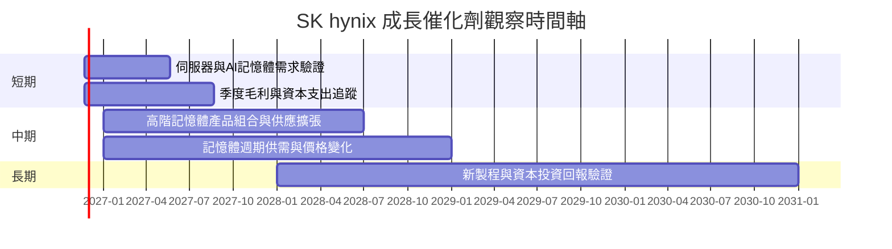
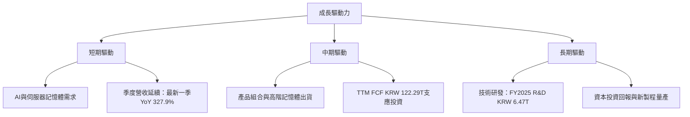
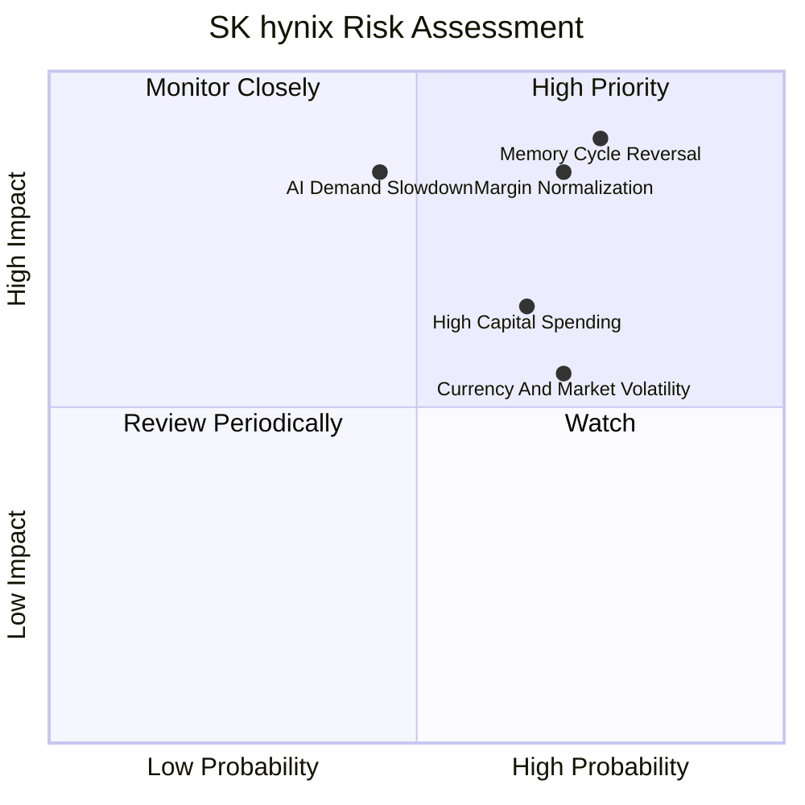
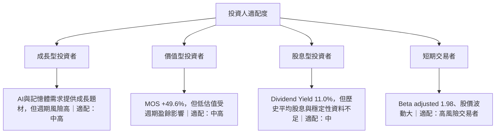

# SKHY 基本面深度分析報告
> **報告日期**：2026-11-22 ｜ **語言**：繁體中文 ｜ **數據來源**：Yahoo Finance、Finviz、StockAnalysis、Roic.ai ｜ **分析師**：CFA 級機構研究  
> **公司**：SK hynix Inc.（SK hynix）｜**股票代號**：SKHY

## 目錄

| # | 章節 | 核心結論 |
|---|------|----------|
| 1 | 執行摘要 | 買入；加權合理價值 $205.37，MOS +49.6% |
| 2 | 公司概覽與商業模式 | 記憶體業務具技術與規模優勢，分部營收占比未提供 |
| 3 | 損益表深度分析 | TTM 營收 KRW 269.34T；最新一季營收年增 327.9% |
| 4 | 資產負債表分析 | 淨現金 KRW 96.34T；流動比率 3.115 |
| 5 | 現金流量深度分析 | TTM FCF KRW 122.29T，FCF Yield 12.54% |
| 6 | 獲利能力與資本效率 | WACC 14.00%；最新 ROIC 缺資料，無法判定當期價值利差 |
| 7 | 相對估值分析 | 公司 Forward P/E 2.50x；同業倍數差異顯著 |
| 8 | DCF 內在價值評估 | 基準 DCF 每股 $268.16；DCF 模型高度依賴營運假設 |
| 9 | 成長催化劑 | AI 記憶體需求為主要質化催化劑；TAM 數據未提供 |
| 10 | 風險矩陣 | 記憶體週期、估值假設及股價波動為主要風險 |
| 11 | 投資建議 | 買入；以估值區間與季度營運指標設定分批與再評估條件 |

## 1. 執行摘要

截至 2026-09-30 的 TTM 營收為 KRW 269.34T，TTM 營業利益率 74.5%，營業現金流 KRW 166.50T、資本支出 KRW 44.21T，依定義計算的 TTM FCF 為 KRW 122.29T，FCF Yield 為 12.54%。公司有 KRW 96.34T 淨現金；但記憶體業務具週期性，最新一季年增 327.9% 不應直接視為長期成長率。依加權合理價值 $205.37 與 2026-11-20 收盤價 $103.57 計算，MOS 為 +49.6%；規則 20 對應評級為**買入**。當期 ROIC 缺少可比數據，因此不據此升級為強烈買入。

### 1.0 一頁式投資儀表板

| 項目 | 內容 |
|------|------|
| **投資論點（3 句）** | ① TTM 營收 KRW 269.34T，最新一季年增 327.9%，但 TTM 成長率 N/A，須分辨週期反彈與可持續需求。<br>② TTM FCF KRW 122.29T、FCF Yield 12.54%，淨現金 KRW 96.34T，提供資本投資與景氣下行緩衝。<br>③ 加權合理價值 $205.37，較現價 $103.57 高；DCF 基準值 $268.16 需以更保守的同業估值交叉檢驗。 |
| **綜合評分** | **7.9/10**（引用 1.1 評分卡） |
| **財務健康** | 🟢 現金及短期投資 KRW 114.46T、總債務 KRW 18.13T，淨現金 KRW 96.34T；流動比率 3.115 |
| **ROIC vs WACC** | 最新 ROIC：N/A；WACC：14.00%。缺最新 ROIC，無法作當期價值創造判定 |
| **FCF 趨勢** | 最新 TTM FCF KRW 122.29T；年度 FCF 由 2023 年負 KRW 4.50T 回升至 2025 年 KRW 24.79T；TTM FCF Yield 12.54% |
| **估值** | Forward P/E 2.5048091x ｜公司 EV/EBITDA：N/A（財報與報價幣別不可直接混用）｜FCF Yield 12.54% |
| **DCF 內在價值（基準）** | $268.16 ｜現價相對 DCF 折價 **61.4%**（現價 ÷ DCF − 1） |
| **安全邊際（MOS）** | **+49.6%**＝($205.37 − $103.57) ÷ $205.37｜🟢 充足 |
| **預期報酬（基準情境 12M）** | DCF 基準情境相對現價 **+158.9%**；此為模型情境，不代表 12 個月價格預測保證 |
| **關鍵風險（前二）** | 記憶體供需與價格反轉；DCF 假設的長期高營業利潤率不能延續 |
| **評級 + 信心度** | 🟢 **買入** ｜信心：中（估值具折價，但景氣循環與 DCF 假設不確定性高） |

### 1.1 綜合評分卡（全報告唯一）

| 維度 | 評分（1–10） | 主要依據（引用數字與其來源章節） |
|------|--------------|----------------------------------|
| 成長性 | 8.5 | 最新一季營收年增 327.9%；TTM 營收成長率 N/A，成長延續性需觀察（第 3 章） |
| 獲利能力 | 9.0 | TTM 營業利益率 74.5%、淨利率 70.1%；當期 ROIC 與 Piotroski F-Score N/A（第 3、6 章） |
| 財務健康 | 8.5 | 淨現金 KRW 96.34T、流動比率 3.115；CCC 203 天，營運資金占用不可忽略（第 4 章） |
| 估值 | 8.0 | MOS +49.6%；同業相對估值結果低於 DCF 基準值，方法差異須重視（第 7、8 章） |
| 護城河 | 8.0 | DRAM、NAND、SSD 與伺服器記憶體產品組合；產業技術與資本門檻高，但市場份額數據未提供（第 2 章） |
| 管理層與資本配置 | 5.5 | 2025 年資本支出 KRW 28.58T、現金股利支付 KRW 1.68T；回購及長期資本回報紀錄不足以作完整評估（第 5 章） |
| **綜合評分** | **7.9** | 六項算術平均： (8.5 + 9.0 + 8.5 + 8.0 + 8.0 + 5.5) ÷ 6 = 7.9167，四捨五入至一位小數 |

### 1.2 五大投資論點 + 三大核心風險

| 類型 | 項目 | 具體依據 | 信心度 |
|------|------|----------|--------|
| 🟢 **投資論點①** | 記憶體景氣復甦反映在營收與利潤 | 最新一季營收年增 327.9%；公司報告的 TTM 營業利益率為 74.5%，顯示景氣上行時營運槓桿明顯 | 🟢 高 |
| 🟢 **投資論點②** | 自由現金流充足 | TTM 營業現金流 KRW 166.50T 減資本支出 KRW 44.21T，得到 FCF KRW 122.29T；FCF Yield 12.54% | 🟢 高 |
| 🟢 **投資論點③** | 淨現金提供逆週期緩衝 | 現金及短期投資 KRW 114.46T，總債務 KRW 18.13T，淨現金 KRW 96.34T | 🟢 高 |
| 🟢 **投資論點④** | 相對估值低 | 公司 Forward P/E 2.5048091x；但半導體同業與公司自身皆受週期利潤影響，低倍數不等於週期低點已確認 | 🟡 中 |
| 🟢 **投資論點⑤** | AI 伺服器記憶體需求可能支撐產品組合 | 新聞資料提及 HBM 需求加速；未提供 HBM 營收占比與市場份額，需後續財報驗證 | 🟡 中 |
| 🟡 **風險①** | 記憶體供需週期反轉 | 最新一季營收年增 327.9% 屬單季年增，不能外推為 TTM 或永續成長；供應擴張可能推低 ASP 與毛利率 | 🔴 高衝擊 |
| 🔴 **風險②** | DCF 對高利潤率延續的依賴 | DCF 第 1 年營業利潤率採 74.5%，第 10 年仍採 35.5%；若價格與產品組合轉弱，估值可能下修 | 🔴 高衝擊 |
| 🟡 **風險③** | 高波動與市場情緒 | Beta used (adjusted) 1.98；近期股價資料自 2026-09 月 $184.15 回落至 2026-11-20 的 $103.57 | 🟡 中高 |

### 1.3 快速統計卡片

| 指標 | 公司實際值（期間） | 同業中位數 | 狀態 |
|------|--------------------|------------|------|
| 營收成長（TTM） | N/A | — | 🟡 TTM 比較期成長率未提供 |
| 營收成長（最新一季年增） | **327.9%** | **377.9%** | 🟡 低於三家同業中位數 |
| 毛利率（TTM） | **77.4%** | **80.0%** | 🟡 低於同業中位數 |
| 營業利益率（TTM） | **74.5%** | — | 🟢 高，但具週期性 |
| ROIC（TTM） | N/A | — | 🟡 最新數據未提供 |
| Forward P/E | **2.5048091x** | **2.8x** | 🟢 低於同業中位數 |
| FCF Yield（TTM） | **12.54%** | — | 🟢 現金流收益率高 |
| Piotroski F-Score | **N/A** | — | 🟡 缺少相隔一年的 SEC 申報數據 |

同業中位數按三家公司數值排序計算：最新一季營收年增率為 55.5%、377.9%、379.3%，中位數 377.9%；毛利率為 52.6%、80.0%、80.7%，中位數 80.0%；Forward P/E 為 2.2x、2.8x、6.5x，中位數 2.8x。

### 1.4 投資結論

```text
╔══════════════════════════════════════════════════════════════════╗
║                    📊 投資結論摘要                               ║
╠══════════════════════════════════════════════════════════════════╣
║  評級：買入（MOS +49.6%，依規則 20）                             ║
║  價格（2026-11-20 收盤）：$103.57                                ║
║  DCF 內在價值（基準）：$268.16（現價折價 61.4%）                ║
║  安全邊際 MOS：+49.6%（以加權合理價值為分母）                   ║
║  加權合理價值（8.8）：$205.37                                    ║
║  DCF 情境價值：                                                  ║
║    悲觀情境：$129.87（+25.4%）                                   ║
║    基準情境：$268.16（+158.9%）                                  ║
║    樂觀情境：$527.52（+409.3%）                                  ║
║  綜合評分：7.9/10（引用 1.1）                                    ║
║  適合投資人：能承受週期與高波動、採分批布局的中長期投資人       ║
╚══════════════════════════════════════════════════════════════════╝
```

## 2. 公司概覽與商業模式

### 2.1 業務結構與收入來源

公司資料列出 DRAM、NAND flash、SSD、MCP 與 foundry 等業務；未提供各業務的營收占比，故不將任一產品線占比或金額臆測為實際分部數據。TTM 總營收 KRW 269.34T（約 USD 201.78B），截至 2026-09-30。



### 2.2 市場份額

市場份額的具體數字與來源年份未提供，因此不製作份額圖或占比表。公司 TTM 營收約 USD 201.78B，最新一季營收年增 327.9%；同業資料中 Micron、SanDisk 的最新一季營收年增分別為 379.3%、377.9%，SK hynix 的增速低於兩者，但遠高於 WDC 的 55.5%。營收成長比較仍受產品組合與季度基期差異影響，不能直接視為市場份額變化。

### 2.3 競爭護城河分析



產品與客戶資料支持公司參與多種記憶體市場，但並未提供 HBM 營收占比、客戶集中度、技術市占率或專利數據。軟體生態與網路效應並非所提供資料可驗證的主要護城河來源。

### 2.4 護城河強度

| 護城河項目 | 強度（強／中／弱） | 證據（引用數字或事實） | 會削弱它的情況 |
|------------|--------------------|------------------------|----------------|
| 技術與產品 | 強 | 產品涵蓋 DRAM、NAND、SSD、MCP，並供應伺服器、網路、行動及 PC 等用途；最新 TTM 毛利率 77.4% | 技術追趕、產品良率落後、同業供給擴張 |
| 規模與製造資本 | 強 | FY2025 資本支出 KRW 28.58T；TTM 資本支出 KRW 44.21T，反映半導體製造資本門檻高 | 設備投資回收期過長、產能利用率下滑 |
| 客戶認證與可靠度 | 中 | 公司面向伺服器、網路、行動與 PC 等客戶應用；客戶認證細節未提供 | 客戶轉換供應商、重大品質或交付問題 |
| 軟體生態／網路效應 | 弱 | 可用資料未顯示直接軟體平台或網路效應 | 記憶體產品規格商品化、價格競爭 |
| 生態夥伴 | 中 | 涵蓋跨區域客戶與半導體供應鏈；合作伙伴營收與依存度未提供 | 供應鏈中斷、客戶自研或多元化採購 |

1.1「護城河」評分為 8.0，依據是多產品線、資本門檻與高 TTM 毛利率；市場份額及客戶依賴數據不足，因此不給更高評價。

## 3. 損益表深度分析

### 3.1 年度收入成長趨勢（近 4 年）

年度營收採 KRW；資料庫呈現單位雖以「T」標示，實際數據按 KRW trillion 換算。YoY 使用 StockAnalysis 歷史數據；2026 TTM 與 FY2025 的期間並不相同，不混為同一年度比較。

```text
╔══════════════════════════════════════════════════════════════════╗
║              SK hynix 年度收入趨勢（FY2022–FY2025）              ║
╠══════════════════════════════════════════════════════════════════╣
║  FY2022  KRW 44.62T  █████████████░░░░░░░░░░░  YoY: +3.78%     ║
║  FY2023  KRW 32.77T  ██████████░░░░░░░░░░░░░░  YoY: -26.57%    ║
║  FY2024  KRW 66.19T  ███████████████████░░░░░  YoY: +102.02%   ║
║  FY2025  KRW 97.15T  ████████████████████████  YoY: +46.76%    ║
╠══════════════════════════════════════════════════════════════════╣
║  FY2022–FY2025 累計 CAGR：約 29.6%                               ║
╚══════════════════════════════════════════════════════════════════╝
```

CAGR 算式：\((97.146675 ÷ 44.621568)^{1/3} - 1 \approx 29.6\%\)。2023 年營收收縮、2024 年反彈逾一倍，呈現強烈週期特徵；FY2025 的 46.76% 增長顯示上行延續，但不能據此推定未來維持同樣增速。2026 TTM 營收 KRW 269.34T，Revenue growth (TTM vs prior TTM) 為 N/A。

### 3.2 季度收入趨勢分析

| 季度 | 營收（KRW T） | QoQ 成長 | YoY 成長 | 備註 |
|------|---------------:|---------:|---------:|------|
| 2025 Q4 | 32.83 | +34.3% | +66.07% | 對比 2025 Q3 KRW 24.45T |
| 2026 Q1 | 52.58 | +60.2% | +198.07% | 對比 2025 Q4 KRW 32.83T；YoY 基期為 2025 Q1 |
| 2026 Q2 | 79.32 | +50.9% | +256.78% | 對比 2026 Q1 KRW 52.58T |
| 2026 Q3 | 104.62 | +31.9% | +327.89% | 對比 2026 Q2 KRW 79.32T |

QoQ 依季度營收相除計算，採一位小數；YoY 直接引用 StockAnalysis 單季年增率。QoQ 仍連續為正，但增幅由 60.2% 降至 31.9%，代表營收仍在擴張、環比增長速度已有所放緩。最新一季年增率受去年同期低基期影響，不是 TTM 成長率。

### 3.3 利潤率演變分析

年度毛利率、營業利益率、淨利率依年度毛利、營業利益、淨利除以營收計算，四捨五入至一位小數。

| 利潤率指標 | FY2022 | FY2023 | FY2024 | FY2025 | 趨勢 | 評估 |
|------------|--------|--------|--------|--------|------|------|
| **毛利率** | 35.0% | -1.6% | 48.1% | 60.4% | 2023 轉負，隨週期復甦回升 | 🟢 FY2025改善，但仍受 ASP 與產品組合影響 |
| **營業利益率** | 15.3% | -23.6% | 35.5% | 48.6% | 2023 虧損，2024–2025 大幅修復 | 🟢 高獲利，週期性明顯 |
| **淨利率** | 5.0% | -27.8% | 29.9% | 44.2% | 2023 淨虧損後回升 | 🟡 淨利受非營業項目與稅率影響 |

FY2026-09-30 的 TTM 毛利率為 77.4%、TTM 營業利益率為 74.5%、TTM 淨利率為 70.1%。季度損益表的個別科目相除，與彙總欄的 TTM／最新季度利潤率有口徑差異；本報告的官方 TTM 利潤率採彙總數據。毛利及營業利益率的改善與記憶體週期復甦、售價及高階產品組合相符，但資料未提供 ASP、產品組合或產能利用率分解，故不把單一因素定量化。

### 3.4 費用結構分析

資料未提供足以構成完整費用結構的 COGS、研發、銷管及其他營業費用明細（除年度 R&D 外），故不畫費用占比圓餅圖。FY2025 研發支出 KRW 6.47T，FY2024 為 KRW 4.44T、FY2023 為 KRW 3.75T；FY2025 R&D 約占當年營收 6.7%（6.47 ÷ 97.15），支持技術投入，但無法據此拆解全部營業成本。

### 3.5 季度 EPS 趨勢與盈餘品質（Quality of Earnings）

| 季度 | EPS 實際值／成長資料 | 超預期或不及預期 | 說明 |
|------|---------------------|------------------|------|
| 2026 Q3 | EPS estimate 與 actual：N/A；EPS YoY +205.06% | N/A | 盈餘大幅增長，但沒有分析師預估值，不能判定 beat/miss |
| 2026 Q2 | EPS estimate 與 actual：N/A；EPS YoY +1,273.16% | N/A | 高增幅含低基期因素；不可等同超預期 |
| 2026 Q1 | EPS YoY +396.72% | N/A | EPS 年增率快速上升，缺估值資料 |
| 2025 Q4 | EPS YoY +85.22% | N/A | 正增長；沒有對應估值與驚喜幅度 |

盈餘品質量化如下。當年度與 TTM 期間不一致者明確標示，避免將季度或單年數字誤作 TTM。

| 盈餘品質項目 | 數值／佔比 | 評估 |
|--------------|-----------|------|
| 股權薪酬 SBC / 營收 | TTM：N/A；FY2025 SBC KRW 414.11B ÷ FY2025 營收 KRW 97.15T = 約 0.43% | 🟢 FY2025 比重低；季度 SBC 波動大，不代表全年 |
| SBC / 營業現金流 | TTM：N/A（缺 TTM SBC）；FY2025 以年度數據比值約 0.78%（414.11B ÷ 53.37T） | 🟢 年度比重不高，但不能替代 TTM 指標 |
| FCF / 淨利（現金轉換率） | TTM FCF KRW 122.29T ÷ TTM 淨利 KRW 188.90T = 約 64.7% | 🟡 現金轉換率低於 100%；資本密集與營運資金變化可能使淨利與現金流不同步 |
| 一次性／非經常性損益 | 無法判定；資料未提供項目明細 | 🟡 不能排除資產處分、匯兌或其他非經常項目影響 |
| 有效稅率異常 | 14.9%（最新年度有效稅率） | 🟡 單期稅率未足以判斷是否持續；缺少多年 TTM 稅率拆解 |
| 資本化支出 vs 費用化 | TTM Capex KRW 44.21T；資本化與費用化拆解 N/A | 🟡 投資額大；無法據現有資料判斷資本化政策是否改變 |

**盈餘品質結論：** TTM FCF 為正且金額可觀，現金流並非只由會計盈餘構成；但 FCF/淨利約 64.7%，營運資金 CCC 為 203 天，且 TTM SBC、一次性損益及資本化細節缺漏。短期高利潤與高淨利不應直接視為穿越週期的常態盈餘。

## 4. 資產負債表分析

### 4.1 資產結構分解

最新可用完整總資產為 2025-12-31 的 KRW 176.11T；當日流動資產 KRW 69.46T，非流動資產按差額計算為 KRW 106.65T。非流動資產差額為總資產減流動資產，非財報中單一科目。



### 4.2 流動性與營運資金分析

| 指標 | 最新值 | 歷史趨勢／解讀 | 評估 |
|------|-------:|----------------|------|
| 流動比率 | 3.115 | 最新市場資料提供；歷年同口徑序列未提供 | 🟢 |
| 速動比率 | 2.794 | 最新市場資料提供；流動性不依賴全部存貨變現 | 🟢 |
| 淨現金 | KRW 96.34T | 現金與短期投資 KRW 114.46T 減總債務 KRW 18.13T | 🟢 |

營運資金天數按 QUALITY FIGURES 原值照錄。沒有一年前可比數值，故不估算變化。

| 指標 | 最新 TTM | 一年前 TTM | 變化 | 解讀 |
|------|----------|------------|------|------|
| DSO 應收帳款天數 | 80 天 | N/A | N/A | 回款週期約 80 天；缺一年前數值，不能判斷收款變快或變慢 |
| DIO 存貨天數 | 143 天 | N/A | N/A | 庫存占用約 143 天；週期下行時存貨可能帶來減值與降價風險 |
| DPO 應付帳款天數 | 20 天 | N/A | N/A | 付款天數較短；缺供應商條款與歷史比較，不推論議價力 |
| CCC 現金轉換週期 | 203 天 | N/A | N/A | 應收加存貨減應付後占用資金 203 天，為重要營運資金監控項 |

### 4.3 債務結構分析

```text
╔══════════════════════════════════════════════════════════════════╗
║                   SK hynix 債務健康診斷                          ║
╠══════════════════════════════════════════════════════════════════╣
║  總債務：        KRW 18.13T  ██░░░░░░░░░░░░░░░░░░  🟢           ║
║  現金+短期投資： KRW 114.46T ████████████████████  🟢           ║
║  淨現金：        KRW 96.34T  █████████████████░░░  🟢           ║
║                                                                  ║
║  流動比率：      3.115       🟢                                  ║
║  速動比率：      2.794       🟢                                  ║
║  Debt/EBITDA：   N/A（計價貨幣口徑不一致，未提供可比 EV/EBITDA）║
║  利息保障倍數：  N/A（利息費用資料未提供）                      ║
╚══════════════════════════════════════════════════════════════════╝
```

市場資料另列 Debt/Equity 5.865，但與同一資料表的淨現金及負債數字口徑無法完全對照，故不以該比率取代總債務、現金及淨現金的絕對額分析。財務數據指出價格以 USD 報價、財報以 KRW 記帳；未對跨幣別比率自行換算。

### 4.4 股東權益趨勢

| 年度 | 股東權益（KRW T） | 年變化 |
|------|-----------------:|------:|
| 2022 | 63.27 | — |
| 2023 | 53.50 | -15.4% |
| 2024 | 73.90 | +38.1% |
| 2025 | 120.52 | +63.1% |

```text
╔══════════════════════════════════════════════════════════════════╗
║                  SK hynix 股東權益趨勢                           ║
╠══════════════════════════════════════════════════════════════════╣
║  2022  KRW 63.27T  █████████████░░░░░░░░░                      ║
║  2023  KRW 53.50T  ███████████░░░░░░░░░░░                      ║
║  2024  KRW 73.90T  ███████████████░░░░░░░░                      ║
║  2025  KRW120.52T  ████████████████████████                      ║
╚══════════════════════════════════════════════════════════════════╝
```

2023 年權益因虧損而下降，2024–2025 隨獲利復甦回升。權益變動同時受淨利、其他綜合損益、股息及其他項目影響；所提供資料不足以完全拆解各項貢獻。

## 5. 現金流量深度分析

### 5.1 現金流量瀑布圖

以 TTM 數據呈現可核對的營業現金流、資本支出與 FCF；TTM 淨利、股利與回購合計變動等所需數據未必同期間完整，因此不虛構完整瀑布金額。



### 5.2 FCF 轉換率趨勢

年度 FCF 直接取自現金流資料；FCF/淨利以同年度數據相除，金額均為 KRW。

| 年度 | FCF | 淨利 | FCF / 淨利 | 解讀 |
|------|-----:|-----:|-----------:|------|
| 2022 | -4.97T | 2.23T | -223.0% | 盈利但自由現金流為負，資本支出高於營運現金流 |
| 2023 | -4.50T | -9.11T | 不具經濟可比性 | 淨利與 FCF 同為負值，百分比不宜作一般轉換率解讀 |
| 2024 | 13.13T | 19.79T | 66.4% | 利潤復甦，仍有資本支出及營運資金吸收 |
| 2025 | 24.79T | 42.92T | 57.8% | FCF 增長，但現金轉換低於 100% |
| TTM 至 2026-09-30 | 122.29T | 188.90T | 64.7% | 大額現金流伴隨較低於淨利的轉換率 |

### 5.3 自由現金流趨勢

| 期間 | FCF（KRW T） | FCF Yield |
|------|-------------:|----------:|
| FY2022 | -4.97 | N/A |
| FY2023 | -4.50 | N/A |
| FY2024 | 13.13 | N/A |
| FY2025 | 24.79 | N/A |
| TTM 至 2026-09-30 | 122.29 | 12.54% |

```text
╔══════════════════════════════════════════════════════════════════╗
║                  自由現金流：年度實際與 TTM                      ║
╠══════════════════════════════════════════════════════════════════╣
║  FY2022  -KRW 4.97T  ◀░░░░░░░░░░░░░░░░░░░░                    ║
║  FY2023  -KRW 4.50T  ◀░░░░░░░░░░░░░░░░░░░░                    ║
║  FY2024   KRW13.13T  ███░░░░░░░░░░░░░░░░░░░                    ║
║  FY2025   KRW24.79T  █████░░░░░░░░░░░░░░░░                    ║
║  TTM      KRW122.29T ████████████████████████  Yield: 12.54%   ║
╚══════════════════════════════════════════════════════════════════╝
```

年度與 TTM 的期間長度不同，不能將 TTM 數字當作單一會計年度。FCF 回升與營業現金流改善相符，但週期高峰下的現金流不宜線性外推。

### 5.4 資本配置評估

回購、投資與留存現金的完整分配比例沒有提供，因此不製作可能誤導的資本配置圓餅圖。

| 資本配置項目 | 可用數據 | 評估 |
|--------------|----------|------|
| Capex | FY2025 KRW 28.58T；TTM KRW 44.21T | 資本密集投資是產能與技術競爭的必要投入，亦是 FCF 波動的重要來源 |
| 現金股利 | FY2025 支付 KRW 1.68T | 約為 FY2025 FCF KRW 24.79T 的 6.8%；比值只用同年度數字 |
| 股份回購 | N/A | 沒有可確認的期間數據 |
| 留存現金／其他投資 | N/A | 未提供資金用途完整調節表 |

## 6. 獲利能力與資本效率

### 6.1 ROE / ROA / ROIC 趨勢

最新 TTM 的 ROE、ROA 及 ROIC 時點與來源如下；歷年 ROE／ROA 未提供完整可比序列。Roic.ai 顯示的歷史 Return on Capital 只能作歷史參考，不替代當期 ROIC。

| 指標 | 歷史／最新數據 | 行業均值對比 | 評估 |
|------|----------------|---------------|------|
| ROE | TTM 92.5%；年度序列 N/A | N/A（未提供同口徑資料） | 🟢 高，但可能受景氣高峰及資產週期影響 |
| ROA | TTM 46.4%；年度序列 N/A | N/A（未提供同口徑資料） | 🟢 盈利相對資產規模高 |
| ROIC | 最新 TTM N/A；Roic.ai 2018 Return on Capital 34.64% | N/A（未提供同期間比較） | 🟡 2018 歷史數據不能代表 2026 當期資本回報 |

### 6.2 ROIC vs WACC 分析（核心價值創造判斷）

公司 WACC 採成本資本數據的官方採用值 14.00%。最新 ROIC 未提供，因此不以 ROE、ROA 或 2018 年歷史 Return on Capital 替代當期 ROIC，亦不計當期 EVA。

```text
╔══════════════════════════════════════════════════════════════════╗
║                ROIC vs WACC 深度分析                            ║
╠══════════════════════════════════════════════════════════════════╣
║  WACC 採用值：14.00%                                             ║
║  ├── 無風險利率（10Y美債）：4.91%                                ║
║  ├── 市場風險溢酬 ERP：5.00%                                     ║
║  ├── Beta 原始值：2.47；採用調整後 Beta：1.98                   ║
║  ├── 股權成本（資料列示）：14.80%                                ║
║  ├── 稅前債務成本：5.10%；有效稅率：14.9%                       ║
║  ├── 股權／債務權重：98.2%／1.8%                                 ║
║  ├── 原始計算 WACC：14.61%；因限制區間採用 14.00%               ║
║                                                                  ║
║  當期 ROIC：N/A（最新 ROIC 數據未提供）                           ║
║  投入資本及當期 NOPAT：資料不足，不另行推算                      ║
║  當期 EVA = ROIC − WACC：N/A                                     ║
║                                                                  ║
║  歷史參考：Roic.ai 2018 Return on Capital 為 34.64%              ║
║  此歷史值與 2026 WACC 非同期間，不作當期價值創造結論            ║
╚══════════════════════════════════════════════════════════════════╝
```

調整後 Beta 依資料提供方式為 ⅔ × 原始 Beta + ⅓：\(⅔ × 2.47 + ⅓ = 1.98\)（依資料列示值）。原始 WACC 為 14.61%，程式將其限制在 7%–14% 區間，因此採用 14.00%。本節與第 8.2 節使用同一 WACC。由於最新 ROIC 缺失，不能判斷公司目前是否以高於資本成本的報酬率創造股東價值。

### 6.3 杜邦三因素分解

**N/A（QUALITY FIGURES 指標缺漏：淨利、營收、總資產或正股東權益的同口徑資料不足，杜邦結果未提供。）** TTM ROE 92.5% 不等同於已核對的杜邦拆解，故不反推三項因素。

### 6.4 財務體質：Piotroski F-Score

**N/A（QUALITY FIGURES：須有相隔一年的 SEC 申報資料；現有財報來源為 Yahoo quarterly statements，無法判定九項測試。）** 因 F-Score 與九項測試結果都未提供，不逐項臆測或填補。

## 7. 相對估值分析

### 7.1 同業估值比較表格

同業倍數照錄 Yahoo Finance 數值；公司倍數取市場資料。公司 P/S、EV/EBITDA 等跨幣別比率依規則不自行補算。SNDK 的 Trailing P/E 0.1x 極端偏低，可能受盈利週期或數據口徑影響，不能視為穩定估值錨。

| 估值指標 | **SK hynix** | **MU** | **SNDK** | **WDC** | 本公司評估 |
|----------|------------:|-------:|---------:|-------:|-----------|
| **Trailing P/E** | 5.7315993x | 8.0x | 0.1x | 9.2x | 🟡 公司倍數低於 MU、WDC，但 SNDK 極端值不宜直接比較 |
| **Forward P/E** | 2.5048091x | 2.8x | 2.2x | 6.5x | 🟢 低於三家同業中位數 2.8x |
| **P/S Ratio** | N/A（報價與財報幣別不同） | 5.1x | 3.1x | 6.7x | 🟡 公司值不可在未換算市值前比較 |
| **EV/EBITDA** | N/A（報價與財報幣別不同） | 5.8x | 4.0x | 15.4x | 🟡 同業中位數 5.8x；公司值缺少同幣別口徑 |

同業最新一季營收年增率：MU 379.3%、SNDK 377.9%、WDC 55.5%；毛利率：80.7%、80.0%、52.6%。SK hynix 最新一季營收年增 327.9%、TTM 毛利率 77.4%，增長率與毛利率均低於三家同業中位數，但公司自身商業組合與季度基期不同，不能只憑倍數判定相對低估。

### 7.2 歷史估值區間分析

```text
╔══════════════════════════════════════════════════════════════════╗
║                    SK hynix 歷史估值位置                         ║
╠══════════════════════════════════════════════════════════════════╣
║  歷史 P/E 區間：N/A（Valuation vs own history 未提供）           ║
║  歷史估值百分位：N/A（未提供）                                   ║
║  最新收盤價：2026-11-20 $103.57                                  ║
║  52 週區間：$102.45–$199.87                                      ║
║  判斷：價格位於所列 52 週區間下端附近；這不是歷史 P/E 百分位。   ║
╚══════════════════════════════════════════════════════════════════╝
```

### 7.3 情境價值（Bear / Base / Bull，照抄 DCF MODEL）

| 情境 | 第 1 年營收成長 | 期末營業利潤率 | WACC | 每股價值 | 相對現價 | 機率 | 會發生的條件 |
|------|----------------|----------------|------|----------|----------|------|--------------|
| 🔴 悲觀 | 15.0% | 30.1% | 15.00% | $129.87 | +25.4% | 25% | 需求與定價低於基準，利潤率收斂至 30.1%，風險折現率升至 15% |
| 🟡 基準 | 30.0% | 35.5% | 14.00% | $268.16 | +158.9% | 50% | 首年增長採上限 30%，其後逐年放緩至 3%，期末利潤率 35.5% |
| 🟢 樂觀 | 45.0% | 39.0% | 13.00% | $527.52 | +409.3% | 25% | 需求及產品組合超預期，首年成長 45%、期末利潤率 39%，折現率降至 13% |

各情境依 DCF MODEL 已計算結果照錄；公司沒有提供管理層財測支持上述情境，因此情境為模型假設，不是公司指引。

### 7.4 相對估值隱含價格區間

```text
╔══════════════════════════════════════════════════════════════════╗
║             同業估值與多方法每股價值比較（USD）                  ║
╠══════════════════════════════════════════════════════════════════╣
║  同業 EV/EBITDA：$144.17  ───── 現價 $103.57                    ║
║  同業 P/S：      $144.51  ───── 分析師共識 $259.50              ║
║  DCF 基準：      $268.16  ─────                                  ║
╚══════════════════════════════════════════════════════════════════╝
```

| 方法 | 每股價值 | 相對現價 | 依據 |
|------|---------:|---------:|------|
| 同業 EV/EBITDA | $144.17 | +39.2% | MU、SNDK、WDC 同業中位數 5.8x × TTM EBITDA，再加淨現金 |
| 同業 P/S | $144.51 | +39.5% | MU、SNDK、WDC 同業中位數 5.1x × TTM 營收 |
| DCF（基準） | $268.16 | +158.9% | 10 年 FCFF、WACC 14.00%、永續成長率 3.0% |
| 分析師共識 | $259.50 | +150.6% | 14 位分析師平均目標價 |

相對估值法所給 $144.17–$144.51 的窄幅區間，顯著低於 DCF 與分析師共識；這是對基準 DCF 的重要反向檢驗。估值方法及權重依第 8.8 節所列固定規則使用，不因本節觀點調整。

## 8. DCF 內在價值評估（Discounted Cash Flow）

> 本章以 DCF MODEL 提供的數值為唯一模型依據。所有年度預測金額以 KRW billions 表示；匯率採 2026-11-20 收盤 1 USD = KRW 1,334.79。模型指定使用 GAAP EBIT，FCFF = NOPAT + D&A − Capex，營運資金變動不建模。

### 8.0 估值推理鏈（Thinking Logic）

**Step 1 — 價值由哪些變數決定？**  
模型以公司整體記憶體與相關半導體主業為基礎；產品線營收占比未提供，不能把 DRAM、NAND 或 HBM 的營收占比自行拆分。估值主要由營收成長路徑、營業利潤率及折現率決定。終值現值占企業價值 37.1%，低於一半，因此除終值假設外，預測期各年現金流同樣重要。敏感度表顯示 WACC 與永續成長率均會改變價值，但收入及利潤率情境也會造成很大的結果差異。

**Step 2 — 模型選擇**

| 決策點 | 本報告採用 | 理由（含數字） | 曾考慮但否決 | 否決理由 |
|--------|-----------|----------------|--------------|----------|
| 現金流定義 | FCFF | 模型以 NOPAT + D&A − Capex 計算，並使用 WACC 折現至 EV | FCFE | 模型已固定採 FCFF，不另建模型 |
| 預測期 N | 10 年 | DCF MODEL 固定列 FY+1 至 FY+10 | 5 年 | 與程式模型不一致，不採用 |
| 終值方法 | Gordon Growth | WACC 14.00% 高於 g 3.0%，公式有效；終值 PV 占 EV 37.1% | 退出倍數作主方法 | DCF MODEL 基準使用 Gordon Growth；未提供模型內 EBITDA 退出倍數結果 |
| EBIT 基礎 | GAAP EBIT | 已含股權薪酬費用，遵循模型口徑 | 非 GAAP EBIT | 無相應非 GAAP 調整資料 |

**Step 3 — 關鍵假設推導**

- **營收成長曲線**：錨點＝最新一季營收 YoY 327.9%，但這是單季而非 TTM 成長率；調整＝避免將週期性低基期反彈外推，模型把首年增長限制在 0%–30% 區間內，並逐年線性衰減；**採用首年 30.0%、第 10 年 3.0%**；曾考慮把最新一季 327.9% 外推為預測，因單季基期與週期性不足以支持長期延續而否決。
- **期末營業利潤率**：錨點＝TTM 營業利益率 74.5%；調整＝模型依「最近 5 個財政年度中位數（含 TTM）」逐步回歸；**採用第 10 年 35.5%**；未採用 74.5% 作十年固定利潤率，因 FY2023 曾錄得營業虧損，歷史已顯示大幅循環。
- **永續成長率 g**：錨點＝DCF 模型採用 3.0%；調整＝採穩定長期假設並低於 WACC 14.00%；**採用 3.0%**；不採用接近 WACC 的永續成長率，因會使 Gordon Growth 終值敏感度失真。
- **預測期 N**：錨點＝DCF MODEL 設定 10 年；調整＝不自行更改固定模型期間；**採用 10 年**；曾考慮 5 年，但無程式模型支持，亦會改變終值起算時間。
- **Capex／營收**：錨點＝TTM Capex／TTM 營收約 16.4%；調整＝模型逐年淡化至第 10 年 6.4%，其依據為若高於折舊則降至 1.1 倍 D&A；**採用 FY+1 16.4%、FY+10 6.4% 的線性路徑**；曾考慮永久固定 16.4%，但模型假設成熟後資本密集度下降。
- **有效稅率**：錨點＝最新年度有效稅率 14.9%；**採用 14.9%**。該輸入依模型固定，未作額外調整。
- **D&A／營收**：錨點＝TTM 5.8%；**採用 5.8% 並固定**，依 DCF MODEL 假設。
- **營運資金**：營運資金變動未建模；資料雖有 CCC 203 天，但模型沒有提供逐年 ΔWC 假設，因此不另加自行估算的現金流列。
- **EBIT 與 SBC**：採 GAAP EBIT、固定股數、不另扣 SBC；**本模型採用組合 (A)，故 SBC 影響已計入一次**。年稀釋率設定 0%，與模型指定股數處理一致。
- **終值方法**：採 Gordon Growth；錨點為模型直接提供的終值與 PV；不另加未提供的退出倍數終值。
- **WACC**：錨點是成本資本資料的 WACC 採用值 14.00%；原始計算 14.61% 被限定在 7%–14% 範圍，故採 14.00%；不另以其他 Beta 或資本成本重建模型。

**Step 4 — 最脆弱環節**  
最脆弱的環節是預測期由 74.5% TTM 營業利益率逐步降至 35.5%，同時維持快速擴張的營收；若產品價格、供給或利潤率比假設更快回落，DCF 價值將下修，情境表的悲觀值 $129.87 提供了模型內可參照的下行情境。

**Step 5 — 計算路徑圖**



### 8.1 模型假設總表（Model Inputs）

| 假設項目 | 採用值 | 依據／來源 | 敏感度 |
|----------|--------|-------------|--------|
| 預測期長度 N | 10 年 | DCF MODEL 固定年數 | 🟡 中 |
| 營收成長曲線 | FY+1 30.0% → FY+10 3.0% | 最新一季 YoY 327.9% 作參考，但模型限制首年上限 30%，逐年線性淡出 | 🔴 高 |
| 營業利潤率 | FY+1 74.5% → FY+10 35.5% | TTM 74.5%，逐步降至最近 5 財年中位數（含 TTM） | 🔴 高 |
| 有效稅率 | 14.9% | 最新年度有效稅率 | 🟢 低 |
| Capex／營收 | FY+1 16.4% → FY+10 6.4% | TTM 起點；成熟期依 1.1×D&A 下修規則 | 🔴 高 |
| D&A／營收 | 5.8% | TTM | 🟢 低 |
| 營運資金變動 | 未建模 | DCF MODEL 明示 Working capital is not modelled | 🟡 中 |
| EBIT 基礎 | GAAP EBIT | DCF MODEL；GAAP EBIT 已含 SBC | 🟡 中 |
| SBC 處理 | 組合 (A)：不再扣 SBC | GAAP EBIT 已扣費用；固定股數 | 🟡 中 |
| 年稀釋率 | 0% | DCF MODEL 指定股數不再稀釋 | 🟡 中 |
| 永續成長率 g | 3.0% | DCF MODEL 固定值；低於 WACC 14.00% | 🔴 高 |
| 終值方法 | Gordon Growth | DCF MODEL 提供終值；WACC > g | 🔴 高 |
| WACC | 14.00% | Cost of capital；原始計算 14.61%，被限制至 7%–14% | 🔴 高 |

**FCFF 定義：** 使用 FCFF 對應 WACC 折現；本模型明確為  
\[
FCFF = NOPAT + D\&A - Capex
\]
營運資金未建模，不加減 ΔWC。組合 (A) 採 GAAP EBIT，FCFF 不再扣 SBC，股數不逐年放大。

### 8.2 折現率推導（WACC）

```text
╔══════════════════════════════════════════════════════════════════╗
║                    WACC 推導（折現率）                           ║
╠══════════════════════════════════════════════════════════════════╣
║  股權成本 Ke（CAPM，資料列示）：14.80%                           ║
║  ├── 無風險利率 Rf（10Y 美債）：4.91%                            ║
║  ├── 市場風險溢酬 ERP：5.00%                                     ║
║  ├── 原始 Beta（Yahoo）：2.47                                    ║
║  ├── 調整後 Beta：1.98（⅔ × 2.47 + ⅓）                          ║
║  └── 成本資本資料列示 Ke：14.80%                                 ║
║                                                                  ║
║  債務成本：                                                      ║
║  ├── 稅前 Kd：5.10%                                              ║
║  ├── 有效稅率：14.9%                                             ║
║  └── 稅後 Kd = 5.10% × (1 − 14.9%) = 4.34%                      ║
║                                                                  ║
║  資本結構（成本資本資料所列權重）：                              ║
║  ├── 股權權重：98.2%                                             ║
║  ├── 債務權重：1.8%                                              ║
║  ├── 未限制的計算 WACC：14.61%                                   ║
║  └── ✅ 採用 WACC：14.00%（限制在 7%–14% 區間）                 ║
╚══════════════════════════════════════════════════════════════════╝
```

**逐步演算與口徑限制：**

1. **Ke**：資料直接列示成本股權 14.80%；原始 Beta 2.47，依 \(⅔ × 2.47 + ⅓ = 1.98\) 調整。用列示輸入逐項計算會因來源精度／四捨五入與資料列示 Ke 出現 0.01 個百分點差異，因此模型遵從已驗證的 Ke 14.80%，不以新數值替換。
2. **稅前 Kd**：資料直接列示 5.10%；利息費用及平均計息負債金額未提供，故不補造原始分子、分母。
3. **稅後 Kd**：\(5.10\% × (1 - 14.9\%) = 5.10\% × 85.1\% = 4.3401\% \approx 4.34\%\)。
4. **權重**：採用成本資本資料列示股權 98.2%、債務 1.8%，相加 \(98.2\% + 1.8\% = 100.0\%\)。資料沒有提供可用來重建該權重的同口徑市值與計息負債細分；故不把另列的市場市值與不同期間負債強行拼接。
5. **未限制 WACC 與採用值**：成本資本來源給出未限制計算值 14.61%，且規定限制於 7%–14%；故採用 \( \min(14.61\%,14.00\%) = 14.00\%\)。

本節與第 6.2 節採用同一 WACC 14.00%。Rf 數值由成本資本資料提供；ERP 為該資料的假設輸入，未另提供額外溢酬；公司國別溢酬未提供且未加計。

### 8.3 逐年自由現金流預測（基準情境）

下表照錄 DCF MODEL，金額為 KRW billions，金額取兩位小數，折現因子顯示三位小數。由於表內折現因子經三位小數四捨五入，PV 使用模型未四捨五入的折現因子；兩者末位可能略有差異。

| 年度 | FY+1 | FY+2 | FY+3 | FY+4 | FY+5 | FY+6 | FY+7 | FY+8 | FY+9 | FY+10 |
|------|-----:|-----:|-----:|-----:|-----:|-----:|-----:|-----:|-----:|------:|
| 營收 | 350,138.32 | 444,675.67 | 551,397.83 | 667,191.37 | 787,285.82 | 905,378.69 | 1,014,024.13 | 1,105,286.30 | 1,171,603.48 | 1,206,751.59 |
| 營收 YoY | 30.0% | 27.0% | 24.0% | 21.0% | 18.0% | 15.0% | 12.0% | 9.0% | 6.0% | 3.0% |
| 營業利潤率 | 74.5% | 70.2% | 65.8% | 61.5% | 57.1% | 52.8% | 48.5% | 44.1% | 39.8% | 35.5% |
| EBIT | 260,853.17 | 311,990.95 | 362,945.99 | 410,218.08 | 449,900.38 | 478,104.93 | 491,483.37 | 487,763.23 | 466,198.18 | 427,828.34 |
| − 稅（14.9%） | (38,858.25) | (46,476.04) | (54,066.60) | (61,108.53) | (67,019.85) | (71,221.37) | (73,214.30) | (72,660.12) | (69,447.66) | (63,731.86) |
| NOPAT | 221,994.92 | 265,514.92 | 308,879.39 | 349,109.54 | 382,880.53 | 406,883.57 | 418,269.07 | 415,103.11 | 396,750.51 | 364,096.48 |
| + D&A | 20,364.52 | 25,862.94 | 32,070.04 | 38,804.75 | 45,789.61 | 52,658.05 | 58,977.01 | 64,284.95 | 68,142.04 | 70,186.30 |
| − Capex | (57,466.92) | (68,034.79) | (78,227.38) | (87,230.86) | (94,171.77) | (98,222.80) | (98,725.83) | (95,311.92) | (87,993.44) | (77,204.93) |
| **FCFF** | **184,892.52** | **223,343.06** | **262,722.05** | **300,683.44** | **334,498.37** | **361,318.82** | **378,520.25** | **384,076.14** | **376,899.11** | **357,077.85** |
| 折現因子 @14.00% | 0.877 | 0.769 | 0.675 | 0.592 | 0.519 | 0.456 | 0.400 | 0.351 | 0.308 | 0.270 |
| **FCFF 現值 PV** | **162,186.42** | **171,855.24** | **177,329.90** | **178,028.73** | **173,727.97** | **164,611.99** | **151,270.82** | **134,641.37** | **115,899.47** | **96,319.54** |

**預測期 FCF 現值合計：**  
162,186.42 + 171,855.24 + 177,329.90 + 178,028.73 + 173,727.97 + 164,611.99 + 151,270.82 + 134,641.37 + 115,899.47 + 96,319.54 = **1,525,871.45 KRW billions**。

**逐步演算（FY+1）：**

1. **營收** = 269,337.17 × (1 + 30.0%) = **350,138.32** KRW billions。
2. **EBIT** = 350,138.32 × 74.5% = **260,853.17** KRW billions。
3. **稅** = 260,853.17 × 14.9% = **38,858.25** KRW billions。
4. **NOPAT** = 260,853.17 − 38,858.25 = **221,994.92** KRW billions。
5. **D&A** = 350,138.32 × 5.8% = **20,364.52** KRW billions（模型依未四捨五入輸入計算）。
6. **Capex** = 模型 FY+1 Capex **57,466.92** KRW billions；模型起點 Capex／營收 16.4%。
7. **ΔWC** = **不建模**，因此不在模型 FCFF 中另扣。
8. **FCFF** = 221,994.92 + 20,364.52 − 57,466.92 = **184,892.52** KRW billions。
9. **折現因子** = \(1 ÷ (1+14.00\%)^1 = 0.87719298\)；PV = 184,892.52 × 0.87719298 = **162,186.42** KRW billions。

**合理性自檢：**

- 預測 FCF 由 FY+1 184,892.52 升至 FY+10 357,077.85，九年 CAGR 約 **7.6%**；歷史年度 FCF 2023–2025 由 -4.50T 升至 24.79T，因基期為負而不適合計算一般 CAGR，且 TTM FCF KRW 122.29T 不等於 FY2025 FCF，不能直接作同期間比較。
- FY+10 FCFF 利潤率 = 357,077.85 ÷ 1,206,751.59 = **29.6%**；TTM FCF／營收 = 122.29 ÷ 269.34 = **45.4%**。同業最佳未提供同口徑 FCFF 利潤率，不能聲稱模型超越或低於同業最佳。
- 預測期各年 FCFF 均為正；此結果依賴模型採用的高起始利潤率和營收成長路徑。

```text
╔══════════════════════════════════════════════════════════════════╗
║            自由現金流：歷史實際 vs 模型預測                      ║
╠══════════════════════════════════════════════════════════════════╣
║  FY2023(實)  -KRW 4.50T  ◀░░░░░░░░░░░░░░░░░░░░                 ║
║  FY2024(實)   KRW13.13T  ███░░░░░░░░░░░░░░░░░░░                 ║
║  FY2025(實)   KRW24.79T  █████░░░░░░░░░░░░░░░░                 ║
║  FY+1 (預)   KRW184.89T  █████████████░░░░░░░░░                 ║
║  FY+10 (預)  KRW357.08T  ████████████████████████               ║
╠══════════════════════════════════════════════════════════════════╣
║  模型 FCF CAGR（FY+1 至 FY+10）約 7.6%；與歷史週期低基期不同， ║
║  不能將歷史反彈直接當成可持續增速。                             ║
╚══════════════════════════════════════════════════════════════════╝
```

### 8.4 終值計算（Terminal Value）

適用性檢查：**WACC 14.00% vs g 3.0% → WACC > g？✅**

DCF MODEL 沒有提供退出倍數終值計算，因此不自行補算；以下列示其提供的 Gordon Growth 終值。

| 方法 | 計算式 | 終值 TV（KRW bn） | TV 現值（KRW bn） | 佔總 EV 比重 |
|------|--------|------------------:|------------------:|-------------:|
| Gordon Growth | 357,077.85 × (1 + 3.0%) ÷ (14.00% − 3.0%) | 3,343,547.12 | 901,901.14 | 37.1% |
| 退出倍數法 | N/A（DCF MODEL 未提供退出倍數終值） | N/A | N/A | N/A |

逐步演算：

1. **FY+10 FCFF** = 357,077.85 KRW billions。
2. **分子** = 357,077.85 × (1 + 3.0%) = **367,790.19** KRW billions（模型終值使用未四捨五入的 FCFF）。
3. **分母** = 14.00% − 3.0% = **11.00%**；TV = 367,790.19 ÷ 11.00% = **約 3,343,547.12** KRW billions（模型值）。
4. **PV(TV)** = 3,343,547.12 × 0.270（顯示值；實際以完整精度折現）= **901,901.14** KRW billions（模型值）。
5. **終值佔比** = 901,901.14 ÷ 2,427,772.59 = **37.1%**。

模型提供值採未四捨五入的底層數據及折現因子；上列手算顯示值因四捨五入可能有末位差異，估值橋接使用 DCF MODEL 原值。

### 8.5 企業價值 → 每股內在價值（Bridge）

```text
╔══════════════════════════════════════════════════════════════════╗
║              企業價值 → 每股內在價值 橋接表                      ║
╠══════════════════════════════════════════════════════════════════╣
║  預測期 FCF 現值合計            +KRW 1,525,871.45B               ║
║  終值現值 PV(TV)                +KRW   901,901.14B               ║
║  ─────────────────────────────────────────────                  ║
║  = 企業價值 EV                    KRW 2,427,772.59B              ║
║  + 淨現金                       +KRW    96,337.19B               ║
║  = 股權價值                       KRW 2,524,109.78B              ║
║  每股價值：依模型 FX、價格及市值橋接                           ║
║  ★ 每股內在價值                  $268.16                         ║
║    當前股價（2026-11-20）        $103.57                         ║
║    折溢價（現價÷DCF內在價值−1）  -61.4%（折價）                 ║
╚══════════════════════════════════════════════════════════════════╝
```

逐步演算：

1. **EV** = 1,525,871.45 + 901,901.14 = **2,427,772.59 KRW billions**。
2. **股權價值** = 2,427,772.59 + 96,337.19 = **2,524,109.78 KRW billions**。
3. **每股內在價值** = DCF MODEL 指定：股權價值 × FX 0.000749181 USD/KRW × 價格 ÷ 市值 = **$268.16**。
4. **折溢價** = $103.57 ÷ $268.16 − 1 = **-61.4%**。負值代表現價相對 DCF 基準價折價。
5. **本節不計算 MOS**；MOS 唯一基準為第 8.8 節加權合理價值。

股數與每股橋接依 DCF MODEL 使用價格／市值比率；市場資料列示流通股數 7.05B 股。DCF 模型採組合 (A)：GAAP EBIT、固定股數、不另扣 SBC。現金與債務橋接使用模型列示淨現金 KRW 96,337.19B；報表最新 TTM 淨現金為 KRW 96.34T，兩者近似但以模型橋接原值為準。

### 8.6 敏感性分析（WACC × 永續成長率）

下表數值照錄 DCF MODEL。括號為相對 $103.57 現價的上行空間；計算式為 \(每股價值 ÷ 103.57 − 1\)，四捨五入至一位小數。

| g（列）／WACC（欄） | 12.00% | 13.00% | **14.00%（基準）** | 15.00% | 16.00% |
|-----------|------:|------:|------------------:|------:|------:|
| **2.0%** | $312.38 (+201.6%) | $283.44 (+173.7%) | $259.33 (+150.4%) | $238.93 (+130.7%) | $221.46 (+113.8%) |
| **2.5%** | $319.58 (+208.6%) | $288.91 (+179.0%) | $263.55 (+154.5%) | $242.25 (+133.9%) | $224.10 (+116.4%) |
| **3.0%（基準）** | $327.58 (+216.3%) | $294.92 (+184.8%) | **$268.16 (+158.9%)** | $245.84 (+137.4%) | $226.94 (+119.1%) |
| **3.5%** | $336.52 (+224.9%) | $301.57 (+191.2%) | $273.21 (+163.8%) | $249.75 (+141.1%) | $230.01 (+122.1%) |
| **4.0%** | $346.58 (+234.6%) | $308.95 (+198.3%) | $278.77 (+169.2%) | $254.01 (+145.2%) | $233.34 (+125.3%) |

**逐步演算限制：** DCF MODEL 只提供敏感度矩陣的最終每股價值，未提供各格的逐年 PV 與終值 PV 分解。為遵守「數字照抄、不另建模型」要求，不臆造非基準格的中間計算；有效格值照錄模型原值。

**三情境 DCF：**

| 情境 | 營收假設 | 期末營業利潤率 | WACC | 每股內在價值 | 相對現價 | 主觀機率 |
|------|----------|----------------|------|--------------|----------|----------|
| 🔴 悲觀 | 第 1 年 15.0% | 30.1% | 15.00% | $129.87 | +25.4% | 25% |
| 🟡 基準 | 第 1 年 30.0% | 35.5% | 14.00% | $268.16 | +158.9% | 50% |
| 🟢 樂觀 | 第 1 年 45.0% | 39.0% | 13.00% | $527.52 | +409.3% | 25% |
| **機率加權** | — | — | — | **$298.43** | **+188.1%** | **100%** |

情境值與機率加權值皆由 DCF MODEL 直接提供。模型沒有公布各情境的 FY+10 收入、FCFF、終值逐項橋接，故不補造情境中間值。機率加權算式：$129.87 × 25% + $268.16 × 50% + $527.52 × 25% = **$298.43**（依模型原值，權重合計 100%）。

**敏感度結論：**

- **g 每 +1pp，WACC 14%**：g 2.0% 的 $259.33 至 g 3.0% 的 $268.16，增加 **$8.83**，約 **+3.4%**；g 3.0% 至 4.0% 則增加 $10.61，約 +4.0%。
- **WACC 每 +1pp，g 3.0%**：由 WACC 13.0% 的 $294.92 至 14.0% 的 $268.16，下降 **$26.76**，約 **-9.1%**。
- **期末營業利潤率每 +1pp**：DCF MODEL 未提供可隔離該變數的每股敏感度，故 N/A；不得由情境值反推單一邊際效應。
- WACC 在矩陣中的邊際影響明顯；8.0 Step 1 指出營收與利潤率為營運主導變數，與利率敏感度屬不同層次，不能以一個代替另一個。

### 8.7 反推 DCF（Reverse DCF：市場在預期什麼）

反推 DCF 由模型以價格為目標逐一解變數；只列模型提供的已解結果。其餘變數固定為基準設定，但部分逐項固定值與迭代軌跡未由模型提供，不自行補造。

| 求解的變數（一次一個） | 其餘變數設定 | 市場隱含值 | 公司歷史實際 | 判斷 |
|------------------------|--------------|-------------:|--------------|------|
| 年 1 營收成長 | 其他基準變數固定 | 0.3% | FY2022–FY2025 營收 CAGR 約 29.6%；最新一季 YoY 327.9% | 🟢 相對基準 DCF 首年 30.0% 假設偏保守 |
| 固定營業利潤率 | 其他基準變數固定 | 19.1% | 最新 TTM 74.5%；FY2025 48.6%（按年度損益資料計算） | 🟢 市場反推值遠低於近期高景氣利潤率 |
| 永續成長率 g | 未提供模型解 | 未計算 | — | N/A |
| 預測期 N | 未提供模型解 | 未計算 | — | N/A |

DCF MODEL 提供已解出的反推值，但未提供逐次試算點或各次中間 DCF 價格；依規定不補造迭代軌跡。反推結果顯示現價可以由遠低於基準的收入增長或利潤率假設解釋。這不證明市場預期必然保守，因週期反轉與風險折現率可能已部分反映於市場價格。

### 8.8 估值三角驗證與安全邊際

估值方法、每股價值及權重依公司類型「cyclical」固定值照錄。

| 估值方法 | 隱含每股價值 | 上行空間（÷現價） | 權重 | 說明 |
|----------|--------------:|-------------------:|------:|------|
| DCF（基準） | $268.16 | +158.9% | 40% | 10 年 FCFF，WACC 14.00%，g 3.0% |
| 同業 EV/EBITDA | $144.17 | +39.2% | 30% | 同業中位數 5.8x × TTM EBITDA，再加淨現金 |
| 同業 P/S | $144.51 | +39.5% | 20% | 同業中位數 5.1x × TTM 營收 |
| 分析師共識目標價 | $259.50 | +150.6% | 10% | 14 位分析師平均目標價；參考用途 |
| **加權合理價值** | **$205.37** | **+98.3%** | **100%** | 依 cyclical 公司固定權重計算 |

**逐步演算：**  
$268.16 × 40% + $144.17 × 30% + $144.51 × 20% + $259.50 × 10%  
= $107.264 + $43.251 + $28.902 + $25.950  
= $205.367  
= **$205.37**（金額取兩位小數；權重合計 100%）。

```text
╔══════════════════════════════════════════════════════════════════╗
║                  估值區間與安全邊際                              ║
╠══════════════════════════════════════════════════════════════════╣
║  悲觀DCF $129.87 ─ 現價 $103.57 ─ 加權合理值 $205.37            ║
║                       ─ 基準DCF $268.16 ─ 樂觀DCF $527.52        ║
║                                                                  ║
║  MOS = ($205.37 − $103.57) ÷ $205.37 = +49.6%                  ║
║  MOS 評估：🟢 充足                                               ║
║  上行空間 = ($205.37 − $103.57) ÷ $103.57 = +98.3%             ║
║  DCF 折溢價 = $103.57 ÷ $268.16 − 1 = -61.4%                   ║
║                                                                  ║
║  買入區間上限（MOS ≥ 10%）：$184.83                              ║
║  合理持有區間（MOS -10% 至 +10%）：$184.83–$225.91              ║
║  減碼考慮：高於 $225.91 時重新檢視加權價值及營運假設             ║
╚══════════════════════════════════════════════════════════════════╝
```

MOS 算式：\((205.37-103.57) ÷ 205.37 = 49.6\%\)。上行空間算式：\((205.37-103.57) ÷ 103.57 = 98.3\%\)。買入區間上限以 MOS 10% 門檻推導：\(205.37 × (1-10\%) = $184.833 \approx $184.83\)。持有區間上限：\(205.37 × (1+10\%) = $225.907 \approx $225.91\)。依 MOS 門檻應為**買入**，未作質化調級。

> 🔎 **程式複算（Python，依本節各項自動重算）**
>
> 加權合理價值 = $268.16 × 40% + $144.17 × 30% + $144.51 × 20% + $259.50 × 10% = **$205.37**（權重合計 100%）
>
> 以價格 $103.57 計：MOS = **+49.6%**，上行空間 = **+98.3%**
>
> ✅ 與本節所寫數值一致。

### 8.9 DCF 模型的局限與失效條件

- **終值依賴度：**終值 PV 佔 EV 37.1%，代表近四成企業價值來自第 10 年後現金流，不過模型並非完全由終值主導。
- **最脆弱的假設：**首年營收增長 30.0% 與 TTM 74.5% 起始營業利益率。若需求、售價及產品組合迅速正常化，價值會向悲觀情境 $129.87 靠近；模型沒有提供可隔離單一利潤率變動的敏感度。
- **營運資金缺漏：**模型不計 ΔWC，而最新 CCC 為 203 天。若營收成長導致應收與存貨增加，FCFF 可能低於模型結果。
- **週期性與投資負擔：**2023 年曾錄得營業虧損，說明以單一高景氣年度營運率估值有失效風險。資本支出若未如模型假設逐步降低，FCFF 與終值亦會受壓。
- **每股橋接限制：**模型提供指定 FX 與價格／市值橋接結果，但沒有逐項列出與最新市場流通股數的精確換算細節；故依其 $268.16 原值，不自行重建替代模型。
- **與第 10 章連結：**AI 需求放緩會衝擊營收成長；供給增加及價格下降會壓低營業利潤率；設備投資升高會使 Capex／營收高於模型淡出路徑；利率上升則透過 WACC 降低現值。

### 8.10 複算檢核表（Audit Trail）

| # | 檢核項目 | 檢查方式 | 結果 |
|---|----------|----------|------|
| 1 | 所有高／中敏感度假設均有推導 | 對照 8.0 Step 3 與 8.1；已列營收、利潤率、Capex、N、g、WACC、SBC 及終值 | ✅ |
| 2 | 假設均有來歷 | 8.1 逐項列明模型或財報錨點；ΔWC 說明未建模 | ✅ |
| 3 | WACC 算式與權重 | 權重 98.2% + 1.8% = 100%；未限制值 14.61%，採用值 14.00% | ✅（遵從來源限制值） |
| 4 | Kd 分母與債務權重同口徑 | 原始利息與計息負債拆分未提供；採用成本資本區塊的 Kd 與權重，不自行重建 | ⚠️ 原始明細缺漏，採用來源計算值 |
| 5 | WACC 與第 6.2 節一致 | 兩節均為 14.00% | ✅ |
| 6 | 預測年度數等於 N | FY+1 至 FY+10 共 10 年，無省略年度 | ✅ |
| 7 | FY+1 FCFF 與 PV 代表演算 | 221,994.92 + 20,364.52 − 57,466.92 = 184,892.52；按未四捨五入因子得 PV 162,186.42 | ✅ |
| 8 | 預測期 PV 合計 | 十年 PV 逐項相加 = 1,525,871.45 | ✅ |
| 9 | WACC > g | 14.00% > 3.0% | ✅ |
| 10 | 終值基於 FY+10 FCFF 並折現 10 期 | 模型列示 FY+10 FCFF 357,077.85，TV PV 901,901.14 | ✅ |
| 11 | EV 與股權價值橋接 | 1,525,871.45 + 901,901.14 = 2,427,772.59；加淨現金 = 2,524,109.78 | ✅ |
| 12 | SBC 組合相容 | 組合 (A)：GAAP EBIT、無 −SBC 列、年稀釋率 0% | ✅ |
| 13 | 敏感度矩陣基準格 | g 3.0%、WACC 14.0% = $268.16，與 DCF 基準相同 | ✅ |
| 14 | 敏感度矩陣有效性 | 全部列示 WACC 均高於 g | ✅ |
| 15 | 三情境機率與加權值 | 25% + 50% + 25% = 100%；採模型加權值 $298.43 | ✅（採模型原值） |
| 16 | 反推 DCF 每列只放開一個變數 | 只列模型已解的兩個變數；未提供疊代軌跡 | ⚠️ 不補造模型未提供的試算點 |
| 17 | MOS 基準、折溢價基準一致 | MOS 用 8.8 加權值 $205.37；折溢價用 8.5 DCF 值 $268.16 | ✅ |
| 18 | 完整輸出至第 11 章 | 報告包含 11 章及各章必要結論 | ✅ |
| 19 | 加權合理價值沒有事後微調 | 各方法乘權重合計 $205.367，四捨五入為 $205.37 | ✅ |
| 20 | 評級符合規則 20 | MOS +49.6%，ROIC 最新值 N/A；依規則門檻為買入 | ✅ |

## 9. 成長催化劑

### 9.1 催化劑時間軸



時間軸是監控框架，不是公司已公布的量化出貨或財測時間表。資料未提供特定產品路線圖或管理層日期承諾。

### 9.2 TAM 市場規模分析

**N/A（TAM 數據未提供）**。公司 TTM 營收為 KRW 269.34T，約 USD 201.78B；最新一季營收年增 327.9%，顯示近期需求增長迅速，但不能以公司營收替代市場 TAM。AI 記憶體需求可作質化催化劑，後續應以 HBM 營收、出貨量及客戶需求披露驗證。

### 9.3 成長驅動力結構圖



## 10. 風險矩陣

### 10.1 風險評分矩陣

以下象限為定性風險排序；機率座標不代表公司提供的統計機率。



### 10.2 風險清單詳細分析

| # | 風險項目 | 發生機率 | 財務衝擊 | 風險評分 | 緩解措施 |
|---|----------|----------|----------|----------|----------|
| 1 | 🔴 **記憶體週期反轉** | 中高；無可靠機率數據 | 高；FY2023 營收年減 26.57%、營業利益率 -23.6% | 🔴 高 | 追蹤 ASP、庫存天數、產能供給與公司指引；分批投資而非依單季年增追高 |
| 2 | 🔴 **營業利潤率正常化** | 中高 | 高；模型由 TTM 74.5% 漸降至第 10 年 35.5%，若更快收縮則 DCF 下修 | 🔴 高 | 每季監控毛利率、營業利益率與高階產品組合 |
| 3 | 🟠 **AI／伺服器需求放緩** | 中 | 高；會令模型 30.0% 首年增長假設失效 | 🟠 高 | 要求實際出貨、客戶需求與營收資料驗證，而非依賴新聞標題 |
| 4 | 🟡 **高資本支出與現金轉換** | 中 | 中高；TTM Capex KRW 44.21T，CCC 203 天 | 🟡 中高 | 監控 Capex／營收、FCF、DSO、DIO 與新增產能利用率 |
| 5 | 🟡 **股價波動與風險偏好** | 中高 | 中高；Beta adjusted 1.98，股價由 2026-09 月 $184.15 降至 2026-11-20 $103.57 | 🟡 中高 | 限制單次建倉比例，按基本面指標調整，不以單日價格作為唯一判斷 |

## 11. 投資建議

### 11.1 最終評級與評分

加權合理價值 $205.37、現價 $103.57，MOS +49.6%，依規則 20 對應**買入**；沒有作質化調級。綜合評分為 **7.9/10**，六項分數依序為成長性 8.5、獲利能力 9.0、財務健康 8.5、估值 8.0、護城河 8.0、管理層與資本配置 5.5；最新 ROIC 不可得與半導體週期性限制了結論信心。

### 11.2 合理價值與隱含報酬率

| 估值情境／方法 | 每股價值 | 相對 2026-11-20 現價 $103.57 | 機率 |
|----------------|---------:|----------------------------:|------:|
| 加權合理價值 | $205.37 | +98.3% | — |
| 悲觀 DCF | $129.87 | +25.4% | 25% |
| 基準 DCF | $268.16 | +158.9% | 50% |
| 樂觀 DCF | $527.52 | +409.3% | 25% |
| DCF 機率加權（參考值） | $298.43 | +188.1% | 100% |

DCF 三情境僅代表指定假設下模型輸出；加權合理價值使用第 8.8 節固定估值方法與權重，並不以 DCF 機率加權值取代。

### 11.3 買入時機與觸發因素

```text
╔══════════════════════════════════════════════════════════════════╗
║                  ✅ 買入觸發因素 Checklist                      ║
╠══════════════════════════════════════════════════════════════════╣
║  立即／分批布局需同時觀察：                                      ║
║  ✅ 現價 $103.57 低於加權合理價值 $205.37，MOS +49.6%           ║
║  ✅ 淨現金 KRW 96.34T，TTM FCF KRW 122.29T                      ║
║  ✅ 最新一季營收 YoY +327.9%，但需確認後續季度仍有需求支持       ║
║                                                                  ║
║  加碼觸發條件：                                                  ║
║  ☐ 營收保持正 QoQ 成長，且毛利率／營業利益率未連續收縮           ║
║  ☐ FCF 維持正值，Capex 增長未使現金轉換顯著惡化                  ║
║  ☐ DIO 及 CCC 不持續上升，降低存貨累積與營運資金風險             ║
║                                                                  ║
║  減碼／重新估值條件：                                            ║
║  ☐ 現價高於加權合理價值 +10% 門檻 $225.91                        ║
║  ☐ 營業利益率快速回落，或公司指引顯示供需轉弱                    ║
║  ☐ FCF 轉負、Capex 高於營運資金承受能力，或淨現金大幅下降        ║
╚══════════════════════════════════════════════════════════════════╝
```

### 11.4 投資人適配度分析



### 11.5 每季財報監控清單（Quarterly Watch List）

| 監控指標 | 最新基準 | 觸發加碼／正面訊號 | 觸發減碼／負面訊號 |
|----------|----------|--------------------|--------------------|
| 營收成長 | 最新一季 YoY 327.9%；QoQ 約 31.9% | QoQ 持續為正且營收增長由多季需求支持 | 連續兩季 QoQ 營收下降；或 YoY 增長迅速轉負 |
| 營業利益率 | TTM 74.5%；模型 FY+10 35.5% | 產品組合與獲利率維持在管理層指引附近 | 明顯低於最近期水平且持續收縮；對照指引重估 |
| 毛利率 | TTM 77.4% | 需求與定價保持穩定 | 毛利率連續下滑，並伴隨存貨天數上升 |
| Capex | TTM KRW 44.21T | 投資支出帶來營收與現金流回報 | Capex 增長但 FCF 下滑或投資回報未改善 |
| FCF | TTM KRW 122.29T | 維持正值，現金轉換改善 | FCF 轉負，或 FCF／淨利持續低於目前約 64.7% |
| 存貨與 CCC | DIO 143 天、CCC 203 天 | DIO、CCC 穩定或回落 | DIO／CCC 持續上升並伴隨降價或減值 |
| 研發支出 | FY2025 KRW 6.47T | 投入支撐高階產品及後續出貨 | 研發與資本投入未帶來可驗證的產品及收入進展 |
| 現金與債務 | 淨現金 KRW 96.34T | 維持淨現金與充足流動性 | 淨現金快速下降或債務增加速度超過現金流生成 |
| 指引與分析師預估 | 分析師平均目標價 $259.50；14 位分析師 | 公司指引與實際需求相符 | 財測下修或實際營收、毛利持續低於市場預期 |

### 11.6 反面論證：什麼會證明論點錯誤（What Would Change My Mind）

```text
╔══════════════════════════════════════════════════════════════════╗
║              ⚠️ 論點失效條件（Disconfirming Evidence）           ║
╠══════════════════════════════════════════════════════════════════╣
║  ☐ 營收連續兩季 QoQ 下降，且公司指引確認供需轉弱                ║
║  ☐ TTM 營業利益率由 74.5% 持續下滑，並低於模型期末 35.5%假設   ║
║  ☐ FCF 轉負，或 TTM FCF 明顯低於正值且無資本支出回報改善        ║
║  ☐ DIO 高於 143 天並持續上升，CCC 高於 203 天且應收回款變慢     ║
║  ☐ 淨現金 KRW 96.34T 大幅下降，且下降來自營運現金流轉弱         ║
║  ☐ 最新 ROIC 可得後低於 WACC 14.00%，顯示回報不足以覆蓋資本成本 ║
║  ☐ AI／伺服器記憶體需求未轉化為出貨與營收，且產品組合改善停滯   ║
╚══════════════════════════════════════════════════════════════════╝
```

> **免責聲明**：本報告為 AI 自動生成，僅供研究參考，不構成投資建議。投資有風險，入市需謹慎。

---

## 資料與來源

| 項目 | 內容 |
|------|------|
| 價格 | 103.57 USD，2026-11-20 收盤（Yahoo Finance 日線） |
| 財務報表 | Yahoo quarterly statements (no SEC filing data)，最新季度 2026-09-30（TTM = four quarters to this date） |
| 有回應的資料來源 | Yahoo Finance、Finviz、StockAnalysis、Roic.ai |
| 未回應的資料來源 | SEC 申報資料 (XBRL) |
| 由程式計算 | TTM 數字、WACC、DCF 模型、估值方法與權重、加權合理價值、MOS、評級門檻、F-Score、杜邦分解、營運資金天數、綜合評分 |
| 撰寫模型 | openai / gpt-6-luna |

> 本區塊由產生報告的程式依實際取得的資料填寫，非模型撰寫。「由程式計算」的數字不是模型的估計；其餘判斷（評分、情境、策略）是模型的分析。
