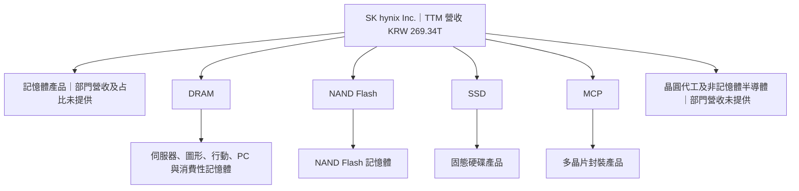
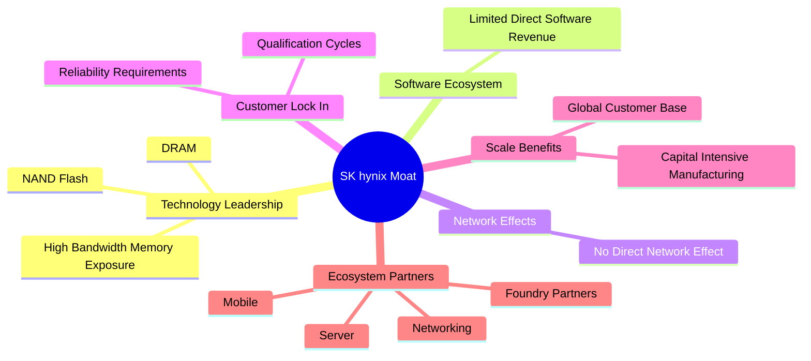
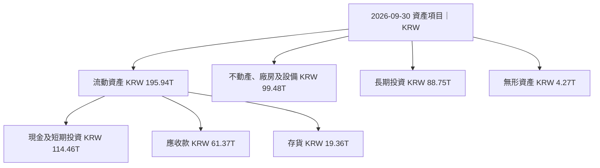
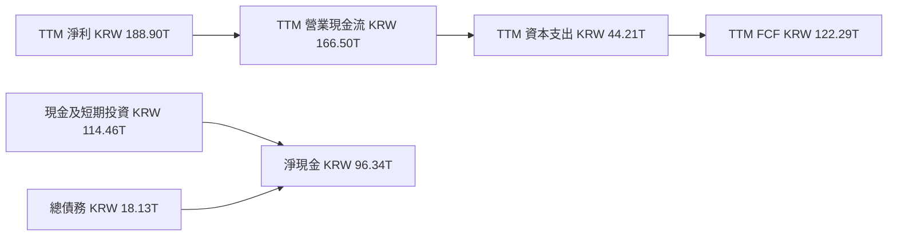
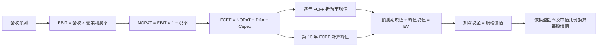
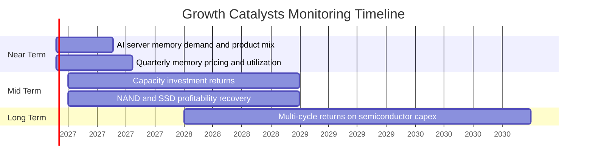
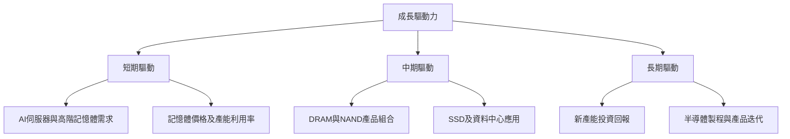
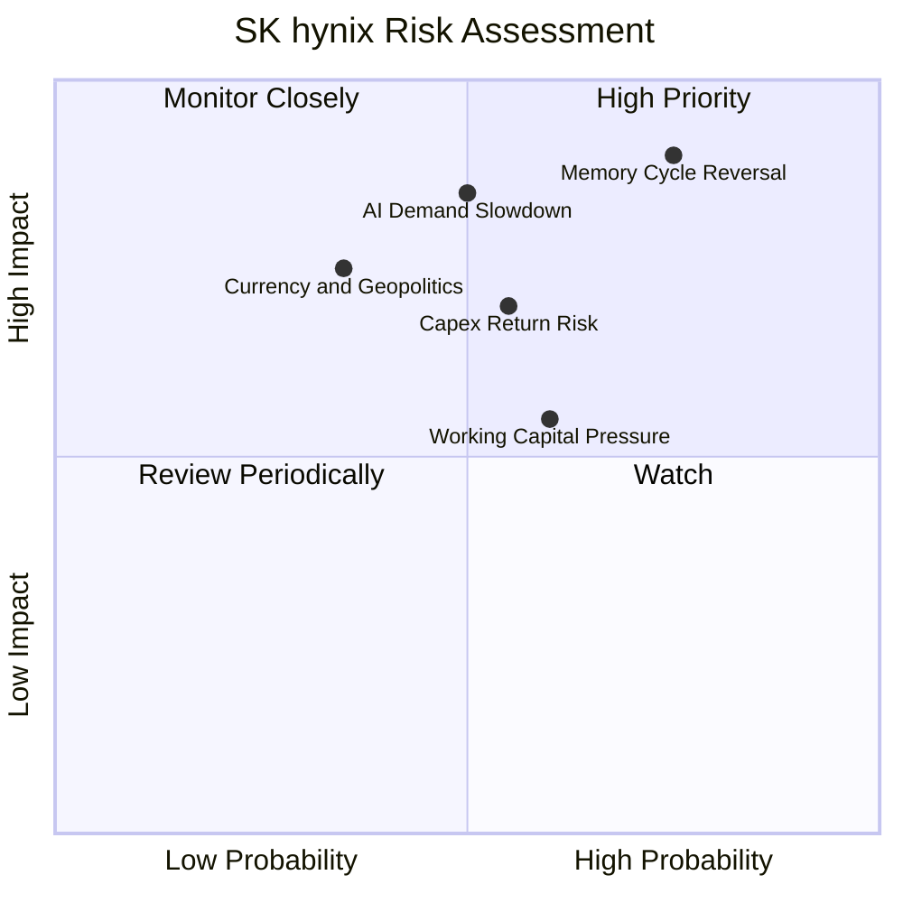
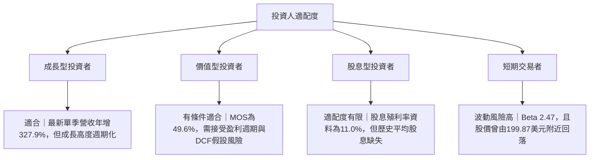

# SKHY 基本面深度分析報告
> **報告日期**：2026-11-23 ｜ **語言**：繁體中文 ｜ **數據來源**：Yahoo Finance、Finviz、StockAnalysis、Roic.ai ｜ **分析師**：CFA 級機構研究

## 目錄

| # | 章節 | 核心結論 |
|---|------|----------|
| 1 | 執行摘要 | 買入；加權合理價值 $205.37；MOS +49.6% |
| 2 | 公司概覽與商業模式 | DRAM、NAND 與 SSD 業務具技術及規模優勢，但市場份額數據未提供 |
| 3 | 損益表深度分析 | TTM 營收 KRW 269.34T；最新一季營收年增 327.9%，週期性利潤率處於高檔 |
| 4 | 資產負債表分析 | 淨現金 KRW 96.34T；最新 TTM CCC 為 203 天 |
| 5 | 現金流量深度分析 | TTM FCF KRW 122.29T，FCF Yield 12.54% |
| 6 | 獲利能力與資本效率 | WACC 採 14.00%；最新 ROIC 缺資料，無法正式判定利差 |
| 7 | 相對估值分析 | 相對同業倍數及分析師共識均指向高於現價，但週期高峰風險明顯 |
| 8 | DCF 內在價值評估 | 基準 DCF $268.16；加權合理價值 $205.37；估值高度仰賴長期假設 |
| 9 | 成長催化劑 | AI／伺服器記憶體需求與產品組合是主要催化劑；TAM 數據未提供 |
| 10 | 風險矩陣 | 記憶體價格反轉、資本支出及 AI 需求不確定性為主要風險 |
| 11 | 投資建議 | 買入；以分批布局及季度監控週期、利潤率、現金流為宜 |

---

## 1. 執行摘要

### 1.0 一頁式投資儀表板

| 項目 | 內容 |
|------|------|
| **投資論點（3 句）** | ① TTM 營收 KRW 269.34T，最新單季營收年增 327.9%，反映記憶體需求及產品組合快速改善。② TTM FCF 為 KRW 122.29T、FCF Yield 12.54%，且淨現金 KRW 96.34T，提供擴產及景氣下行緩衝。③ 估值上，DCF 基準 $268.16、加權合理價值 $205.37，惟 DCF 依賴高利潤率持續及終值假設。 |
| **綜合評分** | **6.8/10**（引用 1.1 評分卡） |
| **財務健康** | 🟢 現金及短期投資 KRW 114.46T、總債務 KRW 18.13T，淨現金 KRW 96.34T。 |
| **ROIC vs WACC** | ROIC：N/A；WACC：14.00%。因最新 ROIC 缺資料，無法確認目前是否創造正經濟利差。 |
| **FCF 趨勢** | 2022–2025 年度 FCF 從 KRW -4.97T 回升至 KRW 24.79T；最新 TTM FCF KRW 122.29T，FCF Yield 12.54%。 |
| **估值** | Forward P/E 2.50x；EV/EBITDA：N/A（報價與財報幣別不同，未提供可直接比較值）；FCF Yield 12.54%。 |
| **DCF 內在價值（基準）** | $268.16；現價相對 DCF 折價 **61.4%**，即折溢價 = $103.57 ÷ $268.16 − 1。 |
| **安全邊際（MOS）** | **+49.6%**＝($205.37 − $103.57) ÷ $205.37；基準為 8.8 加權合理價值。🟢 MOS >25%。 |
| **預期報酬（基準情境 12M）** | N/A（未提供 12 個月獨立模型目標價；10 年基準 DCF 的 +158.9% 不等同 12 個月報酬）。 |
| **關鍵風險（前二）** | 記憶體價格及供需反轉；AI 投資或高階記憶體需求不及預期。 |
| **評級 + 信心度** | 🟢 **買入** ｜ 信心：中。MOS 對應買入區間；但 ROIC 未提供，且 DCF 對週期高峰獲利的外推幅度較大。 |

### 1.1 綜合評分卡（全報告唯一）

| 維度 | 評分（1–10） | 主要依據（引用數字與其來源章節） |
|------|--------------|----------------------------------|
| 成長性 | 8.0 | 最新一季營收年增 327.9%；TTM 成長率依指定指標為 N/A（第 3 章）。 |
| 獲利能力 | 8.0 | TTM 營業利益率 74.5%、FCF KRW 122.29T；最新 ROIC 與 F-Score 為 N/A（第 3、5、6 章）。 |
| 財務健康 | 8.0 | 淨現金 KRW 96.34T、流動比率 3.115；CCC 203 天，營運資金佔用仍高（第 4 章）。 |
| 估值 | 6.0 | MOS +49.6%，但 DCF 基準價與同業倍數回推值差距大，且週期景氣可能造成盈餘高峰偏誤（第 7、8 章）。 |
| 護城河 | 7.0 | DRAM、NAND、SSD 產品線及半導體製造規模可形成進入障礙；市場份額及各業務營收拆分未提供（第 2 章）。 |
| 管理層與資本配置 | 4.0 | FY2025 資本支出 KRW 28.58T、股息支出 KRW 1.68T；回購資料未提供，股權薪酬 TTM 亦無完整數據（第 5 章）。 |
| **綜合評分** | **6.8** | 六項算術平均：(8.0 + 8.0 + 8.0 + 6.0 + 7.0 + 4.0) ÷ 6 = 6.833，四捨五入為 6.8。 |

### 1.2 五大投資論點 + 三大核心風險

| 類型 | 項目 | 具體依據 | 信心度 |
|------|------|----------|--------|
| 🟢 **投資論點①** | AI／伺服器記憶體需求帶動營收 | 最新單季營收 KRW 104.62T，年增 327.9%；高成長反映需求及產品價格／組合改善，但單季增速不宜直接當作 TTM 成長率。 | 🟢 高 |
| 🟢 **投資論點②** | 營業槓桿顯著 | TTM 營業利益率 74.5%；最新一季營業利益 KRW 83.33T、營收 KRW 104.62T，獲利轉換極高。若售價或產能利用率回落，反向槓桿也會放大。 | 🟢 高 |
| 🟢 **投資論點③** | 現金流與資產負債表緩衝充足 | TTM FCF KRW 122.29T、現金及短期投資 KRW 114.46T、總債務 KRW 18.13T。可支應資本投資並承受景氣回落。 | 🟢 高 |
| 🟢 **投資論點④** | 相對估值低於同業倍數中位數 | Forward P/E 為 2.50x，低於同業中位數 2.8x；但低倍數可能反映市場預期高峰盈餘不可持續。 | 🟡 中 |
| 🟢 **投資論點⑤** | 現價低於模型及共識價值 | 加權合理價值 $205.37，較現價 $103.57 高 98.3%；分析師共識均值 $259.50。估值結論高度依賴盈利持續性。 | 🟡 中 |
| 🟡 **風險①** | 記憶體週期反轉 | FY2023 營收年減 26.57%，營業利益轉為 KRW -7.73T，說明價格／供需變化能使盈利快速反轉。 | 🔴 高衝擊 |
| 🔴 **風險②** | 高峰利潤率難以維持 | DCF 以 TTM 營業利益率 74.5% 作為第一年起點，再降至第十年 35.5%；若短期即回落，DCF 價值會下降。 | 🔴 高衝擊 |
| 🟡 **風險③** | 高資本需求與營運資金壓力 | TTM Capex KRW 44.21T、CCC 203 天；擴產及存貨週轉會消耗現金，需求不如預期時可能形成產能及庫存風險。 | 🟡 中至高 |

### 1.3 快速統計卡片

| 指標 | 公司實際值（期間） | 同業中位數 | 狀態 |
|------|--------------------|------------|------|
| 營收成長（TTM） | **N/A** | — | 🟡 未提供可引用的 TTM 比較值 |
| 營收成長（最新一季年增） | **327.9%** | 377.9% | 🟢 高成長、低於同業中位數 |
| 毛利率（TTM） | **77.4%** | 80.0% | 🟢 高，但低於同業中位數 |
| 營業利益率（TTM） | **74.5%** | — | 🟢 高峰水準，需防週期回落 |
| ROIC（TTM） | **N/A** | — | 🟡 缺最新 ROIC |
| Forward P/E | **2.50x** | 2.8x | 🟢 低於同業中位數 |
| FCF Yield（TTM） | **12.54%** | — | 🟢 現金流收益率高 |
| Piotroski F-Score | **N/A** | — | 🟡 缺兩個相隔一年的 SEC TTM 期間數據 |

### 1.4 投資結論

```text
╔══════════════════════════════════════════════════════════════════╗
║                    📊 投資結論摘要                               ║
╠══════════════════════════════════════════════════════════════════╣
║  評級：買入（依 MOS 規則；未作質化調整）                         ║
║  價格（2026-11-20 收盤）：$103.57                                ║
║  DCF 內在價值（基準）：$268.16（折價 61.4%）                    ║
║  安全邊際 MOS：+49.6%（以加權合理價值為分母）                   ║
║  加權合理價值（8.8）：$205.37                                    ║
║  DCF 情境價值：                                                   ║
║    悲觀情境：$129.87（+25.4%）                                   ║
║    基準情境：$268.16（+158.9%）                                  ║
║    樂觀情境：$527.52（+409.3%）                                  ║
║  綜合評分：6.8/10（引用 1.1）                                    ║
║  適合投資人：能承受半導體週期波動、分批持有的成長／價值型投資人  ║
╚══════════════════════════════════════════════════════════════════╝
```

## 2. 公司概覽與商業模式

### 2.1 業務結構與收入來源

公司總營收採最新 TTM KRW 269.34T（約 USD 201.78B）。現有資料列出 DRAM、NAND Flash、SSD、MCP，以及晶圓代工／非記憶體半導體業務，但未提供各產品的營收、占比或服務收入拆分，因此不以推估值繪製比例圖。



### 2.2 市場份額

市場份額數據未提供，故不以未經證實的比例製作圖表。可觀察到 SK hynix TTM 營收約 USD 201.78B、最新一季營收年增 327.9%；同一來源的 Micron、SanDisk、Western Digital 最新季營收年增中位數為 377.9%，SK hynix 成長快速但低於該中位數。

### 2.3 競爭護城河分析



### 2.4 護城河強度

| 護城河項目 | 強度 | 證據（引用數字或事實） | 會削弱它的情況 |
|------------|------|------------------------|----------------|
| 技術與產品能力 | 中至強 | DRAM、NAND、SSD、MCP 多產品線；TTM 毛利率 77.4%。產品別營收及技術市占未提供。 | 競爭者追上製程、良率或高階記憶體性能。 |
| 規模效應 | 強 | FY2025 營收 KRW 97.15T，TTM 營收 KRW 269.34T，需大量資本與製造經驗。 | 產能過剩、製程轉換失敗或擴產回報下降。 |
| 客戶驗證及切換成本 | 中 | 產品服務伺服器、網路、行動及 PC 客戶；客戶集中度與合約資料未提供。 | 客戶多源採購、降價或重新認證替代產品。 |
| 軟體生態系統 | 弱 | 財務資料未顯示獨立軟體收入或軟體平台效應。 | 競爭者提供更完整的系統級解決方案。 |
| 網路效應 | 弱 | 半導體產品主要由性能、成本及供應能力競爭，直接網路效應證據不足。 | — |
| 生態夥伴 | 中 | 覆蓋伺服器、網路、行動等應用市場；夥伴營收與合作規模未提供。 | AI／資料中心投資放緩或客戶轉向其他供應商。 |

護城河評分 **7.0/10** 的依據是規模、技術及客戶驗證帶來進入障礙；但市場份額、產品組合與客戶集中度數據缺失，故不給更高評價。

## 3. 損益表深度分析

### 3.1 年度收入成長趨勢（近 4 年）

營收單位為 KRW 兆。成長率引用年度財報列示值；圖中長條僅按各年度營收大小呈現。

```text
╔══════════════════════════════════════════════════════════════════╗
║              SK hynix 年度收入趨勢（FY2022–FY2025）              ║
╠══════════════════════════════════════════════════════════════════╣
║  FY2022  KRW 44.62T  ████████████░░░░░░░░░░░░  基期              ║
║  FY2023  KRW 32.77T  █████████░░░░░░░░░░░░░░░  YoY -26.57% 🔴    ║
║  FY2024  KRW 66.19T  ██████████████████░░░░░░  YoY +102.02% 🟢   ║
║  FY2025  KRW 97.15T  ████████████████████████  YoY +46.76% 🟢    ║
║                                                                  ║
║  FY2022–FY2025 CAGR：約 29.6%                                    ║
╚══════════════════════════════════════════════════════════════════╝
```

FY2023 營收下滑伴隨營業虧損，顯示記憶體景氣具有高週期性；FY2024–FY2025 營收回升，營業利益率由負轉正並擴張，代表價格、產能利用率與產品組合可能同步改善，但不能把反彈期增速視為長期常態。

### 3.2 季度收入趨勢分析

金額為 KRW 兆。QoQ 以相鄰季度收入計算；YoY 採各單季對上一年同季成長率。TTM 營收成長仍依指定資料為 N/A。

| 季度 | 營收 | QoQ | 單季 YoY | 備註 |
|------|------:|----:|---------:|------|
| 2025 Q3 | 24.45 | — | 39.13% | 同比基期 |
| 2025 Q4 | 32.83 | +34.3% | 66.07% | 復甦延續 |
| 2026 Q1 | 52.58 | +60.2% | 198.07% | 成長加速 |
| 2026 Q2 | 79.32 | +50.9% | 256.78% | 規模快速擴大 |
| 2026 Q3 | 104.62 | +31.9% | 327.89% | 最新季；年增率不是 TTM 成長率 |

### 3.3 利潤率演變分析

年度比率以各年損益表項目除以同年度營收計算，四捨五入至一位小數。

| 利潤率指標 | FY2022 | FY2023 | FY2024 | FY2025 | 趨勢 | 評估 |
|------------|-------:|-------:|-------:|-------:|------|------|
| **毛利率** | 35.0% | -1.6% | 48.1% | 60.4% | 低谷後大幅反彈 | 🟢 復甦明顯 |
| **營業利益率** | 15.3% | -23.6% | 35.5% | 48.6% | 隨景氣及營運槓桿回升 | 🟡 高度週期性 |
| **淨利率** | 5.0% | -27.8% | 29.9% | 44.2% | 由虧損轉為高獲利 | 🟡 應留意稅項及非營業項目 |

**利潤率演變深度解析：**FY2023 毛利率降至 -1.6%、營業利益率降至 -23.6%，反映產業低迷時固定成本難以吸收；其後毛利率及營業利益率快速回升，可能由價格回升、產能利用率提高及高階產品組合改善共同推動。現有資料沒有各產品價格、出貨量或成本拆解，因此無法量化個別驅動因素。TTM 營業利益率 74.5% 顯著高於 FY2025 的 48.6%，不可視為已驗證的中週期利潤率。

### 3.4 費用結構分析

未提供完整 TTM 研發、銷管、製造費用與各項費用明細，無法製作代表完整費用結構的圓餅圖。FY2025 研發費用為 KRW 6.47T；營收 KRW 97.15T，但研發以外營業費用拆分未提供。

### 3.5 季度 EPS 趨勢與盈餘品質（Quality of Earnings）

近四季 EPS 預估值及實際值資料缺失；EPS Beat/Miss 區塊僅有 2026 Q2、Q3 且 EPS Est、EPS Act 均為空值，不能判定超預期或不及預期。季度淨利可見 2026 Q2 為 KRW 93.82T、Q3 為 KRW 39.53T，Q3 QoQ 下跌 57.9%；季度淨利波動大於營收，需追蹤非營業項目、稅項及週期變化。

| 盈餘品質項目 | 數值／佔比 | 評估 |
|--------------|-----------|------|
| 股權薪酬 SBC / 營收 | TTM N/A；FY2025 SBC KRW 0.414T ÷ 營收 KRW 97.147T = 0.43% | 🟢 FY2025 比例低；但最新 TTM 季度有缺值，不能外推 |
| SBC / 營業現金流 | TTM N/A；FY2025 KRW 0.414T ÷ KRW 53.37T = 0.78% | 🟢 FY2025 對現金流影響有限 |
| FCF / 淨利（現金轉換率） | TTM KRW 122.29T ÷ TTM 淨利 KRW 188.90T = 64.7% | 🟡 有現金流支撐，但不是全額淨利轉現 |
| 一次性／非經常性損益 | N/A（未提供明細） | 🟡 無法判斷季度淨利波動是否含重大一次性項目 |
| 有效稅率異常 | 最新年度有效稅率 14.9% | 🟡 低於常見法定稅率區間的可能性需再核實；不可僅據此認定稅務利益 |
| 資本化支出 vs 費用化 | TTM Capex KRW 44.21T；研發 FY2025 KRW 6.47T | 🟡 資本支出反映半導體資產密集性；資本化及折舊政策明細未提供 |

**盈餘品質結論：**TTM FCF 對淨利轉換率約 64.7%，且 FY2025 SBC 占比低，支持獲利有一定現金含量；但 TTM SBC 缺一季資料、非經常性項目明細缺失，加上營業利益率處於高位，應採中週期盈利而非單季高峰作估值基礎。

## 4. 資產負債表分析

### 4.1 資產結構分解

FY2025 年末總資產 KRW 176.11T；截至 2026-09-30 的 TTM 資產項目另列於 Yahoo 季度資產負債表，為避免不同期間拼接，以下只列可引用的 2026-09-30 資產明細，未提供該期總資產，不畫總額比例。



### 4.2 流動性與營運資金分析

流動比率 3.115、速動比率 2.794，顯示短期流動性充足。週轉天數只提供最新 TTM 數據；一年前數值缺失，故變化無法計算。

| 指標 | 最新 TTM | 一年前 TTM | 變化 | 解讀 |
|------|----------|------------|------|------|
| DSO 應收帳款天數 | 80 天 | N/A | N/A | 應收週轉占用約 80 天；無去年同期比較 |
| DIO 存貨天數 | 143 天 | N/A | N/A | 存貨週轉天數偏長，需求反轉時有庫存減值風險 |
| DPO 應付帳款天數 | 20 天 | N/A | N/A | 對供應商付款天數較短；缺少同業及歷史比較 |
| CCC 現金轉換週期 | 203 天 | N/A | N/A | DSO + DIO − DPO = 203 天；營運資金占用值得追蹤 |

### 4.3 債務結構分析

Debt/EBITDA 與利息保障倍數沒有可在同一幣別及期間下直接使用的數據，不推算未提供比率。

```text
╔══════════════════════════════════════════════════════════════════╗
║                   SK hynix 債務健康診斷                          ║
╠══════════════════════════════════════════════════════════════════╣
║  總債務：              KRW 18.13T（≈ USD 13.58B）                ║
║  現金及短期投資：      KRW 114.46T（≈ USD 85.76B）               ║
║  淨現金：              KRW 96.34T（≈ USD 72.17B） 🟢             ║
║  流動比率：            3.115x 🟢                                 ║
║  速動比率：            2.794x 🟢                                 ║
║  Debt/EBITDA：         N/A（未提供同幣別可比數據）               ║
║  Interest Coverage：   N/A（利息費用明細不足）                   ║
╚══════════════════════════════════════════════════════════════════╝
```

### 4.4 股東權益趨勢

```text
╔══════════════════════════════════════════════════════════════════╗
║                   歷年股東權益變化（KRW 兆）                      ║
╠══════════════════════════════════════════════════════════════════╣
║  FY2022  63.27  █████████████░░░░░░░░░░                          ║
║  FY2023  53.50  ███████████░░░░░░░░░░░                           ║
║  FY2024  73.90  ███████████████░░░░░                              ║
║  FY2025 120.52  █████████████████████████                         ║
╚══════════════════════════════════════════════════════════════════╝
```

FY2023 權益下降與當年 KRW 9.11T 淨虧損相符；FY2024–FY2025 隨獲利復甦而增加。2026-09-30 股東權益未提供於完整可核對欄位，故不延伸外推。

## 5. 現金流量深度分析

### 5.1 現金流量瀑布圖

單季／TTM 淨利與現金流不是同一個期間口徑，以下以 TTM 營業現金流、資本支出與 FCF 呈現；股息及回購未提供完整 TTM 資料，不畫數值。



### 5.2 FCF 轉換率趨勢

| 年度 | FCF（KRW T） | 淨利（KRW T） | FCF / 淨利 | 評估 |
|------|-------------:|-------------:|-----------:|------|
| 2022 | -4.97 | 2.23 | -223.0% | 🔴 景氣與資本支出週期下現金流為負 |
| 2023 | -4.50 | -9.11 | 49.4% | 🟡 分子、分母皆負，比例解讀有限 |
| 2024 | 13.13 | 19.79 | 66.4% | 🟡 現金流轉正，低於淨利 |
| 2025 | 24.79 | 42.92 | 57.8% | 🟡 獲利增長快於 FCF |
| TTM 至 2026-09-30 | 122.29 | 188.90 | 64.7% | 🟡 FCF 規模大，但現金轉換並非 100% |

### 5.3 自由現金流趨勢

```text
╔══════════════════════════════════════════════════════════════════╗
║                    歷年 FCF（KRW 兆）                            ║
╠══════════════════════════════════════════════════════════════════╣
║  FY2022  -4.97  ◀██░░░░░░░░░░░░░░░░░░                            ║
║  FY2023  -4.50  ◀██░░░░░░░░░░░░░░░░░░                            ║
║  FY2024  13.13  ███████░░░░░░░░░░░░░                              ║
║  FY2025  24.79  █████████████░░░░░░░                              ║
║  TTM     122.29 █████████████████████████                         ║
║                                                                  ║
║  TTM FCF Yield：12.54%                                           ║
╚══════════════════════════════════════════════════════════════════╝
```

FY2022–FY2023 FCF 為負，之後隨營業現金流回升而轉正；TTM FCF 大幅升高，但資本支出亦達 KRW 44.21T，反映擴產仍消耗大量現金。FCF Yield 12.54% 是現金流相對市值的指標，不代表其可在週期高峰永久維持。

### 5.4 資本配置評估

精確的資本配置占比（回購、投資、Capex、股息、留存）未完整提供，不製作比例圖。已知 FY2025 Capex 為 KRW 28.58T、股息支付 KRW 1.68T；回購金額資料未提供。

| 項目 | 可引用數據 | 評估 |
|------|-----------|------|
| 資本支出 | FY2025 KRW 28.58T；TTM KRW 44.21T | 🟡 產業需要持續投資，應監控新增產能回報 |
| 股息 | FY2025 KRW 1.68T | 🟡 有現金回饋，但占現金流比例未作跨幣別推算 |
| 回購 | N/A | 缺資料，不能評估回購及股數管理 |
| 留存現金 | 現金及短期投資 KRW 114.46T | 🟢 提供財務彈性 |

## 6. 獲利能力與資本效率

### 6.1 ROE / ROA / ROIC 趨勢

| 指標 | 最新數值 | 歷史／補充 | 評估 |
|------|----------|-------------|------|
| ROE | TTM 92.5% | FY2025 資產負債表及淨利顯示獲利高，但 DuPont 官方品質數據為 N/A | 🟡 景氣高峰可能拉高 ROE |
| ROA | TTM 46.4% | FY2025 淨利 KRW 42.92T | 🟡 盈利能力高，週期可持續性待驗證 |
| ROIC | N/A | Roic.ai 有較早歷史資料，但無最新 TTM 可比值 | 🟡 無法與 WACC 作同期間定量比較 |

行業均值數據未提供，不列行業比較欄。ROIC 與 WACC 的差額不可用 ROE 或 ROA 代替。

### 6.2 ROIC vs WACC 分析（核心價值創造判斷）

```text
╔══════════════════════════════════════════════════════════════════╗
║                ROIC vs WACC 深度分析                            ║
╠══════════════════════════════════════════════════════════════════╣
║  WACC（採用值）：14.00%                                          ║
║  ├── 無風險利率（10Y 美債）：4.91%                               ║
║  ├── 市場風險溢酬 ERP：5.00%                                     ║
║  ├── 原始 Beta：2.47；調整後 Beta：1.98                          ║
║  ├── 股權成本（資料列示）：14.80%                                ║
║  ├── 稅前債務成本：5.10%；稅率：14.9%                            ║
║  ├── 股權／債務權重：98.2%／1.8%                                 ║
║  ├── 未截限計算值：14.61%；依 7%–14% 區間採用 14.00%             ║
║  ├── ROIC（最新 TTM）：N/A                                       ║
║  └── EVA = ROIC − WACC：N/A                                      ║
║                                                                  ║
║  結論：營業獲利及 ROE 顯示目前盈利能力高，但缺最新 ROIC，         ║
║        不足以判定資本回報是否高於 14.00% 的資本成本。             ║
╚══════════════════════════════════════════════════════════════════╝
```

### 6.3 杜邦三因素分解

N/A（QUALITY FIGURES 未提供 DuPont：缺淨利、營收、總資產或正股東權益的統一計算資料）。因此不重算淨利率、資產週轉率及權益乘數，也不將 ROE 92.5% 代替三因素分解。

### 6.4 財務體質：Piotroski F-Score

**Piotroski F-Score：N/A。** 需要相隔一年的兩個 TTM 期間及 SEC 申報資料，現有來源資料不足。

| 測試 | 結果 | 解讀 |
|------|------|------|
| 淨利為正 | N/A | 缺符合要求的兩期測試結果 |
| 營業現金流為正 | N/A | 缺兩期標準化測試結果 |
| ROA 改善 | N/A | 缺兩期可比數據 |
| 現金流高於淨利 | N/A | 缺兩期 F-Score 原始測試結果 |
| 槓桿下降 | N/A | 缺兩期標準化判定 |
| 流動比率改善 | N/A | 缺兩期標準化判定 |
| 股數未稀釋 | N/A | 缺完整可比股份資料 |
| 毛利率改善 | N/A | 缺兩期 F-Score 判定 |
| 資產週轉率改善 | N/A | 缺兩期 F-Score 判定 |

## 7. 相對估值分析

### 7.1 同業估值比較表格

同業倍數依 Yahoo Finance 提供的 Peer multiples。公司自身 P/S、EV/EBITDA 因報價以 USD、財報以 KRW 而不可直接比較，依要求列為 N/A。公司 P/E 來自市場數據；不同來源口徑與同業計算日期可能不同。

| 估值指標 | **SK hynix** | **MU** | **SNDK** | **WDC** | 本公司評估 |
|----------|----------:|---------:|---------:|--------:|-----------|
| **Trailing P/E** | 5.73x | 8.0x | 0.1x | 9.2x | 🟢 低於同業中位數 8.0x；同業極端低值受週期影響 |
| **Forward P/E** | 2.50x | 2.8x | 2.2x | 6.5x | 🟢 低於同業中位數 2.8x |
| **P/S Ratio** | N/A | 5.1x | 3.1x | 6.7x | 🟡 公司值因幣別限制無法比較；同業中位數 5.1x |
| **EV/EBITDA** | N/A | 5.8x | 4.0x | 15.4x | 🟡 公司值因幣別限制無法比較；同業中位數 5.8x |
| **最新單季營收 YoY** | 327.9% | 379.3% | 377.9% | 55.5% | 🟢 高增長，但低於兩家記憶體同業 |
| **毛利率 TTM** | 77.4% | 80.7% | 80.0% | 52.6% | 🟢 高於 WDC、略低於 MU 與 SNDK |

估值偏低不必然代表低估：記憶體公司盈利常在景氣高點放大，低 P/E 可能是市場對未來獲利回落的反映。

### 7.2 歷史估值區間分析

N/A（數據未提供：缺少 Valuation vs own history 的歷史 P/E 區間及目前百分位數）。不以 24 個月股價走勢代替估值歷史區間。

### 7.3 情境價值（Bear / Base / Bull）

情境值及假設均取自 DCF 模型；每股價值為模型結果，不代表可直接觀察到的近期股價目標。

| 情境 | 第 1 年營收成長 | 期末營業利潤率 | WACC | 每股價值 | 相對現價 | 機率 | 會發生的條件 |
|------|----------------:|----------------:|-----:|---------:|---------:|-----:|--------------|
| 🔴 悲觀 | 15.0% | 30.1% | 15.00% | $129.87 | +25.4% | 25% | AI／伺服器需求低於預期，競爭與價格壓力使長期利潤率低於基準 |
| 🟡 基準 | 30.0% | 35.5% | 14.00% | $268.16 | +158.9% | 50% | 短期需求延續，之後成長與利潤率依模型逐步回歸 |
| 🟢 樂觀 | 45.0% | 39.0% | 13.00% | $527.52 | +409.3% | 25% | AI 記憶體需求與產品組合持續強於基準，資本成本下降 |

### 7.4 相對估值隱含價格區間

```text
╔══════════════════════════════════════════════════════════════════╗
║                 每股價值與現價（USD）                            ║
╠══════════════════════════════════════════════════════════════════╣
║  同業 EV/EBITDA   $144.17  ─── 現價 $103.57 ─── 同業 P/S $144.51 ║
║  分析師共識       $259.50                                        ║
║  DCF 基準         $268.16                                        ║
╚══════════════════════════════════════════════════════════════════╝
```

| 方法 | 每股價值 | 相對現價 | 計算依據 |
|------|---------:|---------:|----------|
| 同業 EV/EBITDA | $144.17 | +39.2% | MU、SNDK、WDC 中位數 5.8x × TTM EBITDA，再加淨現金；依估值方法區塊原值 |
| 同業 P/S | $144.51 | +39.5% | 同業 P/S 中位數 5.1x × TTM Revenue；依估值方法區塊原值 |
| 分析師共識 | $259.50 | +150.6% | 14 位分析師目標價均值 |
| DCF 基準 | $268.16 | +158.9% | 10 年 FCFF、WACC 14.00%、永續成長率 3.0% |

## 8. DCF 內在價值評估（Discounted Cash Flow）

### 8.0 估值推理鏈（Thinking Logic）

#### Step 1 — 價值由哪些變數決定？

SK hynix 的模型價值主要由記憶體收入成長、營業利益率及長期資本成本決定；可辨識產品包括 DRAM、NAND、SSD、MCP，但產品別營收占比未提供，不能將個別產品成長拆成可量化價值。基準模型中，TTM 營業利益率 74.5% 為高位起點；最敏感的假設是現金流與利潤率能否延續，而非單一季增長率。

#### Step 2 — 模型選擇

| 決策點 | 本報告採用 | 理由（含數字） | 曾考慮但否決 | 否決理由 |
|--------|-----------|----------------|--------------|----------|
| 現金流定義 | FCFF | 配合 WACC 折現，估得企業價值；模型使用 NOPAT + D&A − Capex | FCFE | 需利息及融資變動的詳細預測，模型未提供 |
| 預測期 N | 10 年 | DCF 模型明列 10 年 | 5 年 | 與既有模型不一致，且無法抄用其估值結果 |
| 終值方法 | Gordon Growth | 模型採永續成長率 3.0% | 退出倍數主估 | DCF 模型沒有提供退出倍數法結果 |
| EBIT 基礎 | GAAP EBIT | 模型明示 GAAP EBIT | 非 GAAP EBIT | 會改變 SBC 處理，且不符合指定模型 |

#### Step 3 — 關鍵假設推導鏈

- **營收成長**：錨點＝最新單季 YoY 327.9%，但 TTM YoY 為 N/A → 單季增幅不可直接長期化，模型將第 1 年限制在 30.0%，再線性降至第 10 年 3.0% → **採用模型列示的 30.0% 至 3.0%** → 曾考慮直接使用 327.9%，因單季年增不具長期外推性而否決。
- **期末營業利益率**：錨點＝TTM 74.5%，FY2025 年度營業利益率約 48.6% → 模型以 TTM 為第一年起點，逐步降至近五年年度中位數口徑所列 35.5% → **第 10 年 35.5%** → 曾考慮維持 74.5%，因週期高峰利潤率難以合理視為終值前常態而否決。
- **永續成長率 g**：錨點＝模型採用 3.0%；長期宏觀成長的實際輸入未提供 → 3.0% 低於 WACC 14.00%，符合公式限制 → **採用 3.0%** → 曾考慮更高 g，因會提高終值敏感度且缺乏可核實的長期產業依據而否決。
- **預測期 N**：錨點＝模型已設定 10 年，半導體產品及資本週期跨多年度 → 採用既有 10 年期預測以保留中期正常化過程 → **N = 10 年** → 曾考慮縮短至 5 年，但會偏離指定模型而否決。
- **Capex／營收**：錨點＝TTM Capex KRW 44.21T ÷ TTM Revenue KRW 269.34T，模型比例列為 16.4% → 以 16.4% 為第 1 年，線性降至第 10 年 6.4% → **採用 16.4% 至 6.4%** → 曾考慮長期維持 16.4%，因模型假設投資強度會逐步正常化而否決。
- **D&A／營收**：錨點＝TTM 模型假設 5.8% → 模型維持固定比例 → **採用 5.8%**。
- **稅率**：錨點＝最新年度有效稅率 14.9% → 模型不額外調整 → **採用 14.9%**。
- **營運資金**：錨點＝最新 CCC 203 天，但未提供模型可用的未來 ΔWC 序列 → DCF 明示未建模營運資金 → **ΔWC 未納入** → 不以估算值填補。
- **SBC／股數**：錨點＝採 GAAP EBIT；模型明示不再額外稀釋股數 → **採組合 (A)：GAAP EBIT、FCFF 不再減 SBC、固定股數** → 避免 GAAP 已扣費用後再次扣 SBC 或重複計算稀釋成本。
- **終值方法**：採 Gordon Growth，使用第 10 年 FCFF 及 g=3.0%；模型未提供退出倍數值，因此不自行補造。
- **WACC**：錨點＝成本資本區塊給出的採用值 14.00%，未截限計算為 14.61% → 按 7%–14% 區間上限採用 14.00% → **採用 14.00%** → 不以自行重算值取代指定折現率。

#### Step 4 — 最脆弱的一環

最脆弱的假設是高峰期營業利益率與營收增長的延續；若需求反轉、長期利潤率低於基準，估值會明顯下降。情境模型中悲觀情境仍為 $129.87，但這不代表實際下檔已被完整封頂。

#### Step 5 — 計算路徑圖



### 8.1 模型假設總表（Model Inputs）

| 假設項目 | 採用值 | 依據／來源 | 敏感度 |
|----------|--------|-------------|--------|
| 預測期長度 N | 10 年 | DCF MODEL 明列 | 🟡 中 |
| 營收成長 | 第 1 年 30.0%，第 10 年 3.0%，線性遞減 | 最新單季 YoY 327.9%，但非 TTM；模型限制最高 30% | 🔴 高 |
| 營業利潤率 | 第 1 年 74.5% → 第 10 年 35.5% | TTM 營業利益率及模型的近五年中位數假設 | 🔴 高 |
| 有效稅率 | 14.9% | 最新年度有效稅率 | 🟢 低 |
| Capex／營收 | 第 1 年 16.4% → 第 10 年 6.4% | TTM 比例起點，模型逐步降至指定長期比例 | 🟡 中 |
| D&A／營收 | 5.8% | TTM 模型假設，持平 | 🟢 低 |
| 營運資金變動 | 未建模 | DCF MODEL 明示 Working capital is not modelled | 🟢 低 |
| EBIT 基礎 | GAAP EBIT | DCF MODEL 指定 | 🟡 中 |
| SBC 處理 | GAAP EBIT 已含 SBC；不再減 SBC | 採組合 (A) | 🟡 中 |
| 年稀釋率 | 0%；固定股數 | 組合 (A)，模型採固定股數 | 🟡 中 |
| 永續成長率 g | 3.0% | DCF MODEL 指定，且低於 WACC | 🔴 高 |
| 終值方法 | Gordon Growth | DCF MODEL 提供；退出倍數未提供 | 🔴 高 |
| WACC | 14.00% | 成本資本輸入；計算值 14.61%，受 7%–14% 區間限制 | 🔴 高 |

**FCFF 定義：**FCFF = NOPAT + D&A − Capex；本模型不含 ΔWC，因模型明示未建模。  
**SBC 防重複扣除：**本模型採用 **(A) GAAP EBIT + 固定股數**，故 SBC 影響已透過 GAAP 費用計入一次。

### 8.2 折現率推導（WACC）

```text
╔══════════════════════════════════════════════════════════════════╗
║                    WACC 推導（折現率）                           ║
╠══════════════════════════════════════════════════════════════════╣
║  股權成本 Ke（採成本資本區塊列示值）：14.80%                     ║
║  ├── 無風險利率 Rf：4.91%                                        ║
║  ├── ERP：5.00%                                                  ║
║  ├── 原始 Beta：2.47                                             ║
║  ├── 調整 Beta：1.98 = ⅔ × 2.47 + ⅓                             ║
║  └── 區塊列示 Ke：14.80%                                         ║
║                                                                  ║
║  債務成本：                                                      ║
║  ├── 稅前 Kd：5.10%                                              ║
║  ├── 有效稅率：14.9%                                             ║
║  └── 稅後 Kd = 5.10% × (1 − 14.9%) = 4.3401%                    ║
║                                                                  ║
║  資本結構：股權 98.2%／債務 1.8%                                 ║
║  ├── 未截限 WACC = 98.2%×14.80% + 1.8%×4.3401% = 14.61%         ║
║  └── 採用 WACC：14.00%（計算值受 7%–14% 區間限制）               ║
╚══════════════════════════════════════════════════════════════════╝
```

**逐步演算：**

1. **Ke（CAPM）**：原始 Beta 2.47 經調整為 1.98；區塊列示 Ke = **14.80%**。以已四捨五入的輸入直接代入為 4.91% + 1.98 × 5.00% = 14.81%；與區塊列示 14.80% 相差 0.01 個百分點，採用區塊原值。
2. **稅前 Kd**：資料列示利息／債務比率為 **5.10%**；利息金額與符合範圍的平均計息負債未提供，不能獨立重算。
3. **稅後 Kd**：5.10% × (1 − 14.9%) = **4.3401%**。
4. **權重**：股權 98.2%，債務 1.8%；合計 98.2% + 1.8% = **100.0%**。權重依成本資本輸入原值；本資料未提供可用來重建權重的股權市值與同範圍期末計息負債明細。
5. **未截限 WACC**：98.2% × 14.80% + 1.8% × 4.3401% = 14.5336% + 0.0781% = 14.6117%，區塊列示 **14.61%**；依 7%–14% 區間採用 **14.00%**。

本報告第 6.2 節與第 8 章一致採用 WACC 14.00%。區塊未列 Rf 日期以外的國別溢酬，也未提供是否加入額外國別風險溢酬；不另行假設。

### 8.3 逐年自由現金流預測（基準情境）

以下沿用 DCF MODEL 原始 **KRW 十億** 數值。因模型數據以 KRW 計、要求的每股價值為 USD，表格不把逐年金額換成美元，避免重複換算或混幣。括號表示負項。

| 項目（KRW 十億） | FY+1 | FY+2 | FY+3 | FY+4 | FY+5 | FY+6 | FY+7 | FY+8 | FY+9 | FY+10 |
|------|------:|------:|------:|------:|------:|------:|------:|------:|------:|-------:|
| 營收 | 350,138.32 | 444,675.67 | 551,397.83 | 667,191.37 | 787,285.82 | 905,378.69 | 1,014,024.13 | 1,105,286.30 | 1,171,603.48 | 1,206,751.59 |
| 營收 YoY | 30.0% | 27.0% | 24.0% | 21.0% | 18.0% | 15.0% | 12.0% | 9.0% | 6.0% | 3.0% |
| 營業利潤率 | 74.5% | 70.2% | 65.8% | 61.5% | 57.1% | 52.8% | 48.5% | 44.1% | 39.8% | 35.5% |
| EBIT（GAAP） | 260,853.17 | 311,990.95 | 362,945.99 | 410,218.08 | 449,900.38 | 478,104.93 | 491,483.37 | 487,763.23 | 466,198.18 | 427,828.34 |
| − 稅 | (38,858.25) | (46,476.04) | (54,066.60) | (61,108.53) | (67,019.85) | (71,221.37) | (73,214.30) | (72,660.12) | (69,447.66) | (63,731.86) |
| = NOPAT | 221,994.92 | 265,514.92 | 308,879.39 | 349,109.54 | 382,880.53 | 406,883.57 | 418,269.07 | 415,103.11 | 396,750.51 | 364,096.48 |
| + D&A | 20,364.52 | 25,862.94 | 32,070.04 | 38,804.75 | 45,789.61 | 52,658.05 | 58,977.01 | 64,284.95 | 68,142.04 | 70,186.30 |
| − Capex | (57,466.92) | (68,034.79) | (78,227.38) | (87,230.86) | (94,171.77) | (98,222.80) | (98,725.83) | (95,311.92) | (87,993.44) | (77,204.93) |
| − ΔWC | 未建模 | 未建模 | 未建模 | 未建模 | 未建模 | 未建模 | 未建模 | 未建模 | 未建模 | 未建模 |
| **= FCFF** | **184,892.52** | **223,343.06** | **262,722.05** | **300,683.44** | **334,498.37** | **361,318.82** | **378,520.25** | **384,076.14** | **376,899.11** | **357,077.85** |
| 折現因子 | 0.877 | 0.769 | 0.675 | 0.592 | 0.519 | 0.456 | 0.400 | 0.351 | 0.308 | 0.270 |
| **FCFF 現值 PV** | **162,186.42** | **171,855.24** | **177,329.90** | **178,028.73** | **173,727.97** | **164,611.99** | **151,270.82** | **134,641.37** | **115,899.47** | **96,319.54** |

預測期現值合計：162,186.42 + 171,855.24 + 177,329.90 + 178,028.73 + 173,727.97 + 164,611.99 + 151,270.82 + 134,641.37 + 115,899.47 + 96,319.54 = **1,525,871.45 KRW 十億**。

**FY+1 逐步演算：**

1. 營收 = 269,337.17 × (1 + 30.0%) = **350,138.32 KRW 十億**（依模型列值）。
2. EBIT = 350,138.32 × 74.5% = **260,853.17 KRW 十億**。
3. 稅 = 260,853.17 × 14.9% = **38,858.25 KRW 十億**。
4. NOPAT = 260,853.17 − 38,858.25 = **221,994.92 KRW 十億**。
5. D&A = **20,364.52 KRW 十億**（模型列值；約為營收的 5.8%）。
6. Capex = **57,466.92 KRW 十億**（模型列值；約為營收的 16.4%）。
7. ΔWC = **未建模**，不以估算值補入。
8. FCFF = 221,994.92 + 20,364.52 − 57,466.92 = **184,892.52 KRW 十億**。
9. 折現因子 = 模型列示 **0.877**；PV 依模型原值為 **162,186.42 KRW 十億**。因折現因子僅顯示三位小數，不用 0.877 反推完整精度 PV。

**合理性自檢：**

- FY+1 至 FY+10 FCFF 由 184,892.52 升至 357,077.85 KRW 十億；模型未提供歷史 TTM FCFF CAGR 的同口徑比較值，故差距為 N/A。
- FY+10 FCFF 利潤率 = 357,077.85 ÷ 1,206,751.59 = **29.6%**；目前 TTM FCF 利潤率 = 122.29 ÷ 269.34 = **45.4%**。同業最佳同口徑 FCFF 利潤率未提供，不能比較。
- 模型各預測年度 FCFF 均為正；但模型未納入營運資金變動，存在現金流高估風險。

```text
╔══════════════════════════════════════════════════════════════════╗
║            自由現金流：歷史實際 vs 模型預測                      ║
╠══════════════════════════════════════════════════════════════════╣
║  FY2023（實）  -4.50T KRW  ◀██░░░░░░░░░░░░░░░░░                 ║
║  FY2024（實）  13.13T KRW  ██████░░░░░░░░░░░░░░                 ║
║  FY2025（實）  24.79T KRW  ████████████░░░░░░                   ║
║  FY+1（預）    184.89T KRW  ████████████████████                ║
║  FY+10（預）   357.08T KRW  █████████████████████████           ║
╠══════════════════════════════════════════════════════════════════╣
║  歷史實際為週期性序列；預測值與 TTM FCF 的口徑及年度化基期不同，  ║
║  不將其直接解讀為可持續的實際增長率。                            ║
╚══════════════════════════════════════════════════════════════════╝
```

### 8.4 終值計算（Terminal Value）

**適用性檢查：**WACC 14.00% vs g 3.0% → WACC > g？✅

| 方法 | 計算式 | 終值 TV（KRW 十億） | TV 現值（KRW 十億） | 佔總 EV |
|------|--------|-------------------:|--------------------:|--------:|
| Gordon Growth | FCFF(FY+10) × (1+g) ÷ (WACC − g) | 3,343,547.12 | 901,901.14 | 37.1% |
| 退出倍數法 | DCF MODEL 未提供 | N/A | N/A | N/A |

**逐步演算：**

1. FY+10 FCFF = **357,077.85 KRW 十億**。
2. 分子 = 357,077.85 × (1 + 3.0%) = **367,790.19 KRW 十億**（模型終值採未四捨五入中間數）。
3. 分母 = 14.00% − 3.0% = **11.00%**；TV = 367,790.19 ÷ 11.00% = **3,343,547.12 KRW 十億**（依模型原值）。
4. PV(TV) = 模型折現後 **901,901.14 KRW 十億**。
5. 終值佔比 = 901,901.14 ÷ 2,427,772.59 = **37.1%**。

PV(TV) 依模型原值引用；折現因子只展示三位小數，底層模型使用較高精度。退出倍數法沒有 DCF MODEL 結果及指定退出倍數，不另行估算。

### 8.5 企業價值 → 每股內在價值（Bridge）

```text
╔══════════════════════════════════════════════════════════════════╗
║              企業價值 → 每股內在價值 橋接表                      ║
╠══════════════════════════════════════════════════════════════════╣
║  預測期 FCF 現值合計               +1,525,871.45 KRW 十億        ║
║  終值現值 PV(TV)                     +901,901.14 KRW 十億        ║
║  ─────────────────────────────────────────────                  ║
║  = 企業價值 EV                     2,427,772.59 KRW 十億        ║
║  + 淨現金                              +96,337.19 KRW 十億        ║
║  = 股權價值                         2,524,109.78 KRW 十億        ║
║  每股內在價值（依模型換算）                 $268.16 USD           ║
║  當前股價（2026-11-20 收盤）                $103.57 USD           ║
║  折溢價（現價÷DCF內在價值−1）                 -61.4% 折價          ║
╚══════════════════════════════════════════════════════════════════╝
```

逐步演算：

1. **EV** = 1,525,871.45 + 901,901.14 = **2,427,772.59 KRW 十億**。
2. **股權價值** = EV 2,427,772.59 + 淨現金 96,337.19 = **2,524,109.78 KRW 十億**。
3. **每股內在價值**依 DCF MODEL 原式：股權價值 × FX 0.000749181 USD/KRW × 價格 ÷ USD 市值 = **$268.16**。此模型採市值比例換算，並非一般單純股權價值除股數的橋接方式。
4. **折溢價** = $103.57 ÷ $268.16 − 1 = **−61.4%**。
5. **本節不計算 MOS**；MOS 只在 8.8 以加權合理價值為分母計算。

股權價值橋接採 DCF MODEL 所列淨現金 KRW 96,337.19B；公司財報淨現金亦列 KRW 96.34T。模型採用其內部 FX 0.000749181 USD/KRW；與 2026-11-20 市場匯率換算因基礎定義不同，依規則引用模型原式，不改動每股價值。

### 8.6 敏感性分析（WACC × 永續成長率）

下表每格採 DCF MODEL 原始每股價值；括號內相對現價上行空間按「價值 ÷ 現價 − 1」計算。基準格為 WACC 14.00%、g 3.0%。

| g／WACC | 12.00% | 13.00% | **14.00% 基準** | 15.00% | 16.00% |
|---|---:|---:|---:|---:|---:|
| 2.0% | $312.38（+201.6%） | $283.44（+173.7%） | $259.33（+150.4%） | $238.93（+130.7%） | $221.46（+113.8%） |
| 2.5% | $319.58（+208.6%） | $288.91（+179.0%） | $263.55（+154.5%） | $242.25（+133.9%） | $224.10（+116.4%） |
| **3.0% 基準** | $327.58（+216.3%） | $294.92（+184.8%） | **$268.16（+158.9%）** | $245.84（+137.4%） | $226.94（+119.1%） |
| 3.5% | $336.52（+224.9%） | $301.57（+191.2%） | $273.21（+163.8%） | $249.75（+141.1%） | $230.01（+122.1%） |
| 4.0% | $346.58（+234.6%） | $308.95（+198.3%） | $278.77（+169.2%） | $254.01（+145.3%） | $233.34（+125.3%） |

**逐步演算限制：**敏感度矩陣由程式以完整模型計算；DCF MODEL 未提供各敏感度格的年度折現 PV、終值及橋接中間值，且規則要求不得自行重建模型，故不對非基準格作一套假裝可複算的重新演算。

**三情境 DCF（照抄模型情境值）**

| 情境 | 第 1 年營收成長 | 期末營業利潤率 | WACC | 每股內在價值 | 相對現價 | 機率 |
|------|----------------:|----------------:|-----:|--------------:|---------:|-----:|
| 🔴 悲觀 | 15.0% | 30.1% | 15.00% | $129.87 | +25.4% | 25% |
| 🟡 基準 | 30.0% | 35.5% | 14.00% | $268.16 | +158.9% | 50% |
| 🟢 樂觀 | 45.0% | 39.0% | 13.00% | $527.52 | +409.3% | 25% |
| **機率加權** | — | — | — | **$298.43** | **+188.1%** | **100%** |

DCF MODEL 未提供各情境逐年營收、FY+10 FCFF 及 TV 分解，依指定規則不重新推導情境中間數。機率加權算式：$129.87 × 25% + $268.16 × 50% + $527.52 × 25% = **$298.43**（模型原值）。

**敏感度結論：**

- g 由 2.0% 升至 3.0%（WACC 14.00%）：$259.33 → $268.16，增加 **$8.83／3.4%**。
- WACC 由 14.00% 升至 15.00%（g 3.0%）：$268.16 → $245.84，減少 **$22.32／8.3%**。
- 期末營業利潤率每 +1pp 的價值變動：敏感度數據未提供，N/A。
- 在模型已提供的兩個變化中，WACC 變動的影響較大；對營業利潤率的精確彈性不能量化。這與 8.0 指出長期現金流與盈利假設為主要價值驅動一致。

### 8.7 反推 DCF（Reverse DCF：市場在預期什麼）

模型以 2026-11-20 收盤價 $103.57 反推，固定其他基準變數、逐次放開單一變數。模型只解出兩項，其餘列不補估。

| 求解的變數 | 固定／已知設定 | 市場隱含值（令 DCF = 現價） | 參考基準 | 判斷 |
|------------|----------------|------------------------------|----------|------|
| 第 1 年營收成長 | 其餘基準值固定 | 0.3% | 基準 30.0% | 🟢 市場價格隱含非常低的第 1 年成長假設 |
| 固定營業利潤率 | 其餘基準值固定 | 19.1% | 基準路徑 74.5% → 35.5% | 🟢 顯著低於基準路徑 |
| 永續成長率 g | 未計算 | 未計算 | 基準 3.0% | N/A |
| 預測期長度 N | 未計算 | 未計算 | 基準 10 年 | N/A |

固定基準輸入包括 WACC 14.00%、稅率 14.9%、預測期 10 年、模型指定的 Capex 比率及固定股數；ΔWC 未建模。反推模型未附逐級試算軌跡或中間結果，且不能自行另建 DCF，故不能聲稱有獨立收斂驗證。模型含義是：若其他基準假設維持不變，現價只要求極低的第 1 年營收成長或較低的固定營業利潤率；但這不是對市場實際預期的唯一解釋，股價也反映週期、風險及資本成本。

### 8.8 估值三角驗證與安全邊際

| 估值方法 | 隱含每股價值 | 上行空間（÷現價） | 權重 | 說明 |
|----------|--------------:|-------------------:|------:|------|
| DCF（基準） | $268.16 | +158.9% | 40% | 10 年 FCFF、WACC 14.00%、g 3.0% |
| 同業 EV/EBITDA | $144.17 | +39.2% | 30% | MU、SNDK、WDC 同業中位數 5.8x × TTM EBITDA，加淨現金 |
| 同業 P/S | $144.51 | +39.5% | 20% | 同業中位數 5.1x × TTM Revenue |
| 分析師共識目標價 | $259.50 | +150.6% | 10% | 14 位分析師目標價均值 |
| **加權合理價值** | **$205.37** | **+98.3%** | **100%** | 公司類型：週期性公司 |

加權合理價值算式：  
$268.16 × 40% + $144.17 × 30% + $144.51 × 20% + $259.50 × 10%  
= $107.264 + $43.251 + $28.902 + $25.950  
= **$205.367，四捨五入為 $205.37**。

週期性公司權重依程式固定；各方法均有結果，沒有方法因無法計算而剔除。分析師共識作為 10% 參考，不能取代基本面驗證。

```text
╔══════════════════════════════════════════════════════════════════╗
║                  估值區間與安全邊際                              ║
╠══════════════════════════════════════════════════════════════════╣
║  $129.87 ───── $103.57 ───── [$205.37] ───── $268.16 ───── $527.52║
║  悲觀DCF        現價           加權合理值       基準DCF       樂觀DCF║
║                                                                  ║
║  MOS = ($205.37 − $103.57) ÷ $205.37 = +49.6%                   ║
║  MOS 評估：🟢 >25% 充足 ｜ 🟡 10–25% 有限 ｜ 🔴 <10% 無           ║
║  上行空間 = ($205.37 − $103.57) ÷ $103.57 = +98.3%              ║
║                                                                  ║
║  建議買入區間：$103.57–$184.83                                   ║
║  合理持有區間：$184.83–$205.37                                   ║
║  減碼考慮區間：高於 $527.52；此為樂觀情境參考，非保證價位       ║
╚══════════════════════════════════════════════════════════════════╝
```

建議買入區間上限 $184.83 由「加權合理價值 × 90%」計算：$205.37 × 90% = $184.833；區間上限仍高於現價，符合買入評級的區間一致性要求。這是依 MOS 至少 10% 的價格界線，不是額外估值方法。

> 🔎 **程式複算（Python，依本節各項自動重算）**
>
> 加權合理價值 = $268.16 × 40% + $144.17 × 30% + $144.51 × 20% + $259.50 × 10% = **$205.37**（權重合計 100%）
>
> 以價格 $103.57 計：MOS = **+49.6%**，上行空間 = **+98.3%**
>
> ✅ 與本節所寫數值一致。

### 8.9 DCF 模型的局限與失效條件

- **終值依賴度：**PV(TV) 占 EV 37.1%，約三分之一企業價值依賴第 10 年以後假設。
- **最脆弱假設：**第 1 年營收成長採 30.0%，遠低於最新單季 327.9% 卻仍是高成長假設；若增長快速減速，價值下降。悲觀情境每股價值 $129.87，基準為 $268.16。
- **營業利潤率：**模型第一年使用 TTM 74.5%，其後降至 35.5%；若當前 TTM 利潤率是週期高峰，短期回落速度可能快於模型。
- **營運資金：**模型未納入 ΔWC，而最新 CCC 為 203 天；若收入擴張帶來應收與存貨增加，FCFF 可能被高估。
- **週期適用性：**公司過去曾在 FY2023 出現 KRW 9.11T 淨虧損與 KRW -4.50T FCF，單一 DCF 對週期股可靠度有限；相對估值、跨週期利潤率及產能回報應並行參考。
- **風險連結：**記憶體價格下跌會影響營收及營業利潤率；產能利用率下降會削弱毛利及現金流；Capex 回報不佳及 CCC 拉長會壓低 FCFF。

### 8.10 複算檢核表（Audit Trail）

| # | 檢核項目 | 檢查方式 | 結果 |
|---|----------|----------|------|
| 1 | 高／中敏感度輸入均有推導 | 逐項對照 8.0 假設鏈 | ✅ 已列模型可用資料與拒絕替代值 |
| 2 | 每個假設均有來歷 | 對照 8.1 依據欄 | ✅ 有資料來源；未提供者標示未建模 |
| 3 | WACC 五步及算式 | 驗算稅後 Kd、權重及未截限值 | 🟡 CAPM 列示 Ke 與已四捨五入輸入計算差 0.01pp；採區塊原值 |
| 4 | Kd 分母與債務權重範圍一致 | 核對平均計息負債及期末 D | 🟡 原始平均負債拆分未提供，無法獨立核驗 |
| 5 | WACC 與第 6.2 節相同 | 比對採用值 | ✅ 皆為 14.00% |
| 6 | 逐年欄位數等於 N | 核對 FY+1 至 FY+10 | ✅ 共 10 年 |
| 7 | FY+1 FCFF 與 PV | 重算 FCFF；PV 用模型原值 | 🟡 FCFF 可重算；PV 因折現因子僅列三位小數而以模型原值引用 |
| 8 | 預測期 PV 加總 | 十年 PV 加總 | ✅ 合計 1,525,871.45 KRW 十億 |
| 9 | WACC > g | 14.00% > 3.0% | ✅ |
| 10 | 終值使用 FY+10 並折現 10 期 | 核對模型期限及 TV | ✅ 按模型原值 |
| 11 | EV、股權價值橋接 | EV 加淨現金 | ✅ 2,427,772.59 + 96,337.19 = 2,524,109.78 |
| 12 | SBC、EBIT 與股數一致 | GAAP、無額外 SBC 列、固定股數 | ✅ 組合 (A) |
| 13 | 敏感性基準格與 DCF | 比對 14.00%、g 3.0% | ✅ $268.16 |
| 14 | 矩陣格符合 WACC > g | 最低 WACC 12.00% 高於最高 g 4.0% | ✅ 全格有效 |
| 15 | 情境機率合計 | 25% + 50% + 25% | ✅ 100%；加權值引用模型原值 |
| 16 | 反推每列只放開一變數 | 核對模型輸出 | 🟡 模型只提供兩個解，未附疊代軌跡 |
| 17 | MOS 分母及折溢價基準 | MOS 用 $205.37；折溢價用 $268.16 | ✅ |
| 18 | 報告涵蓋至第 11 章 | 核對章節 | ✅ |
| 19 | 加權價值等於加權算式 | 逐項相乘加總 | ✅ $205.367 ≈ $205.37 |
| 20 | 評級符合 MOS 門檻 | MOS +49.6%，但 ROIC N/A | ✅ 買入；未提升為強烈買入，因 ROIC > WACC 未能證明 |

未能獨立重建的項目已保留模型原值或標記缺漏，沒有自行替換 DCF 假設、敏感度矩陣或估值方法權重。

## 9. 成長催化劑

### 9.1 催化劑時間軸

具體產品量產日程、訂單或管理層預測未提供；下列為依公司產品與市場應用形成的監控時間框架，而非公司已承諾的日期。



### 9.2 TAM 市場規模分析

N/A（TAM 數據未提供，缺市場規模的來源與年份）。公司 TTM 營收 KRW 269.34T、最新單季營收年增 327.9%，可證明現階段營收擴張快速，但不能用公司自身營收推算市場總規模或滲透率。

### 9.3 成長驅動力結構圖



## 10. 風險矩陣

### 10.1 風險評分矩陣

以下機率座標為分析師質化判斷，並非財務資料或歷史統計估計；圖表僅用於風險排序。



### 10.2 風險清單詳細分析

| # | 風險項目 | 發生機率 | 財務衝擊 | 風險評分 | 緩解措施 |
|---|----------|----------|----------|----------|----------|
| 1 | 🔴 **記憶體景氣反轉** | 中高（質化） | 高；FY2023 營收年減 26.57%、營業利益 KRW -7.73T | 🔴 高 | 每季追蹤記憶體價格、出貨、庫存及利用率；以跨週期盈利估值 |
| 2 | 🔴 **AI／伺服器需求不及預期** | 中（質化） | 高；模型基準第 1 年成長 30%，悲觀情境價值 $129.87 | 🔴 高 | 監控產品組合、客戶需求及資本支出回報；避免只看單季增速 |
| 3 | 🟠 **高資本支出回報不足** | 中（質化） | 中高；TTM Capex KRW 44.21T | 🟠 中高 | 比較擴產後營收、FCF、折舊及產能利用率 |
| 4 | 🟡 **庫存及營運資金增加** | 中（質化） | 中；DIO 143 天、CCC 203 天 | 🟡 中 | 追蹤 DIO、DSO、庫存減值及現金轉換週期 |
| 5 | 🟡 **財報口徑及估值輸入不完整** | 中（質化） | 中；最新 ROIC、Piotroski、TTM SBC 及 EPS surprise 缺資料 | 🟡 中 | 優先核對公司季報、稀釋股數、稅務及非經常性項目 |

## 11. 投資建議

### 11.1 最終評級與評分

依 8.8 加權合理價值 $205.37 與現價 $103.57 計算，MOS 為 +49.6%，依 MOS 規則評級為 **買入**；未調整一級。雖 MOS 超過 25%，但強烈買入還要求 ROIC 高於 WACC，而最新 ROIC 為 N/A，故不升級為強烈買入。1.1 綜合評分為 **6.8/10**，六項依序為成長性 8.0、獲利能力 8.0、財務健康 8.0、估值 6.0、護城河 7.0、管理層與資本配置 4.0。

### 11.2 合理價值與隱含報酬率

| 估值項目 | 每股價值 | 相對現價 | 機率／權重 |
|----------|---------:|---------:|-----------:|
| 8.8 加權合理價值 | $205.37 | +98.3% | 方法加權 100% |
| 悲觀 DCF 情境 | $129.87 | +25.4% | 25% |
| 基準 DCF 情境 | $268.16 | +158.9% | 50% |
| 樂觀 DCF 情境 | $527.52 | +409.3% | 25% |
| DCF 機率加權參考值 | $298.43 | +188.1% | 100% |

上述 DCF 情境價值是長期模型估值，不應直接等同 12 個月目標價。12 個月獨立合理價值未提供；分析師共識均值為 $259.50，但其時間框架及模型假設未足以替代本報告的長期情境。

### 11.3 買入時機與觸發因素

```text
╔══════════════════════════════════════════════════════════════════╗
║                  ✅ 買入觸發因素 Checklist                      ║
╠══════════════════════════════════════════════════════════════════╣
║  立即／分批布局條件：                                            ║
║  ✅ 現價 $103.57 低於加權合理價值 $205.37                        ║
║  ✅ 最新 TTM FCF KRW 122.29T，FCF Yield 12.54%                   ║
║  ✅ 淨現金 KRW 96.34T，流動比率 3.115                            ║
║                                                                  ║
║  加碼觸發條件：                                                  ║
║  ☐ 下季營收及毛利率維持增長，且 CCC 未持續惡化                   ║
║  ☐ TTM FCF 仍為正，資本支出後現金流改善                         ║
║  ☐ 營業利益率回落幅度與模型正常化路徑相符                       ║
║                                                                  ║
║  減碼／重新評估條件：                                            ║
║  ☐ 記憶體價格下跌伴隨連續季度營收或毛利收縮                     ║
║  ☐ FCF 轉負、存貨天數明顯增加或擴產回報下降                     ║
║  ☐ 估值高於樂觀情境 $527.52，且基本面未同步上修                 ║
╚══════════════════════════════════════════════════════════════════╝
```

### 11.4 投資人適配度分析



### 11.5 每季財報監控清單（Quarterly Watch List）

| 監控項目 | 最新參考值 | 加碼觀察條件 | 減碼／重新評估條件 |
|----------|------------|--------------|--------------------|
| 營收及單季 YoY | 最新單季 KRW 104.62T、YoY +327.9% | 營收保持增長且產品組合改善 | 連續兩季 YoY 低於 0% |
| 營業利益率 | TTM 74.5%；最新季 74.5% | 隨增長維持高於模型正常化路徑 | 較最新 74.5% 收縮超過 15pp 且伴隨需求轉弱 |
| 毛利率 | TTM 77.4% | 穩定或上升 | 連續兩季下滑並伴隨價格下跌 |
| 營業現金流與 FCF | TTM OCF KRW 166.50T；FCF KRW 122.29T | FCF 維持正值且資本支出回報可驗證 | TTM FCF 轉負 |
| Capex | TTM KRW 44.21T | 新增投資帶動產出或現金流 | Capex 上升而營收、FCF 未改善 |
| 存貨及 CCC | DIO 143 天；CCC 203 天 | DIO／CCC 不再惡化 | CCC 持續上升且存貨週轉放慢 |
| 現金及債務 | 淨現金 KRW 96.34T | 維持淨現金及流動性 | 淨現金快速收縮或負債大幅增加 |
| ROIC 與 EPS surprise | 最新 ROIC、近四季 Beat/Miss 均 N/A | 以公司季報補齊後，ROIC 高於 WACC | ROIC 持續低於 14.00% 或 EPS 連續不及預期 |

### 11.6 反面論證：什麼會證明論點錯誤（What Would Change My Mind）

```text
╔══════════════════════════════════════════════════════════════════╗
║              ⚠️ 論點失效條件（Disconfirming Evidence）           ║
╠══════════════════════════════════════════════════════════════════╣
║  本投資論點在下列情況成立時應重新檢視或退出：                    ║
║  ☐ 最新單季營收年增連續兩季低於 0%                               ║
║  ☐ TTM 營業利益率由 74.5% 回落超過 15 個百分點，且需求同步轉弱   ║
║  ☐ TTM FCF 轉負，或營業現金流持續低於資本支出                   ║
║  ☐ 最新 ROIC 確認低於 WACC 14.00%，且不是短暫週期低谷           ║
║  ☐ DIO 高於 143 天且 CCC 高於 203 天並持續惡化                   ║
║  ☐ AI／伺服器記憶體需求無法支撐基準情境，估值落向 $129.87 悲觀值║
╚══════════════════════════════════════════════════════════════════╝
```

> **免責聲明**：本報告為 AI 自動生成，僅供研究參考，不構成投資建議。投資有風險，入市需謹慎。

---

## 資料與來源

| 項目 | 內容 |
|------|------|
| 價格 | 103.57 USD，2026-11-20 收盤（Yahoo Finance 日線） |
| 財務報表 | Yahoo quarterly statements (no SEC filing data)，最新季度 2026-09-30（TTM = four quarters to this date） |
| 有回應的資料來源 | Yahoo Finance、Finviz、StockAnalysis、Roic.ai |
| 未回應的資料來源 | SEC 申報資料 (XBRL) |
| 由程式計算 | TTM 數字、WACC、DCF 模型、估值方法與權重、加權合理價值、MOS、評級門檻、F-Score、杜邦分解、營運資金天數、綜合評分 |
| 撰寫模型 | openai / gpt-6-luna |

> 本區塊由產生報告的程式依實際取得的資料填寫，非模型撰寫。「由程式計算」的數字不是模型的估計；其餘判斷（評分、情境、策略）是模型的分析。
