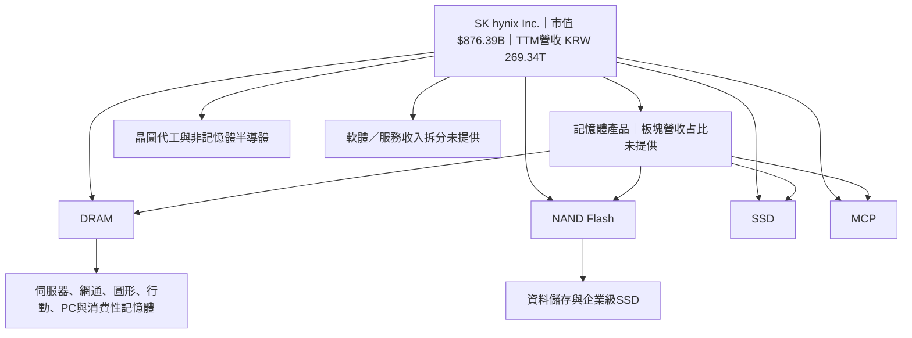
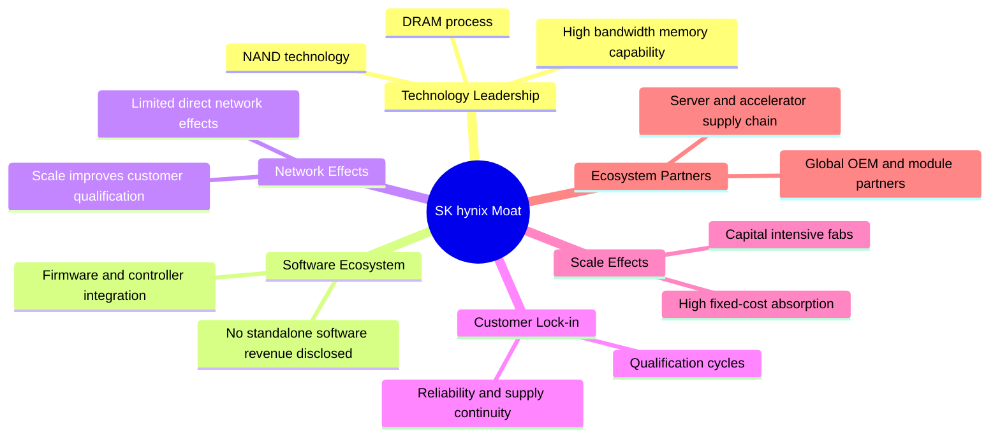
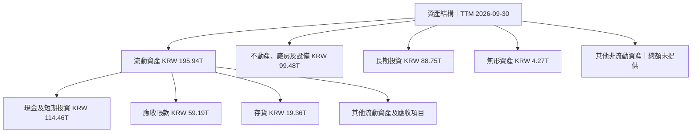
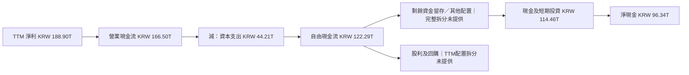
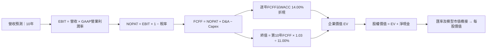
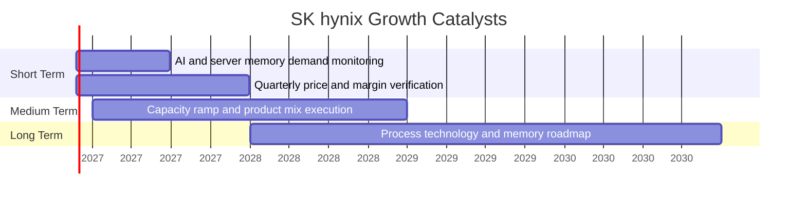
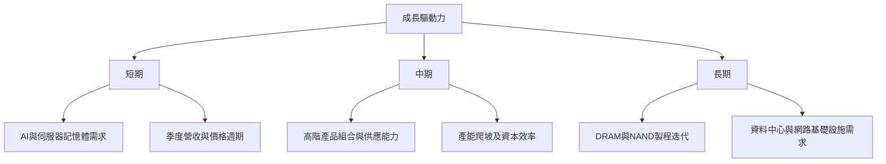
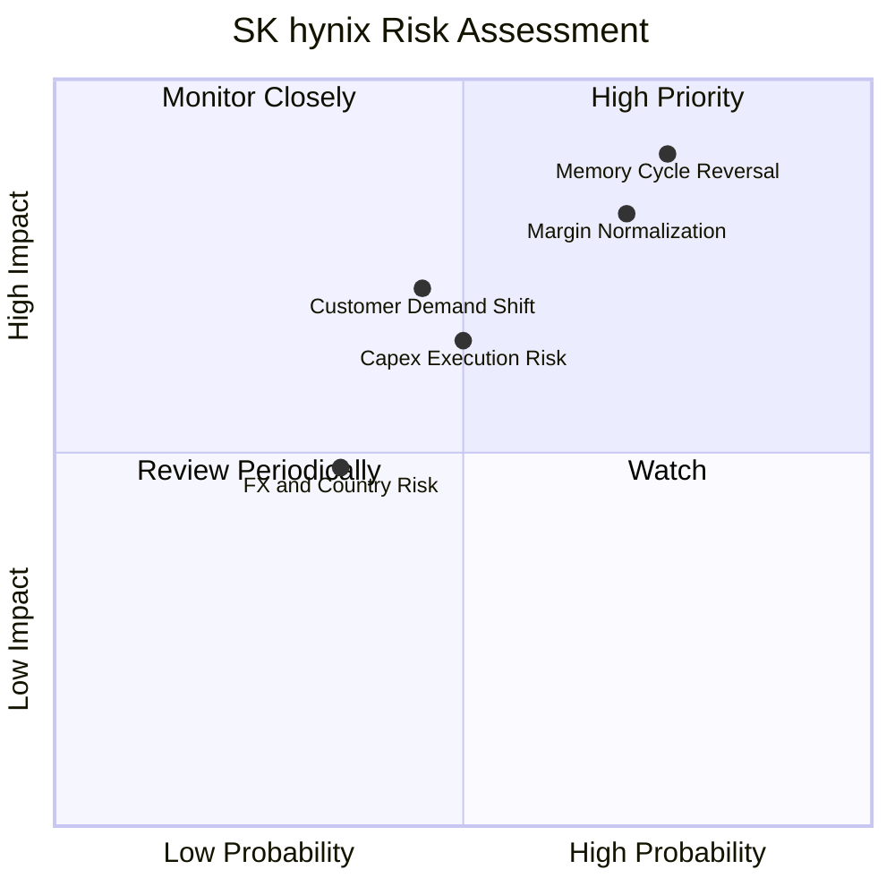
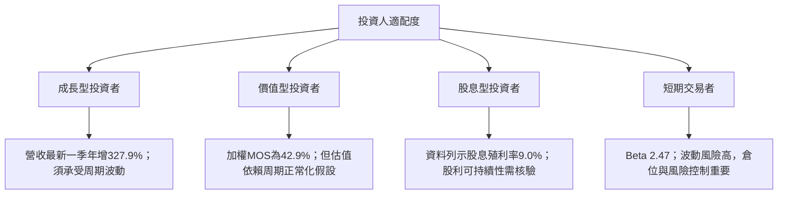

# SKHY 基本面深度分析報告
> **報告日期**：2026-11-24 ｜ **語言**：繁體中文 ｜ **數據來源**：Yahoo Finance、Finviz、StockAnalysis、Roic.ai ｜ **分析師**：CFA 級機構研究

## 目錄

| # | 章節 | 核心結論 |
|---|------|----------|
| 1 | 執行摘要 | 買入；加權合理價值 $217.62，MOS +42.9% |
| 2 | 公司概覽與商業模式 | DRAM、NAND 與 SSD 為核心，技術與規模構成主要護城河 |
| 3 | 損益表深度分析 | TTM 營收 KRW 269.34T；最新一季營收年增 327.9% |
| 4 | 資產負債表分析 | 淨現金 KRW 96.34T，流動性充足；CCC 203 天 |
| 5 | 現金流量深度分析 | TTM FCF KRW 122.29T，FCF Yield 10.38% |
| 6 | 獲利能力與資本效率 | WACC 採 14.00%；TTM ROIC 資料未提供，無法判定價值利差 |
| 7 | 相對估值分析 | 同業倍數估值低於 DCF 基準，分析師共識目標價 $259.50 |
| 8 | DCF 內在價值評估 | 基準 DCF $266.26；估值高度依賴營收成長與利潤率假設 |
| 9 | 成長催化劑 | AI／伺服器記憶體需求為主要成長驅動，TAM 數據未提供 |
| 10 | 風險矩陣 | 週期反轉、估值假設與執行風險為主要風險 |
| 11 | 投資建議 | 買入；分批布局並以利潤率、資本支出和現金流設監控門檻 |

---

## 1. 執行摘要

截至 2026-11-23 收盤，SK hynix 美元報價為 **$124.28**。公司 TTM 營收為 KRW 269.34T，最新一季營收年增 327.9%，TTM 營業利益率 74.5%，TTM FCF 為 KRW 122.29T、FCF Yield 10.38%；現金及短期投資 KRW 114.46T、總債務 KRW 18.13T，淨現金 KRW 96.34T。估值模型給出的 DCF 基準價值為 $266.26，估值方法加權合理價值為 $217.62，MOS 為 +42.9%。依規則 20 的 MOS 門檻，若 ROIC 高於 WACC 應可達強烈買入；但 TTM ROIC 未提供，無法確認該條件，因此採用已計算評級 **買入**，不作額外調整。

### 1.0 一頁式投資儀表板（Portfolio Manager 30 秒速讀）

| 項目 | 內容 |
|------|------|
| **投資論點（3 句）** | ① 最新一季營收年增 327.9%，反映記憶體需求與價格週期顯著上行。② TTM FCF KRW 122.29T、FCF Yield 10.38%，現金流為估值提供支撐。③ 淨現金 KRW 96.34T，但記憶體週期性強，不能把峰值利潤率直接外推。 |
| **綜合評分** | **7.7/10**（引用 1.1 評分卡） |
| **財務健康** | 🟢 淨現金 KRW 96.34T、流動比率 3.115；但 CCC 為 203 天 |
| **ROIC vs WACC** | ROIC：N/A；WACC：14.00%。資料不足，無法判定是否創造超額資本報酬 |
| **FCF 趨勢** | FY2023 為負、FY2024–FY2025 回正；TTM FCF KRW 122.29T，FCF Yield 10.38% |
| **估值** | Forward P/E 3.01x ｜ EV/EBITDA：公司值 N/A（幣別不一致）｜ FCF Yield 10.38% |
| **DCF 內在價值（基準）** | $266.26 ｜ 現價相對 DCF 折價 **−53.3%**（現價 ÷ DCF − 1） |
| **安全邊際（MOS）** | **+42.9%**＝($217.62 − $124.28) ÷ $217.62；🟢 >25% 充足 |
| **預期報酬（基準情境 12M）** | +114.2%（DCF 基準情境；非保證報酬） |
| **關鍵風險（前二）** | 記憶體價格週期反轉；高峰營業利益率無法延續 |
| **評級 + 信心度** | 🟢 **買入** ｜ 信心：中（ROIC 缺漏、週期與估值模型不確定性高） |

### 1.1 綜合評分卡（全報告唯一）

| 維度 | 評分（1–10） | 主要依據（引用數字與其來源章節） |
|------|--------------|----------------------------------|
| 成長性 | 8.5 | 最新一季營收年增 327.9%；TTM 營收年增率 N/A（第 3 章） |
| 獲利能力 | 8.5 | TTM 營業利益率 74.5%、FCF KRW 122.29T；ROIC、F-Score 未提供（第 3、5、6 章） |
| 財務健康 | 8.0 | 淨現金 KRW 96.34T、流動比率 3.115、CCC 203 天（第 4 章） |
| 估值 | 7.5 | MOS +42.9%；DCF 基準價值 $266.26；同業相對估值較低（第 7、8 章） |
| 護城河 | 8.0 | DRAM／NAND 製程、資本密集與客戶認證形成進入門檻；市場份額數據未提供（第 2 章） |
| 管理層與資本配置 | 5.5 | FY2025 資本支出 KRW 28.58T、股利支付 KRW 1.68T；回購與資本回報政策資料有限（第 5 章） |
| **綜合評分** | **7.7** | 六項算術平均：(8.5 + 8.5 + 8.0 + 7.5 + 8.0 + 5.5) ÷ 6 = 7.3 |

### 1.2 五大投資論點 + 三大核心風險

| 類型 | 項目 | 具體依據 | 信心度 |
|------|------|----------|--------|
| 🟢 **投資論點①** | 需求與營收快速擴張 | 最新一季營收 KRW 104.62T，年增 327.9%；季度營收自 2025Q4 KRW 32.83T 增至 2026Q3 KRW 104.62T | 🟢 高 |
| 🟢 **投資論點②** | 高現金流轉換 | TTM OCF KRW 166.50T、Capex KRW 44.21T、FCF KRW 122.29T | 🟢 高 |
| 🟢 **投資論點③** | 資產負債表具防禦力 | 現金及短期投資 KRW 114.46T，債務 KRW 18.13T，淨現金 KRW 96.34T | 🟢 高 |
| 🟢 **投資論點④** | 產品與製程壁壘 | DRAM、NAND、SSD、MCP 產品涵蓋伺服器、網通、行動與 PC；半導體製造需長期資本投入和客戶認證 | 🟡 中 |
| 🟢 **投資論點⑤** | 相對現價具估值緩衝 | 加權合理價值 $217.62，較 $124.28 現價高 75.1%；MOS +42.9% | 🟡 中 |
| 🟡 **風險①** | 記憶體週期反轉 | 歷史年度營收由 FY2022 KRW 44.62T 降至 FY2023 KRW 32.77T，年減 26.57%；周期下行會同步壓縮價格與利潤率 | 🔴 高衝擊 |
| 🔴 **風險②** | 峰值利潤率外推風險 | TTM 營業利益率 74.5%，DCF 假設由 74.5% 線性降至第十年 35.5%；若實際更快收縮，DCF 價值下降 | 🔴 高衝擊 |
| 🟡 **風險③** | 營運資金占用 | CCC 203 天，其中 DSO 80 天、DIO 143 天；若需求轉弱，應收及庫存可能轉化為現金流壓力 | 🟡 中 |

### 1.3 快速統計卡片

| 指標 | 公司實際值（期間） | 同業中位數 | 狀態 |
|------|--------------------|------------|------|
| 營收成長（TTM） | **N/A** | — | 🟡 TTM 對比資料未提供 |
| 營收成長（最新一季年增） | **327.9%** | 377.9% | 🟡 低於同業中位數 |
| 毛利率（TTM） | **77.4%** | 80.0% | 🟡 略低於同業中位數 |
| 營業利益率（TTM） | **74.5%** | — | 🟢 高，但可能反映周期高點 |
| ROIC（TTM） | **N/A** | — | 🟡 未提供 |
| Forward P/E | **3.01x** | 3.4x | 🟢 低於同業中位數 |
| FCF Yield（TTM） | **10.38%** | — | 🟢 具現金流支撐 |
| Piotroski F-Score | **N/A / 9** | — | 🟡 缺少跨年度 SEC 申報資料 |

### 1.4 投資結論

```text
╔══════════════════════════════════════════════════════════════════╗
║                    📊 投資結論摘要                               ║
╠══════════════════════════════════════════════════════════════════╣
║  評級：買入（依 MOS 規則計算；ROIC 缺漏，未升為強烈買入）        ║
║  價格（2026-11-23 收盤）：$124.28                                ║
║  DCF 內在價值（基準）：$266.26（現價折價 53.3%）                 ║
║  安全邊際 MOS：+42.9%（以加權合理價值為分母）                    ║
║  加權合理價值（8.8）：$217.62                                    ║
║  DCF 情境價值：                                                   ║
║    悲觀情境：$128.95（+3.8%）                                    ║
║    基準情境：$266.26（+114.2%）                                  ║
║    樂觀情境：$523.78（+321.5%）                                  ║
║  綜合評分：7.7/10（引用 1.1）                                    ║
║  適合投資人：能承受高波動的成長型、周期型與長線持有者            ║
╚══════════════════════════════════════════════════════════════════╝
```

---

## 2. 公司概覽與商業模式

### 2.1 業務結構與收入來源

公司資料列出 DRAM、NAND flash、SSD、MCP 及晶圓代工等業務，但未提供各板塊營收拆分，因此不填入未披露的占比或金額。



### 2.2 市場份額

市場份額數據未提供，故不繪製份額圖。公司最新一季營收 KRW 104.62T，年增 327.9%；同業最新一季年增率為 MU 379.3%、SNDK 377.9%、WDC 55.5%。這顯示 SK hynix 處於記憶體產業需求快速擴張的環境，但單靠成長率不足以推定市場份額變化。

### 2.3 競爭護城河分析



### 2.4 護城河強度

| 護城河項目 | 強度（強／中／弱） | 證據（引用數字或事實） | 會削弱它的情況 |
|------------|--------------------|------------------------|----------------|
| 技術與製程 | 強 | 產品包含 DRAM、NAND、SSD、MCP；TTM 毛利率 77.4% | 製程落後、良率不足或競品替代 |
| 規模效應 | 強 | TTM 營收 KRW 269.34T，需大量資本與產能支出 | 供給過剩、固定成本吸收惡化 |
| 客戶認證與供應關係 | 中至強 | 產品用於伺服器、網通、行動與 PC 等多個市場 | 客戶多源採購或產品認證轉移 |
| 網路效應 | 弱 | 未見直接網路效應或平台型收入證據 | 不適用，原本即非核心優勢 |
| 軟體生態 | 弱至中 | 產品有韌體及系統整合環節，但軟體／服務收入未提供 | 標準化加速、整合價值下降 |
| 生態夥伴 | 中 | 服務多種終端市場，包含伺服器與網通 | 供應鏈集中或終端需求快速變化 |

1.1 的護城河評分 **8.0/10**，主要依據為資本密集、製程技術與客戶認證；市場份額及產品分部數據缺漏，使評估不宜再提高。

---

## 3. 損益表深度分析

### 3.1 年度收入成長趨勢（近4年）

年度營收採 KRW 兆元。FY2021 作為 CAGR 起點，四年營收 CAGR 約 22.6%；FY2023 的下滑凸顯記憶體業務的週期性。

```text
╔══════════════════════════════════════════════════════════════════╗
║           SK hynix 年度收入趨勢（FY2022–FY2025）                 ║
╠══════════════════════════════════════════════════════════════════╣
║  FY2022  KRW 44.62T  ███████████░░░░░░░░░  YoY: +3.78%  🟡    ║
║  FY2023  KRW 32.77T  ████████░░░░░░░░░░░░  YoY: -26.57% 🔴    ║
║  FY2024  KRW 66.19T  █████████████████░░░  YoY:+102.02% 🟢    ║
║  FY2025  KRW 97.15T  ████████████████████  YoY: +46.76% 🟢    ║
╠══════════════════════════════════════════════════════════════════╣
║  FY2021–FY2025 營收 CAGR：約 +22.6%                              ║
╚══════════════════════════════════════════════════════════════════╝
```

FY2024、FY2025 的復甦與半導體需求、產品組合及價格週期回升一致；FY2023 曾出現營收年減 26.57%、營業虧損 KRW 7.73T，證明以高峰期數字外推會高估穩態獲利。

### 3.2 季度收入趨勢分析

| 季度 | 營收（KRW T） | QoQ | YoY | 備註 |
|------|---------------:|----:|----:|------|
| 2025Q4 | 32.83 | +34.3% | +66.1% | 相較 2025Q3 KRW 24.45T |
| 2026Q1 | 52.58 | +60.2% | +198.1% | 相較 2025Q4；同比加速 |
| 2026Q2 | 79.32 | +50.9% | +256.8% | 季增仍高，需求與供應組合延續 |
| 2026Q3 | 104.62 | +31.9% | +327.9% | 同比增速最高，但 QoQ 增速較前季放緩 |

季度營收仍快速增長，但 QoQ 成長率由 60.2% 降至 31.9%。這可能是極高基期與產能爬坡速度共同作用，需觀察後續季度是否進一步減速。

### 3.3 利潤率演變分析

| 利潤率指標 | FY2022 | FY2023 | FY2024 | FY2025 | 趨勢 | 評估 |
|------------|-------:|-------:|-------:|-------:|------|------|
| **毛利率** | 35.0% | -1.6% | 48.1% | 60.4% | 低谷後快速回升 | 🟢 |
| **營業利益率** | 15.3% | -23.6% | 35.5% | 48.6% | 從虧損轉為高獲利 | 🟢 |
| **淨利率** | 5.0% | -27.8% | 29.9% | 44.2% | 復甦明顯，仍具周期性 | 🟡 |

年度利潤率由營收、毛利、營業利益與淨利計算。2023 年毛利轉負、營業虧損 KRW 7.73T，反映記憶體價格和產能利用率對固定成本吸收的敏感性。2024–2025 回升可能來自需求改善、產品組合轉佳及產能利用率提高；其是否可持續，需以後續產品價格、產能供給及高階記憶體出貨驗證。

### 3.4 費用結構分析

有數字可引用的年度費用項目包括 FY2025 研發費 KRW 6.47T、資本支出 KRW 28.58T。完整營業費用分項及銷貨成本細項未提供，不以不完整項目製作比例圓餅圖。研發投入支持製程與產品迭代，資本支出則是產能競爭與折舊負擔的主要來源。

### 3.5 季度 EPS 趨勢與盈餘品質（Quality of Earnings）

| 盈餘品質項目 | 數值/佔比 | 評估 |
|--------------|-----------|------|
| 股權薪酬 SBC / 營收 | TTM N/A；已列季度 SBC 2026Q3 KRW 3.57T、2026Q2 KRW 53.64B、2026Q1 KRW 21.00B | 🟡 缺 2025Q4 SBC，不能計算完整 TTM 比率；單季 SBC 波動需核對 |
| SBC / 營業現金流 | TTM N/A | 🟡 完整 TTM SBC 缺漏 |
| FCF / 淨利（現金轉換率） | TTM FCF KRW 122.29T ÷ TTM 淨利 KRW 188.90T = **64.7%** | 🟡 正值，但低於 100%；盈利高峰期仍需留意營運資金與資本投入 |
| 一次性/非經常性損益 | N/A（項目明細未提供） | 🟡 不足以判斷季度淨利變動的非經常因素 |
| 有效稅率異常 | 14.9%（最新年度有效稅率） | 🟢 模型採用此稅率；實際季度稅項明細未提供 |
| 資本化支出 vs 費用化 | TTM Capex KRW 44.21T；資本化明細未提供 | 🟡 資本支出規模重大，折舊與新產能利用率會影響未來利潤 |

最近四季 EPS 實際值在 StockAnalysis 顯示為 2025Q4 21,507.49、2026Q1 56,711.37、2026Q2 131,456.60、2026Q3 54,454.07；單位與市場報價 EPS 資料口徑不同，不與美元 EPS 直接混用。季度 EPS 預估值及實際驚喜率皆未提供，Yahoo 盈餘歷史亦為缺值，因此不能可靠標示四季「超預期／不及預期」。EPS Q2 高於 Q3，與 Q3 淨利低於 Q2的情況一致；原因可能涉及非營業項目或稅項，但明細不足，不作確定歸因。

---

## 4. 資產負債表分析

### 4.1 資產結構分解

最新 TTM 資產負債表完整總資產分類未提供，以下只展示可引用的流動資產與 PP&E 等數字；不將已知項目推算成總資產比例。



### 4.2 流動性與營運資金分析

| 指標 | 最新 TTM | 一年前 TTM | 變化 | 解讀 |
|------|----------|------------|------|------|
| 流動比率 | 3.115 | N/A | N/A | 流動資產對短期負債有緩衝 |
| 速動比率 | 2.794 | N/A | N/A | 扣除存貨後仍高於 1 |
| DSO 應收帳款天數 | 80 天 | N/A | N/A | 應收回收周期需要追蹤，缺去年基準無法判定方向 |
| DIO 存貨天數 | 143 天 | N/A | N/A | 存貨占用較長；週期轉弱時有跌價與庫存風險 |
| DPO 應付帳款天數 | 20 天 | N/A | N/A | 供應商付款天數不長，無法認定公司以延後付款支持現金流 |
| CCC 現金轉換週期 | 203 天 | N/A | N/A | 資金由採購至收款的週期較長；因缺少去年值，不判定趨勢 |

### 4.3 債務結構分析

```text
╔══════════════════════════════════════════════════════════════════╗
║                    SK hynix 債務健康診斷                         ║
╠══════════════════════════════════════════════════════════════════╣
║  總債務：              KRW 18.13T   🟢                           ║
║  現金及短期投資：      KRW 114.46T  🟢                           ║
║  淨現金：              KRW 96.34T   🟢                           ║
║  Debt/EBITDA：         N/A（財報與報價幣別不一致）               ║
║  利息保障倍數：        N/A（利息費用未提供）                     ║
║  流動比率：            3.115        🟢                           ║
║  速動比率：            2.794        🟢                           ║
╚══════════════════════════════════════════════════════════════════╝
```

市值以美元報價、債務以 KRW 財報數字披露；不以混合幣別計算債務倍數。財報資料另列 FY2025 總債務 KRW 24.76T，與最新 TTM 的 KRW 18.13T 不同，應以最新 TTM 統計作本報告債務快照，年度序列則僅作歷史參考。

### 4.4 股東權益趨勢

```text
╔══════════════════════════════════════════════════════════════════╗
║                 股東權益年度變化（KRW 兆元）                     ║
╠══════════════════════════════════════════════════════════════════╣
║  FY2022  63.27T  █████████████░░░░░░░                           ║
║  FY2023  53.50T  ███████████░░░░░░░░░                           ║
║  FY2024  73.90T  ███████████████░░░░░                           ║
║  FY2025 120.52T  █████████████████████████                      ║
╚══════════════════════════════════════════════════════════════════╝
```

股東權益 FY2023 下滑後回升，FY2025 達 KRW 120.52T，與恢復獲利及留存盈餘相符；本報告不以帳面權益替代市值衡量資本成本。

---

## 5. 現金流量深度分析

### 5.1 現金流量瀑布圖

可引用的 TTM 現金流包括 OCF、Capex、FCF、現金與債務；股利回購和淨現金變動的 TTM 完整數據未提供。



### 5.2 FCF 轉換率趨勢

| 年度 | OCF（KRW T） | Capex（KRW T） | FCF（KRW T） | 淨利（KRW T） | FCF / 淨利 |
|------|-------------:|---------------:|-------------:|--------------:|-----------:|
| FY2022 | 14.78 | 19.75 | -4.97 | 2.23 | -222.9% |
| FY2023 | 4.28 | 8.78 | -4.50 | -9.11 | 不具直觀解讀 |
| FY2024 | 29.80 | 16.66 | 13.13 | 19.79 | 66.4% |
| FY2025 | 53.37 | 28.58 | 24.79 | 42.92 | 57.8% |
| TTM 至 2026-09-30 | 166.50 | 44.21 | 122.29 | 188.90 | 64.7% |

年度 FCF 與 TTM FCF 依 Yahoo 財報數字照列；FY2022–FY2023 資本支出大於 OCF，FY2024–FY2025 才恢復正 FCF。TTM FCF 達 KRW 122.29T，顯示現金創造力顯著增強；但低於淨利的 64.7% 轉換率提醒投資人不能只看會計盈餘。

### 5.3 自由現金流趨勢

```text
╔══════════════════════════════════════════════════════════════════╗
║                  FCF：歷史實際與最新 TTM（KRW T）                ║
╠══════════════════════════════════════════════════════════════════╣
║  FY2022  -4.97T  ░░░░░░░░░░░░░░░░░░░░  FCF Yield：N/A          ║
║  FY2023  -4.50T  ░░░░░░░░░░░░░░░░░░░░  FCF Yield：N/A          ║
║  FY2024  13.13T  ███░░░░░░░░░░░░░░░░░  FCF Yield：N/A          ║
║  FY2025  24.79T  █████░░░░░░░░░░░░░░░  FCF Yield：N/A          ║
║  TTM     122.29T ████████████████████  FCF Yield：10.38%        ║
╚══════════════════════════════════════════════════════════════════╝
```

年度 FCF Yield 未提供，故不以不同期間市值反推。TTM FCF Yield 10.38% 直接引用財務資料。

### 5.4 資本配置評估

完整 TTM 資本配置比例未提供，不繪製比例圓餅圖。FY2025 資本支出 KRW 28.58T、股利支付 KRW 1.68T；同年 OCF KRW 53.37T、FCF KRW 24.79T。資本支出是產能與製程投入的主要現金用途；由於回購、收購及其他投資的完整金額未提供，不能把剩餘現金流全部歸類為留存或股利。

---

## 6. 獲利能力與資本效率

### 6.1 ROE / ROA / ROIC 趨勢

| 指標 | 可用期間數值 | 評估 |
|------|---------------|------|
| ROE | TTM 92.5% | 🟢 高，但可能受周期高峰及獲利回升影響 |
| ROA | TTM 46.4% | 🟢 資產獲利率高，需以周期中段檢驗持續性 |
| ROIC | N/A | 🟡 無法計算 TTM 投入資本報酬 |
| 歷史 ROIC | Roic.ai 列示 2013–2018 年約 11.06%–31.44% | 🟡 歷史年份較舊，不代替最新 TTM |
| 行業均值 | 未提供 | 不作同業均值比較 |

### 6.2 ROIC vs WACC 分析（核心價值創造判斷）

```text
╔══════════════════════════════════════════════════════════════════╗
║                    ROIC vs WACC 深度分析                         ║
╠══════════════════════════════════════════════════════════════════╣
║  WACC（採用值）：14.00%（成本資本資料；計算值14.65%受上限約束）  ║
║  ├── 無風險利率（10Y美債）：4.92%                                 ║
║  ├── 市場風險溢酬：5.00%                                          ║
║  ├── 調整後 Beta：1.98（原始 Beta 2.47）                          ║
║  ├── 股權成本（資料列示）：14.80%                                 ║
║  ├── 稅前債務成本：5.10%；稅後約 4.34%                            ║
║  ├── 資本結構：股權 98.5%，債務 1.5%                              ║
║  └── WACC：計算值 14.65%，受 7%–14% 區間限制，採用 14.00%        ║
║                                                                  ║
║  ROIC（TTM）：N/A（缺少完整投入資本與 NOPAT 計算資料）            ║
║  EVA = ROIC − WACC：N/A                                           ║
║  價值創造判斷：資料不足，不能確認 ROIC 是否高於 14.00% WACC       ║
╚══════════════════════════════════════════════════════════════════╝
```

Beta 使用調整後 1.98；調整方式為 ⅔ × 原始 Beta 2.47 + ⅓。由於資料列示 Ke 14.80%、稅前 Kd 5.10%、稅率 14.9%、權重 E/D 98.5%/1.5%，程式計算 WACC 為 14.65%，但因指定資本成本區間上限為 14%，DCF 及本節統一採用 14.00%。ROIC 缺漏，故不將高 ROE 或 ROA 誤當 ROIC，也不宣稱公司已在 TTM 創造高於資本成本的經濟利潤。

### 6.3 杜邦三因素分解

| 因素 | 數值（TTM） | 解讀 |
|------|-------------|------|
| 淨利率 | N/A | QUALITY FIGURES 指出資料不足 |
| 資產週轉率 | N/A | 缺少可用且口徑一致的總資產／營收資料 |
| 權益乘數 | N/A | QUALITY FIGURES 未能計算 |
| **ROE** | **N/A（杜邦分解）** | QUALITY FIGURES 標示 N/A：資料條件不足；另行公布 TTM ROE 92.5% 不替代該分解 |

### 6.4 財務體質：Piotroski F-Score

Piotroski F-Score 為 **N/A**：需有相隔一年的兩個 TTM SEC 申報期間資料，現有資料來源為 Yahoo 季報，無法完成九項測試。個別九項結果均未提供，因此不補列或推算。

---

## 7. 相對估值分析

### 7.1 同業估值比較表格

| 估值指標 | **SK hynix** | **MU** | **SNDK** | **WDC** | 本公司評估 |
|----------|-------------:|-------:|--------:|-------:|-----------|
| **Trailing P/E** | 6.88x | 9.5x | 5.6x | 10.5x | 🟢 低於 MU、WDC，高於 SNDK |
| **Forward P/E** | 3.01x | 3.4x | 2.4x | 7.4x | 🟢 低於 MU、WDC；略高於 SNDK |
| **P/S Ratio** | N/A | 6.0x | 3.4x | 7.7x | 🟡 公司報價與財報幣別不同，不直接比較 |
| **EV/EBITDA** | N/A | 7.0x | 4.5x | 17.6x | 🟡 公司倍數因幣別口徑未提供 |
| **最新一季營收年增** | 327.9% | 379.3% | 377.9% | 55.5% | 🟡 增長高，但略低於 MU、SNDK |
| **TTM 毛利率** | 77.4% | 80.7% | 80.0% | 52.6% | 🟢 高於 WDC，略低於 MU、SNDK |

同業倍數是周期性半導體企業的市場估值，Forward P/E 可能包含盈利高峰預測；低倍數不必然代表低估，亦可能反映市場預期周期正常化。

### 7.2 歷史估值區間分析

N/A（歷史估值區間及當前估值百分位數據未提供；不自行估算）。

### 7.3 情境價值（Bear / Base / Bull，依 DCF MODEL）

| 情境 | 第 1 年營收成長 | 期末營業利潤率 | WACC | 每股價值 | 相對現價 | 機率 | 會發生的條件 |
|------|----------------:|----------------:|-----:|----------:|----------:|-----:|--------------|
| 🔴 悲觀 | 15.0% | 30.1% | 15.00% | $128.95 | +3.8% | 25% | 記憶體需求放緩、價格回落，利潤率較快收斂 |
| 🟡 基準 | 30.0% | 35.5% | 14.00% | $266.26 | +114.2% | 50% | 首年高增長後逐步降至第十年 3.0%，利潤率回歸五年中位水準 |
| 🟢 樂觀 | 45.0% | 39.0% | 13.00% | $523.78 | +321.5% | 25% | AI／伺服器記憶體需求延續、供給紀律及高階產品組合優於基準 |

### 7.4 相對估值隱含價格區間

```text
╔══════════════════════════════════════════════════════════════════╗
║                 估值方法每股價值（美元）                         ║
╠══════════════════════════════════════════════════════════════════╣
║  $124.28 現價 ── $170.01 同業 EV/EBITDA ── $170.81 同業 P/S     ║
║       │                 │                         │              ║
║       └─────────────────┴─────────────────────────┴─ $266.26 DCF ║
╚══════════════════════════════════════════════════════════════════╝
```

| 方法 | 每股價值 | 相對現價 | 依據 |
|------|---------:|---------:|------|
| 同業 EV/EBITDA | $170.01 | +36.8% | MU、SNDK、WDC 同業中位數 7.0x × TTM EBITDA，加回淨現金 |
| 同業 P/S | $170.81 | +37.4% | 同業中位數 6.0x × TTM 營收 |
| 分析師共識目標價 | $259.50 | +108.8% | 14 位分析師平均目標價 |

---

## 8. DCF 內在價值評估（Discounted Cash Flow）

> DCF 數字依程式計算的 DCF MODEL 照列，金額為 KRW 十億元，除每股價值外皆同單位。由於部分模型中間輸入（例如完整稀釋股數、營運資金及替代情境逐年預測）未提供，本章不自行建立第二套模型。

### 8.0 估值推理鏈（Thinking Logic）

**Step 1 — 價值來源與主導變數**

SK hynix 的價值主要來自 DRAM、NAND、SSD 等記憶體產品的現金流；公司未提供各產品收入占比，因此不可量化單一業務比重。DCF 基準採用 TTM 營收 KRW 269,337.17B、TTM 營業利益率 74.5%，模型中收入成長與利潤率衰減共同決定現金流。敏感度矩陣顯示 WACC 與永續成長率也顯著影響價值；核心脆弱點是高峰獲利能否維持，而非單一倍數。

**Step 2 — 模型選擇**

| 決策點 | 本報告採用 | 理由 | 曾考慮但否決 | 否決理由 |
|--------|-----------|------|--------------|----------|
| 現金流定義 | FCFF | 以 WACC 折現，先估企業價值再橋接股權價值 | FCFE | 債務結構與現金餘額以橋接方式處理較一致 |
| 預測期 N | 10 年 | DCF MODEL 固定預測 10 年，並以成長率線性遞減 | 5 年 | 未反映模型預設的長期週期收斂路徑 |
| 終值方法 | Gordon Growth | DCF MODEL 指定永續成長率 3.0% | 僅退出倍數 | DCF MODEL 未提供退出倍數終值計算 |
| EBIT 基礎 | GAAP EBIT | 模型以 GAAP 營業利益為基礎 | 非 GAAP EBIT | 可能將 SBC 與其他費用排除，造成口徑差異 |

**Step 3 — 主要假設推導鏈**

- **營收增長**：錨點＝最新一季營收年增 327.9%，但這是單季、不是 TTM 成長率；調整＝模型將首年成長限制在 0%–30%，並由首年線性降至第十年 3.0%；**採用首年 30.0%、第十年 3.0%**；曾考慮將 327.9% 延續，因其屬單季增幅且不適合作長期年化而否決。
- **營業利益率**：錨點＝TTM 74.5%；調整＝以五年中位數作成熟期收斂目標；**採用 74.5% 降至第十年 35.5%**；未採用利潤率永久維持 74.5%，因年度歷史曾在 FY2023 出現營業虧損。
- **Capex／營收**：錨點＝TTM 約 16.4%；調整＝模型讓其降至 D&A 的 1.1 倍；**採用首年 16.4%、第十年 6.4%**；未採固定低 Capex，因半導體製造需持續更新產能。
- **永續成長率 g**：錨點＝長期成熟企業需低於折現率；**採用 3.0%**，低於 WACC 14.00%；不採更高永續增長以避免終值占比失真。
- **預測期 N**：錨點＝模型設定 10 年；**採用 10 年**；不改為更短期限，因需保留模型成長率及利潤率逐步收斂的路徑。
- **WACC**：錨點＝資本成本模組計算值 14.65%，並限定在 7%–14%；**採用 14.00%**；不採 14.65%，因模型明示套用 14% 上限。
- **SBC 與股數**：採 GAAP EBIT、固定股數、不另扣 SBC；模型明定此組合，股數不再稀釋。可用的股權薪酬 TTM 總額缺漏，不因此額外扣除或自行估算。
- **營運資金**：DCF MODEL 明確未建模 ΔWC；因此預測表沒有 ΔWC 列，不能把實際 CCC 另行轉成未提供的未來現金流假設。

**Step 4 — 最脆弱一環**

最脆弱的是由單季年增 327.9% 推導首年營收成長 30.0%，並假設 74.5% TTM 利潤率以線性方式在十年後仍為 35.5%；若需求與定價更快正常化，價值可能接近悲觀情境 $128.95，而非基準 $266.26。

**Step 5 — 計算路徑圖**



### 8.1 模型假設總表（Model Inputs）

| 假設項目 | 採用值 | 依據 / 來源 | 敏感度 |
|----------|--------|-------------|--------|
| 預測期長度 N | 10 年 | DCF MODEL 設定；成長與利潤率逐年收斂 | 🟡 中 |
| 營收增長路徑 | FY+1 30.0% 線性降至 FY+10 3.0% | 最新一季年增 327.9%，但非 TTM；模型限制並淡出 | 🔴 高 |
| 營業利潤率 | FY+1 74.5% 至 FY+10 35.5% | TTM 74.5%；長期端採五個財年中位數 | 🔴 高 |
| 有效稅率 | 14.9% | 最新年度有效稅率 | 🟢 低 |
| Capex / 營收 | FY+1 16.4% 至 FY+10 6.4% | TTM 16.4%，逐步降至 D&A 的 1.1 倍 | 🟡 中 |
| D&A / 營收 | 5.8% | TTM 比率，固定 | 🟢 低 |
| 營運資金變動 | 未建模 | DCF MODEL 明示不建模 | 🟡 中 |
| EBIT 基礎 | GAAP | DCF MODEL 明示採 GAAP EBIT | 🟡 中 |
| SBC 處理 | 组合 A：GAAP EBIT、無額外 SBC 扣除、固定股數 | SBC 已反映於 GAAP 費用；模型不再調整股數 | 🟡 中 |
| 年稀釋率 | 0%（模型固定股數） | 與組合 A 相容；不另增股數 | 🟡 中 |
| 永續成長率 g | 3.0% | DCF MODEL 設定；低於 WACC | 🔴 高 |
| 終值方法 | Gordon Growth | DCF MODEL 指定終值公式 | 🔴 高 |
| WACC | 14.00% | 資本成本模組計算 14.65%，上限套用 14.00% | 🔴 高 |

**FCFF 定義：**FCFF = NOPAT + D&A − Capex；本模型未加入 ΔWC，也不另扣 SBC。本模型採用 **(A)**：GAAP EBIT 已含 SBC 費用，故 FCFF 不再扣 SBC，股數亦不再稀釋。

### 8.2 折現率推導（WACC）

```text
╔══════════════════════════════════════════════════════════════════╗
║                    WACC 推導（折現率）                           ║
╠══════════════════════════════════════════════════════════════════╣
║  股權成本 Ke（CAPM）：                                           ║
║  ├── 無風險利率 Rf：4.92%（資本成本輸入；日期未另行列示）         ║
║  ├── 市場風險溢酬 ERP：5.00%（假設值，資本成本輸入）              ║
║  ├── 原始 Beta：2.47；調整後 Beta：1.98                           ║
║  ├── Ke（資本成本輸入列示）：14.80%                               ║
║  └── 不另加規模／國別溢酬：資本成本輸入未列此項                   ║
║                                                                  ║
║  債務成本 Kd：                                                   ║
║  ├── 稅前 Kd：5.10%（資本成本輸入）                               ║
║  ├── 有效稅率：14.9%                                              ║
║  └── 稅後 Kd = 5.10% × (1 − 14.9%) = 4.3401%                     ║
║                                                                  ║
║  資本結構（資本成本輸入）：                                       ║
║  ├── 股權權重 E：98.5%                                            ║
║  ├── 債務權重 D：1.5%                                             ║
║  └── WACC 計算值 14.65%；限制區間 7%–14%，採用 14.00%             ║
╚══════════════════════════════════════════════════════════════════╝
```

**逐步演算與資料限制：**

1. **Ke**：資本成本輸入列示 `Rf 4.92% + 調整後 Beta 1.98 × ERP 5.00% = Ke 14.80%`。以顯示值直接運算會得到 14.82%；差異來自底層未四捨五入輸入，故 Ke 依規定照引資本成本輸入的 14.80%，不自行替換。
2. **稅前 Kd**：採資本成本輸入列示 **5.10%**。利息費用及平均計息負債的完整金額未提供，不能獨立重建其除法。
3. **稅後 Kd**：`5.10% × (1 − 14.9%) = 4.3401%`。
4. **權重**：股權 98.5%、債務 1.5%，合計 100.0%。底層市值與相同範圍的計息負債明細未提供，依規定不重算或另行替代權重。
5. **WACC**：依資本成本模組，計算值為 14.65%；由 7%–14% 區間上限約束後，**採用 14.00%**。第 6.2 節採同一數值。

### 8.3 逐年自由現金流預測（基準情境）

以下金額為 KRW 十億元，數字照 DCF MODEL。模型未提供 ΔWC，且明示不建模，故不列該項。

| 年度 | FY+1 | FY+2 | FY+3 | FY+4 | FY+5 | FY+6 | FY+7 | FY+8 | FY+9 | FY+10 |
|------|------:|------:|------:|------:|------:|------:|------:|------:|------:|-------:|
| 營收 | 350,138.32 | 444,675.67 | 551,397.83 | 667,191.37 | 787,285.82 | 905,378.69 | 1,014,024.13 | 1,105,286.30 | 1,171,603.48 | 1,206,751.59 |
| 營收 YoY | 30.0% | 27.0% | 24.0% | 21.0% | 18.0% | 15.0% | 12.0% | 9.0% | 6.0% | 3.0% |
| 營業利潤率 | 74.5% | 70.2% | 65.8% | 61.5% | 57.1% | 52.8% | 48.5% | 44.1% | 39.8% | 35.5% |
| EBIT | 260,853.17 | 311,990.95 | 362,945.99 | 410,218.08 | 449,900.38 | 478,104.93 | 491,483.37 | 487,763.23 | 466,198.18 | 427,828.34 |
| − 稅 | (38,858.25) | (46,476.04) | (54,066.60) | (61,108.53) | (67,019.85) | (71,221.37) | (73,214.30) | (72,660.12) | (69,447.66) | (63,731.86) |
| = NOPAT | 221,994.92 | 265,514.92 | 308,879.39 | 349,109.54 | 382,880.53 | 406,883.57 | 418,269.07 | 415,103.11 | 396,750.51 | 364,096.48 |
| + D&A | 20,364.52 | 25,862.94 | 32,070.04 | 38,804.75 | 45,789.61 | 52,658.05 | 58,977.01 | 64,284.95 | 68,142.04 | 70,186.30 |
| − Capex | (57,466.92) | (68,034.79) | (78,227.38) | (87,230.86) | (94,171.77) | (98,222.80) | (98,725.83) | (95,311.92) | (87,993.44) | (77,204.93) |
| = FCFF | 184,892.52 | 223,343.06 | 262,722.05 | 300,683.44 | 334,498.37 | 361,318.82 | 378,520.25 | 384,076.14 | 376,899.11 | 357,077.85 |
| 折現因子 | 0.877 | 0.769 | 0.675 | 0.592 | 0.519 | 0.456 | 0.400 | 0.351 | 0.308 | 0.270 |
| FCFF 現值 PV | 162,186.42 | 171,855.24 | 177,329.90 | 178,028.73 | 173,727.97 | 164,611.99 | 151,270.82 | 134,641.37 | 115,899.47 | 96,319.54 |

**預測期 FCF 現值合計：**

`162,186.42 + 171,855.24 + 177,329.90 + 178,028.73 + 173,727.97 + 164,611.99 + 151,270.82 + 134,641.37 + 115,899.47 + 96,319.54 = 1,525,871.45`

**FY+1 逐步演算**（依模型輸入及顯示精度）：

1. 營收：`269,337.17 × (1 + 30.0%) = 350,138.32`（KRW 十億元）。
2. EBIT：`350,138.32 × 74.5% = 260,853.05`；模型列示 260,853.17，差異來自底層未四捨五入利潤率與營收。
3. 稅：模型列示 38,858.25。
4. NOPAT：`260,853.17 − 38,858.25 = 221,994.92`。
5. D&A：模型列示 20,364.52。
6. Capex：模型列示 57,466.92。
7. ΔWC：未建模，按模型定義不列入。
8. FCFF：`221,994.92 + 20,364.52 − 57,466.92 = 184,892.52`。
9. 折現：模型列示折現因子 0.877；`184,892.52 × 0.877 ≈ 162,191.75`。DCF MODEL PV 列為 162,186.42，細微差異反映模型使用未四捨五入折現因子；本報告估值採用模型 PV 原值。

> 表格金額及 PV 以模型輸出原值引用。由於模型表格的折現因子只顯示三位小數，若使用顯示值手算，會產生四捨五入差異；估值加總採用模型提供的未四捨五入計算結果。

**合理性自檢**

- 預測 FCF CAGR：FY+1 至 FY+10 約 6.8%；FY2022 至 FY2025 歷史 FCF 由負轉正，CAGR 不具經濟意義。TTM FCF 為 KRW 122.29T，不能與十年模型直接等口徑比較。
- FY+10 FCF 利潤率：`357,077.85 ÷ 1,206,751.59 = 29.6%`；目前 TTM FCF 利潤率為 `122.29 ÷ 269.34 = 45.4%`。同業最佳數據未提供。
- 模型各年度 FCFF 均為正；但這建立在營收持續成長和利潤率逐步正常化的假設之上。

```text
╔══════════════════════════════════════════════════════════════════╗
║          自由現金流：歷史實際 vs 模型預測（KRW T）               ║
╠══════════════════════════════════════════════════════════════════╣
║  FY2023(實)  -4.50T   實際為負                                  ║
║  FY2024(實)  13.13T   ███░░░░░░░░░░░░░░░░░                      ║
║  FY2025(實)  24.79T   █████░░░░░░░░░░░░░░░                      ║
║  FY+1 (預)   184.89T  ████████████████████                      ║
║  FY+10(預)   357.08T  ███████████████████████████████████████   ║
╠══════════════════════════════════════════════════════════════════╣
║  模型預測 FY+1 至 FY+10 FCF CAGR 約 6.8%；歷史跨負轉正無法計算CAGR║
╚══════════════════════════════════════════════════════════════════╝
```

### 8.4 終值計算（Terminal Value）

**適用性檢查：**`WACC 14.00% vs g 3.00% → WACC > g？✅`

| 方法 | 計算式 | 終值 TV（KRW B） | TV 現值（KRW B） | 佔企業價值比重 |
|------|--------|----------------:|-----------------:|---------------:|
| Gordon Growth | 357,077.85 × 1.03 ÷ (14.00% − 3.00%) | 3,343,547.12 | 901,901.14 | 37.1% |
| 退出倍數法 | N/A（DCF MODEL 未提供退出倍數終值） | N/A | N/A | N/A |

1. FY+N FCFF：`357,077.85`。
2. 分子：`357,077.85 × 1.03 = 367,790.19`（模型終值計算按未四捨五入輸入）。
3. 分母：`14.00% − 3.00% = 11.00%`；模型列示 `TV = 3,343,547.12`。
4. PV(TV)：`3,343,547.12 × 0.270 = 902,758.71`（使用顯示因子會有精度差異）；模型原值為 **901,901.14**。
5. 終值占比：`901,901.14 ÷ 2,427,772.59 = 37.1%`。

終值占 EV 37.1%，未超過 75% 警示線，但仍是企業價值的重要部分。退出倍數法的逐年 EBITDA 與退出倍數未由 DCF MODEL 提供，因此不另造交叉估值。

### 8.5 企業價值 → 每股內在價值（Bridge）

```text
╔══════════════════════════════════════════════════════════════════╗
║              企業價值 → 每股內在價值 橋接表                      ║
╠══════════════════════════════════════════════════════════════════╣
║  預測期 FCF 現值合計            +KRW 1,525,871.45B               ║
║  終值現值 PV(TV)                +KRW   901,901.14B               ║
║  = 企業價值 EV                   KRW 2,427,772.59B               ║
║  + 淨現金                       +KRW    96,337.19B               ║
║  = 股權價值                      KRW 2,524,109.78B               ║
║  每股內在價值（模型橋接及匯率）   $266.26                         ║
║  2026-11-23 收盤價               $124.28                         ║
║  折溢價（現價÷DCF價值−1）        -53.3%（折價）                  ║
╚══════════════════════════════════════════════════════════════════╝
```

1. **EV**：`1,525,871.45 + 901,901.14 = 2,427,772.59`（KRW 十億元）。
2. **股權價值**：`2,427,772.59 + 96,337.19 = 2,524,109.78`（KRW 十億元）。
3. **每股價值**：DCF MODEL 指定橋接公式為「股權價值 × FX 0.000743876 USD/KRW × 價格 ÷ 美元市值」，模型值 **$266.26**。美元市值／換算橋接細節未列出，不以另一套股數推算取代。
4. **折溢價**：`($124.28 ÷ $266.26) − 1 = −53.3%`。
5. **本節不計算 MOS**；MOS 僅以第 8.8 節加權合理價值為分母。

淨現金 KRW 96.33719T、現金與短期投資 KRW 114.46T、債務 KRW 18.13T，均為最新 TTM 快照；DCF MODEL 未列少數股東權益扣項。股數及模型完整美元橋接中間值未提供；依要求不另行反推。

### 8.6 敏感性分析（WACC × 永續成長率）

下表每股價值及相對現價上行空間取自 DCF MODEL。百分比依 `價值 ÷ $124.28 − 1` 計算並取一位小數。

| g（列）／WACC（欄） | 12.00% | 13.00% | **14.00%（基準）** | 15.00% | 16.00% |
|-----------|------:|------:|------------------:|------:|------:|
| 2.0% | $310.17（+149.6%） | $281.43（+126.5%） | $257.49（+107.2%） | $237.24（+90.9%） | $219.89（+76.9%） |
| 2.5% | $317.32（+155.4%） | $286.86（+130.8%） | $261.69（+110.5%） | $240.53（+93.5%） | $222.51（+79.1%） |
| **3.0%（基準）** | $325.26（+161.8%） | $292.83（+135.6%） | **$266.26（+114.2%）** | $244.10（+96.4%） | $225.33（+81.3%） |
| 3.5% | $334.14（+168.9%） | $299.43（+140.9%） | $271.28（+118.3%） | $247.98（+99.5%） | $228.38（+83.8%） |
| 4.0% | $344.13（+176.9%） | $306.76（+146.8%） | $276.79（+122.7%） | $252.21（+102.9%） | $231.68（+86.4%） |

**矩陣計算限制：**敏感度矩陣照模型原值引用。逐年 FCFF 與折現因子只提供基準 WACC 的折現結果，沒有其他 WACC 下的逐年 PV 明細，故不能在不重建模型的情況下展示可稽核的完整替代格逐項算式。

**三情境 DCF（營運假設與折現率同時變動）**

| 情境 | 第 1 年成長 | 第 10 年營業利潤率 | WACC | 每股價值 | 相對現價 | 主觀機率 |
|------|------------:|-------------------:|-----:|---------:|---------:|---------:|
| 🔴 悲觀 | 15.0% | 30.1% | 15.00% | $128.95 | +3.8% | 25% |
| 🟡 基準 | 30.0% | 35.5% | 14.00% | $266.26 | +114.2% | 50% |
| 🟢 樂觀 | 45.0% | 39.0% | 13.00% | $523.78 | +321.5% | 25% |
| **機率加權** | — | — | — | **$296.31** | **+138.4%** | **100%** |

DCF MODEL 未提供悲觀與樂觀情境逐年營收、FCFF、終值及折現明細，因此只照列模型情境價值，不虛構情境推導鏈。機率加權：`$128.95 × 25% + $266.26 × 50% + $523.78 × 25% = $296.31`。

**敏感度結論**

- g 由 2.0% 升至 3.0%，WACC 14% 時，價值由 $257.49 至 $266.26：`$266.26 − $257.49 = $8.77`，約 +3.4%。
- WACC 由 13% 升至 14%，g 3.0% 時，價值由 $292.83 降至 $266.26：`$266.26 − $292.83 = −$26.57`，約 −9.1%。
- 期末營業利潤率每 +1pp 對應價值變動未在敏感度矩陣提供，故 N/A，不自行推算。
- 矩陣顯示所測範圍內 WACC 變動影響大於 g 的 1pp 變動；但模型核心營運風險仍是營收與利潤率路徑，與 8.0 所指的「高峰獲利正常化」一致。

### 8.7 反推 DCF（Reverse DCF）

DCF MODEL 解出的市場隱含變數只有營收增長及固定營業利潤率；其餘列未提供，不另行求解。

| 求解的變數（一次一個） | 其餘變數設定 | 市場隱含值 | 可比基準 | 判斷 |
|------------------------|--------------|-----------:|----------|------|
| 年 1 營收成長 | 其他變數固定基準 | 6.2% | 基準 30.0%；最新單季年增 327.9%，但不能視作長期成長 | 🟢 相對保守 |
| 固定營業利潤率 | 其他變數固定基準 | 22.7% | 基準路徑 74.5% 降至 35.5% | 🟢 相對保守 |
| 永續成長率 g | 未計算 | N/A | 需由模型求解；未提供 | N/A |
| 預測期長度 N | 未計算 | N/A | 基準 N=10 年；未提供求解結果 | N/A |

反推 DCF 的營收增長與利潤率是「一次解一個變數」的模型輸出。程式未提供試算迭代軌跡、對應終年營收與 FCFF，故不補造收斂表。依現有反推結果，要使現價合理，模型所需的營收增長或利潤率顯著低於基準假設；但該結論仍受模型輸入與幣別橋接限制。

### 8.8 估值三角驗證與安全邊際

| 估值方法 | 隱含每股價值 | 上行空間（÷現價） | 權重 | 說明 |
|----------|--------------:|-------------------:|-----:|------|
| DCF（基準） | $266.26 | +114.2% | 40% | 10 年 FCFF、WACC 14.00%、永續成長 3.0% |
| 同業 EV/EBITDA | $170.01 | +36.8% | 30% | MU、SNDK、WDC 中位數 7.0x × TTM EBITDA，加回淨現金 |
| 同業 P/S | $170.81 | +37.4% | 20% | 同業中位數 6.0x × TTM 營收 |
| 分析師共識目標價 | $259.50 | +108.8% | 10% | 14 位分析師平均目標價 |
| **加權合理價值** | **$217.62** | **+75.1%** | **100%** | 周期性公司權重依模型固定 |

加權合理價值計算：

`$266.26 × 40% + $170.01 × 30% + $170.81 × 20% + $259.50 × 10%`
`= $106.504 + $51.003 + $34.162 + $25.950`
`= $217.619 ≈ $217.62`

權重合計 `40% + 30% + 20% + 10% = 100%`。相對估值方法及分析師共識均有計算值，沒有方法被剔除。

```text
╔══════════════════════════════════════════════════════════════════╗
║                  估值區間與安全邊際                              ║
╠══════════════════════════════════════════════════════════════════╣
║  $128.95 悲觀DCF ─ $124.28 現價 ─ [$217.62 加權合理值] ─ $266.26 基準DCF ║
║                                                                  ║
║  安全邊際 MOS = ($217.62 − $124.28) ÷ $217.62 = +42.9%           ║
║  MOS 評估：🟢 >25% 充足                                          ║
║  上行空間 = ($217.62 − $124.28) ÷ $124.28 = +75.1%               ║
║                                                                  ║
║  建議買入區間：$124.28 – $195.86（加權價值的 90%）               ║
║  合理持有區間：$195.86 – $217.62                                 ║
║  減碼考慮區間：高於 $523.78（樂觀情境價值以上）                  ║
╚══════════════════════════════════════════════════════════════════╝
```

買入區間上限計算：`$217.62 × (1 − 10%) = $195.858 ≈ $195.86`。MOS 嚴格採加權合理價值為分母；DCF 折溢價則以 DCF 基準價值為分母，兩者用途不同。

> 🔎 **程式複算（Python，依本節各項自動重算）**
>
> 加權合理價值 = $266.26 × 40% + $170.01 × 30% + $170.81 × 20% + $259.50 × 10% = **$217.62**（權重合計 100%）
>
> 以價格 $124.28 計：MOS = **+42.9%**，上行空間 = **+75.1%**
>
> ✅ 與本節所寫數值一致。

### 8.9 DCF 模型的局限與失效條件

- **終值依賴度**：終值 PV 占 EV 37.1%，代表估值約三分之一來自第十年以後的現金流假設。
- **最脆弱假設**：首年營收成長 30.0% 高於市場反推的 6.2%；若需求快速正常化，應參考悲觀情境 $128.95，而非把基準價值視為確定結果。
- **利潤率正常化**：TTM 營業利益率 74.5% 顯著高於 FY2025 48.6%；模型雖逐步降至 35.5%，仍需驗證價格、產品組合與產能利用率能否支撐。
- **模型限制**：營運資金未建模；SBC 完整 TTM 資料缺漏；逐年美元每股價值轉換中間資料不足。若週期高峰獲利大幅反轉，DCF 可靠度下降，需以周期中段獲利、相對估值及現金流能力交叉檢驗。
- **風險連結**：記憶體價格轉弱會直接降低營收成長與營業利潤率；產能擴張可能推升 Capex；利率或國家風險上升則提高 WACC，對估值形成折價。

### 8.10 複算檢核表（Audit Trail）

| # | 檢核項目 | 檢查方式 | 結果 |
|---|----------|----------|------|
| 1 | 高／中敏感度輸入有四段式推導 | 逐項對照 8.0、8.1 | ⚠️ 模型輸入依據已列；替代假設完整量化資料未提供 |
| 2 | 每個假設都有來歷 | 檢查 8.1 依據欄 | ✅ |
| 3 | WACC 算式與輸入 | 引用資本成本模組 14.65%，上限採 14.00% | ⚠️ 底層精確未四捨五入值未提供，依規定照引 |
| 4 | Kd 分母與債務權重範圍一致 | 利息費用、平均計息負債明細未提供 | ⚠️ 無法獨立驗證 |
| 5 | WACC 與第 6.2 節一致 | 比對兩節 | ✅ 14.00% |
| 6 | 預測年數與省略 | FY+1 至 FY+10 共 10 年 | ✅ |
| 7 | FY+1 FCFF/PV 複算 | 按模型原值引用；顯示折現因子有四捨五入差異 | ⚠️ |
| 8 | 預測期 PV 相加 | 10 個年度 PV 加總 | ✅ 1,525,871.45 |
| 9 | WACC > g | 14.00% > 3.00% | ✅ |
| 10 | 終值以 FY+10、折現 10 期 | 依 DCF MODEL | ✅ |
| 11 | EV 至每股價值橋接 | EV、淨現金、股權價值照列 | ⚠️ 美元橋接中間股數未提供 |
| 12 | SBC 組合相容 | GAAP EBIT、無 SBC 再扣、固定股數 | ✅ 組合 A |
| 13 | 敏感性基準格等於 DCF 價值 | $266.26 對 $266.26 | ✅ |
| 14 | 矩陣有效性 | 全部 WACC 12%–16% 均大於 g 2%–4% | ✅ |
| 15 | 情境機率加總 | 25% + 50% + 25% | ✅ 100% |
| 16 | 反推 DCF 每列只解一個變數 | 僅引用已列示解 | ⚠️ 逐步迭代軌跡未提供 |
| 17 | MOS 與折溢價分母 | MOS 用 $217.62；DCF 折溢價用 $266.26 | ✅ |
| 18 | 報告完整至第 11 章 | 章節完整 | ✅ |
| 19 | 加權合理價值加總 | 四項價值乘權重後相加 | ✅ $217.62 |
| 20 | 評級符合 MOS 門檻 | MOS +42.9%，ROIC 未知，採買入 | ✅ |

資料缺漏項目已標記為「未提供／N/A」，未以未披露數字填補；模型本身的四捨五入差異及橋接資料限制不以改造模型方式消除，因此 DCF 結論信心度為中。

---

## 9. 成長催化劑

### 9.1 催化劑時間軸

公司財報與新聞未提供可量化的催化劑落地日期，以下為業務觀察期限，不代表公司已承諾的發布時間。



### 9.2 TAM 市場規模分析

N/A（TAM 數據未提供）。目前可量化的公司規模為 TTM 營收 KRW 269.34T、最新一季營收年增 327.9%。成長空間需以伺服器、AI 加速器與資料中心記憶體採用趨勢驗證，不能以未提供的市場規模推算滲透率。

### 9.3 成長驅動力結構圖



---

## 10. 風險矩陣

### 10.1 風險評分矩陣

機率與衝擊位置為分析師定性評估，不是公司或資料庫公布的統計機率。



### 10.2 風險清單詳細分析

| # | 風險項目 | 發生機率 | 財務衝擊 | 風險評分 | 緩解措施 |
|---|----------|----------|----------|----------|----------|
| 1 | 🔴 **記憶體週期反轉** | 高（分析估計 40%–60%） | 高；FY2023 營收年減 26.57%，營業利益轉負 | 🔴 9/10 | 追蹤 DRAM／NAND 價格、庫存與季度營收；分批進場 |
| 2 | 🔴 **利潤率由高峰正常化** | 高（分析估計 40%–60%） | 高；TTM 營業利益率 74.5%，FY2025 為 48.6% | 🔴 8/10 | 以利潤率及 FCF 作季度驗證，不只看營收 |
| 3 | 🟡 **需求及產品組合變化** | 中（分析估計 25%–45%） | 高；若伺服器／高階產品需求放緩，成長假設下修 | 🟡 7/10 | 關注主要終端市場需求及產品組合披露 |
| 4 | 🟡 **資本支出與產能執行** | 中（分析估計 25%–45%） | 中高；FY2025 Capex KRW 28.58T，TTM KRW 44.21T | 🟡 7/10 | 比較 Capex、產能利用率與 FCF；避免投資過度 |
| 5 | 🟡 **匯率及市場風險** | 中低（分析估計 15%–35%） | 中；報價 USD、財報 KRW，匯率為 1 USD = KRW 1,344.31（2026-11-23） | 🟡 5/10 | 追蹤 KRW/USD、美元折算和跨市場估值風險 |

---

## 11. 投資建議

### 11.1 最終評級與評分

按加權合理價值 $217.62、現價 $124.28 計算，MOS 為 +42.9%；規則 20 因 ROIC 未證明高於 WACC，評級採 **買入**，不調整一級。1.1 綜合評分為 **7.7/10**，六項分數依序為成長性 8.5、獲利能力 8.5、財務健康 8.0、估值 7.5、護城河 8.0、管理層與資本配置 5.5。

### 11.2 合理價值與隱含報酬率

| 估值情境／方法 | 每股價值 | 相對現價 | 機率 |
|----------------|---------:|---------:|-----:|
| 加權合理價值 | $217.62 | +75.1% | — |
| 🔴 悲觀 DCF | $128.95 | +3.8% | 25% |
| 🟡 基準 DCF | $266.26 | +114.2% | 50% |
| 🟢 樂觀 DCF | $523.78 | +321.5% | 25% |
| 機率加權 DCF（參考） | $296.31 | +138.4% | 100% |

情境價值與機率照 DCF MODEL；投資人不應把機率加權 DCF 當作保證目標價，尤其悲觀情境與基準情境差距大。

### 11.3 買入時機與觸發因素

```text
╔══════════════════════════════════════════════════════════════════╗
║                  ✅ 買入觸發因素 Checklist                       ║
╠══════════════════════════════════════════════════════════════════╣
║  分批買入考量條件：                                               ║
║  ✅ 現價低於加權合理價值 $217.62，MOS 維持至少 10%               ║
║  ✅ 季度營收增長與利潤率未同時大幅轉弱                             ║
║  ✅ TTM FCF 維持正值，且資本支出未侵蝕淨現金緩衝                  ║
║                                                                  ║
║  加碼觸發條件：                                                   ║
║  ☐ 營業利益率維持在 60% 以上，且非單季一次性因素                 ║
║  ☐ FCF Yield 持續不低於 8%，淨現金仍為正                         ║
║  ☐ 價格回落至加權合理價值的 80% 以下，即約 $174.10               ║
║                                                                  ║
║  減碼／重新評估條件：                                             ║
║  ☐ 股價高於樂觀情境 $523.78 而營運假設未上修                      ║
║  ☐ TTM 營業利益率低於 35.5% 或連續兩季快速收縮                   ║
║  ☐ FCF 轉負、淨現金轉為淨負債，或存貨持續增加而收入放緩           ║
╚══════════════════════════════════════════════════════════════════╝
```

### 11.4 投資人適配度分析



### 11.5 每季財報監控清單（Quarterly Watch List）

| 監控指標 | 最新基準 | 觸發加碼 | 觸發減碼／重估 |
|----------|----------|----------|----------------|
| 營收年增率 | 最新一季 327.9% | 維持高於 30%，且非僅價格短期因素 | 連續兩季低於 10% |
| 營業利益率 | TTM、最新一季均 74.5% | 高於 60% 且現金流同步改善 | 低於 35.5% 或連續兩季下降 |
| FCF | TTM KRW 122.29T | 正值且 FCF Yield ≥8% | TTM 轉負 |
| Capex | TTM KRW 44.21T | Capex 成長與營收／產能利用相匹配 | Capex 增長但收入與 FCF 下滑 |
| 現金及債務 | 現金及短投 KRW 114.46T；債務 KRW 18.13T | 維持淨現金 | 淨現金低於零 |
| CCC | 203 天 | CCC 不惡化且 DIO 穩定 | CCC 增加超過 30 天，尤其 DIO 上升 |
| SBC | 完整 TTM N/A | 完整披露後 SBC／營收維持低位 | SBC／營收顯著上升並增加稀釋 |
| 財測 | 公司管理層財測未提供 | 實際結果持續符合或高於財測 | 財測下修或供給擴張快於需求 |

### 11.6 反面論證：什麼會證明論點錯誤

```text
╔══════════════════════════════════════════════════════════════════╗
║              ⚠️ 論點失效條件（Disconfirming Evidence）            ║
╠══════════════════════════════════════════════════════════════════╣
║  本投資論點在下列情況成立時應重新檢視或退出：                    ║
║  ☐ 最新一季營收年增連續兩季低於 10%                              ║
║  ☐ 營業利益率低於 35.5%，或較 TTM 74.5% 收縮超過 20pp            ║
║  ☐ TTM FCF 轉負，或 FCF／淨利低於 30%                            ║
║  ☐ ROIC 有可靠資料後低於 WACC 14.00%                             ║
║  ☐ 淨現金 KRW 96.34T 消失並轉為淨負債                            ║
║  ☐ DIO 高於目前 143 天且 CCC 高於 203 天，並伴隨收入減速          ║
║  ☐ 基準假設連續失效，估值由 $266.26 向悲觀情境 $128.95 收斂       ║
╚══════════════════════════════════════════════════════════════════╝
```

---

> **免責聲明**：本報告為 AI 自動生成，僅供研究參考，不構成投資建議。投資有風險，入市需謹慎。

---

## 資料與來源

| 項目 | 內容 |
|------|------|
| 價格 | 124.28 USD，2026-11-23 收盤（Yahoo Finance 日線） |
| 財務報表 | Yahoo quarterly statements (no SEC filing data)，最新季度 2026-09-30（TTM = four quarters to this date） |
| 有回應的資料來源 | Yahoo Finance、Finviz、StockAnalysis、Roic.ai |
| 未回應的資料來源 | SEC 申報資料 (XBRL) |
| 由程式計算 | TTM 數字、WACC、DCF 模型、估值方法與權重、加權合理價值、MOS、評級門檻、F-Score、杜邦分解、營運資金天數、綜合評分 |
| 撰寫模型 | openai / gpt-6-luna |

> 本區塊由產生報告的程式依實際取得的資料填寫，非模型撰寫。「由程式計算」的數字不是模型的估計；其餘判斷（評分、情境、策略）是模型的分析。
