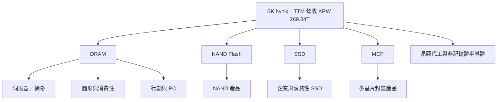
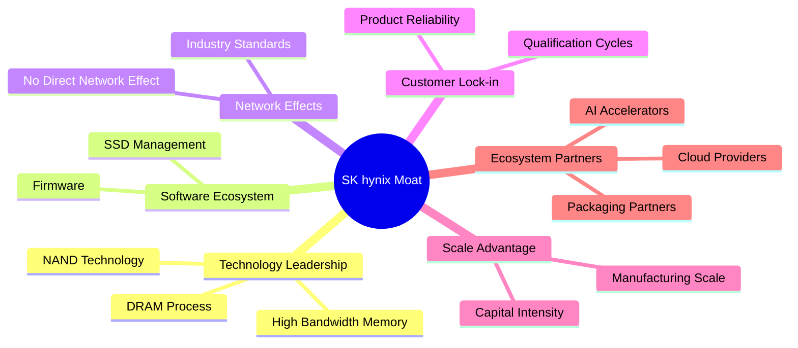
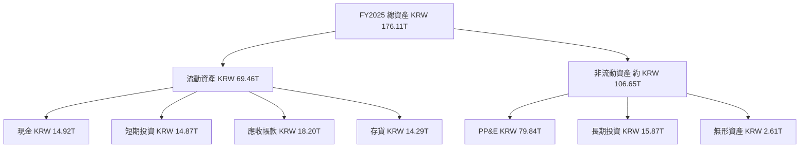
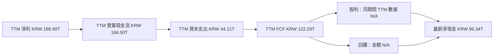
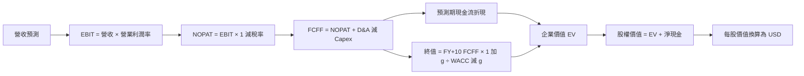
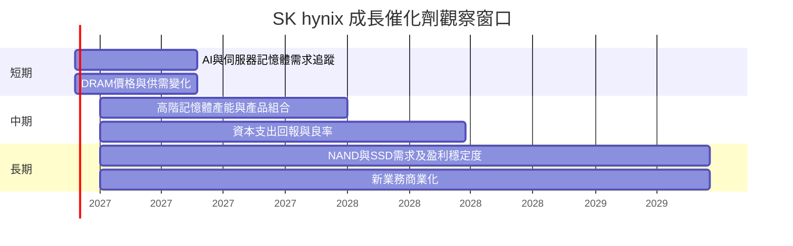
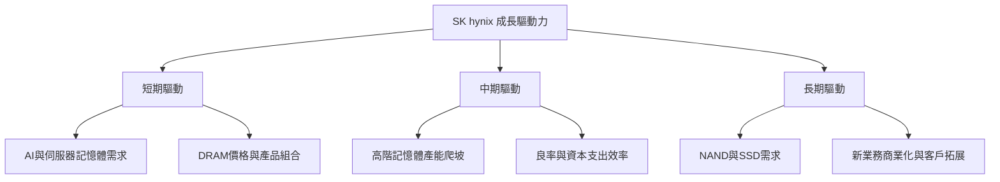
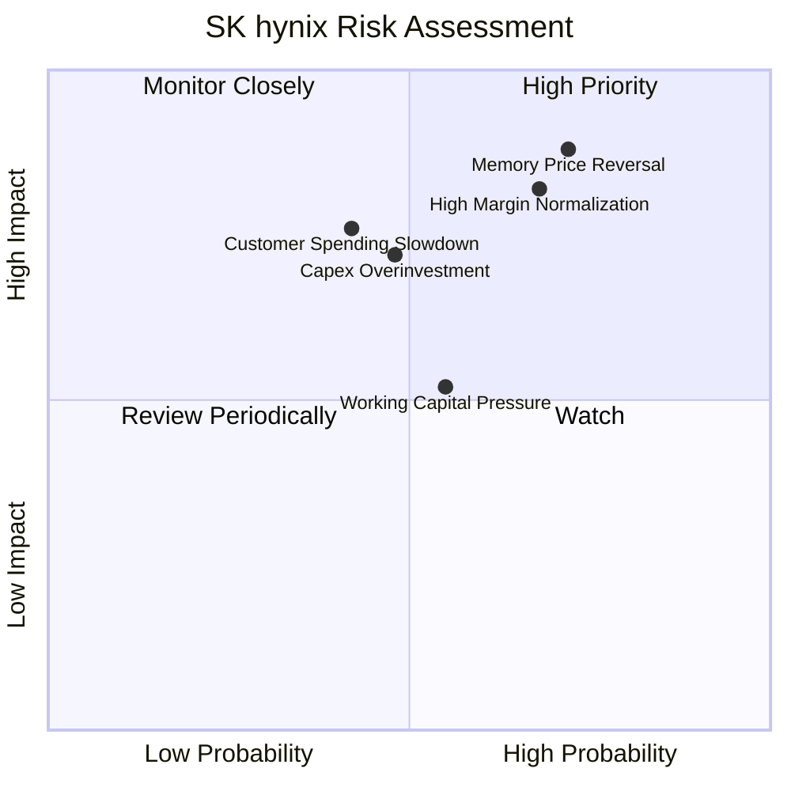
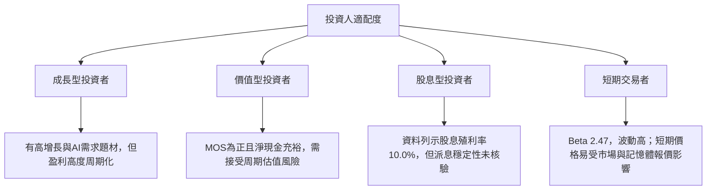

# SKHY 基本面深度分析報告
> **報告日期**：2026-11-25 ｜ **語言**：繁體中文 ｜ **數據來源**：Yahoo Finance、Finviz、StockAnalysis、Roic.ai ｜ **分析師**：CFA 級機構研究

> **口徑說明**：SKHY 為 SK hynix Inc. 的美元報價標的；財報以韓元（KRW）列示。報價與財報換算採 2026-11-24 匯率 **1 美元 = 1,341.02 韓元**。財務數據主要來自 Yahoo Finance 等資料來源，並非 SEC 申報資料。不同來源的期間與指標可能不完全一致；凡程式計算的認證數字，本文依其原值引用。除非特別標示，財務金額均為韓元。

---

## 目錄

| # | 章節 | 核心結論 |
|---|------|----------|
| 1 | 執行摘要 | 買入；加權合理價值 $208.12，MOS +46.2% |
| 2 | 公司概覽與商業模式 | 記憶體技術、製程與規模構成競爭優勢；市場份額數據未提供 |
| 3 | 損益表深度分析 | TTM 營收 KRW 269.34T；最新一季營收年增 327.9%，獲利處於周期高位 |
| 4 | 資產負債表分析 | 淨現金 KRW 96.34T，流動性充裕；現金轉換週期 203 天 |
| 5 | 現金流量深度分析 | TTM FCF KRW 122.29T，FCF Yield 11.55% |
| 6 | 獲利能力與資本效率 | WACC 14.00%；目前 ROIC 缺資料，無法確認價值創造利差 |
| 7 | 相對估值分析 | SKHY 自身 P/E 低於同業中位數；週期高峰盈餘令低 P/E 具誤導性 |
| 8 | DCF 內在價值評估 | 基準 DCF $266.92；加權合理價值 $208.12，MOS +46.2% |
| 9 | 成長催化劑 | AI／伺服器記憶體需求與產品組合是主要催化劑；TAM 數據未提供 |
| 10 | 風險矩陣 | 記憶體週期、價格回落與高估值假設是主要風險 |
| 11 | 投資建議 | 買入；按估值與週期風險分批，並監控利潤率、資本支出及 FCF |

---

## 1. 執行摘要

最新一季營收年增 **327.9%**、TTM 營業利益率 **74.5%**、TTM FCF **KRW 122.29T**，並持有 **KRW 96.34T 淨現金**；然而記憶體產業高度循環，最新一季淨利亦較前季回落，且 ROIC 資料缺漏。估值方面，DCF 基準每股價值為 **$266.92**，同業估值與分析師共識拉低後的加權合理價值為 **$208.12**，相較 2026-11-24 收盤價 **$111.98** 的 MOS 為 **+46.2%**。依 MOS 門檻應評為**買入**；由於 ROIC 無法核驗，且 DCF 對周期高峰利潤率敏感，不上調至強烈買入。

### 1.0 一頁式投資儀表板（Portfolio Manager 30 秒速讀）

| 項目 | 內容 |
|------|------|
| **投資論點（3 句）** | ① 最新一季營收年增 **327.9%**，反映記憶體需求與定價上行，但該增幅不能外推為長期常態。② TTM 營業利益率 **74.5%**、FCF **KRW 122.29T**，現金生成能力顯著改善。③ 加權合理價值 **$208.12** 高於最新收盤價 **$111.98**，MOS **+46.2%**。 |
| **綜合評分** | **7.5/10**（引用 1.1 六項算術平均） |
| **財務健康** | 🟢 現金及短期投資 KRW 114.46T、總債務 KRW 18.13T，淨現金 KRW 96.34T；但 CCC 為 203 天 |
| **ROIC vs WACC** | ROIC：N/A；WACC：**14.00%**。資料不足，無法判斷當期是否超額創造價值 |
| **FCF 趨勢** | FY2023 至 FY2025 由負轉正；TTM FCF **KRW 122.29T**，FCF Yield **11.55%** |
| **估值** | Forward P/E **2.77x** ｜ EV/EBITDA **N/A**（跨幣別口徑不可用）｜ FCF Yield **11.55%** |
| **DCF 內在價值（基準）** | **$266.92** ｜ 現價相對 DCF 折價 **58.0%**（折溢價定義見第 8 章） |
| **安全邊際（MOS）** | **+46.2%**＝(**加權合理價值 $208.12 − 現價 $111.98**) ÷ **$208.12**｜ 🟢 >25% |
| **預期報酬（基準情境 12M）** | 加權合理價值隱含上行空間 **+85.9%**；此為估值差距，不代表 12 個月報酬保證 |
| **關鍵風險（前二）** | 記憶體供需反轉造成價格與利潤率回落；DCF 對高峰營業利潤率及長期成長假設敏感 |
| **評級 + 信心度** | 🟢 **買入** ｜ 信心：中 |

### 1.1 綜合評分卡（全報告唯一）

| 維度 | 評分（1–10） | 主要依據（引用數字與其來源章節） |
|------|--------------|----------------------------------|
| 成長性 | 8 | 最新一季營收年增 327.9%；TTM 營收年增率認證值為 N/A，見 3.2 |
| 獲利能力 | 8 | TTM 營業利益率 74.5%、FCF KRW 122.29T；ROIC 尚無可比 TTM 值，見 3、5、6 |
| 財務健康 | 8 | 淨現金 KRW 96.34T、流動比率 3.115；CCC 203 天，見 4 |
| 估值 | 7 | MOS +46.2%；同業 EV/EBITDA 法估值 $151.90，低於 DCF 基準，見 7、8 |
| 護城河 | 8 | DRAM、NAND、SSD 產品線與跨地區營運；具體市場份額未提供，見 2 |
| 管理層與資本配置 | 6 | FY2025 股息支付 KRW 1.68T；回購金額、長期資本配置報酬資料不足，見 5 |
| **綜合評分** | **7.5** | 六項算術平均：(**8 + 8 + 8 + 7 + 8 + 6**) ÷ 6 = **7.5** |

### 1.2 五大投資論點 + 三大核心風險

| 類型 | 項目 | 具體依據 | 信心度 |
|------|------|----------|--------|
| 🟢 **投資論點①** | AI／伺服器記憶體需求拉動營收 | 最新一季營收 KRW 104.62T，年增 327.9%；同業 MU、SNDK 同季亦分別年增 379.3%、377.9%，顯示整體記憶體景氣強 | 🟢 高 |
| 🟢 **投資論點②** | 利潤及現金流急升 | TTM 營業利益率 74.5%、FCF KRW 122.29T、FCF Yield 11.55%；盈利改善轉化為現金流，但高峰能否持續仍待驗證 | 🟢 高 |
| 🟢 **投資論點③** | 淨現金提供周期緩衝 | 現金及短期投資 KRW 114.46T，總債務 KRW 18.13T，淨現金 KRW 96.34T | 🟢 高 |
| 🟢 **投資論點④** | 估值方法交叉後仍有折價空間 | DCF $266.92、同業 EV/EBITDA $151.90、同業 P/S $152.38、分析師共識 $253.07，加權後 $208.12 | 🟡 中 |
| 🟢 **投資論點⑤** | 產品與地理市場多元 | 公司銷售 DRAM、NAND、SSD、MCP，涵蓋韓國、中國、亞洲、美國與歐洲；財務數據未提供各產品營收拆分 | 🟡 中 |
| 🟡 **風險①** | 記憶體價格反轉 | 新聞提及 TrendForce 下調 DRAM 價格預測；若供給增加快於需求，74.5% TTM 營業利益率可能快速收縮 | 🟡 中 |
| 🔴 **風險②** | DCF 假設偏倚於高峰利潤率 | 基準模型 FY+1 營業利潤率 74.5%，第 10 年仍為 35.5%；若利潤率回歸更低周期水準，估值下修 | 🔴 高 |
| 🟡 **風險③** | 營運資金占用較大 | DIO 143 天、CCC 203 天；庫存與收款時間延長可能使現金流落後會計獲利 | 🟡 中 |

### 1.3 快速統計卡片

| 指標 | 公司實際值（期間） | 同業中位數 | 狀態 |
|------|--------------------|------------|------|
| 營收成長（TTM） | **N/A** | — | 🟡 認證 TTM 對比值缺漏 |
| 營收成長（最新一季年增） | **327.9%** | 377.9% | 🟢 略低於 MU、SNDK 中位數 |
| 毛利率（TTM） | **77.4%** | 80.0% | 🟡 低於三家同業中位數 |
| 營業利益率（TTM） | **74.5%** | — | 🟢 高，但屬周期性高水準 |
| ROIC（TTM） | **N/A** | — | 🟡 無法核驗 |
| Forward P/E | **2.77x** | 3.1x | 🟢 低於同業中位數 |
| FCF Yield（TTM） | **11.55%** | — | 🟢 現金流收益率具吸引力 |
| Piotroski F-Score | **N/A** | — | 🟡 缺少相隔一年之 SEC 申報期數據 |

### 1.4 投資結論

```text
╔══════════════════════════════════════════════════════════════════╗
║                    📊 投資結論摘要                               ║
╠══════════════════════════════════════════════════════════════════╣
║  評級：買入（依 MOS 門檻；未作一級調整）                         ║
║  價格（2026-11-24 收盤）：$111.98                                ║
║  DCF 內在價值（基準）：$266.92（現價折價 58.0%）                 ║
║  安全邊際 MOS：+46.2%（＝(加權合理價值−現價)÷加權合理價值）     ║
║  加權合理價值（8.8）：$208.12                                    ║
║  DCF 情境價值：                                                   ║
║    悲觀情境：$129.26（+15.4%）                                   ║
║    基準情境：$266.92（+138.4%）                                  ║
║    樂觀情境：$525.07（+368.9%）                                  ║
║  綜合評分：7.5/10（引用 1.1）                                    ║
║  適合投資人：可承受半導體周期波動、偏成長與價值並重的投資人      ║
╚══════════════════════════════════════════════════════════════════╝
```

---

## 2. 公司概覽與商業模式

### 2.1 業務結構與收入來源

財務資料沒有提供 DRAM、NAND、SSD 等分部營收或占比，因此不填造比例。公司 TTM 營收為 **KRW 269.34T（約 USD 200.85B）**，產品包含伺服器、圖形、行動、PC、消費性 DRAM，以及 NAND Flash、SSD、MCP；另有非記憶體晶圓代工業務。



### 2.2 市場份額

市場份額數據未提供，亦無可引用的份額年份或來源，因此不繪製市場份額圖。SKHY 的 TTM 營收約 USD 200.85B，最新一季營收年增 327.9%；MU 與 SNDK 同季年增率亦超過 370%，顯示本期成長主要受產業周期與產品需求帶動，不能單憑營收增速推斷份額變化。

### 2.3 競爭護城河分析



### 2.4 護城河強度

| 護城河項目 | 強度（強／中／弱） | 證據（引用數字或事實） | 會削弱它的情況 |
|------------|--------------------|------------------------|----------------|
| 技術與製程 | 強 | 產品涵蓋 DRAM、NAND、SSD、MCP；具大型半導體製造與研發能力，FY2025 研發支出 KRW 6.47T | 競爭者製程追趕、良率落後或技術轉換不順 |
| 規模效應 | 強 | TTM 營收 KRW 269.34T；半導體製造需要大量資本與產能規劃 | 產能過剩、折舊上升、利用率下降 |
| 客戶鎖定 | 中 | 伺服器與企業級記憶體需產品驗證與長期供應可靠度；具體客戶留存數據未提供 | 客戶多來源採購、規格轉換或價格競爭 |
| 軟體生態系統 | 弱 | 財務資料未提供可量化軟體收入或生態系統指標 | 產品差異化不足、以價格競爭為主 |
| 網路效應 | 弱 | 記憶體不是典型直接網路效應業務 | 標準化程度提高、產品互換性上升 |
| 生態夥伴 | 中 | 供應伺服器、網路、行動與 PC 市場；客戶及夥伴營收占比未提供 | AI 投資放緩或大型客戶資本支出減少 |

護城河分數引用 1.1 的 **8/10**：技術、規模與客戶認證支持競爭力，但缺少市場份額、客戶集中度及軟體生態數據，且產業供需周期會放大獲利波動。

---

## 3. 損益表深度分析

### 3.1 年度收入成長趨勢（近 4 年）

下表採年度收入資料。FY2022 至 FY2025 三年 CAGR 為 **約 29.6%**；這是由年度財務數字計算，不等同程式認證的 TTM 成長率，後者為 N/A。

```text
╔══════════════════════════════════════════════════════════════════╗
║              SK hynix 年度收入趨勢（FY2022-FY2025）              ║
╠══════════════════════════════════════════════════════════════════╣
║  FY2022  KRW 44.62T  ███████████░░░░░░░░░  YoY: +3.78%          ║
║  FY2023  KRW 32.77T  ████████░░░░░░░░░░░░  YoY: -26.57%         ║
║  FY2024  KRW 66.19T  █████████████████░░░  YoY: +102.02%        ║
║  FY2025  KRW 97.15T  ████████████████████  YoY: +46.76%         ║
╠══════════════════════════════════════════════════════════════════╣
║  FY2022-FY2025 三年 CAGR：約 +29.6%                              ║
╚══════════════════════════════════════════════════════════════════╝
```

FY2023 營收下降 26.57%，FY2024 反彈 102.02%，FY2025 再增 46.76%。這種大幅擺動與半導體記憶體產業的價格、庫存及資本支出周期相符；因此歷史 CAGR 不宜視作穩定的長期成長率。

### 3.2 季度收入趨勢分析

| 季度 | 營收（KRW T） | QoQ 成長 | YoY 成長 | 備註 |
|------|---------------:|---------:|---------:|------|
| 2025 Q4 | 32.83 | +34.3% | +66.07% | QoQ 以 2025 Q3 的 KRW 24.45T 計算 |
| 2026 Q1 | 52.58 | +60.2% | +198.07% | 需求與價格回升令基期快速抬高 |
| 2026 Q2 | 79.32 | +50.9% | +256.78% | 營收續增，但增速仍含低基期效果 |
| 2026 Q3 | 104.62 | +31.9% | +327.89% | 單季營收再創資料列示高點；增速為單季年增，不是 TTM |

QoQ 計算採相鄰季度營收：例如 Q3 2026 QoQ = (104.615 − 79.319) ÷ 79.319 = 31.9%。認證的 Revenue growth (TTM vs prior TTM) 為 **N/A**；另有 StockAnalysis 表格列示 TTM 成長 220.31%，但為避免跨來源口徑混用，本文不將該值作為認證 TTM 成長率。

### 3.3 利潤率演變分析

年度毛利率與營業利益率依年度毛利、營業利益除以營收計算；TTM 採資料列示值。

| 利潤率指標 | FY2022 | FY2023 | FY2024 | FY2025 | TTM至2026-09-30 | 趨勢與評估 |
|------------|-------:|-------:|-------:|-------:|----------------:|------------|
| **毛利率** | 35.0% | -1.6% | 48.1% | 60.4% | 77.4% | 由周期低點快速反彈；TTM 高於 FY2025，反映價格／產品組合改善 |
| **營業利益率** | 15.3% | -23.6% | 35.5% | 48.6% | 74.5% | 營收回升帶動固定成本吸收；目前水平高度周期化 |
| **淨利率** | 5.0% | -27.8% | 29.9% | 44.2% | 70.1% | TTM 淨利率上升幅度須與非營業及稅務明細交叉核對 |

**利潤率演變深度解析：**FY2023 營業利益為負 KRW 7.73T，FY2024 回升至 KRW 23.47T，FY2025 再升至 KRW 47.21T。同期營收從 KRW 32.77T 回升至 KRW 97.15T，顯示營業槓桿顯著：產能與固定成本不必同比例增加，即可在價格回升時擴大毛利。不過 TTM 營業利益率 74.5% 遠高於 FY2025 的 48.6%，估值應納入周期回落可能，而非將該利潤率永久化。

### 3.4 費用結構分析

財務資料提供營收、毛利與研發支出，但未提供可一致拆分的 TTM 銷售、管理、研發及其他營業費用明細；因此不繪製費用占比圓餅圖，也不把毛利與營業利益差額自行解讀為特定費用項目。FY2025 研發支出為 **KRW 6.47T**，約占 FY2025 營收 KRW 97.15T 的 **6.7%**（6.47 ÷ 97.15）。

### 3.5 季度 EPS 趨勢與盈餘品質（Quality of Earnings）

過去四季 EPS 預估值、實際值與驚喜幅度未提供有效數字：2026 Q2、Q3 的 EPS Est／EPS Act 均為 NaN，其他季度亦無可用一致資料。因此不能將任何一季定性為「超預期」或「不及預期」。可核對的最新一季 EPS 年增率為 **205.1%**，屬單季同比數據。

| 盈餘品質項目 | 數值／佔比 | 評估 |
|--------------|-----------|------|
| 股權薪酬 SBC / 營收 | FY2025 SBC KRW 0.414T ÷ FY2025 營收 KRW 97.15T = **0.43%** | 🟢 FY2025 年度比例低；但 2026 Q3 SBC KRW 3.57T ÷ 營收 KRW 104.62T = **3.41%**，單季增高，須追蹤 |
| SBC / 營業現金流 | FY2025 0.414T ÷ 53.37T = **0.78%** | 🟢 FY2025 影響有限；不能以該年度比率代替最新 TTM |
| FCF / 淨利（現金轉換率） | TTM 122.29T ÷ TTM 淨利 188.90T = **64.7%** | 🟡 現金轉換低於 100%；高資本開支及營運資金占用可能解釋部分差異 |
| 一次性／非經常性損益 | N/A；Q2 2026 淨利 KRW 93.82T，高於營業利益 KRW 60.54T | 🟡 差異可能含非營業或稅務因素，但資料未提供明細，不能確認成因 |
| 有效稅率異常 | 最新年度有效稅率 **14.9%** | 🟡 為 WACC／DCF 使用值；缺少年度稅項明細，無法辨識是否有一次性稅務利益 |
| 資本化支出 vs 費用化 | TTM Capex KRW 44.21T；資本化與費用化分類明細 N/A | 🟡 資本支出較大，但無資料支持其造成成本遞延或盈餘高估 |

**盈餘品質結論：**TTM FCF 為正且金額高，但 FCF／淨利轉換率為 64.7%，加上 CCC 203 天與最新季度 SBC 上升，獲利不能只以會計淨利衡量。現有資料不足以確認一次性損益及稅務影響；估值以 FCF 與周期利潤率交叉檢驗較合適。

---

## 4. 資產負債表分析

### 4.1 資產結構分解

2025-12-31 總資產為 KRW 176.11T，流動資產 KRW 69.46T；非流動資產為兩者差額 KRW 106.65T。該差額是依總資產減流動資產計算，並非財報另列科目。



以上細項為 2025 年年末口徑；最新 TTM 資產負債表列示現金及短期投資 KRW 114.46T，與 FY2025 年末水準差距大，反映期間內資金變動，不能將不同日期的細項混在同一張資產分布中。

### 4.2 流動性與營運資金分析

| 指標 | 最新值 | 歷史趨勢與評估 |
|------|-------:|----------------|
| 流動比率 | **3.115** | 🟢 流動資產對流動負債有充裕覆蓋 |
| 速動比率 | **2.794** | 🟢 扣除存貨後仍有流動性緩衝 |
| 現金及短期投資 | **KRW 114.46T** | 🟢 最新 TTM 資產負債表口徑 |
| 淨現金 | **KRW 96.34T** | 🟢 現金及短期投資扣總債務後仍為大額淨現金 |

**營運資金天數**（QUALITY FIGURES 原值照錄）：

| 指標 | 最新 TTM | 一年前 TTM | 變化 | 解讀 |
|------|----------:|-----------:|------|------|
| DSO 應收帳款天數 | 80 天 | N/A | N/A | 一年前資料未提供；目前應收回收週期需結合銷售條件監控 |
| DIO 存貨天數 | 143 天 | N/A | N/A | 庫存天數較高；須區分在製品、成品與需求備貨，分項資料未提供 |
| DPO 應付帳款天數 | 20 天 | N/A | N/A | 相對短的付款天數可能限制供應商融資效果；歷史比較缺漏 |
| CCC 現金轉換週期 | 203 天 | N/A | N/A | 依 CCC = 80 + 143 − 20 = 203 天；意味現金被營運資金占用的週期較長 |

### 4.3 債務結構分析

```text
╔══════════════════════════════════════════════════════════════════╗
║                   SK hynix 債務健康診斷                          ║
╠══════════════════════════════════════════════════════════════════╣
║  總債務：          KRW 18.13T   ██░░░░░░░░░░░░░░░░  🟢          ║
║  現金+短期投資：   KRW 114.46T  ████████████████████  🟢        ║
║  淨現金：          KRW 96.34T   █████████████████░░░  🟢        ║
║                                                                  ║
║  流動比率：        3.115        🟢                                ║
║  速動比率：        2.794        🟢                                ║
║  Debt/EBITDA：     N/A（口徑缺少可直接核驗的 TTM EBITDA 值）     ║
║  利息保障倍數：    N/A（利息費用明細未提供）                     ║
╚══════════════════════════════════════════════════════════════════╝
```

總債務與現金數據取最新 TTM 口徑。年度資產負債表的 2025 年末總債務 KRW 24.76T 與最新 TTM 的 KRW 18.13T 不同，可能涉及期間及資料供應商口徑，本文不混用兩者推導槓桿倍數。

### 4.4 股東權益趨勢

```text
╔══════════════════════════════════════════════════════════════════╗
║                   SK hynix 股東權益變化                          ║
╠══════════════════════════════════════════════════════════════════╣
║  FY2022  KRW 63.27T  ████████████████████                       ║
║  FY2023  KRW 53.50T  █████████████████                          ║
║  FY2024  KRW 73.90T  ███████████████████████                    ║
║  FY2025  KRW 120.52T ██████████████████████████████████████     ║
╚══════════════════════════════════════════════════════════════════╝
```

2023 年權益隨虧損下滑，FY2024、FY2025 隨盈利恢復而上升；FY2025 權益比 FY2024 增加約 KRW 46.62T。這與淨利回升方向一致，但完整的其他綜合損益、股利與回購拆分未提供。

---

## 5. 現金流量深度分析

### 5.1 現金流量瀑布圖

採 TTM 營業現金流與資本支出定義：FCF = OCF − Capex。淨利使用 TTM 淨利 KRW 188.90T。股利、回購與淨現金變化沒有同期間完整數字，故不將其接成 TTM 金額瀑布。



### 5.2 FCF 轉換率趨勢

| 財政年度 | 營業現金流（KRW T） | FCF（KRW T） | 淨利（KRW T） | FCF／淨利 |
|---------|--------------------:|-------------:|--------------:|----------:|
| FY2022 | 14.78 | -4.97 | 2.23 | -222.9% |
| FY2023 | 4.28 | -4.50 | -9.11 | 49.4%* |
| FY2024 | 29.80 | 13.13 | 19.79 | 66.4% |
| FY2025 | 53.37 | 24.79 | 42.92 | 57.8% |
| TTM 至 2026-09-30 | 166.50 | 122.29 | 188.90 | 64.7% |

\* FY2023 的比率為負 FCF ÷ 負淨利，數值為正但經濟含義不等同高品質現金轉換。年度現金流顯示 FY2022、FY2023 因高資本開支而 FCF 為負，FY2024 起轉正；TTM FCF 大幅提升，主要與本周期盈利與營業現金流擴張同時發生有關。

### 5.3 自由現金流趨勢

```text
╔══════════════════════════════════════════════════════════════════╗
║                 SK hynix 自由現金流趨勢                          ║
╠══════════════════════════════════════════════════════════════════╣
║  FY2022  -KRW 4.97T   ◀██░░░░░░░░░░░░░░░░░░░                   ║
║  FY2023  -KRW 4.50T   ◀██░░░░░░░░░░░░░░░░░░░                   ║
║  FY2024   KRW 13.13T   █████░░░░░░░░░░░░░░░                    ║
║  FY2025   KRW 24.79T   █████████░░░░░░░░░░░                    ║
║  TTM      KRW 122.29T  ████████████████████                     ║
╠══════════════════════════════════════════════════════════════════╣
║  TTM FCF Yield：11.55%（依程式認證值；年度 FCF Yield 未提供）    ║
╚══════════════════════════════════════════════════════════════════╝
```

TTM FCF 高於 FY2025，顯示本期現金生成加速；但年度 FCF 跟隨周期變化，且 TTM FCF 不應直接外推為長期正常化現金流。

### 5.4 資本配置評估

缺少同一期間的完整投資、回購、股息與留存現金分配資料，故不以估算比例繪製資本配置圓餅圖。

| 資本配置項目 | 已知數據 | 評估 |
|--------------|----------|------|
| 資本支出 | TTM KRW 44.21T；FY2025 KRW 28.58T | 資本密集度高；新增產能需以需求與利用率驗證回報 |
| 股利 | FY2025 支付 KRW 1.68T | 對比 FY2025 FCF KRW 24.79T，派息規模有限 |
| 股票回購 | 金額 N/A | 新聞提及擴大回購意向，但實際金額未提供 |
| 留存／現金累積 | 最新現金及短期投資 KRW 114.46T | 提供周期緩衝，也可支持資本支出；但現金用途與報酬需後續追蹤 |

---

## 6. 獲利能力與資本效率

### 6.1 ROE / ROA / ROIC 趨勢

| 指標 | 可用數值 | 評估 |
|------|----------|------|
| ROE（TTM） | 92.5% | 🟢 高，但周期高峰淨利與權益基數會提高比率；杜邦細項未提供 |
| ROA（TTM） | 46.4% | 🟢 高；須留意同樣受周期峰值影響 |
| ROIC（TTM） | N/A | 無法以現有完整 TTM 投入資本與 NOPAT 數據核驗 |
| 歷史 ROIC／ROIC.AI | 2018 Return on Capital 34.64% | 僅為歷史資料，不可替代 2026 TTM ROIC |
| 行業均值 | N/A | 無同口徑來源，故不列比較欄 |

### 6.2 ROIC vs WACC 分析（核心價值創造判斷）

ROIC 缺乏可核驗的最新 TTM 數據，不能計算 EVA 或宣稱公司目前的 ROIC 高於／低於 WACC。已知 WACC 採用 **14.00%**；這是第 8 章 DCF 的同一折現率。

```text
╔══════════════════════════════════════════════════════════════════╗
║                ROIC vs WACC 深度分析                            ║
╠══════════════════════════════════════════════════════════════════╣
║  WACC 估算（直接採用成本資本輸入）：                             ║
║  ├── 無風險利率（10Y 美債）：       4.90%                        ║
║  ├── 市場風險溢酬 ERP：              5.00%                        ║
║  ├── 原始 Beta：                     2.47                         ║
║  ├── 調整後 Beta：                   1.98                         ║
║  ├── 股權成本 Ke（資料列示）：       14.79%                       ║
║  ├── 稅前債務成本：                  5.10%                        ║
║  ├── 稅率：                          14.9%                        ║
║  ├── 股權／債務權重：                98.3%／1.7%                  ║
║  └── 採用 WACC：                     14.00%                       ║
║                                                                  ║
║  ROIC（TTM）：N/A；投入資本與一致口徑 NOPAT 數據不足              ║
║  EVA = ROIC − WACC：N/A                                           ║
║  價值創造判斷：目前無法以 ROIC 與 WACC 的差額確認                 ║
╚══════════════════════════════════════════════════════════════════╝
```

成本資本資料列示未封頂計算值 **14.61%**，但 WACC 被限制在 **7%–14%** 區間，因此模型採用上限 **14.00%**。因缺少利息費用金額與同口徑平均計息負債，無法獨立重算 5.10% 稅前債務成本；採用的 WACC 與第 8.2 節一致。

### 6.3 杜邦三因素分解

| 因素 | 數值（TTM） | 解讀 |
|------|-------------|------|
| 淨利率 | N/A | QUALITY FIGURES 指明缺少所需一致數據 |
| 資產週轉率 | N/A | 同上 |
| 權益乘數 | N/A | 同上 |
| **ROE** | **N/A（杜邦分解）** | QUALITY FIGURES 因缺少淨利、營收、總資產或正權益的必要一致輸入而列 N/A；另有 ROE TTM 92.5%，但不能據此補做杜邦 |

### 6.4 財務體質：Piotroski F-Score

Piotroski F-Score 為 **N/A**；需要相隔一年的兩期 TTM SEC 申報資料，目前沒有可供逐項評分的完整輸入。

| 測試 | 結果 | 解讀 |
|------|------|------|
| 淨利為正 | N/A | 缺少可用的成套歷史測試資料 |
| 營業現金流為正 | N/A | 無法依規定建立完整 F-Score 對照期間 |
| ROA 改善 | N/A | N/A 不代表未通過，僅表示無資料 |
| 營業現金流高於淨利 | N/A | 無法依標準兩期口徑核算 |
| 槓桿下降 | N/A | 缺少對應 SEC 兩期檢核 |
| 流動性改善 | N/A | 同上 |
| 未稀釋股數增加 | N/A | 同上 |
| 毛利率改善 | N/A | 同上 |
| 資產週轉率改善 | N/A | 同上 |

---

## 7. 相對估值分析

### 7.1 同業估值比較表格

同業倍數採 Yahoo Finance 所列 Peer multiples；SKHY 自身估值採公司估值資料。SKHY 財報為 KRW、報價為 USD，因此公司 P/S 與 EV/EBITDA 不直接混算，列為 N/A。

| 估值指標 | **SKHY** | **MU** | **SNDK** | **WDC** | SKHY 評估 |
|----------|---------:|-------:|--------:|-------:|-----------|
| **Trailing P/E** | 6.20x | 8.5x | 5.0x | 9.6x | 🟢 低於三家同業中位數 8.5x；可能反映周期性與盈餘峰值風險 |
| **Forward P/E** | 2.77x | 3.1x | 2.2x | 6.9x | 🟢 低於同業中位數 3.1x；前瞻 EPS 預估可能偏向景氣高位 |
| **P/S（TTM）** | N/A | 5.4x | 3.1x | 7.1x | 🟡 SKHY 跨幣別口徑不可用；同業中位數 5.4x |
| **EV/EBITDA（TTM）** | N/A | 6.2x | 3.9x | 16.2x | 🟡 SKHY 跨幣別口徑不可用；同業中位數 6.2x |
| **最新一季營收年增** | 327.9% | 379.3% | 377.9% | 55.5% | 🟢 增長接近記憶體同業、遠高於 WDC；不能代表長期趨勢 |
| **毛利率（TTM）** | 77.4% | 80.7% | 80.0% | 52.6% | 🟡 低於 MU、SNDK 中位數 80.0%，但高於 WDC |

SKHY P/E 較低並不必然代表便宜：當盈利處於周期高點，Trailing P/E 和 Forward P/E 會因分母膨脹而下降。相對估值應與正常化利潤率、資本支出及 FCF 一併看待。

### 7.2 歷史估值區間分析

N/A（沒有可引用的「Valuation vs own history」歷史估值區間資料；不推估百分位或歷史高低倍數。）

### 7.3 情境價值（Bear / Base / Bull，照抄 DCF MODEL 的 Scenarios）

| 情境 | 第 1 年營收成長 | 期末營業利潤率 | WACC | 每股價值 | 相對現價 | 機率 | 會發生的條件 |
|------|----------------:|----------------:|-----:|----------:|---------:|-----:|--------------|
| 🔴 悲觀 | 15.0% | 30.1% | 15.00% | $129.26 | +15.4% | 25% | AI／伺服器需求轉弱、價格下行，營收成長低於基準且長期利潤率回落 |
| 🟡 基準 | 30.0% | 35.5% | 14.00% | $266.92 | +138.4% | 50% | 首年高增長後逐年放緩，長期利潤率回歸五年中位數設定 |
| 🟢 樂觀 | 45.0% | 39.0% | 13.00% | $525.07 | +368.9% | 25% | AI 記憶體需求持續超預期、供給紀律維持、成長與利潤率均高於基準 |

### 7.4 相對估值隱含價格區間

```text
╔══════════════════════════════════════════════════════════════════╗
║             同業估值法回推每股價值與現價位置                     ║
╠══════════════════════════════════════════════════════════════════╣
║  $111.98 現價 ───── $151.90 EV/EBITDA ─ $152.38 P/S              ║
║  現價低於兩項同業估值法回推值；但方法值仍受周期盈利影響          ║
╚══════════════════════════════════════════════════════════════════╝
```

| 方法 | 每股價值 | 依據 |
|------|---------:|------|
| 同業 EV/EBITDA | **$151.90** | MU、SNDK、WDC 的 EV/EBITDA 中位數 **6.2x** 乘以 SKHY TTM EBITDA，再加淨現金；價值照估值方法資料列示 |
| 同業 P/S | **$152.38** | 同業 P/S 中位數 **5.4x** 乘以 SKHY TTM 營收；價值照估值方法資料列示 |

---

## 8. DCF 內在價值評估（Discounted Cash Flow）

> DCF 模型金額以 **KRW 十億**列示；每股價值為 USD。程式模型所列假設與結果原值引用。模型 FCFF 為 NOPAT + D&A − Capex，**未建模營運資金變動**。

### 8.0 估值推理鏈（Thinking Logic：在算之前先想清楚）

**Step 1 — 價值來源與主導變數**

本模型的價值主要由既有記憶體業務的現金流決定：DRAM、NAND、SSD、MCP 的合計 TTM 營收 KRW 269.34T，但各分部占比未提供；第二成長曲線可能包括 AI／伺服器記憶體需求，但沒有獨立營收拆分；新業務選擇權亦無量化收入資料。模型中估值最敏感的變數是營業利潤率與 WACC：基準營業利潤率由 FY+1 的 74.5% 線性降至 FY+10 的 35.5%，而折現率採 14.00%。

**Step 2 — 模型選擇**

| 決策點 | 本報告採用 | 理由（含數字） | 曾考慮但否決 | 否決理由 |
|--------|-----------|----------------|--------------|----------|
| 現金流定義 | FCFF | 以 WACC 折現並先求企業價值，再橋接股權價值 | FCFE | 模型提供的是企業自由現金流 |
| 預測期 N | 10 年 | DCF MODEL 固定 10 年；記憶體周期跨期，需較長期回歸假設 | 5 年 | 與提供模型不一致，且不更改程式模型 |
| 終值方法 | Gordon Growth | 模型列示永續成長 3.0% | 退出倍數 | DCF MODEL 未提供退出倍數輸入或估值結果 |
| EBIT 基礎 | GAAP EBIT | TTM GAAP 營業利益率為 74.5% | 非 GAAP EBIT | 未提供相應調整明細 |

**Step 3 — 關鍵假設推導鏈**

- **預測期 N**：錨點＝程式模型採 10 年，且公司業務具強周期性 → 調整理由＝延長預測期能呈現成長與利潤率逐步回歸，但也提高遠期假設不確定性 → **採用 10 年** → 曾考慮 5 年，但會改動已提供模型，且缺少可替代的長期公司指引，因此不採用。
- **營收成長路徑**：錨點＝最新一季年增 327.9%，但 TTM 成長認證值 N/A → 調整理由＝單季增幅包含低基期與周期效應，模型將首年成長限制於 30.0%，再線性降至 3.0% → **採用 FY+1 30.0%、FY+10 3.0%** → 曾考慮把 327.9% 單季增幅外推，但其為單季同比而非 TTM，故否決。
- **期末營業利潤率**：錨點＝TTM 74.5%、FY2025 48.6%、FY2024 35.5% → 調整理由＝周期成熟與競爭可能令高峰利潤率回落 → **採用 FY+1 74.5% 線性下降至 FY+10 35.5%** → 曾考慮維持 74.5% 不變，但未反映歷史周期回落，故否決。
- **Capex／營收**：錨點＝TTM Capex／營收約 16.4% → 調整理由＝模型假設資本支出比率逐步降至 D&A 的 1.1 倍 → **採用 FY+1 16.4%、FY+10 6.4%** → 曾考慮維持 16.4% 全期不變，但會偏離模型設定且未反映成熟期資本支出收斂，故否決。
- **永續成長率 g**：錨點＝模型終值成長 3.0% → 調整理由＝取長期成熟型企業假設，並確保低於 14.00% WACC → **採用 3.0%** → 曾考慮高於 3.0% 的永續增長，但終值會過度依賴長期高增長，故不採用。
- **WACC**：錨點＝未封頂計算 14.61%，模型規則限制區間為 7%–14% → 調整理由＝達區間上限 → **採用 14.00%** → 不採用未封頂 14.61%，因 DCF MODEL 已指定採用封頂後折現率。
- **EBIT 基礎及 SBC**：錨點＝模型使用 GAAP EBIT；FY2025 SBC KRW 0.414T → 採用 GAAP EBIT，SBC 已視為費用，不再重複扣除 → **採用組合 (A)** → 否決「額外扣 SBC」與額外稀釋，因會重複計入成本。
- **年稀釋率**：模型明確採固定股數處理 → **採用 0% 額外年稀釋**；股數／市值換算依模型所列公式處理 → 否決自行加入稀釋率，因沒有可用逐年股數模型輸入。
- **ΔWC／營收增額**：模型未建模營運資金變動 → **採用不納入 FCFF**；此項不是假設為零的經濟事實，而是模型簡化，會影響估值完整性。
- **終值方法**：錨點＝模型列示 Gordon Growth → **採用 Gordon Growth**；退出倍數只可作交叉驗證，但模型未提供倍數，故不自行補造。

**Step 4 — 最脆弱環節**

最脆弱環節是高峰營業利潤率能否在十年內平順收斂至 35.5%；若實際周期利潤率更低，DCF 將向下修正，且終值敏感度矩陣顯示 WACC 上升會顯著壓低估值。

**Step 5 — 計算路徑圖**



### 8.1 模型假設總表（Model Inputs）

| 假設項目 | 採用值 | 依據／來源 | 敏感度 |
|----------|--------|-------------|--------|
| 預測期長度 **N** | 10 年 | DCF MODEL；模型預測涵蓋 FY+1 至 FY+10 | 🟡 中 |
| 營收成長 | FY+1 30.0%，FY+10 3.0%，逐年線性遞減 | FY+1 受 327.9% 單季年增上限設定約束；末年採模型長期假設 | 🔴 高 |
| 營業利潤率 | FY+1 74.5% → FY+10 35.5% | 起點為 TTM；末期為模型所用近五年中位數（含 TTM） | 🔴 高 |
| 有效稅率 | 14.9% | 最新年度有效稅率 | 🟢 低 |
| Capex／營收 | FY+1 16.4% → FY+10 6.4% | TTM 起點，逐步降至 D&A 的 1.1 倍 | 🟡 中 |
| D&A／營收 | 5.8% | TTM 比率，模型固定 | 🟢 低 |
| 營運資金變動 | 未建模 | DCF MODEL 明示 Working capital is not modelled | 🟢 低 |
| EBIT 基礎 | GAAP EBIT | TTM 營業利益率 74.5% | 🟡 中 |
| SBC 處理 | 組合 (A)：不另扣 SBC | GAAP EBIT 已含 SBC 費用；股數不額外稀釋 | 🟡 中 |
| 年稀釋率 | 0% 額外稀釋 | 固定股數模型設定；不再放大股數 | 🟡 中 |
| 永續成長率 g | 3.0% | DCF MODEL 假設 | 🔴 高 |
| 終值方法 | Gordon Growth | 模型提供終值公式；退出倍數未提供 | 🔴 高 |
| WACC | 14.00% | 成本資本資料列示未封頂 14.61%，受 7%–14% 上下限限制 | 🔴 高 |

**FCF 定義與 SBC 防呆：**FCFF = NOPAT + D&A − Capex，未扣 ΔWC。模型採用 **(A) GAAP EBIT + 固定股數**；SBC 已在 GAAP EBIT 費用中計入，不再另扣 SBC，且不另加年稀釋率，因此 SBC 影響已計入一次。

### 8.2 折現率推導（WACC）

```text
╔══════════════════════════════════════════════════════════════════╗
║                    WACC 推導（折現率）                           ║
╠══════════════════════════════════════════════════════════════════╣
║  股權成本 Ke（CAPM）：                                           ║
║  ├── 無風險利率 Rf（10Y 美債）：     4.90%                       ║
║  ├── 市場風險溢酬 ERP：              5.00%                       ║
║  ├── 原始 Beta（Yahoo）：             2.47                        ║
║  ├── 調整後 Beta：                   1.98                         ║
║  ├── 調整方式：⅔ × 2.47 + ⅓ × 1 = 1.98                         ║
║  └── Ke（成本資本資料列示）：        14.79%                       ║
║                                                                  ║
║  債務成本 Kd：                                                    ║
║  ├── 稅前 Kd（資料列示）：            5.10%                       ║
║  ├── 有效稅率：                      14.9%                        ║
║  └── 稅後 Kd = 5.10% × (1−14.9%) = 4.3389% ≈ 4.34%              ║
║                                                                  ║
║  資本結構（成本資本資料列示權重）：                               ║
║  ├── 股權 E 權重：                    98.3%                       ║
║  ├── 債務 D 權重：                    1.7%                        ║
║  ├── 未封頂 WACC：                   14.61%                       ║
║  └── ✅ 採用 WACC：                   14.00%（7%–14% 區間封頂）   ║
╚══════════════════════════════════════════════════════════════════╝
```

逐步演算與限制：

1. **Ke（CAPM）**：成本資本資料列示 Ke = **14.79%**。以顯示後數字重算，4.90% + 1.98 × 5.00% = 14.80%；與資料列示差 0.01 個百分點，本文保留資料原值 14.79%，不改寫原始輸入。
2. **稅前 Kd**：資料列示 **5.10%**。利息費用金額與平均計息負債未提供，故不能獨立重算該比率；不將應付帳款等無息負債當作債務。
3. **稅後 Kd**：5.10% × (1 − 14.9%) = 5.10% × 0.851 = **4.3389%**。
4. **權重**：成本資本資料列示股權 **98.3%**、債務 **1.7%**；98.3% + 1.7% = **100.0%**。E 及 D 的市值金額未作獨立重算。
5. **未封頂 WACC**：14.79% × 98.3% + 4.3389% × 1.7% = 14.53857% + 0.0737613% = **14.6123313% ≈ 14.61%**；因採用值限制為 7%–14%，採 **14.00%**。

原始 Beta 2.47 高於 1.5，採用調整後 Beta 1.98。成本資本資料沒有明示 10 年期美債日期或 ERP 估計方法，因此沿用資料列示值；國別／規模溢酬未另加。第 6.2 與本節均採用 14.00%。

### 8.3 逐年自由現金流預測（基準情境）

**單位：KRW 十億；折現因子保留三位小數。**模型未列 ΔWC，故不自行新增該列。GAAP EBIT 已含 SBC，不另設 SBC 扣除列。

| 年度 | FY+1 | FY+2 | FY+3 | FY+4 | FY+5 | FY+6 | FY+7 | FY+8 | FY+9 | FY+10 |
|------|-----:|-----:|-----:|-----:|-----:|-----:|-----:|-----:|-----:|------:|
| 營收 | 350,138.32 | 444,675.67 | 551,397.83 | 667,191.37 | 787,285.82 | 905,378.69 | 1,014,024.13 | 1,105,286.30 | 1,171,603.48 | 1,206,751.59 |
| 營收 YoY | 30.0% | 27.0% | 24.0% | 21.0% | 18.0% | 15.0% | 12.0% | 9.0% | 6.0% | 3.0% |
| 營業利潤率 | 74.5% | 70.2% | 65.8% | 61.5% | 57.1% | 52.8% | 48.5% | 44.1% | 39.8% | 35.5% |
| EBIT（GAAP） | 260,853.17 | 311,990.95 | 362,945.99 | 410,218.08 | 449,900.38 | 478,104.93 | 491,483.37 | 487,763.23 | 466,198.18 | 427,828.34 |
| − 稅（14.9%） | (38,858.25) | (46,476.04) | (54,066.60) | (61,108.53) | (67,019.85) | (71,221.37) | (73,214.30) | (72,660.12) | (69,447.66) | (63,731.86) |
| = NOPAT | 221,994.92 | 265,514.92 | 308,879.39 | 349,109.54 | 382,880.53 | 406,883.57 | 418,269.07 | 415,103.11 | 396,750.51 | 364,096.48 |
| + D&A | 20,364.52 | 25,862.94 | 32,070.04 | 38,804.75 | 45,789.61 | 52,658.05 | 58,977.01 | 64,284.95 | 68,142.04 | 70,186.30 |
| − Capex | (57,466.92) | (68,034.79) | (78,227.38) | (87,230.86) | (94,171.77) | (98,222.80) | (98,725.83) | (95,311.92) | (87,993.44) | (77,204.93) |
| **= FCFF** | **184,892.52** | **223,343.06** | **262,722.05** | **300,683.44** | **334,498.37** | **361,318.82** | **378,520.25** | **384,076.14** | **376,899.11** | **357,077.85** |
| 折現因子 @14.00% | 0.877 | 0.769 | 0.675 | 0.592 | 0.519 | 0.456 | 0.400 | 0.351 | 0.308 | 0.270 |
| **FCFF 現值 PV** | **162,186.42** | **171,855.24** | **177,329.90** | **178,028.73** | **173,727.97** | **164,611.99** | **151,270.82** | **134,641.37** | **115,899.47** | **96,319.54** |

**預測期現值合計：**

162,186.42 + 171,855.24 + 177,329.90 + 178,028.73 + 173,727.97 + 164,611.99 + 151,270.82 + 134,641.37 + 115,899.47 + 96,319.54  
= **KRW 1,525,871.45 十億**（模型列示值）。

**逐步演算（FY+1）：**

1. 營收 = 269,337.17 × (1 + 30.0%) = **350,138.32**
2. EBIT = 350,138.32 × 74.5% = **260,853.17**
3. 稅 = 260,853.17 × 14.9% = **38,858.25**
4. NOPAT = 260,853.17 − 38,858.25 = **221,994.92**
5. D&A = 350,138.32 × 5.8% = **20,364.52**（依模型列值）
6. Capex = 350,138.32 × 模型年度 Capex 比率 = **57,466.92**
7. ΔWC = **未建模，未列入 FCFF**
8. FCFF = 221,994.92 + 20,364.52 − 57,466.92 = **184,892.52**
9. 折現因子 = 1 ÷ (1 + 14.00%)¹ = **0.877**；PV = 184,892.52 × 折現因子 = **162,186.42**（模型原值）

**合理性自檢：**

- 預測 FCF CAGR（FY+1 至 FY+10）約 **6.8%**；歷史 FY2022 至 FY2025 FCF CAGR 不宜直接計算，因起點、終點跨越負值至正值，複合成長率無經濟意義。
- FY+10 FCF 利潤率 = 357,077.85 ÷ 1,206,751.59 = **29.6%**；目前 TTM FCF 利潤率 = 122.29 ÷ 269.34 = **45.4%**。同業最佳同口徑 FCF 利潤率未提供，不能作比較。
- 模型預測各年 FCFF 均為正；但 FCFF 不納入營運資金變動，對 CCC 203 天的業務可能高估可分配現金。

```text
╔══════════════════════════════════════════════════════════════════╗
║            自由現金流：歷史實際 vs 模型預測                      ║
╠══════════════════════════════════════════════════════════════════╣
║  FY2023（實） -KRW 4.50T   ◀██░░░░░░░░░░░░░░░░                   ║
║  FY2024（實）  KRW 13.13T   ███░░░░░░░░░░░░░░░                   ║
║  FY2025（實）  KRW 24.79T   ████░░░░░░░░░░░░░░                   ║
║  FY+1（預）    KRW 184.89T  █████████████████                    ║
║  FY+10（預）   KRW 357.08T  ████████████████████                 ║
╠══════════════════════════════════════════════════════════════════╣
║  FY+1 至 FY+10 預測 FCFF CAGR 約 6.8%；歷史跨負轉正，CAGR 無意義 ║
╚══════════════════════════════════════════════════════════════════╝
```

### 8.4 終值計算（Terminal Value）

**適用性檢查：**WACC 14.00% vs g 3.0% → **WACC > g ✅**

| 方法 | 計算式 | 終值 TV | TV 現值 | 佔總 EV 比重 |
|------|--------|---------:|--------:|-------------:|
| Gordon Growth | 357,077.85 × (1 + 3.0%) ÷ (14.00% − 3.0%) | KRW 3,343,547.12 十億 | KRW 901,901.14 十億 | 37.1% |
| 退出倍數法 | N/A（DCF MODEL 未提供退出倍數） | N/A | N/A | N/A |

逐步演算：

1. FY+10 FCFF = **KRW 357,077.85 十億**。
2. 分子 = 357,077.85 × 1.03 = **KRW 367,790.20575 十億**。
3. 分母 = 14.00% − 3.0% = **11.00%**；TV = 367,790.20575 ÷ 11.00% = **KRW 3,343,547.12 十億**。
4. PV(TV) = 3,343,547.12 × 0.270 = **KRW 901,901.14 十億**（模型列示值）。
5. 終值占比 = 901,901.14 ÷ 2,427,772.59 = **37.1%**。

終值占比低於 75% 警示線，但仍占企業價值約 37.1%，因此遠期利潤率與 WACC 仍是重要估值來源。退出倍數法因模型未給同業終值倍數，不自行填入數字。

### 8.5 企業價值 → 每股內在價值（Bridge）

```text
╔══════════════════════════════════════════════════════════════════╗
║              企業價值 → 每股內在價值 橋接表                      ║
╠══════════════════════════════════════════════════════════════════╣
║  預測期 FCF 現值合計            KRW 1,525,871.45B               ║
║  終值現值 PV(TV)                KRW   901,901.14B               ║
║  ─────────────────────────────────────────────                  ║
║  = 企業價值 EV                  KRW 2,427,772.59B               ║
║  + 淨現金                      KRW    96,337.19B               ║
║  = 股權價值                    KRW 2,524,109.78B               ║
║  ─────────────────────────────────────────────                  ║
║  ★ 每股內在價值                  $266.92                         ║
║    2026-11-24 收盤價             $111.98                         ║
║    折溢價（現價÷DCF價值−1）       -58.0%（折價）                  ║
╚══════════════════════════════════════════════════════════════════╝
```

逐步演算：

1. EV = 1,525,871.45 + 901,901.14 = **KRW 2,427,772.59 十億**。
2. 股權價值 = 2,427,772.59 + 96,337.19 = **KRW 2,524,109.78 十億**；淨現金來自現金及短期投資減總債務，資料列示淨現金 KRW 96.34T。
3. 每股內在價值依模型列示換算式：股權價值 × 匯率 × 價格／市值 = **$266.92**。匯率為 0.000745701 USD／KRW；模型每股換算使用其列示之價格／市值比例。
4. 折溢價 = 111.98 ÷ 266.92 − 1 = **−58.0%**，即現價相對 DCF 基準值折價 58.0%。
5. 本節**不計算 MOS**；MOS 僅以 8.8 加權合理價值為分母，避免與 DCF 單一估值混用。

### 8.6 敏感性分析（WACC × 永續成長率）

| g（列）／WACC（欄） | 12.00% | 13.00% | **14.00%（基準）** | 15.00% | 16.00% |
|-----------|------:|------:|-------------------:|------:|------:|
| 2.0% | $310.93（+177.7%） | $282.12（+151.9%） | $258.12（+130.5%） | $237.82（+112.4%） | $220.43（+96.8%） |
| 2.5% | $318.10（+184.1%） | $287.56（+156.8%） | $262.33（+134.3%） | $241.12（+115.3%） | $223.06（+99.2%） |
| **3.0%（基準）** | $326.06（+191.2%） | $293.55（+162.1%） | **$266.92（+138.4%）** | $244.70（+118.5%） | $225.89（+101.7%） |
| 3.5% | $334.96（+199.1%） | $300.17（+168.1%） | $271.94（+142.9%） | $248.59（+122.0%） | $228.94（+104.4%） |
| 4.0% | $344.97（+208.1%） | $307.52（+174.6%） | $277.47（+147.8%） | $252.83（+125.8%） | $232.25（+107.4%） |

上表每格百分比為 (每股價值 ÷ $111.98) − 1；例如基準格：(266.92 ÷ 111.98) − 1 = **138.4%**。

**逐步演算的可得性說明：**敏感度矩陣只提供各組合的最終每股價值，未提供不同 WACC 下十年逐年折現 PV、終值現值與完整股權橋接明細。因此不虛構中間值；非基準格採矩陣原值。選取有效格 **WACC 13.00% > g 3.0% ✅**，其結果為 **$293.55**（模型矩陣原值）。

**三情境 DCF（程式模型輸出）**

| 情境 | 營收假設 | 期末營業利潤率 | 永續成長 g | WACC | 每股內在價值 | 相對現價 | 機率 |
|------|----------|----------------:|------------:|-----:|--------------:|---------:|-----:|
| 🔴 悲觀 | 第 1 年成長 15.0% | 30.1% | 情境模型未單獨列示 | 15.00% | $129.26 | +15.4% | 25% |
| 🟡 基準 | 第 1 年成長 30.0% | 35.5% | 3.0% | 14.00% | $266.92 | +138.4% | 50% |
| 🟢 樂觀 | 第 1 年成長 45.0% | 39.0% | 情境模型未單獨列示 | 13.00% | $525.07 | +368.9% | 25% |
| **機率加權** | — | — | — | — | **$297.04** | **+165.3%** | **100%** |

情境模型未提供悲觀與樂觀情境的 FY+10 營收、FCFF、終值等中間數字，故不能在不重建模型的情況下列出完整營運推導鏈。機率加權算式：$129.26 × 25% + $266.92 × 50% + $525.07 × 25% = **$297.04**。

**敏感度結論：**

- g 由 2.5% 升至 3.5%（WACC 14%），價值由 $262.33 升至 $271.94：$271.94 − $262.33 = **+$9.61，約 +3.7%**。
- WACC 由 13% 升至 15%（g 3%），價值由 $293.55 降至 $244.70：$244.70 − $293.55 = **−$48.85，約 −16.6%**。
- 期末營業利潤率每 +1 個百分點的獨立敏感度：**N/A**（矩陣未提供該敏感度，且不另建模型）。
- 就已提供的敏感度矩陣，WACC 的 ±1 個百分點變化影響最大；與 8.0 指出利潤率與折現率均為主導因素的方向一致，但矩陣無法比較利潤率的邊際影響。

### 8.7 反推 DCF（Reverse DCF：市場在預期什麼）

反推 DCF 的可用結果只提供兩個變數：首年營收成長率與固定營業利潤率。其餘變數未由模型求解，不擅自補值。

| 求解的變數（一次一個） | 其餘變數設定 | 市場隱含值（令 DCF = 現價） | 公司歷史實際 | 判斷 |
|------------------------|--------------|------------------------------:|--------------|------|
| 第 1 年營收成長率 | 其他輸入固定為基準模型 | **2.9%**；基準假設 30.0% | 最新一季年增 327.9%；TTM 增長 N/A | 🟢 相對基準成長假設保守，但不能以單季增速作長期比較 |
| 固定營業利潤率 | 其他輸入固定為基準模型 | **20.6%**；基準利潤率路徑 74.5% 至 35.5% | FY2023 -23.6%、FY2024 35.5%、FY2025 48.6% | 🟡 低於近期高峰，仍高於周期低谷 |
| 永續成長率 g | 未提供反解結果 | 未計算 | — | N/A |
| 預測期 N | 未提供反解結果 | 未計算 | — | N/A |

反推模型沒有提供試算軌跡與逐次收斂表，因此不虛構試算點。可得結論是：若採用模型其餘基準輸入，現價對應的首年營收增長為 2.9%，或對應固定營業利潤率 20.6%；這顯示市場價格並未要求基準模型所假設的高增長與高利潤率同時實現，但結論仍受反推模型口徑限制。

### 8.8 估值三角驗證與安全邊際

| 估值方法 | 隱含每股價值 | 上行空間（÷現價） | 權重 | 說明 |
|----------|--------------:|-------------------:|-----:|------|
| DCF（基準） | $266.92 | +138.4% | 40% | 10 年 FCFF、WACC 14.00%、終端成長 3.0% |
| 同業 EV/EBITDA | $151.90 | +35.6% | 30% | MU、SNDK、WDC 同業中位數 6.2x × TTM EBITDA，再加淨現金 |
| 同業 P/S | $152.38 | +36.1% | 20% | 同業中位數 5.4x × TTM 營收 |
| 分析師共識目標價 | $253.07 | +126.0% | 10% | 14 位分析師平均目標價 |
| **加權合理價值** | **$208.12** | **+85.9%** | **100%** | 周期性公司權重依固定方法設定 |

逐步演算：

- DCF：266.92 × 40% = **106.768**
- EV/EBITDA：151.90 × 30% = **45.570**
- P/S：152.38 × 20% = **30.476**
- 分析師共識：253.07 × 10% = **25.307**
- 權重合計：40% + 30% + 20% + 10% = **100%**
- 加權合理價值：106.768 + 45.570 + 30.476 + 25.307 = **$208.121 ≈ $208.12**

該組權重對應公司類型為**周期性公司**；列示四種方法均有數值，沒有因無法計算而剔除的方法。

```text
╔══════════════════════════════════════════════════════════════════╗
║                  估值區間與安全邊際                              ║
╠══════════════════════════════════════════════════════════════════╣
║  $129.26 ───── $111.98 ───── [$208.12] ───── $266.92 ─── $525.07║
║  悲觀DCF       現價          加權合理值        基準DCF      樂觀DCF║
║                                                                  ║
║  MOS = (208.12 − 111.98) ÷ 208.12 = +46.2%                      ║
║  上行空間 = (208.12 − 111.98) ÷ 111.98 = +85.9%                 ║
║  MOS 評估：🟢 >25% 充足                                          ║
║  建議買入區間：$100.00 – $187.31（加權價值的 90%）              ║
║  合理持有區間：$187.31 – $208.12                                 ║
║  減碼考慮區間：高於 $525.07（超過樂觀 DCF 情境）                 ║
╚══════════════════════════════════════════════════════════════════╝
```

買入區間上限 $187.31 = $208.12 × (1 − 10%)；其設計對應 MOS 至少 10%。現價 $111.98 低於此上限。MOS 為 **+46.2%**，採規則 20 的評級為**買入**。

> 🔎 **程式複算（Python，依本節各項自動重算）**
>
> 加權合理價值 = $266.92 × 40% + $151.90 × 30% + $152.38 × 20% + $253.07 × 10% = **$208.12**（權重合計 100%）
>
> 以價格 $111.98 計：MOS = **+46.2%**，上行空間 = **+85.9%**
>
> ✅ 與本節所寫數值一致。

### 8.9 DCF 模型的局限與失效條件

- **終值依賴度：**PV(TV) 佔 EV **37.1%**，約三分之一企業價值來自 FY+10 之後的現金流假設。
- **最脆弱假設：**首年營收成長 30.0% 與高起始營業利潤率 74.5%。若需求、供給或 DRAM 定價逆轉，利潤率及營收同時下滑，基準 DCF 可能高估。
- **營運資金缺漏：**CCC 為 203 天，但 DCF 不含 ΔWC；若營收增長需要更多應收帳款與存貨，FCFF 會低於模型值。
- **周期性問題：**FY2023 曾出現營業虧損，FY2026 TTM 利潤率已升至 74.5%；周期振幅使單一 DCF 點估值不穩定，應並用同業 EV/EBITDA、P/S 及情境分析。
- **每股換算限制：**模型採用特定價格／市值換算式及匯率；其股數與市值口徑未提供完整逐步橋接資料，因此每股值依程式模型原值引用。
- **與第 10 章的連結：**DRAM 價格回落衝擊營收成長及營業利潤率；產能投資超預期衝擊 Capex；市場風險上升則透過 WACC 壓低折現價值。

### 8.10 複算檢核表（Audit Trail）

| # | 檢核項目 | 檢查方式 | 結果 |
|---|----------|----------|------|
| 1 | 高／中敏感度輸入有推導鏈 | 對照 8.0 Step 3；未能提供歷史與替代假設完整數據者已明示限制 | ⚠️ 部分可核驗 |
| 2 | 每個假設都有來歷 | 對照 8.1 依據欄 | ✅ |
| 3 | WACC 五步算式及權重 | 權重合計 100%；成本資本資料列示未封頂 14.61%，採用 14.00% | ⚠️ Ke 顯示數字重算差 0.01pp，保留原值 |
| 4 | Kd 分母與債務權重範圍 | 利息費用與平均計息負債明細未提供；引用已列示 Kd 與權重 | ⚠️ 無法獨立核驗負債範圍 |
| 5 | WACC 與第 6.2 同值 | 兩節均為 14.00% | ✅ |
| 6 | 逐年表格年度數等於 N | FY+1 至 FY+10，共 10 年 | ✅ |
| 7 | FY+1 算式 | 營收、EBIT、NOPAT 與 FCFF 依模型列值展示 | ⚠️ 模型比率經四捨五入，部分乘算有尾差 |
| 8 | 預測期 PV 加總 | 十年 PV 逐項加總為 KRW 1,525,871.45B | ✅ |
| 9 | WACC > g | 14.00% > 3.0% | ✅ |
| 10 | 終值基於 FY+10 並折現 10 期 | 以 FY+10 FCFF 及模型折現因子 0.270 | ✅ |
| 11 | EV 至股權價值橋接 | EV + 淨現金 = 股權價值 | ✅ |
| 12 | SBC 組合相容 | GAAP EBIT、不另扣 SBC、0% 額外稀釋，符合組合 (A) | ✅ |
| 13 | 矩陣基準格與 DCF 每股值 | 14%／3% 為 $266.92 | ✅ |
| 14 | 矩陣有效性 | 全部 WACC 均高於 g，未出現無效格 | ✅ |
| 15 | 三情境機率加總 | 25% + 50% + 25% = 100%；機率加權 $297.04 | ✅ |
| 16 | 反推 DCF 一次一變數 | 只引用已列出的 2.9% 成長與 20.6% 固定利潤率；無試算軌跡 | ⚠️ 原模型未提供收斂表 |
| 17 | MOS 與折溢價基準 | MOS 用 $208.12；DCF 折溢價用 $266.92 | ✅ |
| 18 | 報告完整到第 11 章 | 章節 1–11 均列出 | ✅ |
| 19 | 加權合理價值 | 各方法價值 × 權重，加總 $208.121 ≈ $208.12 | ✅ |
| 20 | 評級符合 MOS 門檻 | MOS +46.2%，且 ROIC 不可確認高於 WACC，因此為買入 | ✅ |

**未完全核驗項目：**Ke、Kd 的底層明細、情境中間現金流、反推 DCF 試算軌跡及不同 WACC 下逐年 PV 未提供。本文以模型原值為準，沒有用自行推估數字填補。

---

## 9. 成長催化劑

### 9.1 催化劑時間軸

催化劑時間為研究觀察窗口，不代表公司正式財測或已公告日期。



### 9.2 TAM 市場規模分析

N/A（TAM 數據未提供）。公司 TTM 營收為 KRW 269.34T，最新一季營收年增 327.9%，但沒有市場總額、份額及可比滲透率資料。成長空間主要需以產品出貨、ASP、產能利用率與客戶需求逐季驗證。

### 9.3 成長驅動力結構圖



---

## 10. 風險矩陣

### 10.1 風險評分矩陣

下列座標為研究判斷的相對風險位置，不是公司申報的機率或財務數字。



### 10.2 風險清單詳細分析

機率為研究估計的定性區間，非公司揭露數據；財務衝擊沒有可靠量化基礎時不虛構收入損失百分比。

| # | 風險項目 | 發生機率 | 財務衝擊 | 風險評估 | 緩解措施 |
|---|----------|----------|----------|----------|----------|
| 1 | 🔴 **記憶體價格／供需反轉** | 中高（估計 40%–60%） | 高；毛利率與營業利益可能快速下降 | 🔴 高 | 監控 DRAM 價格、庫存、產能利用率與同業 Capex；分批投資 |
| 2 | 🔴 **高峰利潤率正常化** | 中高（估計 40%–60%） | 高；TTM 營業利益率 74.5%，DCF 仍需長期維持可觀利潤 | 🔴 高 | 以季度營業利益率及 ASP／出貨組合檢驗，若連續下滑則重估 |
| 3 | 🟠 **資本支出超前需求** | 中（估計 30%–50%） | 高；TTM Capex KRW 44.21T，可能壓低 FCF | 🟠 中高 | 比較 Capex、折舊、產能利用與新增產能貢獻 |
| 4 | 🟠 **AI／雲端客戶支出放緩** | 中（估計 30%–50%） | 高；可能減少高階記憶體需求與定價 | 🟠 中高 | 追蹤大型客戶資本支出與伺服器供應鏈訂單 |
| 5 | 🟡 **營運資金占用增加** | 中（估計 30%–50%） | 中；DIO 143 天、CCC 203 天 | 🟡 中 | 監控庫存天數、應收帳款及回款；要求 FCF 與淨利同步改善 |
| 6 | 🟡 **匯率與地緣政治** | 中（估計 20%–40%） | 中至高；報價 USD、財報 KRW，匯兌可影響報表換算 | 🟡 中 | 追蹤 KRW 匯率與跨境供應鏈限制；估值換算保持一致口徑 |

---

## 11. 投資建議

### 11.1 最終評級與評分

MOS 為 **+46.2%**，落在買入區間；規則 20 的評級為**買入**，未作一級調整。綜合評分為 **7.5/10**，引用 1.1 六項分數：成長性 8、獲利能力 8、財務健康 8、估值 7、護城河 8、管理層與資本配置 6；ROIC 缺資料，故不評為強烈買入。

### 11.2 合理價值與隱含報酬率

| 估值項目 | 每股價值 | 相對現價 | 機率／權重 |
|----------|---------:|---------:|-----------:|
| 加權合理價值 | **$208.12** | **+85.9%** | 估值方法權重合計 100% |
| 悲觀 DCF 情境 | $129.26 | +15.4% | 25% |
| 基準 DCF 情境 | $266.92 | +138.4% | 50% |
| 樂觀 DCF 情境 | $525.07 | +368.9% | 25% |
| 機率加權 DCF（情境參考） | $297.04 | +165.3% | 100% 情境機率 |

加權合理價值 $208.12 是評級與 MOS 的估值基準；情境機率加權值 $297.04 僅作 DCF 情境參考，不取代估值方法固定權重的加權合理價值。

### 11.3 買入時機與觸發因素

```text
╔══════════════════════════════════════════════════════════════════╗
║                  ✅ 買入觸發因素 Checklist                      ║
╠══════════════════════════════════════════════════════════════════╣
║  分批建倉條件：                                                  ║
║  ✅ 價格低於加權合理價值 $208.12，且基本面沒有連續惡化           ║
║  ✅ 季度營收與營業利益仍維持正向趨勢                              ║
║  ✅ FCF 維持正值，Capex 增幅沒有長期快於營收與現金流              ║
║                                                                  ║
║  加碼觸發條件：                                                  ║
║  ☐ DRAM價格與高階記憶體需求穩定，營業利益率止跌                  ║
║  ☐ CCC 自 203 天方向改善，庫存天數下降                            ║
║  ☐ 連續季度 FCF 改善，且淨現金維持正值                            ║
║                                                                  ║
║  減碼／重新估值條件：                                            ║
║  ☐ 營收或營業利益率連續兩季轉弱                                  ║
║  ☐ Capex 持續增加但新增產能未帶來營收或現金流                    ║
║  ☐ 股價進入高於樂觀情境 $525.07 區域而基本面未同步上修            ║
╚══════════════════════════════════════════════════════════════════╝
```

### 11.4 投資人適配度分析



### 11.5 每季財報監控清單（Quarterly Watch List）

| 監控指標 | 最新基準 | 觸發加碼的觀察條件 | 觸發減碼／重估條件 |
|----------|----------|--------------------|--------------------|
| 營收年增 | 最新一季 +327.9% | 成長仍為正且不是只依賴單一季度低基期 | 連續兩季年增明顯降速或轉負 |
| 營業利益率 | TTM 74.5%；最新一季 74.5% | 利潤率穩定，且符合產品組合改善 | 連續兩季收縮，尤其伴隨價格下滑 |
| 毛利率 | TTM 77.4% | 毛利率維持並由產品組合支持 | 毛利率跌幅快於營收變化 |
| 資本支出 | TTM KRW 44.21T | Capex 支持有明確訂單與產能需求 | Capex 上升、FCF 同時轉弱 |
| FCF | TTM KRW 122.29T；Yield 11.55% | FCF 維持正值且現金轉換改善 | FCF 轉負或 FCF／淨利低於 50% |
| 存貨與營運資金 | DIO 143 天；CCC 203 天 | DIO、CCC 逐季下降 | CCC 持續上升或應收款增速長期高於營收 |
| 淨現金 | KRW 96.34T | 淨現金維持正值 | 淨現金快速消耗且債務明顯增加 |
| SBC | 2026 Q3 KRW 3.57T；占當季營收 3.41% | SBC／營收回落至 FY2025 年度比例附近 | SBC／營收維持高位或股數稀釋加速 |
| 產業價格與需求 | DRAM 價格預測新聞出現下修 | 價格穩定、供需紀律持續 | 報價下行與庫存累積同時發生 |
| 財測與 EPS 驚喜 | 最近季度 EPS 預估／實際值 N/A | 後續提供可核驗財測且實現率改善 | 預測下修、實際盈利連續低於預期 |

### 11.6 反面論證：什麼會證明論點錯誤（What Would Change My Mind）

```text
╔══════════════════════════════════════════════════════════════════╗
║              ⚠️ 論點失效條件（Disconfirming Evidence）           ║
╠══════════════════════════════════════════════════════════════════╣
║  本投資論點在下列情況成立時應重新檢視或退出：                    ║
║  ☐ 最新一季營收年增連續兩季低於 0%                               ║
║  ☐ 營業利益率由 TTM 74.5% 下滑超過 15 個百分點且未止跌           ║
║  ☐ TTM FCF 轉負，或 FCF／淨利低於 50% 並持續兩季                 ║
║  ☐ 淨現金 KRW 96.34T 明顯下降，且債務同步增加                    ║
║  ☐ DIO 高於 143 天、CCC 高於 203 天並連續惡化                    ║
║  ☐ SBC／營收持續高於 2026 Q3 的 3.41%                            ║
║  ☐ ROIC 一旦可核驗後，低於 WACC 14.00% 且不是短期周期因素        ║
║  ☐ AI／伺服器需求未能轉化為訂單、出貨及 FCF                     ║
╚══════════════════════════════════════════════════════════════════╝
```

> **免責聲明**：本報告為 AI 自動生成，僅供研究參考，不構成投資建議。投資有風險，入市需謹慎。

---

## 資料與來源

| 項目 | 內容 |
|------|------|
| 價格 | 111.98 USD，2026-11-24 收盤（Yahoo Finance 日線） |
| 財務報表 | Yahoo quarterly statements (no SEC filing data)，最新季度 2026-09-30（TTM = four quarters to this date） |
| 有回應的資料來源 | Yahoo Finance、Finviz、StockAnalysis、Roic.ai |
| 未回應的資料來源 | SEC 申報資料 (XBRL) |
| 由程式計算 | TTM 數字、WACC、DCF 模型、估值方法與權重、加權合理價值、MOS、評級門檻、F-Score、杜邦分解、營運資金天數、綜合評分 |
| 撰寫模型 | openai / gpt-6-luna |

> 本區塊由產生報告的程式依實際取得的資料填寫，非模型撰寫。「由程式計算」的數字不是模型的估計；其餘判斷（評分、情境、策略）是模型的分析。
