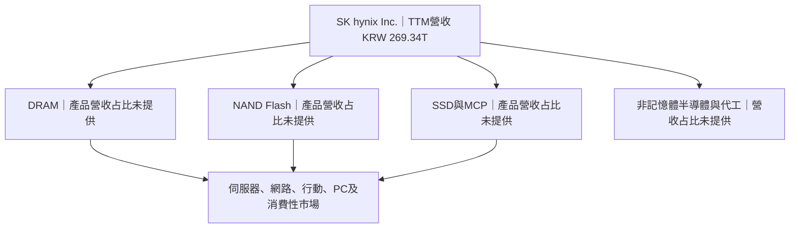
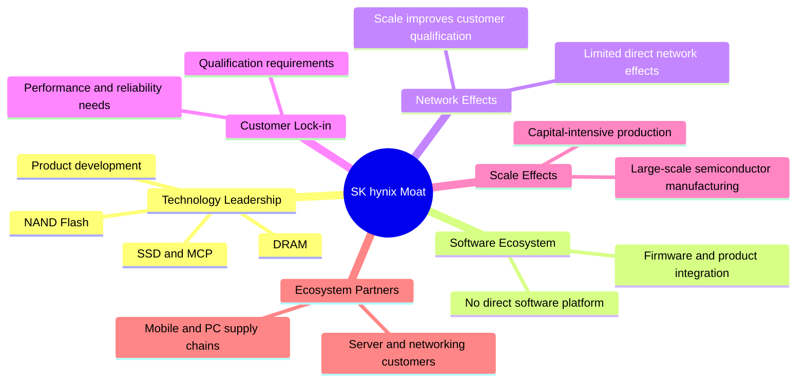
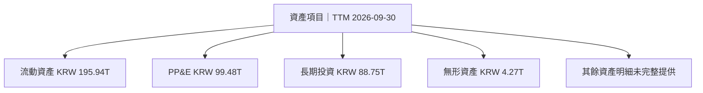
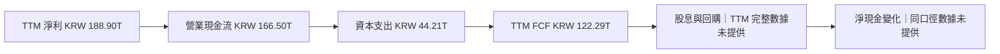
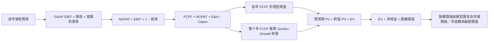
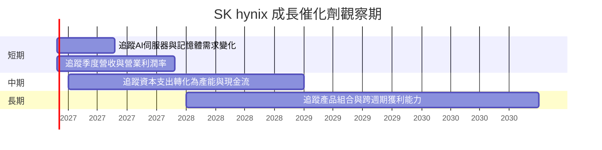
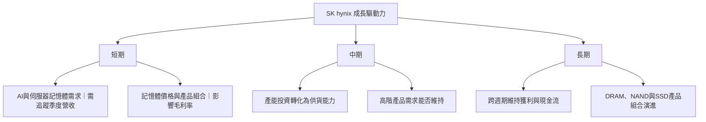
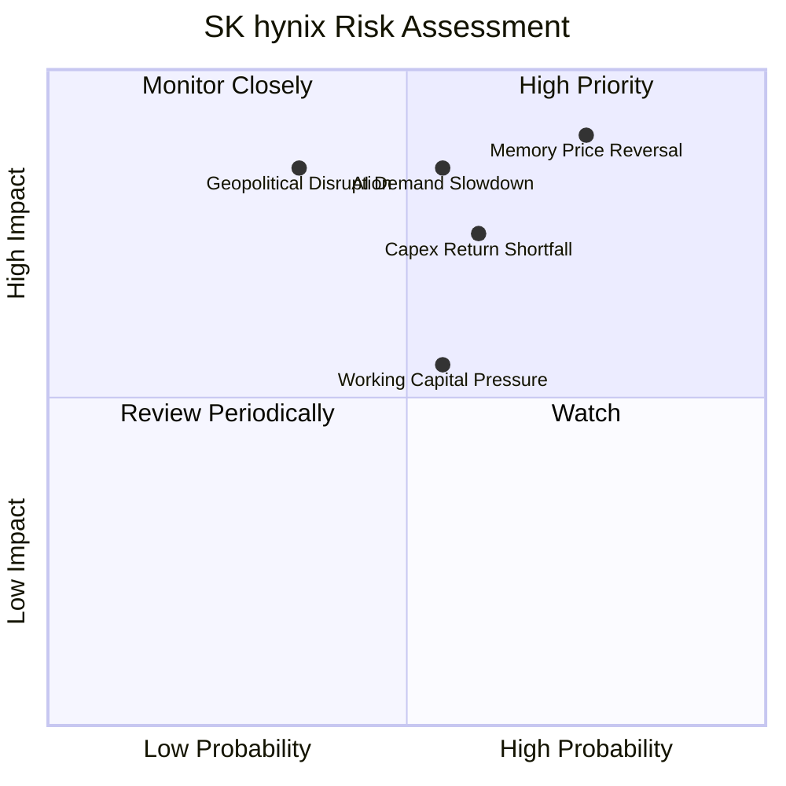
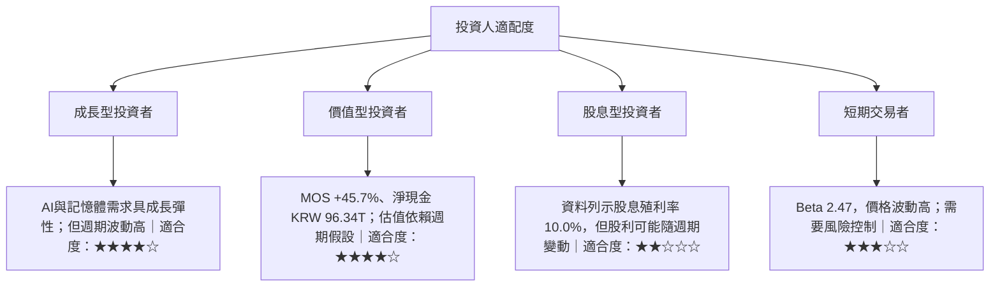

# SKHY 基本面深度分析報告
> **報告日期**：2026-11-26 ｜ **語言**：繁體中文 ｜ **數據來源**：Yahoo Finance、Finviz、StockAnalysis、Roic.ai ｜ **分析師**：CFA 級機構研究

## 目錄

| # | 章節 | 核心結論 |
|---|------|----------|
| 1 | 執行摘要 | 買入；加權合理價值 $204.49；MOS +45.7% |
| 2 | 公司概覽與商業模式 | DRAM、NAND 與儲存產品受益於 AI 記憶體需求；各產品營收占比未提供 |
| 3 | 損益表深度分析 | TTM 營收 KRW 269.34T，最新一季營收年增 327.9%；週期性與利潤率峰值風險並存 |
| 4 | 資產負債表分析 | 淨現金 KRW 96.34T、流動比率 3.115；CCC 為 203 天 |
| 5 | 現金流量深度分析 | TTM FCF KRW 122.29T、FCF Yield 11.62%；資本支出仍具週期性 |
| 6 | 獲利能力與資本效率 | 營業利益率高，但最新 ROIC 缺值，無法確認其高於 14.00% WACC |
| 7 | 相對估值分析 | SK hynix P/E 低於同業中位數，但記憶體產業獲利高度週期化 |
| 8 | DCF 內在價值評估 | 基準 DCF $266.59；加權合理價值 $204.49；MOS +45.7% |
| 9 | 成長催化劑 | AI 伺服器與高頻寬記憶體需求是主要質化催化劑；TAM 數據未提供 |
| 10 | 風險矩陣 | 記憶體價格反轉、資本支出與地緣政治為主要風險 |
| 11 | 投資建議 | 買入；現價 $111.14，建議買入區間 $111.14–$184.04 |

---

## 1. 執行摘要

最新收盤價為 **2026-11-25 的 $111.14**。TTM 營收為 **KRW 269.34T（約 USD 200.60B）**，最新一季營收年增 **327.9%**，TTM 營業利益率 **74.5%**，TTM FCF **KRW 122.29T（約 USD 91.08B）**，淨現金 **KRW 96.34T（約 USD 71.75B）**。估值模型給出 DCF 基準值 **$266.59**，但依循週期性公司的固定估值權重後，加權合理價值為 **$204.49**；按該價值計算 MOS 為 **+45.7%**，規則 20 評級為 **買入**。最新 ROIC 未提供，因此不能以當期 ROIC 高於 WACC 作為買入依據；模型 WACC 為 **14.00%**。

### 1.0 一頁式投資儀表板

| 項目 | 內容 |
|------|------|
| **投資論點（3 句）** | ① 最新一季營收年增 **327.9%**，但這是單季成長率而非 TTM 成長率，反映記憶體復甦的高基期反彈。② TTM FCF **KRW 122.29T**、淨現金 **KRW 96.34T**，提供投資與週期下行緩衝。③ 加權合理價值 **$204.49**，相對 $111.14 收盤價的 MOS 為 **+45.7%**。 |
| **綜合評分** | **7.9/10**（引用 1.1 評分卡） |
| **財務健康** | 🟢 TTM 淨現金 KRW 96.34T，流動比率 3.115；但 CCC 203 天，營運資金占用仍高 |
| **ROIC vs WACC** | ROIC：N/A（最新值未提供） vs WACC：14.00%；目前無法直接判定當期是否創造超額報酬 |
| **FCF 趨勢** | FY2023 至 FY2025 FCF 由 KRW -4.50T 回升至 KRW 24.79T；TTM FCF KRW 122.29T，FCF Yield **11.62%** |
| **估值** | Forward P/E **2.75x** ｜公司 EV/EBITDA：N/A（幣別口徑不一致）｜FCF Yield **11.62%** |
| **DCF 內在價值（基準）** | **$266.59** ｜現價相對 DCF 折價 **-58.3%**（折溢價定義：現價 ÷ DCF 價值 − 1） |
| **安全邊際（MOS）** | **+45.7%**＝($204.49 − $111.14) ÷ $204.49；🟢 高於 25% |
| **預期報酬（基準情境）** | DCF 基準情境相對現價 **+139.9%**；此為模型情境價值相對現價的差額，不是年化 12 個月報酬預測 |
| **關鍵風險（前二）** | 記憶體價格／需求反轉；AI 資本支出與新產能投資回報低於預期 |
| **評級 + 信心度** | 🟢 **買入** ｜信心：中（估值折價與資產負債表有利，但週期和模型假設風險高） |

### 1.1 綜合評分卡

| 維度 | 評分（1–10） | 主要依據（引用數字與其來源章節） |
|------|--------------|----------------------------------|
| 成長性 | 8.5 | 最新一季營收年增 327.9%，但 TTM 成長率 N/A；詳見第 3 章 |
| 獲利能力 | 8.0 | TTM 營業利益率 74.5%、淨利率 70.1%；最新 ROIC 與 F-Score N/A；詳見第 3、6 章 |
| 財務健康 | 8.0 | 淨現金 KRW 96.34T、流動比率 3.115；CCC 203 天；詳見第 4 章 |
| 估值 | 8.5 | MOS +45.7%；Forward P/E 2.75x，低於同業中位數 2.9x；詳見第 7、8 章 |
| 護城河 | 8.0 | DRAM、NAND、SSD 等產品組合及大規模製造能力；產品營收占比和市場份額數據未提供；詳見第 2 章 |
| 管理層與資本配置 | 6.5 | FY2025 SBC KRW 414.11B、股利 KRW 1.68T；回購及資本配置目標資料不足；詳見第 3、5 章 |
| **綜合評分** | **7.9** | 六項算術平均： (8.5 + 8.0 + 8.0 + 8.5 + 8.0 + 6.5) ÷ 6 = 7.9167，四捨五入至一位小數 |

### 1.2 五大投資論點 + 三大核心風險

| 類型 | 項目 | 具體依據 | 信心度 |
|------|------|----------|--------|
| 🟢 **投資論點①** | AI 記憶體需求帶動營收加速 | 最新一季營收 KRW 104.62T，年增 327.9%；需求增長推升產品利用率與售價時，可能放大營業槓桿 | 🟢 高 |
| 🟢 **投資論點②** | 現金流與淨現金支撐投資週期 | TTM FCF KRW 122.29T，淨現金 KRW 96.34T，可支應資本支出與週期下行 | 🟢 高 |
| 🟢 **投資論點③** | 目前估值反映低於基準模型的市場預期 | 收盤價 $111.14，DCF 基準值 $266.59；加權合理價值 $204.49 | 🟢 中 |
| 🟢 **投資論點④** | 高毛利與高營業利益率改善自我融資能力 | TTM 毛利率 77.4%、營業利益率 74.5%；若價格和組合維持，現金創造能力強 | 🟢 中 |
| 🟢 **投資論點⑤** | 淨現金降低財務槓桿風險 | 現金及短期投資 KRW 114.46T，總債務 KRW 18.13T | 🟢 高 |
| 🟡 **風險①** | 利潤率處於高峰、下行彈性大 | TTM 營業利益率 74.5%，明顯高於 FY2025 約 48.6%；降價或供給增加可快速壓低利潤 | 🟡 中 |
| 🔴 **風險②** | DCF 對長期成長與利潤率假設敏感 | 基準模型假設首年營收成長 30.0%，但模型以最新單季年增率為錨，且該數字不能代表 TTM 成長 | 🔴 高 |
| 🔴 **風險③** | 營運資金與高資本支出可能擠壓現金 | CCC 203 天；TTM Capex KRW 44.21T，記憶體擴產需持續資本投入 | 🔴 中 |

### 1.3 快速統計卡片

| 指標 | 公司實際值（期間） | 同業中位數 | 狀態 |
|------|--------------------|------------|------|
| 營收成長（TTM） | **N/A** | — | 🟡 TTM 比較值缺失 |
| 營收成長（最新一季年增） | **327.9%** | 377.9% | 🟢 高增長，低於 MU／SNDK 中位數 |
| 毛利率（TTM） | **77.4%** | 80.0% | 🟢 高，但低於三家同業中位數 |
| 營業利益率（TTM） | **74.5%** | — | 🟢 高水準，週期高峰風險需考量 |
| ROIC（TTM） | **N/A** | — | 🟡 最新數據缺失 |
| Forward P/E | **2.75x** | 2.9x | 🟢 略低於同業中位數 |
| FCF Yield（TTM） | **11.62%** | — | 🟢 現金流收益率高 |
| Piotroski F-Score | **N/A / N/A** | — | 🟡 缺少兩個相隔一年的 SEC TTM 期間 |

### 1.4 投資結論

```text
╔══════════════════════════════════════════════════════════════════╗
║                    📊 投資結論摘要                               ║
╠══════════════════════════════════════════════════════════════════╣
║  評級：買入（依加權合理價值 MOS +45.7%，符合規則 20）             ║
║  價格（2026-11-25 收盤）：$111.14                                ║
║  DCF 內在價值（基準）：$266.59（現價折價 58.3%）                 ║
║  安全邊際 MOS：+45.7%（＝(加權合理價值−現價)÷加權合理價值）      ║
║  加權合理價值（8.8）：$204.49                                    ║
║  DCF 情境價值：                                                   ║
║    悲觀情境：$129.11（+16.2%）                                    ║
║    基準情境：$266.59（+139.9%）                                   ║
║    樂觀情境：$524.43（+371.9%）                                   ║
║  綜合評分：7.9/10（引用 1.1）                                    ║
║  適合投資人：能承受記憶體週期波動、採分批布局的長線投資人        ║
╚══════════════════════════════════════════════════════════════════╝
```

---

## 2. 公司概覽與商業模式

### 2.1 業務結構與收入來源

SK hynix 是韓國半導體公司，業務涵蓋 DRAM、NAND Flash、SSD、MCP 及非記憶體代工。公司 TTM 營收為 **KRW 269.34T**，但財務數據未提供各產品線營收及占比，故不以未經披露的數字拆分。



公司主要營收來自半導體產品銷售。軟體或服務收入占比未提供，不另行估算。

### 2.2 市場份額

市場份額數據未提供，因此不繪製市占圖，也不填入估算比例。可確認的是，SK hynix 的 TTM 營收達 KRW 269.34T，最新一季營收年增 327.9%；Peer multiples 顯示 MU、SNDK 及 WDC 同期營收年增分別為 379.3%、377.9% 及 55.5%。這顯示 SK hynix 處於高速復甦週期，但單季增幅不能直接等同市場份額提升。

### 2.3 競爭護城河分析



### 2.4 護城河強度

| 護城河項目 | 強度（強／中／弱） | 證據（引用數字或事實） | 會削弱它的情況 |
|------------|--------------------|------------------------|----------------|
| 技術與產品能力 | 強 | DRAM、NAND、SSD、MCP 多產品組合；TTM 營業利益率 74.5% | 技術迭代落後、產品良率或性能不足 |
| 規模效應 | 強 | TTM 營收 KRW 269.34T、員工 47,639 人 | 產能利用率下降、固定成本無法吸收 |
| 客戶認證與切換成本 | 中 | 記憶體產品需配合伺服器、網路、行動等平台驗證；個別客戶數據未提供 | 競品完成認證、客戶多源採購 |
| 軟體生態系 | 弱 | 公司產品以半導體硬體為主，軟體收入未提供 | 競爭者提供更完整的軟硬體方案 |
| 網路效應 | 弱 | 未見可量化的直接網路效應數據 | 產品市場以性能、價格和供應能力競爭 |
| 生態夥伴 | 中 | 服務伺服器、網路、行動及 PC 等市場 | 主要客戶集中或供應鏈重組 |

1.1 的「護城河」評分為 **8.0/10**，理由是公司具備多產品線與規模化製造基礎，但市場份額、客戶集中度及產品營收占比未提供，難以量化其競爭優勢持續性。

---

## 3. 損益表深度分析

### 3.1 年度收入成長趨勢（近 4 年）

FY2022 至 FY2025 年營收分別為 KRW 44.62T、32.77T、66.19T、97.15T。FY2023 下滑後，FY2024 與 FY2025 出現反彈；FY2022 至 FY2025 收入 CAGR 約 **29.5%**，但該結果受記憶體週期低谷及復甦影響，不宜視為穩態增長率。

```text
╔══════════════════════════════════════════════════════════════════╗
║             SK hynix 年度收入趨勢（FY2022–FY2025）               ║
╠══════════════════════════════════════════════════════════════════╣
║  FY2022  KRW 44.62T  █████████░░░░░░░░░░░░░  YoY：N/A          ║
║  FY2023  KRW 32.77T  ███████░░░░░░░░░░░░░░░  YoY：-26.57% 🔴   ║
║  FY2024  KRW 66.19T  ██████████████░░░░░░░░  YoY：+102.02% 🟢 ║
║  FY2025  KRW 97.15T  ████████████████████░░  YoY：+46.76% 🟢  ║
╠══════════════════════════════════════════════════════════════════╣
║  FY2022–FY2025 收入 CAGR：約 +29.5%                              ║
╚══════════════════════════════════════════════════════════════════╝
```

FY2023 營收下滑與記憶體市場週期性低迷一致；FY2024、FY2025 的反彈則顯示需求和定價環境改善。2026 最新季度資料進一步顯示復甦加速，但 TTM 成長率仍為 N/A。

### 3.2 季度收入趨勢分析

單季營收資料以 KRW 計，QoQ 由相鄰季度營收計算；最新一季 YoY 使用資料來源提供的單季年增率。

| 季度 | 營收 | QoQ | YoY | 備註 |
|------|------:|----:|----:|------|
| 2025-12-31 | KRW 32.83T | — | +66.07% | 2025 年末季度 |
| 2026-03-31 | KRW 52.58T | +60.2% | +198.07% | 復甦加速 |
| 2026-06-30 | KRW 79.32T | +50.9% | +256.78% | 營收持續擴大 |
| 2026-09-30 | KRW 104.62T | +31.9% | +327.9% | 最新季度增幅仍高，QoQ 增速較前兩季放緩 |

收入由 2026 年第一季 KRW 52.58T 增至第三季 KRW 104.62T，表明營收規模仍在擴張；但 QoQ 增速從 60.2% 降至 31.9%，需觀察後續季度是否進一步降速。

### 3.3 利潤率演變分析

| 利潤率指標 | FY2022 | FY2023 | FY2024 | FY2025 | 趨勢 | 評估 |
|------------|--------|--------|--------|--------|------|------|
| **毛利率** | 35.0% | -1.6% | 48.1% | 60.4% | 低谷後快速回升 | 🟢 但週期性高 |
| **營業利益率** | 15.3% | -23.6% | 35.5% | 48.6% | 由虧轉盈並擴張 | 🟢 |
| **淨利率** | 5.0% | -27.8% | 29.9% | 44.2% | 週期復甦明顯 | 🟡 年度波動大 |
| **TTM 毛利率** | — | — | — | **77.4%** | 2026 TTM 顯著高於 FY2025 | 🟡 可能接近週期高位 |
| **TTM 營業利益率** | — | — | — | **74.5%** | 2026 TTM 顯著擴張 | 🟡 高利潤率持續性待驗證 |

上述 FY 利潤率由年度營收與毛利、營業利益、淨利計算。營收與利潤率同步回升，通常反映記憶體產品價格、利用率及產品組合改善；但資料未提供各項因素貢獻拆分，因此不能將利潤率擴張全數歸因於單一業務。TTM 營業利益率 74.5% 高於 FY2025 約 48.6%，基準 DCF 因此假設利潤率逐步回落至第十年 35.5%。

### 3.4 費用結構分析

資料未提供完整 TTM 費用科目拆分，也未提供可重建的費用結構百分比，故不繪製 pie chart。FY2025 研發費用為 KRW 6.47T，約占 FY2025 營收 KRW 97.15T 的 6.7%；研發投入有助於產品迭代，但資本密集型半導體業的完整成本結構還包含製造、折舊與設備投資，不能只以研發費用代表整體費用負擔。

### 3.5 季度 EPS 趨勢與盈餘品質（Quality of Earnings）

過去四季 EPS 實際值可由不同來源看到，但一致口徑的市場預期數據缺失，因此無法判斷「超預期／不及預期」。2026-06-30、2026-09-30 的 EPS Est 及 EPS Act 欄位均為 nan。季度淨利則於 2026 年第二季達 KRW 93.82T，第三季回落至 KRW 39.53T，QoQ 下滑約 **57.9%**，顯示季度淨利波動不能以單一季度外推。

| 盈餘品質項目 | 數值／占比 | 評估 |
|--------------|-----------|------|
| 股權薪酬 SBC / 營收 | 最新季度 SBC KRW 3.57T ÷ 營收 KRW 104.62T = **3.4%**；TTM SBC N/A | 🟡 單季占比具重要性；由於 TTM 其餘季度資料不完整，不能以單季值替代 TTM |
| SBC / 營業現金流 | TTM SBC N/A；TTM OCF KRW 166.50T | 🟡 無法計算完整 TTM 比率；FY2025 SBC KRW 414.11B |
| FCF / 淨利（現金轉換率） | KRW 122.29T ÷ KRW 188.90T = **64.7%** | 🟡 有正現金流支撐，但 FCF 低於淨利；可能反映資本支出與營運資金需求 |
| 一次性／非經常性損益 | N/A（資料未提供明細） | 🟡 無法確認季度淨利大幅變動是否包含一次性項目 |
| 有效稅率異常 | **14.9%**（最新年度有效稅率） | 🟢 模型採用此稅率；缺少歷年稅務明細，無法判斷其長期代表性 |
| 資本化支出 vs 費用化 | TTM Capex KRW 44.21T；資本化政策明細未提供 | 🟡 大額設備資本支出由資產折舊逐期認列，需留意折舊與資本化政策對期間利潤的影響 |

**盈餘品質結論**：TTM FCF KRW 122.29T，顯示獲利有現金流支撐，但 FCF/淨利約 64.7%，並非淨利全數轉為可分配現金。TTM SBC 不完整，無法量化全年稀釋成本；第三季 SBC KRW 3.57T 的單季占比 3.4% 值得追蹤。基準 DCF 使用 GAAP EBIT 且不另扣 SBC，避免重複扣減；估值可靠度仍受週期性和一次性損益資料缺漏限制。

---

## 4. 資產負債表分析

### 4.1 資產結構分解

最新 TTM 資產負債表列出流動資產 KRW 195.94T、PP&E KRW 99.48T、長期投資 KRW 88.75T，但缺少同一期完整總資產合計與全部資產科目，不宜繪製比例圖。



流動資產中現金與短期投資為 KRW 114.46T，應收帳款 KRW 59.19T、存貨 KRW 19.36T。現金部位提供流動性，但應收款和存貨也反映營運資金需求較高。

### 4.2 流動性與營運資金分析

| 指標 | 最新 TTM | 一年前 TTM | 變化 | 解讀 |
|------|----------|------------|------|------|
| 流動比率 | 3.115 | N/A | N/A | 流動資產相對流動負債充足 |
| 速動比率 | 2.794 | N/A | N/A | 扣除存貨後仍具流動性緩衝 |
| DSO 應收帳款天數 | 80 天 | N/A | N/A | 客戶回款約需 80 天；缺少同比數據，不判定收款趨勢 |
| DIO 存貨天數 | 143 天 | N/A | N/A | 庫存週轉週期較長，須監控產品世代與庫存跌價風險 |
| DPO 應付帳款天數 | 20 天 | N/A | N/A | 供應商付款天數較短，但不單獨推斷議價能力 |
| CCC 現金轉換週期 | 203 天 | N/A | N/A | 應收與存貨占用長，營運資金可能隨業務擴張上升 |

一年前營運資金天數沒有可比數值，故不能推斷 DSO、DIO、DPO 或 CCC 的方向變化。CCC 203 天表示現金由投入生產到收回的時間較長，若需求突然轉弱，存貨與應收款可能成為現金流壓力來源。

### 4.3 債務結構分析

```text
╔══════════════════════════════════════════════════════════════════╗
║                   SK hynix 債務健康診斷                          ║
╠══════════════════════════════════════════════════════════════════╣
║  總債務：             KRW 18.13T（約 USD 13.50B）                ║
║  現金及短期投資：     KRW 114.46T（約 USD 85.25B）               ║
║  淨現金：             KRW 96.34T（約 USD 71.75B） 🟢             ║
║  流動比率：           3.115x 🟢                                   ║
║  速動比率：           2.794x 🟢                                   ║
║  Debt/EBITDA：        N/A（同一期 EBITDA 口徑未提供）             ║
║  Interest Coverage： N/A（利息費用明細未提供）                   ║
╚══════════════════════════════════════════════════════════════════╝
```

數據來源同時列有 FY2025 年末總債務 KRW 24.76T 及最新 TTM 債務 KRW 18.13T；本報告資產負債表與估值橋接採用 VERIFIED 數據中的最新 TTM 數字，不將不同日期直接拼接。

### 4.4 股東權益趨勢

| 年度 | 股東權益 | 年度變化 |
|------|----------:|---------:|
| 2022-12-31 | KRW 63.27T | — |
| 2023-12-31 | KRW 53.50T | -15.5% |
| 2024-12-31 | KRW 73.90T | +38.1% |
| 2025-12-31 | KRW 120.52T | +63.1% |

```text
╔══════════════════════════════════════════════════════════════════╗
║                  股東權益趨勢（KRW T）                           ║
╠══════════════════════════════════════════════════════════════════╣
║  2022  63.27  ██████████░░░░░░░░░░                              ║
║  2023  53.50  █████████░░░░░░░░░░░                              ║
║  2024  73.90  ████████████░░░░░░░░                              ║
║  2025 120.52  ████████████████████                              ║
╚══════════════════════════════════════════════════════════════════╝
```

股東權益在 FY2023 下滑後，FY2024、FY2025 隨盈利恢復而增加；FY2025 年末股東權益 KRW 120.52T。該年度趨勢與周期性盈利回升相符，但不能單憑帳面權益上升推斷未來 ROIC。

---

## 5. 現金流量深度分析

### 5.1 現金流量瀑布圖

最新 TTM 淨利 KRW 188.90T、營業現金流 KRW 166.50T、Capex KRW 44.21T、FCF KRW 122.29T。股息與淨現金變化沒有完整 TTM 對應數據，故圖中不填入推估金額。



### 5.2 FCF 轉換率趨勢

| 年度 | FCF | 淨利 | FCF / 淨利 | 解讀 |
|------|----:|-----:|-----------:|------|
| FY2022 | KRW -4.97T | KRW 2.23T | -222.9% | 資本支出與營運週期下現金流為負 |
| FY2023 | KRW -4.50T | KRW -9.11T | 49.4% | 淨利為負，比例解讀有限 |
| FY2024 | KRW 13.13T | KRW 19.79T | 66.4% | 獲利恢復並轉正 FCF |
| FY2025 | KRW 24.79T | KRW 42.92T | 57.7% | 現金流增加，但低於淨利增長規模 |
| TTM 至 2026-09-30 | KRW 122.29T | KRW 188.90T | 64.7% | 現金轉換為正，仍受資本開支影響 |

### 5.3 自由現金流趨勢

```text
╔══════════════════════════════════════════════════════════════════╗
║           自由現金流趨勢（年度 FCF，KRW T）                      ║
╠══════════════════════════════════════════════════════════════════╣
║  FY2022  -4.97  ◀██░░░░░░░░░░░░░░░░░░░░                         ║
║  FY2023  -4.50  ◀██░░░░░░░░░░░░░░░░░░░░                         ║
║  FY2024  13.13   █████░░░░░░░░░░░░░░░                          ║
║  FY2025  24.79   ██████████░░░░░░░░░░                          ║
║  TTM     122.29  ████████████████████                           ║
╠══════════════════════════════════════════════════════════════════╣
║  TTM FCF Yield：11.62%｜FCF 定義：營業現金流 − 資本支出          ║
╚══════════════════════════════════════════════════════════════════╝
```

TTM FCF 遠高於 FY2025 年度值，應理解為最新四季記憶體景氣與現金流處於強勢階段，而非穩態自由現金流預測。

### 5.4 資本配置評估

資本配置比例圖所需的 TTM 股息、回購、債務償還及留存現金完整金額未提供，因此不繪製 pie chart。

| 項目 | 可得數據 | 評估 |
|------|----------|------|
| 資本支出 | TTM KRW 44.21T | 半導體製造需持續投資；回報受供需與產品組合影響 |
| 股利 | FY2025 支付 KRW 1.68T；TTM 完整數據未提供 | 與 TTM FCF 相比規模較小，但分紅政策及週期調整規則未提供 |
| 回購 | N/A | 未提供可核實金額 |
| 債務變化 | 最新總債務 KRW 18.13T | 淨現金位置仍充裕 |
| 留存現金 | 現金及短期投資 KRW 114.46T | 可提高擴產及週期下行的彈性 |

---

## 6. 獲利能力與資本效率

### 6.1 ROE / ROA / ROIC 趨勢

| 指標 | 最新可得值 | 歷史／期間 | 評估 |
|------|------------:|------------|------|
| ROE | 92.5% | TTM | 高回報，但最新 ROE 受週期性獲利放大 |
| ROA | 46.4% | TTM | 資產獲利能力高，仍可能隨記憶體價格反轉而回落 |
| ROIC | N/A | 最新 TTM 未提供 | 不以其他期間數字替代 |
| Roic.ai 歷史 ROIC | 31.27% | 2018 年資料 | 年份過舊，不代表 2026 年資本回報 |
| WACC | 14.00% | 資本成本模型 | 第 8.2 節採用相同數值 |

### 6.2 ROIC vs WACC 分析（核心價值創造判斷）

最新 ROIC 缺失，故不能作出「當期 ROIC 高於 WACC」的肯定結論。成本資本輸入依指定數值引用：無風險利率 4.85%、ERP 5.00%、調整後 Beta 1.98、股權成本 14.73%、稅前債務成本 5.10%、稅率 14.9%、股權／債務權重 98.3%／1.7%，計算 WACC 為 14.56%，並因區間上限採用 **14.00%**。

```text
╔══════════════════════════════════════════════════════════════════╗
║                ROIC vs WACC 深度分析                            ║
╠══════════════════════════════════════════════════════════════════╣
║  WACC 輸入：                                                     ║
║  ├── 無風險利率（10Y 美債）：4.85%                               ║
║  ├── ERP：5.00%                                                  ║
║  ├── 原始 Beta：2.47；調整後 Beta：1.98                         ║
║  ├── 股權成本（資料列值）：14.73%                               ║
║  ├── 稅前債務成本：5.10%；稅率：14.9%                           ║
║  ├── 股權／債務權重：98.3%／1.7%                                ║
║  ├── 計算 WACC：14.56%                                          ║
║  └── 採用 WACC：14.00%（受 7%–14% 範圍上限限制）                ║
║                                                                  ║
║  最新 ROIC：N/A（資料未提供）                                    ║
║  EVA = ROIC − WACC：N/A，無法判斷當期創造或摧毀價值              ║
╚══════════════════════════════════════════════════════════════════╝
```

數據中列示 Ke = 14.73%，但以展示到小數點後兩位的輸入直接代入 CAPM，`4.85% + 1.98 × 5.00% = 14.75%`。這 0.02 個百分點差異可能來自底層未四捨五入輸入；本報告依指定資料採用其 Ke 及 WACC 結果，不自行替換。過去 Roic.ai 顯示 2018 年 ROIC 31.27%，但距今太久，不能用來替代最新值。

### 6.3 杜邦三因素分解

| 因素 | 數值（TTM） | 解讀 |
|------|-------------|------|
| 淨利率 | N/A | 品質指標計算欄位為 N/A |
| 資產週轉率 | N/A | 品質指標計算欄位為 N/A |
| 權益乘數 | N/A | 品質指標計算欄位為 N/A |
| **ROE** | **N/A** | 財務數據品質區塊指出淨利、營收、總資產或正權益資料不足以計算一致口徑杜邦分解 |

### 6.4 財務體質：Piotroski F-Score

Piotroski F-Score 為 **N/A**；需要相隔一年且來自 SEC 申報資料的兩個 TTM 期間。資料來源是 Yahoo 季度報表，無法產出可核對的九項測試結果，故不推算或補填個別測試。

| 測試 | 結果 | 解讀 |
|------|------|------|
| 盈利能力九項測試 | N/A | 缺少所需的兩期 SEC 申報口徑資料 |
| 營運效率／資產品質測試 | N/A | 不以不完整資料替代 |
| 財務槓桿／流動性測試 | N/A | 不以不完整資料替代 |
| **Piotroski F-Score** | **N/A** | 無法得出有效分數 |

---

## 7. 相對估值分析

### 7.1 同業估值比較表格

SK hynix 的 P/E 取自市場估值資料；Peer multiples 依 Yahoo Finance 數據。SK hynix P/S 與 EV/EBITDA 因報價為 USD、財報為 KRW 而未提供一致口徑，故不混用幣別計算。

| 估值指標 | **SK hynix** | **MU** | **SNDK** | **WDC** | 本公司評估 |
|----------|----------:|------:|--------:|------:|-----------|
| **Trailing P/E** | 6.15x | 8.1x | 4.7x | 9.6x | 🟢 低於 MU、WDC，高於 SNDK |
| **Forward P/E** | 2.75x | 2.9x | 2.1x | 6.8x | 🟢 略低於三家中位數 2.9x |
| **P/S Ratio** | N/A | 5.1x | 2.9x | 7.0x | 🟡 SK hynix 幣別口徑不一致，無法直接比較 |
| **EV / EBITDA** | N/A | 5.9x | 3.7x | 16.1x | 🟡 SK hynix 幣別口徑不一致，無法直接比較 |
| **最新一季營收年增** | 327.9% | 379.3% | 377.9% | 55.5% | 🟢 高增長，低於 MU 與 SNDK |
| **TTM 毛利率** | 77.4% | 80.7% | 80.0% | 52.6% | 🟢 高於 WDC，低於 MU、SNDK |

Forward P/E 低可能反映預期盈餘大幅回升，不應視為週期中性估值。當盈餘處於高峰，低 P/E 可能是市場預期未來 EPS 正規化的結果。

### 7.2 歷史估值區間分析

```text
╔══════════════════════════════════════════════════════════════════╗
║                   歷史估值區間分析                              ║
╠══════════════════════════════════════════════════════════════════╣
║  歷史 P/E 區間及當前歷史百分位：N/A                              ║
║  原因：未提供 Valuation vs own history 可核對數據                ║
║  當前 Trailing P/E：6.15x；Forward P/E：2.75x                    ║
╚══════════════════════════════════════════════════════════════════╝
```

### 7.3 情境價值（Bear / Base / Bull）

下表照錄 DCF MODEL 三情境。模型情境中的市場環境解讀為分析判斷，不代表公司已公布指引。

| 情境 | 第 1 年營收成長 | 期末營業利潤率 | WACC | 每股價值 | 相對現價 | 機率 | 會發生的條件 |
|------|----------------|----------------|------|----------|----------|------|--------------|
| 🔴 悲觀 | 15.0% | 30.1% | 15.00% | $129.11 | +16.2% | 25% | AI／伺服器需求降溫、供給增長令價格下跌，利潤率回歸更快 |
| 🟡 基準 | 30.0% | 35.5% | 14.00% | $266.59 | +139.9% | 50% | 首年高速增長後，營收增速逐年降至 3.0%，營業利潤率逐步回落 |
| 🟢 樂觀 | 45.0% | 39.0% | 13.00% | $524.43 | +371.9% | 25% | 高階記憶體需求維持、供給紀律良好，長期利潤率高於基準情境 |

### 7.4 相對估值隱含價格區間

```text
╔══════════════════════════════════════════════════════════════════╗
║                  估值方法每股價值（USD）                        ║
╠══════════════════════════════════════════════════════════════════╣
║  $111.14 現價 ── $144.95 同業 EV/EBITDA ── $145.30 同業 P/S      ║
║                         $253.07 分析師共識                       ║
║                                      $266.59 基準 DCF             ║
╚══════════════════════════════════════════════════════════════════╝
```

| 方法 | 每股價值 | 相對現價 | 依據 |
|------|---------:|---------:|------|
| 同業 EV/EBITDA | $144.95 | +30.4% | MU、SNDK、WDC 同業中位數 5.9x × TTM EBITDA，加回淨現金 |
| 同業 P/S | $145.30 | +30.7% | MU、SNDK、WDC 同業中位數 5.1x × TTM 營收 |
| 分析師共識 | $253.07 | +127.7% | 14 位分析師平均目標價 |

分析師目標價區間為 $164 至 $400；此為外部共識，與 DCF 假設不同，不應視為模型保證。

---

## 8. DCF 內在價值評估（Discounted Cash Flow）

> 本章採用程式計算的 DCF MODEL 數據；金額以 KRW billions 為單位，換算美金時使用 2026-11-25 匯率 **1 USD = KRW 1,342.65**。模型列示的 DCF 數字照錄；顯示值四捨五入可能造成細微尾差。

### 8.0 估值推理鏈（Thinking Logic）

**Step 1 — 價值來源與主導變數**

模型將 SK hynix 價值視為記憶體主業現金流的折現值；目前 DRAM、NAND、SSD、MCP 各線營收占比均未提供，因此無法按業務拆分現金流。TTM 營收為 KRW 269.34T，TTM 營業利益率 74.5%，TTM FCF KRW 122.29T。由 8.6 敏感度矩陣可見，WACC 與永續成長率 g 對估值有明顯影響；業務端最重要的長期風險是高利潤率是否能延續。

**Step 2 — 模型選擇**

| 決策點 | 本報告採用 | 理由（含數字） | 曾考慮但否決 | 否決理由 |
|--------|-----------|----------------|--------------|----------|
| 現金流定義 | FCFF | 使用 GAAP EBIT，對應 WACC 折現後得企業價值 | FCFE | 資本結構與融資成本納入 WACC 處理 |
| 預測期 N | 10 年 | DCF MODEL 固定期間 | 5 年 | 不符合指定模型，不能另建模型 |
| 終值方法 | Gordon Growth | 模型基準 g=3.0%，WACC=14.00%，WACC>g | 退出倍數作主估值 | 模型基準採 Gordon Growth；退出倍數數據未提供 |
| EBIT 基礎 | GAAP EBIT | DCF 模型列明 GAAP EBIT | 非 GAAP EBIT | 避免加回 SBC 後漏計股東成本 |

**Step 3 — 重要假設推導鏈**

- **營收增長路徑**：錨點＝最新一季營收 YoY 327.9%，但這是單季值，不是 TTM 成長率；模型把首年成長率限制在 0%–30% 並採用 30.0% → 逐年線性降至第十年 3.0% → **採用模型逐年 30.0%、27.0%、24.0%、21.0%、18.0%、15.0%、12.0%、9.0%、6.0%、3.0%** → 曾考慮直接沿用 327.9%，但因單季週期增長不可合理外推而否決。
- **期末營業利潤率**：錨點＝TTM 74.5%，FY2025 約 48.6% → 記憶體高峰利潤率可能正常化 → **採用第十年 35.5%，由 74.5% 線性遞減** → 曾考慮長期維持 74.5%，但這會忽略記憶體價格和供給週期，故否決。
- **永續成長率 g**：錨點＝模型採用 3.0%，並低於 14.00% WACC → 以成熟期長期增長作估值延伸 → **採用 3.0%** → 曾考慮更高 g，但沒有長期 GDP 或公司長期財測數據支持，故不採用。
- **預測期 N**：錨點＝DCF MODEL 明列 10 年 → 記憶體週期雖短於十年，但模型用逐年淡出反映成熟化 → **採用 10 年** → 曾考慮較短週期，但不能更改模型輸入。
- **Capex／營收**：錨點＝TTM Capex KRW 44.21T ÷ TTM 營收 KRW 269.34T，模型採用 16.4% 作首年值 → 假設隨營收成熟降至 6.4% → **採用 16.4% 線性淡出至 6.4%** → 曾考慮長期固定於 TTM 16.4%，但模型假設成熟期資本密度下降；此假設有樂觀風險。
- **D&A／營收**：錨點＝TTM 5.8% → **採用 5.8% 固定**；不另改值。
- **稅率**：錨點＝最新年度有效稅率 14.9% → **採用 14.9%**；歷年稅率資料不足，不外推其他值。
- **ΔWC／營收增額**：資料未提供明確模型輸入；**營運資金未納入模型**，不以估算補入。
- **SBC 與年稀釋率**：模型採組合 **(A)**，GAAP EBIT 已含 SBC 費用，FCFF 不再扣 SBC，股數不再稀釋；因此 SBC 影響在營業費用中計入一次。
- **終值方法**：模型提供 Gordon Growth TV；退出倍數法所需 FY+10 EBITDA 估值倍數未在 DCF MODEL 提供，故不自建另一個終值。
- **WACC**：錨點＝資本成本區塊計算 14.56%，受 7%–14% 區間上限約束 → **採用 14.00%** → 不採用未受限 14.56%，因模型明確規定使用受限值。

**Step 4 — 最脆弱假設**

最脆弱之處是首年營收成長 30.0% 及高利潤率的持續時間；若需求與價格比模型預期更快正常化，價值會下降，情境模型的悲觀值為 **$129.11**，相對現價仍為 +16.2%。

**Step 5 — 計算路徑**



### 8.1 模型假設總表（Model Inputs）

| 假設項目 | 採用值 | 依據／來源 | 敏感度 |
|----------|--------|-------------|--------|
| 預測期長度 N | 10 年 | DCF MODEL 明列；逐年營收及利潤率淡出 | 🟡 中 |
| 營收成長路徑 | FY+1 30.0% 線性降至 FY+10 3.0% | FY+1 錨定最新季度 YoY 327.9%，但限制在 0%–30%；TTM 成長 N/A | 🔴 高 |
| 營業利潤率 | 74.5% 降至 35.5% | TTM 74.5% 起步，淡出至含 TTM 的近五年年度中位數 | 🔴 高 |
| 有效稅率 | 14.9% | 最新年度有效稅率 | 🟢 低 |
| Capex／營收 | 16.4% 降至 6.4% | TTM 資本支出強度，逐步淡出至約 1.1 倍 D&A | 🔴 高 |
| D&A／營收 | 5.8% | TTM 比率，保持不變 | 🟢 低 |
| 營運資金變動 | 未建模 | DCF MODEL 明列 working capital is not modelled | 🟡 中 |
| EBIT 基礎 | GAAP | 模型採 GAAP EBIT | 🟡 中 |
| SBC 處理 | GAAP EBIT 已扣 SBC，不另扣 FCFF | DCF MODEL 組合 (A) | 🟡 中 |
| 年稀釋率 | 0%／固定股數處理 | 與組合 (A) 相容；模型未另增稀釋 | 🟡 中 |
| 永續成長率 g | 3.0% | DCF MODEL 假設，低於 14.00% WACC | 🔴 高 |
| 終值方法 | Gordon Growth | DCF MODEL 指定 | 🔴 高 |
| WACC | 14.00% | 計算值 14.56%，受 7%–14% 區間上限約束 | 🔴 高 |

本模型的 FCFF 定義是 `NOPAT + D&A − Capex`，**沒有 ΔWC 列**，因模型明確未納入營運資金變動。組合 **(A)**：GAAP EBIT 已含 SBC 費用，FCFF 不再扣 SBC，且股數不再另行稀釋，故 SBC 只計入一次。

### 8.2 折現率推導（WACC）

```text
╔══════════════════════════════════════════════════════════════════╗
║                    WACC 推導（折現率）                           ║
╠══════════════════════════════════════════════════════════════════╣
║  股權成本 Ke：                                                   ║
║  ├── 無風險利率 Rf：4.85%（Cost of capital 數據）                ║
║  ├── ERP：5.00%（Cost of capital 數據，假設值）                  ║
║  ├── 原始 Beta：2.47；調整後 Beta：1.98                          ║
║  ├── Beta 調整：⅔ × 2.47 + ⅓ × 1 = 1.98                        ║
║  └── Ke 資料列值：14.73%                                        ║
║                                                                  ║
║  債務成本 Kd：                                                   ║
║  ├── 稅前 Kd：5.10%（利息 ÷ 債務，來源未提供利息金額明細）        ║
║  ├── 有效稅率：14.9%                                             ║
║  └── 稅後 Kd = 5.10% × (1 − 14.9%) = 4.3401%                    ║
║                                                                  ║
║  資本結構：                                                      ║
║  ├── 股權權重：98.3%                                             ║
║  ├── 債務權重：1.7%                                              ║
║  ├── 計算 WACC：14.56%                                          ║
║  └── 採用 WACC：14.00%（限制在 7%–14% 區間）                    ║
╚══════════════════════════════════════════════════════════════════╝
```

**逐步演算（WACC）**

1. **Ke（CAPM）**：指定資料列示 `Rf 4.85% + 調整後 Beta 1.98 × ERP 5.00%`，由展示值直接計算為 `4.85% + 1.98 × 5.00% = 14.75%`；資料列 Ke 為 **14.73%**。因底層輸入可能未四捨五入，依 VERIFIED 成本資本輸入採用 Ke **14.73%**，不替換成重算值。
2. **稅前 Kd**：指定資料列示利息 ÷ 債務為 **5.10%**；利息費用金額與平均計息負債明細未提供，不能補造分子或分母。
3. **稅後 Kd**：`5.10% × (1 − 14.9%) = 5.10% × 85.1% = 4.3401%`。
4. **權重**：`E 權重 = 98.3%`；`D 權重 = 1.7%`；`98.3% + 1.7% = 100.0%`。成本資本資料使用市場市值／債務權重；Debt 以資料列示的市場權重為準，未另將無息負債納入。
5. **WACC**：`98.3% × 14.73% + 1.7% × 4.3401% = 14.4796% + 0.0738% = 14.5534% ≈ 14.56%`；模型受上限限制，**採用 14.00%**。

10 年美國公債利率資料提供值為 4.85%，但未提供精確觀測日期；ERP 5.00% 是模型假設。原始 Beta 2.47 高，故依資料採用調整後 Beta 1.98。沒有加計額外國別或規模溢酬，因成本資本區塊未提供此項。第 6.2 節與本節均採 WACC **14.00%**。

### 8.3 逐年自由現金流預測（基準情境）

以下金額單位為 **KRW billions**，折現因子採模型列示值。FCFF 依模型公式 `NOPAT + D&A − Capex`；ΔWC 未建模。

| 年度 | FY+1 | FY+2 | FY+3 | FY+4 | FY+5 | FY+6 | FY+7 | FY+8 | FY+9 | FY+10 |
|------|-----:|-----:|-----:|-----:|-----:|-----:|-----:|-----:|-----:|------:|
| 營收 | 350,138.32 | 444,675.67 | 551,397.83 | 667,191.37 | 787,285.82 | 905,378.69 | 1,014,024.13 | 1,105,286.30 | 1,171,603.48 | 1,206,751.59 |
| 營收 YoY | 30.0% | 27.0% | 24.0% | 21.0% | 18.0% | 15.0% | 12.0% | 9.0% | 6.0% | 3.0% |
| 營業利潤率 | 74.5% | 70.2% | 65.8% | 61.5% | 57.1% | 52.8% | 48.5% | 44.1% | 39.8% | 35.5% |
| EBIT（GAAP） | 260,853.17 | 311,990.95 | 362,945.99 | 410,218.08 | 449,900.38 | 478,104.93 | 491,483.37 | 487,763.23 | 466,198.18 | 427,828.34 |
| − 稅 | (38,858.25) | (46,476.04) | (54,066.60) | (61,108.53) | (67,019.85) | (71,221.37) | (73,214.30) | (72,660.12) | (69,447.66) | (63,731.86) |
| = NOPAT | 221,994.92 | 265,514.92 | 308,879.39 | 349,109.54 | 382,880.53 | 406,883.57 | 418,269.07 | 415,103.11 | 396,750.51 | 364,096.48 |
| + D&A | 20,364.52 | 25,862.94 | 32,070.04 | 38,804.75 | 45,789.61 | 52,658.05 | 58,977.01 | 64,284.95 | 68,142.04 | 70,186.30 |
| − Capex | (57,466.92) | (68,034.79) | (78,227.38) | (87,230.86) | (94,171.77) | (98,222.80) | (98,725.83) | (95,311.92) | (87,993.44) | (77,204.93) |
| − ΔWC | 未建模 | 未建模 | 未建模 | 未建模 | 未建模 | 未建模 | 未建模 | 未建模 | 未建模 | 未建模 |
| **= FCFF** | **184,892.52** | **223,343.06** | **262,722.05** | **300,683.44** | **334,498.37** | **361,318.82** | **378,520.25** | **384,076.14** | **376,899.11** | **357,077.85** |
| 折現因子 @14.00% | 0.877 | 0.769 | 0.675 | 0.592 | 0.519 | 0.456 | 0.400 | 0.351 | 0.308 | 0.270 |
| **FCFF 現值 PV** | **162,186.42** | **171,855.24** | **177,329.90** | **178,028.73** | **173,727.97** | **164,611.99** | **151,270.82** | **134,641.37** | **115,899.47** | **96,319.54** |

預測期現值合計依模型列值逐項相加：

`162,186.42 + 171,855.24 + 177,329.90 + 178,028.73 + 173,727.97 + 164,611.99 + 151,270.82 + 134,641.37 + 115,899.47 + 96,319.54 = KRW 1,525,871.45 billion`

**逐步演算（FY+1）**

1. 營收：`KRW 269,337.17B × (1 + 30.0%) = KRW 350,138.32B`。
2. EBIT：模型列示 **KRW 260,853.17B**；以列示營收與顯示利潤率直接相乘會有輕微差異，採用模型原值。
3. 稅：`KRW 260,853.17B × 14.9% = KRW 38,858.25B`。
4. NOPAT：`KRW 260,853.17B − KRW 38,858.25B = KRW 221,994.92B`。
5. D&A：模型列示 **KRW 20,364.52B**（約為營收 5.8%）。
6. Capex：模型列示 **KRW 57,466.92B**（約為營收 16.4%）。
7. ΔWC：**未建模**。
8. FCFF：`KRW 221,994.92B + KRW 20,364.52B − KRW 57,466.92B = KRW 184,892.52B`。
9. 折現及 PV：`1 ÷ (1 + 14.00%)^1 = 0.877`（三位小數）；模型 PV 為 **KRW 162,186.42B**，使用未四捨五入折現因子，故與展示到三位的因子相乘會有尾差。

**合理性自檢**

- 預測 FCF CAGR：FY+1 至 FY+10 約 **6.8%**，但 FY+1 到 FY+10 的 FCFF 是逐年推估且前段大幅增長；FY2022–FY2025 歷史 FCF 起點包含負數，無法形成有意義的同口徑 CAGR。
- FY+10 FCFF 利潤率：`357,077.85 ÷ 1,206,751.59 = 29.6%`；目前 TTM FCF 利潤率約 `122.29 ÷ 269.34 = 45.4%`。Peer 毛利率最高為 MU 80.7%，但這不是 FCF 利潤率，不能直接視為同類比較。
- 預測各年 FCFF 均為正；模型未計入營運資金需求，若實際 CCC 203 天造成營運資金額外投入，預測 FCFF 可能偏高。

```text
╔══════════════════════════════════════════════════════════════════╗
║            自由現金流：歷史實際 vs 模型預測                      ║
╠══════════════════════════════════════════════════════════════════╣
║  FY2023(實)  KRW -4.50T  ◀██░░░░░░░░░░░░░░░░░░░                  ║
║  FY2024(實)  KRW 13.13T   ███░░░░░░░░░░░░░░░░░                   ║
║  FY2025(實)  KRW 24.79T   █████░░░░░░░░░░░░░░░                   ║
║  FY+1 (預)   KRW 184.89T  ████████████████████                   ║
║  FY+10(預)   KRW 357.08T  ██████████████████████████████████████ ║
╠══════════════════════════════════════════════════════════════════╣
║  歷史 FCF 受週期與資本支出影響；模型未計入營運資金變動。         ║
╚══════════════════════════════════════════════════════════════════╝
```

### 8.4 終值計算（Terminal Value）

**適用性檢查**：`WACC 14.00% vs g 3.00% → WACC > g ✅`

| 方法 | 計算式 | 終值 TV | TV 現值 | 佔總 EV 比重 |
|------|--------|---------|---------|--------------|
| Gordon Growth | FCFF(FY+10) × (1+g) ÷ (WACC−g) | KRW 3,343,547.12B | KRW 901,901.14B | 37.1% |
| 退出倍數法 | N/A | N/A | N/A | N/A |

**逐步演算**

1. FY+10 FCFF：**KRW 357,077.85B**。
2. 分子：`357,077.85 × (1 + 3.0%) = KRW 367,790.19B`。
3. 分母：`14.00% − 3.00% = 11.00%`；`367,790.19 ÷ 11.00% = KRW 3,343,547.12B`。
4. PV(TV)：模型終值折現因子約為 0.2697，`KRW 3,343,547.12B × 0.2697 ≈ KRW 901,901.14B`。因 0.270 是三位小數顯示值，直接用 0.270 乘會產生四捨五入尾差。
5. 終值占比：`KRW 901,901.14B ÷ KRW 2,427,772.59B = 37.1%`。

模型未提供退出倍數法的必要輸入，不以同業倍數自行重建第二個終值。

### 8.5 企業價值 → 每股內在價值（Bridge）

```text
╔══════════════════════════════════════════════════════════════════╗
║              企業價值 → 每股內在價值 橋接表                      ║
╠══════════════════════════════════════════════════════════════════╣
║  預測期 FCF 現值合計            +KRW 1,525,871.45B              ║
║  終值現值 PV(TV)                +KRW   901,901.14B              ║
║  ─────────────────────────────────────────────                  ║
║  = 企業價值 EV                   KRW 2,427,772.59B              ║
║  + 淨現金                       +KRW    96,337.19B              ║
║  = 股權價值                      KRW 2,524,109.78B              ║
║  ─────────────────────────────────────────────                  ║
║  ★ 每股內在價值                  USD 266.59                     ║
║    2026-11-25 收盤價              USD 111.14                     ║
║    折溢價（現價÷DCF價值−1）       -58.3%（折價）                 ║
╚══════════════════════════════════════════════════════════════════╝
```

模型橋接算式如下：

1. **EV**：`KRW 1,525,871.45B + KRW 901,901.14B = KRW 2,427,772.59B`。
2. **股權價值**：`KRW 2,427,772.59B + KRW 96,337.19B = KRW 2,524,109.78B`。此處直接加回資料列示淨現金；其口徑為現金減債務，不能再額外重複加現金或扣債務。
3. **每股價值**：依模型原始行列，`equity value × FX 0.000744796 USD per KRW × price ÷ market cap (in USD) = USD 266.59`。因模型未提供獨立的同口徑稀釋股數及完整每股換算細節，本報告不另反推或改建股數橋接。
4. **折溢價**：`($111.14 ÷ $266.59) − 1 = -58.3%`。
5. **本節不計算 MOS**：MOS 僅在 8.8 按加權合理價值計算。

模型另列的匯率換算係數為 **0.000744796 USD per KRW**；財報換算所用匯率為 **1 USD = KRW 1,342.65**，日期為 2026-11-25。每股估值直接採用 DCF MODEL 結果。

### 8.6 敏感性分析（WACC × 永續成長率）

下表為 DCF MODEL 原始每股價值；括號內上行空間以 `(每股價值 − $111.14) ÷ $111.14` 計算，百分比取一位小數。基準格為 $266.59。

| g（列）／WACC（欄） | 12.00% | 13.00% | **14.00%（基準）** | 15.00% | 16.00% |
|-----------|------|------|------------------|------|-------|
| 2.0% | $310.55（+179.4%） | $281.78（+153.6%） | $257.81（+132.0%） | $237.53（+113.7%） | $220.16（+98.1%） |
| 2.5% | $317.71（+185.9%） | $287.21（+158.4%） | $262.01（+135.8%） | $240.83（+116.7%） | $222.79（+100.5%） |
| **3.0%（基準）** | $325.67（+193.0%） | $293.19（+163.8%） | **$266.59（+139.9%）** | $244.40（+119.9%） | $225.61（+103.0%） |
| 3.5% | $334.55（+201.1%） | $299.80（+169.8%） | $271.61（+144.4%） | $248.29（+123.4%） | $228.66（+105.8%） |
| 4.0% | $344.55（+210.0%） | $307.14（+176.4%） | $277.14（+149.4%） | $252.53（+127.2%） | $231.97（+108.7%） |

**矩陣示範格**：選擇 WACC=15.00%、g=2.0%，`15.00% > 2.0% ✅`。DCF MODEL 敏感度矩陣列示此格每股價值 **$237.53**。模型沒有提供該格逐年 PV 中間值，因此不重建另一套現金流模型；此處以矩陣原值為準。基準格 **WACC 14.00%、g 3.0% = $266.59**，與 8.5 DCF 基準每股價值一致。

**三情境 DCF（照錄模型，不改動輸入）**

| 情境 | 年 1 成長 | 第 10 年營業利潤率 | WACC | 每股價值 | 相對現價 | 機率 |
|------|---------:|------------------:|-----:|---------:|---------:|-----:|
| 🔴 悲觀 | 15.0% | 30.1% | 15.00% | $129.11 | +16.2% | 25% |
| 🟡 基準 | 30.0% | 35.5% | 14.00% | $266.59 | +139.9% | 50% |
| 🟢 樂觀 | 45.0% | 39.0% | 13.00% | $524.43 | +371.9% | 25% |
| **機率加權** | — | — | — | **$296.68** | **+166.9%** | **100%** |

情境完整逐年現金流與 FY+10 FCFF 未在 DCF MODEL 的情境表中提供，依規則不另建模型、不推造每個情境的中間數字。模型提供的機率加權核對為：`$129.11 × 25% + $266.59 × 50% + $524.43 × 25% = $296.68`（顯示值四捨五入造成尾差）。

**敏感度結論**

- g 每增加 1 個百分點，基準 WACC 14% 下價值由 g=2.0% 的 $257.81 增至 g=3.0% 的 $266.59，變化 **+$8.78／+3.4%**；由 g=3.0% 至 4.0% 為 `$277.14 − $266.59 = +$10.55`，約 **+4.0%**。
- WACC 每增加 1 個百分點，g=3.0% 下價值由 14% 的 $266.59 降至 15% 的 $244.40，變化 **−$22.19／−8.3%**；由 14% 至 13% 則增加 `$293.19 − $266.59 = $26.60`。
- 期末營業利潤率每增加 1 個百分點的估值影響：敏感度模型沒有單獨列示該變數，故 **N/A**，不自行計算。
- 就已提供的敏感度而言，WACC 變化造成的影響大於 g 的 1 個百分點變化；這與 8.0 對折現率和長期現金流持續性的關注一致。

### 8.7 反推 DCF（Reverse DCF：市場在預期什麼）

模型反推固定其餘基準值後，市場價格所隱含的年 1 營收成長率為 **2.7%**，低於基準模型年 1 成長率 30.0%；固定營業利潤率解為 **20.5%**，低於基準路徑 74.5% 至 35.5%。模型未提供反推 g 或高成長持續年數的結果，故不列數值。

| 求解的變數（一次一個） | 其餘變數設定 | 市場隱含值 | 公司歷史實際 | 判斷 |
|------------------------|--------------|--------------|--------------|------|
| 年 1 營收成長 | 其餘輸入固定為基準值 | 2.7% | 最新一季 YoY 327.9%；TTM 成長 N/A | 相對基準 30.0% 偏保守，但單季值不可直接作歷史 CAGR |
| 固定營業利潤率 | 其餘輸入固定為基準值 | 20.5% | TTM 營業利益率 74.5% | 隱含利潤正常化程度很高 |
| 永續成長率 g | 未計算 | 未計算 | — | 模型未提供解 |
| 預測期 N | 未計算 | 未計算 | — | 模型未提供解 |

基準固定輸入包括 WACC 14.00%、稅率 14.9%、Capex 率逐年淡出、預測期 10 年、FCFF 不建模營運資金、股數處理依組合 (A)。反推模型提供最終解，但未提供逐級試算軌跡，故不虛構中間點。反推結果表示，若其餘輸入維持模型基準，現價只要求較低營收增長或較低平均利潤率；惟此結論高度依賴反推模型的固定假設。

### 8.8 估值三角驗證與安全邊際

| 估值方法 | 隱含每股價值 | 上行空間（÷現價） | 權重 | 說明 |
|----------|--------------|-------------------|------|------|
| DCF（基準） | $266.59 | +139.9% | 40% | 10 年 FCFF、WACC 14.00%、終值成長率 3.0% |
| 同業 EV/EBITDA | $144.95 | +30.4% | 30% | 同業中位數 5.9x，乘 TTM EBITDA 並加回淨現金 |
| 同業 P/S | $145.30 | +30.7% | 20% | 同業中位數 5.1x，乘 TTM 營收 |
| 分析師共識目標價 | $253.07 | +127.7% | 10% | 14 位分析師平均目標價 |
| **加權合理價值** | **$204.49** | **+84.0%** | **100%** | 週期性公司固定方法與權重 |

逐步演算：

`$266.59 × 40% + $144.95 × 30% + $145.30 × 20% + $253.07 × 10%`  
`= $106.636 + $43.485 + $29.060 + $25.307`  
`= $204.488 ≈ $204.49`

公司類型為 **cyclical（週期性）**，方法及權重依固定規則採用。沒有列入同業 Forward P/E 方法，因估值方法清單沒有該方法；不得自行增刪或改權重。

```text
╔══════════════════════════════════════════════════════════════════╗
║                  估值區間與安全邊際                              ║
╠══════════════════════════════════════════════════════════════════╣
║  $129.11 ───── $111.14 ───── [$204.49] ───── $266.59 ─── $524.43║
║  悲觀 DCF       現價           加權合理值       基準 DCF   樂觀 DCF║
║                                                                  ║
║  安全邊際 MOS = ($204.49 − $111.14) ÷ $204.49 = +45.7%           ║
║  MOS 評估：🟢 高於 25%                                           ║
║  上行空間 = ($204.49 − $111.14) ÷ $111.14 = +84.0%               ║
║                                                                  ║
║  建議買入區間：$111.14 – $184.04                                 ║
║  合理持有區間：$184.04 – $224.94                                 ║
║  減碼考慮區間：高於 $224.94；接近或超過樂觀情境 $524.43 時再評估 ║
╚══════════════════════════════════════════════════════════════════╝
```

買入上限以 `加權合理價值 × (1 − 10%) = $204.49 × 90% = $184.04` 計算；合理持有區間依 MOS -10% 至 +10% 的界線換算。

> 🔎 **程式複算（Python，依本節各項自動重算）**
>
> 加權合理價值 = $266.59 × 40% + $144.95 × 30% + $145.30 × 20% + $253.07 × 10% = **$204.49**（權重合計 100%）
>
> 以價格 $111.14 計：MOS = **+45.7%**，上行空間 = **+84.0%**
>
> ✅ 與本節所寫數值一致。

### 8.9 DCF 模型的局限與失效條件

- **終值依賴度**：PV(TV) 占 EV **37.1%**，代表終值重要，但不是估值的唯一來源。
- **最脆弱假設**：年 1 營收成長採 30.0%，而 TTM 成長率缺失；若實際增速明顯低於假設，基準 DCF 會下修。營業利潤率由 74.5% 回落至 35.5%，若價格下降速度更快，估值也會下行。
- **營運資金缺口**：模型未納入 ΔWC；最新 CCC 為 203 天。若營收擴張需要大量應收與存貨投入，模型 FCFF 可能高估。
- **週期性限制**：記憶體價格、利用率與資本支出均可能急變，DCF 單點估值可靠度低於跨週期平均的情境分析；應同時參照同業 EV/EBITDA、P/S 及資產負債表。
- **風險矩陣連結**：需求反轉主要衝擊營收成長與營業利潤率；供給擴張主要影響 Capex、利用率與終值利潤率；利率上升則提高 WACC，敏感度矩陣顯示 WACC 變動會明顯改變價值。

### 8.10 複算檢核表（Audit Trail）

| # | 檢核項目 | 檢查方式 | 結果 |
|---|----------|----------|------|
| 1 | 高／中敏感度輸入有推導 | 逐項核對 8.0 與 8.1；模型本身未提供完整所有替代值試算 | ⚠️ 部分可核對，模型未提供逐項原始推導 |
| 2 | 每個假設有來歷 | 8.1 依據欄均列明資料錨點或模型來源 | ✅ |
| 3 | WACC 五步與加權 | 權重 98.3% + 1.7% = 100%；計算 14.56%，採用 14.00% | ✅（Ke 顯示值有 0.02pp 尾差，已揭露） |
| 4 | Kd 分母與權重負債範圍 | 利息及平均計息負債明細未提供，無法獨立核驗債務範圍 | ⚠️ |
| 5 | WACC 與第 6.2 節同值 | 兩節均採用 14.00% | ✅ |
| 6 | 逐年數量等於 N 且無省略 | 列出 FY+1 至 FY+10 共十年 | ✅ |
| 7 | FY+1 FCFF 與 PV | FCFF 可由 NOPAT + D&A − Capex 核對；PV 使用未四捨五入折現因子 | ✅ |
| 8 | 預測期 PV 加總 | 十項相加為 KRW 1,525,871.45B | ✅ |
| 9 | WACC > g | 14.00% > 3.00% | ✅ |
| 10 | 終值以 FY+10 現金流折現 10 期 | 模型終值基於 FY+10 FCFF | ✅ |
| 11 | EV 與淨現金橋接 | EV + 淨現金 = 股權價值，數字吻合 | ✅ |
| 12 | SBC 組合相容 | GAAP EBIT、無 −SBC 列、固定股數組合 (A) | ✅ |
| 13 | 矩陣基準格與 DCF 相同 | g=3.0%、WACC=14.0% 為 $266.59 | ✅ |
| 14 | 敏感矩陣 WACC > g | 表內所有格均符合 WACC > g | ✅ |
| 15 | 三情境機率合計 | 25% + 50% + 25% = 100% | ✅ |
| 16 | 反推變數逐一求解 | 僅列模型有解的年 1 增長與固定利潤率；未提供迭代軌跡 | ⚠️ 模型輸出缺少試算步驟 |
| 17 | MOS 與折溢價基準一致 | MOS 使用 8.8 加權價值；折溢價使用 8.5 DCF 值 | ✅ |
| 18 | 報告完整至第 11 章 | 已列出第 1 至第 11 章 | ✅ |
| 19 | 加權合理價值可加總 | 四項價值乘權重得 $204.488，四捨五入為 $204.49 | ✅ |
| 20 | 評級符合 MOS 門檻 | MOS +45.7%，評級採模型規則 20 的「買入」 | ✅ |

需注意：DCF MODEL 的每股換算公式與稀釋股數細節未完整揭露；本報告照錄模型每股結果，未另造股數或重建模型。

---

## 9. 成長催化劑

### 9.1 催化劑時間軸

財務數據與新聞未提供明確公布日期或產品量產時程，因此時間軸只以研究觀察期標示，不視為公司正式指引。



### 9.2 TAM 市場規模分析

**N/A（TAM 數據未提供）**。公司 TTM 營收 KRW 269.34T，最新一季營收年增 327.9%，產品服務於伺服器、網路、行動、PC 與消費性市場；但缺少各市場 TAM、公司營收拆分及市場滲透率，不能估算可服務市場規模。

### 9.3 成長驅動力結構圖



---

## 10. 風險矩陣

### 10.1 風險評分矩陣

下圖為定性風險位置，機率與衝擊座標是分析師定性排序，並非財報披露的統計機率。



### 10.2 風險清單詳細分析

| # | 風險項目 | 發生機率 | 財務衝擊 | 風險評分 | 緩解措施 |
|---|----------|----------|----------|----------|----------|
| 1 | 🔴 **記憶體價格與供需反轉** | 中高；無可靠數字可量化 | 高；TTM 營業利益率 74.5%，利潤率下滑可快速壓縮現金流 | 🔴 8.5/10 | 分批投資；追蹤每季毛利率、庫存天數與產能利用 |
| 2 | 🔴 **AI 需求放緩或客戶資本支出回落** | 中；新聞與財報無量化機率 | 高；最新一季營收年增 327.9%，高增長提高預期落差風險 | 🔴 8.0/10 | 追蹤季度營收 YoY、QoQ 與高階產品需求指標 |
| 3 | 🟠 **擴產回報低於預期** | 中 | 高；TTM Capex KRW 44.21T，若新增產能供過於求，折舊與閒置成本上升 | 🟠 7.5/10 | 監控 Capex／營收、FCF 及擴產後毛利率 |
| 4 | 🟠 **地緣政治、出口管制與供應鏈中斷** | 中低；無法量化 | 高；公司營運遍及韓國、中國、亞洲、美國及歐洲 | 🟠 7.0/10 | 追蹤出口管制與供應鏈調整公告，避免單一地區曝險 |
| 5 | 🟡 **營運資金占用與存貨風險** | 中 | 中；CCC 203 天、DIO 143 天 | 🟡 6.0/10 | 追蹤存貨天數、應收天數及營收／FCF 轉換 |

---

## 11. 投資建議

### 11.1 最終評級與評分

按 8.8 加權合理價值 $204.49 與 2026-11-25 收盤價 $111.14 計算，MOS 為 **+45.7%**，依規則 20 的基礎評級為 **買入**；不作一級質化調整。1.1 綜合評分為 **7.9/10**，六項分數依序為成長性 8.5、獲利能力 8.0、財務健康 8.0、估值 8.5、護城河 8.0、管理層與資本配置 6.5。

### 11.2 合理價值與隱含報酬率

| 價值參考 | 每股價值 | 機率 | 相對 $111.14 現價 |
|----------|---------:|-----:|------------------:|
| 加權合理價值 | $204.49 | — | +84.0% |
| 🔴 悲觀 DCF 情境 | $129.11 | 25% | +16.2% |
| 🟡 基準 DCF 情境 | $266.59 | 50% | +139.9% |
| 🟢 樂觀 DCF 情境 | $524.43 | 25% | +371.9% |
| DCF 機率加權參考值 | $296.68 | 100% | +166.9% |

### 11.3 買入時機與觸發因素

```text
╔══════════════════════════════════════════════════════════════════╗
║                  ✅ 買入觸發因素 Checklist                      ║
╠══════════════════════════════════════════════════════════════════╣
║  分批買入條件（多數符合）：                                      ║
║  ✅ 股價低於加權合理價值 MOS 10% 對應價格 $184.04               ║
║  ✅ 季度營收保持正向增長，營業利益率未快速跌離 TTM 74.5%        ║
║  ✅ FCF 維持正值，且 Capex 未持續快於營收擴張                   ║
║                                                                  ║
║  加碼觸發條件（出現以下任一）：                                  ║
║  ☐ 股價回落至低於 $111.14 且基本面／需求沒有惡化               ║
║  ☐ CCC 由 203 天改善，並伴隨 FCF 維持正向                       ║
║  ☐ 後續季報顯示高營收增長可轉化為現金，而非只增加應收與存貨     ║
║                                                                  ║
║  減碼／退出觸發條件（出現以下任一）：                            ║
║  ☐ 股價高於加權合理價值上緣 $224.94，且盈利預估同步下修         ║
║  ☐ 營業利益率連續下滑，或 FCF 轉負                              ║
║  ☐ 記憶體供給擴張導致庫存天數與 CCC 持續上升                    ║
╚══════════════════════════════════════════════════════════════════╝
```

### 11.4 投資人適配度分析



股息殖利率 10.0% 為市場資料所列，不代表未來固定收益；記憶體公司的盈餘及現金流受週期影響，股利可能調整。

### 11.5 每季財報監控清單（Quarterly Watch List）

| 監控指標 | 最新基準 | 觸發加碼觀察 | 觸發減碼／重新評估 |
|----------|----------|--------------|--------------------|
| 營收成長 | 最新一季 YoY 327.9%，QoQ +31.9% | YoY 仍為正且需求延續 | 連續兩季 YoY 低於 0% 或 QoQ 明顯轉負 |
| 營業利益率 | TTM 與最新季度 74.5% | 高位回落幅度可控，且 FCF 穩定 | 連續兩季快速收縮，且低於 FY2025 約 48.6% |
| FCF | TTM KRW 122.29T | FCF 保持正值且轉換率改善 | 轉負或連續兩季明顯低於資本支出需求 |
| Capex | TTM KRW 44.21T | 投資增加並伴隨收入與 FCF 增長 | Capex 增長但營收／毛利率不再改善 |
| DIO／CCC | DIO 143 天、CCC 203 天 | 庫存天數下降、CCC 改善 | DIO 或 CCC 持續攀升並伴隨價格下跌 |
| 淨現金 | KRW 96.34T | 維持正淨現金 | 淨現金快速消耗、債務大幅上升 |
| SBC | 最新季度 KRW 3.57T；TTM N/A | TTM SBC／營收維持下降或穩定 | SBC 占比持續增高且股數稀釋加快 |
| EPS 與財測 | 市場 EPS 預期資料缺失 | 有連續一致的盈利預期上修 | 公司指引下修或實際獲利連續低於一致預期 |

### 11.6 反面論證：什麼會證明論點錯誤（What Would Change My Mind）

```text
╔══════════════════════════════════════════════════════════════════╗
║              ⚠️ 論點失效條件（Disconfirming Evidence）           ║
╠══════════════════════════════════════════════════════════════════╣
║  本投資論點在下列情況成立時應重新檢視或退出：                    ║
║  ☐ 核心營收連續兩季年減，或最新一季增長由正轉負                 ║
║  ☐ 營業利益率連續兩季下降，並跌破 FY2025 約 48.6%                ║
║  ☐ TTM FCF 轉負，或 FCF 對淨利轉換率持續低於目前約 64.7%        ║
║  ☐ CCC 由 203 天進一步上升，且 DIO 143 天同步惡化                ║
║  ☐ 淨現金 KRW 96.34T 快速縮減並轉為淨負債                       ║
║  ☐ 後續可核實 ROIC 低於 WACC 14.00%，且非短期擴產所致           ║
║  ☐ AI／伺服器相關需求沒有轉化為持續營收與 FCF                   ║
╚══════════════════════════════════════════════════════════════════╝
```

> **免責聲明**：本報告為 AI 自動生成，僅供研究參考，不構成投資建議。投資有風險，入市需謹慎。

---

## 資料與來源

| 項目 | 內容 |
|------|------|
| 價格 | 111.14 USD，2026-11-25 收盤（Yahoo Finance 日線） |
| 財務報表 | Yahoo quarterly statements (no SEC filing data)，最新季度 2026-09-30（TTM = four quarters to this date） |
| 有回應的資料來源 | Yahoo Finance、Finviz、StockAnalysis、Roic.ai |
| 未回應的資料來源 | SEC 申報資料 (XBRL) |
| 由程式計算 | TTM 數字、WACC、DCF 模型、估值方法與權重、加權合理價值、MOS、評級門檻、F-Score、杜邦分解、營運資金天數、綜合評分 |
| 撰寫模型 | openai / gpt-6-luna |

> 本區塊由產生報告的程式依實際取得的資料填寫，非模型撰寫。「由程式計算」的數字不是模型的估計；其餘判斷（評分、情境、策略）是模型的分析。
