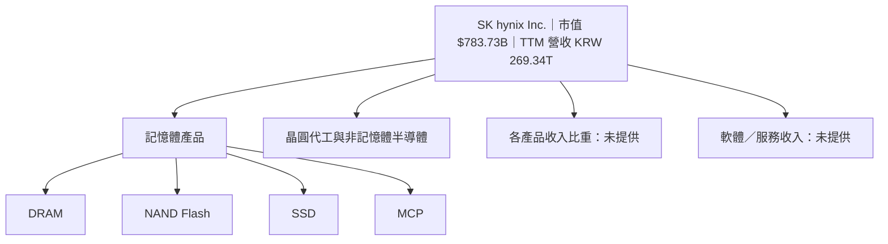
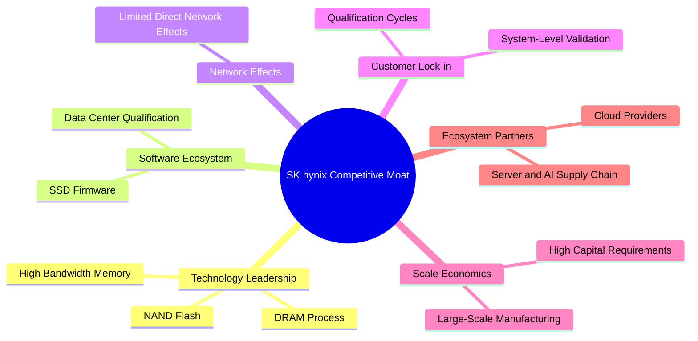
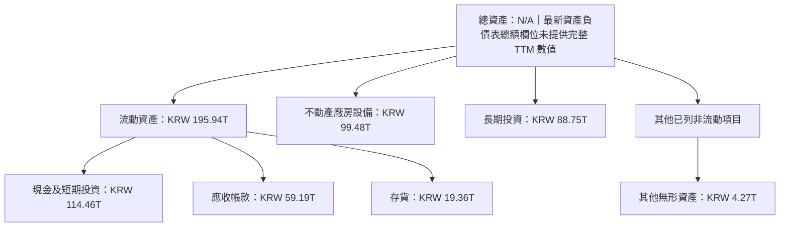
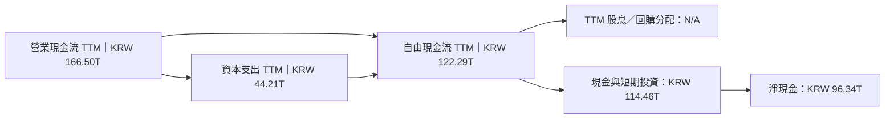
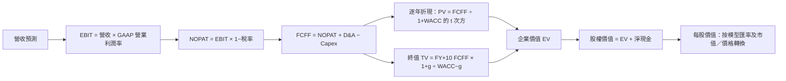
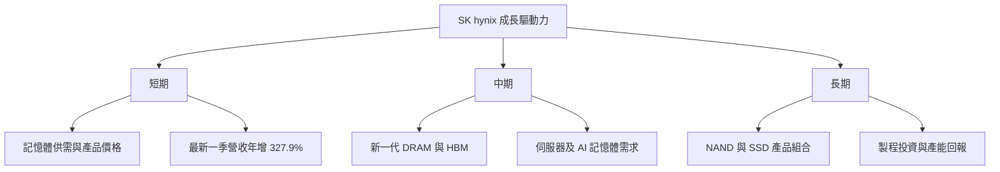
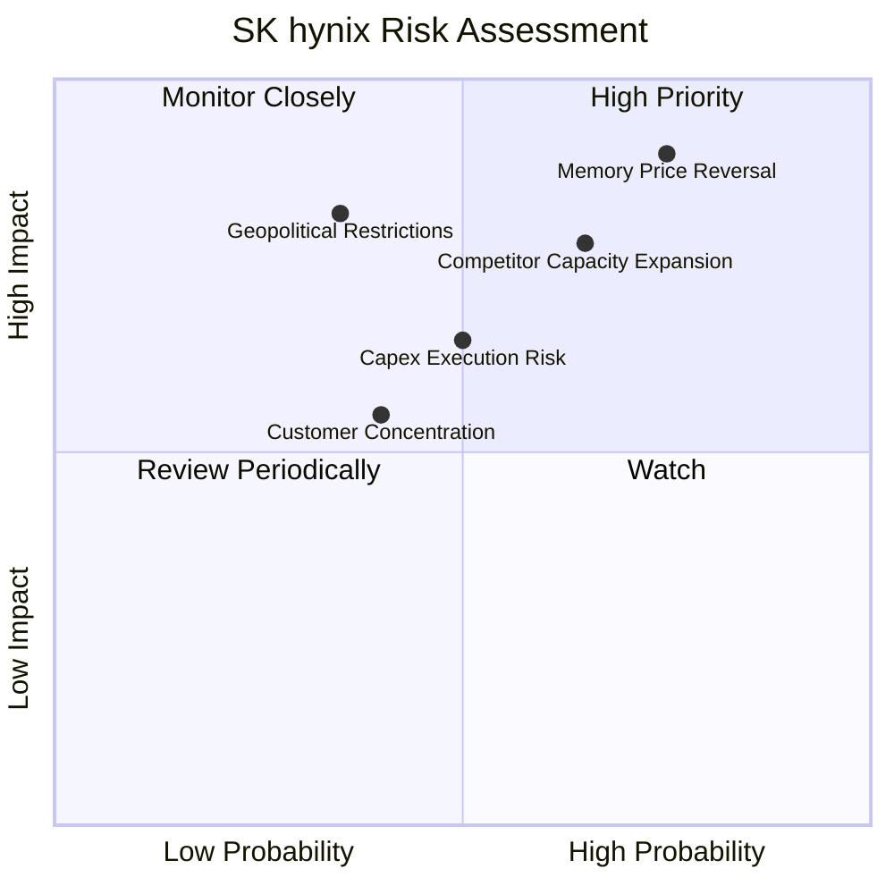
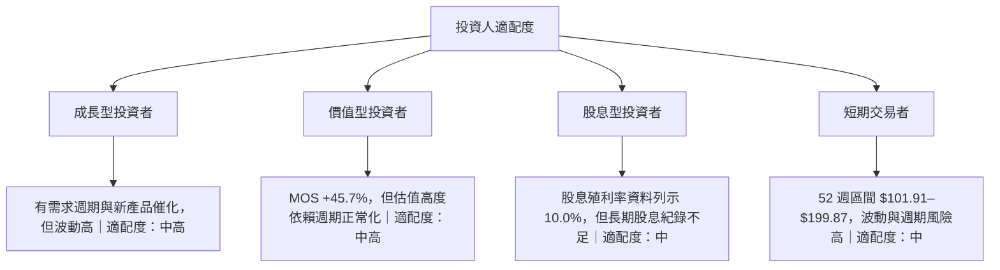

# SKHY 基本面深度分析報告
> **報告日期**：2026-11-27 ｜ **語言**：繁體中文 ｜ **數據來源**：Yahoo Finance、Finviz、StockAnalysis、Roic.ai ｜ **分析師**：CFA 級機構研究

---

## 目錄

| # | 章節 | 核心結論 |
|---|------|----------|
| 1 | 執行摘要 | 買入；加權合理價值 $204.54；MOS +45.7% |
| 2 | 公司概覽與商業模式 | 記憶體製造規模與技術構成主要壁壘，產品收入拆分資料未提供 |
| 3 | 損益表深度分析 | TTM 營收 KRW 269.34T；最新一季營收年增 327.9%，獲利率處於週期高檔 |
| 4 | 資產負債表分析 | 淨現金 KRW 96.34T；流動性充足，CCC 為 203 天 |
| 5 | 現金流量深度分析 | TTM FCF KRW 122.29T，FCF Yield 11.62% |
| 6 | 獲利能力與資本效率 | ROIC 缺少可引用的最新值；WACC 採用 14.00%，不能據此確認最新 ROIC 是否高於資金成本 |
| 7 | 相對估值分析 | 同業倍數支持相對低估，但記憶體週期與盈餘基期使倍數具高度週期性 |
| 8 | DCF 內在價值評估 | 基準 DCF 每股 $266.53；加權合理價值 $204.54，兩者用途與分母不同 |
| 9 | 成長催化劑 | AI／高頻寬記憶體需求、DRAM 新產品與 NAND 市場復甦是觀察重點 |
| 10 | 風險矩陣 | 記憶體價格反轉、競爭供給擴張、地緣與技術風險是前三大風險 |
| 11 | 投資建議 | 依 MOS 評級為買入；以季度毛利率、Capex、FCF 與產品需求作持續驗證 |

---

## 1. 執行摘要

截至 **2026-11-25 收盤價 $111.14**，SK hynix TTM 營收為 KRW 269.34T，最新一季營收年增 327.9%，TTM 營業利益率 74.5%，TTM FCF KRW 122.29T、FCF Yield 11.62%。程式加權估值為每股 **$204.54**，以加權合理價值為分母計算 MOS 為 **+45.7%**，規則 20 的評級為 **買入**。不過，TTM ROIC 未提供，且業務正處記憶體景氣高峰區間的可能性不可忽視；因此估值折價須與週期性風險一併理解。

### 1.0 一頁式投資儀表板（Portfolio Manager 30 秒速讀）

| 項目 | 內容 |
|------|------|
| **投資論點（3 句）** | ① 最新一季營收年增 327.9%，反映記憶體需求與價格週期快速改善；② TTM 營業利益率 74.5%、FCF KRW 122.29T，現金流具高轉換能力；③ 加權合理價值 $204.54 高於 2026-11-25 收盤價 $111.14，MOS +45.7%。 |
| **綜合評分** | **7.8/10**（引用 1.1 評分卡） |
| **財務健康** | 🟢 淨現金 KRW 96.34T、流動比率 3.115；但 CCC 203 天，仍須關注庫存與收款週期。 |
| **ROIC vs WACC** | ROIC：N/A；WACC：14.00%。ROIC 缺數，無法判定最新期間是否創造超額報酬。 |
| **FCF 趨勢** | TTM FCF KRW 122.29T；FCF Yield 11.62%。年度 FCF 由 2023 年負 KRW 4.50T，回升至 2025 年 KRW 24.79T。 |
| **估值** | Forward P/E 2.748x ｜ EV/EBITDA：N/A（幣別口徑不一致）｜ FCF Yield 11.62% |
| **DCF 內在價值（基準）** | $266.53 ｜ 現價折價 **58.3%**（依 DCF 基準值計算） |
| **安全邊際（MOS）** | **+45.7%**＝($204.54 − $111.14) ÷ $204.54（基準為 8.8 加權合理價值）｜ 🟢 >25% 充足 |
| **預期報酬（基準情境 12M）** | +139.8%（DCF 基準情境相對現價；非保證報酬） |
| **關鍵風險（前二）** | 記憶體價格週期反轉；競爭者擴產與產品替代。 |
| **評級 + 信心度** | 🟢 **買入** ｜ 信心：中（週期高峰與 ROIC 缺數限制信心） |

### 1.1 綜合評分卡（全報告唯一）

| 維度 | 評分（1–10） | 主要依據（引用數字與其來源章節） |
|------|--------------|----------------------------------|
| 成長性 | 8 | 最新一季營收年增 327.9%；TTM 成長率依價格與財報核驗口徑為 N/A，詳見 3.2。 |
| 獲利能力 | 9 | TTM 營業利益率 74.5%、淨利率 70.1%；ROIC 與 F-Score 未提供，詳見 3、6。 |
| 財務健康 | 8 | 淨現金 KRW 96.34T、流動比率 3.115；CCC 203 天，詳見 4。 |
| 估值 | 8 | MOS +45.7%；同業 Forward P/E 中位數 2.9x，SK hynix Forward P/E 2.748x，詳見 7–8。 |
| 護城河 | 8 | DRAM、NAND、SSD 與先進記憶體製造能力；產品分部收入與市場份額數字未提供，詳見 2。 |
| 管理層與資本配置 | 6 | FY2025 Capex 約 KRW 28.58T，年度股息 KRW 1.68T；長期回購與資本回報政策資料不足，詳見 5。 |
| **綜合評分** | **7.8** | 六項算術平均：47 ÷ 6 = 7.833…，四捨五入至一位小數。 |

### 1.2 五大投資論點 + 三大核心風險

| 類型 | 項目 | 具體依據 | 信心度 |
|------|------|----------|--------|
| 🟢 **投資論點①** | AI 與伺服器記憶體需求帶動營收擴張 | 最新一季營收 KRW 104.62T，年增 327.9%；季度成長仍高，但 QoQ 增速由 Q1 的約 60.2% 降至 Q3 約 31.9%。 | 🟢 高 |
| 🟢 **投資論點②** | 獲利與現金流轉換顯著改善 | TTM 營業利益率 74.5%；TTM OCF KRW 166.50T，扣 Capex KRW 44.21T 後 FCF KRW 122.29T。 | 🟢 高 |
| 🟢 **投資論點③** | 淨現金提供下行緩衝 | 現金與短期投資 KRW 114.46T、總債務 KRW 18.13T，淨現金 KRW 96.34T。 | 🟢 高 |
| 🟢 **投資論點④** | 相對估值低於或接近同業 | Forward P/E 2.748x；MU、SNDK、WDC 的 Forward P/E 中位數為 2.9x。 | 🟡 中 |
| 🟢 **投資論點⑤** | 基準 DCF 與加權估值均高於現價 | DCF 基準 $266.53；加權合理價值 $204.54；現價 $111.14。模型結果高度仰賴獲利正常化假設。 | 🟡 中 |
| 🟡 **風險①** | 記憶體價格與供需週期反轉 | 2023 年營收年減 26.57%、營業利益 KRW -7.73T，證明下行週期可造成虧損。 | 🟡 中 |
| 🔴 **風險②** | 高峰利潤率不可持續 | TTM 營業利益率 74.5%，DCF 模型假設十年後降至 35.5%；若降幅更快，估值下修。 | 🔴 高衝擊 |
| 🟡 **風險③** | 競爭者擴產、技術迭代與地緣因素 | 同業 MU、SNDK 最新一季營收年增均超過 377%；新聞亦提及中國記憶體廠商與新一代 DRAM 競爭。 | 🟡 中 |

### 1.3 快速統計卡片

| 指標 | 公司實際值（期間） | 同業中位數 | 狀態 |
|------|--------------------|------------|------|
| 營收成長（TTM） | **N/A**（核驗資料未提供） | — | 🟡 |
| 營收成長（最新一季年增） | **327.9%** | 377.9% | 🟡 |
| 毛利率（TTM） | **77.4%** | 80.0% | 🟡 |
| 營業利益率（TTM） | **74.5%** | — | 🟢 |
| ROIC（TTM） | **N/A** | — | 🟡 |
| Forward P/E | **2.748x** | 2.9x | 🟢 |
| FCF Yield（TTM） | **11.62%** | — | 🟢 |
| Piotroski F-Score | **N/A** | — | 🟡 |

### 1.4 投資結論

╔══════════════════════════════════════════════════════════════════╗  
║                    📊 投資結論摘要                               ║  
╠══════════════════════════════════════════════════════════════════╣  
║  評級：買入（依規則 20；MOS +45.7%）                            ║  
║  價格（2026-11-25 收盤）：$111.14                                ║  
║  DCF 內在價值（基準）：$266.53（折價 58.3%）                    ║  
║  安全邊際 MOS：+45.7%（以加權合理價值為分母）                    ║  
║  加權合理價值（8.8）：$204.54                                    ║  
║  DCF 情境價值：                                                  ║  
║    悲觀情境：$129.08（+16.1%）                                   ║  
║    基準情境：$266.53（+139.8%）                                  ║  
║    樂觀情境：$524.30（+371.7%）                                  ║  
║  綜合評分：7.8/10（引用 1.1）                                    ║  
║  適合投資人：能承受半導體週期波動、採分批布局的長線投資人        ║  
╚══════════════════════════════════════════════════════════════════╝

---

## 2. 公司概覽與商業模式

### 2.1 業務結構與收入來源

SK hynix Inc. 研發、製造並銷售 DRAM、NAND Flash、SSD、MCP，亦有晶圓代工及非記憶體半導體業務。公司總營收 TTM 為 KRW 269.34T，市值約 $783.73B；但財務資料未提供各產品分部收入、比重或服務收入，故不將總營收拆成未經證實的產品比例。

### 2.2 市場份額

市場份額數字未提供，亦無可引用的新聞市佔數據，因此不繪製市佔圖。SK hynix TTM 營收 KRW 269.34T、最新一季營收年增 327.9%；MU 與 SNDK 同期營收年增分別為 379.3% 與 377.9%，顯示整體記憶體市場皆處於高速反彈階段，不能單憑成長率推定市佔變化。

### 2.3 競爭護城河分析

### 2.4 護城河強度

| 護城河項目 | 強度（強／中／弱） | 證據（引用數字或事實） | 會削弱它的情況 |
|------------|--------------------|------------------------|----------------|
| 技術與製程 | 強 | 公司產品涵蓋 DRAM、NAND、SSD、MCP；新一代 DRAM 競爭為近期產業焦點。 | 良率落後、製程轉換延誤、競品取得性能或成本優勢。 |
| 規模效應 | 強 | TTM 營收 KRW 269.34T，資產負債表顯示 PP&E KRW 99.48T。 | 產能利用率下降、資本支出過度或供給擴張快於需求。 |
| 客戶驗證與轉換成本 | 中 | 記憶體與 SSD 需通過伺服器、網路及終端產品驗證；實際客戶留存數據未提供。 | 客戶多來源採購，或替代產品通過驗證。 |
| 軟體生態與網路效應 | 弱／有限 | 公司為硬體及半導體製造商，沒有可量化的軟體訂閱或網路效應數據。 | 競品提供更完整的系統級產品或軟硬體整合。 |
| 生態夥伴 | 中 | 服務伺服器、網路、行動裝置等多類客戶；客戶集中度未提供。 | 主要客戶自研、削減採購或更換供應商。 |

1.1 護城河評分為 **8/10**，理由是收入規模、製造資產與產品覆蓋支持規模壁壘，但市佔、客戶集中度及產品分部收入資料不足，不能將競爭優勢量化到更高確定性。

---

## 3. 損益表深度分析

### 3.1 年度收入成長趨勢（近 4 年）

年度營收來源為 StockAnalysis.com，金額以 KRW T 表示；增幅由年度數據計算。

╔══════════════════════════════════════════════════════════════════╗  
║              SK hynix 年度收入趨勢（FY2022–FY2025）              ║  
╠══════════════════════════════════════════════════════════════════╣  
║  FY2022  KRW 44.62T  ████████████░░░░░░░░░░░░  YoY +3.78%      ║  
║  FY2023  KRW 32.77T  █████████░░░░░░░░░░░░░░░  YoY -26.57%     ║  
║  FY2024  KRW 66.19T  ██████████████████░░░░░░  YoY +102.02%    ║  
║  FY2025  KRW 97.15T  █████████████████████████  YoY +46.76%    ║  
╠══════════════════════════════════════════════════════════════════╣  
║  FY2022–FY2025 營收 CAGR：約 +29.6%                              ║  
╚══════════════════════════════════════════════════════════════════╝

FY2023 營收下滑，FY2024–FY2025 則快速回升，呈現記憶體產業典型的價格與供需週期。2022 至 2025 CAGR 約 29.6%，但不能將復甦期間的成長率直接視為長期常態。

### 3.2 季度收入趨勢分析

| 季度 | 營收（KRW T） | QoQ | YoY | 備註 |
|------|---------------:|----:|----:|------|
| 2025 Q4 | 32.83 | +34.2% | +66.07% | 與 2025 Q3 比較及來源所列年增。 |
| 2026 Q1 | 52.58 | +60.2% | +198.07% | 高基期下仍大幅增長。 |
| 2026 Q2 | 79.32 | +50.9% | +256.78% | 營收規模持續擴大。 |
| 2026 Q3 | 104.62 | +31.9% | +327.9% | YoY 加速，但 QoQ 增速已低於前兩季。 |

最新一季年增 327.9% 是**單季年增率**，並非 TTM 成長率。核驗資料對 Revenue growth（TTM vs prior TTM）標示 N/A；StockAnalysis.com另列 TTM Revenue Growth 220.31%，但本報告不以該來源值取代核驗口徑。

### 3.3 利潤率演變分析

年度利潤率以年度損益表相應項目除以營收計算，可能因四捨五入略有差異。

| 利潤率指標 | FY2022 | FY2023 | FY2024 | FY2025 | 趨勢 | 評估 |
|------------|-------:|-------:|-------:|-------:|------|------|
| **毛利率** | 35.0% | -1.6% | 48.1% | 60.4% | 2023 轉負，之後復甦 | 🟡 週期敏感 |
| **營業利益率** | 15.3% | -23.6% | 35.5% | 48.6% | 由虧損回到高獲利 | 🟢 |
| **淨利率** | 5.0% | -27.8% | 29.9% | 44.2% | 隨營運復甦快速回升 | 🟢 |

TTM 毛利率 77.4%、營業利益率 74.5%、淨利率 70.1%，高於 FY2025。可能反映產品組合、價格、產能利用率與營業槓桿同步改善；但年度資料亦顯示 2023 年營業利益轉為 KRW -7.73T，故目前利潤率不能外推為永久結構。價格下跌或供給增加時，高固定成本可能反向放大利潤收縮。

### 3.4 費用結構分析

可取得的費用數據不足以建立完整的營業費用分解。FY2025 研發支出為 KRW 6.47T，FY2024 為 KRW 4.44T；但銷售、管理、折舊等項目未以一致口徑完整提供，因此不繪製費用結構圓餅圖，亦不以不完整項目推算比例。

### 3.5 季度 EPS 趨勢與盈餘品質（Quality of Earnings）

最近四季 EPS 實際值與年增率可由 StockAnalysis.com資料取得，但 EPS 預估值缺失，不能判定是否超預期或不及預期。

| 季度 | EPS 實際值（KRW） | EPS YoY | 預估／驚喜 |
|------|------------------:|-------:|------------|
| 2025 Q4 | 21,507.49 | +85.22% | 預估值未提供 |
| 2026 Q1 | 56,711.37 | +396.72% | 預估值未提供 |
| 2026 Q2 | 131,456.60 | +1,273.16% | 預估值未提供 |
| 2026 Q3 | 54,454.07 | +205.06% | 預估值未提供 |

Q2 至 Q3 淨利由 KRW 93.82T 降至 KRW 39.53T，下降約 57.9%；資料未提供足以拆分季節性、非營業損益或一次性項目的資訊。EPS 預估缺失，因此不能把表現標為 beat 或 miss。

| 盈餘品質項目 | 數值/佔比 | 評估 |
|--------------|-----------|------|
| 股權薪酬 SBC / 營收 | FY2025 約 0.43%（KRW 0.414T ÷ KRW 97.15T） | 🟢 年度資料顯示比例低；TTM SBC 未完整提供，不能以年度值代替 TTM。 |
| SBC / 營業現金流 | FY2025 約 0.78%（KRW 0.414T ÷ KRW 53.37T） | 🟢 同樣僅為 FY2025 比例。 |
| FCF / 淨利（現金轉換率） | TTM 約 64.7%（122.29T ÷ 188.90T） | 🟡 現金流充沛，但 TTM 淨利口徑與年度可能受週期及營運資金影響。 |
| 一次性／非經常性損益 | N/A（未提供完整明細） | 無法判斷是否有一次性項目抬高或壓低盈餘。 |
| 有效稅率異常 | 14.9%（最近年度有效稅率） | 目前採用值未顯示明顯異常；年度稅務調節表未提供。 |
| 資本化支出 vs 費用化 | Capex TTM KRW 44.21T；資本化利息與資本化政策細節未提供 | 高資本支出是半導體製造必要條件，但無法據此判斷是否遞延費用。 |

**盈餘品質結論：**FCF KRW 122.29T 及 FCF Yield 11.62% 支持獲利具現金流基礎；FY2025 SBC 對收入占比約 0.43%。主要限制是 TTM SBC、非經常性項目及資本化政策資料不足，並且 FCF/淨利約 64.7% 低於 100%，反映現金轉換仍會受資本支出與營運資金週期影響。

---

## 4. 資產負債表分析

### 4.1 資產結構分解

最新資產負債表可取得 TTM 資產明細。總資產與部分科目之間可能因資料截取、科目缺漏及四捨五入不完全勾稽，以下僅列來源有數字的項目，不反推缺失科目。

### 4.2 流動性與營運資金分析

| 指標 | 最新 TTM | 一年前 TTM | 變化 | 解讀 |
|------|----------|------------|------|------|
| DSO 應收帳款天數 | 80 天 | N/A | N/A | 一年前同口徑數據未提供，無法判斷收款速度變化。 |
| DIO 存貨天數 | 143 天 | N/A | N/A | 存貨天數需結合產品組合與訂單能見度解讀；缺少同比值。 |
| DPO 應付帳款天數 | 20 天 | N/A | N/A | 未提供一年前數據，不能推論供應商付款條件變化。 |
| CCC 現金轉換週期 | 203 天 | N/A | N/A | CCC = 80 + 143 − 20 = 203 天，資金留在應收與庫存的時間較長。 |

流動比率 3.115、速動比率 2.794；均顯示短期償付緩衝較充足。該等比率未提供可比的歷史序列，不作趨勢推論。

### 4.3 債務結構分析

╔══════════════════════════════════════════════════════════════════╗  
║                   SK hynix 債務健康診斷                         ║  
╠══════════════════════════════════════════════════════════════════╣  
║  總債務：       KRW 18.13T   ██░░░░░░░░░░░░░░░░░░  🟢          ║  
║  現金+短期投資：KRW 114.46T  ████████████████████  🟢          ║  
║  淨現金：       KRW 96.34T   ████████████████░░░░  🟢          ║  
║  流動比率：     3.115x                              🟢          ║  
║  速動比率：     2.794x                              🟢          ║  
║  Debt/EBITDA：  N/A（口徑與幣別資料不一致）                       ║  
║  利息保障倍數：N/A（利息支出明細未提供）                         ║  
╚══════════════════════════════════════════════════════════════════╝

核驗口徑的 TTM 總債務 KRW 18.13T、現金及短期投資 KRW 114.46T，淨現金 KRW 96.34T。年度資產負債表 FY2025 總債務另列 KRW 24.76T，與 TTM 資產負債表口徑及日期不同，不混用計算。

### 4.4 股東權益趨勢

| 年度 | 股東權益（KRW T） | 年增率 |
|------|------------------:|------:|
| 2022 | 63.27 | — |
| 2023 | 53.50 | -15.4% |
| 2024 | 73.90 | +38.1% |
| 2025 | 120.52 | +63.0% |

股東權益隨 2024–2025 盈利復甦明顯增加。由於淨利、其他綜合損益、股利及匯兌等完整權益變動表未提供，不能把權益增加全部歸因於留存盈餘。

---

## 5. 現金流量深度分析

### 5.1 現金流量瀑布圖

TTM 淨利數據與營業現金流、Capex 口徑不同，不直接把未經核驗的 TTM 淨利填入瀑布起點；以下呈現可核驗的 TTM 現金流關係。

### 5.2 FCF 轉換率趨勢

| 年度 | FCF（KRW T） | 淨利（KRW T） | FCF / 淨利 |
|------|-------------:|--------------:|-----------:|
| 2022 | -4.97 | 2.23 | -222.9% |
| 2023 | -4.50 | -9.11 | 不具可比意義 |
| 2024 | 13.13 | 19.79 | 66.3% |
| 2025 | 24.79 | 42.92 | 57.8% |
| TTM 至 2026-09-30 | 122.29 | 188.90 | 64.7% |

週期低谷時 FCF 為負，復甦後轉正；2024–TTM 的 FCF/淨利約 58%–66%，尚未達 100%。Capex、營運資金及季度波動會使會計獲利與自由現金流不同步。

### 5.3 自由現金流趨勢

╔══════════════════════════════════════════════════════════════════╗  
║                   自由現金流趨勢（KRW T）                        ║  
╠══════════════════════════════════════════════════════════════════╣  
║  FY2022  -4.97  ◀░░░░░░░░░░░░░░░░░░░░░░░                       ║  
║  FY2023  -4.50  ◀░░░░░░░░░░░░░░░░░░░░░                       ║  
║  FY2024  13.13  █████░░░░░░░░░░░░░░░░░                       ║  
║  FY2025  24.79  ██████████░░░░░░░░░░░                       ║  
║  TTM     122.29  █████████████████████████                     ║  
║  TTM FCF Yield：11.62%                                          ║  
╚══════════════════════════════════════════════════════════════════╝

TTM FCF 顯著高於 FY2025，與 2026 年季度營收、營業利益快速上升一致；但記憶體價格高峰通常會提高週期反轉風險，不能將 TTM FCF 直接當作穩態現金流。

### 5.4 資本配置評估

可確認的年度資本用途包括 Capex 與股息；回購及完整留存資金用途資料未提供，因此不繪製資本配置比例圖。

| 項目 | FY2025／TTM 數據 | 評估 |
|------|-----------------|------|
| Capex | FY2025 KRW 28.58T；TTM KRW 44.21T | 反映半導體製造資本密集特性；需檢查新增產能的回報。 |
| 現金股息 | FY2025 KRW 1.68T | 相較 TTM FCF 規模不高；年度分紅政策資料不足。 |
| 股票回購 | N/A | 未提供可核驗數據。 |
| 留存／其他投資 | N/A | 不能由 FCF 與已列用途反推未列項目。 |

---

## 6. 獲利能力與資本效率

### 6.1 ROE / ROA / ROIC 趨勢

| 指標 | 最新資料 | 歷史／說明 | 評估 |
|------|---------:|------------|------|
| ROE | 92.5%（TTM） | 財務數據列示值；品質指標的杜邦分解為 N/A。 | 🟢 高，但週期高峰可能抬升。 |
| ROA | 46.4%（TTM） | 財務數據列示值。 | 🟢 高，但須以週期完整區間評估。 |
| ROIC | N/A（TTM） | Roic.ai提供較早歷史數據，最新 TTM 值未提供。 | 無法與 WACC 作同期量化比較。 |
| 行業均值 | N/A | 未提供可核驗來源與同口徑數值。 | 不列同業均值。 |

### 6.2 ROIC vs WACC 分析（核心價值創造判斷）

╔══════════════════════════════════════════════════════════════════╗  
║                ROIC vs WACC 深度分析                            ║  
╠══════════════════════════════════════════════════════════════════╣  
║  折現率與資金成本：                                              ║  
║  ├── 無風險利率（10Y 美債）：4.85%                               ║  
║  ├── ERP：5.00%                                                  ║  
║  ├── 原始 Beta：2.47；調整後 Beta：1.98                         ║  
║  ├── 股權成本（資料列示）：14.73%                               ║  
║  ├── 稅前債務成本：5.10%；稅率：14.9%                           ║  
║  ├── 股權／債務權重：98.3%／1.7%                                ║  
║  └── WACC：計算值 14.56%，區間上限約束後採用 14.00%             ║  
║                                                                  ║  
║  ROIC（TTM）：N/A（缺少最新可核驗計算所需數據）                   ║  
║  EVA = ROIC − WACC：N/A，不能據此判定價值創造或摧毀              ║  
╚══════════════════════════════════════════════════════════════════╝

WACC 採用 14.00%，與 DCF 一致。由於最新 ROIC 缺少可靠同期數值，不以 ROE 或 ROA 代替 ROIC，也不宣稱公司已創造或摧毀超額股東價值。上述 14.56% 為資金成本資料列示的計算值，模型依 7%–14% 區間限制採用 14.00%。

### 6.3 杜邦三因素分解

| 因素 | 數值（TTM） | 解讀 |
|------|-------------|------|
| 淨利率 | N/A（品質指標欄位缺數） | 資料另列淨利率 70.1%，但 QUALITY FIGURES 的杜邦組件整體為 N/A；遵守同一品質指標口徑，不在此重算。 |
| 資產週轉率 | N/A | 缺少一致口徑的總資產與營收數據。 |
| 權益乘數 | N/A | 權益口徑未提供完整最新值。 |
| **ROE** | **N/A（杜邦分解）** | DuPont 品質指標因缺少所需資料而未計算；市場資料另列 ROE 92.5%。 |

### 6.4 財務體質：Piotroski F-Score

**Piotroski F-Score：N/A**。缺少相隔一年的 SEC 申報資料與完整雙期 TTM 資料，九項測試無法可靠判定，故不以推測值填列。

---

## 7. 相對估值分析

### 7.1 同業估值比較表格

本公司倍數取可取得的公司估值資料；同業倍數取 Yahoo Finance 的 Peer multiples。SK hynix P/S、EV/EBITDA 等因報價 USD、財報 KRW 而無法可靠計算，標示 N/A。

| 估值指標 | **SK hynix** | **MU** | **SNDK** | **WDC** | 本公司評估 |
|----------|-------------:|-------:|---------:|-------:|-----------|
| **Trailing P/E** | 6.15x | 8.1x | 4.7x | 9.6x | 🟢 位於同業中間偏低，但週期盈餘可能壓低 P/E。 |
| **Forward P/E** | 2.748x | 2.9x | 2.1x | 6.8x | 🟢 略低於同業中位數 2.9x；遠期盈餘預測誤差風險高。 |
| **P/S Ratio** | N/A | 5.1x | 2.9x | 7.0x | 🟡 不作跨幣別本公司比較。 |
| **EV/EBITDA** | N/A | 5.9x | 3.7x | 16.1x | 🟡 同業差異大；SK hynix 口徑不可比。 |
| **最新一季營收 YoY** | 327.9% | 379.3% | 377.9% | 55.5% | 🟡 SK hynix 成長很快，但 MU、SNDK 更快。 |
| **毛利率 TTM** | 77.4% | 80.7% | 80.0% | 52.6% | 🟢 接近 MU、SNDK，顯著高於 WDC。 |

### 7.2 歷史估值區間分析

╔══════════════════════════════════════════════════════════════════╗  
║                   歷史估值區間分析                              ║  
╠══════════════════════════════════════════════════════════════════╣  
║  Valuation vs own history：N/A                                   ║  
║  缺少可核驗的歷史 P/E 區間與當前估值百分位資料。                 ║  
║  不以自行估算的百分位或歷史區間替代。                           ║  
╚══════════════════════════════════════════════════════════════════╝

### 7.3 情境價值（Bear / Base / Bull）

| 情境 | 第 1 年營收成長 | 期末營業利潤率 | WACC | 每股價值 | 相對現價 | 機率 | 會發生的條件 |
|------|----------------:|---------------:|-----:|---------:|---------:|-----:|--------------|
| 🔴 悲觀 | 15.0% | 30.1% | 15.00% | $129.08 | +16.1% | 25% | 需求與產品價格較基準情境弱，且競爭或資本成本壓力上升。 |
| 🟡 基準 | 30.0% | 35.5% | 14.00% | $266.53 | +139.8% | 50% | 短期維持較快增長，之後營收及利潤率逐步回歸成熟水準。 |
| 🟢 樂觀 | 45.0% | 39.0% | 13.00% | $524.30 | +371.7% | 25% | 需求與產品組合超預期，長期利潤率高於基準，且資金成本下降。 |

以上情境價值照模型輸出引用，並非另行設定目標價。機率加權值為 $296.61，僅供情境參考；8.8 權重估值採用基準 DCF $266.53。

### 7.4 相對估值隱含價格區間

╔══════════════════════════════════════════════════════════════════╗  
║             相對估值方法回推價格（每股 USD）                    ║  
╠══════════════════════════════════════════════════════════════════╣  
║  $111.14 現價 ── 同業 EV/EBITDA $144.92 ── 同業 P/S $145.71     ║  
║  分析師共識 $253.07 ── 基準 DCF $266.53                         ║  
╚══════════════════════════════════════════════════════════════════╝

| 方法 | 每股價值 | 相對現價 | 依據 |
|------|---------:|---------:|------|
| 同業 EV/EBITDA | $144.92 | +30.4% | MU、SNDK、WDC 同業中位數 5.9x × TTM EBITDA，再加淨現金。 |
| 同業 P/S | $145.71 | +31.1% | 同業中位數 5.1x × TTM Revenue。 |
| 分析師共識目標價 | $253.07 | +127.7% | 14 位分析師平均目標價。 |

---

## 8. DCF 內在價值評估（Discounted Cash Flow）

### 8.0 估值推理鏈（Thinking Logic）

**Step 1 — 價值來源與主導變數**

SK hynix 的營運價值主要來自 DRAM、NAND、SSD 等記憶體與儲存產品；各產品的營收比重未提供，故無法把總營收 KRW 269.34T 拆分為主業、第二曲線或選擇權價值。模型最敏感的變數是折現率與終值現金流：在 14% WACC 下，終值現值占 EV 37.1%；敏感性表亦顯示 WACC 變動對每股價值的影響大於永續成長率小幅變動。

**Step 2 — 模型選擇**

| 決策點 | 本報告採用 | 理由（含數字） | 曾考慮但否決 | 否決理由 |
|--------|-----------|----------------|--------------|----------|
| 現金流定義 | FCFF | 對應 WACC 折現並先求 EV；模型給出完整 10 年 FCFF。 | FCFE | 模型資料已採 FCFF，且企業資本結構會隨週期與投資調整。 |
| 預測期 N | 10 年 | DCF 模型固定預測 10 年，反映利潤率逐步從 74.5% 回歸至 35.5%。 | 5 年 | 不能覆蓋模型設定的長週期利潤率正常化過程。 |
| 終值方法 | Gordon Growth | WACC 14.0% 高於 g 3.0%，終值公式有效。 | 退出倍數 | DCF MODEL 未提供退出倍數輸出，不自行增建終值方法。 |
| EBIT 基礎 | GAAP EBIT | TTM 營業利益率 74.5%；模型明示 GAAP EBIT。 | 非 GAAP EBIT | 避免加回 SBC 後又忽略股東成本。 |

**Step 3 — 關鍵假設推導鏈**

- **營收成長**：錨點＝最新一季營收 YoY 327.9%，但該數值是單季而非 TTM；模型將年 1 成長限制在 0%–30% → 由高景氣單季基期回歸，採用 **30.0%** → 曾考慮直接採用 327.9%，因季度年增不能代表十年可持續 CAGR 而否決。
- **期末營業利潤率**：錨點＝TTM 74.5%，FY2025 約 48.6%，過去虧損年 FY2023 為 -23.6% → 模型將毛利與景氣週期正常化 → **FY+10 為 35.5%** → 曾考慮維持 74.5%，因 2023 年虧損與記憶體價格週期顯示不宜外推而否決。
- **永續成長率 g**：錨點＝模型採 3.0%；數據未提供管理層長期財測 → 採用 **3.0%**，且低於 WACC 14.0% → 未採更高 g，因永久增長率過高會放大終值且缺乏長期需求數據支持。
- **預測期 N**：錨點＝模型設定 10 年，營業利潤率由 74.5% 線性淡化至 35.5% → 讓週期高峰逐步回歸 → **採 10 年** → 未改為更短期限，因模型已有完整十年現金流，且不得另建模型。
- **Capex／營收**：錨點＝TTM Capex/Revenue 約 16.4% → 模型假設隨成熟度逐步降至 6.4% → 採用 **FY+1 16.4% 至 FY+10 6.4%** → 不假設一直維持 16.4%，因模型明示逐步回歸至 D&A 的 1.1 倍附近。
- **D&A／營收**：錨點＝TTM 5.8% → 模型維持不變，採 **5.8%**。
- **稅率**：錨點＝最近年度有效稅率 14.9% → 採 **14.9%**；未採用更高或更低稅率，因沒有其他可核驗長期稅率資料。
- **WACC**：錨點＝成本資本資料計算 14.56%，受 7%–14% 區間限制 → 採 **14.00%** → 不採 14.56%，因核驗輸出已明示上限限制。
- **EBIT、SBC、稀釋股數**：模型明示 GAAP EBIT，FCFF 不另扣 SBC，股數不再稀釋。**本模型採用組合 (A)，故 SBC 影響已計入一次**；年稀釋率為 0%。
- **營運資金**：模型明示不建模營運資金變化；ΔWC 沒有輸入值，故不自行補造或反推。
- **終值方法**：採 Gordon Growth，因模型以 FY+10 FCFF 與 g 3.0%計算；退出倍數缺少模型輸出，不另建替代值。

**Step 4 — 最脆弱的一環**

最脆弱假設是景氣高峰期的營收成長與利潤率能平順淡化，而非更早出現價格下跌；若現金流路徑惡化，DCF 價值將向悲觀情境 $129.08 靠攏。

**Step 5 — 計算路徑圖**

### 8.1 模型假設總表（Model Inputs）

金額單位為 KRW billions，除每股美元價值及比率外。

| 假設項目 | 採用值 | 依據 / 來源 | 敏感度 |
|----------|--------|-------------|--------|
| 預測期長度 **N** | 10 年 | DCF MODEL 固定設定；利潤率十年淡化。 | 🟡 中 |
| 營收成長 | FY+1 30.0%，FY+10 3.0%，逐年線性淡化 | FY+1 參考最新一季 YoY 327.9%，但受 0%–30% 限制；FY+10 為模型假設。 | 🔴 高 |
| 營業利潤率（期末） | FY+1 74.5% → FY+10 35.5% | TTM 74.5%；期末取近五財年中位數口徑，含 TTM。 | 🔴 高 |
| 有效稅率 | 14.9% | 最近年度有效稅率。 | 🟢 低 |
| Capex / 營收 | 16.4% → 6.4% | TTM 約 16.4%，逐步淡化至模型規定水準。 | 🟡 中 |
| D&A / 營收 | 5.8% | TTM 比率，模型保持固定。 | 🟢 低 |
| 營運資金變動 | 不建模 | DCF MODEL 明示 Working capital is not modelled。 | 🟢 低 |
| EBIT 基礎 | GAAP | 模型明示使用 GAAP EBIT。 | 🟡 中 |
| 股權薪酬 SBC | 已含於 GAAP EBIT，不再另扣 | DCF MODEL 明示 SBC 已作費用，不另減 FCF。 | 🟡 中 |
| 年稀釋率 | 0% | 組合 (A)：SBC 已經 GAAP 費用化，固定股數處理。 | 🟡 中 |
| 永續成長率 g | 3.0% | DCF MODEL 設定；低於 WACC 14.0%。 | 🔴 高 |
| 終值方法 | Gordon Growth | 模型直接提供終值；退出倍數未提供。 | 🔴 高 |
| WACC | 14.00% | 核驗成本資本資料；計算值 14.56%，受上限約束。 | 🔴 高 |

**FCF 定義：**使用 FCFF；模型採 `FCFF = NOPAT + D&A − Capex`，且不建模營運資金。SBC 採組合 (A)，不重複扣除。

### 8.2 折現率推導（WACC）

╔══════════════════════════════════════════════════════════════════╗  
║                    WACC 推導（折現率）                           ║  
╠══════════════════════════════════════════════════════════════════╣  
║  股權成本 Ke（CAPM）：                                           ║  
║  ├── 無風險利率 Rf：4.85%（成本資本資料列示）                    ║  
║  ├── ERP：5.00%（成本資本資料假設值）                            ║  
║  ├── 原始 Beta：2.47；調整後 Beta：1.98                         ║  
║  ├── 調整方式：⅔ × 2.47 + ⅓ × 1 = 1.98（依資料列示）           ║  
║  ├── Ke（資料列示）：14.73%                                      ║  
║  ├── 稅前 Kd：5.10%；稅後 Kd：5.10% × (1−14.9%) = 4.3401%       ║  
║  ├── 權重：E 98.3%；D 1.7%                                       ║  
║  ├── 未限制計算 WACC：14.56%                                     ║  
║  └── 區間 7%–14% 上限約束後採用 WACC：14.00%                    ║  
╚══════════════════════════════════════════════════════════════════╝

**逐步演算及資料核對：**

1. **Ke（CAPM）**：資料列示 `4.85% + 調整後 Beta 1.98 × ERP 5.00% = 14.73%`。按展示到兩位小數的 Beta 直接相乘為 14.75%；差異來自 Beta 原始精度或資料展示四捨五入。本報告照引核驗資料列示 Ke **14.73%**，不以展示值自行替代。
2. **稅前 Kd**：利息費用與平均計息負債明細未提供；成本資本資料直接列示稅前 Kd **5.10%**，不反推利息或債務分母。
3. **稅後 Kd**：`5.10% × (1 − 14.9%) = 4.3401%`。
4. **權重**：成本資本資料列示 E 權重 98.3%、D 權重 1.7%，合計 `98.3% + 1.7% = 100.0%`。因該區塊未提供用來重建權重的完整市值與同一期計息債務範圍，本報告不另行重算。
5. **WACC**：`98.3% × 14.73% + 1.7% × 4.3401% = 14.5534%`，四捨五入為 14.56%；受 7%–14% 範圍限制，**採用 14.00%**。

Rf 日期未在成本資本欄位列出；ERP 為假設值。Beta 原始值 2.47 高於 1.5，故依來源採用調整後 Beta 1.98。未另加規模／國別溢酬。WACC 與 6.2 節一致。

### 8.3 逐年自由現金流預測（基準情境）

表內金額單位為 **KRW billions**；折現因子照模型輸出，保留三位小數。

| 年度 | FY+1 | FY+2 | FY+3 | FY+4 | FY+5 | FY+6 | FY+7 | FY+8 | FY+9 | FY+10 |
|------|-----:|-----:|-----:|-----:|-----:|-----:|-----:|-----:|-----:|------:|
| 營收 | 350,138.32 | 444,675.67 | 551,397.83 | 667,191.37 | 787,285.82 | 905,378.69 | 1,014,024.13 | 1,105,286.30 | 1,171,603.48 | 1,206,751.59 |
| 營收 YoY | 30.0% | 27.0% | 24.0% | 21.0% | 18.0% | 15.0% | 12.0% | 9.0% | 6.0% | 3.0% |
| 營業利潤率 | 74.5% | 70.2% | 65.8% | 61.5% | 57.1% | 52.8% | 48.5% | 44.1% | 39.8% | 35.5% |
| EBIT | 260,853.17 | 311,990.95 | 362,945.99 | 410,218.08 | 449,900.38 | 478,104.93 | 491,483.37 | 487,763.23 | 466,198.18 | 427,828.34 |
| − 稅 | (38,858.25) | (46,476.04) | (54,066.60) | (61,108.53) | (67,019.85) | (71,221.37) | (73,214.30) | (72,660.12) | (69,447.66) | (63,731.86) |
| NOPAT | 221,994.92 | 265,514.92 | 308,879.39 | 349,109.54 | 382,880.53 | 406,883.57 | 418,269.07 | 415,103.11 | 396,750.51 | 364,096.48 |
| + D&A | 20,364.52 | 25,862.94 | 32,070.04 | 38,804.75 | 45,789.61 | 52,658.05 | 58,977.01 | 64,284.95 | 68,142.04 | 70,186.30 |
| − Capex | (57,466.92) | (68,034.79) | (78,227.38) | (87,230.86) | (94,171.77) | (98,222.80) | (98,725.83) | (95,311.92) | (87,993.44) | (77,204.93) |
| **FCFF** | **184,892.52** | **223,343.06** | **262,722.05** | **300,683.44** | **334,498.37** | **361,318.82** | **378,520.25** | **384,076.14** | **376,899.11** | **357,077.85** |
| 折現因子 @14.00% | 0.877 | 0.769 | 0.675 | 0.592 | 0.519 | 0.456 | 0.400 | 0.351 | 0.308 | 0.270 |
| **FCFF 現值 PV** | **162,186.42** | **171,855.24** | **177,329.90** | **178,028.73** | **173,727.97** | **164,611.99** | **151,270.82** | **134,641.37** | **115,899.47** | **96,319.54** |

預測期 FCF 現值加總：

`162,186.42 + 171,855.24 + 177,329.90 + 178,028.73 + 173,727.97 + 164,611.99 + 151,270.82 + 134,641.37 + 115,899.47 + 96,319.54 = 1,525,871.45 KRW billions`

**FY+1 逐步演算：**

1. 營收：`269,337.17 × (1 + 30.0%) = 350,138.321 ≈ 350,138.32`
2. EBIT：`350,138.32 × 74.5% = 260,853.05`；模型列示 **260,853.17**，差異為輸入未展示精度所致，本報告照引模型輸出。
3. 稅：`260,853.17 × 14.9% = 38,858.25`
4. NOPAT：`260,853.17 − 38,858.25 = 221,994.92`
5. D&A：模型列示 **20,364.52**（約為營收的 5.8%，使用模型未四捨五入輸入）。
6. Capex：模型列示 **57,466.92**（約為營收的 16.4%，使用模型未四捨五入輸入）。
7. ΔWC：不建模，無該項扣除。
8. FCFF：`221,994.92 + 20,364.52 − 57,466.92 = 184,892.52`
9. 折現與 PV：`184,892.52 × 0.877 = 162,150.75`；DCF 模型列示 PV **162,186.42**，因折現因子展示為三位小數、模型內部使用未四捨五入因子。DCF 表格數值以模型原值為準。

**合理性自檢：**
- 預測 FCF 由 FY+1 184,892.52 增至 FY+10 357,077.85，九年間 CAGR 約 7.6%；歷史 FCF 因 2022–2023 為負，無法計算有意義的全期 CAGR。
- FY+10 FCF 利潤率約 29.6%（357,077.85 ÷ 1,206,751.59）；TTM FCF 利潤率約 45.4%（122.29 ÷ 269.34）。模型預測比現況低，反映獲利正常化。
- 模型十年 FCFF 均為正；未建模營運資金，若營運資金需求上升，實際 FCF 可能低於模型。

╔══════════════════════════════════════════════════════════════════╗  
║            自由現金流：實際與模型預測（KRW T）                   ║  
╠══════════════════════════════════════════════════════════════════╣  
║  FY2023 實際  -4.50   ◀░░░░░░░░░░░░░░░░░░░░                     ║  
║  FY2024 實際  13.13   ███░░░░░░░░░░░░░░░░░░                     ║  
║  FY2025 實際  24.79   █████░░░░░░░░░░░░░░░░                     ║  
║  TTM 實際     122.29  ████████████████████                      ║  
║  FY+1 模型    184.89  ██████████████████████████████            ║  
║  FY+10 模型   357.08  ████████████████████████████████████████  ║  
╠══════════════════════════════════════════════════════════════════╣  
║  模型增長路徑遠高於歷史週期谷底；不宜把高景氣 TTM 直接年化。    ║  
╚══════════════════════════════════════════════════════════════════╝

### 8.4 終值計算（Terminal Value）

**適用性檢查：**`WACC 14.00% vs g 3.00% → WACC > g？✅`

| 方法 | 計算式 | 終值 TV（KRW bn） | TV 現值（KRW bn） | 佔總 EV 比重 |
|------|--------|------------------:|------------------:|-------------:|
| Gordon Growth | 357,077.85 × 1.03 ÷ (14.00% − 3.00%) | 3,343,547.12 | 901,901.14 | 37.1% |
| 退出倍數法 | N/A | N/A | N/A | N/A |

1. FY+10 FCFF = **357,077.85**。
2. 分子：`357,077.85 × 1.03 = 367,790.1855`。
3. 分母：`14.00% − 3.00% = 11.00%`；`367,790.1855 ÷ 11.00% = 3,343,547.12`。
4. PV(TV)：模型列示 `3,343,547.12 × 折現因子（未四捨五入）= 901,901.14`；因因子僅顯示三位小數 0.270，直接以 0.270 乘算會有展示精度差異。
5. 終值占比：`901,901.14 ÷ 2,427,772.59 = 37.1%`。

退出倍數法需要 FY+10 EBITDA 與採用的成熟期倍數，但 DCF MODEL 未提供退出倍數結果，故不自行補算。

### 8.5 企業價值 → 每股內在價值（Bridge）

╔══════════════════════════════════════════════════════════════════╗  
║              企業價值 → 每股內在價值橋接表                      ║  
╠══════════════════════════════════════════════════════════════════╣  
║  預測期 FCF 現值合計             +KRW 1,525,871.45B             ║  
║  終值現值 PV(TV)                 +KRW   901,901.14B             ║  
║  = 企業價值 EV                      KRW 2,427,772.59B             ║  
║  + 淨現金                           KRW    96,337.19B             ║  
║  = 股權價值                         KRW 2,524,109.78B             ║  
║  每股價值（依模型匯率及市值轉換）      $266.53                    ║  
║  2026-11-25 收盤價                  $111.14                      ║  
║  DCF 折溢價：111.14 ÷ 266.53 − 1      -58.3%（折價）             ║  
╚══════════════════════════════════════════════════════════════════╝

逐步演算：

1. **EV**：`1,525,871.45 + 901,901.14 = 2,427,772.59 KRW billions`。
2. **股權價值**：`2,427,772.59 + 96,337.19 = 2,524,109.78 KRW billions`。
3. **每股價值**：模型原式為 `股權價值 × FX 0.000744618 USD/KRW × 價格 ÷ 市值（USD） = $266.53`；FX 日期為 2026-11-26。依核驗資料要求照引模型輸出，未使用四捨五入股數自行替代。
4. **折溢價**：`111.14 ÷ 266.53 − 1 = -58.3%`。
5. **本節不計算 MOS**；MOS 僅於 8.8 以加權合理價值為分母。

現金與債務採最新 TTM 資產負債表的淨現金 KRW 96.34T。模型採 GAAP EBIT 與組合 (A)，不另加年稀釋；每股換算按模型提供的 FX 與市值公式。

### 8.6 敏感性分析（WACC × 永續成長率）

每股價值及相對現價上行空間；基準格依 DCF MODEL 照引。

| g（列）／WACC（欄） | 12.00% | 13.00% | **14.00%（基準）** | 15.00% | 16.00% |
|-----------|-------:|-------:|------------------:|-------:|-------:|
| **2.0%** | $310.48 (+179.4%) | $281.71 (+153.5%) | $257.75 (+132.0%) | $237.48 (+113.7%) | $220.11 (+98.0%) |
| **2.5%** | $317.64 (+185.8%) | $287.15 (+158.4%) | $261.95 (+135.7%) | $240.77 (+116.7%) | $222.73 (+100.4%) |
| **3.0%** | $325.59 (+192.9%) | $293.12 (+163.8%) | **$266.53 (+139.8%)** | $244.35 (+119.9%) | $225.56 (+103.0%) |
| **3.5%** | $334.48 (+201.0%) | $299.73 (+169.7%) | $271.55 (+144.4%) | $248.23 (+123.4%) | $228.61 (+105.7%) |
| **4.0%** | $344.47 (+209.9%) | $307.07 (+176.3%) | $277.07 (+149.3%) | $252.47 (+127.2%) | $231.91 (+108.7%) |

**代表格複算限制：**敏感性矩陣由程式計算，但未提供各替代 WACC 下的預測期 PV、未四捨五入折現因子及橋接中間值。因此不能在不自建模型的情況下重建非基準格；表格保留原始矩陣數字，不以虛構的中間值補算。

**三情境 DCF：**

| 情境 | 營收成長假設 | 期末營業利潤率 | WACC | 每股內在價值 | 相對現價 | 機率 |
|------|-------------:|---------------:|-----:|--------------:|---------:|-----:|
| 🔴 悲觀 | 第 1 年 15.0% | 30.1% | 15.00% | $129.08 | +16.1% | 25% |
| 🟡 基準 | 第 1 年 30.0% | 35.5% | 14.00% | $266.53 | +139.8% | 50% |
| 🟢 樂觀 | 第 1 年 45.0% | 39.0% | 13.00% | $524.30 | +371.7% | 25% |
| **機率加權** | — | — | — | **$296.61** | **+166.9%** | 100% |

模型未提供三種情境各自 FY+10 營收、FCFF 與 TV 分項，故不虛構逐情境推導鏈。可複核的機率加權算式為：`$129.08 × 25% + $266.53 × 50% + $524.30 × 25% = $296.61`。

**敏感度結論：**
- g 由 3.0% 升至 4.0%，WACC 維持 14.0%：`$277.07 − $266.53 = +$10.54`，約 **+4.0%**。
- WACC 由 14.0% 升至 15.0%，g 維持 3.0%：`$244.35 − $266.53 = -$22.18`，約 **-8.3%**。
- 營業利潤率每變動 1pp 的價值變化：模型未提供對應敏感度，**N/A**。
- 矩陣中 WACC 上升 1pp 的估值影響大於 g 上升 1pp，主導風險與 8.0 所述資金成本及整體現金流可持續性一致。

### 8.7 反推 DCF（Reverse DCF）

反推結果照模型輸出；未提供其餘輸入完整表與逐步收斂軌跡，因此不自行迭代補算。

| 求解的變數（一次一個） | 其餘變數設定 | 市場隱含值（令 DCF = 現價） | 公司歷史實際 | 判斷 |
|------------------------|--------------|------------------------------:|--------------|------|
| 年 1 營收成長 | 其他基準輸入固定 | 2.7% | 歷史營收成長高度週期化；FY2023 -26.57%，FY2024 +102.02%，FY2025 +46.76% | 🟢 價格反映低於基準的成長要求 |
| 固定營業利潤率 | 其餘基準輸入固定 | 20.5% | TTM 74.5%，FY2023 為 -23.6% | 🟢 市場價格可由低於目前週期利潤率的假設解釋 |
| 永續成長率 g | N/A | 未提供 | — | N/A |
| 高成長持續年數 N | N/A | 未提供 | — | N/A |

模型列示基準年 1 成長 30.0%，而市場隱含年 1 成長僅 2.7%；固定營業利潤率隱含值 20.5%，亦低於目前 TTM 74.5%。這表示現價並未要求目前高景氣永久延續，但反推數值依賴其餘模型輸入固定，不能單獨視為市場預測。

### 8.8 估值三角驗證與安全邊際

| 估值方法 | 隱含每股價值 | 上行空間（÷現價） | 權重 | 說明 |
|----------|--------------:|-------------------:|------:|------|
| DCF（基準） | $266.53 | +139.8% | 40% | 10 年 FCFF，WACC 14.00%，g 3.0%。 |
| 同業 EV/EBITDA | $144.92 | +30.4% | 30% | MU、SNDK、WDC 同業中位數 5.9x，乘 TTM EBITDA 並加淨現金。 |
| 同業 P/S | $145.71 | +31.1% | 20% | 同業中位數 5.1x 乘 TTM Revenue。 |
| 分析師共識目標價 | $253.07 | +127.7% | 10% | 14 位分析師平均目標價。 |
| **加權合理價值** | **$204.54** | **+84.0%** | **100%** | 公司類型為循環型，權重依固定規則採用。 |

逐步演算：

`$266.53 × 40% + $144.92 × 30% + $145.71 × 20% + $253.07 × 10%`  
`= $106.612 + $43.476 + $29.142 + $25.307 = $204.537 ≈ $204.54`

權重合計 `40% + 30% + 20% + 10% = 100%`。相對估值方法使用同業中位數倍數；沒有其他估值方法被加入或調整權重。

╔══════════════════════════════════════════════════════════════════╗  
║                  估值區間與安全邊際                              ║  
╠══════════════════════════════════════════════════════════════════╣  
║  $129.08 ─── $111.14 ─── [$204.54] ─── $266.53 ─── $524.30      ║  
║  悲觀DCF       現價       加權合理值       基準DCF       樂觀DCF  ║  
║                                                                  ║  
║  MOS = (204.54 − 111.14) ÷ 204.54 = +45.7%                      ║  
║  MOS 評估：🟢 >25% 充足                                          ║  
║  上行空間 = (204.54 − 111.14) ÷ 111.14 = +84.0%                 ║  
║                                                                  ║  
║  買入區間：$111.14–$184.09（對應 MOS ≥10%，含現價）             ║  
║  合理持有區間：$184.09–$224.99                                  ║  
║  減碼考慮區間：高於 $224.99；並非價格保證或機械交易指令          ║  
╚══════════════════════════════════════════════════════════════════╝

> 🔎 **程式複算（Python，依本節各項自動重算）**
>
> 加權合理價值 = $266.53 × 40% + $144.92 × 30% + $145.71 × 20% + $253.07 × 10% = **$204.54**（權重合計 100%）
>
> 以價格 $111.14 計：MOS = **+45.7%**，上行空間 = **+84.0%**
>
> ✅ 與本節所寫數值一致。

### 8.9 DCF 模型的局限與失效條件

- **終值依賴度：**PV(TV) 佔 EV 37.1%，即約三分之一 EV 取決於 FY+10 以後的假設，重要但未超過 75%。
- **最脆弱假設：**年 1 營收成長 30.0% 與利潤率由 74.5% 緩慢淡化至 35.5%。若供需反轉快於模型，估值可向悲觀情境 $129.08 靠近；該情境相對現價仍為 +16.1%，但不代表實際底部。
- **週期限制：**2023 年 FCF 為負 KRW 4.50T，顯示記憶體下行週期下 DCF 的穩態假設可靠度下降。應以同業倍數、跨週期獲利與資本支出紀律交叉驗證。
- **模型缺漏：**未建模營運資金變動；未提供情境現金流分解、退出倍數及營業利潤率敏感度。
- **風險連結：**記憶體價格下跌會衝擊營收成長及 EBIT margin；競爭者擴產會同時壓低價格與產能利用率；資本成本提高會直接壓低折現價值。

### 8.10 複算檢核表（Audit Trail）

| # | 檢核項目 | 檢查方式 | 結果 |
|---|----------|----------|------|
| 1 | 高／中敏感度輸入有推導說明 | 對照 8.0、8.1 | ✅ |
| 2 | 假設均列明來源或缺數限制 | 檢查 8.1 依據欄 | ✅ |
| 3 | WACC 算式與限制說明 | 核對 14.56% 計算值、14.00% 採用值 | ✅（顯示 Beta 四捨五入造成 Ke 小幅差異） |
| 4 | Kd 分母與債務權重範圍一致 | 原始利息與同口徑債務未提供，不自行重建 | ⚠️ 依來源權重引用，無法獨立複核 |
| 5 | WACC 與 6.2 同值 | 均為 14.00% | ✅ |
| 6 | 逐年表格與 N 一致 | FY+1 至 FY+10，共 10 年 | ✅ |
| 7 | FY+1 代表年度公式可複算 | 模型原始精度未完全展示，展示比率有四捨五入差異 | ⚠️ 已保留模型值並揭露精度限制 |
| 8 | 預測期 PV 加總 | 10 年 PV 合計 1,525,871.45 | ✅ |
| 9 | WACC > g | 14.00% > 3.00% | ✅ |
| 10 | 終值以 FY+10 現金流及十期折現 | 模型原始輸出照引 | ✅ |
| 11 | EV、股權價值橋接 | EV + 淨現金 = 股權價值 | ✅ |
| 12 | SBC 三要素組合 | GAAP EBIT、無 SBC 再扣、年稀釋 0% | ✅ |
| 13 | 矩陣基準格與 DCF 基準值 | 均為 $266.53 | ✅ |
| 14 | 矩陣有效格 | 所列格子均 WACC > g | ✅ |
| 15 | 情境機率加總 | 25% + 50% + 25% = 100% | ✅ |
| 16 | Reverse DCF 每列只解一項 | 引用模型已提供的兩項解；其他項未提供 | ⚠️ 未提供迭代軌跡 |
| 17 | MOS、折溢價口徑 | MOS 用 $204.54；折溢價用 DCF $266.53 | ✅ |
| 18 | 完整輸出至第 11 章 | 章節均列出 | ✅ |
| 19 | 加權合理價值 | 四方法加權合計 $204.537，顯示 $204.54 | ✅ |
| 20 | 評級符合 MOS 門檻 | MOS +45.7%，規則 20 為買入 | ✅ |

**已披露限制：**逐年表格展示的比率與金額取位後，少數中間算式會與模型使用的未四捨五入輸入略有差異；報告保留 DCF MODEL 原始輸出。缺少逐情境現金流、替代 WACC 折現因子與 Reverse DCF 迭代表的部分，不以自行建模數字填補。

---

## 9. 成長催化劑

### 9.1 催化劑時間軸

近期資料提及新一代 DRAM、AI 記憶體需求與產業競爭，但沒有可驗證的產品量產日期或訂單時間表，因此不以任意年月製作 gantt 圖。可追蹤的時間維度如下：

| 時間維度 | 催化劑 | 可觀察驗證指標 |
|----------|--------|----------------|
| 短期：未來數季 | AI／伺服器記憶體需求延續 | DRAM 價格、產品組合、季度營收與毛利率。 |
| 中期：未來 1–3 年 | 新一代 DRAM 與高頻寬記憶體放量 | 新產品營收占比、良率、客戶認證與 Capex 回報；目前占比未提供。 |
| 長期：3 年以上 | NAND、SSD 與伺服器儲存擴張 | NAND 價格週期、存貨天數、SSD 出貨與現金流；量化展望未提供。 |

### 9.2 TAM 市場規模分析

**N/A（TAM 數據未提供）**。目前可引用的是 TTM 營收 KRW 269.34T 及最新一季營收年增 327.9%，而不是市場總規模或滲透率。AI、伺服器與儲存需求提供方向性機會，但沒有來源與年份一致的 TAM 數值，不推算市場規模。

### 9.3 成長驅動力結構圖

---

## 10. 風險矩陣

### 10.1 風險評分矩陣

下列座標為研究分析的相對機率與衝擊評估，非公司財務數字或統計模型輸出。

### 10.2 風險清單詳細分析

| # | 風險項目 | 發生機率 | 財務衝擊 | 風險評分 | 緩解措施 |
|---|----------|----------|----------|----------|----------|
| 1 | 🔴 **記憶體價格與供需反轉** | 中高（研究判斷） | 高；FY2023 營收年減 26.57%，營業利益 KRW -7.73T | 🔴 8.5/10 | 追蹤 DRAM／NAND 價格、庫存、利用率與客戶訂單；以跨週期 FCF 評估。 |
| 2 | 🔴 **競爭者擴產與產品替代** | 中高（研究判斷） | 高；競品 MU、SNDK 最新一季營收年增分別 379.3%、377.9%，供給競爭激烈 | 🔴 7.8/10 | 觀察產品認證、良率、毛利率及客戶多來源採購。 |
| 3 | 🟠 **地緣政治與出口限制** | 中（研究判斷） | 高；可能限制設備、客戶或區域市場供應 | 🟠 7.0/10 | 追蹤政策變化、供應鏈區域配置及海外產能進度。 |
| 4 | 🟡 **高 Capex 投資回報不足** | 中（研究判斷） | 中高；TTM Capex KRW 44.21T，若需求放緩會壓低 FCF | 🟡 6.8/10 | 比較 Capex/Revenue、產能利用率及增量 ROIC；ROIC 最新值目前缺失。 |
| 5 | 🟡 **庫存及應收週期拉長** | 中（研究判斷） | 中；DIO 143 天、DSO 80 天、CCC 203 天 | 🟡 6.2/10 | 每季追蹤存貨與應收變化，辨識銷售放緩及收款壓力。 |

---

## 11. 投資建議

### 11.1 最終評級與評分

按 8.8 加權合理價值 $204.54、2026-11-25 收盤價 $111.14 計算，MOS 為 +45.7%；依規則 20 應為 **買入**，未作質化調整。1.1 綜合評分為 **7.8/10**；其六項分數為成長性 8、獲利能力 9、財務健康 8、估值 8、護城河 8、管理層與資本配置 6。

### 11.2 合理價值與隱含報酬率

| 估值參考 | 每股價值 | 相對 2026-11-25 現價 | 機率／權重 |
|----------|---------:|---------------------:|-----------:|
| 加權合理價值 | $204.54 | +84.0% | 固定權重估值結果 |
| 悲觀 DCF 情境 | $129.08 | +16.1% | 25% |
| 基準 DCF 情境 | $266.53 | +139.8% | 50% |
| 樂觀 DCF 情境 | $524.30 | +371.7% | 25% |
| 機率加權 DCF 情境 | $296.61 | +166.9% | 情境參考，不替代 8.8 |

### 11.3 買入時機與觸發因素

╔══════════════════════════════════════════════════════════════════╗  
║                  ✅ 買入觸發因素 Checklist                       ║  
╠══════════════════════════════════════════════════════════════════╣  
║  分批布局的正向條件：                                            ║  
║  ✅ 價格低於 8.8 加權合理價值 $204.54，且基本面未惡化            ║  
║  ✅ 營業利益率維持在高水準，並未快速跌離 TTM 74.5%               ║  
║  ✅ FCF 保持正值，Capex 投入能轉化為產品出貨與現金流             ║  
║                                                                  ║  
║  加碼觸發條件：                                                  ║  
║  ☐ 新一代 DRAM／HBM 出貨與客戶認證有可量化進展                  ║  
║  ☐ 存貨天數回落，營收與毛利率同步維持                            ║  
║  ☐ 股價回落至買入區間，同時財測沒有下修                          ║  
║                                                                  ║  
║  減碼／重新評估條件：                                            ║  
║  ☐ 兩季營收年增轉負或產品價格明顯下行                            ║  
║  ☐ 營業利益率較 TTM 74.5% 快速收縮，且毛利率同步下滑             ║  
║  ☐ FCF 轉負、Capex 上升而新增需求未能跟上                        ║  
╚══════════════════════════════════════════════════════════════════╝

### 11.4 投資人適配度分析

### 11.5 每季財報監控清單（Quarterly Watch List）

| 監控指標 | 目前基準 | 加碼／正向觸發 | 減碼／警戒觸發 |
|----------|----------|----------------|----------------|
| 營收年增 | 最新一季 +327.9% | 成長延續且不是只靠價格上漲 | 連續兩季年增轉負或財測明顯下修 |
| 營業利益率 | TTM 74.5%；最新一季 74.5% | 維持高位且毛利率穩定 | 連續兩季明顯下滑，尤其低於模型長期正常化假設 |
| 毛利率 | TTM 77.4% | 產品組合改善、毛利率穩定 | 記憶體價格下跌使毛利率快速收縮 |
| Capex | TTM KRW 44.21T | Capex 對應可驗證需求與新增產品出貨 | Capex 增加而 FCF／出貨未改善 |
| FCF | TTM KRW 122.29T；Yield 11.62% | 維持正值且現金轉換穩定 | FCF 轉負或連續兩季快速下降 |
| 存貨天數 DIO | 143 天 | 庫存與銷售同步、天數下降 | DIO 持續上升且營收增速放慢 |
| 現金轉換週期 CCC | 203 天 | 收款與庫存週期改善 | CCC 延長且應收帳款增速高於營收 |
| 新產品與研發 | FY2025 R&D KRW 6.47T | 新產品量產、認證與收入貢獻明確 | 投入增加但良率或客戶採用落後 |
| EPS／財測 | EPS 預估值未提供 | 財報後取得一致分析師預估並確認執行 | 連續財測下修或實際獲利低於一致預期 |

### 11.6 反面論證：什麼會證明論點錯誤（What Would Change My Mind）

╔══════════════════════════════════════════════════════════════════╗  
║              ⚠️ 論點失效條件（Disconfirming Evidence）           ║  
╠══════════════════════════════════════════════════════════════════╣  
║  ☐ 營收年增連續兩季轉負，且無法由產品組合改善抵銷              ║  
║  ☐ 營業利益率連續兩季快速下滑，低於基準 DCF 的長期正常化路徑    ║  
║  ☐ TTM FCF 轉負，或 FCF/淨利持續低於 50%                        ║  
║  ☐ DIO 高於目前 143 天且持續上升，伴隨營收增速下降              ║  
║  ☐ 最新 ROIC 低於 WACC 14.00%，且無短期改善證據                 ║  
║  ☐ 新產品需求、客戶認證或量產延遲，使 30% 年 1 成長假設失效      ║  
╚══════════════════════════════════════════════════════════════════╝

> **免責聲明**：本報告為 AI 自動生成，僅供研究參考，不構成投資建議。投資有風險，入市需謹慎。

---

## 資料與來源

| 項目 | 內容 |
|------|------|
| 價格 | 111.14 USD，2026-11-25 收盤（Yahoo Finance 日線） |
| 財務報表 | Yahoo quarterly statements (no SEC filing data)，最新季度 2026-09-30（TTM = four quarters to this date） |
| 有回應的資料來源 | Yahoo Finance、Finviz、StockAnalysis、Roic.ai |
| 未回應的資料來源 | SEC 申報資料 (XBRL) |
| 由程式計算 | TTM 數字、WACC、DCF 模型、估值方法與權重、加權合理價值、MOS、評級門檻、F-Score、杜邦分解、營運資金天數、綜合評分 |
| 撰寫模型 | openai / gpt-6-luna |

> 本區塊由產生報告的程式依實際取得的資料填寫，非模型撰寫。「由程式計算」的數字不是模型的估計；其餘判斷（評分、情境、策略）是模型的分析。
