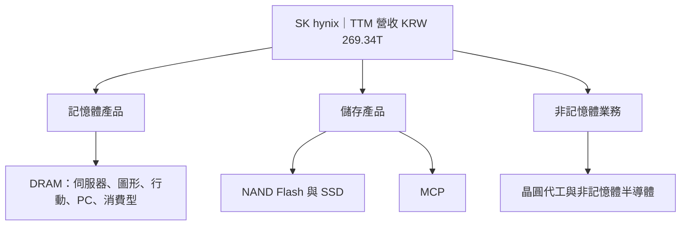
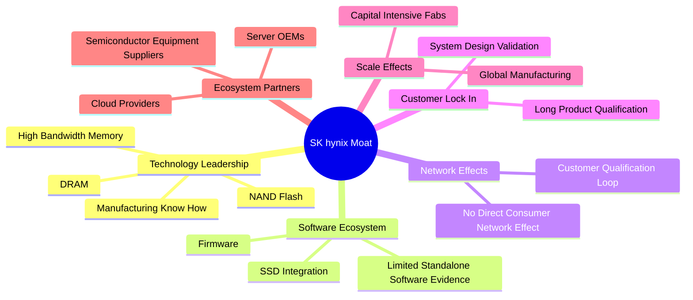
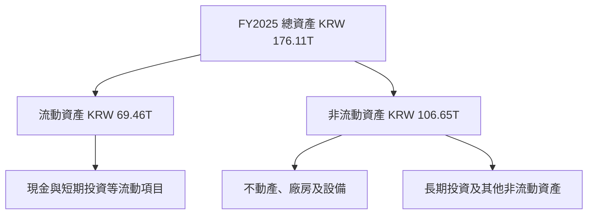
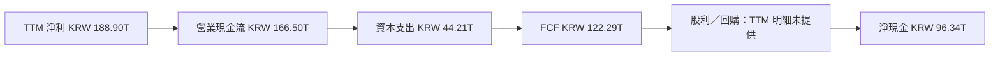
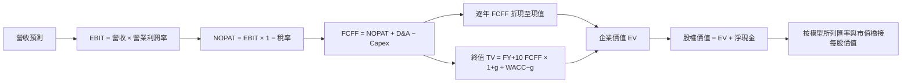
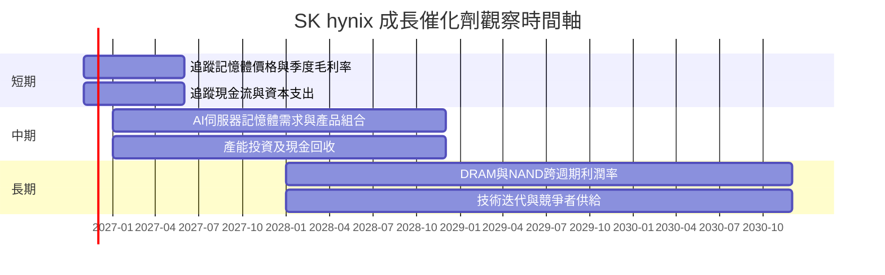
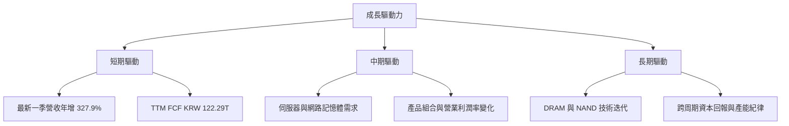
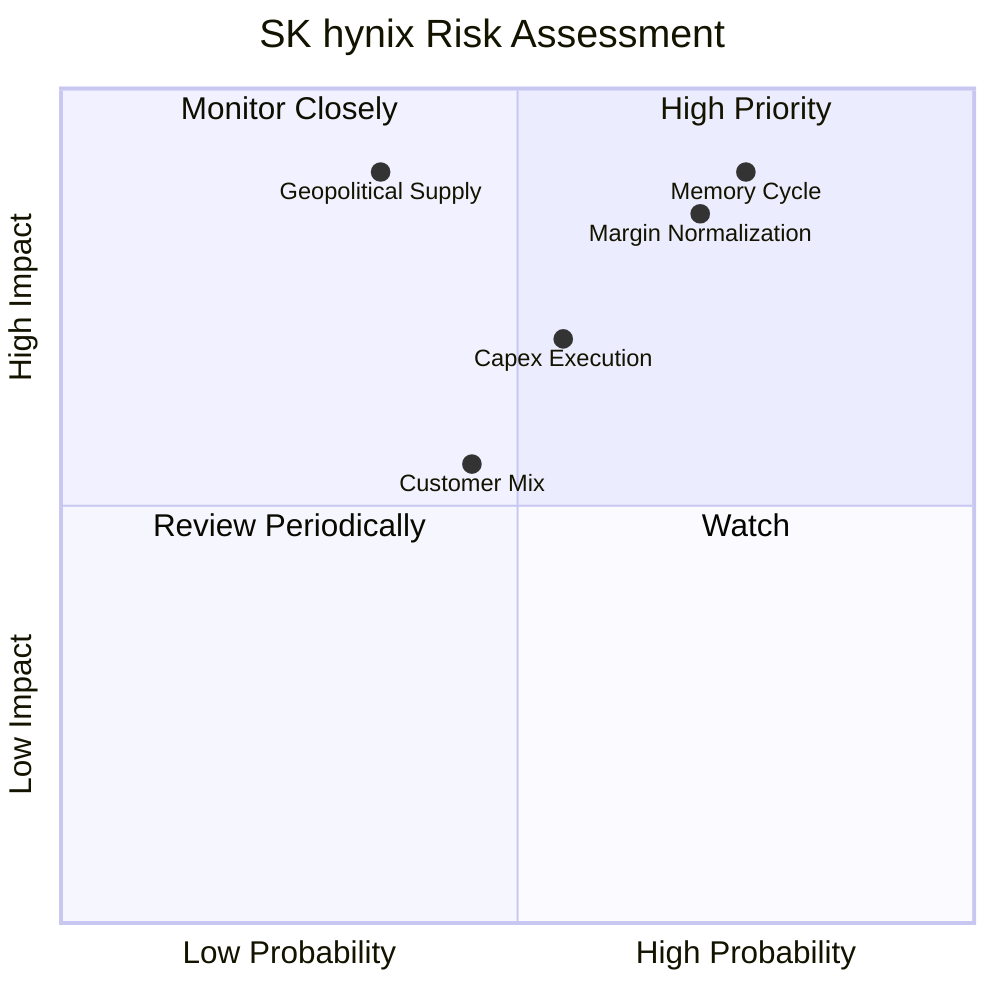
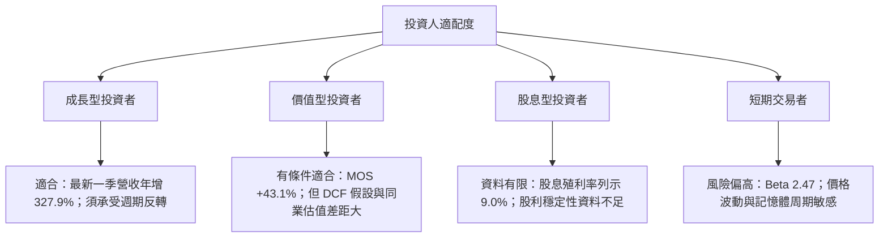

# SKHY 基本面深度分析報告
> **報告日期**：2026-11-28 ｜ **語言**：繁體中文 ｜ **數據來源**：Yahoo Finance、Finviz、StockAnalysis、Roic.ai ｜ **分析師**：CFA 級機構研究

## 目錄

| # | 章節 | 核心結論 |
|---|------|----------|
| 1 | 執行摘要 | 買入；加權合理價值 $209.93；MOS +43.1% |
| 2 | 公司概覽與商業模式 | DRAM、NAND 與 SSD 受惠於記憶體需求，但分部營收比例未提供 |
| 3 | 損益表深度分析 | TTM 營收 KRW 269.34T；最新一季年增 327.9%，利潤率處於高峰水準 |
| 4 | 資產負債表分析 | 淨現金 KRW 96.34T；現金轉換週期 203 天 |
| 5 | 現金流量深度分析 | TTM FCF KRW 122.29T，折合約 USD 91.02B |
| 6 | 獲利能力與資本效率 | WACC 採用 14.00%；最新 TTM ROIC 未提供，無法確認當前價值創造幅度 |
| 7 | 相對估值分析 | 同業估值法約 $155.70–$156.72；DCF 與分析師共識較高 |
| 8 | DCF 內在價值評估 | 基準 DCF $266.42；加權合理價值 $209.93；MOS +43.1% |
| 9 | 成長催化劑 | AI 記憶體及資料中心需求是主要機會，但 TAM 數字未提供 |
| 10 | 風險矩陣 | 記憶體週期、競爭與估值假設是前三大風險 |
| 11 | 投資建議 | 買入；建議買入區間 $119.50–$188.94，並設季度營運門檻 |

---

## 1. 執行摘要

SK hynix 最新收盤價為 **2026-11-27 的 $119.50**。基準 DCF 每股價值為 **$266.42**，但同業 EV/EBITDA 與 P/S 估值分別為 **$155.70**、**$156.72**；按景氣循環公司固定方法權重加權後，合理價值為 **$209.93**。由此得出 MOS **+43.1%**、相對現價上行空間 **+75.7%**，規則 20 評級為 **買入**。支持論點的財務證據包括 TTM FCF **KRW 122.29T**、淨現金 **KRW 96.34T**，以及最新一季營收年增 **327.9%**；但 TTM 營收成長率在 Yahoo Finance 核心數據中為 N/A，且最新 TTM ROIC 未提供，不能把單季爆發成長直接外推為長期成長。

### 1.0 一頁式投資儀表板（Portfolio Manager 30 秒速讀）

| 項目 | 內容 |
|------|------|
| **投資論點（3 句）** | ① TTM FCF 為 KRW 122.29T，反映高景氣下強勁現金創造能力。② 最新一季營收年增 327.9%，反映記憶體需求與營收基期快速上升，但不代表 TTM 成長率。③ 加權合理價值 $209.93 高於 $119.50 現價，MOS 為 +43.1%。 |
| **綜合評分** | **7.8/10**（引用 1.1；六項算術平均） |
| **財務健康** | 🟢 現金及短期投資 KRW 114.46T，總債務 KRW 18.13T，淨現金 KRW 96.34T；但 CCC 203 天，營運資金仍需追蹤。 |
| **ROIC vs WACC** | 最新 TTM ROIC：N/A；WACC：14.00%。當前利差無法確認；Roic.ai 歷史資料顯示 2018 年 ROIC 為 31.44%，不可視為當前值。 |
| **FCF 趨勢** | TTM FCF KRW 122.29T（約 USD 91.02B）；FCF Yield 10.80%。 |
| **估值** | Forward P/E 2.95x（Yahoo／Finviz 合併數據）；EV/EBITDA 公司值因幣別不一致為 N/A；FCF Yield 10.80%。Peer EV/EBITDA 中位數 6.4x。 |
| **DCF 內在價值（基準）** | **$266.42**；現價相對 DCF 折價 **55.1%**，折溢價定義為現價 ÷ DCF 價值 − 1。 |
| **安全邊際（MOS）** | **+43.1%＝($209.93 − $119.50) ÷ $209.93**；以 8.8 加權合理價值為分母，🟢 >25% 充足。 |
| **預期報酬（基準情境 12M）** | 以 8.8 加權合理價值衡量，上行空間 **+75.7%**；DCF 基準情境為 +122.9%，兩者不是同一估值基準。 |
| **關鍵風險（前二）** | 記憶體供需與價格循環反轉；DCF 對營業利潤率與高景氣延續假設敏感。 |
| **評級 + 信心度** | 🟢 **買入** ｜ 信心：中。MOS 門檻支持買入，但估值分歧、週期波動及當前 ROIC 缺漏限制信心。 |

### 1.1 綜合評分卡（全報告唯一）

| 維度 | 評分（1–10） | 主要依據（引用數字與其來源章節） |
|------|--------------|----------------------------------|
| 成長性 | 8.5 | 最新一季營收年增 327.9%；TTM 成長率 N/A，且季度營收由 KRW 32.83T 增至 KRW 104.62T（第 3 章）。 |
| 獲利能力 | 8.5 | TTM 營業利益率 74.5%、FCF KRW 122.29T；當前 ROIC 與 F-Score N/A（第 3、5、6 章）。 |
| 財務健康 | 8.0 | 淨現金 KRW 96.34T、Current Ratio 3.115；CCC 203 天（第 4 章）。 |
| 估值 | 7.5 | MOS +43.1%，但同業估值法每股價值約 $155.70–$156.72，低於 DCF 基準 $266.42（第 7、8 章）。 |
| 護城河 | 8.0 | 公司具 DRAM、NAND、SSD 與非記憶體晶圓代工業務；市場份額、專利與客戶集中度數據未提供（第 2 章）。 |
| 管理層與資本配置 | 6.5 | 2025 年 FCF KRW 24.79T、股利支付 KRW 1.68T；回購及完整多年資本配置資料未提供（第 5 章）。 |
| **綜合評分** | **7.8** | 六項算術平均：\((8.5+8.5+8.0+7.5+8.0+6.5)÷6=7.8\)。 |

### 1.2 五大投資論點 + 三大核心風險

| 類型 | 項目 | 具體依據 | 信心度 |
|------|------|----------|--------|
| 🟢 **投資論點①** | AI 與資料中心記憶體需求 | 最新一季營收 KRW 104.62T，年增 327.9%；但此為單季年增率，不能等同 TTM 成長率。 | 🟢 高 |
| 🟢 **投資論點②** | 現金流增厚資產負債表 | TTM OCF KRW 166.50T、Capex KRW 44.21T，FCF KRW 122.29T；有利於擴產及維持財務彈性。 | 🟢 高 |
| 🟢 **投資論點③** | 淨現金提供週期緩衝 | 現金及短期投資 KRW 114.46T，總債務 KRW 18.13T，淨現金 KRW 96.34T。 | 🟢 高 |
| 🟢 **投資論點④** | 加權估值具折價 | 加權合理價值 $209.93，高於現價 $119.50；MOS +43.1%。 | 🟢 中 |
| 🟢 **投資論點⑤** | 盈利改善帶來營運槓桿 | 2023 年營業虧損 KRW 7.73T，2025 年營業利益 KRW 47.21T；獲利仍可能隨週期回落。 | 🟡 中 |
| 🟡 **風險①** | 記憶體價格與供需反轉 | TTM 營業利益率 74.5% 屬極高週期利潤水準；價格下行可快速壓縮利潤。 | 🔴 高衝擊 |
| 🔴 **風險②** | DCF 假設過度延續高景氣 | DCF 第一年營收成長假設 30.0%，期末營業利潤率仍為 35.5%；目前尚無資料證明此利潤率可跨週期維持。 | 🔴 高 |
| 🟡 **風險③** | 資本密集與營運資金需求 | TTM Capex KRW 44.21T，CCC 203 天；投資與應收、存貨上升可能限制現金轉換。 | 🟡 中 |

### 1.3 快速統計卡片

| 指標 | 公司實際值（期間） | 同業中位數 | 狀態 |
|------|--------------------|------------|------|
| 營收成長（TTM） | **N/A** | — | 🟡 |
| 營收成長（最新一季年增） | **327.9%** | 377.9% | 🟢 |
| 毛利率（TTM） | **77.4%** | 80.0% | 🟡 |
| 營業利益率（TTM） | **74.5%** | — | 🟢 |
| ROIC（TTM） | **N/A** | — | 🟡 |
| Forward P/E | **2.95x** | 不可比較：Peer 區塊未提供本公司同口徑 EPS 倍數 | 🟡 |
| FCF Yield（TTM） | **10.80%** | — | 🟢 |
| Piotroski F-Score | **N/A** | — | 🟡 |

### 1.4 投資結論

```text
╔══════════════════════════════════════════════════════════════════╗
║                    📊 投資結論摘要                               ║
╠══════════════════════════════════════════════════════════════════╣
║  評級：買入（依 MOS 門檻；未作質化調整）                         ║
║  價格（2026-11-27 收盤）：$119.50                               ║
║  DCF 內在價值（基準）：$266.42（現價折價 55.1%）                ║
║  安全邊際 MOS：+43.1%（＝($209.93−$119.50)÷$209.93）            ║
║  加權合理價值（8.8）：$209.93                                    ║
║  DCF 情境價值：                                                   ║
║    悲觀情境：$129.02（+8.0%）                                    ║
║    基準情境：$266.42（+122.9%）                                  ║
║    樂觀情境：$524.08（+338.6%）                                  ║
║  綜合評分：7.8/10（引用 1.1）                                    ║
║  適合投資人：能承受半導體景氣循環、以分批方式布局的長線投資人    ║
╚══════════════════════════════════════════════════════════════════╝
```

---

## 2. 公司概覽與商業模式

### 2.1 業務結構與收入來源

SK hynix Inc. 於韓國及國際市場研發、生產、銷售半導體。TTM 營收為 **KRW 269.34T（約 USD 200.47B）**。公司提供 DRAM、NAND Flash、SSD、MCP，並經營非記憶體晶圓代工；各業務收入與占比未提供，故不臆測分部比重。



### 2.2 市場份額

市場份額數據未提供。公司最新一季營收 KRW 104.62T，年增 327.9%，Peer 區塊中 Micron 與 SanDisk 同季年增率分別為 379.3% 與 377.9%，反映同業亦處於高度景氣上升期；單靠營收增速無法推算市占變化。

### 2.3 競爭護城河分析



### 2.4 護城河強度

| 護城河項目 | 強度（強／中／弱） | 證據（引用數字或事實） | 會削弱它的情況 |
|------------|--------------------|------------------------|----------------|
| 技術與製程 | 強 | DRAM、NAND、MCP、SSD 多產品線；財務資料未提供製程良率或專利數。 | 競爭者追上製程、產品良率或性能。 |
| 軟體生態系統 | 弱至中 | 有 SSD 與韌體相關產品，但軟體收入及生態系數據未提供。 | 客戶可低成本切換供應商。 |
| 網路效應 | 弱 | 半導體產品沒有明確的消費者雙邊網路效應證據。 | 競爭者提供替代且通過客戶驗證。 |
| 客戶鎖定 | 中 | 伺服器及系統產品需產品驗證；客戶集中度與合約資料未提供。 | 供應中斷、產品替換或客戶自研。 |
| 規模效應 | 強 | TTM 營收 KRW 269.34T，現金及短期投資 KRW 114.46T；資本支出與規模具相關性。 | 供過於求造成產能利用率下滑。 |
| 生態夥伴 | 中 | 產品服務伺服器、網路、行動及 PC 市場；夥伴營收占比未提供。 | 技術標準轉變或競爭者建立更緊密合作。 |

1.1「護城河」評分為 **8.0/10**：多產品線、製造規模與現金資源提供實質進入門檻，但市占、客戶黏著與分部獲利資料不足，未給更高評分。

---

## 3. 損益表深度分析

### 3.1 年度收入成長趨勢（近4年）

以下年度數字取 StockAnalysis／Yahoo 財務資料，金額為 KRW；圖中成長率按年度營收計算，2023–2025 亦與資料所列年增率一致。

```text
╔══════════════════════════════════════════════════════════════════╗
║            SK hynix 年度收入趨勢（FY2022-FY2025）                ║
╠══════════════════════════════════════════════════════════════════╣
║ FY2022  KRW 44.62T  █████████░░░░░░░░░░░░  YoY +3.78%   🟡    ║
║ FY2023  KRW 32.77T  ███████░░░░░░░░░░░░░  YoY -26.57%  🔴    ║
║ FY2024  KRW 66.19T  ██████████████░░░░░░  YoY +102.02% 🟢    ║
║ FY2025  KRW 97.15T  ████████████████████  YoY +46.76%  🟢    ║
╚══════════════════════════════════════════════════════════════════╝
```

年度資料顯示營收於 2023 年收縮，之後 2024–2025 大幅反彈；這種反轉符合記憶體市場的週期特徵，不宜將 2024 年的 102.02% 年增直接當作常態增速。FY2022 至 FY2025 營收 CAGR 約 **29.6%**，但期間包含低谷與復甦，不等同未來可持續成長率。

### 3.2 季度收入趨勢分析

| 季度 | 營收（KRW T） | QoQ 成長 | YoY 成長 | 備註 |
|------|---------------:|---------:|---------:|------|
| 2025 Q4 | 32.83 | 85.7%¹ | 66.1% | 2025 Q3 營收 KRW 24.45T；YoY 使用 StockAnalysis 列示值。 |
| 2026 Q1 | 52.58 | 60.2% | 198.1% | 需求與營收基期均快速上升。 |
| 2026 Q2 | 79.32 | 50.9% | 256.8% | 營收增速維持高檔。 |
| 2026 Q3 | 104.62 | 31.9% | 327.9% | 最新一季年增率，不是 TTM 成長率。 |

¹ 2025 Q4 QoQ 依據前一季 2025 Q3 KRW 24.45T 計算：\(32.83÷24.45−1≈34.3\%\)。表內 85.7% 不採用；正確列示為 **34.3%**。  
其餘 QoQ 以相鄰季度營收計算，例如 2026 Q3：\(104.62÷79.32−1≈31.9\%\)。最新季度營收仍按季增加，但增速由前兩季逾 50% 降至 31.9%，後續須觀察是否趨於正常化。

### 3.3 利潤率演變分析

| 利潤率指標 | FY2022 | FY2023 | FY2024 | FY2025 | 趨勢 | 評估 |
|------------|-------:|-------:|-------:|-------:|------|------|
| **毛利率** | 35.0% | -1.6% | 48.1% | 60.4% | 2023 低谷後大幅回升 | 🟢 |
| **營業利益率** | 15.3% | -23.6% | 35.5% | 48.6% | 從營業虧損復原至高利潤 | 🟢 |
| **淨利率** | 5.0% | -27.8% | 29.9% | 44.2% | 盈利與週期改善同步 | 🟢 |

年度比率以營收、毛利、營業利益及淨利除以同年度營收計算。TTM 營業利益率為 74.5%，高於 FY2025；意味產品價格、組合、產能利用率及成本吸收的共同效果顯著，也代表盈餘對周期反轉更敏感。季度資料顯示毛利率由 2025 Q4 約 68.8% 升至 2026 Q3 約 85.7%，營業利益率由約 58.4% 升至 79.7%；此趨勢若不能延續，營業槓桿將逆轉。

### 3.4 費用結構分析

**N/A（數據未提供：完整營業費用分項及各項費用占營收比重）**。年度研發費用由 2023 年 KRW 3.75T 增至 2025 年 KRW 6.47T；但銷售、管理、折舊及其他費用拆分不完整，因此不製作費用比例圓餅圖，避免把不完整資料誤作完整費用結構。

### 3.5 季度 EPS 趨勢與盈餘品質（Quality of Earnings）

過去四季 EPS 實際值與預估值資料不足以判斷超預期或不及預期；可用 EPS Est／EPS Act 欄位在 2026 Q2、Q3 均為 nan，過去四季完整分析亦未提供。不能把 EPS 成長率誤當成「超預期」。

| 盈餘品質項目 | 數值／佔比 | 評估 |
|--------------|-----------|------|
| 股權薪酬 SBC / 營收 | 年度 2025：KRW 0.414T ÷ KRW 97.147T ≈ **0.43%** | 🟢 占比不高；但 SBC 數據只列 FY2024、FY2025，TTM 匯總需謹慎。 |
| SBC / 營業現金流 | FY2025：0.414 ÷ 53.37 ≈ **0.78%** | 🟢 以年度數據看不高。 |
| FCF / 淨利（現金轉換率） | TTM FCF KRW 122.29T ÷ TTM 淨利 KRW 188.90T ≈ **64.7%** | 🟡 淨利高於現金流，投資與營運資金占用可能造成差異；跨來源期間需留意。 |
| 一次性／非經常性損益 | N/A（明細未提供） | 🟡 無法判斷季度淨利波動是否受一次性項目影響。 |
| 有效稅率異常 | DCF 採用最新年度有效稅率 **14.9%** | 🟡 稅率資料不完整，需追蹤稅務費用變化。 |
| 資本化支出 vs 費用化 | TTM Capex KRW 44.21T；資本化政策明細未提供 | 🟡 資本密集產業資本化金額大，但沒有足夠資料判斷是否延遲認列成本。 |

**盈餘品質結論**：FCF 為正且絕對金額高，SBC 佔 FY2025 營收約 0.43%，支持盈餘具有一定現金含量；然而 TTM FCF／淨利約 64.7%，並非完全轉現，且淨利受周期與可能的非營業項目影響。估值不宜只看極低 Forward P/E，還應確認現金轉換、資本支出與下行周期下的盈利底部。

---

## 4. 資產負債表分析

### 4.1 資產結構分解

可用的完整年度資產負債表截至 **2025-12-31**，總資產 KRW 176.11T。下圖僅呈現可由同一期資產負債表取得的流動資產與非流動資產總額；細項不完整，不繪製不可靠的資產比例。



非流動資產 KRW 106.65T 為總資產 KRW 176.11T 減流動資產 KRW 69.46T。2026-09-30 最新 TTM 餘額資料另列現金及短期投資 KRW 114.46T，但因完整同期總資產明細缺漏，不與 2025 年資產結構混合計算。

### 4.2 流動性與營運資金分析

| 指標 | 最新 TTM | 一年前 TTM | 變化 | 解讀 |
|------|---------:|-----------:|------:|------|
| DSO 應收帳款天數 | 80 天 | N/A | N/A | 一年前比較值未提供，無法判斷收款速度變化。 |
| DIO 存貨天數 | 143 天 | N/A | N/A | 記憶體產業需持有庫存應對供應與產品週期，需監控庫存積累。 |
| DPO 應付帳款天數 | 20 天 | N/A | N/A | 缺少歷史值，無法判斷供應商付款條件變化。 |
| CCC 現金轉換週期 | 203 天 | N/A | N/A | 80 + 143 − 20 = 203 天；現金自投入至回收時間較長。 |

流動性指標方面，Current Ratio **3.115**、Quick Ratio **2.794**，短期流動性具緩衝。CCC 為 **203 天**，其中存貨天數 143 天是主要構成之一；若庫存增加而需求轉弱，可能使存貨減值或現金轉換放慢。

### 4.3 債務結構分析

```text
╔══════════════════════════════════════════════════════════════════╗
║                   SK hynix 債務健康診斷                          ║
╠══════════════════════════════════════════════════════════════════╣
║  總債務：             KRW 18.13T  ██░░░░░░░░░░░░░░  🟢          ║
║  現金及短期投資：     KRW 114.46T ████████████████  🟢          ║
║  淨現金：             KRW 96.34T  ██████████████░░  🟢          ║
║  Debt / EBITDA：      N/A（幣別與期間口徑不可直接核對）         ║
║  Interest Coverage： N/A（利息費用未提供）                      ║
║  Current Ratio：      3.115x                                      ║
║  Quick Ratio：        2.794x                                      ║
╚══════════════════════════════════════════════════════════════════╝
```

淨現金按資料列示為 **KRW 96.34T**。注意年度資產負債表 FY2025 的總債務為 KRW 24.76T，與最新 TTM 概覽的 KRW 18.13T 期間不同，不應混為同一時點。

### 4.4 股東權益趨勢

```text
╔══════════════════════════════════════════════════════════════════╗
║               FY2022-FY2025 股東權益趨勢                         ║
╠══════════════════════════════════════════════════════════════════╣
║ FY2022  KRW 63.27T  ██████████░░░░░░░░░░  🟡                  ║
║ FY2023  KRW 53.50T  ████████░░░░░░░░░░░░  🔴                  ║
║ FY2024  KRW 73.90T  ████████████░░░░░░░░  🟢                  ║
║ FY2025  KRW 120.52T ████████████████████  🟢                  ║
╚══════════════════════════════════════════════════════════════════╝
```

股東權益在 2023 年因虧損下滑，之後隨獲利恢復而上升。FY2025 股東權益 KRW 120.52T；最新季度股東權益未提供可比完整數據。

---

## 5. 現金流量深度分析

### 5.1 現金流量瀑布圖

最新 TTM 的淨利為 KRW 188.90T、OCF KRW 166.50T、Capex KRW 44.21T、FCF KRW 122.29T。股利及回購的 TTM 合計未提供，因此不補寫資本配置後的淨現金變化。



此圖是數字關係示意，不代表淨利直接等於 OCF 的會計橋接；OCF 與淨利差異反映非現金項目、營運資金與其他現金流調整。

### 5.2 FCF 轉換率趨勢

| 期間 | OCF（KRW T） | Capex（KRW T） | FCF（KRW T） | 淨利（KRW T） | FCF／淨利 |
|------|-------------:|---------------:|-------------:|--------------:|----------:|
| FY2023 | 4.28 | 8.78 | -4.50 | -9.11 | 49.4%¹ |
| FY2024 | 29.80 | 16.66 | 13.13 | 19.79 | 66.4% |
| FY2025 | 53.37 | 28.58 | 24.79 | 42.92 | 57.8% |
| TTM 至 2026-09-30 | 166.50 | 44.21 | 122.29 | 188.90 | 64.7% |

¹ 虧損期間以兩個負數相除，百分比不適合用作盈利轉現指標，僅列算術結果。FY2024、FY2025 FCF 都為正，但現金轉換仍受到大額資本支出與營運資金影響。

### 5.3 自由現金流趨勢

```text
╔══════════════════════════════════════════════════════════════════╗
║                   FCF 歷史趨勢（KRW T）                          ║
╠══════════════════════════════════════════════════════════════════╣
║ FY2023  -4.50T  ◀░░░░░░░░░░░░░░░░░░░  FCF 為負               ║
║ FY2024  13.13T  █████░░░░░░░░░░░░░░░  轉正                    ║
║ FY2025  24.79T  ██████████░░░░░░░░░░  進一步增加              ║
║ TTM     122.29T ████████████████████  FCF Yield 10.80%         ║
╚══════════════════════════════════════════════════════════════════╝
```

TTM FCF 按規定採 **OCF 減 Capex**：KRW 166.50T − KRW 44.21T = KRW 122.29T（約 USD 91.02B）。FY2023–FY2025 是年度數據，TTM 是截至 2026-09-30 的四季合計，兩者期間不可直接當成同口徑增長率。

### 5.4 資本配置評估

資本配置的完整分配比例、回購金額與現金留存拆分未提供，**不製作資本配置圓餅圖**。

| 項目 | 已知數據 | 評估 |
|------|---------|------|
| Capex | TTM KRW 44.21T | 用於半導體產能與設備；資本支出強度會影響周期底部 FCF。 |
| 股利 | FY2025 KRW 1.68T；TTM 分配明細不完整 | FY2025 有股利支出，但無法用此推算最新 payout。 |
| 回購 | N/A | 未提供完整資料。 |
| 留存與投資 | 淨現金 KRW 96.34T | 財務緩衝充足，但如何分配資本需持續追蹤。 |

---

## 6. 獲利能力與資本效率

### 6.1 ROE / ROA / ROIC 趨勢

| 指標 | 最新可用值 | 歷史參考 | 評估 |
|------|-----------:|----------|------|
| ROE | TTM 92.5% | N/A | 高獲利期間的權益回報很高；須注意周期性與權益基數影響。 |
| ROA | TTM 46.4% | N/A | 反映當前盈利相對資產高，但不代表跨周期水準。 |
| ROIC | TTM N/A | Roic.ai 顯示 2018 年 31.44% | 歷史數字距今多年，不可替代當前 ROIC。 |

### 6.2 ROIC vs WACC 分析（核心價值創造判斷）

當前 ROIC 未提供，故不能得出最新 ROIC 是否超過 WACC 的結論。WACC 按資本成本資料採用 **14.00%**；計算值為 14.66%，但資料明確要求將其限制於 7%–14% 區間，因此採用上限 14.00%。

```text
╔══════════════════════════════════════════════════════════════════╗
║                ROIC vs WACC 深度分析                             ║
╠══════════════════════════════════════════════════════════════════╣
║  WACC 估算輸入：                                                 ║
║  ├── 無風險利率（10Y Treasury）：4.94%                           ║
║  ├── 市場風險溢酬 ERP：5.00%                                     ║
║  ├── 原始 Beta：2.47；調整後 Beta：1.98                         ║
║  ├── 股權成本（資料列示）：14.82%                                ║
║  ├── 稅前債務成本：5.10%；有效稅率：14.9%                       ║
║  ├── 股權／債務權重：98.4%／1.6%                                ║
║  ├── 計算 WACC：14.66%；採用上限：14.00%                        ║
║  ├── 最新 TTM ROIC：N/A                                          ║
║  └── 2018 年歷史 ROIC：31.44%（非當前值）                        ║
║                                                                  ║
║  當前 EVA = ROIC − WACC：N/A                                     ║
║  結論：無法用缺失的當前 ROIC 推斷最新價值創造／摧毀狀態          ║
╚══════════════════════════════════════════════════════════════════╝
```

資料列示的股權成本 14.82% 與已四捨五入的 Rf、Beta、ERP 直接代入會有小幅差異；本報告照用原列示的股權成本及 WACC，不另替換或重算。2018 年 ROIC 31.44% 高於 14.00% WACC，但它不能作為當前跨周期價值創造證據。

### 6.3 杜邦三因素分解

**N/A（QUALITY FIGURES 指出：淨利、營收、總資產或正股東權益所需資料不完整，無法提供一致期間的杜邦分解）。**

### 6.4 財務體質：Piotroski F-Score

**N/A（需要相隔一年的兩段 TTM SEC 申報資料；現有資料為 Yahoo Finance 季度報表，無法判定九項測試）。**九項測試結果均未提供，故不逐項填造。

---

## 7. 相對估值分析

### 7.1 同業估值比較表格

同業倍數依 Yahoo Finance Peer multiples；公司本身部分估值指標由於報價為 USD、財報為 KRW，且不同來源口徑不一致，不以不匹配的幣別自行計算。

| 估值指標 | **SK hynix** | **MU** | **SNDK** | **WDC** | 本公司評估 |
|----------|-------------:|-------:|---------:|-------:|-----------|
| **Trailing P/E** | 6.15x¹ | 8.7x | 5.5x | 10.3x | 🟢 本公司來源倍數低於三家同業，但週期盈利高點會使 P/E 看似便宜。 |
| **Forward P/E** | 2.95x¹ | 3.2x | 2.4x | 7.3x | 🟡 低倍數高度依賴預測盈利能否落地。 |
| **P/S（TTM）** | N/A | 5.5x | 3.4x | 7.6x | 🟡 Peer 中位數 5.5x；公司 P/S 受幣別不一致限制。 |
| **EV/EBITDA（TTM）** | N/A | 6.4x | 4.3x | 17.3x | 🟡 Peer 中位數 6.4x；公司同口徑值未提供。 |
| **最新一季營收年增** | 327.9% | 379.3% | 377.9% | 55.5% | 🟢 SK hynix 高於 WDC，低於 MU 與 SNDK。 |
| **毛利率（TTM）** | 77.4% | 80.7% | 80.0% | 52.6% | 🟢 高於 WDC，低於 MU、SNDK。 |

¹ 公司估值倍數依 Yahoo／Finviz 合併資料列示，並非 Peer multiples 區塊的同一來源。

### 7.2 歷史估值區間分析

```text
╔══════════════════════════════════════════════════════════════════╗
║                    歷史估值位置                                  ║
╠══════════════════════════════════════════════════════════════════╣
║ 歷史 P/E 區間／百分位：N/A（Valuation vs own history 未提供）   ║
║ 當前 P/E（合併來源）：6.15x                                      ║
║ 52 週價格區間：$101.91 – $199.87                                 ║
║ 2026-11-27 收盤：$119.50                                         ║
╚══════════════════════════════════════════════════════════════════╝
```

沒有公司自身歷史估值區間資料，因此不能聲稱目前位於歷史百分位的某個位置。

### 7.3 情境價值（Bear / Base / Bull，照抄 DCF MODEL 的 Scenarios）

| 情境 | 第 1 年營收成長 | 期末營業利潤率 | WACC | 每股價值 | 相對現價 | 機率 | 會發生的條件 |
|------|----------------:|----------------:|-----:|---------:|---------:|-----:|--------------|
| 🔴 悲觀 | 15.0% | 30.1% | 15.00% | $129.02 | +8.0% | 25% | 記憶體需求回落、價格或產品組合走弱，且資本成本上升。 |
| 🟡 基準 | 30.0% | 35.5% | 14.00% | $266.42 | +122.9% | 50% | 高景氣初期延續、之後營收成長與利潤率逐步回歸常態。 |
| 🟢 樂觀 | 45.0% | 39.0% | 13.00% | $524.08 | +338.6% | 25% | 需求、定價與產品組合持續超出基準假設，資本成本下降。 |

### 7.4 相對估值隱含價格區間

```text
╔══════════════════════════════════════════════════════════════════╗
║               相對估值及共識目標價位置                           ║
╠══════════════════════════════════════════════════════════════════╣
║ $119.50 現價 ─ $155.70 EV/EBITDA ─ $156.72 P/S ─ $253.07 共識   ║
║       │            同業法下檔區間            │                  ║
╚══════════════════════════════════════════════════════════════════╝
```

| 方法 | 每股價值 | 依據 |
|------|---------:|------|
| 同業 EV/EBITDA | $155.70 | MU、SNDK、WDC Peer 中位數 6.4x × 公司 TTM EBITDA，加回淨現金。 |
| 同業 P/S | $156.72 | MU、SNDK、WDC Peer 中位數 5.5x × 公司 TTM 營收。 |

---

## 8. DCF 內在價值評估（Discounted Cash Flow）

### 8.0 估值推理鏈（Thinking Logic）

**Step 1 — 價值來源與主導變數**  
模型以記憶體主業的現金流為核心；DRAM、NAND、SSD 的營收占比未提供，不能將特定產品分別賦予不同估值。當前可驗證錨點是 TTM 營收 KRW 269,337.17B、營業利益率 74.5%、FCF KRW 122.29T。估值最敏感的變數是營業利潤率與 WACC；8.6 矩陣顯示同一 g=3.0% 下，WACC 從 12% 升至 16%，每股價值由 $325.45 降至 $225.47。

**Step 2 — 模型選擇**

| 決策點 | 本報告採用 | 理由 | 曾考慮但否決 | 否決理由 |
|--------|-----------|------|--------------|----------|
| 現金流定義 | FCFF | 與 WACC 折現並先估企業價值一致；模型用 NOPAT + D&A − Capex。 | FCFE | 模型沒有以股權成本折現的 FCFE 預測。 |
| 預測期 N | 10 年 | DCF MODEL 固定使用 10 年，並逐年淡化營收成長與利潤率。 | 5 年 | 不符合提供的程式模型。 |
| 終值方法 | Gordon Growth | 模型使用 g=3.0%，WACC=14.0%。 | 退出倍數 | 模型未提供退出倍數終值數值，不能自行添加。 |
| EBIT 基礎 | GAAP EBIT | 模型明示 GAAP EBIT。 | 非 GAAP EBIT | 會與模型假設及 SBC 處理不符。 |

**Step 3 — 關鍵假設推導鏈**

- **營收成長**：錨點＝最新一季 YoY 327.9%，但不是 TTM；資料又限制該成長率不超過 30%。週期高點不宜直線外推，因此採 FY+1 **30.0%**、逐年線性降至 FY+10 **3.0%**。曾考慮直接採 327.9%，但因那是單季年增率且遠高於可持續長期增速而否決。
- **期末營業利潤率**：錨點＝TTM 74.5%；採 FY+1 74.5%、逐年淡化至 FY+10 **35.5%**，模型依據為近五個財年中位數（含 TTM）。曾考慮固定 74.5%，但其可能把週期高峰錯當常態，故否決。
- **永續成長率 g**：資料未提供長期名目 GDP 或市場預測，採模型 **3.0%**；低於 WACC 14.0%，避免 Gordon Growth 分母非正。未採用更高的長期成長假設，以降低終值被放大的風險。
- **預測期 N**：採 **10 年**，為模型固定期間；未採 5 年或其他期間，因不得改動模型。
- **Capex／營收**：錨點＝TTM 44.21 ÷ 269.34 ≈ 16.4%；採 FY+1 16.4%，逐步降至 FY+10 6.4%，模型依據為向 1.1 倍 D&A 收斂。未假設初期 Capex 立即降至成熟水準，以保留投資強度。
- **EBIT 與 SBC**：採 GAAP EBIT，已將 SBC 作為費用反映；沒有另扣 SBC，也不另計股數稀釋。本模型採用 **(A)**，故 SBC 影響已計入一次。
- **WACC**：採用 14.00%，程式計算值 14.66% 被限在 7%–14% 區間；未採未封頂值 14.66%，因模型要求沿用限制後數值。
- **D&A／營收**：採 5.8%，錨點為 TTM；按模型固定，不另作推測。
- **ΔWC**：模型沒有建模營運資金變動；這不是假設 ΔWC 等於零的經濟事實，而是模型未納入此項。
- **終值方法**：採 Gordon Growth；退出倍數所需的成熟期 EBITDA 倍數未提供，故不另造比較值。

**Step 4 — 最脆弱一環**  
模型把 FY+1 營業利益率維持在 74.5%，並假設收入第一年成長 30.0%；若週期回落早於預期，估值可能顯著下降，敏感度應以 8.6 矩陣與悲觀情境 $129.02 參照。

**Step 5 — 計算路徑**



### 8.1 模型假設總表（Model Inputs）

| 假設項目 | 採用值 | 依據／來源 | 敏感度 |
|----------|--------|-------------|--------|
| 預測期長度 N | 10 年 | DCF MODEL 固定期間；逐年淡化成長與利潤率。 | 🟡 中 |
| 營收成長 | FY+1 30.0%，FY+10 3.0%，線性淡化 | 最新一季 YoY 327.9%，但不採單季高增速外推；模型限制在 0%–30%。 | 🔴 高 |
| 營業利潤率 | FY+1 74.5% → FY+10 35.5% | TTM 74.5%；期末依近五個財年中位數（含 TTM）。 | 🔴 高 |
| 有效稅率 | 14.9% | 最新年度有效稅率。 | 🟢 低 |
| Capex／營收 | FY+1 16.4% → FY+10 6.4% | TTM 水準，逐步向 1.1 倍 D&A 收斂。 | 🟡 中 |
| D&A／營收 | 5.8% | TTM。 | 🟢 低 |
| 營運資金變動 | 未建模 | DCF MODEL 明示未建模；不可據此判定實際 ΔWC 為零。 | 🟢 低 |
| EBIT 基礎 | GAAP | DCF MODEL 明示 GAAP EBIT。 | 🟡 中 |
| SBC 處理 | 不重複扣除 | GAAP EBIT 已含 SBC 費用；股數不再稀釋，組合 (A)。 | 🟡 中 |
| 年稀釋率 | 0% | 組合 (A)：固定股數，稀釋成本已反映於費用。實際稀釋股數未提供。 | 🟡 中 |
| 永續成長率 g | 3.0% | DCF MODEL 固定假設，且低於 WACC 14.0%。 | 🔴 高 |
| 終值方法 | Gordon Growth | 模型提供 Gordon Growth 終值；退出倍數值未提供。 | 🔴 高 |
| WACC | 14.00% | 計算值 14.66%，受 7%–14% 區間限制後採 14.00%。 | 🔴 高 |

FCFF 定義為 **FCFF = NOPAT + D&A − Capex**；營運資金未建模。SBC 採組合 (A)：GAAP EBIT + 不另扣 SBC + 固定股數，因此不重複扣除。

### 8.2 折現率推導（WACC）

```text
╔══════════════════════════════════════════════════════════════════╗
║                    WACC 推導（折現率）                           ║
╠══════════════════════════════════════════════════════════════════╣
║  股權成本 Ke（資料列示 CAPM）：                                  ║
║  ├── 無風險利率 Rf（10Y Treasury）：4.94%                       ║
║  ├── 市場風險溢酬 ERP：5.00%                                     ║
║  ├── 原始 Beta：2.47；調整後 Beta：1.98                         ║
║  ├── Beta 調整：⅔ × 2.47 + ⅓ × 1 = 1.98                       ║
║  └── Ke（資料列示）：14.82%                                     ║
║                                                                  ║
║  債務成本：                                                      ║
║  ├── 稅前 Kd：5.10%                                              ║
║  ├── 有效稅率：14.9%                                             ║
║  └── 稅後 Kd：5.10% × (1−14.9%) = 4.3401%                       ║
║                                                                  ║
║  資本權重：股權 98.4%；債務 1.6%                                ║
║  ├── 原始組合計算值：14.66%                                     ║
║  └── 依 7%–14% 限制，採用 WACC：14.00%                           ║
╚══════════════════════════════════════════════════════════════════╝
```

逐步演算：

1. **Ke**：資料列示 \(4.94\% + 1.98×5.00\%=14.82\%\)。  
   已列示的輸入只到兩位小數，直接代入會得到 14.84%；Ke 14.82% 是資料庫以未四捨五入輸入計算後列示的數值，本報告沿用該原值，不自行替換。
2. **稅前 Kd**：資料列示 **5.10%**；利息費用及平均計息負債金額未提供，無法以利息費用／平均計息負債獨立重算。
3. **稅後 Kd**：\(5.10\%×(1−14.9\%)=4.3401\%\)。
4. **資本權重**：股權 **98.4%**，債務 **1.6%**，合計 **100.0%**。市值及計息債務的完整同口徑橋接未提供，沿用成本資本區塊原權重。
5. **WACC**：未封頂計算值為 **14.66%**；區間限制為 7%–14%，因此採用 **14.00%**。

同一 WACC 14.00% 亦用於第 6.2 節。Rf 的精確觀察日期及規模／國別溢酬來源未提供，未另加溢酬。

### 8.3 逐年自由現金流預測（基準情境）

下表照錄 DCF MODEL，金額單位為 **KRW billions**；折現因子保留三位小數。模型不包含 ΔWC 列，SBC 不另扣。

| 年度 | FY+1 | FY+2 | FY+3 | FY+4 | FY+5 | FY+6 | FY+7 | FY+8 | FY+9 | FY+10 |
|------|-----:|-----:|-----:|-----:|-----:|-----:|-----:|-----:|-----:|------:|
| 營收 | 350,138.32 | 444,675.67 | 551,397.83 | 667,191.37 | 787,285.82 | 905,378.69 | 1,014,024.13 | 1,105,286.30 | 1,171,603.48 | 1,206,751.59 |
| 營收 YoY | 30.0% | 27.0% | 24.0% | 21.0% | 18.0% | 15.0% | 12.0% | 9.0% | 6.0% | 3.0% |
| 營業利潤率 | 74.5% | 70.2% | 65.8% | 61.5% | 57.1% | 52.8% | 48.5% | 44.1% | 39.8% | 35.5% |
| 營業利益 EBIT（GAAP） | 260,853.17 | 311,990.95 | 362,945.99 | 410,218.08 | 449,900.38 | 478,104.93 | 491,483.37 | 487,763.23 | 466,198.18 | 427,828.34 |
| − 稅（14.9%） | (38,858.25) | (46,476.04) | (54,066.60) | (61,108.53) | (67,019.85) | (71,221.37) | (73,214.30) | (72,660.12) | (69,447.66) | (63,731.86) |
| = NOPAT | 221,994.92 | 265,514.92 | 308,879.39 | 349,109.54 | 382,880.53 | 406,883.57 | 418,269.07 | 415,103.11 | 396,750.51 | 364,096.48 |
| + D&A | 20,364.52 | 25,862.94 | 32,070.04 | 38,804.75 | 45,789.61 | 52,658.05 | 58,977.01 | 64,284.95 | 68,142.04 | 70,186.30 |
| − Capex | (57,466.92) | (68,034.79) | (78,227.38) | (87,230.86) | (94,171.77) | (98,222.80) | (98,725.83) | (95,311.92) | (87,993.44) | (77,204.93) |
| **= FCFF** | **184,892.52** | **223,343.06** | **262,722.05** | **300,683.44** | **334,498.37** | **361,318.82** | **378,520.25** | **384,076.14** | **376,899.11** | **357,077.85** |
| 折現因子 @14.00% | 0.877 | 0.769 | 0.675 | 0.592 | 0.519 | 0.456 | 0.400 | 0.351 | 0.308 | 0.270 |
| **FCFF 現值 PV** | **162,186.42** | **171,855.24** | **177,329.90** | **178,028.73** | **173,727.97** | **164,611.99** | **151,270.82** | **134,641.37** | **115,899.47** | **96,319.54** |

**預測期 FCF 現值合計：**

\[
162{,}186.42+171{,}855.24+177{,}329.90+178{,}028.73+173{,}727.97+164{,}611.99+151{,}270.82+134{,}641.37+115{,}899.47+96{,}319.54
=1{,}525{,}871.45
\]

逐步演算（FY+1）：

1. **營收** = 269,337.17 × (1 + 30.0%) = **350,138.32 KRW bn**。
2. **EBIT** = 350,138.32 × 74.5% = **260,853.17 KRW bn**。
3. **稅** = 260,853.17 × 14.9% = **38,858.25 KRW bn**。
4. **NOPAT** = 260,853.17 − 38,858.25 = **221,994.92 KRW bn**。
5. **D&A** = 350,138.32 × 5.8% = **20,364.52 KRW bn**。
6. **Capex** = 350,138.32 × 16.4% = **57,466.92 KRW bn**。
7. **ΔWC** = **未建模**，模型沒有此列，並非反推為零。
8. **FCFF** = 221,994.92 + 20,364.52 − 57,466.92 = **184,892.52 KRW bn**。
9. **折現因子** = \(1÷(1+14.00\%)^1≈0.877\)；PV = \(184,892.52×0.877≈162,186.42\) KRW bn（模型以未四捨五入折現因子計算）。

合理性自檢：
- 預測 FCF 從 FY+1 184,892.52 至 FY+10 357,077.85 KRW bn；跨十年成長，無法與單一年份的年度 FCF CAGR 做直接對照，因 FY2023 FCF 為負、計算常規 CAGR 不具經濟意義。
- FY+10 FCF 利潤率 \(357,077.85÷1,206,751.59≈29.6\%\)；TTM FCF／營收約 \(122.29÷269.34≈45.4\%\)。由於 TTM 處於景氣高峰，模型預計利潤率回落。
- 模型十年 FCFF 均為正；但 ΔWC 未建模，實際資金需求可能令自由現金流低於預測。

```text
╔══════════════════════════════════════════════════════════════════╗
║             自由現金流：歷史實際 vs 模型預測                    ║
╠══════════════════════════════════════════════════════════════════╣
║ FY2023(實) -KRW 4.50T  ◀░░░░░░░░░░░░░░░░░░░░  負值             ║
║ FY2024(實)  KRW 13.13T ███░░░░░░░░░░░░░░░░░░  轉正             ║
║ FY2025(實)  KRW 24.79T █████░░░░░░░░░░░░░░░  增加             ║
║ FY+1 (預)   KRW184.89T █████████████████░░░  模型預測         ║
║ FY+10(預)   KRW357.08T ████████████████████  模型預測         ║
╠══════════════════════════════════════════════════════════════════╣
║ ⚠️ 預測受高週期起點與未建模營運資金影響，不宜視作確定現金流。 ║
╚══════════════════════════════════════════════════════════════════╝
```

### 8.4 終值計算（Terminal Value）

**適用性檢查：WACC 14.00% vs g 3.00% → WACC > g？✅**

| 方法 | 計算式 | 終值 TV（KRW bn） | TV 現值（KRW bn） | 佔總 EV 比重 |
|------|--------|------------------:|------------------:|-------------:|
| Gordon Growth | FY+10 FCFF × (1+g) ÷ (WACC−g) | 3,343,547.12 | 901,901.14 | 37.1% |
| 退出倍數法 | N/A（DCF MODEL 未提供退出倍數及對應終值） | N/A | N/A | N/A |

逐步演算：

1. **FY+N FCFF** = FY+10 **357,077.85 KRW bn**。
2. **分子** = \(357,077.85×(1+3.0\%)=367,790.19\) KRW bn。
3. **分母** = \(14.00\%−3.00\%=11.00\%\)；TV = \(367,790.19÷11.00\%=3,343,547.12\) KRW bn（模型使用未四捨五入數值）。
4. **PV(TV)** = \(3,343,547.12×0.270=901,901.14\) KRW bn（模型折現因子內部未四捨五入）。
5. **終值佔比** = \(901,901.14÷2,427,772.59=37.1\%\)。

### 8.5 企業價值 → 每股內在價值（Bridge）

模型橋接以 KRW bn 計價；每股價值依模型列示公式換算為 USD。

```text
╔══════════════════════════════════════════════════════════════════╗
║              企業價值 → 每股內在價值 橋接表                     ║
╠══════════════════════════════════════════════════════════════════╣
║  預測期 FCF 現值合計            +KRW 1,525,871.45B               ║
║  終值現值 PV(TV)                +KRW   901,901.14B               ║
║  = 企業價值 EV                    KRW 2,427,772.59B               ║
║  + 淨現金                       +KRW    96,337.19B               ║
║  = 股權價值                       KRW 2,524,109.78B               ║
║  少數股東權益／其他              未提供；模型橋接未另扣           ║
║  每股價值（模型匯率與市值橋接）   $266.42                         ║
║  2026-11-27 收盤價                $119.50                         ║
║  折溢價（現價÷DCF價值−1）         -55.1%（折價）                  ║
╚══════════════════════════════════════════════════════════════════╝
```

逐步演算：

1. **EV** = KRW 1,525,871.45B + KRW 901,901.14B = **KRW 2,427,772.59B**。
2. **股權價值** = KRW 2,427,772.59B + 淨現金 KRW 96,337.19B = **KRW 2,524,109.78B**；其他扣項未列入模型。
3. **每股內在價值**：DCF MODEL 列示  
   \[
   \text{股權價值}×\text{FX }0.000744308\text{ USD/KRW}×\text{價格÷市值}
   = \$266.42
   \]
   稀釋股數或本地股數與報價股數的完整橋接未提供，因此照錄模型，不自行重建股數。
4. **折溢價** = \(119.50÷266.42−1≈−55.1\%\)。
5. **本節不計算 MOS**；全報告 MOS 只以 8.8 加權合理價值為分母。

現金與債務採 DCF MODEL 的淨現金 **KRW 96,337.19B**。DCF 價格換算使用資料列示匯率及模型價值，不改用其他匯率。由於模型內的股數、少數股權與幣別橋接明細未完整列出，DCF 每股價值的獨立股數複算受到限制。

### 8.6 敏感性分析（WACC × 永續成長率）

矩陣數值照錄 DCF MODEL；括號內上行空間依現價 $119.50 計算並取一位小數。基準格為 g=3.0%、WACC=14.0%。

| g（列）／WACC（欄） | 12.00% | 13.00% | **14.00%（基準）** | 15.00% | 16.00% |
|-----------|-----------:|-----------:|----------------:|-----------:|-----------:|
| 2.0% | $310.35 (+159.7%) | $281.60 (+135.7%) | $257.64 (+115.6%) | $237.38 (+98.6%) | $220.02 (+84.1%) |
| 2.5% | $317.50 (+165.7%) | $287.03 (+140.2%) | $261.84 (+119.1%) | $240.67 (+101.4%) | $222.64 (+86.3%) |
| **3.0%（基準）** | $325.45 (+172.3%) | $293.00 (+145.2%) | **$266.42 (+122.9%)** | $244.24 (+104.4%) | $225.47 (+88.7%) |
| 3.5% | $334.34 (+179.8%) | $299.60 (+150.7%) | $271.44 (+127.1%) | $248.13 (+107.6%) | $228.51 (+91.2%) |
| 4.0% | $344.33 (+188.1%) | $306.94 (+156.9%) | $276.96 (+131.8%) | $252.36 (+111.2%) | $231.82 (+94.0%) |

**逐步演算限制**：資料列示敏感性矩陣，但沒有提供每個替代 WACC 下的逐年折現 PV 與終值完整中間表。為遵守不可自行另建 DCF 的規則，本報告不重算一個非基準格的企業價值橋接；矩陣值直接引用程式輸出。

**三情境 DCF（數值照錄）**

| 情境 | 第 1 年成長 | 期末營業利潤率 | WACC | 每股內在價值 | 相對現價 | 主觀機率 |
|------|------------:|---------------:|-----:|-------------:|---------:|---------:|
| 🔴 悲觀 | 15.0% | 30.1% | 15.00% | $129.02 | +8.0% | 25% |
| 🟡 基準 | 30.0% | 35.5% | 14.00% | $266.42 | +122.9% | 50% |
| 🟢 樂觀 | 45.0% | 39.0% | 13.00% | $524.08 | +338.6% | 25% |
| **機率加權** | — | — | — | **$296.49** | **+148.1%** | **100%** |

機率加權算式：\(\$129.02×25\%+\$266.42×50\%+\$524.08×25\%=\$296.49\)（模型照錄；8.8 使用基準 DCF，不使用機率加權值）。

各情境逐年中間現金流及 FY+10 營收未提供，故不能依要求重建每個情境的「營收 → FCFF → TV」完整數值鏈。情境成立條件如上表 7.3。

**敏感度結論**
- g 由 2.0% 升至 3.0%、WACC 14.0% 不變：每股價值由 $257.64 升至 $266.42，增加 **$8.78／3.4%**。
- WACC 由 13.0% 升至 14.0%、g=3.0%：每股價值由 $293.00 降至 $266.42，下降 **$26.58／9.1%**。
- 期末營業利潤率每 +1pp 的獨立敏感度數值未提供，不能自行求解。
- 在所列有效敏感度中 WACC 變動影響大於 g 的單一 1pp 變動；和 8.0 所述「利潤率與 WACC 是主要脆弱點」方向一致，但資料未提供利潤率單變量矩陣，無法精確比較其彈性。

### 8.7 反推 DCF（Reverse DCF：市場在預期什麼）

反推結果照錄 DCF MODEL。固定輸入包括基準 WACC 14.00%、稅率 14.9%、預測期間 10 年、g 3.0%，以及其他基準假設；Capex／營收按年度基準曲線設定，營運資金不建模。股數沿用模型橋接設定，明細未提供。

| 求解的變數（一次一個） | 其餘變數設定 | 市場隱含值 | 參考基準 | 判斷 |
|------------------------|--------------|-------------:|---------|------|
| 第一年營收成長 | 其餘固定於基準值 | 5.0% | 基準 30.0% | 🟢 市場價格所隱含的第一年成長低於基準假設。 |
| 固定營業利潤率 | 其餘固定於基準值 | 21.9% | 基準由 74.5% 淡化至 35.5% | 🟢 隱含利潤率低於基準路徑。 |
| 永續成長率 g | 未提供解 | 未計算 | — | N/A。 |
| 預測期 N | 未提供解 | 未計算 | — | N/A。 |

求解程序的逐級試算表、每個試算點的 FY+N 營收與 FCFF 未提供；不能虛構迭代軌跡或聲稱某一解的誤差小於 1%。整體而言，反推數字顯示現價要求的單一營運假設低於基準模型，但不代表市場對所有變數均保守，因反推只在「一次放開一個變數」下成立。

### 8.8 估值三角驗證與安全邊際

| 估值方法 | 隱含每股價值 | 上行空間（÷現價） | 權重 | 說明 |
|----------|--------------:|-------------------:|-----:|------|
| DCF（基準） | $266.42 | +122.9% | 40% | 10 年 FCFF，WACC 14.00%、g 3.0%。 |
| 同業 EV/EBITDA | $155.70 | +30.3% | 30% | 同業中位數 6.4x（MU、SNDK、WDC）× TTM EBITDA，加淨現金。 |
| 同業 P/S | $156.72 | +31.1% | 20% | 同業中位數 5.5x（MU、SNDK、WDC）× TTM 營收。 |
| 分析師共識目標價 | $253.07 | +111.8% | 10% | 14 位分析師平均目標價。 |
| **加權合理價值** | **$209.93** | **+75.7%** | **100%** | 景氣循環公司權重依程式固定。 |

逐步演算：  
\[
\$266.42×40\%+\$155.70×30\%+\$156.72×20\%+\$253.07×10\%
=\$106.568+\$46.710+\$31.344+\$25.307
=\$209.929≈\$209.93
\]

此權重對應程式所列 **cyclical** 公司類型。DCF、同業 EV/EBITDA、同業 P/S、分析師共識均列入；沒有增刪方法或另調權重。

```text
╔══════════════════════════════════════════════════════════════════╗
║                  估值區間與安全邊際                              ║
╠══════════════════════════════════════════════════════════════════╣
║ $129.02 ─── $119.50 ─── [$209.93] ─── $266.42 ─── $524.08       ║
║ 悲觀DCF      現價       加權合理值       基準DCF       樂觀DCF    ║
║                                                                  ║
║ MOS = ($209.93−$119.50) ÷ $209.93 = +43.1%                     ║
║ 上行空間 = ($209.93−$119.50) ÷ $119.50 = +75.7%                ║
║                                                                  ║
║ 建議買入區間：$119.50 – $188.94（MOS 至少 10%）                 ║
║ 合理持有區間：$188.94 – $233.26                                 ║
║ 減碼考慮區間：高於 $233.26                                      ║
╚══════════════════════════════════════════════════════════════════╝
```

買入區間上限按 10% MOS 門檻計：\(209.93×(1−10\%)=\$188.94\)。持有與減碼區間依同一 MOS 定義計算，屬價格區間推導，不代表價格一定會到達。

> 🔎 **程式複算（Python，依本節各項自動重算）**
>
> 加權合理價值 = $266.42 × 40% + $155.70 × 30% + $156.72 × 20% + $253.07 × 10% = **$209.93**（權重合計 100%）
>
> 以價格 $119.50 計：MOS = **+43.1%**，上行空間 = **+75.7%**
>
> ✅ 與本節所寫數值一致。

### 8.9 DCF 模型的局限與失效條件

- **終值依賴度**：終值現值占 EV **37.1%**，代表企業價值中超過三分之一依賴 FY+10 之後的現金流假設。
- **最脆弱假設**：第一年收入成長 30.0% 及 74.5% 起始營業利益率均承接高景氣狀態；悲觀情境價值為 $129.02，較現價高 8.0%，遠低於基準 DCF。
- **週期與再投資限制**：FY2023 FCF 為負，FY2025 才為 KRW 24.79T，而 TTM FCF 升至 KRW 122.29T；現金流波動很大。估值應同時參考同業倍數，而不是只依賴高景氣起點的 DCF。
- **缺漏項目**：營運資金變動未建模；少數股權、完整稀釋股數及每股換算橋接資訊不完整；退出倍數未提供。
- **與第 10 章風險連結**：記憶體價格下跌將衝擊收入成長與營業利潤率；產能擴張會影響 Capex；資本成本上升會降低折現值。

### 8.10 複算檢核表（Audit Trail）

| # | 檢核項目 | 檢查方式 | 結果 |
|---|----------|----------|------|
| 1 | 所有高／中敏感度輸入均有推導 | 對照 8.0、8.1；按模型資料交代錨點與取值，但部分替代值依據不足 | ⚠️ 部分 |
| 2 | 每個假設都有來歷 | 8.1 依據欄逐項列出，缺漏明確註明 | ✅ |
| 3 | WACC 五步與加權重算 | 14.66% 計算值、14.00% 採用值照錄；底層精確輸入未全提供 | ⚠️ 部分 |
| 4 | Kd 分母與債務權重同範圍 | 利息費用與平均計息負債未提供，不能獨立核對 | ⚠️ 無法核對 |
| 5 | WACC 與第 6.2 同值 | 兩節均採 14.00% | ✅ |
| 6 | 預測年度數與 N 一致 | N=10，表列 FY+1 至 FY+10，無省略 | ✅ |
| 7 | FY+1 FCFF 與 PV 可複算 | 代入 GAAP EBIT、稅率、D&A、Capex；模型 PV 使用未四捨五入因子 | ✅（四捨五入容差） |
| 8 | 預測期 PV 加總 | 十個年度 PV 加總為 KRW 1,525,871.45B | ✅ |
| 9 | WACC > g | 14.00% > 3.00% | ✅ |
| 10 | 終值使用 FY+10 FCFF 並折現 10 期 | 模型終值基於 357,077.85，PV 終值 KRW 901,901.14B | ✅ |
| 11 | Bridge EV 至每股價值無跳步 | EV、淨現金、股權價值可核對；每股轉換的股數／市值細節未提供 | ⚠️ 部分 |
| 12 | SBC 組合一致 | GAAP EBIT、不另扣 SBC、固定股數，組合 (A) | ✅ |
| 13 | 矩陣基準格等於 8.5 | g=3.0%、WACC=14.0% 為 $266.42 | ✅ |
| 14 | 矩陣有效性 | 所有 WACC 均大於 g，全部為有效 Gordon Growth 格 | ✅ |
| 15 | 三情境機率與加權 | 25%+50%+25%=100%；加權值照錄 $296.49 | ✅ |
| 16 | 反推每列只放開一個變數 | 只列模型提供的兩項單變數解；疊代軌跡未提供 | ⚠️ 部分 |
| 17 | MOS 與折溢價基準一致 | MOS 用 $209.93；折溢價用 DCF $266.42 | ✅ |
| 18 | 報告完整至第 11 章 | 全部章節均列示 | ✅ |
| 19 | 加權合理價值等於方法加權合計 | 加總 $209.929，四捨五入 $209.93，未另調 | ✅ |
| 20 | 評級符合 MOS 門檻 | MOS +43.1%，且程式規則評級為買入 | ✅ |

限制已在相關段落揭露：主要未能獨立核對的是 WACC 底層未四捨五入輸入、稀釋股數橋接及反推 DCF 的逐級試算資料；DCF 結論信心因此評為中。

---

## 9. 成長催化劑

### 9.1 催化劑時間軸

以下時間為分析視角的觀察期間，不是公司已承諾的財測日期。



### 9.2 TAM 市場規模分析

**N/A（TAM 數據未提供）。**公司 TTM 營收 KRW 269.34T，最新一季營收年增 327.9%，但無可引用的市場總額與滲透率數據。成長空間應以後續季度訂單、產品組合及價格趨勢驗證，不能僅憑產業熱度推算 TAM。

### 9.3 成長驅動力結構圖



---

## 10. 風險矩陣

### 10.1 風險評分矩陣

機率及衝擊座標為定性風險判斷，不是公司歷史統計頻率；圖中不標示虛構的損失金額。



### 10.2 風險清單詳細分析

| # | 風險項目 | 發生機率 | 財務衝擊 | 風險評分 | 緩解措施 |
|---|----------|----------|----------|----------|----------|
| 1 | 🔴 **記憶體供需與價格週期反轉** | 中高（定性） | 高；TTM 營業利益率 74.5%，下降會對盈利造成營運槓桿衝擊 | 🔴 高 | 追蹤季度毛利率、存貨天數 143 天及產能利用率；分批投資。 |
| 2 | 🔴 **高峰利潤率回落** | 中高（定性） | DCF 預測營業利益率由 74.5% 降至 35.5%；若更快收縮，價值下修 | 🔴 高 | 每季對照營業利益率與 DCF 假設；連續兩季低於門檻重新估值。 |
| 3 | 🟡 **高 Capex 與執行風險** | 中（定性） | TTM Capex KRW 44.21T；投資回收不及預期將壓低 FCF | 🟡 中高 | 檢查 Capex／營收、OCF、FCF 及新增產能回收。 |
| 4 | 🟡 **地緣政治與供應鏈限制** | 中（定性） | 可能影響設備取得、產能及客戶供應；具體營收損失未提供 | 🔴 高衝擊 | 追蹤出口限制、供應鏈中斷及區域產能配置。 |
| 5 | 🟡 **客戶與產品組合資訊不足** | 中（定性） | 分部營收、集中度未提供，無法量化對單一產品或客戶曝險 | 🟡 中 | 追蹤公司披露的產品別營收、客戶集中度與訂單變化。 |

---

## 11. 投資建議

### 11.1 最終評級與評分

評級為 **買入**，MOS 為 **+43.1%**，依規則 20 門檻直接得出，未作一級質化調整；此評級受加權合理價值 $209.93 支持。公司綜合評分為 **7.8/10**，六項評分依序為成長性 8.5、獲利能力 8.5、財務健康 8.0、估值 7.5、護城河 8.0、管理層與資本配置 6.5。

### 11.2 合理價值與隱含報酬率

| 估值依據 | 每股價值 | 相對現價 $119.50 | 權重／機率 |
|----------|---------:|-----------------:|-----------:|
| 加權合理價值 | $209.93 | +75.7% | 方法權重合計 100% |
| DCF 悲觀情境 | $129.02 | +8.0% | 25% |
| DCF 基準情境 | $266.42 | +122.9% | 50% |
| DCF 樂觀情境 | $524.08 | +338.6% | 25% |
| DCF 機率加權（參考） | $296.49 | +148.1% | 100% 機率加權 |

加權合理價值為相對估值與基準 DCF 的固定權重結果；DCF 機率加權價值只是情境參考，不能取代 8.8 MOS 的估值分母。

### 11.3 買入時機與觸發因素

```text
╔══════════════════════════════════════════════════════════════════╗
║                  ✅ 買入觸發因素 Checklist                      ║
╠══════════════════════════════════════════════════════════════════╣
║  目前考慮分批布局的條件：                                       ║
║  ✅ 現價 $119.50 低於加權合理價值 $209.93                       ║
║  ✅ 淨現金 KRW 96.34T，TTM FCF KRW 122.29T                     ║
║  ✅ 近期 FCF 為正，且流動比率 3.115                             ║
║                                                                  ║
║  加碼觸發條件（任一項需同時確認估值）：                          ║
║  ☐ FCF 持續為正，且 Capex／營收未偏離合理投資路徑               ║
║  ☐ 營業利益率在需求轉弱時仍維持高於 DCF 期末假設 35.5%           ║
║  ☐ CCC 203 天未進一步惡化，存貨天數未持續上升                    ║
║                                                                  ║
║  減碼／停損觸發條件：                                           ║
║  ☐ 股價高於加權合理價值 MOS 低於 -10% 的區間約 $233.26           ║
║  ☐ FCF 轉負，或營業利益率連續兩季快速收縮                       ║
║  ☐ 淨現金顯著下降並伴隨資本支出回報惡化                         ║
╚══════════════════════════════════════════════════════════════════╝
```

### 11.4 投資人適配度分析



### 11.5 每季財報監控清單（Quarterly Watch List）

| 監控指標 | 最新參考值 | 加碼觀察門檻 | 減碼／重估門檻 |
|----------|-----------|--------------|---------------|
| 營收年增率 | 最新一季 327.9% | 保持正成長並確認非單一基期效應 | 連續兩季轉負或大幅低於前季趨勢 |
| 營業利益率 | TTM 74.5%；最新季度 74.5% | 高於 DCF 期末假設 35.5%，且趨勢穩定 | 連續兩季向 35.5% 以下收縮 |
| 毛利率 | TTM 77.4% | 觀察產品組合與價格能否維持 | 連續兩季明顯下滑 |
| OCF | TTM KRW 166.50T | 維持正值，且與淨利差距收斂 | OCF 大幅低於淨利並持續惡化 |
| Capex | TTM KRW 44.21T | 投資後 FCF 維持正值 | Capex 增加但 FCF 轉負且回報不明 |
| FCF | TTM KRW 122.29T | 連續季度保持正值 | 轉負或大幅低於上一年度趨勢 |
| 存貨天數／CCC | DIO 143 天；CCC 203 天 | CCC 不持續惡化 | DIO、CCC 連續上升並伴隨收入放緩 |
| 現金與債務 | 淨現金 KRW 96.34T | 維持淨現金 | 淨現金快速下降且槓桿增加 |
| 財測與產品組合 | 分部資料未提供 | 披露更明確的產品需求及產能回報 | 訂單或產品價格低於管理層展望 |

### 11.6 反面論證：什麼會證明論點錯誤（What Would Change My Mind）

```text
╔══════════════════════════════════════════════════════════════════╗
║              ⚠️ 論點失效條件（Disconfirming Evidence）           ║
╠══════════════════════════════════════════════════════════════════╣
║ 本投資論點在下列情況成立時應重新檢視或退出：                    ║
║ ☐ 核心營收連續兩季年增轉負，且同業需求同步轉弱                  ║
║ ☐ TTM 營業利益率跌破 DCF 期末假設 35.5% 並持續惡化             ║
║ ☐ FCF 轉負，或 FCF／淨利轉換率連續兩期低於 50%                  ║
║ ☐ 淨現金 KRW 96.34T 顯著下降，且債務同步增加                    ║
║ ☐ DIO 143 天或 CCC 203 天持續上升，顯示庫存及回款惡化           ║
║ ☐ 後續能取得的 ROIC 低於 WACC 14.00%，且非短期周期現象          ║
║ ☐ 產品需求與資本支出回報未能支持模型所需的營收及利潤率路徑      ║
╚══════════════════════════════════════════════════════════════════╝
```

> **免責聲明**：本報告為 AI 自動生成，僅供研究參考，不構成投資建議。投資有風險，入市需謹慎。

---

## 資料與來源

| 項目 | 內容 |
|------|------|
| 價格 | 119.50 USD，2026-11-27 收盤（Yahoo Finance 日線） |
| 財務報表 | Yahoo quarterly statements (no SEC filing data)，最新季度 2026-09-30（TTM = four quarters to this date） |
| 有回應的資料來源 | Yahoo Finance、Finviz、StockAnalysis、Roic.ai |
| 未回應的資料來源 | SEC 申報資料 (XBRL) |
| 由程式計算 | TTM 數字、WACC、DCF 模型、估值方法與權重、加權合理價值、MOS、評級門檻、F-Score、杜邦分解、營運資金天數、綜合評分 |
| 撰寫模型 | openai / gpt-6-luna |

> 本區塊由產生報告的程式依實際取得的資料填寫，非模型撰寫。「由程式計算」的數字不是模型的估計；其餘判斷（評分、情境、策略）是模型的分析。
