# SMH 基本面深度分析報告
> **報告日期**：2026-11-13 ｜ **語言**：繁體中文 ｜ **數據來源**：Yahoo Finance、Finviz ｜ **分析師**：CFA 級機構研究

> **標的性質與重要限制**：SMH 是 VanEck Semiconductor ETF，不是有損益表、資產負債表與公司現金流的營運企業。以下採用 ETF 分析框架：指數曝險、持倉集中度、費用、追蹤、分配收益與估值。持倉明細、費用率、追蹤誤差、AUM、NAV、分配紀錄及同業倍數均未提供，故標示 **N/A**；不以公司 DCF、ROIC 或財務槓桿數字替代基金資料。

---

## 目錄

| # | 章節 | 核心結論 |
|---|------|----------|
| 1 | 執行摘要 | 2026-11-12 收盤價 $501.73；缺少持倉與費用資料，無法可靠計算加權合理價值或 MOS，採中性觀望 |
| 2 | 公司概覽與商業模式 | 半導體產業股票 ETF；基準指數成分股曝險至少 80%，且基金為非多元化 |
| 3 | 損益表深度分析 | ETF 無公司營收、EPS 或營業利潤率；過去四季 EPS 驚喜資料 N/A |
| 4 | 資產負債表分析 | 基金現金、負債、流動性與持倉明細 N/A，不能套用公司償債指標 |
| 5 | 現金流量深度分析 | 基金層級 OCF、Capex、FCF 不適用；提供資料中的 FCF Yield 為 N/A |
| 6 | 獲利能力與資本效率 | ROIC、WACC、ROE、ROA 不適用於 ETF |
| 7 | 相對估值分析 | 組合 Trailing P/E 為 27.089224；Forward P/E、同業倍數與自身歷史估值區間 N/A |
| 8 | DCF 內在價值評估 | ETF 不適用公司 FCFF DCF；加權合理價值、MOS、DCF 折溢價均 N/A |
| 9 | 成長催化劑 | 半導體需求、AI 資本支出、產品週期是產業層級催化劑；基金持倉受益程度待核實 |
| 10 | 風險矩陣 | 前三大風險為持倉集中、半導體週期與高波動估值回撤 |
| 11 | 投資建議 | 中性觀望；不給無資料支持的基本面目標價，依持倉與估值資料更新後再定價 |

---

## 1. 執行摘要

### 1.0 一頁式投資儀表板

| 項目 | 內容 |
|------|------|
| **投資論點（3 句）** | ① SMH 追蹤美國上市半導體產業，基金通常至少將總資產 80% 投資於基準指數證券。② 2026-11-12 收盤價為 **$501.73**，相較資料包 52 週高點 $671.83 低約 **25.3%**，顯示高波動與回撤風險。③ 組合 Trailing P/E 為 **27.089224**，但 Forward P/E、持倉權重及費用率 N/A，無法完整判斷相對價值。 |
| **護城河評分** | **N/A（基金本身不經營半導體業務）**；指數曝險不是基金的營運護城河 |
| **管理層／資本配置評分** | **N/A**；未提供基金管理、換手率及資本配置資料 |
| **財務健康** | **不適用**；ETF 沒有企業式損益及資產負債表資料 |
| **ROIC vs WACC** | **N/A vs N/A**；ETF 不適用公司資本報酬率分析 |
| **FCF 趨勢** | **N/A**；基金 FCF Yield N/A，基金不是營運企業 |
| **估值** | Portfolio Trailing P/E **27.089224** ｜ Forward P/E **N/A** ｜ FCF Yield **N/A** |
| **DCF 內在價值（基準）** | **N/A**；缺少逐項持倉、現金流、股數、費用與分配資料，不適用公司 DCF |
| **安全邊際（MOS）** | **N/A**；加權合理價值無法建立，不能計算 `(合理價值 − $501.73) ÷ 合理價值` |
| **預期報酬（基準情境 12M）** | **N/A**；沒有可信的基金目標價或估值輸入 |
| **關鍵風險（前二）** | 半導體持倉集中與產業週期下行；高估值及價格波動造成回撤 |
| **評級 + 信心度** | **中性／觀望 ｜ 信心：低**。這不是依 MOS 門檻計算出的量化評級；MOS 因資料不足而無法判定 |

### 1.1 核心評分儀表板

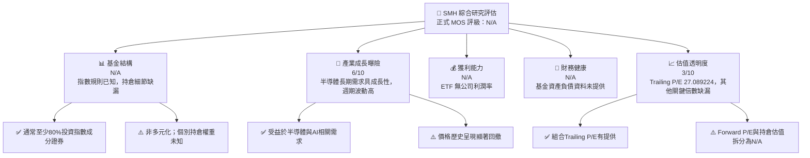

### 1.2 評分進度條視覺化

> 對沒有可計算資料的項目不以主觀分數冒充數據；「產業成長曝險」與「估值透明度」為研究判斷分數，並非基金績效評級。

```text
╔══════════════════════════════════════════════════════════════╗
║                SMH 多維度研究儀表板 (1-10分)                 ║
╠══════════════════════════════════════════════════════════════╣
║ 基金結構透明度  N/A  持倉、費用率與追蹤資料未提供             ║
║ 成長曝險        6.0  ▓▓▓▓▓▓▓▓▓▓▓▓░░░░░░░░  ★★★☆☆            ║
║ 獲利能力        N/A  ETF不適用公司利潤率分析                  ║
║ 財務健康        N/A  基金資產負債資料未提供                   ║
║ 估值透明度      3.0  ▓▓▓▓▓▓░░░░░░░░░░░░░░  ★★☆☆☆            ║
║ 護城河深度      N/A  基金不是半導體營運公司                   ║
║ 管理層執行      N/A  未提供基金管理及追蹤誤差資料             ║
║ 技術創新力      N/A  基金不自行研發半導體技術                 ║
╠══════════════════════════════════════════════════════════════╣
║ 整體可評估度    低   主要限制是持倉、費用與NAV資料缺漏        ║
╚══════════════════════════════════════════════════════════════╝
```

### 1.3 五大投資論點 + 三大核心風險

| 類型 | 項目 | 具體依據 | 信心度 |
|------|------|----------|--------|
| 🟢 **論點①** | 半導體產業集中曝險 | 基金通常至少 80% 投資於基準指數證券，投資人可取得產業股票曝險 | 🟡 中 |
| 🟢 **論點②** | 長期需求具多元驅動 | 半導體需求與運算、資料中心、網路、汽車及終端電子相關；但資料包沒有分部持倉和收入比重 | 🟡 中 |
| 🟡 **論點③** | 大幅回撤可提供分批配置機會 | 2026-11-12 價格 $501.73，較資料包 52 週高點 $671.83 低約 25.3%；價格回落不等於基本面便宜 | 🟡 中 |
| 🟡 **風險①** | 個股與產業集中 | 基金明確標示為 non-diversified，且未提供持倉權重，集中度無法量化 | 🔴 高 |
| 🔴 **風險②** | 估值與週期風險 | Portfolio Trailing P/E 27.089224；Forward P/E N/A。若盈餘下修，追蹤倍數可能被低估 | 🔴 高 |
| 🔴 **風險③** | 數據及分配率異常 | Dividend Yield 顯示 21.0%，但沒有分配金額、期間或計算口徑，不能視為可持續收益率 | 🔴 高 |

### 1.4 快速統計卡片

此為產業 ETF，不能與營運企業毛利率、ROE 等指標直接比較。

| 指標 | SMH 實際值 | 行業均值 | S&P 500 均值 | 狀態 |
|------|-------------|----------|--------------|------|
| 收入 YoY 成長 | N/A | N/A | N/A | ⚪ 不適用 |
| 毛利率 | N/A | N/A | N/A | ⚪ 不適用 |
| 淨利率 | N/A | N/A | N/A | ⚪ 不適用 |
| ROE | N/A | N/A | N/A | ⚪ 不適用 |
| ROIC | N/A | N/A | N/A | ⚪ 不適用 |
| Portfolio Trailing P/E | **27.089224** | N/A | N/A | 🟡 單一倍數不足以判定便宜或昂貴 |
| Forward P/E | N/A | N/A | N/A | ⚪ 缺漏 |
| 費用率 | N/A | N/A | N/A | ⚪ 缺漏 |
| Dividend Yield | **21.0%（來源值）** | N/A | N/A | 🔴 需核對定義及分配紀錄 |
| 最新收盤價 | **$501.73，2026-11-12** | — | — | — |

### 1.5 投資結論

```text
╔══════════════════════════════════════════════════════════════════╗
║                    📊 投資結論摘要                               ║
╠══════════════════════════════════════════════════════════════════╣
║  評級：中性／觀望（非MOS量化評級；加權合理價值資料不足）         ║
║  價格（2026-11-12 收盤）：$501.73                                ║
║  DCF 內在價值（基準）：N/A（ETF不適用公司FCFF DCF）             ║
║  安全邊際 MOS：N/A（無法建立第8.8節加權合理價值）               ║
║  目標價區間：基本面目標價 N/A；不以無持倉資料的假設值填補         ║
║    悲觀情境：N/A                                                  ║
║    基準情境：N/A                                                  ║
║    樂觀情境：N/A                                                  ║
║  投資評分：N/A（資料不足以支持單一綜合量化分數）                 ║
║  適合投資人：能承受產業集中與大幅波動、並願意自行核對持倉者       ║
╚══════════════════════════════════════════════════════════════════╝
```

---

## 2. 公司概覽與商業模式

### 2.1 業務結構與收入來源

SMH 是 VanEck 半導體 ETF。資料包說明基金通常至少將總資產的 80% 投資於構成其基準指數的證券；指數包括美國交易所上市半導體公司的普通股及存託憑證，也可能包含中型市值及在美國交易所上市的外國公司。基金標示為 **非多元化**。

由於基金 AUM、持倉名單及權重均未提供，不能把基金資產任意分配到 NVIDIA、TSMC、Broadcom 等公司，也不能產生持倉收入占比。

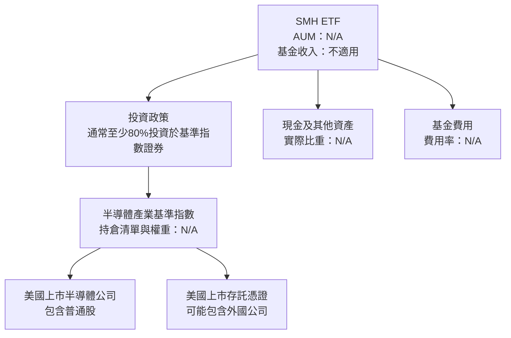

| 基金項目 | 已知資料 | 未提供資料 |
|----------|----------|------------|
| 產業曝險 | 半導體產業 | 子產業及單一持股比重 |
| 投資規則 | 通常至少 80% 投資指數成分證券 | 目前實際投資比例 |
| 基準成分 | 美國交易所上市半導體公司普通股及存託憑證 | 成分股完整名單、權重及調整日期 |
| 基金分散度 | 非多元化 | 前十大持倉占比、HHI 集中度 |
| AUM／市值 | N/A | N/A |
| 費用率 | N/A | N/A |
| 追蹤誤差 | N/A | N/A |

### 2.2 市場份額

SMH 是 ETF，不是半導體晶片供應商；因此「半導體市場份額」不適用於基金本身。基金在半導體 ETF 類別中的 AUM 市占率亦因 AUM 與同業 AUM 未提供而無法計算。

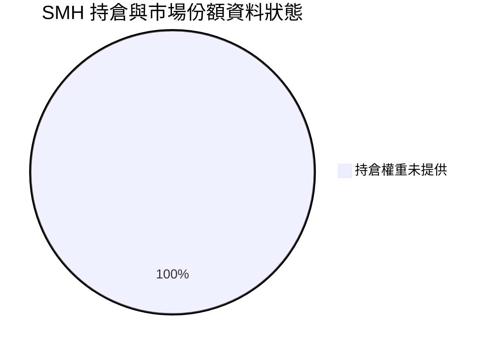

> 圖中 100% 代表「未提供的資料狀態」，不是 SMH 的實際持倉分布或市場份額。

### 2.3 競爭護城河分析

SMH 不生產晶片，所謂基金護城河應著重指數方法、費用、流動性、追蹤品質與品牌，而非科技公司的技術或客戶鎖定。

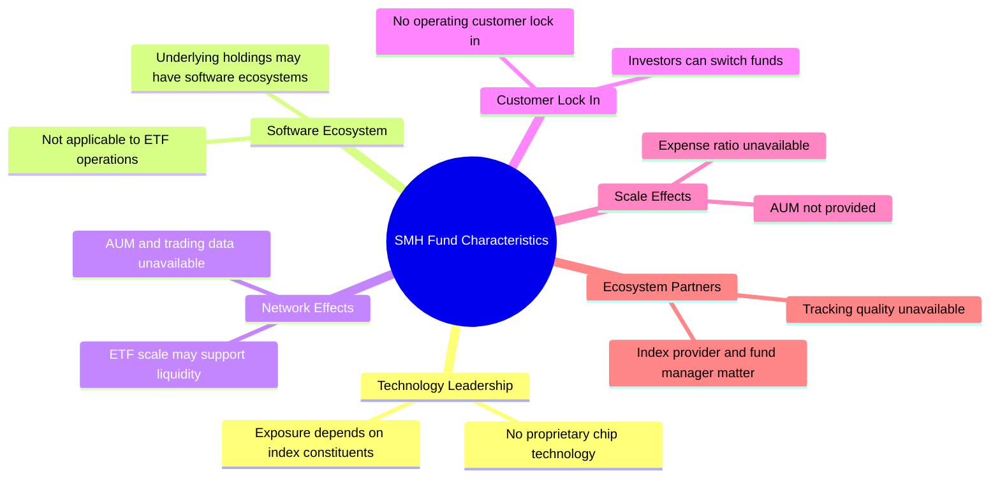

### 2.4 護城河強度評分

```text
╔══════════════════════════════════════════════════════════════╗
║                 SMH 基金競爭優勢評估                         ║
╠══════════════════════════════════════════════════════════════╣
║ 指數規則透明度   N/A  基準方法與版本資料未提供               ║
║ 成本優勢         N/A  費用率未提供                           ║
║ 交易流動性       N/A  AUM、成交量與買賣價差未提供            ║
║ 追蹤品質         N/A  追蹤誤差及追蹤差異未提供               ║
║ 品牌與規模       N/A  AUM與基金流量資料未提供                ║
║ 綜合基金護城河   N/A  缺少必要比較資料                       ║
╚══════════════════════════════════════════════════════════════╝
```

基金的價值不應以「公司護城河」評估。投資人應比較其費用率、追蹤誤差、流動性、持倉集中度與指數方法；目前這些關鍵資訊多數為 N/A。

---

## 3. 損益表深度分析

### 3.1 年度收入成長趨勢（近 4 年）

SMH 沒有營運公司式的產品收入，且資料包沒有基金年度總報酬、分配收入或年度資產規模序列。不可將成分股營收加總後稱為基金營收。

```text
╔══════════════════════════════════════════════════════════════════╗
║              SMH 年度營收趨勢（近4年）                          ║
╠══════════════════════════════════════════════════════════════════╣
║  FY-3  基金營收：N/A  ｜公司營收概念不適用                      ║
║  FY-2  基金營收：N/A  ｜未提供基金財務報表                      ║
║  FY-1  基金營收：N/A  ｜不可用成分股營收替代                    ║
║  FY0   基金營收：N/A  ｜未提供基金收入或分配序列                ║
╠══════════════════════════════════════════════════════════════════╣
║  YoY、CAGR：N/A                                                  ║
╚══════════════════════════════════════════════════════════════════╝
```

### 3.2 季度收入趨勢分析

| 季度 | 基金營收 | QoQ | YoY | 備註 |
|------|----------|-----|-----|------|
| 最近一季 | N/A | N/A | N/A | 未提供基金財務報表 |
| 前一季 | N/A | N/A | N/A | 不適用營運公司營收分析 |
| 前兩季 | N/A | N/A | N/A | 不適用營運公司營收分析 |
| 前三季 | N/A | N/A | N/A | 不適用營運公司營收分析 |

### 3.3 利潤率演變分析

| 利潤率指標 | FY-3 | FY-2 | FY-1 | FY0 | 趨勢 | 評估 |
|------------|------|------|------|-----|------|------|
| 毛利率 | N/A | N/A | N/A | N/A | ETF 不適用 | ⚪ |
| 營業利益率 | N/A | N/A | N/A | N/A | ETF 不適用 | ⚪ |
| EBITDA 利潤率 | N/A | N/A | N/A | N/A | ETF 不適用 | ⚪ |
| 淨利率 | N/A | N/A | N/A | N/A | ETF 不適用 | ⚪ |

基金費用會從基金資產中扣除，但沒有費用率、行政成本及基金年報資料，無法量化費用對追蹤報酬的拖累。

### 3.4 費用結構分析

資料包未提供基金費用率或其他費用明細，以下僅呈現資料狀態，不表示實際比例。

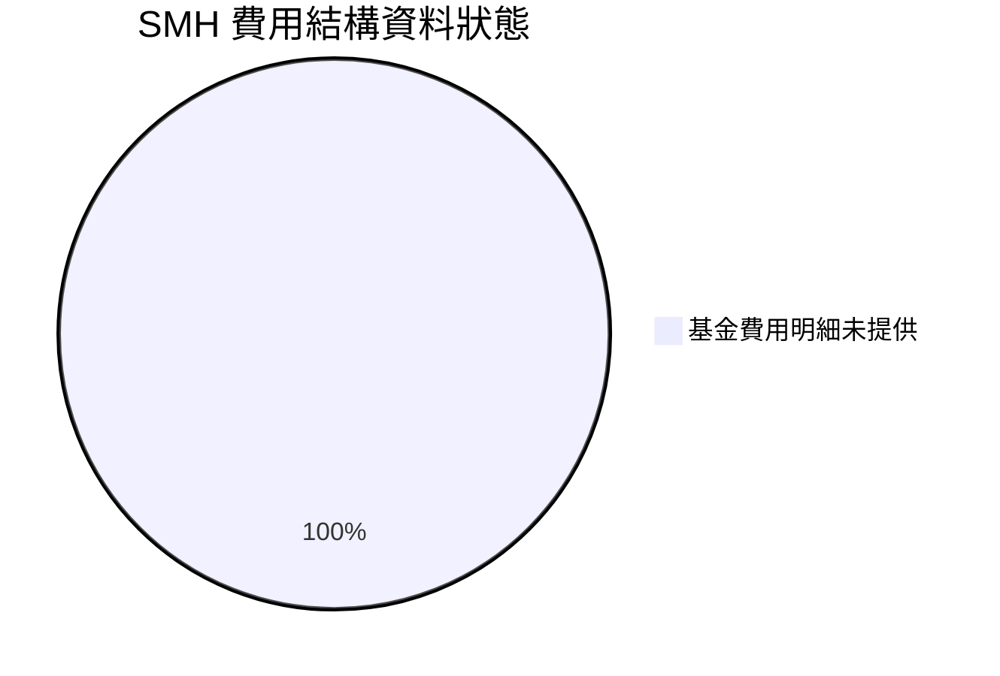

```text
╔══════════════════════════════════════════════════════════════╗
║                    SMH 費用資料狀態                          ║
╠══════════════════════════════════════════════════════════════╣
║ 管理費／總費用率：N/A                                        ║
║ 交易成本：N/A                                                ║
║ 基金行政費用：N/A                                            ║
║ 實際追蹤差異：N/A                                            ║
║ 結論：未取得費用率與追蹤資料，不能估算持有成本               ║
╚══════════════════════════════════════════════════════════════╝
```

### 3.5 季度 EPS 趨勢與盈餘品質（Quality of Earnings）

ETF 沒有公司 EPS；持倉公司的 EPS 驚喜也不能直接等同 SMH 的 EPS。資料包「Earnings History」為 no data。

| 盈餘品質項目 | 數值／佔比 | 評估 |
|--------------|------------|------|
| 過去 4 季 EPS 超預期／不及預期 | N/A | 基金無單一公司 EPS，持倉公司資料未提供 |
| 股權薪酬 SBC／營收 | N/A | 對基金不適用；各持倉 SBC 資料未提供 |
| SBC／營業現金流 | N/A | 不適用 |
| FCF／淨利 | N/A | 基金無公司式 FCF 與淨利 |
| 一次性／非經常性損益 | N/A | 無基金報表可供判斷 |
| 有效稅率 | N/A | 需依基金分配與投資人稅務情況分析 |
| 資本化支出 vs 費用化 | N/A | ETF 不經營工廠或資本設備 |

**盈餘品質結論**：無法對 SMH 套用 GAAP 淨利品質分析。應改查基金年度報告中的投資收入、已實現／未實現損益、資本利得分配、費用與持倉公司盈餘品質；現有資料不足以判斷基金分配是否可持續。

---

## 4. 資產負債表分析

### 4.1 資產結構分解

基金的資產主要由投資證券、現金及其他基金資產構成，但 SMH 的實際持倉與資產負債表未提供。

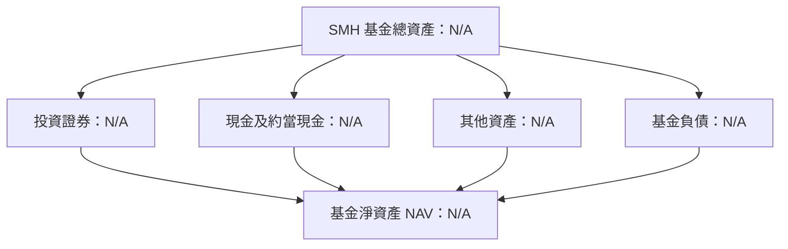

### 4.2 流動性指標分析

| 指標 | SMH | 半導體 ETF 均值 | 評估 |
|------|-----|-----------------|------|
| 現金比例 | N/A | N/A | 未提供基金資產明細 |
| 流動比率 | N/A | N/A | 不宜套用企業流動比率 |
| 買賣價差 | N/A | N/A | 缺少即時交易資料 |
| AUM | N/A | N/A | 無法評估基金規模與承載能力 |
| NAV 溢折價 | N/A | N/A | 缺少 NAV 與市場價格同日數據 |

### 4.3 債務結構分析

ETF 市場價格不代表基金有企業式債務。資料包的 `Net Cash / Debt = $0.00` 不能解讀為基金淨現金恰為零，因 Total Cash 與 Total Debt 都是 N/A；該欄位不能補足缺漏的基金資產負債資訊。

```text
╔══════════════════════════════════════════════════════════════════╗
║                   SMH 基金負債健康診斷                           ║
╠══════════════════════════════════════════════════════════════════╣
║  基金總負債：       N/A                                          ║
║  基金現金：         N/A                                          ║
║  基金淨現金／淨負債：N/A；來源欄位 $0.00 不足以確認實際金額       ║
║  Debt/EBITDA：      不適用                                       ║
║  Interest Coverage：不適用                                       ║
║  結論：缺少基金資產負債明細，不作償債能力推論                    ║
╚══════════════════════════════════════════════════════════════════╝
```

### 4.4 股東權益趨勢

ETF 沒有公司股東權益的營運分析框架。基金淨資產會隨持倉市值、資金申贖、收入與分配變化，但歷史 NAV、資金流及基金淨資產未提供，故不能繪製數值趨勢。

```text
╔══════════════════════════════════════════════════════════════╗
║                  SMH 基金淨資產趨勢                           ║
╠══════════════════════════════════════════════════════════════╣
║ FY-3：N/A  → FY-2：N/A  → FY-1：N/A  → FY0：N/A              ║
║ AUM與NAV均未提供；不以市場價格替代基金淨資產                  ║
╚══════════════════════════════════════════════════════════════╝
```

---

## 5. 現金流量深度分析

### 5.1 現金流量瀑布圖

基金層級的投資收入、投資人申贖、費用與分配應依基金現金流量表判斷。提供資料沒有基金 OCF、Capex 或分配明細；下圖為分析框架，不是實際金額。

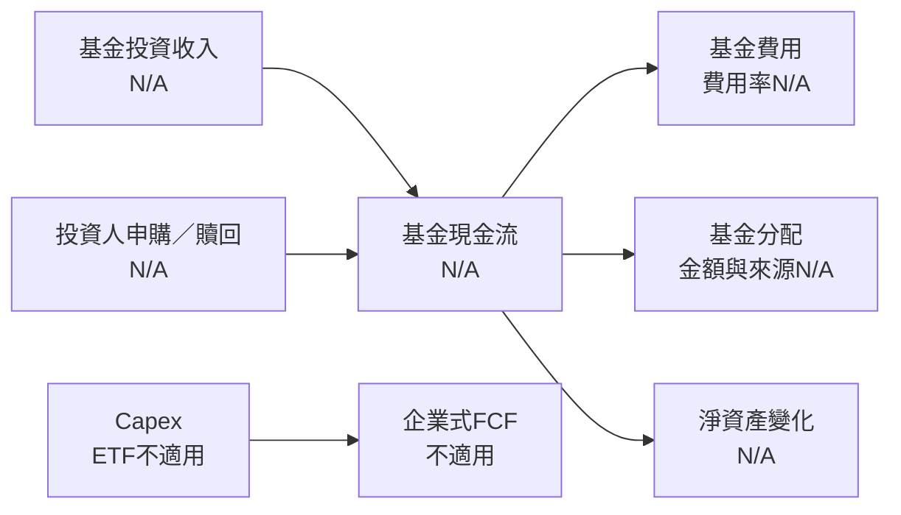

### 5.2 FCF 轉換率趨勢

| 期間 | FCF／Net Income | 評估 |
|------|-----------------|------|
| TTM | N/A | 資料包的 OCF、Capex、FCF 均為 N/A |
| 過去年度 | N/A | 無基金現金流量表 |
| 定義 | 企業 FCF 通常為 OCF − Capex | 不應把基金申贖或投資分配當企業 FCF |

### 5.3 自由現金流趨勢

```text
╔══════════════════════════════════════════════════════════════╗
║              SMH 基金 FCF 與 FCF Yield                         ║
╠══════════════════════════════════════════════════════════════╣
║ TTM 營業現金流：N/A                                           ║
║ TTM 資本支出：  N/A                                           ║
║ TTM FCF：       N/A                                           ║
║ TTM FCF Yield： N/A                                           ║
║ 說明：不得用成分股企業 FCF 取代基金自身 FCF                   ║
╚══════════════════════════════════════════════════════════════╝
```

### 5.4 資本配置評估

基金資本配置應觀察投資標的配置、指數調整、資金申贖與費用。持倉名單與交易資料沒有提供，無法按比例展示投資、回購、Capex 或股息。

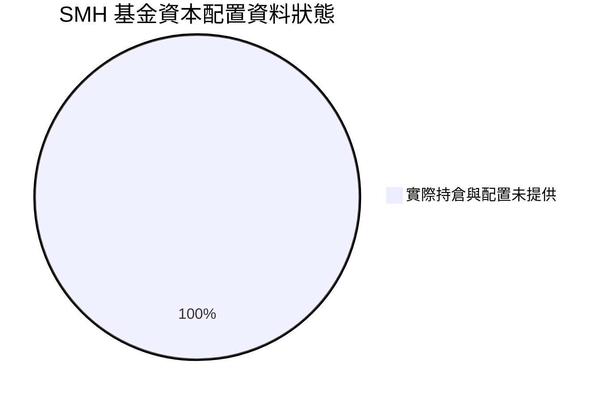

| 資本配置項目 | 數據 | 評估 |
|--------------|------|------|
| 半導體證券配置 | 依政策通常至少 80%，實際比例 N/A | 有政策基準，無實際期末數據 |
| 現金與其他資產 | N/A | 無法判斷流動性緩衝 |
| 追蹤指數交易 | N/A | 無換手率與交易成本 |
| 基金費用 | N/A | 無費用率 |
| 分配與資本利得 | N/A；來源顯示殖利率 21.0% | 需核對分配金額及收益率計算口徑 |

---

## 6. 獲利能力與資本效率

### 6.1 ROE／ROA／ROIC 趨勢

| 指標 | SMH | 行業均值 | 評估 |
|------|-----|----------|------|
| ROE | N/A | N/A | ETF 不是營運公司 |
| ROA | N/A | N/A | 不適用公司資產報酬率 |
| ROIC | N/A | N/A | 不適用公司投入資本分析 |
| WACC | N/A | N/A | ETF 沒有企業資本結構與公司資金成本 |
| 投資人總報酬 | 價格變化僅能部分反映 | N/A | 尚需分配與總報酬資料 |

### 6.2 ROIC vs WACC 分析

```text
╔══════════════════════════════════════════════════════════════════╗
║                ROIC vs WACC 深度分析：不適用                     ║
╠══════════════════════════════════════════════════════════════════╣
║  Rf、ERP、Beta：不適用於基金公司估值                             ║
║  股權成本 Ke：N/A                                                ║
║  債務成本 Kd：N/A                                                ║
║  資本結構權重：N/A                                               ║
║  WACC：N/A                                                       ║
║  ROIC：N/A                                                       ║
║  EVA = ROIC − WACC：N/A                                          ║
║                                                                  ║
║  結論：不能根據 ETF 市價或成分股市值推導基金 ROIC。              ║
║  對投資人更有用的替代指標是總報酬、費用率、追蹤差異、             ║
║  NAV 溢折價及持倉集中度；現有資料多為 N/A。                     ║
╚══════════════════════════════════════════════════════════════════╝
```

### 6.3 杜邦三因素分解

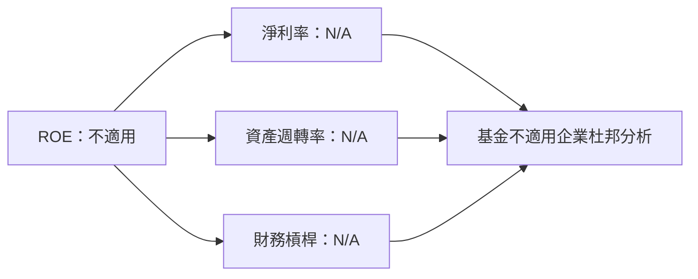

### 6.4 獲利能力儀表板

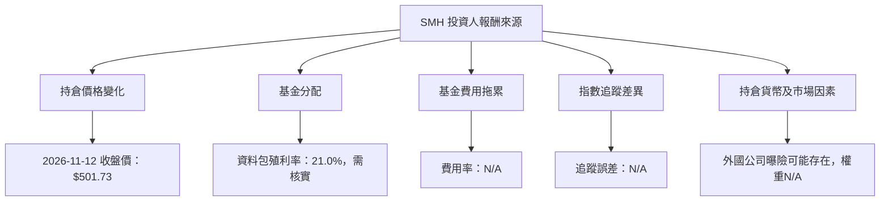

---

## 7. 相對估值分析

### 7.1 同業估值比較表格

SMH 是產業 ETF，以下同業是可比較的半導體 ETF 類別，而非營運公司的直接競爭對手。資料包未提供 Peer multiples；任何同業倍數均不得冒充已驗證數據。

| 估值指標 | **SMH** | **SOXX** | **SOXQ** | **XSD** | SMH 評估 |
|----------|---------|---------|---------|---------|-----------|
| **Trailing P/E** | **27.089224** | N/A | N/A | N/A | 🟡 單一組合倍數，未提供計算口徑 |
| **Forward P/E** | N/A | N/A | N/A | N/A | ⚪ 無法比較 |
| **P/S Ratio** | N/A | N/A | N/A | N/A | ⚪ 未提供 |
| **EV/EBITDA** | N/A | N/A | N/A | N/A | ⚪ 不適合直接套用企業 EV |
| **FCF Yield** | N/A | N/A | N/A | N/A | ⚪ 未提供基金 FCF |
| **費用率** | N/A | N/A | N/A | N/A | ⚪ ETF 選擇時的核心比較項目缺漏 |
| **追蹤誤差** | N/A | N/A | N/A | N/A | ⚪ 無法衡量追蹤品質 |

> SOXX、SOXQ、XSD 為同類型 ETF 名稱；因 Peer multiples、費用率及持倉資料未提供，本報告不填入估計倍數。

### 7.2 歷史估值區間分析

資料包沒有 `Valuation vs own history` 數據，不能估算歷史 P/E 百分位或自行推導歷史估值區間。

```text
╔══════════════════════════════════════════════════════════════╗
║                   SMH 歷史估值位置                            ║
╠══════════════════════════════════════════════════════════════╣
║ Trailing P/E：27.089224                                      ║
║ 歷史低點／中位數／高點：N/A                                  ║
║ 歷史百分位：N/A                                               ║
║ 判斷：缺少自身歷史估值資料，無法判斷目前位於何種估值區間       ║
╚══════════════════════════════════════════════════════════════╝
```

### 7.3 情境目標價（假設驅動，Bear / Base / Bull）

ETF 的情境目標價需要持倉預期報酬、各成分股估值及基金折溢價等輸入。由於持倉、Forward P/E、成分股盈利預測與同業倍數未提供，以下不以主觀假設輸出看似精確的目標價。

| 情境 | 營收 CAGR | 營業利潤率 | 退出倍數 | 隱含目標價 | 相對現價 |
|------|-----------|------------|----------|------------|----------|
| 🔴 悲觀 | 不適用 | 不適用 | N/A | N/A | N/A |
| 🟡 基準 | 不適用 | 不適用 | N/A | N/A | N/A |
| 🟢 樂觀 | 不適用 | 不適用 | N/A | N/A | N/A |

### 7.4 相對估值隱含價格區間

```text
╔══════════════════════════════════════════════════════════════╗
║                  相對估值隱含股價區間                        ║
╠══════════════════════════════════════════════════════════════╣
║ Forward P/E 回推：N/A                                        ║
║ EV/EBITDA 回推：N/A                                          ║
║ EV/Sales 回推：N/A                                           ║
║ FCF Yield 回推：N/A                                          ║
║ 2026-11-12 收盤價：$501.73                                   ║
║ 結論：沒有可用倍數，不能繪製具估值意義的價格區間              ║
╚══════════════════════════════════════════════════════════════╝
```

---

## 8. DCF 內在價值評估（Discounted Cash Flow）

> **適用性結論**：SMH 是持有一籃子證券的 ETF，不是透過單一企業營運創造 FCFF 的公司。資料包沒有基金持倉現金流、成分股預測、基金股數、NAV、費用、現金與負債等必要輸入。將基金當作公司做 FCFF DCF 會產生無法驗證的假設，因此本章逐項說明不適用，而不編造每股內在價值。

### 8.0 估值推理鏈（Thinking Logic）

**Step 1 — 價值來源**

SMH 的經濟價值可概括為「持倉證券未來總報酬 − 基金費用 − 追蹤偏差」，而非公司營收與 FCFF。持倉比重、基金費用率及追蹤差異均為 N/A，因此無法判斷哪個成分公司或子產業主導基金估值。

**Step 2 — 模型選擇**

| 決策點 | 本報告採用 | 理由（含數字） | 曾考慮但否決 | 否決理由 |
|--------|-----------|----------------|--------------|----------|
| 現金流定義 | 不使用 FCFF／FCFE DCF | 基金不是單一營運企業；OCF、Capex、FCF 均 N/A | 公司 FCFF DCF | 缺少企業現金流、淨負債及股數，結果不可稽核 |
| 預測期 N | 不適用 | ETF 持倉會按指數規則調整，沒有單一公司產品週期 | 固定 5 年預測 | 需要成分股與基金總報酬預測，資料不具備 |
| 終值方法 | 不適用 | 無法定義基金企業終值 | Gordon Growth | 缺乏可作為分子的基金 FCFF |
| EBIT 基礎 | 不適用 | ETF 沒有公司 EBIT | GAAP／非 GAAP EBIT | 不適用基金 |
| 估值替代 | 組合估值、總報酬、費用與追蹤分析 | 已有組合 Trailing P/E 27.089224，但其他資料缺漏 | 以 P/E 單一倍數推目標價 | Forward 盈利及持倉權重缺漏，不能回推價格 |

**Step 3 — 關鍵假設推導**

營收 CAGR、期末營業利潤率、稅率、Capex、D&A、ΔWC、SBC、稀釋率、WACC 與永續成長率均屬公司 DCF 輸入，對 SMH 無適用性；若強行填入數字，即會變成虛構公司財務。

**Step 4 — 最脆弱環節**

估值分析最大的缺口不是模型參數選擇，而是基金持倉與基金成本／追蹤資料皆缺失；在取得持倉前，無法用透明方法量化合理價值。

**Step 5 — 計算路徑圖**

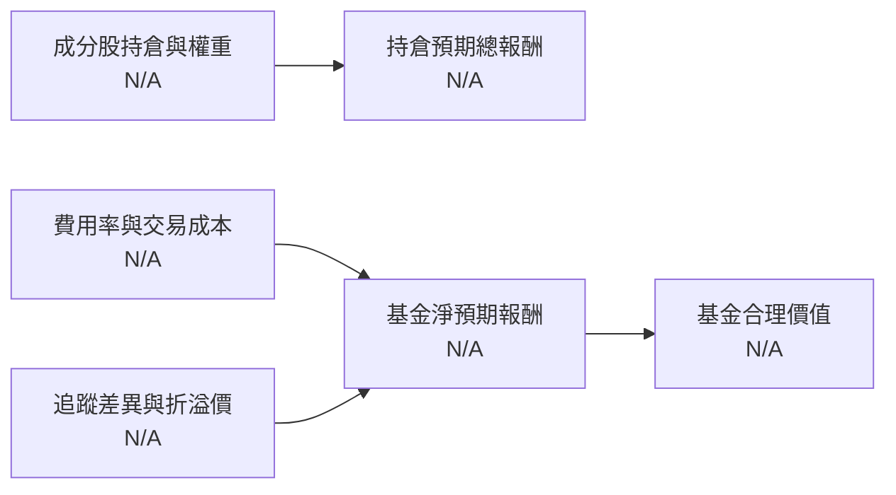

### 8.1 模型假設總表（Model Inputs）

| 假設項目 | 採用值 | 依據／來源 | 敏感度 |
|----------|--------|-------------|--------|
| 預測期 N | 不適用 | ETF 持倉依指數規則調整，無單一營運預測期 | N/A |
| 營收 CAGR | N/A | 基金沒有營運收入 | N/A |
| 營業利潤率 | N/A | 基金沒有 EBIT | N/A |
| 有效稅率 | N/A | 須看基金收入與分配情況 | N/A |
| Capex／營收 | N/A | 基金不經營資本設備業務 | N/A |
| D&A／營收 | N/A | 不適用 | N/A |
| ΔWC／營收增額 | N/A | 不適用 | N/A |
| EBIT 基礎 | 不適用 | 無公司 EBIT | N/A |
| SBC 處理 | 不適用 | 基金沒有單一公司 SBC | N/A |
| 年稀釋率 | N/A | 基金單位股數與基金申贖不等同公司股權稀釋 | N/A |
| 永續成長率 g | N/A | 無 FCFF 終值 | N/A |
| 終值方法 | 不適用 | 無可計算 FCFF | N/A |
| WACC | N/A | 基金不是單一企業，且 Rf、ERP、Beta、資本結構輸入未提供 | N/A |

**FCF 定義及 SBC 防呆**：本報告不建立 FCFF DCF，因此不採用 (A)、(B) 或 (C) 公司 SBC 模型；三者均不適用於 ETF，不計算假設性的股數稀釋。

### 8.2 折現率推導（WACC）

```text
╔══════════════════════════════════════════════════════════════════╗
║                    WACC 推導：不適用                             ║
╠══════════════════════════════════════════════════════════════════╣
║  無風險利率 Rf：N/A（資料包未提供資本成本輸入）                  ║
║  市場風險溢酬 ERP：N/A                                           ║
║  Beta：N/A                                                       ║
║  股權成本 Ke：N/A                                                ║
║  計息債務 Kd：N/A                                                ║
║  股權／債務權重：N/A                                              ║
║  WACC：N/A                                                       ║
║                                                                  ║
║  不列五步公司 WACC 算式：SMH 為基金，沒有單一企業資本結構；      ║
║  不能把任意債務或股權數字代入公式。                              ║
╚══════════════════════════════════════════════════════════════════╝
```

第 6.2 節同樣標示 WACC N/A，不存在跨章節不一致。

### 8.3 逐年自由現金流預測（基準情境）

| 項目 | FY+1 | FY+2 | FY+3 | FY+4 | FY+5 |
|------|------|------|------|------|------|
| 營收 | N/A | N/A | N/A | N/A | N/A |
| 營收 YoY | N/A | N/A | N/A | N/A | N/A |
| EBIT | N/A | N/A | N/A | N/A | N/A |
| NOPAT | N/A | N/A | N/A | N/A | N/A |
| D&A | N/A | N/A | N/A | N/A | N/A |
| Capex | N/A | N/A | N/A | N/A | N/A |
| ΔWC | N/A | N/A | N/A | N/A | N/A |
| FCFF | N/A | N/A | N/A | N/A | N/A |
| 折現因子 | N/A | N/A | N/A | N/A | N/A |
| FCFF 現值 | N/A | N/A | N/A | N/A | N/A |

預測期現值合計：**N/A**。資料不適用，不能以持倉公司現金流拼湊基金 FCFF。

```text
╔══════════════════════════════════════════════════════════════╗
║             FCF：歷史實際與模型預測                            ║
╠══════════════════════════════════════════════════════════════╣
║ 歷史基金 FCF：N/A                                             ║
║ FY+1 至 FY+5 模型 FCFF：N/A                                   ║
║ FCF CAGR、FCF利潤率：N/A                                      ║
║ 說明：基金投資人應使用總報酬、追蹤差異與費用率，不以企業FCF衡量 ║
╚══════════════════════════════════════════════════════════════╝
```

### 8.4 終值計算（Terminal Value）

適用性檢查：`WACC N/A vs g N/A → WACC > g？不適用`

| 方法 | 計算式 | 終值 TV | TV 現值 | 佔總 EV 比重 |
|------|--------|---------|---------|--------------|
| Gordon Growth | 不適用 | N/A | N/A | N/A |
| 退出倍數法 | 不適用 | N/A | N/A | N/A |

### 8.5 企業價值 → 每股內在價值（Bridge）

```text
╔══════════════════════════════════════════════════════════════════╗
║            ETF合理價值：必要資料不足，無法建立DCF橋接             ║
╠══════════════════════════════════════════════════════════════════╣
║  預測期 FCF 現值合計：N/A                                       ║
║  終值現值：N/A                                                   ║
║  企業價值 EV：不適用                                             ║
║  基金現金與投資資產：N/A                                         ║
║  基金負債：N/A                                                   ║
║  基金淨資產 NAV：N/A                                             ║
║  基金單位數：N/A                                                 ║
║  每單位 DCF 內在價值：N/A                                        ║
║  2026-11-12 收盤價：$501.73                                      ║
║  折溢價（相對 DCF）：N/A                                          ║
║  MOS：不在此節計算；第8.8節加權合理價值亦因資料不足為N/A         ║
╚══════════════════════════════════════════════════════════════════╝
```

### 8.6 敏感性分析（WACC × 永續成長率）

因 WACC、g、基金現金流及單位數均不適用，不能構造 5×5 DCF 敏感性矩陣。若填入數字，就會將虛構的企業現金流偽裝成基金內在價值。

| g／WACC | WACC N/A |
|---------|----------|
| g N/A | N/A（ETF 不適用 Gordon Growth DCF） |

| 情境 | 營收 CAGR | 期末營業利潤率 | 永續成長 g | WACC | 每股內在價值 | 相對現價 | 主觀機率 |
|------|-----------|----------------|------------|------|--------------|----------|----------|
| 🔴 悲觀 | N/A | N/A | N/A | N/A | N/A | N/A | N/A |
| 🟡 基準 | N/A | N/A | N/A | N/A | N/A | N/A | N/A |
| 🟢 樂觀 | N/A | N/A | N/A | N/A | N/A | N/A | N/A |
| **機率加權** | — | — | — | — | **N/A** | **N/A** | N/A |

敏感度彈性：g、WACC、期末營業利潤率的每 1 個百分點變動影響均為 **N/A**，因本報告沒有可計算的 DCF。對 SMH 更有意義的敏感變數是成分股盈餘修正、持倉權重、費用與產業風險溢酬，但目前缺少所需資料。

### 8.7 反推 DCF（Reverse DCF）

市場價格可用來反推單一企業的現金流假設，但 SMH 缺少基金持倉、基礎現金流及基金單位數，無法由 $501.73 反推出唯一的成分股 CAGR 或利潤率。

| 求解變數 | 固定輸入 | 市場隱含值 | 公司／基金可驗證歷史 | 判斷 |
|----------|----------|------------|----------------------|------|
| 成分股營收 CAGR | 其餘 DCF 輸入固定 | N/A | N/A | 無法求解 |
| 組合期末營業利潤率 | 其餘 DCF 輸入固定 | N/A | N/A | 無法求解 |
| 永續成長率 g | 其餘 DCF 輸入固定 | N/A | N/A | 無法求解 |
| 預測期 N | 其餘 DCF 輸入固定 | N/A | N/A | 無法求解 |

### 8.8 估值三角驗證與安全邊際

| 估值方法 | 隱含每股價值 | 上行空間（÷現價） | 權重 | 說明 |
|----------|--------------|-------------------|------|------|
| DCF | N/A | N/A | N/A | ETF 不適用公司 FCFF DCF |
| 同業 Forward P/E | N/A | N/A | N/A | 同業倍數與 SMH Forward P/E 未提供 |
| EV/EBITDA 倍數 | N/A | N/A | N/A | 基金不適用企業 EV/EBITDA |
| FCF Yield 回推 | N/A | N/A | N/A | 基金 FCF Yield N/A |
| 分析師共識目標價 | N/A | N/A | N/A | 共識均價及高低區間 N/A |
| **加權合理價值** | **N/A** | **N/A** | **無法配置** | 不能計算 MOS |

加權合理價值的必要算式因方法價值及權重均缺漏而不能建立；不以任意權重替換缺失數據。因此：

```text
╔══════════════════════════════════════════════════════════════╗
║                估值區間與安全邊際：N/A                         ║
╠══════════════════════════════════════════════════════════════╣
║  DCF基準內在價值：N/A                                         ║
║  加權合理價值：N/A                                             ║
║  安全邊際 MOS：N/A                                             ║
║  MOS = (加權合理價值 − $501.73) ÷ 加權合理價值：不可計算       ║
║  上行空間：N/A                                                 ║
║  買入／持有／減碼的估值區間：N/A                               ║
║  原因：缺少持倉、估值、費用、NAV與分析師目標價等必要輸入        ║
╚══════════════════════════════════════════════════════════════╝
```

依評級門檻，無法從 MOS 判定買入、持有或賣出；第 1 章及第 11 章採用「中性／觀望」是資料不充分下的操作立場，不宣稱符合 MOS 門檻。

### 8.9 DCF 模型的局限與失效條件

- **終值依賴度**：N/A；沒有可計算的 DCF 企業價值。
- **最脆弱的假設**：若自行假設持倉權重與成分股現金流，可能主導整個估值，故不採用。
- **不適用情境**：ETF 應以基金持倉估值、NAV、費用率、追蹤差異與總報酬分析；公司 DCF 會錯把基金當成單一營運公司。
- **連結風險矩陣**：產業盈餘下修會影響持倉估值；集中持倉會放大個股事件；費用與追蹤差異影響扣費後報酬。前兩者須用實際持倉權重量化，目前資料缺漏。

### 8.10 複算檢核表（Audit Trail）

| # | 檢核項目 | 檢查方式 | 結果 |
|---|----------|----------|------|
| 1 | DCF 高／中敏感輸入推導 | 不建立企業 DCF | ✅ 不適用 |
| 2 | 每項假設有來歷 | 未填入虛構假設 | ✅ |
| 3 | WACC 五步算式與資本權重 | WACC 不適用 ETF | ✅ 不適用 |
| 4 | Kd 與債務口徑一致 | 未計算公司債務成本 | ✅ 不適用 |
| 5 | WACC 與第 6.2 節一致 | 兩處皆 N/A | ✅ |
| 6 | 預測年度數與 N 一致 | 沒有宣告有效 DCF 預測期 | ✅ 不適用 |
| 7 | FY+1 九步 FCFF 算式可複算 | 基礎財務輸入 N/A | ✅ 不適用 |
| 8 | 預測期 PV 加總 | 預測現值 N/A | ✅ 不適用 |
| 9 | WACC > g | 二者不適用 | ✅ 不適用 |
| 10 | 終值以 FY+N 現金流計算 | 沒有終值 | ✅ 不適用 |
| 11 | EV 至每股內在價值橋接 | 基金 NAV、單位數 N/A | ✅ 不適用 |
| 12 | SBC 三要素相容 | 公司 SBC 模型不適用 | ✅ 不適用 |
| 13 | 敏感性矩陣基準格與 DCF 一致 | 沒有 DCF 矩陣 | ✅ 不適用 |
| 14 | 矩陣有效格與 WACC > g | 沒有 DCF 矩陣 | ✅ 不適用 |
| 15 | 情境機率加總 100% | 不輸出虛構目標價機率 | ✅ 不適用 |
| 16 | 反推 DCF 每列只放開一個變數 | 缺少基金現金流，無法反推 | ✅ 不適用 |
| 17 | MOS 以第 8.8 加權價值為分母 | 加權價值 N/A，未計算 MOS | ✅ |
| 18 | 報告完成至第 11 章 | 章節完整 | ✅ |
| 19 | 加權價值等於價值乘權重之和 | 無有效估值項目，不計加權值 | ✅ 不適用 |
| 20 | 評級符合 MOS 門檻 | MOS N/A；明確標示非量化評級 | ✅ 已揭露限制 |

---

## 9. 成長催化劑

### 9.1 催化劑時間軸

以下為半導體產業層級的可能催化因素，不是對 SMH 持倉回報的定量預測；具體權重及時間表需待成分股資料核實。

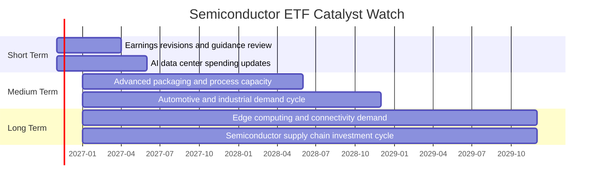

### 9.2 TAM 市場規模分析

資料包沒有半導體各終端市場 TAM、滲透率或 SMH 持倉營收，因此不填入未經驗證的市場規模數字。

```text
╔══════════════════════════════════════════════════════════════════╗
║                 半導體產業 TAM 觀察框架                          ║
╠══════════════════════════════════════════════════════════════════╣
║ AI／資料中心：TAM、滲透率、SMH持倉收入貢獻均 N/A               ║
║ 個人運算與終端裝置：TAM、更新週期及持倉曝險均 N/A              ║
║ 汽車／工業半導體：TAM、內容價值及持倉曝險均 N/A                ║
║ 網路／通訊：TAM、資本支出週期及持倉曝險均 N/A                  ║
║ 結論：先確認持倉權重，再評估各市場成長對基金的實際貢獻          ║
╚══════════════════════════════════════════════════════════════════╝
```

### 9.3 成長驅動力結構圖

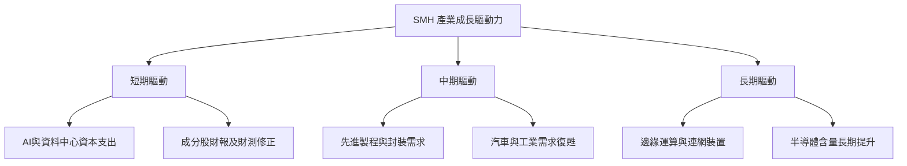

---

## 10. 風險矩陣

### 10.1 風險評分矩陣

下圖為研究團隊定性風險位置，不是統計預測；機率與衝擊分數需以持倉權重及歷史波動資料進一步校準。

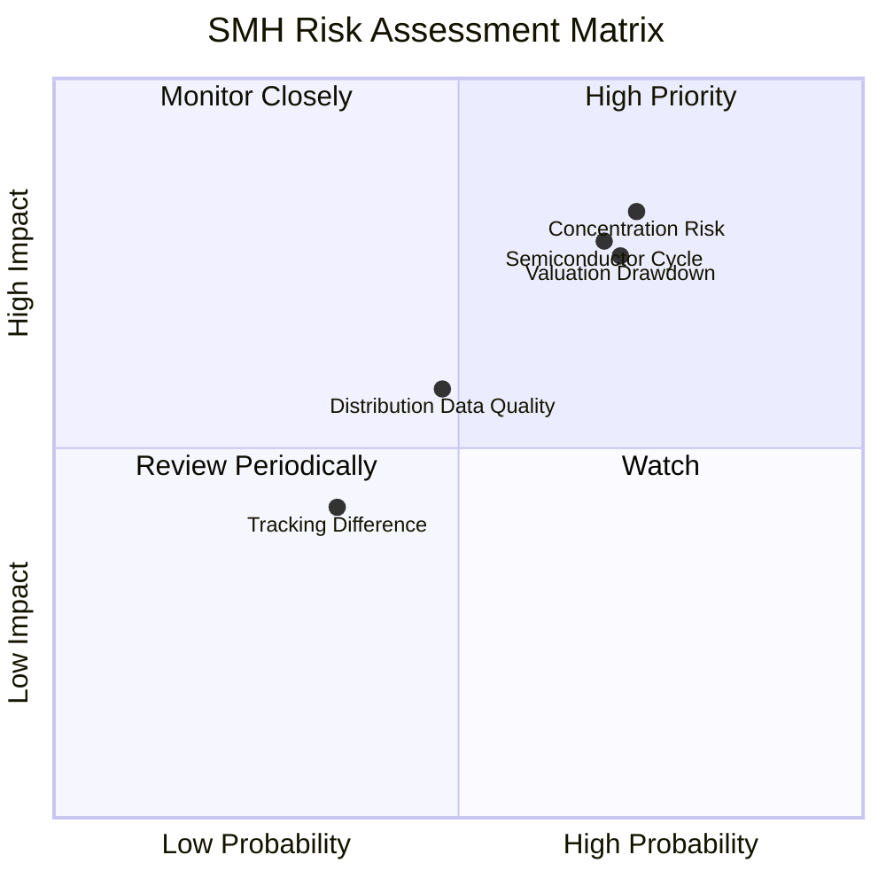

### 10.2 風險清單詳細分析

| # | 風險項目 | 發生機率 | 財務衝擊 | 風險評分 | 緩解措施 |
|---|----------|----------|----------|----------|----------|
| 1 | 🔴 **持倉集中風險** | 中高；資料不足以給精確百分比 | 高；基金標示非多元化，單一持倉事件可能放大價格波動 | 🔴 8/10 | 查核前十大持倉及權重；以較廣泛市場 ETF 分散單一產業風險 |
| 2 | 🔴 **半導體週期下行** | 中高；產業具週期性 | 高；訂單、庫存與資本支出轉弱可能引發持倉股盈餘下修 | 🔴 8/10 | 監控庫存、訂單、晶圓代工利用率、資本支出與公司財測 |
| 3 | 🔴 **高估值與價格回撤** | 中高；Trailing P/E 27.089224，Forward P/E N/A | 高；估值倍數收縮與獲利下修可能同時發生 | 🔴 8/10 | 分批投入；避免以單一 P/E 斷定便宜；更新持倉盈利與估值 |
| 4 | 🟡 **地緣政治與供應鏈限制** | 中；基金可能持有海外供應鏈企業，但權重 N/A | 高；出口管制或供應中斷影響特定公司與產品 | 🟠 7/10 | 查核地區與單一公司曝險；設定持倉上限 |
| 5 | 🟡 **費用及追蹤品質不明** | 資料缺漏 | 中；費用及追蹤差異會侵蝕長期報酬 | 🟡 5/10 | 取得官方費用率、NAV、成交價與指數總報酬後比較 |
| 6 | 🟡 **分配殖利率數據疑慮** | 21.0% 來源值需核實 | 中；若把一次性資本利得或資料錯誤當成收益，可能形成錯誤投資預期 | 🟡 6/10 | 查基金官方分配紀錄、SEC yield 與 trailing distribution yield 定義 |

---

## 11. 投資建議

### 11.1 最終綜合評級雷達圖

```text
╔══════════════════════════════════════════════════════════════╗
║                   SMH 最終研究評分                            ║
╠══════════════════════════════════════════════════════════════╣
║ 成長曝險        6.0/10  ▓▓▓▓▓▓▓▓▓▓▓▓░░░░░░░░  ★★★☆☆          ║
║ 估值透明度      3.0/10  ▓▓▓▓▓▓░░░░░░░░░░░░░░  ★★☆☆☆          ║
║ 基金成本        N/A     費用率未提供                           ║
║ 追蹤品質        N/A     追蹤誤差未提供                         ║
║ 持倉分散        N/A     成分股權重未提供；基金為非多元化       ║
║ 財務健康        N/A     ETF不適用企業財務分析                  ║
║ 綜合評級        中性／觀望：估值與基金結構資料不足             ║
╚══════════════════════════════════════════════════════════════╝
```

### 11.2 目標價與隱含報酬率

| 情境／價格參考 | 價格 | 相對 2026-11-12 收盤 $501.73 | 性質 |
|----------------|------|------------------------------|------|
| 52 週低點 | $314.07 | 約 −37.4% | 已提供的歷史價格，不是目標價 |
| 2026-11-12 收盤 | **$501.73** | 基準 | VERIFIED FIGURES |
| 52 週高點 | $671.83 | 約 +33.9% | 已提供的歷史價格，不是目標價 |
| 基本面悲觀目標價 | N/A | N/A | 需要持倉及盈利預測 |
| 基本面基準目標價 | N/A | N/A | 需要基金估值及分配資料 |
| 基本面樂觀目標價 | N/A | N/A | 需要成分股及風險假設 |

歷史區間只能說明價格曾到達的水準，不應當作公允價值或未來支撐／阻力的保證。

### 11.3 買入時機與觸發因素

```text
╔══════════════════════════════════════════════════════════════════╗
║                 ✅ 買入／加碼／減碼監控 Checklist                ║
╠══════════════════════════════════════════════════════════════════╣
║  建立或加碼前，優先確認：                                       ║
║  ☐ 取得最新前十大持倉及單一持倉權重                             ║
║  ☐ 核實費用率、AUM、成交量、買賣價差及追蹤誤差                 ║
║  ☐ 核實21.0%殖利率的計算口徑、現金分配及資本利得分配           ║
║  ☐ 檢視成分股財測修正、庫存與半導體資本支出方向                 ║
║                                                                  ║
║  加碼觸發條件：                                                  ║
║  ☐ 持倉估值回到可接受區間，且盈利預期未同步下修                 ║
║  ☐ 產業庫存與訂單指標改善，並由成分股財報確認                   ║
║  ☐ 追蹤誤差、費用率及交易流動性符合投資人要求                   ║
║                                                                  ║
║  減碼／重新檢視條件：                                            ║
║  ☐ 前十大持倉集中度超出個人風險限額                             ║
║  ☐ 多家核心持倉下修財測，且產業庫存或資本支出惡化               ║
║  ☐ 估值上升但盈利預期未上修，或基金分配數據無法核實             ║
╚══════════════════════════════════════════════════════════════════╝
```

### 11.4 投資人適配度分析

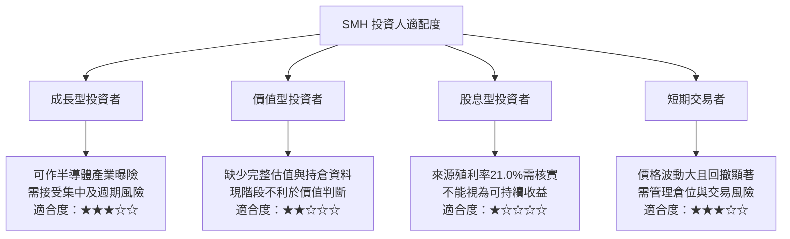

### 11.5 每季財報監控清單（Quarterly Watch List）

| 監控項目 | 目前資料 | 觸發加碼的觀察方向 | 觸發減碼／檢視的方向 |
|----------|----------|--------------------|-----------------------|
| 前十大持倉與集中度 | N/A | 持倉結構與投資目標相符，集中度可控 | 單一持倉權重超過投資人風險上限 |
| 組合 Forward P/E | N/A | 盈利預期上修且估值未同步過度擴張 | 盈利預期下修、估值仍高 |
| 成分股財測 | 近四季 EPS beat/miss N/A | 核心持倉訂單與財測改善 | 多家核心公司連續下修 |
| 產業庫存與訂單 | N/A | 庫存正常化、訂單改善 | 庫存增加但終端需求疲弱 |
| AI／資料中心資本支出 | N/A | 資本支出成長轉為核心持倉實際營收與現金流 | 資本支出計畫延後或投資回報下修 |
| 費用率 | N/A | 費用與同類 ETF 比較具競爭力 | 費用明顯偏高且追蹤品質無優勢 |
| 追蹤差異／追蹤誤差 | N/A | 實際追蹤貼近基準 | 持續偏離基準且無合理解釋 |
| NAV 溢折價 | N/A | 市價接近 NAV、流動性正常 | 折溢價擴大或交易價差惡化 |
| 分配收益 | 來源值 21.0%，未核實 | 官方分配與收益率口徑確認後再評估 | 分配率由一次性資本利得或資料錯誤造成 |

### 11.6 反面論證：什麼會證明論點錯誤（What Would Change My Mind）

```text
╔══════════════════════════════════════════════════════════════════╗
║              ⚠️ 論點失效條件（Disconfirming Evidence）           ║
╠══════════════════════════════════════════════════════════════════╣
║  半導體產業配置論點在下列情況成立時應重新檢視：                 ║
║  ☐ 核心持倉連續兩季下修營收或盈利指引，且下修範圍擴大           ║
║  ☐ 產業庫存持續上升、訂單下滑，並伴隨資本支出計畫縮減           ║
║  ☐ SMH前十大持倉集中度超出投資人原先設定的風險上限              ║
║  ☐ 組合盈利預期下修，而Trailing P/E仍維持或進一步上升           ║
║  ☐ 基金費用率或追蹤誤差顯著高於可替代的同類ETF                  ║
║  ☐ 官方文件無法支持資料包所示21.0%殖利率，或實際分配大幅下降    ║
║  ☐ 持倉、NAV與流動性資料顯示基金交易品質不符合配置要求           ║
╚══════════════════════════════════════════════════════════════════╝
```

> **最終判斷**：SMH 提供半導體產業集中曝險，基金政策明示通常至少 80% 投資於指數成分證券，且標示為非多元化。價格資料顯示，2026-11-12 收盤價 $501.73，仍低於 52 週高點 $671.83；Portfolio Trailing P/E 為 27.089224。另一方面，持倉權重、費用率、追蹤誤差、Forward P/E、基金 NAV 與分配明細皆缺漏，資料包所列 21.0% 殖利率尤其需要核實。因此本報告採 **中性／觀望**，不將其包裝成依 MOS 推導的買入或賣出評級；在取得官方持倉、費用、追蹤與分配資料前，不給基本面目標價。

> **免責聲明**：本報告為 AI 自動生成，僅供研究參考，不構成投資建議。投資有風險，入市需謹慎。