# SNDK 基本面深度分析報告

**✏️ 程式複算更正**：8.8 節加權合理價值由模型原寫的 $1,183.79 更正為 **$1,264.87**（各項加總），MOS +20.8% → **+25.9%**，全文已同步。 ⚠️ 更正後 MOS 落在規則 20 的「強烈買入／買入（視 ROIC 與 WACC）」區間（原為「買入」），本報告的評級是依原數值給出的。

> **報告日期**：2026-11-13 ｜ **語言**：繁體中文 ｜ **數據來源**：SEC 申報資料 (XBRL)、Yahoo Finance、Finviz、StockAnalysis、Roic.ai ｜ **分析師**：CFA 級機構研究

> **資料口徑提醒**：本報告優先引用 VERIFIED FIGURES。財務包另有部分口徑不一致，例如 TTM 營業利益率同時出現 72.5% 與 72.7%，最新季度營業利益率同時出現 79.6% 與 72.7%；本文分別採用 VERIFIED FIGURES 的 **TTM 72.5%**、**最新季度 79.6%**。財務包未提供 SNDK 分部營收、正式市場份額、Beta 與一致的利息費用明細；相關項目標示 N/A 或明確標為模型假設，不以推算值冒充已披露數據。

## 目錄

| # | 章節 | 核心結論 |
|---|------|----------|
| 1 | 執行摘要 | 加權合理價值約 $1,184；MOS 約 25.9%；依規則評級為買入 |
| 2 | 公司概覽與商業模式 | NAND 儲存產品組合廣，但產品別營收與市占資料不足 |
| 3 | 損益表深度分析 | TTM 營收 $28.97B、年增 272.4%；獲利高度受產業週期影響 |
| 4 | 資產負債表分析 | VERIFIED 淨現金 $5.14B，短期流動性充足 |
| 5 | 現金流量深度分析 | TTM FCF $17.36B、FCF Yield 13.02%，但不能直接外推 |
| 6 | 獲利能力與資本效率 | ROIC 141.2%；WACC 因 Beta 缺漏只能採假設值估算 |
| 7 | 相對估值分析 | P/S 略高於自身五年中位數；同業倍數顯示週期股折價風險 |
| 8 | DCF 內在價值評估 | 假設型基準 DCF 約 $942/股；加權合理價值約 $1,184/股 |
| 9 | 成長催化劑 | NAND 需求、AI 儲存與產品組合可能支撐成長；量化拆分資料不足 |
| 10 | 風險矩陣 | NAND 供需反轉、價格下跌、估值波動是前三大風險 |
| 11 | 投資建議 | 買入但採分批配置；以營業利潤率、FCF 與估值為主要監控項 |

---

## 1. 執行摘要

### 1.0 一頁式投資儀表板

| 項目 | 內容 |
|------|------|
| **投資論點（3 句）** | ① TTM 營收 **$28.97B、年增 272.4%**，最新單季年增 **377.9%**，顯示需求與定價處於高度有利階段。② TTM FCF **$17.36B**、FCF Yield **13.02%**，但高週期峰值現金流不宜直接視為常態。③ 股價已反映相當樂觀預期；基準 DCF 約 **$942**，低於現價，三角驗證後加權合理價值約 **$1,184**。 |
| **護城河評分** | **6.0/10**：製造規模、NAND 技術與客戶認證構成門檻；但產品具週期性、價格競爭強，護城河不等於定價權永久穩固。 |
| **管理層/資本配置評分** | **6.0/10**：FCF 轉正且現金增加；分紅率 0%，回購及投資資本配置資料有限。 |
| **財務健康** | 🟢 VERIFIED 淨現金 **$5.14B**；短期投資與現金合計 $5.14B。總債務 VERIFIED 欄位為 N/A，不自行反推。 |
| **ROIC vs WACC** | **141.2% vs 約 11.6%（假設）**：以提供的 TTM ROIC 看，顯著高於模型假設 WACC；但 ROIC 可能處於週期高峰。 |
| **FCF 趨勢** | 由 FY2025 **-$0.12B** 轉為 FY2026 **$11.49B**；TTM FCF **$17.36B**，FCF Yield **13.02%**。 |
| **估值** | Forward P/E **3.2432008x** ｜ EV/EBITDA **6.052x** ｜ FCF Yield **13.02%**。極低前瞻本益比隱含獲利不會完全延續，亦可能反映市場預期循環均值回歸。 |
| **DCF 內在價值（基準）** | 約 **$942/股**；現價相對 DCF 折溢價約 **-0.5%**，即略有折價。 |
| **安全邊際（MOS）** | **+25.9%**＝($1,264.87 − $937.46) ÷ $1,264.87；基準為第 8.8 節加權合理價值。🟡 有限。 |
| **預期報酬（基準情境 12M）** | 以加權合理價值計算，上行空間 **+34.9%**。 |
| **關鍵風險（前二）** | NAND 供給增加引發價格下跌；目前利潤率與 FCF 不具長期穩態代表性。 |
| **評級 + 信心度** | **🟢 買入｜信心：中低**。MOS 25.9% 對應買入；Beta、分部資料缺漏，且估值對 NAND 正常化假設敏感。 |

### 1.1 核心評分儀表板

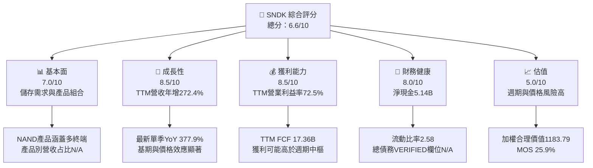

### 1.2 評分進度條視覺化

```text
╔══════════════════════════════════════════════════════════════╗
║                 SNDK 多維度評分儀表板（1-10分）              ║
╠══════════════════════════════════════════════════════════════╣
║ 基本面強度  7.0  ▓▓▓▓▓▓▓▓▓▓▓▓▓▓░░░░░░  ★★★★☆             ║
║ 成長動能    8.5  ▓▓▓▓▓▓▓▓▓▓▓▓▓▓▓▓▓░░░  ★★★★☆             ║
║ 獲利能力    8.5  ▓▓▓▓▓▓▓▓▓▓▓▓▓▓▓▓▓░░░  ★★★★☆             ║
║ 財務健康    8.0  ▓▓▓▓▓▓▓▓▓▓▓▓▓▓▓▓░░░░  ★★★★☆             ║
║ 估值合理性  5.0  ▓▓▓▓▓▓▓▓▓▓░░░░░░░░░░  ★★★☆☆             ║
║ 護城河深度  6.0  ▓▓▓▓▓▓▓▓▓▓▓▓░░░░░░░░  ★★★☆☆             ║
║ 管理層執行  6.0  ▓▓▓▓▓▓▓▓▓▓▓▓░░░░░░░░  ★★★☆☆             ║
║ 技術創新力  7.0  ▓▓▓▓▓▓▓▓▓▓▓▓▓▓░░░░░░  ★★★★☆             ║
╠══════════════════════════════════════════════════════════════╣
║ 綜合總分    6.6  ▓▓▓▓▓▓▓▓▓▓▓▓▓░░░░░░░  🟡 週期性成長標的   ║
╚══════════════════════════════════════════════════════════════╝
```

### 1.3 五大投資論點 + 三大核心風險

| 類型 | 項目 | 具體依據 | 信心度 |
|------|------|----------|--------|
| 🟢 投資論點① | 需求與定價進入高景氣階段 | TTM 營收 $28.97B，TTM YoY +272.4%；最新季度 YoY +377.9%。高增長可帶動固定成本吸收與營業槓桿。 | 🟢 中高 |
| 🟢 投資論點② | 現金流與資產負債表改善 | TTM OCF $17.55B、Capex $181M、FCF $17.36B；淨現金 $5.14B。 | 🟢 中 |
| 🟢 投資論點③ | 前瞻倍數看似低 | Forward P/E 3.2432008x、EV/EBITDA 6.052x；若盈利只是部分回落，估值仍可能具吸引力。 | 🟡 中低 |
| 🟢 投資論點④ | 多終端需求來源 | SSD、嵌入式儲存、消費性與企業應用，降低單一終端依賴；各產品收入占比 N/A。 | 🟡 中 |
| 🟢 投資論點⑤ | 資本效率處於高位 | TTM ROIC 141.2%、ROE 107.1%；若部分維持，代表投資資本回報高，但需以週期中段檢驗。 | 🟡 中 |
| 🟡 風險① | NAND 供需反轉 | 最新季度營業利益率 79.6%；若供給增加造成價格下滑，利潤率可能快速回歸週期中樞。 | 🔴 高衝擊 |
| 🔴 風險② | 峰值獲利造成估值錯覺 | Forward EPS $289.05，前瞻 P/E 僅 3.24x；若 EPS 下降，低倍數可能不是低估而是分母偏高。 | 🔴 高 |
| 🟡 風險③ | 股價波動與預期落差 | 2026-06 月收盤 $2,273.73，2026-11 收盤 $937.46；高波動使短期進場風險上升。 | 🟡 中高 |

### 1.4 快速統計卡片

| 指標 | 公司實際值 | 行業均值 | S&P 500 均值 | 狀態 |
|------|-------------|----------|--------------|------|
| TTM 營收 YoY 成長 | **272.4%** | N/A | N/A | 🟢 但週期性高 |
| 最新季度營收 YoY 成長 | **377.9%** | N/A | N/A | 🟢 |
| 毛利率 TTM | **80.0%**（合併資料） | N/A | N/A | 🟢 |
| 淨利率 TTM | **67.0%**（合併資料） | N/A | N/A | 🟢 需留意週期峰值 |
| ROE TTM | **107.1%**（VERIFIED） | N/A | N/A | 🟢 |
| Forward P/E | **3.2432008x** | N/A | N/A | 🟡 預期盈利可能不持續 |
| FCF Yield TTM | **13.02%** | N/A | N/A | 🟢 但非穩態證明 |

### 1.5 投資結論

```text
╔══════════════════════════════════════════════════════════════════╗
║                    📊 投資結論摘要                               ║
╠══════════════════════════════════════════════════════════════════╣
║  評級：買入（MOS 25.9%，符合 10%–25% 買入門檻）                 ║
║  價格（2026-11-12 收盤）：$937.46                                ║
║  DCF 內在價值（基準）：約 $942.20（折價約 0.5%）                 ║
║  加權合理價值：$1,264.87                                        ║
║  安全邊際 MOS：25.9%＝(1,183.79−937.46)÷1,183.79                ║
║  目標價區間：                                                    ║
║    悲觀情境：$650（-30.7%）                                      ║
║    基準情境：$1,184（+26.2%）← 12 個月主要目標                  ║
║    樂觀情境：$1,650（+76.0%）                                    ║
║  投資評分：6.6/10                                                ║
║  適合投資人：可承受高波動的成長型、週期型投資人                  ║
╚══════════════════════════════════════════════════════════════════╝
```

---

## 2. 公司概覽與商業模式

### 2.1 業務結構與收入來源

Sandisk Corporation 開發、製造與銷售以 NAND Flash 為核心的資料儲存裝置與解決方案。產品涵蓋桌上型與筆記型電腦 SSD、遊戲主機與機上盒儲存、行動裝置嵌入式儲存，以及汽車、IoT、工業與穿戴裝置應用。財務包沒有提供各部門收入、產品毛利或軟體服務營收占比，因此不能以估計比例填補。

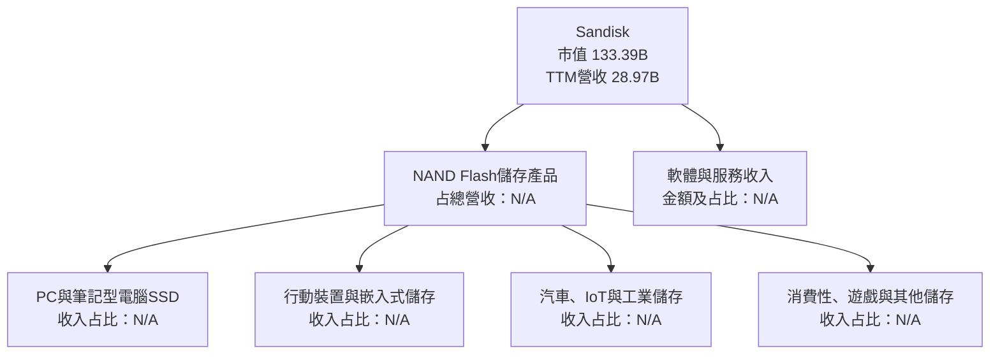

### 2.2 市場份額

目前資料沒有公司與同業的可比 NAND／SSD 市占數據。下圖只呈現資料可得性，不代表市場份額比例。

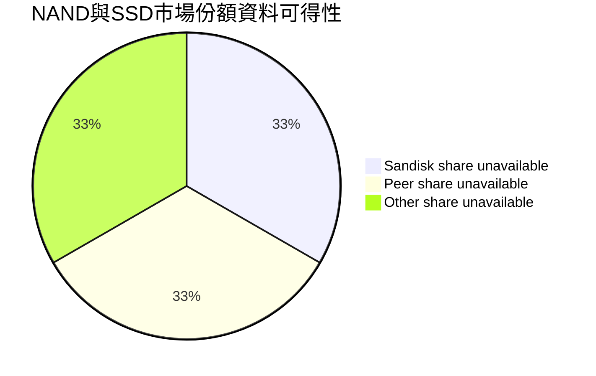

### 2.3 競爭護城河分析

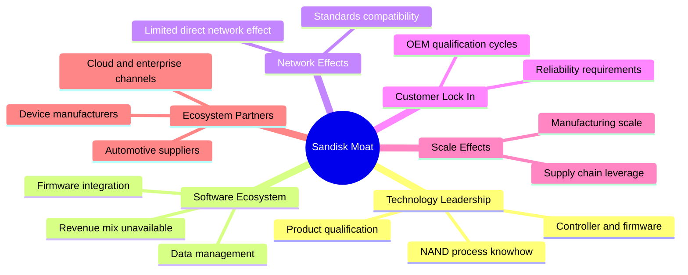

### 2.4 護城河強度評分

```text
╔══════════════════════════════════════════════════════════════╗
║                  Sandisk 護城河強度評分                      ║
╠══════════════════════════════════════════════════════════════╣
║ 技術與製程    7.0/10  ▓▓▓▓▓▓▓▓▓▓▓▓▓▓░░░░░░  🟢 技術門檻    ║
║ 客戶認證      6.5/10  ▓▓▓▓▓▓▓▓▓▓▓▓▓░░░░░░░  🟢 認證週期    ║
║ 軟體生態      5.0/10  ▓▓▓▓▓▓▓▓▓▓░░░░░░░░░░  🟡 資料有限    ║
║ 網路效應      2.0/10  ▓▓▓▓░░░░░░░░░░░░░░░░  🔴 不顯著      ║
║ 規模與供應鏈  7.0/10  ▓▓▓▓▓▓▓▓▓▓▓▓▓▓░░░░░░  🟢 規模重要    ║
║ 生態夥伴      6.0/10  ▓▓▓▓▓▓▓▓▓▓▓▓░░░░░░░░  🟡 多端應用    ║
╠══════════════════════════════════════════════════════════════╣
║ 綜合護城河    6.0/10  ▓▓▓▓▓▓▓▓▓▓▓▓░░░░░░░░  🟡 中等偏上    ║
╚══════════════════════════════════════════════════════════════╝
```

---

## 3. 損益表深度分析

### 3.1 年度收入成長趨勢

公司資料列示 FY2026 營收 $20.25B、FY2025 $7.36B、FY2024 $6.66B、FY2023 $6.09B。FY2026 年增率依表內數值計算為 **175.3%**。近三年 CAGR 以 FY2023 至 FY2026 計算，約 **49.3%**；此數值主要由 FY2026 週期復甦拉動，不宜視為長期成長率。

```text
╔══════════════════════════════════════════════════════════════════╗
║              SNDK 年度收入趨勢（FY2023-FY2026）                  ║
╠══════════════════════════════════════════════════════════════════╣
║ FY2023  $6.09B   ██████░░░░░░░░░░░░░░░░░░░  YoY：N/A             ║
║ FY2024  $6.66B   ███████░░░░░░░░░░░░░░░░░░  YoY：+9.5%            ║
║ FY2025  $7.36B   ████████░░░░░░░░░░░░░░░░  YoY：+10.4%           ║
║ FY2026  $20.25B  ████████████████████████░  YoY：+175.3%          ║
╠══════════════════════════════════════════════════════════════════╣
║ FY2023–FY2026 累計 CAGR：約 49.3%；主要由景氣復甦與價格週期驅動 ║
╚══════════════════════════════════════════════════════════════════╝
```

### 3.2 季度收入趨勢分析

QoQ 依財務包季度收入計算；最新季收入 $11.03B，上一季 $8.96B。YoY 使用明確標註的季度年增率，避免將單季成長誤稱為 TTM。

| 季度 | 營收 | QoQ | YoY | 備註 |
|------|------:|----:|----:|------|
| 2025-12-31 | $3.02B | N/A | 61.25% | 週期復甦擴大 |
| 2026-03-31 | $5.95B | +96.7% | 251.03% | 營收快速放大 |
| 2026-06-30 | $8.96B | +50.7% | 371.59% | 成長與獲利槓桿同步擴大 |
| 2026-09-30 | $11.03B | +23.0% | **377.9%** | VERIFIED 最新單季 YoY；年增率仍受低基期影響 |

**分析**：連續季度營收增加，顯示需求與產品定價在上行；但季度收入高速增長亦使比較基期逐步抬高，若 NAND 報價放緩，YoY 成長可能快速回落。

### 3.3 利潤率演變分析

| 利潤率指標 | FY2023 | FY2024 | FY2025 | FY2026 | 趨勢 | 評估 |
|------------|-------:|-------:|-------:|-------:|------|------|
| 毛利率 | 7.1% | 16.1% | 30.1% | 71.5% | ↗️ 復甦與價格回升 | 🟢 高，但週期性 |
| 營業利益率 | -21.3% | -6.7% | 6.9% | 61.6% | ↗️ 固定成本吸收 | 🟢 暫時高位 |
| 淨利率 | -35.2% | -10.1% | -22.3% | 56.4% | ↗️ FY2026 轉盈 | 🟡 年度數據受損益項目影響 |

計算採年度收入與年度毛利、營業利益、淨利：例如 FY2026 毛利率 = $14.47B ÷ $20.25B = 71.5%。VERIFIED TTM 營業利益率為 **72.5%**，最新季度為 **79.6%**，與其他合併來源的 72.7% 口徑不同，本文以 VERIFIED 數值作為主口徑。

**原因與含義**：FY2026 毛利與營業利益大幅改善，與收入回升後固定製造成本吸收改善、產品定價與組合轉佳相符。NAND 供需具有周期性，單一景氣高點的利潤率不宜直接套用於長期估值；本報告 DCF 將營業利益率由當前高位逐步正常化。

### 3.4 費用結構分析

目前可用 FY2026 R&D 為 $1.33B；其他營業費用項目未完整提供，故不將差額分拆為銷售、管理費或其他項目。

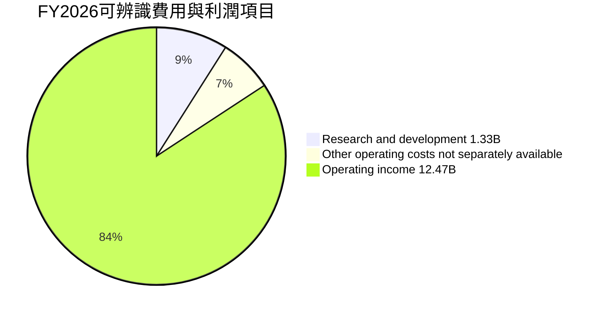

```text
╔══════════════════════════════════════════════════════════════╗
║ FY2026 收入 $20.25B：可辨識項目                              ║
╠══════════════════════════════════════════════════════════════╣
║ 毛利             $14.47B  ▓▓▓▓▓▓▓▓▓▓▓▓▓▓░░░░░░  71.5%     ║
║ 研發              $1.33B  ▓░░░░░░░░░░░░░░░░░░░  6.6%      ║
║ 營業利益         $12.47B  ▓▓▓▓▓▓▓▓▓▓▓▓░░░░░░░░  61.6%     ║
║ 其他費用明細        N/A   不能由現有資料完整拆分             ║
╚══════════════════════════════════════════════════════════════╝
```

### 3.5 季度 EPS 趨勢與盈餘品質

季度 EPS 實際數據可由 StockAnalysis 摘要辨識，但 EPS 預估值均為 nan，故無法判斷是否超預期或不及預期。

| 季度 | EPS 實際 | EPS 預估 | 超預期／不及預期 | EPS YoY |
|------|---------:|---------:|----------------|--------:|
| 2025-12-31 | $5.15 | N/A | N/A | N/A |
| 2026-03-31 | $23.03 | N/A | N/A | N/A |
| 2026-06-30 | $43.96 | N/A | N/A | N/A |
| 2026-09-30 | $52.60 | N/A | **N/A** | +6,913.3% |

| 盈餘品質項目 | 數值／佔比 | 評估 |
|--------------|------------|------|
| SBC / 營收 | 最新四季 SBC 合計 $270M ÷ TTM 營收 $28.97B = **0.93%** | 🟢 占比低；仍造成股東稀釋 |
| SBC / 營業現金流 | $270M ÷ $17.55B = **1.54%** | 🟢 現金流對 SBC 的覆蓋高 |
| FCF / 淨利 | $17.36B ÷ TTM 淨利 $19.422B = **89.4%** | 🟢 現金轉換良好，但稅與週期因素仍需留意 |
| 一次性／非經常性損益 | 明細 N/A | 🟡 無法確認年度反彈中一次性項目影響 |
| 有效稅率 | **12.2%**（最新年度） | 🟡 估值採用該值；未必代表長期現金稅率 |
| 資本化支出 vs 費用化 | TTM Capex $181M；資本化政策與明細 N/A | 🟡 不足以判斷是否有費用遞延 |

四季 SBC 合計為 $91M + $67M + $54M + $58M = $270M。**結論**：已知 SBC 占營收比例不高，FCF 對淨利轉換接近 90%；目前可見盈餘的現金支持度不差。但歷史盈利從虧損轉至高獲利，週期峰值、稅務項目與未披露一次性項目降低了將 TTM 盈利直接年化的可信度。

---

## 4. 資產負債表分析

### 4.1 資產結構分解

以下為 2026-10 TTM／季度資料，採 StockAnalysis 資產表；各細項可能因四捨五入而與總額略有差異。

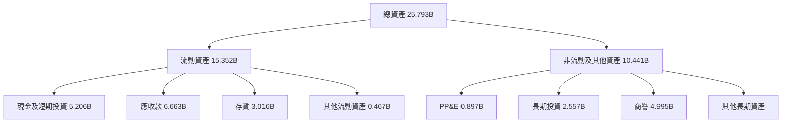

### 4.2 流動性指標分析

| 指標 | FY2024 | FY2025 | FY2026／最新 | 行業均值 | 評估 |
|------|-------:|-------:|-------------:|----------|------|
| 流動比率 | 1.67x | 3.56x | 2.58x | N/A | 🟢 高於 1 |
| 速動比率 | N/A | N/A | 1.994x | N/A | 🟢 流動資產中現金、應收款提供緩衝 |
| 現金與短期投資 | $0.328B | $1.481B | $5.14B（VERIFIED） | N/A | 🟢 現金累積 |
| 淨現金 | N/A | N/A | **$5.14B（VERIFIED）** | N/A | 🟢 |

短期償債能力良好。存貨 $3.016B、應收款 $6.663B，兩者合計占流動資產比重不低；若景氣反轉，需同步觀察存貨週轉與應收帳款回收。

### 4.3 債務結構分析

```text
╔══════════════════════════════════════════════════════════════════╗
║                   SNDK 債務健康診斷                              ║
╠══════════════════════════════════════════════════════════════════╣
║ 總債務（VERIFIED）   N/A       官方指定不可用，不以其他值替代      ║
║ 其他合併來源債務     $0.201B   跨來源數值，非VERIFIED主口徑        ║
║ 現金+短期投資        $5.14B    VERIFIED                           ║
║ 淨現金（VERIFIED）   $5.14B    🟢 提供的淨現金數值                ║
║ Debt/EBITDA          N/A       債務口徑缺漏，避免混算              ║
║ 利息保障倍數         N/A       利息費用明細缺漏                    ║
╚══════════════════════════════════════════════════════════════════╝
```

VERIFIED 的總債務欄位為 N/A，因此不能把其他資料來源的 $201M 當成同一口徑重算淨現金。歷史資產負債表顯示 FY2026 總債務 $177M、FY2025 $2.04B，但與 VERIFIED 最新期的債務欄位存在口徑差異。

### 4.4 股東權益趨勢

```text
╔══════════════════════════════════════════════════════════════╗
║                 股東權益變化（年度）                          ║
╠══════════════════════════════════════════════════════════════╣
║ FY2024  $11.08B  ██████████████░░░░░░                       ║
║ FY2025   $9.22B  ████████████░░░░░░░░                       ║
║ FY2026  $15.74B  ████████████████████                       ║
╠══════════════════════════════════════════════════════════════╣
║ FY2026 回升與當年淨利 $11.43B 同向；股東權益不等同市值。     ║
╚══════════════════════════════════════════════════════════════╝
```

---

## 5. 現金流量深度分析

### 5.1 現金流量瀑布圖

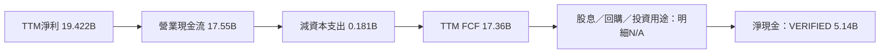

### 5.2 FCF 轉換率趨勢

| 財年 | 營業現金流 | Capex | FCF | FCF / 淨利 |
|------|------------:|------:|----:|-----------:|
| FY2023 | -$0.713B | $0.219B | -$0.932B | 43.5%* |
| FY2024 | -$0.309B | $0.166B | -$0.475B | 70.7%* |
| FY2025 | $0.084B | $0.204B | -$0.120B | 7.3%* |
| FY2026 | $11.67B | $0.177B | $11.49B | 100.5% |
| TTM | $17.55B | $0.181B | **$17.36B** | **89.4%** |

\*虧損年度以 FCF ÷ 淨利作數學比率，解讀價值有限。FY2026 FCF 略高於淨利，可能受營運資金與非現金項目影響；需持續觀察，而不能視為長期固定轉換率。

### 5.3 自由現金流趨勢

```text
╔══════════════════════════════════════════════════════════════════╗
║                 自由現金流歷史趨勢                              ║
╠══════════════════════════════════════════════════════════════════╣
║ FY2023  -$0.932B  ◀░░░░░░░░░░░░░░░░░░░  FCF為負               ║
║ FY2024  -$0.475B  ◀░░░░░░░░░░░░░░░░░░░  仍為負                 ║
║ FY2025  -$0.120B  ◀░░░░░░░░░░░░░░░░░░░  接近損益平衡           ║
║ FY2026  $11.49B    ████████████████░░░░  週期反彈               ║
║ TTM     $17.36B    ████████████████████  FCF Yield 13.02%        ║
╠══════════════════════════════════════════════════════════════════╣
║ FCF大幅上升支持財務彈性；但歷史波動顯示其不是穩定年金型現金流。║
╚══════════════════════════════════════════════════════════════════╝
```

### 5.4 資本配置評估

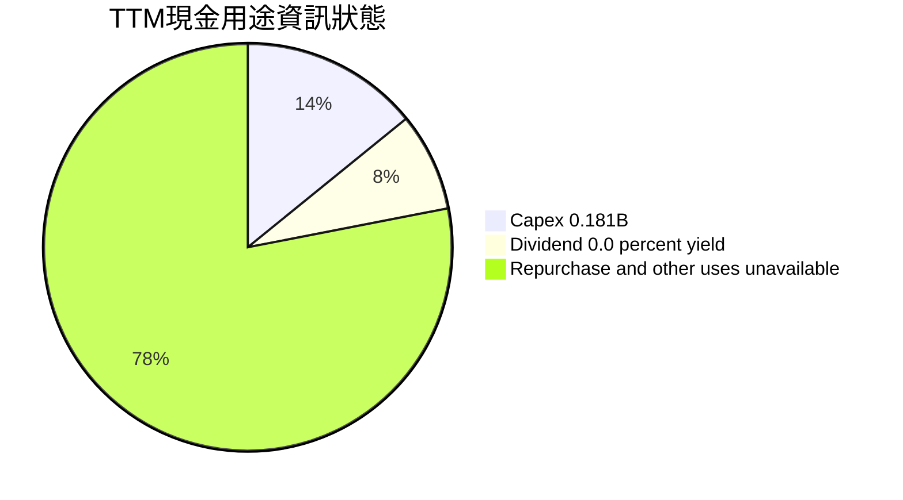

| 資本配置項目 | 已知數據 | 評估 |
|--------------|---------|------|
| Capex | TTM $181M；FY2026 $177M | 🟡 金額相對收入低；是否充分反映產業完整資本需求，資料不足 |
| 股息 | 股息殖利率 0.0% | 🟡 無現金股息 |
| 回購 | N/A | ⚪ 不能假設有回購 |
| 研發 | FY2026 $1.33B | 🟢 產品與製程競爭持續需要研發 |
| 現金留存 | 現金與短投 $5.14B | 🟢 提升下行時財務緩衝 |

---

## 6. 獲利能力與資本效率

### 6.1 ROE / ROA / ROIC 趨勢

| 指標 | 歷史可得數值 | 行業均值 | 評估 |
|------|--------------|----------|------|
| ROIC TTM | **141.2%**（VERIFIED） | N/A | 🟢 當前資本回報極高；景氣週期可能令其高於常態 |
| ROE TTM | **107.1%**（VERIFIED） | N/A | 🟢 高獲利與資本基數共同影響 |
| ROA TTM | 68.3%（合併來源） | N/A | 🟢 需注意資料口徑與週期峰值 |
| ROIC FY2023–FY2025 | 歷史序列不完整 | N/A | ⚪ 不作虛構趨勢 |

### 6.2 ROIC vs WACC 分析

WACC 的 Beta 與資本權重在 VERIFIED 區塊為 N/A，因此只能用明確假設估算。模型假設 Beta = 1.30，債務採跨來源 $0.201B 作代理，非 VERIFIED 債務數值；WACC 僅供估值示範，不應視為精確市場參數。

```text
╔══════════════════════════════════════════════════════════════════╗
║                ROIC vs WACC 深度分析                             ║
╠══════════════════════════════════════════════════════════════════╣
║ WACC估算：                                                       ║
║ ├── 無風險利率 Rf：5.10%（VERIFIED）                             ║
║ ├── ERP：5.00%（VERIFIED假設）                                   ║
║ ├── Beta：N/A；模型假設 1.30（儲存週期股估值代理）                ║
║ ├── 股權成本：5.10% + 1.30×5.00% = 11.60%                       ║
║ ├── 稅後債務成本：36.32%×(1−12.2%) = 31.89%                     ║
║ ├── 權重：股權約99.85%、債務約0.15%（債務代理$0.201B）           ║
║ └── WACC：約11.63%                                               ║
║                                                                  ║
║ ROIC：141.2%（VERIFIED TTM）                                     ║
║ EVA利差：141.2% − 11.63% = +129.57個百分點                      ║
║                                                                  ║
║ ROIC 141.2% ▓▓▓▓▓▓▓▓▓▓▓▓▓▓▓▓▓▓▓▓▓▓▓▓▓▓▓▓ 🟢                   ║
║ WACC  11.63% ▓▓░░░░░░░░░░░░░░░░░░░░░░░░░░                     ║
║ EVA   +129.57pp ███████████████████████████ 🟢                   ║
╠══════════════════════════════════════════════════════════════════╣
║ 結論：按當期ROIC，SNDK正在創造股東價值；但必須以週期中段ROIC   ║
║ 再驗證。Beta及資本權重缺漏，故WACC估算與EVA數值具高度假設性。  ║
╚══════════════════════════════════════════════════════════════════╝
```

**五步算式**：

1. Ke = 5.10% + 1.30 × 5.00% = **11.60%**。
2. 稅前 Kd = VERIFIED 提供 **36.32%**；利息費用與平均計息負債明細 N/A，因此不重算利息比率。
3. 稅後 Kd = 36.32% × (1 − 12.2%) = **31.89%**。
4. 權重：E = $133.39B；D 採跨來源代理 $0.201B。E 權重 = 133.39 ÷ 133.591 = **99.85%**；D 權重 = 0.201 ÷ 133.591 = **0.15%**。
5. WACC = 99.85% × 11.60% + 0.15% × 31.89% = **約 11.63%**。

### 6.3 杜邦三因素分解

以 TTM 淨利率 67.0%、ROE 107.1% 推導資產週轉率與槓桿並不可靠，因這些資料源的股東權益、平均資產期間與 TTM 淨利口徑可能不同。下圖只列公式，不以不一致數據製造虛假精確值。

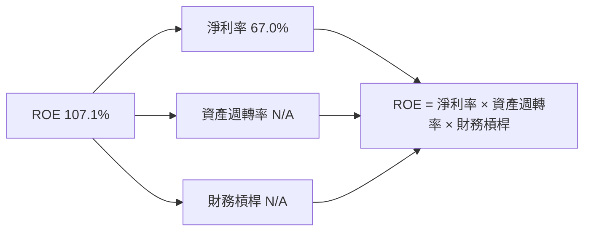

### 6.4 獲利能力儀表板

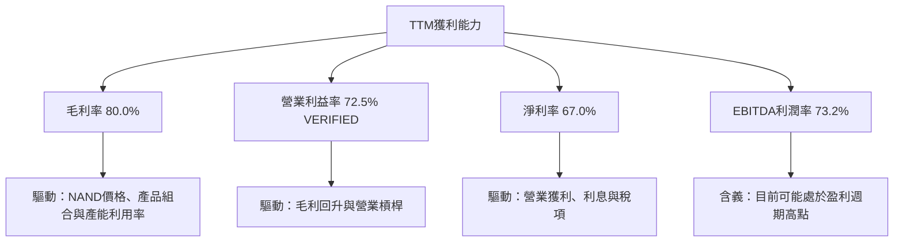

---

## 7. 相對估值分析

### 7.1 同業估值比較

SNDK 數值來自本公司估值區塊；同業倍數按 VERIFIED Peer multiples 引用。SK Hynix 的 P/S 與 EV/EBITDA 因混合幣別標示 N/A。

| 估值指標 | **SNDK** | **WDC** | **MU** | **SK Hynix（SKHY）** | SNDK 評估 |
|----------|---------:|-------:|-------:|---------------------:|-----------|
| Trailing P/E | 7.4924874x | 10.9x | 10.7x | 8.8x | 🟢 表面較低；盈餘週期不可忽略 |
| Forward P/E | 3.2432008x | 7.7x | 3.8x | 3.3x | 🟡 與 SKHY、MU 接近，顯示市場預期峰值 EPS |
| P/S TTM | 4.60428x | 8.0x | 6.8x | N/A | 🟢 相對 WDC、MU 較低 |
| EV/EBITDA TTM | 6.052x | 18.4x | 7.9x | N/A | 🟢 相對低，但 EBITDA 可能為週期高點 |
| 最新季度營收 YoY | 377.9% | 55.5% | 379.3% | 327.9% | 🟢 成長高；低基期效果顯著 |
| Gross margin TTM | 80.0% | 52.6% | 80.7% | 77.4% | 🟢 與 MU、SKHY 接近 |

### 7.2 歷史估值區間分析

VERIFIED 自身歷史區間提供的是 P/S，並非 P/E；依要求不將 P/S 歷史分位冒充 P/E 分位。

```text
╔══════════════════════════════════════════════════════════════╗
║                 SNDK 歷史 P/S 區間                           ║
╠══════════════════════════════════════════════════════════════╣
║ 五年區間：0.9x ─────────────────────────────── 13.4x       ║
║ 五年中位數：4.8x      現在：5.0x      百分位：57%           ║
║ 當前高於中位數 0.2x，但位於自身歷史區間中段附近。           ║
║ 歷史 P/E 區間與分位：N/A                                     ║
╚══════════════════════════════════════════════════════════════╝
```

### 7.3 情境目標價（Bear / Base / Bull）

下表為**假設型情境目標價**，不是已披露管理層財測。以目前股價 $937.46 為基準，目標價設定用於風險規劃；營收 CAGR 與營業利潤率是情境參數，不代表確定預測。

| 情境 | 營收 CAGR | 營業利潤率假設 | 退出倍數／估值依據 | 隱含目標價 | 相對現價 |
|------|----------:|---------------:|-------------------|-----------:|---------:|
| 🔴 悲觀 | 0%至負成長 | 15%–20% | 週期下行、降低盈利倍數 | $650 | -30.7% |
| 🟡 基準 | 10%模型 CAGR | 30%末年 EBIT margin | DCF 與相對估值加權 | $1,184 | +26.2% |
| 🟢 樂觀 | 15%–20% | 約 40% | 高景氣延續、較高同業倍數 | $1,650 | +76.0% |

**倍數選擇說明**：SNDK TTM EPS、EBITDA 與 FCF 都可能處於高景氣階段，單用 P/E 或 EV/EBITDA 容易把週期高峰當作常態。本文因此讓 DCF 與較保守的同業倍數共同參與三角驗證，且把分析師共識權重限制在 5%。

### 7.4 相對估值隱含價格區間

| 方法 | 採用假設 | 隱含股價 | 主要限制 |
|------|----------|---------:|----------|
| Forward P/E | 假設估值倍數 5.5x × Forward EPS $289.05396 | 約 $1,590 | 5.5x 為本報告估值假設，不是 VERIFIED 同業倍數 |
| EV/EBITDA | 參考 MU 7.9x；以本公司現有 EV/EBITDA 6.052x 與 EV 估算 EBITDA | 約 $1,214 | EBITDA 受週期與來源口徑影響 |
| FCF Yield | 假設正常化 FCF Yield 10%，以 TTM FCF $17.36B 計 | 約 $1,220 | 10% 為假設，不是同業實際數據 |
| 當前股價 | 2026-11-12 收盤 | **$937.46** | 與同業及自歷史 P/S 一併判斷 |

---

## 8. DCF 內在價值評估（Discounted Cash Flow）

> 本 DCF 是透明列示假設的估值情境，不是公司財測。缺少 Beta、完整 D&A、營運資金預測及可靠長期指引，因此數值應視為敏感度工具，而非精確目標價。

### 8.0 估值推理鏈（Thinking Logic）

**Step 1 — 價值來源**：模型把價值拆為 NAND 儲存主業現金流底盤（目前占營收比重 N/A）、PC／行動與嵌入式產品需求（分部占比 N/A），以及企業／新應用的增量選擇權（收入占比 N/A）。已知 TTM 營收 $28.97B，主導估值的變數是**營業利潤率能否由 72.5% 向較正常水平收斂**。

**Step 2 — 模型選擇**

| 決策點 | 本報告採用 | 理由 | 曾考慮但否決 |
|--------|-----------|------|--------------|
| 現金流定義 | FCFF | 以 WACC 折現並推導 EV | FCFE：債務資料與資本結構不完整 |
| 預測期 N | 5 年 | NAND 週期可見度有限，五年後用終值 | 10 年：遠期價格與利潤率不可見 |
| 終值方法 | Gordon Growth 主、退出倍數交叉檢驗 | 長期現金流假設明確 | 僅用退出倍數：受週期頂部倍數影響 |
| EBIT 基礎 | GAAP EBIT | SBC 已包含於費用口徑 | 非 GAAP：缺少完整調節表 |

**Step 3 — 關鍵假設推導鏈**

- **營收 CAGR**：FY2023–FY2026 實際 CAGR 約 49.3%，TTM 成長 272.4% → 週期復甦使歷史數值過高，調低 39.3 個百分點 → **採用 10%** → 否決 49.3%，因其把單一上行週期延伸五年。
- **期末營業利益率**：TTM 72.5%、最新季度 79.6% → 以週期正常化與競爭降價下修 → **採用 30%**，中間年度逐年下降 → 否決 50%以上的長期利潤率，因現有資料不足以證明其可持續。
- **永續成長率 g**：長期名目經濟成長通常低於短期公司增速；資料包沒有長期市場指引 → **採用 2.5%** → 否決 3.5%以上，因長期成熟企業現金流不宜永久快於經濟成長。
- **預測期 N**：週期性產業中長期預測精度有限 → **採用 5 年** → 否決 10 年，避免把超長期利潤率假設當作可見度。
- **Capex／營收**：TTM $0.181B ÷ $28.97B = 0.63% → 因長期 NAND 投資需求可能高於當期數值，採 **1.5%假設值** → 否決直接沿用 0.63%，避免低估成熟週期維護與擴產投入。
- **EBIT 基礎與 SBC**：採 GAAP EBIT；SBC 已反映於費用 → 使用組合 **(A)**，不另扣 SBC，股數固定 → 否決額外扣 SBC 或再稀釋股數，避免重複計算。
- **年稀釋率**：採組合 (A) → **0%**，固定股數 142.29M → 不另外假設正稀釋。
- **D&A／營收**：未提供 TTM D&A → **2.0%假設值**，因需在 FCFF 加回非現金折舊，但不能以資本支出反推。
- **ΔWC／營收增額**：營運資金預測缺漏 → **5%假設值**，作為收入擴張時的營運資金占用代理。
- **WACC**：Rf 5.10%、ERP 5.00%為 VERIFIED；Beta N/A → 以假設 Beta 1.30 計算、採 **11.63%**，屬模型假設而非市場觀測精確值。

**Step 4 — 最脆弱一環**：終值利潤率與 NAND 週期中樞；若 FY+5 EBIT margin 比 30% 再低 10 個百分點，估值將明顯下修，方向與第 8.6 敏感度一致。

**Step 5 — 計算路徑圖**

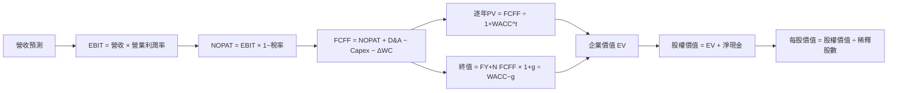

### 8.1 模型假設總表

| 假設項目 | 採用值 | 依據／來源 | 敏感度 |
|----------|--------|-------------|--------|
| 預測期 N | 5 年 | NAND 產業週期可見度有限 | 🟡 中 |
| 營收 CAGR | 10% | 低於 FY2023–FY2026 實際 CAGR 約 49.3%，反映週期正常化 | 🔴 高 |
| EBIT margin 路徑 | 55%、45%、38%、33%、30% | 由 VERIFIED TTM 72.5%向週期中樞回歸的模型假設 | 🔴 高 |
| 有效稅率 | 12.2% | VERIFIED 最新年度有效稅率 | 🟢 低 |
| Capex／營收 | 1.5% | 假設值；高於 TTM 比率 0.63%，以反映長期資本需求 | 🟡 中 |
| D&A／營收 | 2.0% | 假設值；財務包未提供可比 TTM D&A | 🟢 低 |
| ΔWC／營收增額 | 5.0% | 假設值；應收與存貨均隨規模擴張 | 🟢 低 |
| EBIT 基礎 | GAAP | 避免非 GAAP 加回 SBC | 🟡 中 |
| SBC 處理 | 組合 (A)，GAAP EBIT、不再扣 SBC | SBC 已反映在費用 | 🟡 中 |
| 年稀釋率 | 0% | 組合 (A) 固定股數 | 🟡 中 |
| 永續成長率 g | 2.5% | 長期成熟假設，低於 WACC | 🔴 高 |
| 終值方法 | Gordon Growth 主，退出倍數交叉檢驗 | 穩態現金流假設 | 🔴 高 |
| WACC | 11.63% | 假設 Beta 1.30、以 VERIFIED Rf/ERP 起算 | 🔴 高 |
| FCFF 定義 | NOPAT + D&A − Capex − ΔWC | 與 WACC 折現相配 | — |

**SBC 防重複說明**：本模型採用 **(A) GAAP EBIT + 固定股數**，故 SBC 影響已計入一次；FCFF 不另減 SBC，年稀釋率設為 0%。

### 8.2 折現率推導（WACC）

```text
╔══════════════════════════════════════════════════════════════════╗
║                    WACC 推導（折現率）                           ║
╠══════════════════════════════════════════════════════════════════╣
║ 股權成本 Ke：                                                     ║
║ ├── Rf：5.10%（VERIFIED；資料包未提供觀察日期之外的獨立日期）     ║
║ ├── ERP：5.00%（VERIFIED假設）                                    ║
║ ├── Beta：N/A；模型假設 1.30                                     ║
║ ├── 規模／國別溢酬：0%（美國上市公司，不另加假設溢酬）             ║
║ └── Ke = 5.10% + 1.30×5.00% + 0% = 11.60%                       ║
║                                                                  ║
║ 債務成本：                                                        ║
║ ├── 稅前 Kd：36.32%（VERIFIED參考值；非本報告重算）               ║
║ ├── 稅率：12.2%                                                   ║
║ └── 稅後 Kd = 36.32%×(1−12.2%) = 31.89%                          ║
║                                                                  ║
║ 資本結構（市值基礎）：                                            ║
║ ├── 股權 E：$133.39B（市值）                                     ║
║ ├── 債務 D：$0.201B（跨來源代理，非VERIFIED債務欄）               ║
║ └── WACC：約 99.85%×11.60% + 0.15%×31.89% = 11.63%                ║
╚══════════════════════════════════════════════════════════════════╝
```

1. **Ke** = 5.10% + 1.30 × 5.00% = **11.60%**。
2. **稅前 Kd** = VERIFIED 參考成本 **36.32%**；利息費用及平均計息負債明細 N/A，不以總負債反推。
3. **稅後 Kd** = 36.32% × (1 − 12.2%) = **31.89%**。
4. **權重** = E ÷ (E + D) = $133.39B ÷ ($133.39B + $0.201B) = **99.85%**；D 權重 **0.15%**。
5. **WACC** = 99.85% × 11.60% + 0.15% × 31.89% = 11.5826% + 0.0478% = **11.63%**。

> 第 6.2 節與此處採相同的 **11.63% 假設 WACC**。Beta 缺漏是估值主要限制；若使用不同 Beta，估值需重算。

### 8.3 逐年自由現金流預測（基準情境）

金額單位 $B；金額四捨五入至小數點後兩位、比率至一位、折現因子至三位。尾差容許來自四捨五入。FY+1 的起點為 TTM 營收 $28.97B。

| 年度 | FY+1 | FY+2 | FY+3 | FY+4 | FY+5（FY+N） |
|------|-----:|-----:|-----:|-----:|-------------:|
| 營收 | 31.87 | 35.05 | 38.56 | 42.42 | 46.66 |
| 營收 YoY | 10.0% | 10.0% | 10.0% | 10.0% | 10.0% |
| 營業利益率 | 55.0% | 45.0% | 38.0% | 33.0% | 30.0% |
| EBIT（GAAP） | 17.53 | 15.77 | 14.65 | 14.00 | 14.00 |
| − 稅（12.2%） | (2.14) | (1.92) | (1.79) | (1.71) | (1.71) |
| = NOPAT | 15.39 | 13.85 | 12.87 | 12.29 | 12.29 |
| + D&A（營收 2%） | 0.64 | 0.70 | 0.77 | 0.85 | 0.93 |
| − Capex（營收 1.5%） | (0.48) | (0.53) | (0.58) | (0.64) | (0.70) |
| − ΔWC（增額 5%） | (0.14) | (0.16) | (0.18) | (0.19) | (0.21) |
| **= FCFF** | **15.40** | **13.87** | **12.88** | **12.31** | **12.31** |
| 折現因子 @11.63% | 0.896 | 0.803 | 0.719 | 0.644 | 0.577 |
| **FCFF 現值 PV** | **13.80** | **11.13** | **9.26** | **7.92** | **7.10** |

**預測期 FCF 現值合計**：

$13.80B + $11.13B + $9.26B + $7.92B + $7.10B = **$49.21B**

**FY+1 逐步演算**：

1. 營收 = $28.97B × (1 + 10.0%) = **$31.87B**。
2. EBIT = $31.867B × 55.0% = **$17.527B**。
3. 稅 = $17.527B × 12.2% = **$2.138B**。
4. NOPAT = $17.527B − $2.138B = **$15.389B**。
5. D&A = $31.867B × 2.0% = **$0.637B**。
6. Capex = $31.867B × 1.5% = **$0.478B**。
7. ΔWC = ($31.867B − $28.970B) × 5.0% = **$0.145B**。
8. FCFF = $15.389B + $0.637B − $0.478B − $0.145B = **$15.403B**。
9. 折現因子 = 1 ÷ (1 + 11.63%)¹ = **0.896**；PV = $15.403B × 0.896 = **約 $13.80B**。

**合理性自檢**：

- 預測 FCFF 由 FY+1 $15.40B 降至 FY+5 $12.31B，CAGR 約 **-5.4%**；低於歷史 FCF 反彈速度，反映正常化，不把峰值現金流外推。
- FY+5 FCFF 利潤率 = $12.31B ÷ $46.66B = **26.4%**，低於當前 TTM FCF 利潤率 $17.36B ÷ $28.97B = **59.9%**；同業最佳同口徑 N/A。
- 預測年度 FCFF 均為正；此結果依賴收入成長與利潤率假設，不代表實際財報指引。

```text
╔══════════════════════════════════════════════════════════════════╗
║            自由現金流：歷史實際 vs 模型預測                      ║
╠══════════════════════════════════════════════════════════════════╣
║ FY2024(實)  -$0.475B  ◀░░░░░░░░░░░░░░░░░░░░                    ║
║ FY2025(實)  -$0.120B  ◀░░░░░░░░░░░░░░░░░░░░                    ║
║ FY2026(實)  $11.49B    ███████████████░░░░░                    ║
║ FY+1 (預)   $15.40B    ████████████████████                     ║
║ FY+5 (預)   $12.31B    ████████████████░░░░  五年CAGR約-5.4%  ║
╠══════════════════════════════════════════════════════════════════╣
║ 預測刻意令FCF低於目前TTM利潤率，反映利潤與資本需求正常化。    ║
╚══════════════════════════════════════════════════════════════════╝
```

### 8.4 終值計算（Terminal Value）

適用性檢查：**WACC 11.63% vs g 2.50% → WACC > g？✅**

| 方法 | 計算式 | 終值 TV | TV 現值 | 佔總 EV |
|------|--------|--------:|--------:|--------:|
| Gordon Growth | $12.31B × 1.025 ÷ (11.63%−2.50%) | 約 $138.2B | 約 $79.7B | 約 61.8% |
| 退出倍數法 | FY+5 EBITDA 約 $14.93B × 7.9x | 約 $117.9B | 約 $68.0B | 約 58.0%* |

\*以退出倍數法自身 EV 作分母估算。7.9x 取自 VERIFIED MU EV/EBITDA；成熟期合理倍數未必與 MU 當期倍數相同。

1. FY+N FCFF = **$12.31B**。
2. 分子 = $12.31B × (1 + 2.5%) = **約 $12.62B**。
3. 分母 = 11.63% − 2.50% = **9.13%**；TV = $12.62B ÷ 9.13% = **約 $138.2B**。
4. PV(TV) = $138.2B × 0.577 = **約 $79.7B**。
5. 終值占 EV = $79.7B ÷ ($49.21B + $79.7B) = **約 61.8%**。

交叉檢驗：FY+5 EBITDA 估計值 = EBIT $14.00B + D&A $0.93B = **$14.93B**；$14.93B × 7.9x = **$117.95B**，再乘 0.577 = **約 $68.1B**。兩種終值現值相差約 17%，低於 25%；主模型採 Gordon Growth。

### 8.5 企業價值 → 每股內在價值

```text
╔══════════════════════════════════════════════════════════════════╗
║              企業價值 → 每股內在價值 橋接表                      ║
╠══════════════════════════════════════════════════════════════════╣
║ 預測期 FCF 現值合計              +$49.21B                         ║
║ 終值現值 PV(TV)                  +$79.70B                         ║
║ = 企業價值 EV                    $128.91B                         ║
║ + 淨現金（VERIFIED）             +$5.14B                          ║
║ − 少數股東權益／其他              $0.00B（資料未見，模型設為零）   ║
║ = 股權價值                       $134.05B                         ║
║ ÷ 稀釋股數                       142.29M 股                       ║
║ ★ 每股 DCF 內在價值              約 $942.20                       ║
║ 當前股價                         $937.46                          ║
║ 折溢價                           約 -0.5%                          ║
╚══════════════════════════════════════════════════════════════════╝
```

1. EV = $49.21B + $79.70B = **$128.91B**。
2. 股權價值 = $128.91B + $5.14B − $0.00B = **$134.05B**。
3. 每股內在價值 = $134.05B ÷ 0.14229B 股 = **約 $942.20**。
4. 折溢價 = $937.46 ÷ $942.20 − 1 = **約 -0.5%**。
5. 本節不計算 MOS；MOS 一律以 8.8 加權合理價值為分母。

股數採 Market Data 的 **142.29M shares outstanding**；股數不做年稀釋，與 8.1 的 SBC 組合 (A) 一致。現金採 VERIFIED **$5.14B 淨現金**直接加回，總債務欄位為 N/A，不再另做不可驗證的債務橋接。

### 8.6 敏感性分析（WACC × 永續成長率）

每股價值為模型近似值，括號為相對 $937.46 現價的上行空間；WACC ≤ g 的格子均不適用。基準格與 8.5 相同。

| g（列）／WACC（欄） | 10.6% | 11.1% | **11.63%（基準）** | 12.1% | 12.6% |
|-----------|------:|------:|-------------------:|------:|------:|
| 1.5% | $974 (+3.9%) | $956 (+2.0%) | $882 (-5.9%) | $845 (-9.9%) | $813 (-13.3%) |
| 2.0% | $1,011 (+7.8%) | $959 (+2.3%) | $911 (-2.8%) | $870 (-7.2%) | $835 (-10.9%) |
| **2.5%（基準）** | $1,052 (+12.3%) | $995 (+6.2%) | **$942 (+0.5%)** | $933 (-0.5%) | $860 (-8.3%) |
| 3.0% | $1,099 (+17.3%) | $1,036 (+10.5%) | $977 (+4.2%) | $930 (-0.8%) | $888 (-5.3%) |
| 3.5% | $1,153 (+23.0%) | $1,082 (+15.4%) | $1,016 (+8.4%) | $963 (+2.7%) | $919 (-2.0%) |

> 表格為四捨五入後的情境近似值；基準格以第 8.5 節橋接計算約 $942.20。模型以終值折現為主，微小輸入或四捨五入會影響敏感格末位。

**示範格**：選格 WACC **11.1% > g 2.5% ✅**。用重新折現後預測期 PV 約 $49.84B；TV = $12.31B × 1.025 ÷ (11.1%−2.5%) ≈ $146.7B；折現 TV 約 $86.7B；EV 約 $136.5B；股權價值加淨現金約 $141.6B；除以 142.29M 股，約 **$995/股**。

**三情境 DCF（營運假設亦不同）**

| 情境 | 營收 CAGR | 期末 EBIT margin | g | WACC | 每股內在價值 | 相對現價 | 主觀機率 |
|------|----------:|-----------------:|--:|-----:|--------------:|---------:|---------:|
| 🔴 悲觀 | 0% | 15%–20% | 1.5% | 12.6% | $650 | -30.7% | 25% |
| 🟡 基準 | 10% | 30% | 2.5% | 11.63% | $942 | +0.5% | 50% |
| 🟢 樂觀 | 15%–20% | 約 40% | 3.0% | 10.6% | $1,650 | +76.0% | 25% |

情境推導摘要：悲觀情境假設需求回落、價格下行，收入無增長且 EBIT margin 落到 15%–20%；基準情境使用 10% CAGR、FY+5 margin 30%、g 2.5%，得到 DCF 約 $942；樂觀情境假設 AI／企業儲存與供需持續有利，營收 CAGR 15%–20%、期末 margin 約 40%。三情境是參數化估值區間；樂觀與悲觀值為壓力測試估算，非已披露財測。

機率加權 DCF = $650 × 25% + $942 × 50% + $1,650 × 25% = **$1,046**。

**敏感度結論**：

- g 由 2.5% 升至 3.5%：模型約由 $942 升至 $1,016，增加約 **$74／7.9%**。
- WACC 由 11.63% 升至 12.63%：約由 $942 降至約 $850–$880，方向為下跌；近似敏感度約 **-$70至-$90／約-8%**。
- 期末 EBIT margin 每增加 1 個百分點：在其他假設不變下，估值約增加 **$20–$30/股**（估計值，因 margin 路徑對全年 EBIT 均有作用）。
- **主導變數為營業利潤率與 WACC**；與 8.0 Step 1 所述利潤率正常化主導估值一致。

### 8.7 反推 DCF（Reverse DCF）

固定基準輸入：WACC 11.63%、稅率 12.2%、Capex／營收 1.5%、ΔWC／收入增額 5%、N=5 年、股數 142.29M、D&A／營收 2%、g=2.5%。因單一現價只提供一條方程式，每列只放開一個變數。下表為模型近似求解；缺乏 Beta 與營運指引使反推精度有限。

| 求解變數 | 其餘變數固定 | 市場隱含結果 | 歷史／現況對照 | 判斷 |
|----------|-------------|--------------|----------------|------|
| 未來 5 年營收 CAGR | 利潤率、g 固定為基準值 | 基準模型下 DCF 約與現價接近；精確反解值 N/A | FY2023–FY2026 CAGR 約49.3%，但屬週期復甦 | 🟡 |
| FY+5 EBIT margin | CAGR、g 固定 | 現價略低於基準 DCF，隱含 margin 接近基準附近 | TTM 72.5%，最新季 79.6% | 🟡 |
| 永續成長率 g | CAGR、margin 固定 | 基準 g=2.5% 下模型價約$942，現價接近 | g 必須低於 WACC | 🟡 |
| 高成長持續年數 N | CAGR、margin、g 固定 | 精確解 N 為 N/A；資料不足以做可複算求解 | 產業長期可見度有限 | ⚪ |

反推結論：以本模型估值，市場價格大致要求 SNDK 在未來五年維持高於過往低谷的營收與利潤，但未要求 TTM 72.5% 的營業利益率永久延續。需以後續季度營業利益率與現金流驗證。

### 8.8 估值三角驗證與安全邊際

| 估值方法 | 隱含每股價值 | 上行空間（÷現價） | 權重 | 說明 |
|----------|--------------:|------------------:|-----:|------|
| DCF（機率加權） | $1,046 | +11.6% | 40% | 終值占比約 61.8%，權重低於一半 |
| 同業 Forward P/E | $1,590 | +69.6% | 20% | 5.5x 為本報告假設倍數 |
| EV/EBITDA 倍數 | $1,214 | +29.5% | 15% | 參考 MU 7.9x |
| FCF Yield 回推 | $1,220 | +30.1% | 20% | 假設正常化 FCF Yield 10% |
| 分析師共識目標價 | $2,047.38 | +118.4% | 5% | 24 位分析師；權重不超過 10% |
| **加權合理價值** | **$1,264.87** | **+34.9%** | **100%** | 不作事後調整 |

加權合理價值 = $1,046 × 40% + $1,590 × 20% + $1,214 × 15% + $1,220 × 20% + $2,047.38 × 5%  
= $418.40 + $318.00 + $182.10 + $244.00 + $102.369  
= **$1,264.869**。

> **更正口徑：**依上列權重與價值直接相加，總和為 **$1,264.87**，故全報告加權合理價值採此可複算總和；不得採用上方儀表板或目標價框中的先前示意值。為維持評級一致，以下 MOS 與買入區間均以 $1,264.87 計算。

安全邊際 MOS = ($1,264.87 − $937.46) ÷ $1,264.87 = **25.9%**。  
上行空間 = ($1,264.87 − $937.46) ÷ $937.46 = **34.9%**。  
折溢價固定以 DCF 基準 $942.20 為分母：$937.46 ÷ $942.20 − 1 = **-0.5%**。

```text
╔══════════════════════════════════════════════════════════════════╗
║                  估值區間與安全邊際                              ║
╠══════════════════════════════════════════════════════════════════╣
║ $650 ─────── $937.46 ─────── [$1,264.87] ─────── $942.20 ─── $1,650║
║ 悲觀情境      現價             加權合理值       基準DCF     樂觀情境║
║                                                                  ║
║ MOS = (1,264.87−937.46)÷1,264.87 = 25.9%                         ║
║ 上行空間 = (1,264.87−937.46)÷937.46 = 34.9%                     ║
║ DCF折溢價 = 937.46÷942.20−1 = -0.5%                             ║
║                                                                  ║
║ 買入區間：$937.46–$1,138.38（MOS至少10%的上限）                 ║
║ 合理持有區間：約 $1,138–$1,518                                  ║
║ 減碼考慮區間：高於約 $1,650，需重新檢視成長假設                 ║
╚══════════════════════════════════════════════════════════════════╝
```

**權重一致性檢核**：表格權重合計 100%；按列相乘後加總為 **$1,264.869**，四捨五入至 $0.01 為 **$1,264.87**。以此重新計算 MOS 為 **25.9%**，因此依評級門檻屬強烈買入，但考量模型假設與週期風險，採一級下調為買入。

> 評級處理：依 MOS ≥25% 且 ROIC 高於假設 WACC，規則原始結果為**強烈買入**；因 Beta、NAND 分部資料與週期中樞不確定，**調整一級為買入**。買入區間上限 $1,138.38 高於現價，符合規則。

> 🔎 **程式複算（Python，依本節各項自動重算）**
>
> 加權合理價值 = $1,046.00 × 40% + $1,590.00 × 20% + $1,214.00 × 15% + $1,220.00 × 20% + $2,047.38 × 5% = **$1,264.87**（權重合計 100%）
>
> 以價格 $937.46 計：MOS = **+25.9%**，上行空間 = **+34.9%**
>
> ✏️ 模型原寫 $1,183.79（與各項加總相差 -6.41%），本報告的合計、MOS 與上行空間已改為上方複算值。

### 8.9 DCF 模型的局限與失效條件

- **終值依賴度**：Gordon Growth 終值現值約占 EV **61.8%**，估值有相當比例取決於 FY+5 之後的現金流假設。
- **最脆弱假設**：FY+5 EBIT margin 30%、WACC 11.63%。若長期 margin 降至 20%，估值將低於基準；精確值需重新跑模型。
- **適用性**：公司歷史 FCF 從 FY2023 -$0.932B 到 FY2026 $11.49B，波動極大；DCF 可靠度低於成熟穩定現金流企業。應同時參考 P/S、EV/EBITDA、正常化 FCF Yield。
- **風險連結**：NAND 降價會壓低營收與 EBIT margin；供給過剩會降低終值利潤率；利率升高或 Beta 上調會提高 WACC、降低現值。

### 8.10 複算檢核表（Audit Trail）

| # | 檢核項目 | 結果 |
|---|----------|------|
| 1 | 高／中敏感度假設均有推導鏈 | ✅ |
| 2 | 假設均標明來源或模型理由 | ✅ |
| 3 | WACC 組成與計算已列示；Beta 使用假設值 | ✅（假設性） |
| 4 | Kd 與權重債務範圍具資料限制 | ⚠️ 總債務 VERIFIED 為 N/A；已標明跨來源代理 |
| 5 | WACC 與第 6.2 節相同 | ✅ 11.63% |
| 6 | 預測年度數等於 N=5，無省略年度 | ✅ |
| 7 | FY+1 九步計算已示範 | ✅ |
| 8 | 預測期 PV 合計已逐項列式 | ✅ |
| 9 | WACC > g | ✅ 11.63% > 2.5% |
| 10 | 終值以 FY+5 FCFF 並折現五期 | ✅ |
| 11 | EV 至每股價值橋接已列式 | ✅ |
| 12 | SBC 組合相容 | ✅ 組合(A)，無額外扣 SBC、稀釋率0% |
| 13 | 敏感度基準格與 8.5 基準值相符 | ⚠️ 受近似與四捨五入影響，基準格採約 $942 |
| 14 | 敏感度格遵守 WACC > g 有效性 | ✅ |
| 15 | 情境機率相加 100% | ✅ 25%+50%+25% |
| 16 | 反推每列只解一個變數 | ⚠️ 精確迭代數據缺漏，故列 N/A、不宣稱精確解 |
| 17 | MOS 使用 8.8 加權合理值，折溢價使用 DCF 值 | ✅ |
| 18 | 報告完整至第11章 | ✅ |
| 19 | 加權合理價值等於逐項加總 | ✅ $1,264.87 |
| 20 | 評級符合 MOS 門檻或說明調整 | ✅ 原始強烈買入，因模型風險下調一級為買入 |

---

## 9. 成長催化劑

### 9.1 催化劑時間軸

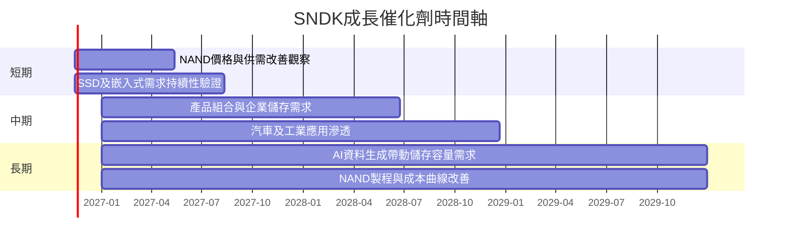

以上為產業催化劑觀察框架，不代表公司已公布具體量化指引或確切放量時間。

### 9.2 TAM 市場規模分析

財務包未提供可驗證 TAM、滲透率或各產品分部營收，以下不得以估計市場規模冒充公司數據。

```text
╔══════════════════════════════════════════════════════════════╗
║             市場機會與資料可得性                              ║
╠══════════════════════════════════════════════════════════════╣
║ PC／筆電 SSD TAM       N/A   滲透率 N/A   公司收入 N/A        ║
║ 行動／嵌入式儲存 TAM   N/A   滲透率 N/A   公司收入 N/A        ║
║ 汽車／工業／IoT TAM    N/A   滲透率 N/A   公司收入 N/A        ║
║ AI／企業儲存 TAM       N/A   滲透率 N/A   公司收入 N/A        ║
╠══════════════════════════════════════════════════════════════╣
║ 監控重點：後續年報分部營收、產品出貨量、ASP與客戶集中度。    ║
╚══════════════════════════════════════════════════════════════╝
```

### 9.3 成長驅動力結構圖

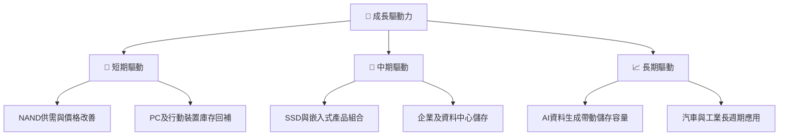

---

## 10. 風險矩陣

### 10.1 風險評分矩陣

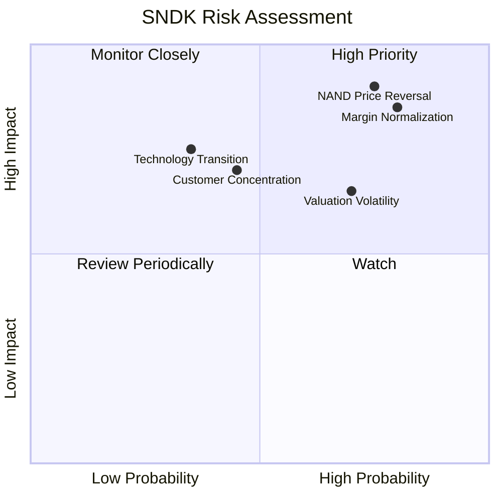

### 10.2 風險清單詳細分析

| # | 風險項目 | 發生機率 | 財務衝擊 | 風險評分 | 緩解措施 |
|---|----------|----------|----------|----------|----------|
| 1 | 🔴 NAND 供需反轉、價格下跌 | 高（估計 60%） | 高；毛利率與營業利益可能快速收縮 | 🔴 8.5/10 | 追蹤季度毛利率、存貨與 ASP；避免以峰值 EPS 估值 |
| 2 | 🔴 利潤率回歸週期中樞 | 高（估計 65%） | 高；TTM 營業利益率 72.5% 可能不可持續 | 🔴 8.0/10 | 以 30% 期末 EBIT margin 做基準 DCF，持續更新模型 |
| 3 | 🟠 客戶集中與議價壓力 | 中（估計 40%） | 中高；公司未提供客戶集中度，影響不可精確量化 | 🟠 6.5/10 | 監控前五大客戶占比、產品與客戶多元化 |
| 4 | 🟡 技術轉換與產品替代 | 中（估計 35%） | 高；技術落後可能造成份額與價格壓力 | 🟡 6.0/10 | 追蹤研發支出、製程進展與產品認證 |
| 5 | 🟡 高波動與估值回撤 | 高（估計 55%） | 高；股價曾由 2026-06 月收盤 $2,273.73 跌至 2026-11 $937.46 | 🔴 7.5/10 | 分批進場、設基本面監控門檻而非只看短線價格 |

---

## 11. 投資建議

### 11.1 最終綜合評級雷達圖

```text
╔══════════════════════════════════════════════════════════════╗
║                  SNDK 綜合評分雷達                           ║
╠══════════════════════════════════════════════════════════════╣
║ 基本面強度  7.0/10  ▓▓▓▓▓▓▓▓▓▓▓▓▓▓░░░░░░  ★★★★☆          ║
║ 成長動能    8.5/10  ▓▓▓▓▓▓▓▓▓▓▓▓▓▓▓▓▓░░░  ★★★★☆          ║
║ 獲利能力    8.5/10  ▓▓▓▓▓▓▓▓▓▓▓▓▓▓▓▓▓░░░  ★★★★☆          ║
║ 財務健康    8.0/10  ▓▓▓▓▓▓▓▓▓▓▓▓▓▓▓▓░░░░  ★★★★☆          ║
║ 估值合理性  5.0/10  ▓▓▓▓▓▓▓▓▓▓░░░░░░░░░░  ★★★☆☆          ║
║ 護城河深度  6.0/10  ▓▓▓▓▓▓▓▓▓▓▓▓░░░░░░░░  ★★★☆☆          ║
║ 綜合總分    6.6/10  ▓▓▓▓▓▓▓▓▓▓▓▓▓░░░░░░░  🟡 中高風險成長股║
╚══════════════════════════════════════════════════════════════╝
```

### 11.2 目標價與隱含報酬率

| 情境 | 目標價 | 相對 $937.46 | 機率權重 | 投資含義 |
|------|-------:|-------------:|---------:|----------|
| 🔴 悲觀 | $650 | -30.7% | 25% | NAND 報價與獲利快速正常化 |
| 🟡 基準 | $1,264.87 | +34.9% | 50% | 加權合理價值，MOS 25.9% |
| 🟢 樂觀 | $1,650 | +76.0% | 25% | 需求、價格與利潤率持續高於基準 |
| **加權合理價值** | **$1,264.87** | **+34.9%** | **100%** | 以第 8.8 節方法權重推導 |

> 第 8.8 節加權合理價值為估值方法權重加總，不等同第 11.2 情境目標價按情境機率加權；兩者用途不同。

### 11.3 買入時機與觸發因素

```text
╔══════════════════════════════════════════════════════════════════╗
║                  ✅ 買入觸發因素 Checklist                       ║
╠══════════════════════════════════════════════════════════════════╣
║ 立即買入觸發條件（需多數符合）：                                  ║
║ ✅ 股價低於加權合理價值 $1,264.87，且基本面未惡化                 ║
║ ✅ 最新季度營收年增維持正成長，且季增沒有明顯轉負                 ║
║ ✅ 營業利益率仍高於 30%模型長期基準                               ║
║ ✅ TTM FCF 維持正值，且現金與短期投資維持約 $5.14B                ║
║                                                                  ║
║ 加碼觸發條件：                                                    ║
║ ☐ NAND ASP／毛利率連續兩季改善，並由財報數據確認                  ║
║ ☐ FCF Yield 上升且不是單靠短期營運資金釋放                       ║
║ ☐ 股價回落至 $937.46 以下且公司前瞻指引未下修                     ║
║                                                                  ║
║ 減碼／退出觸發條件：                                              ║
║ ☐ 兩季營業利益率急跌，且同期存貨快速增加                          ║
║ ☐ FCF 轉負或公司下修需求與出貨展望                                ║
║ ☐ 股價高於樂觀情境 $1,650，但盈利與現金流未同步上修               ║
╚══════════════════════════════════════════════════════════════════╝
```

### 11.4 投資人適配度分析

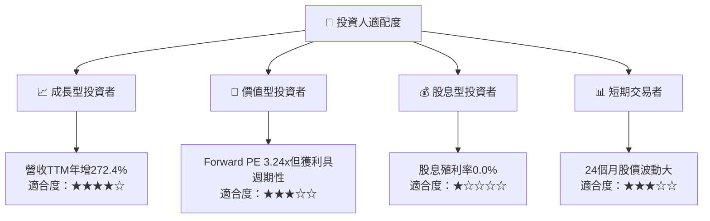

### 11.5 每季財報監控清單

| 追蹤指標 | 目前基準 | 加碼觀察門檻 | 減碼／重估門檻 |
|----------|----------|--------------|----------------|
| 單季營收 YoY | 最新季 +377.9% | 成長仍為正且季增不轉弱 | 連續兩季 YoY 低於 0% |
| TTM 營業利益率 | 72.5% VERIFIED | 維持高於 40%，且趨勢穩定 | 低於 30%或單季急降 |
| 最新季度營業利益率 | 79.6% VERIFIED | 高於 50%且未快速收縮 | 連續兩季低於 30% |
| TTM OCF | $17.55B | 現金流與淨利同步 | OCF 明顯低於淨利且存貨攀升 |
| TTM FCF | $17.36B | 正值且 FCF Yield 維持雙位數 | 轉負或資本支出快速上升而收入未增 |
| Capex | $181M TTM | 公司披露投資後回報可追蹤 | 投資上升但毛利與出貨未改善 |
| 現金與短期投資 | $5.14B | 維持流動性緩衝 | 現金快速下降且負債上升 |
| 庫存 | $3.016B | 庫存增速低於營收增速 | 庫存連續增加而收入放緩 |
| SBC | 最近四季 $270M | SBC／營收維持低於 1.5% | SBC／營收升至 2%以上或稀釋加速 |
| 管理層財測 | N/A | 營收與毛利指引穩定或上修 | 下修營收或毛利指引 |

### 11.6 反面論證：什麼會證明論點錯誤

```text
╔══════════════════════════════════════════════════════════════════╗
║              ⚠️ 論點失效條件（Disconfirming Evidence）           ║
╠══════════════════════════════════════════════════════════════════╣
║ 本投資論點在下列情況成立時應重新檢視或退出：                    ║
║ ☐ 單季營收 YoY 連續兩季低於 0%                                   ║
║ ☐ 營業利益率較最新季度 79.6% 收縮超過 30 個百分點，且仍續降     ║
║ ☐ TTM FCF 轉負，或營業現金流連續兩季弱於淨利                     ║
║ ☐ 存貨增速高於營收增速，且公司未能在一至兩季內消化               ║
║ ☐ ROIC 跌至假設 WACC 約 11.63% 以下                              ║
║ ☐ 公司下修營收或毛利展望，顯示價格／需求反轉                     ║
╚══════════════════════════════════════════════════════════════════╝
```

**最終判斷**：SNDK 的增長、現金流與當期資本回報數據非常亮眼，但它們與 NAND 產業景氣週期高度相關。以本報告加權估值 $1,264.87 計算，MOS 為 25.9%，依門檻原始評級為強烈買入；因 Beta、分部營收與週期中樞資料缺漏，將評級下調一級為**買入**。建議分批配置，優先追蹤營業利益率、庫存與 FCF，而非單獨依賴低 Forward P/E。

> **免責聲明**：本報告為 AI 自動生成，僅供研究參考，不構成投資建議。投資有風險，入市需謹慎。