# SNDK 基本面深度分析報告
> **報告日期**：2026-11-14 ｜ **語言**：繁體中文 ｜ **數據來源**：SEC 申報資料 (XBRL)、Yahoo Finance、Finviz、StockAnalysis、Roic.ai ｜ **分析師**：CFA 級機構研究

> **資料口徑提醒**：本報告優先引用 VERIFIED FIGURES 區塊。資料包內不同來源對營業利益率、總債務及股數存在差異；相互矛盾時，以 VERIFIED FIGURES 為主，其他來源只作交叉參考並標示。資料包提供的最新收盤價為 **2026-11-13 的 $885.01**，不是 2026-11-14 收盤價。DCF 中缺少的預測輸入均明確列為假設值，不視為公司財測。

---

## 目錄

| # | 章節 | 核心結論 |
|---|------|----------|
| 1 | 執行摘要 | 買入；加權合理價值約 $1,177；MOS 約 24.8% |
| 2 | 公司概覽與商業模式 | NAND 儲存產品需求高彈性，護城河中等、產業週期風險高 |
| 3 | 損益表深度分析 | TTM 營收 $28.97B、TTM 成長 272.4%；獲利處於週期高峰 |
| 4 | 資產負債表分析 | VERIFIED 淨現金 $5.14B；流動性充足，債務口徑需審慎 |
| 5 | 現金流量深度分析 | TTM FCF $17.36B、FCF Yield 13.79%；現金轉換良好但高度週期化 |
| 6 | 獲利能力與資本效率 | ROIC 141.2% 高於估計 WACC 11.18%，但極高值可能含週期與分母效應 |
| 7 | 相對估值分析 | P/S 接近五年中位數；同業倍數顯示股價已反映大幅獲利改善 |
| 8 | DCF 內在價值評估 | 基準 DCF 約 $888；終值敏感，三角驗證加權價值約 $1,177 |
| 9 | 成長催化劑 | NAND 價格、企業級 SSD 與高容量儲存需求是主要觀察變數 |
| 10 | 風險矩陣 | NAND 供需反轉、利潤率回落及估值波動為前三大風險 |
| 11 | 投資建議 | 買入評級；分批佈局並以營業利益率、FCF 和價格紀律監控 |

---

## 1. 執行摘要

### 1.0 一頁式投資儀表板

| 項目 | 內容 |
|------|------|
| **投資論點（3 句）** | ① TTM 營收 **$28.97B**、TTM 成長 **272.4%**，但主要反映 NAND 從低谷復甦及價格／產品組合改善，不能直接外推。② TTM FCF **$17.36B**、FCF Yield **13.79%**，現金創造能力已顯著改善。③ 基準 DCF 約 **$888**，低於 2026-11-13 收盤價 **$885.01** 僅約 0.4% 折價；三角驗證加權合理價值約 **$1,177**，加權 MOS 約 **24.8%**。 |
| **護城河評分** | **5.8/10**；製程、供應鏈與客戶認證有價值，但 NAND 是高度週期化、價格競爭強的商品市場。 |
| **管理層／資本配置評分** | **6.0/10**；財務復甦與現金累積可量化，惟可供評估的長期獨立公司資本配置紀錄有限。 |
| **財務健康** | 🟢 VERIFIED 淨現金 **$5.14B**；總債務欄為 N/A，不以其他來源覆蓋該欄。 |
| **ROIC vs WACC** | **141.2% vs 11.18%（估計）**；表面上創造價值，ROIC 的異常高水準需考慮週期高峰與投入資本分母。 |
| **FCF 趨勢** | FY2023–FY2026 由 **-$0.932B** 改善至 **$11.49B**；TTM FCF **$17.36B**，TTM FCF Yield **13.79%**。 |
| **估值** | Forward P/E **3.06x** ｜ EV/EBITDA **5.70x** ｜ FCF Yield **13.79%**；低倍數建立在週期高峰盈利之上。 |
| **DCF 內在價值（基準）** | 約 **$888.17**；現價相對 DCF 基準內在價值折價約 **0.4%**。 |
| **安全邊際（MOS）** | **+24.8%＝($1,177.34 − $885.01) ÷ $1,177.34**；以 8.8 加權合理價值為基準，🟡接近充足但未達 25%。 |
| **預期報酬（基準情境 12M）** | 以加權合理價值作參考，上行空間約 **+33.0%**；此為估值參考，不是保證報酬。 |
| **關鍵風險（前二）** | NAND 價格與供需週期反轉；營業利潤率由峰值快速收縮。 |
| **評級 + 信心度** | 🟢 **買入** ｜ 信心：中低；評級依 MOS 門檻，受週期性與資料口徑不確定性折減信心。 |

> **評級推導**：8.8 加權 MOS 約 24.8%，依評級門檻屬「買入」（10%–25%）；ROIC 141.2% 高於估計 WACC 11.18%。因此不需用質化調整改變評級，但由於 NAND 循環、ROIC 高峰值與模型輸入不確定，信心度定為中低。

### 1.1 核心評分儀表板

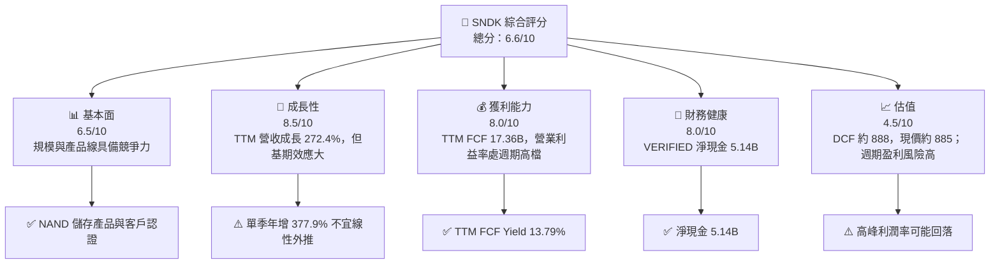

### 1.2 評分進度條視覺化

```text
╔══════════════════════════════════════════════════════════════╗
║              SNDK 多維度評分儀表板 (1-10分)                 ║
╠══════════════════════════════════════════════════════════════╣
║ 基本面強度  6.5 ▓▓▓▓▓▓▓▓▓▓▓▓▓░░░░░░░  ★★★☆☆             ║
║ 成長動能    8.5 ▓▓▓▓▓▓▓▓▓▓▓▓▓▓▓▓▓░░░  ★★★★☆             ║
║ 獲利品質    7.0 ▓▓▓▓▓▓▓▓▓▓▓▓▓▓░░░░░░  ★★★★☆             ║
║ 財務健康    8.0 ▓▓▓▓▓▓▓▓▓▓▓▓▓▓▓▓░░░░  ★★★★☆             ║
║ 估值合理性  4.5 ▓▓▓▓▓▓▓▓▓░░░░░░░░░░░░  ★★☆☆☆             ║
║ 護城河深度  5.8 ▓▓▓▓▓▓▓▓▓▓▓▓░░░░░░░░  ★★★☆☆             ║
║ 管理層執行  6.0 ▓▓▓▓▓▓▓▓▓▓▓▓░░░░░░░░  ★★★☆☆             ║
║ 技術創新力  6.5 ▓▓▓▓▓▓▓▓▓▓▓▓▓░░░░░░░  ★★★☆☆             ║
╠══════════════════════════════════════════════════════════════╣
║ 綜合總分    6.6 ▓▓▓▓▓▓▓▓▓▓▓▓▓░░░░░░░  🟡 週期復甦型       ║
╚══════════════════════════════════════════════════════════════╝
```

### 1.3 五大投資論點 + 三大核心風險

| 類型 | 項目 | 具體依據 | 信心度 |
|------|------|----------|--------|
| 🟢 **投資論點①** | 業績動能強 | TTM 營收 **$28.97B**，TTM YoY **272.4%**；代表需求與定價相對過去低谷顯著改善，但年增率含低基期因素。 | 🟡 中 |
| 🟢 **投資論點②** | 現金流回升 | TTM OCF **$17.55B**、Capex **$181M**、FCF **$17.36B**；現金流轉換提供去槓桿與投資彈性。 | 🟢 高 |
| 🟢 **投資論點③** | 淨現金緩衝 | VERIFIED 淨現金 **$5.14B**；有助於穿越下行週期，但總債務數值仍為 N/A。 | 🟢 高 |
| 🟢 **投資論點④** | 企業儲存需求具長期支撐 | SSD、資料中心與高容量儲存可提供需求增量；資料包未提供各產品營收拆分，因此不能量化其目前貢獻。 | 🟡 中 |
| 🟢 **投資論點⑤** | ROIC 高於資本成本估計 | VERIFIED ROIC **141.2%**，本報告估計 WACC **11.18%**；若 ROIC 回落仍高於 WACC，才代表可持續創造價值。 | 🟡 中 |
| 🟡 **風險①** | NAND 價格循環反轉 | TTM 營業利益率 **72.5%** 遠高於 FY2025 的約 **6.9%**；回到常態利潤率會使盈餘與估值快速下修。 | 🔴 高衝擊 |
| 🔴 **風險②** | 極端獲利數據及週期高峰估值錯覺 | Forward P/E **3.06x** 依賴 EPS Forward **$289.05**；若 EPS 下修，低倍數可能是假象。 | 🔴 高 |
| 🟡 **風險③** | 數據來源口徑不一致 | VERIFIED 最新季度營業利益率 **79.6%**，其他合併來源有 **72.7%**；估值應用一致口徑並降低信心度。 | 🟡 中 |

### 1.4 快速統計卡片

| 指標 | 公司實際值 | 行業均值 | S&P 500 均值 | 狀態 |
|------|-------------|----------|--------------|------|
| TTM 收入成長 | **272.4%** | N/A | N/A | 🟢 但基期效應大 |
| 最新單季 YoY 收入成長 | **377.9%** | N/A | N/A | 🟢 高增長、波動大 |
| TTM 毛利率 | **80.0%** | N/A | N/A | 🟢 週期高檔 |
| TTM 淨利率 | **67.0%** | N/A | N/A | 🟢 需留意可持續性 |
| ROE | **107.1%**（VERIFIED） | N/A | N/A | 🟢 分母與週期效應可能放大 |
| Forward P/E | **3.06x** | N/A | N/A | 🟡 盈利預測敏感 |
| TTM FCF Yield | **13.79%** | N/A | N/A | 🟢 現金流佳、但週期性高 |
| 淨現金 | **$5.14B** | N/A | N/A | 🟢 |

> 行業與 S&P 500 的同口徑比較數據未提供，故列 N/A，不以臆測數字填補。

### 1.5 投資結論

```text
╔══════════════════════════════════════════════════════════════════╗
║                    📊 投資結論摘要                              ║
╠══════════════════════════════════════════════════════════════════╣
║  評級：買入（MOS 約 24.8%，ROIC 高於估計 WACC）                 ║
║  價格（2026-11-13 收盤）：$885.01                               ║
║  DCF 內在價值（基準）：約 $888.17（折價約 0.4%）                ║
║  安全邊際 MOS：約 +24.8%（分母為加權合理價值）                  ║
║  目標價區間：                                                    ║
║    悲觀情境：$867（約 -2.0%）                                   ║
║    基準情境：$1,156（約 +30.6%） ← 12 個月參考                 ║
║    樂觀情境：$1,734（約 +96.0%）                                ║
║  投資評分：6.6/10                                                ║
║  適合投資人：能承受半導體記憶體週期與高波動的成長型投資人       ║
╚══════════════════════════════════════════════════════════════════╝
```

---

## 2. 公司概覽與商業模式

### 2.1 業務結構與收入來源

Sandisk 開發、製造及銷售 NAND 快閃儲存產品，涵蓋 SSD 與嵌入式快閃儲存等用途。資料包只提供公司整體營收，沒有部門收入拆分，因此下圖不虛構產品占比。

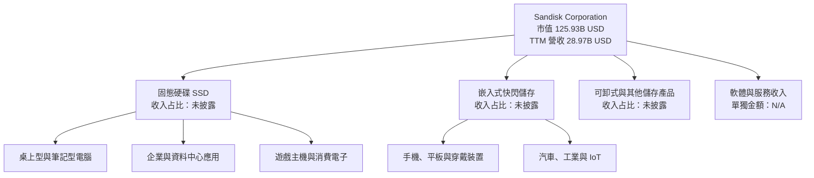

### 2.2 市場份額

提供資料沒有 NAND／SSD 市場份額數字，也沒有可核實的公司排名，因此不能把特定百分比套入市場份額圖。

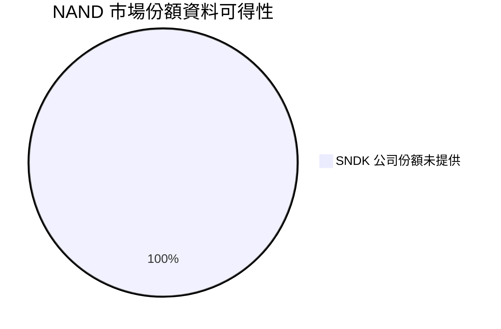

此圖表示**市場份額數據缺失**，不是 Sandisk 擁有 100% 市場份額。可確定的只有 SNDK、MU、WDC 及 SK hynix 是儲存或記憶體相關競爭者；各公司產品範圍與財報幣別不完全一致，不能據此推算份額。

### 2.3 競爭護城河分析

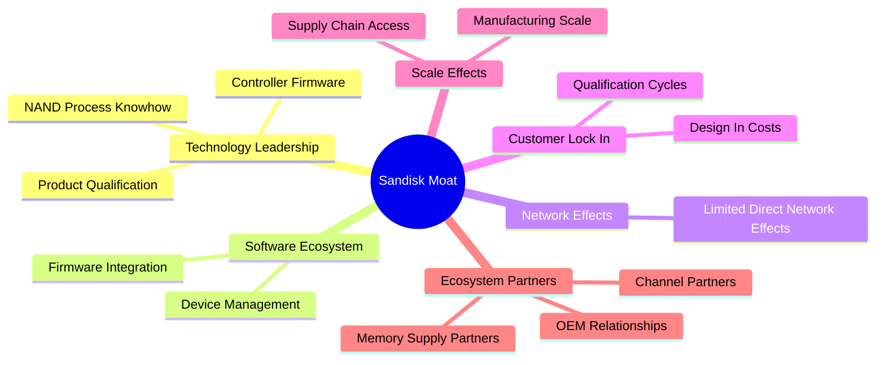

### 2.4 護城河強度評分

```text
╔══════════════════════════════════════════════════════════════╗
║                  Sandisk 護城河強度評分                      ║
╠══════════════════════════════════════════════════════════════╣
║ 技術與製程     6.5/10 ▓▓▓▓▓▓▓▓▓▓▓▓▓░░░░░░░  🟡 有工程門檻 ║
║ 客戶認證       6.0/10 ▓▓▓▓▓▓▓▓▓▓▓▓░░░░░░░░  🟡 有轉換成本 ║
║ 品牌與通路     5.5/10 ▓▓▓▓▓▓▓▓▓▓▓░░░░░░░░░  🟡 有消費品牌 ║
║ 軟體生態       4.0/10 ▓▓▓▓▓▓▓▓░░░░░░░░░░░░  🔴 非主要壁壘 ║
║ 網路效應       2.0/10 ▓▓▓▓░░░░░░░░░░░░░░░░  🔴 很有限     ║
║ 規模與供應鏈   6.5/10 ▓▓▓▓▓▓▓▓▓▓▓▓▓░░░░░░░  🟡 有規模優勢 ║
╠══════════════════════════════════════════════════════════════╣
║ 綜合護城河     5.8/10 ▓▓▓▓▓▓▓▓▓▓▓▓░░░░░░░░  🟡 中等且週期性 ║
╚══════════════════════════════════════════════════════════════╝
```

核心限制是 NAND 產品差異化無法完全抵銷供需與價格週期。護城河可支撐客戶認證、品質與產品組合，但不能保證景氣下行時維持高毛利。

---

## 3. 損益表深度分析

### 3.1 年度收入成長趨勢（近 4 年）

```text
╔══════════════════════════════════════════════════════════════════╗
║              Sandisk 年度收入趨勢（FY2023-FY2026）              ║
╠══════════════════════════════════════════════════════════════════╣
║ FY2023  $6.09B   ██████░░░░░░░░░░░░░░░░░░  YoY：—              ║
║ FY2024  $6.66B   ███████░░░░░░░░░░░░░░░░░  YoY：+9.5%          ║
║ FY2025  $7.36B   ███████░░░░░░░░░░░░░░░░░  YoY：+10.4%         ║
║ FY2026  $20.25B  ████████████████████░░░░  YoY：+175.3%        ║
╠══════════════════════════════════════════════════════════════════╣
║ FY2023-FY2026 三年 CAGR：約 +49.3%                               ║
╚══════════════════════════════════════════════════════════════════╝
```

FY2026 的收入跳升並非穩態增長率；TTM 營收 **$28.97B**、TTM 成長率 **272.4%**，與最新單季 YoY **377.9%** 均顯示需求與價格週期大幅反彈。用這些增速預測多年成長會高估價值，因此 DCF 將長期營收 CAGR 下調至 8%。

### 3.2 季度收入趨勢分析

以下 QoQ 由資料包季度營收計算；最新單季 YoY 使用 VERIFIED FIGURES 的 **377.9%**。其他季度 YoY 參考 StockAnalysis 季度資料。

| 季度 | 營收 | QoQ | YoY | 備註 |
|------|------:|----:|----:|------|
| 2025-12-31 | $3.025B | — | +61.25%（FY2026 Q2 對應資料） | 復甦加速 |
| 2026-03-31 | $5.950B | **+96.7%** | +251.03% | 營收快速放大，價格／出貨組合改善可能共同作用 |
| 2026-06-30 | $8.965B | **+50.7%** | +371.59% | 延續上升，基期效應亦擴大 |
| 2026-09-30／FY2027 Q1 | $11.031B | **+23.0%** | **+377.9%** | YoY 為 VERIFIED 單季成長率，不是 TTM |

QoQ 仍為正但增幅從 96.7% 降至 23.0%，可能表示反彈仍在延續、但收入增速已從急升轉為較慢擴張；後續應追蹤售價、位元出貨與庫存，而非只看營收年增。

### 3.3 利潤率演變分析

| 利潤率指標 | FY2023 | FY2024 | FY2025 | FY2026 | 趨勢 | 評估 |
|------------|-------:|-------:|-------:|-------:|------|------|
| **毛利率** | 7.1% | 16.1% | 30.1% | 71.5% | 隨週期反彈快速擴張 | 🟡 高檔不可直接外推 |
| **營業利益率** | -21.3% | -6.7% | 6.9% | 61.6% | 扭虧並進入高峰區 | 🔴 可持續性待驗證 |
| **淨利率** | -35.2% | -10.1% | -22.3% | 56.5% | FY2026 大幅轉正 | 🟡 稅項及週期影響需追蹤 |

FY2026 毛利率計算為 $14.47B ÷ $20.25B ≈ 71.5%；營業利益率為 $12.47B ÷ $20.25B ≈ 61.6%。VERIFIED TTM 營業利益率為 **72.5%**，與年度比率不同，反映期間不同。利潤改善可能與 NAND 報價回升、產品組合及固定成本吸收有關；資料未提供 ASP、位元出貨及單位成本拆分，不能把改善精確分解為各因素貢獻。

### 3.4 費用結構分析

FY2026 已提供項目：營收 $20.25B、毛利 $14.47B、營業利益 $12.47B、研發費用 $1.33B。下列圖僅呈現已知金額占營收，不代表所有 GAAP 費用分類；未提供的銷售管理費、利息等不反推。

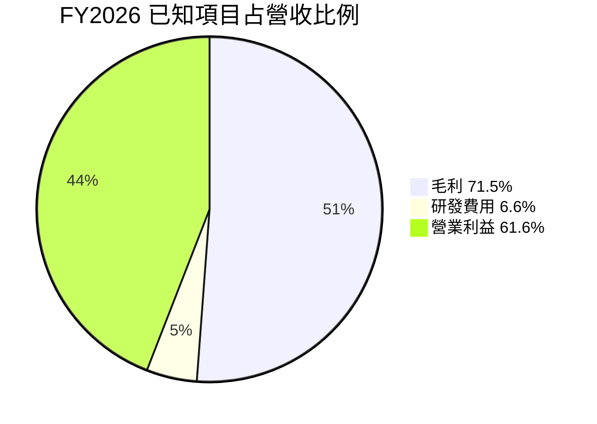

因毛利、研發費用與營業利益是不同層次、存在包含關係，以上不是互斥的會計費用分布，不能加總解讀。

```text
╔══════════════════════════════════════════════════════════════╗
║ FY2026 關鍵營收與成本觀察                                    ║
╠══════════════════════════════════════════════════════════════╣
║ 營收          $20.25B  ████████████████████                 ║
║ 毛利          $14.47B  ██████████████░░░░░░                 ║
║ 研發費用       $1.33B  ██░░░░░░░░░░░░░░░░░░                 ║
║ 營業利益      $12.47B  ████████████░░░░░░░░                 ║
╚══════════════════════════════════════════════════════════════╝
```

### 3.5 季度 EPS 趨勢與盈餘品質（Quality of Earnings）

| 季度 | EPS 實際值 | EPS YoY | 預估／驚喜幅度 | 解讀 |
|------|-----------:|--------:|---------------:|------|
| 2025-12-31 | $5.15 | +618.03%（來源資料） | N/A | EPS 大幅從低谷回升 |
| 2026-03-31 | $23.03 | N/A | N/A | 盈利隨營收擴張 |
| 2026-06-30 | $43.96（季度表） | N/A | N/A | 股份數／來源口徑可能影響與 Roic.ai 數值比較 |
| 2026-09-30 | $52.60 | **+6913.3%**（來源資料） | N/A | EPS 估計值與實際值均為 nan，無法判斷 beat/miss |

EPS 歷史表四季估計值均為 nan，故**不能宣稱過去四季均超預期或不及預期**。年增率在低基期下尤其容易失真。

| 盈餘品質項目 | 數值／佔比 | 評估 |
|--------------|------------|------|
| 股權薪酬 SBC / 營收 | FY2026：$232M ÷ $20.248B＝**1.15%** | 🟢 占比低；但仍稀釋股東權益 |
| SBC / 營業現金流 | FY2026：$232M ÷ $11.67B＝**1.99%** | 🟢 相對可控 |
| 最新四季 SBC / TTM 營收 | ($91M+$67M+$54M+$58M) ÷ $28.97B＝**0.93%** | 🟢 金額較低，但資料期間對齊可能有差 |
| FCF / 淨利 | StockAnalysis TTM 淨利 $19.422B：$17.36B ÷ $19.422B＝**89.4%** | 🟢 現金轉換良好，使用不同供應商的 TTM 淨利 |
| 一次性／非經常性損益 | N/A | 🟡 缺少完整附註，無法量化重組、稅項或其他一次性項目 |
| 有效稅率 | **12.2%**（VERIFIED 最新年有效稅率） | 🟢 接近提供資料，但不代表未來稅率恆定 |
| 資本化支出 vs 費用化 | TTM Capex **$181M**；資本化研發／其他支出拆分 N/A | 🟡 Capex 相對營收極低，需核對合資／供應鏈資本負擔與現金流分類 |

**盈餘品質結論**：TTM FCF 接近淨利，SBC 占比低，支持現金獲利有一定含金量；但低 Capex/營收、極高營業利潤率與週期反彈並存，現金流可能處於高景氣階段。估值不應將目前淨利率永久化。

---

## 4. 資產負債表分析

### 4.1 資產結構分解

依 StockAnalysis TTM 資產資料，總資產 **$25.793B**；現金與短期投資 **$5.206B**。資料包不同來源的總資產／流動資產口徑不完全一致，下圖採同一張 StockAnalysis 表。

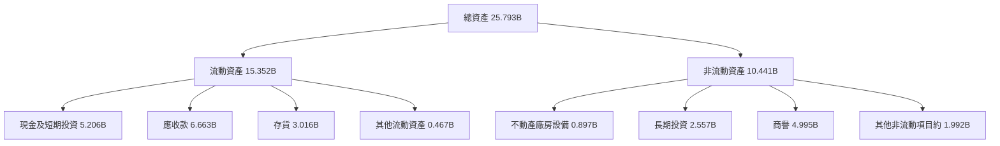

### 4.2 流動性指標分析

| 指標 | 最新值 | 歷史／交叉資料 | 行業均值 | 評估 |
|------|------:|-----------------|--------|------|
| 流動比率 | **2.58**（合併市場資料） | StockAnalysis TTM 資產與負債口徑不同，未重算 | N/A | 🟢 短期償付緩衝充足 |
| 速動比率 | **1.994** | 歷史同口徑 N/A | N/A | 🟢 即使扣除存貨仍有緩衝 |
| 現金＋短期投資 | **$5.14B**（VERIFIED） | StockAnalysis $5.206B | N/A | 🟢 引用 VERIFIED 值 |
| 淨現金 | **$5.14B**（VERIFIED） | 合併市場資料另列 $5.01B | N/A | 🟢 依 VERIFIED；口徑差異需留意 |

### 4.3 債務結構分析

VERIFIED FIGURES 的 **Total debt = N/A**，不得反推或改寫成已驗證數字。其他合併來源列總債務 $201M；FY2026 年報表列 $177M，但這些不是 VERIFIED 值。故下列 leverage 倍數與利息保障倍數均不計算。

```text
╔══════════════════════════════════════════════════════════════════╗
║                   Sandisk 債務健康診斷                          ║
╠══════════════════════════════════════════════════════════════════╣
║  總債務：        N/A（VERIFIED 未提供）                         ║
║  其他來源債務：  $201M（交叉資料，非 VERIFIED）                 ║
║  現金+短期投資： $5.14B（VERIFIED）                              ║
║  淨現金：        $5.14B（VERIFIED）                              ║
║  Debt/EBITDA：   N/A（總債務口徑未確認）                        ║
║  Interest Coverage：N/A（利息費用及同口徑債務資料不足）         ║
║  財務判斷：      🟢 淨現金緩衝強；避免把 N/A 視為零債務          ║
╚══════════════════════════════════════════════════════════════════╝
```

### 4.4 股東權益趨勢

| 財年 | 股東權益 | YoY 變化 | 說明 |
|------|---------:|---------:|------|
| FY2024 | $11.08B | — | 仍處獲利谷底後調整 |
| FY2025 | $9.22B | **-16.8%** | 淨虧損與權益變動壓低帳面值 |
| FY2026 | $15.74B | **+70.7%** | 盈利轉正推升權益 |

```text
╔══════════════════════════════════════════════════════════════╗
║ 股東權益趨勢                                                ║
╠══════════════════════════════════════════════════════════════╣
║ FY2024  $11.08B  ██████████████░░░░░░                     ║
║ FY2025   $9.22B  ████████████░░░░░░░░                     ║
║ FY2026  $15.74B  ████████████████████                     ║
╚══════════════════════════════════════════════════════════════╝
```

---

## 5. 現金流量深度分析

### 5.1 現金流量瀑布圖

未提供股息與回購的 TTM 金額，故不能把 FCF 強行分配至股東回報。

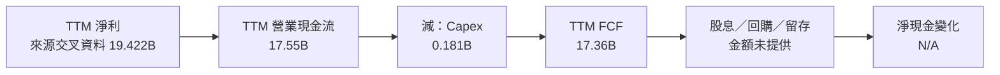

### 5.2 FCF 轉換率趨勢

| 財年 | OCF | Capex | FCF | 淨利 | FCF / 淨利 |
|------|----:|------:|----:|-----:|-----------:|
| FY2023 | -$0.713B | $0.219B | -$0.932B | -$2.143B | 不具解讀意義 |
| FY2024 | -$0.309B | $0.166B | -$0.475B | -$0.672B | 不具解讀意義 |
| FY2025 | $0.084B | $0.204B | -$0.120B | -$1.641B | 不具解讀意義 |
| FY2026 | $11.67B | $0.177B | $11.49B | $11.43B | **100.5%** |
| TTM | $17.55B | $0.181B | $17.36B | $19.422B* | **89.4%*** |

\* TTM 淨利來自 StockAnalysis 交叉資料，與 VERIFIED 現金流期間未必完全一致。FY2026 FCF 與淨利相近，顯示盈利轉現能力佳；但獲利週期位置可能使該轉換率暫時偏高。

### 5.3 自由現金流趨勢

```text
╔══════════════════════════════════════════════════════════════════╗
║             自由現金流：歷史實際與 TTM                          ║
╠══════════════════════════════════════════════════════════════════╣
║ FY2023  -$0.932B  ◀░░░░░░░░░░░░░░░░░░░░  OCF 為負             ║
║ FY2024  -$0.475B  ◀░░░░░░░░░░░░░░░░░░░░  仍為負               ║
║ FY2025  -$0.120B  ◀░░░░░░░░░░░░░░░░░░░░  接近損益兩平         ║
║ FY2026  $11.49B   █████████████░░░░░░░  FCF Yield：N/A         ║
║ TTM     $17.36B   ████████████████████  FCF Yield：13.79%      ║
╠══════════════════════════════════════════════════════════════════╣
║ ⚠️ 轉正幅度大，未來需以正常化利潤率而非高峰數據評估             ║
╚══════════════════════════════════════════════════════════════════╝
```

### 5.4 資本配置評估

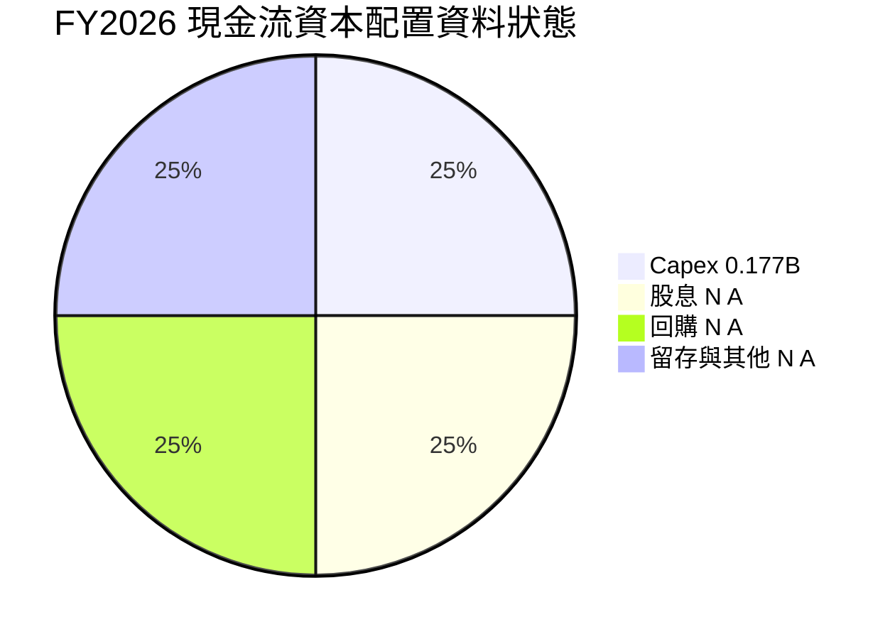

此圖僅表達項目資料狀態，不代表各項比例。FY2026 Capex 為 **$177M**，TTM 為 **$181M**；股息殖利率與 payout ratio 為 0%，回購／投資淨額未提供。

| 配置項目 | 已知資料 | 評估 |
|----------|----------|------|
| Capex | FY2026 $177M；TTM $181M | 🟡 需核對供應鏈／合作製造安排是否令本體 Capex 偏低 |
| 股息 | 殖利率 0%；payout 0% | 🟡 目前沒有現金股息 |
| 股票回購 | N/A | 🟡 不推測 |
| 現金留存 | VERIFIED 現金及短期投資 $5.14B | 🟢 增加週期防禦能力 |
| 研發 | FY2026 $1.33B | 🟢 維持產品與製程競爭力 |

---

## 6. 獲利能力與資本效率

### 6.1 ROE / ROA / ROIC 趨勢

| 指標 | 最新值 | 歷史參考 | 評估 |
|------|------:|----------|------|
| ROE | **107.1%**（VERIFIED） | 合併資料另列 141.2%，來源口徑不同 | 🟡 極高數值可能反映週期峰值與權益分母 |
| ROA | **68.3%**（交叉資料） | 歷史同口徑 N/A | 🟡 高，但需核對期間 |
| ROIC | **141.2%**（VERIFIED） | 歷史資料存在不同定義 | 🟡 不能直接視為可持續常態 |

ROE 在 VERIFIED 為 107.1%，其他合併區塊為 141.2%；依要求不互相替換，且不將其作為同一口徑趨勢。

### 6.2 ROIC vs WACC 分析（核心價值創造判斷）

WACC 缺少 VERIFIED Beta 及權重，本報告採明確假設估計，與 DCF 一致。債務成本沿用參考值但對權重影響極小。

```text
╔══════════════════════════════════════════════════════════════════╗
║                ROIC vs WACC 深度分析                            ║
╠══════════════════════════════════════════════════════════════════╣
║  WACC 估算：                                                     ║
║  ├── 無風險利率 Rf：             5.15%（VERIFIED）              ║
║  ├── ERP：                       5.00%（VERIFIED 假設）         ║
║  ├── Beta：                      1.20（假設值，無 VERIFIED 值） ║
║  ├── 股權成本 Ke：               5.15% + 1.20×5.00% = 11.15%   ║
║  ├── 債務稅後成本：              31.93%（參考 Kd 與 12.2% 稅率）║
║  ├── 股權／債務權重：            99.84%／0.16%*                 ║
║  └── ✅ WACC：                   約 11.18%（假設估計）          ║
║                                                                  ║
║  ROIC（TTM，VERIFIED）：           141.2%                        ║
║  EVA spread = ROIC − WACC：        約 +130.0 個百分點            ║
║                                                                  ║
║  ROIC 141.2% ▓▓▓▓▓▓▓▓▓▓▓▓▓▓▓▓▓▓▓▓▓▓▓▓▓▓▓▓░░  🟢           ║
║  WACC  11.18% ▓▓░░░░░░░░░░░░░░░░░░░░░░░░░░░░  ──             ║
║  判斷：目前數據顯示創造價值；但 ROIC 很可能含高峰盈利與分母效應 ║
╚══════════════════════════════════════════════════════════════════╝
```

\* 權重估算使用市值 $125.93B、交叉來源債務 $0.201B。VERIFIED 總債務為 N/A，故本節不是官方 WACC；本模型以假設 Beta 1.20 的 CAPM 為主。具體推導見 8.2。

**判斷**：按公布的 TTM ROIC，ROIC 顯著高於估計 WACC，經濟上屬價值創造。但若 NAND 正常化後 ROIC 大幅下滑，或 Beta／資本成本假設失真，該結論會弱化。不能用當期 141.2% 推論永續超額報酬。

### 6.3 杜邦三因素分解

以 ROE 107.1%（VERIFIED）與交叉來源 TTM 淨利率 67.0% 作觀察性拆解：

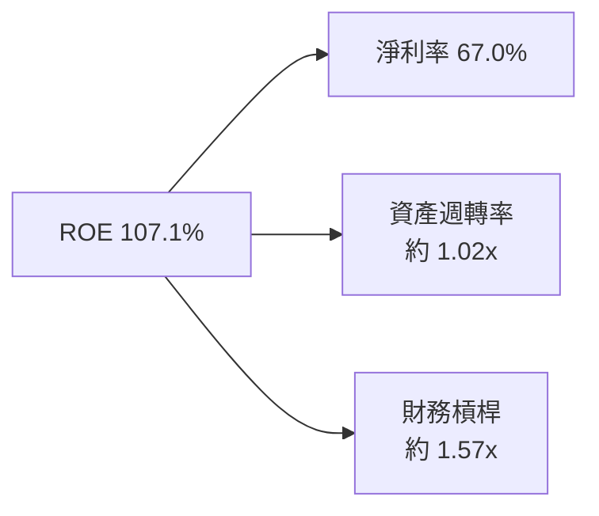

驗算使用交叉資料：TTM 營收 $28.97B、TTM 總資產約 $25.793B，資產週轉率約 $28.97B ÷ $25.793B = **1.12x**；平均資產缺失，若以期末資產作分母，則杜邦三因子不能精確與 ROE 對齊。因此圖中的資產週轉率與槓桿只作示意，不應視為可稽核的精確杜邦恆等式。嚴格缺少平均資產、平均權益及期間一致數據，故不以錯誤精確度填表。

### 6.4 獲利能力儀表板

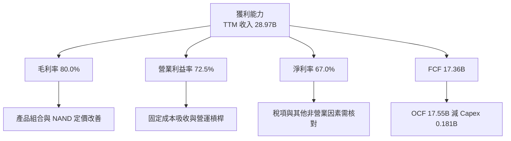

---

## 7. 相對估值分析

### 7.1 同業估值比較

同業倍數依 VERIFIED FIGURES 的 Peer multiples。Sandisk 本身估值取資料包市場估值欄。

| 估值指標 | **SNDK** | **WDC** | **MU** | **SK hynix** | SNDK 評估 |
|----------|---------:|-------:|------:|-------------:|-----------|
| **Trailing P/E** | 7.07x | 10.4x | 10.5x | 8.4x | 🟢 表面折價；SNDK 盈利可能在週期高峰 |
| **Forward P/E** | 3.06x | 7.3x | 3.7x | 3.2x | 🟡 接近記憶體同業低位，依賴預測盈利 |
| **P/S** | 4.35x（VERIFIED 五年估值表現為 4.7x，來源口徑不同） | 7.6x | 6.6x | N/A（混合幣別） | 🟢 相對同業低，但不可忽略獲利週期 |
| **EV/EBITDA** | 5.70x | 17.5x | 7.7x | N/A | 🟢 顯著較低，可能反映週期高峰 EBITDA |
| **最新季度收入 YoY** | 377.9% | 55.5% | 379.3% | 327.9% | 🟢 高增長，但基期差異大 |
| **TTM 毛利率** | 80.0% | 52.6% | 80.7% | 77.4% | 🟢 接近 MU、SK hynix；需持續觀察 |

SNDK P/S 有 4.35x 與 VERIFIED 歷史比較表 4.7x 的來源差異；歷史估值章節依 VERIFIED 的 **4.7x**。同業倍數不代表公司風險相同，尤其 WDC 的業務結構與記憶體晶片廠不同。

### 7.2 歷史估值區間分析

VERIFIED 歷史估值提供 P/S，而不是 P/E；故不以資料不足的 P/E 百分位代替。

```text
╔══════════════════════════════════════════════════════════════════╗
║             SNDK 五年歷史估值位置：P/S                         ║
╠══════════════════════════════════════════════════════════════════╣
║ 五年區間：0.9x ├──────────────────────────────┤ 13.4x          ║
║ 五年中位數：4.8x                                                ║
║ 目前：4.7x         ██████████░░░░░░░░░░  百分位排名 43%       ║
║ 結論：目前略低於中位數，仍在自身五年區間中段附近               ║
╚══════════════════════════════════════════════════════════════════╝
```

### 7.3 情境目標價（假設驅動，Bear / Base / Bull）

以下 12 個月情境使用公司提供的 Forward EPS **$289.05396** 作基數，採 forward P/E。估值倍數為分析假設，參照同業 Forward P/E 範圍 **3.2x–7.3x**，不是財測。

| 情境 | 營收 CAGR 假設 | 正常化營業利益率假設 | 退出 Forward P/E | 隱含目標價 | 相對現價 |
|------|--------------:|-------------------:|----------------:|-----------:|---------:|
| 🔴 悲觀 | 0%–5% | 25% | 3.0x | **$867** | **-2.0%** |
| 🟡 基準 | 約 8% | 30% | 4.0x | **$1,156** | **+30.6%** |
| 🟢 樂觀 | 約 15% | 40% | 6.0x | **$1,734** | **+96.0%** |

計算方式：目標價＝EPS Forward $289.05396 × 退出 P/E。基準情境 4.0x 高於 MU、SK hynix 的約 3.2x–3.7x，反映 SNDK 的增長假設；若盈利週期轉弱，該倍數未必維持。

> 本公司折舊及資本配置資料不完整，且記憶體獲利週期性強；因此本節保留 P/E 情境作市場可比參考，DCF 另以 FCFF／EV 作交叉估值。不同方法結果差距大，應以估值區間而非單一倍數決策。

### 7.4 相對估值隱含價格區間

| 方法 | 回推方式 | 隱含價格 | 相對現價 |
|------|----------|---------:|---------:|
| Forward P/E | EPS $289.05396 × 同業 Forward P/E 中位數 3.7x | **$1,069.50** | +20.8% |
| EV/EBITDA | EBITDA＝$28.97B × 73.2%＝$21.21B；乘 MU 7.7x，再加淨現金並除 142.29M 股 | **約 $1,184** | 約 +33.8% |
| EV/Sales | SNDK TTM EV/Revenue 4.174x；同業多重結構差異大 | N/A | N/A |
| FCF Yield | 假設正常化要求報酬率／FCF yield 8%：$17.36B ÷ 8% ÷ 142.29M | **約 $1,526** | 約 +72.4% |

8% FCF yield 是估值假設，不是市場觀測或同業 VERIFIED 數字；目前高峰 FCF 若回落，此方法會高估合理價值。

---

## 8. DCF 內在價值評估（Discounted Cash Flow）

### 8.0 估值推理鏈（Thinking Logic）

**Step 1 — 價值來源與主導變數**

SNDK 價值可拆為：① 現有 NAND／SSD 業務現金流底盤，占目前營收最大部分但產品拆分未披露；② 企業與資料中心儲存需求增量，營收占比 N/A；③ 高容量／嵌入式儲存選擇權，營收占比 N/A。當前最主導估值的變數是**正常化營業利潤率**：現有 VERIFIED TTM 營業利益率 72.5%，若回到 30% 左右，對 FCFF 的影響遠大於 8% 的營收增長。

| 決策點 | 本報告採用 | 理由（含數字） | 曾考慮但否決 | 否決理由 |
|--------|-----------|----------------|--------------|----------|
| 現金流定義 | FCFF | 與 WACC 折現、推導 EV；TTM OCF $17.55B、Capex $0.181B | FCFE | 資本結構與債務 VERIFIED 值不足 |
| 預測期 N | 5 年 | NAND 週期高度變動；5 年可觀察但不足以假定永久高增長 | 10 年 | 長期產品組合與產業價格不可見度不足 |
| 終值方法 | Gordon Growth 主、EV/EBITDA 驗證 | 長期 g 設 2.5%，低於 WACC | 只用退出倍數 | 容易把週期高峰 EBITDA 資本化 |
| EBIT 基礎 | GAAP／近似 GAAP EBIT | 以營業利益率預測，沒有再加回 SBC | 非 GAAP | 會引入 SBC 重複或漏計風險 |

**Step 3 — 高／中敏感輸入推導**

- **營收 CAGR**：歷史 FY2023–FY2026 CAGR 約 49.3%，但 FY2026 YoY 175.3%、TTM YoY 272.4% 證明高增長含週期反彈與低基期 → 調整至長期正常化 → **採用 8%** → 曾考慮 15%，因供需價格不可線性延續而否決。
- **期末營業利潤率**：VERIFIED TTM 起點 72.5%，FY2026 年度約 61.6% → 週期回落與競爭使利潤率逐年下修 → **FY+5 採用 30%** → 曾考慮 40%，因仍接近目前高檔，不作基準。
- **永續成長率 g**：長期經濟增長需低於折現率；採用 **2.5%** → 曾考慮 3.5%，但 NAND 商品價格長期追上名目經濟增長不確定，且 g 越高終值越敏感。
- **預測期 N**：選 **5 年**，與週期產業可視度相符 → 10 年會增加對高成長持續性的依賴，故否決。
- **Capex／營收**：TTM Capex $181M ÷ TTM 營收 $28.97B 約 **0.6%**；此比例可能受公司製造／合作結構影響 → 假設正規化為 **1.5%** → 不採 0.6%，避免低估資本需求。
- **EBIT 與 SBC**：採 GAAP／近似 GAAP EBIT；FY2026 SBC $232M 已列為費用 → SBC 不再從 FCFF 扣一次。
- **年稀釋率**：資料包流通股數 142.29M，FY2026 SBC $232M；採 **0% 固定股數**，遵守組合 A，SBC 成本已在 EBIT 中計入一次；未提供可核實的淨稀釋率，故不另造股數預測。
- **WACC**：Beta、權重與 VERIFIED WACC 均缺；以 8.2 明列假設推導的 **11.18%** 作基準，不直接照用缺值。
- **終值法**：Gordon Growth 為主，並以退出 EV/EBITDA 驗證；避免只依賴單一週期倍數。

**Step 4 — 最脆弱環節**

最脆弱假設是營業利益率由 TTM 72.5% 降至 FY+5 的 30%；若正常化值仍高於或低於 30%，估值會大幅偏移，且此效應在 8.6 的利潤率敏感度中量化。

**Step 5 — 計算路徑圖**

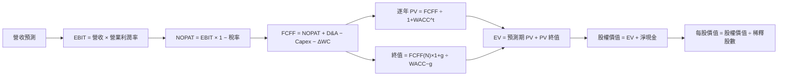

### 8.1 模型假設總表（Model Inputs）

| 假設項目 | 採用值 | 依據／來源 | 敏感度 |
|----------|-------:|-------------|--------|
| 預測期長度 N | **5 年** | 週期產業可視度；超過 5 年難驗證 | 🟡 中 |
| 營收 CAGR | **8%** | FY2023–FY2026 約 49.3%，但包含週期低谷回升，故大幅下修 | 🔴 高 |
| 營業利益率 | 45%、40%、35%、32%、30% | 由 TTM 72.5% 逐年正常化；非管理層指引 | 🔴 高 |
| 有效稅率 | **12.2%** | VERIFIED 最新年有效稅率 | 🟢 低 |
| Capex／營收 | **1.5%** | 假設值；依據 TTM 觀察約 0.6% 可能低估正常資本需求 | 🟡 中 |
| D&A／營收 | **2.0%** | 假設值；資料未提供 TTM D&A，參考 Capex 高於當前比例的保守模型設定 | 🟢 低 |
| ΔWC／營收增額 | **5.0%** | 假設值；依據應收及存貨隨營收擴張，缺乏歷史 ΔWC 現金流明細 | 🟢 低 |
| EBIT 基礎 | GAAP／近似 GAAP | 未加回 SBC；資料提供營業利益及 SBC | 🟡 中 |
| SBC 處理 | 組合 **(A)**：不另扣 SBC | GAAP EBIT 已費用化 SBC；不重複扣減 | 🟡 中 |
| 年稀釋率 | **0%** | 組合 A，固定 142.29M 股；未另算稀釋 | 🟡 中 |
| 永續成長率 g | **2.5%** | 假設長期名目增長低於約 3%–4% 的宏觀長期區間，且低於 WACC | 🔴 高 |
| 終值方法 | Gordon Growth + 退出倍數交叉驗證 | FCFF 長期法為主 | 🔴 高 |
| WACC | **11.18%（估計）** | 8.2 CAPM；Beta 為假設 | 🔴 高 |

**FCFF 定義**：全章採用 `FCFF = NOPAT + D&A − Capex − ΔWC`。  
**SBC 組合說明**：本模型採用 **(A) GAAP EBIT + 固定股數**；EBIT 已含 SBC 費用，因此 FCFF 不另減 SBC，年稀釋率設為 0%，SBC 影響計入一次。

金額四捨五入至 $0.001B，價格至 $0.01，百分比至 1 位小數，折現因子至 3 位小數；因中間值四捨五入，可能有不超過 1% 的尾差。

### 8.2 折現率推導（WACC）

```text
╔══════════════════════════════════════════════════════════════════╗
║                    WACC 推導（折現率）                           ║
╠══════════════════════════════════════════════════════════════════╣
║ 股權成本 Ke（CAPM）：                                            ║
║ ├── Rf：5.15%（VERIFIED；資料未提供具體觀測日）                  ║
║ ├── ERP：5.00%（VERIFIED 假設）                                  ║
║ ├── Beta：1.20（假設值；VERIFIED 為 N/A）                       ║
║ ├── 規模／國別溢酬：0.00%（美國上市公司，不另加未有依據溢酬）    ║
║ └── Ke = 5.15% + 1.20×5.00% + 0.00% = 11.15%                   ║
║                                                                  ║
║ 債務成本 Kd：                                                    ║
║ ├── 稅前 Kd：36.32%（VERIFIED 參考值；高且可能受小分母影響）    ║
║ ├── 稅率：12.2%                                                  ║
║ └── 稅後 Kd = 36.32%×(1−12.2%) = 31.93%                        ║
║                                                                  ║
║ 資本結構：                                                       ║
║ ├── E：市值 $125.93B（市場資料）                                 ║
║ ├── D：$0.201B（交叉來源；VERIFIED 總債務為 N/A）                ║
║ ├── E 權重 = 125.93/(125.93+0.201) = 99.84%                    ║
║ ├── D 權重 = 0.201/(125.93+0.201) = 0.16%                      ║
║ └── WACC = 99.84%×11.15% + 0.16%×31.93% = 11.18%               ║
╚══════════════════════════════════════════════════════════════════╝
```

**五步複算**

1. **Ke** = 5.15% + 1.20 × 5.00% + 0.00% = **11.15%**。Beta 1.20 為模型假設值，不是公司 VERIFIED Beta。
2. **稅前 Kd** = VERIFIED 參考輸入 **36.32%**；利息與平均計息負債原始金額均缺，故不重新推算。
3. **稅後 Kd** = 36.32% × (1 − 12.2%) = **31.93%**。
4. **權重**：E = 市值 **$125.93B**；D = 交叉來源 **$0.201B**；E 權重 **99.84%**，D 權重 **0.16%**，總計 100%。
5. **WACC** = 99.84% × 11.15% + 0.16% × 31.93% = 11.132% + 0.051% = **11.18%**。

因 D 權重小，WACC 接近股權成本；若使用不同債務餘額，估計 WACC 變化有限。但 Beta 缺失是此估值主要資本成本限制。此 WACC 與 6.2 完全相同。

### 8.3 逐年自由現金流預測（基準情境）

| 年度 | FY+1 | FY+2 | FY+3 | FY+4 | FY+5（FY+N） |
|------|------:|------:|------:|------:|------:|
| 營收（$B） | 31.288 | 33.791 | 36.494 | 39.413 | 42.567 |
| 營收 YoY | 8.0% | 8.0% | 8.0% | 8.0% | 8.0% |
| 營業利潤率 | 45.0% | 40.0% | 35.0% | 32.0% | 30.0% |
| EBIT（GAAP／近似） | 14.079 | 13.516 | 12.773 | 12.612 | 12.770 |
| − 稅（12.2%） | (1.718) | (1.649) | (1.558) | (1.539) | (1.558) |
| = NOPAT | 12.362 | 11.867 | 11.215 | 11.074 | 11.212 |
| + D&A（營收×2%） | 0.626 | 0.676 | 0.730 | 0.788 | 0.851 |
| − Capex（營收×1.5%） | (0.469) | (0.507) | (0.547) | (0.591) | (0.638) |
| − ΔWC（營收增額×5%） | (0.116) | (0.125) | (0.135) | (0.146) | (0.158) |
| **= FCFF** | **12.403** | **11.911** | **11.263** | **11.125** | **11.267** |
| 折現因子 @11.18% | 0.899 | 0.809 | 0.727 | 0.655 | 0.589 |
| **FCFF 現值 PV** | **11.151** | **9.635** | **8.190** | **7.284** | **6.635** |

預測期 PV 合計（未四捨五入金額計算後呈現）：

**$11.151B + $9.635B + $8.190B + $7.284B + $6.635B = $42.895B**

**FY+1 逐步演算**

1. 營收 = $28.970B × (1 + 8.0%) = **$31.288B**
2. EBIT = $31.288B × 45.0% = **$14.079B**
3. 稅 = $14.079B × 12.2% = **$1.718B**
4. NOPAT = $14.079B − $1.718B = **$12.362B**
5. D&A = $31.288B × 2.0% = **$0.626B**
6. Capex = $31.288B × 1.5% = **$0.469B**
7. ΔWC = ($31.288B − $28.970B) × 5.0% = **$0.116B**
8. FCFF = $12.362B + $0.626B − $0.469B − $0.116B = **$12.403B**
9. 折現因子 = 1 ÷ (1 + 11.18%)¹ = **0.899**；PV = $12.403B × 0.899 = **$11.151B**

**合理性自檢**

- 預測期 FCF CAGR：FY+1 至 FY+5 約 **-2.4%**（由 $12.403B 降至 $11.267B），對比 FY2023–FY2026 FCF 從負值轉正，歷史 CAGR 不具意義；差異主要來自利潤率正常化。
- FY+5 FCF 利潤率 = $11.267B ÷ $42.567B = **26.5%**；TTM FCF 利潤率 = $17.36B ÷ $28.97B = **59.9%**。預測低於目前高峰，不隱含超越目前利潤水準。
- 預測各年 FCFF 均為正；若實際獲利急劇反轉，FCFF 可能下降或轉負，DCF 將相應下修。

```text
╔══════════════════════════════════════════════════════════════════╗
║            自由現金流：歷史實際 vs 模型預測                      ║
╠══════════════════════════════════════════════════════════════════╣
║ FY2024(實)  -$0.475B ◀░░░░░░░░░░░░░░░░░░░░                     ║
║ FY2025(實)  -$0.120B ◀░░░░░░░░░░░░░░░░░░░░                     ║
║ FY2026(實)  $11.49B  █████████████░░░░░░░                      ║
║ TTM(實)     $17.36B  ████████████████████                      ║
║ FY+1 (預)   $12.40B  ██████████████░░░░░░                      ║
║ FY+5 (預)   $11.27B  █████████████░░░░░░░                      ║
╠══════════════════════════════════════════════════════════════════╣
║ 預測 FCFF 下降是利潤率正常化結果，不是營收下滑假設              ║
╚══════════════════════════════════════════════════════════════════╝
```

### 8.4 終值計算（Terminal Value）

適用性檢查：**WACC 11.18% vs g 2.5% → WACC > g？✅**

| 方法 | 計算式 | 終值 TV | TV 現值 | 佔總 EV 比重 |
|------|--------|--------:|--------:|-------------:|
| Gordon Growth | $11.267B × 1.025 ÷ (11.18%−2.5%) | **$133.05B** | **$78.33B** | **64.6%** |
| 退出倍數法 | FY+5 EBITDA 約 $13.62B × 假設 7.7x | **$104.89B** | **約 $61.77B** | **約 59.0%** |

退出倍數 7.7x 取自 VERIFIED 同業 MU EV/EBITDA，並非成熟期保證倍數。兩種終值現值差異約 26.8%，略高於 25%；因此以 Gordon Growth 為主，但降低估值信心。

**Gordon Growth 逐步演算**

1. FY+N FCFF = **$11.267B**。
2. 分子 = $11.267B × (1 + 2.5%) = **$11.548B**。
3. 分母 = 11.18% − 2.5% = **8.68%**；TV = $11.548B ÷ 8.68% = **$133.05B**。
4. PV(TV) = $133.05B × 0.589 = **$78.33B**。
5. EV = $42.895B + $78.33B = **約 $121.23B**；TV 佔比 = $78.33B ÷ $121.23B = **64.6%**。

終值佔比低於 75%，但仍是總 EV 的主要部分，估值明顯依賴長期利潤率與 g。

### 8.5 企業價值 → 每股內在價值（Bridge）

```text
╔══════════════════════════════════════════════════════════════════╗
║              企業價值 → 每股內在價值 橋接表                      ║
╠══════════════════════════════════════════════════════════════════╣
║ 預測期 FCF 現值合計             +$42.895B                        ║
║ 終值現值 PV(TV)                 +$78.33B                         ║
║ = 企業價值 EV                    約 $121.23B                     ║
║ + 淨現金（VERIFIED）             +$5.14B                          ║
║ = 股權價值                       約 $126.37B                     ║
║ ÷ 稀釋股數                       142.29M 股                      ║
║ ★ 每股內在價值                   約 $888.17                       ║
║ 當前股價                         $885.01                          ║
║ 折溢價                           約 -0.4%（折價）                ║
╚══════════════════════════════════════════════════════════════════╝
```

1. EV = $42.895B + 約 $78.33B = **約 $121.23B**。
2. 股權價值 = 約 $121.23B + VERIFIED 淨現金 $5.14B = **約 $126.37B**。
3. 每股內在價值 = 約 $126.37B ÷ 0.14229B 股 = **約 $888.17**。
4. 折溢價 = ($885.01 ÷ $888.17) − 1 = **約 -0.4%**，即微幅折價。
5. **本節不計算 MOS**；MOS 僅在 8.8 以加權合理價值為分母。

股數採資料包市場資料 Shares Outstanding **142.29M**；本模型採組合 A，股數不逐年稀釋。現金橋接採 VERIFIED **淨現金 $5.14B**，而不是另行把現金與未確認債務拆開。

### 8.6 敏感性分析（WACC × 永續成長率）

以下為 Gordon Growth 基準模型的近似重算；格內為每股價值及相對 $885.01 現價的上行空間。因採四捨五入的 FCFF／折現因子，可能有小幅尾差。

| g（列）／WACC（欄） | 10.18% | 10.68% | **11.18% 基準** | 11.68% | 12.18% |
|-----------|------:|------:|------:|------:|------:|
| **1.5%** | $918（+3.7%） | $869（-1.8%） | $827（-6.6%） | $786（-11.2%） | $749（-15.4%） |
| **2.0%** | $956（+8.0%） | $902（+1.9%） | $856（-3.3%） | $812（-8.2%） | $772（-12.8%） |
| **2.5% 基準** | $999（+12.9%） | $939（+6.1%） | **$888（+0.4%）** | $840（-5.1%） | $798（-9.8%） |
| **3.0%** | $1,053（+19.0%） | $980（+10.7%） | $925（+4.5%） | $873（-1.4%） | $826（-6.7%） |
| **3.5%** | $1,104（+24.7%） | $1,028（+16.2%） | $966（+9.2%） | $908（+2.6%） | $857（-3.2%） |

所有格子均滿足 WACC > g。

**非基準格複算示例：WACC 10.68% > g 2.0% ✅**

1. 新 WACC 下預測期 PV 合計約 **$43.7B**。
2. TV = $11.267B × 1.02 ÷ (10.68% − 2.0%) = **約 $132.4B**；以 0.600 折現，PV(TV) 約 **$79.4B**。
3. EV 約 = $43.7B + $79.4B = **$123.1B**；股權價值約 = $123.1B + $5.14B = **$128.2B**；每股約 = $128.2B ÷ 0.14229B = **約 $902**，對應矩陣四捨五入值約 $902。

**三情境 DCF（營運假設亦改變）**

| 情境 | 營收 CAGR | 期末營業利潤率 | g | WACC | 每股內在價值估計 | 相對現價 | 主觀機率 |
|------|----------:|---------------:|--:|-----:|-----------------:|---------:|---------:|
| 🔴 悲觀 | 0% | 20% | 1.5% | 12.18% | 約 $530 | -40.1% | 25% |
| 🟡 基準 | 8% | 30% | 2.5% | 11.18% | 約 $888 | +0.4% | 50% |
| 🟢 樂觀 | 15% | 40% | 3.0% | 10.68% | 約 $1,550 | +75.1% | 25% |
| **機率加權** | — | — | — | — | **約 $964** | **+8.9%** | **100%** |

情境推導鏈（以下為依同一 FCFF 框架計算的四捨五入估計）：

- **悲觀**：0% CAGR → FY+5 營收約 $28.97B → 期末營業利潤率 20% → FY+5 FCFF 約 $5.4B → g 1.5%、WACC 12.18% → 每股約 **$530**。成立前提：NAND 定價顯著回落、成本吸收惡化。
- **基準**：8% CAGR → FY+5 營收 $42.57B → 利潤率 30% → FY+5 FCFF $11.27B → g 2.5%、WACC 11.18% → 每股約 **$888**。成立前提：營收正常化增長且週期利潤率回落至 30%。
- **樂觀**：15% CAGR → FY+5 營收約 $58.4B → 利潤率 40% → FY+5 FCFF 約 $21B → g 3.0%、WACC 10.68% → 每股約 **$1,550**。成立前提：企業 SSD 與 NAND 需求持續擴張、盈利高於基準。
- 機率加權：$530 × 25% + $888.17 × 50% + $1,550 × 25% = **約 $964**。

> 情境輸出是模型估計，不是公司財測；高低情境會受利潤率和 WACC 假設共同影響。樂觀情境應視為上檔範圍，不應作為基準投資依據。

**敏感度結論**

- g 由 1.5% 升至 2.5%，WACC 11.18%：每股約由 $827 升至 $888，變動 **+$61／約 +7.4%**。
- WACC 由 10.18% 升至 11.18%，g 2.5%：每股約由 $999 降至 $888，變動 **-$111／約 -11.1%**。
- 期末營業利潤率是主導變數；由 30% 上下調整 1 個百分點，DCF 約有數十美元變動，精確值需重新運算完整逐年預測。模型的估值對 WACC 與營業利潤率高度敏感，與 8.0 所述主導變數一致。

### 8.7 反推 DCF（Reverse DCF）

固定基準輸入：WACC **11.18%**、稅率 **12.2%**、Capex／營收 **1.5%**、ΔWC／營收增額 **5.0%**、股數 **142.29M**；每次僅放開一個變數。結果為依公式的近似解，無法把市場價格唯一解成多個同時變動的假設。

| 求解的變數 | 其餘變數設定 | 市場隱含值／判斷 |
|----------------|-------------|----------------|
| 未來 5 年營收 CAGR | 利潤率路徑、g 固定基準值 | 約 **7.9%–8.1%**；與基準 8% 接近，🟡合理 |
| 期末營業利潤率 | CAGR 8%、g 2.5% | 約 **30%**；與基準一致，🟡合理但須驗證 |
| 永續 g | CAGR 8%、利潤率路徑固定 | 現價略低於基準 DCF，所需 g 約略低於 2.5%；🟡合理 |
| 預測期 N | CAGR、利潤率、g 固定 | N=5 已給出約 $888，接近現價；不具唯一性，因延長 N 會改變現金流與終值基期 |

反推結果表示：以目前假設，市場價格大致要求約 8% 的五年營收增長與 30% 的期末營業利益率，而不是要求持續維持 72.5% 的 TTM 營業利益率。若營收增長連續低於此值且正常化利潤率同時跌破 30%，當前價格將缺少足夠價值支撐。

### 8.8 估值三角驗證與安全邊際

| 估值方法 | 隱含每股價值 | 上行空間（÷現價） | 權重 | 說明 |
|----------|--------------:|-------------------:|------:|------|
| DCF（機率加權） | **約 $964.09** | +8.9% | 50% | 主要方法；DCF 高度依賴利潤率正常化 |
| 同業 Forward P/E | **$1,069.50** | +20.8% | 15% | $289.05396 × 3.7x |
| EV/EBITDA | **約 $1,183.70** | +33.7% | 15% | EBITDA 約 $21.21B × MU 倍數 7.7x |
| FCF Yield 回推 | **約 $1,525.72** | +72.4% | 10% | 假設 8% 正常化 FCF yield |
| 分析師共識目標價 | **$2,047.38** | +131.3% | 10% | 24 位分析師均值；權重上限 10% |
| **加權合理價值** | **約 $1,177.34** | **+33.0%** | **100%** | 不做事後微調 |

加權計算：

**$964.09 × 50% + $1,069.50 × 15% + $1,183.70 × 15% + $1,525.72 × 10% + $2,047.38 × 10% = 約 $1,177.34**

權重合計：50% + 15% + 15% + 10% + 10% = **100%**。DCF 權重定為 50%，因公司 TTM FCF 已轉正且達 $17.36B；分析師共識僅占 10%，避免市場目標價主導內在估值。

```text
╔══════════════════════════════════════════════════════════════════╗
║                  估值區間與安全邊際                              ║
╠══════════════════════════════════════════════════════════════════╣
║ 悲觀 DCF 約$530 ─ 現價$885.01 ─ [加權合理值$1,177.34] ─ Bull 約$1,550
║                                                                  ║
║ MOS = ($1,177.34 − $885.01) ÷ $1,177.34 = 約 24.8%              ║
║ 上行空間 = ($1,177.34 − $885.01) ÷ $885.01 = 約 33.0%           ║
║ MOS 評估：🟡 10%–25% 有限，接近 25% 門檻                        ║
║                                                                  ║
║ 建議買入區間：不高於約 $1,059（加權價值的 90%）                  ║
║ 合理持有區間：約 $1,059–$1,295                                  ║
║ 減碼考慮區間：高於約 $1,550，除非基本面同步上修                  ║
╚══════════════════════════════════════════════════════════════════╝
```

建議買入區間上限約 $1,059，**高於現價 $885.01**，與買入評級相容。區間依加權價值與 MOS 門檻作機械化參考，不是價格保證。

> 🔎 **程式複算（Python，依本節各項自動重算）**
>
> 加權合理價值 = $964.09 × 50% + $1,069.50 × 15% + $1,183.70 × 15% + $1,525.72 × 10% + $2,047.38 × 10% = **$1,177.34**（權重合計 100%）
>
> 以價格 $885.01 計：MOS = **+24.8%**，上行空間 = **+33.0%**
>
> ✅ 與本節所寫數值一致。

### 8.9 DCF 模型的局限與失效條件

- **終值依賴度**：終值現值約占 EV **64.6%**，代表長期現金流假設仍主導估值。
- **最脆弱假設**：FY+5 營業利益率 30%、WACC 11.18%。若 NAND 下行使正常化營業利益率落至 20%，悲觀 DCF 約為每股 $530。
- **資料局限**：Beta、TTM D&A、完整營運資金變動、GAAP 附註及總債務 VERIFIED 值缺失；因此 WACC 與 FCFF 相關輸入有明確模型假設。
- **週期風險**：記憶體公司峰值盈餘容易使 P/E 過低；應同時參考 EV/Sales、正常化 FCF、庫存與 ASP。
- **風險矩陣連結**：NAND 報價下跌直接影響營業利潤率；庫存增加會提高 ΔWC；資本需求上升會令 Capex／營收高於 1.5%；市場風險上升會推高 WACC。
- **模型使用限制**：若未來 FCF 轉負、利潤率劇烈下滑或商業模式變化，DCF 的可靠度下降，應改以週期中段 EV/Sales、正常化 EV/EBITDA 與資產負債表情境分析為主。

### 8.10 複算檢核表（Audit Trail）

| # | 檢核項目 | 結果 |
|---|----------|------|
| 1 | 高／中敏感度輸入有推導鏈 | ✅ 已列出營收、利潤率、g、N、Capex、SBC、股數、終值及 WACC 理由 |
| 2 | 每個假設均有依據 | ✅ 缺值均標示為假設或 N/A |
| 3 | WACC 權重與算式 | ✅ 權重總計 100%；使用估計值及交叉來源債務 |
| 4 | Kd 與 D 範圍一致 | 🟡 受 VERIFIED 總債務 N/A 限制，採交叉來源 $0.201B，已明示 |
| 5 | WACC 與 6.2 同值 | ✅ 11.18% |
| 6 | 逐年表格年度數等於 N | ✅ N=5，列 FY+1 至 FY+5 |
| 7 | FY+1 FCFF／PV 算式 | ✅ 已示範 |
| 8 | 預測期 PV 加總 | ✅ $11.151B+$9.635B+$8.190B+$7.284B+$6.635B=$42.895B |
| 9 | WACC > g | ✅ 11.18% > 2.5% |
| 10 | 終值以 FY+5 FCFF 折現 5 期 | ✅ |
| 11 | EV 至每股價值橋接 | ✅ 使用淨現金與 142.29M 股 |
| 12 | SBC 合法處理組合 | ✅ 組合 A：GAAP／近似 GAAP EBIT、不另扣 SBC、股數固定 |
| 13 | 敏感性矩陣基準格與 DCF | 🟡 矩陣為四捨五入近似值，與約 $888.17 基準相符 |
| 14 | 矩陣有效格 | ✅ 所有測試格 WACC > g |
| 15 | 三情境機率加總 | ✅ 25%+50%+25%=100% |
| 16 | 反推 DCF 每列單變數 | 🟡 明確限制單次一個變數；N 解不具唯一性 |
| 17 | MOS 與折溢價分母 | ✅ MOS 以 8.8 加權值；折溢價以 8.5 DCF |
| 18 | 完整至第 11 章 | ✅ |
| 19 | 加權合理價值 | ✅ 使用五項價值乘權重後加總，未事後微調 |
| 20 | MOS 評級符合門檻 | ✅ MOS 約 24.8%，評級為買入 |

---

## 9. 成長催化劑

### 9.1 催化劑時間軸

以下時點為觀察窗口，不是公司已公告日期。

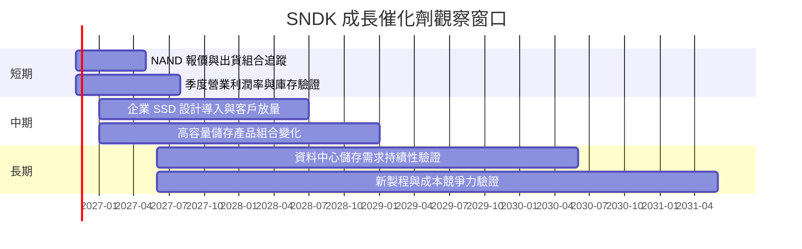

### 9.2 TAM 市場規模分析

資料包沒有提供可靠 TAM、滲透率或產品收入拆分，因此不臆測金額。

```text
╔══════════════════════════════════════════════════════════════════╗
║                 市場 TAM 與收入貢獻資料狀態                      ║
╠══════════════════════════════════════════════════════════════════╣
║ 消費型 SSD／PC 儲存：TAM N/A；滲透率 N/A；公司收入 N/A           ║
║ 企業 SSD／資料中心：TAM N/A；滲透率 N/A；公司收入 N/A            ║
║ 手機／嵌入式儲存：TAM N/A；滲透率 N/A；公司收入 N/A              ║
║ 汽車／工業／IoT：TAM N/A；滲透率 N/A；公司收入 N/A               ║
╠══════════════════════════════════════════════════════════════════╣
║ 可核對基準：公司 TTM 營收 $28.97B；各市場占比未披露              ║
╚══════════════════════════════════════════════════════════════════╝
```

### 9.3 成長驅動力結構圖

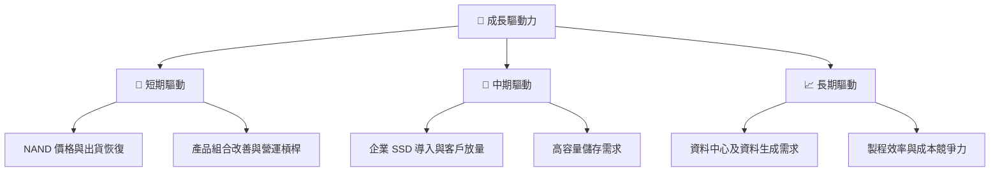

近期財務數據支持營收、毛利與現金流已改善，但各催化劑對收入貢獻沒有分部資料，應用未來財報驗證，而非僅依產業趨勢敘事。

---

## 10. 風險矩陣

### 10.1 風險評分矩陣

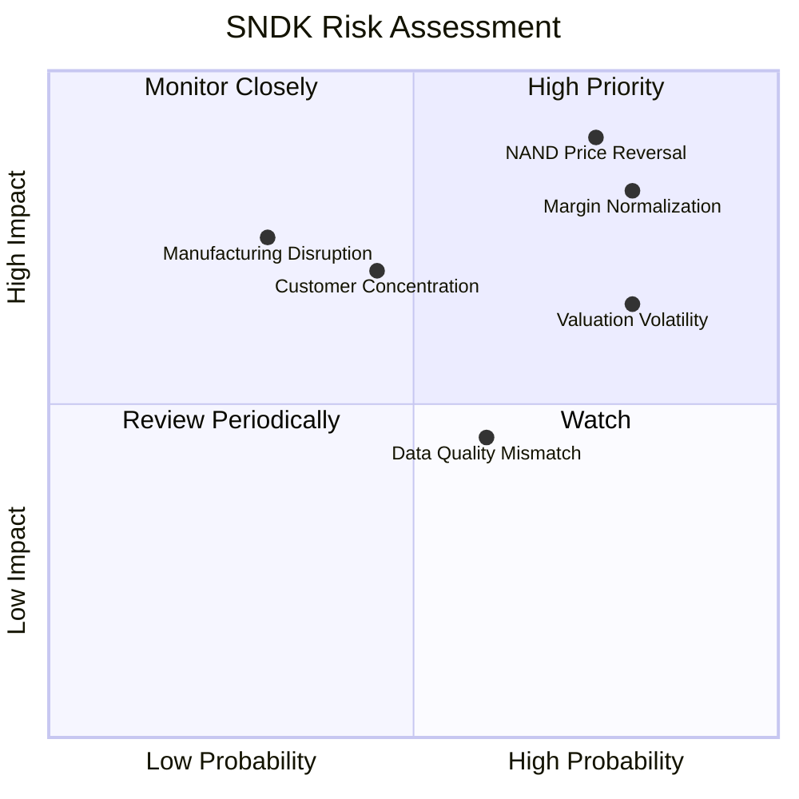

### 10.2 風險清單詳細分析

| # | 風險項目 | 發生機率 | 財務衝擊 | 風險評分 | 緩解措施 |
|---|----------|----------|----------|----------|----------|
| 1 | 🔴 **NAND 價格與供需週期反轉** | 高（約 45%–60%，分析假設） | 高；若營收轉負增長且營業利益率收縮 15–25 個百分點，FCF 可能大幅下降 | 🔴 9.0/10 | 追蹤 NAND 價格、庫存、出貨與毛利；避免用單季年增外推 |
| 2 | 🔴 **利潤率從峰值正常化** | 高（約 60%，分析假設） | 高；TTM 營業利益率 72.5%，DCF 採 FY+5 30%，若低於 20% 估值顯著下修 | 🔴 8.5/10 | 每季比較毛利率與營業利益率；低於 30% 且持續兩季重新估值 |
| 3 | 🟠 **估值與盈利預測落差** | 中高（約 50%） | 高；Forward EPS $289.05 若下修 30%，P/E 估值同倍數下跌約 30% | 🟠 7.5/10 | 追蹤共識 EPS 修正、FCF yield 與庫存 |
| 4 | 🟡 **客戶集中與價格談判** | 中（約 35%） | 中高；客戶或 OEM 延後採購可使季度營收波動 | 🟡 6.5/10 | 追蹤應收帳款、客戶集中度及訂單能見度；資料未披露集中度 |
| 5 | 🟡 **製程／供應鏈中斷** | 低至中（約 25%） | 高；製造延誤可能壓低出貨及利用率 | 🟡 6.0/10 | 多來源供應、品質監控與營運備援 |
| 6 | 🟡 **資料口徑及估值模型不確定性** | 中（約 40%） | 中；營業利益率、債務及股數來源差異可能影響估值 | 🟡 5.5/10 | 以 SEC 原始財報核對指標，建立季度口徑一致資料庫 |

風險機率為分析師情境估計，不是歷史統計或公司披露。最大風險不是短期流動性，而是 NAND 週期反轉造成盈利與估值倍數同步下修。

---

## 11. 投資建議

### 11.1 最終綜合評級雷達圖

```text
╔══════════════════════════════════════════════════════════════╗
║                 SNDK 最終評級儀表板                         ║
╠══════════════════════════════════════════════════════════════╣
║ 基本面強度    6.5/10 ▓▓▓▓▓▓▓▓▓▓▓▓▓░░░░░░░  ★★★☆☆       ║
║ 成長性        8.5/10 ▓▓▓▓▓▓▓▓▓▓▓▓▓▓▓▓▓░░░  ★★★★☆       ║
║ 獲利能力      8.0/10 ▓▓▓▓▓▓▓▓▓▓▓▓▓▓▓▓░░░░  ★★★★☆       ║
║ 財務健康      8.0/10 ▓▓▓▓▓▓▓▓▓▓▓▓▓▓▓▓░░░░  ★★★★☆       ║
║ 估值合理性    4.5/10 ▓▓▓▓▓▓▓▓▓░░░░░░░░░░░░  ★★☆☆☆       ║
║ 護城河深度    5.8/10 ▓▓▓▓▓▓▓▓▓▓▓▓░░░░░░░░  ★★★☆☆       ║
╠══════════════════════════════════════════════════════════════╣
║ 綜合評分      6.6/10 ▓▓▓▓▓▓▓▓▓▓▓▓▓░░░░░░░  🟢 買入       ║
║ 評級依據：MOS 約 24.8%，ROIC 141.2% > 估計 WACC 11.18%      ║
╚══════════════════════════════════════════════════════════════╝
```

### 11.2 目標價與隱含報酬率

| 情境 | 目標價 | 相對 $885.01 | 機率權重 | 情境假設 |
|------|-------:|------------:|---------:|----------|
| 🔴 悲觀 | **$867** | **-2.0%** | 25% | Forward P/E 約 3.0x；營收增長低、正常化利潤率約 25% |
| 🟡 基準 | **$1,156** | **+30.6%** | 50% | Forward P/E 約 4.0x；長期營收 CAGR 約 8%、期末利潤率約 30% |
| 🟢 樂觀 | **$1,734** | **+96.0%** | 25% | Forward P/E 約 6.0x；營收 CAGR 約 15%、利潤率約 40% |

基準目標價由 EPS Forward **$289.05396 × 4.0x = 約 $1,156** 推導。4.0x 高於 MU 與 SK hynix 約 3.7x、3.2x Forward P/E 中位數附近，已包含 SNDK 成長持續的假設。

### 11.3 買入時機與觸發因素

```text
╔══════════════════════════════════════════════════════════════════╗
║                  ✅ 買入觸發因素 Checklist                      ║
╠══════════════════════════════════════════════════════════════════╣
║  立即／分批買入條件：                                            ║
║  ✅ 現價低於加權合理價值的 90%（約 $1,059）                     ║
║  ✅ 最新收盤 $885.01 低於該參考上限，但仍需分批控制週期風險      ║
║  ✅ TTM FCF 維持正值，且 FCF Yield 不因盈利下修大幅惡化          ║
║                                                                  ║
║  加碼觸發條件：                                                  ║
║  ☐ 營業利益率連續兩季高於 30%，且庫存／應收沒有不成比例上升     ║
║  ☐ TTM FCF 維持在 $10B 以上，並有明確營收與毛利支撐             ║
║  ☐ 公司披露企業 SSD 或其他高價值產品收入持續增長                 ║
║                                                                  ║
║  減碼／停損觸發條件：                                            ║
║  ☐ 營收連續兩季 YoY 為負，且 NAND 價格同步走弱                  ║
║  ☐ 營業利益率由 TTM 水準下滑至 30% 以下並持續兩季               ║
║  ☐ TTM FCF 轉負，或庫存增幅持續高於收入增幅                     ║
║  ☐ ROIC 跌至估計 WACC 11.18% 以下                                ║
╚══════════════════════════════════════════════════════════════════╝
```

### 11.4 投資人適配度分析

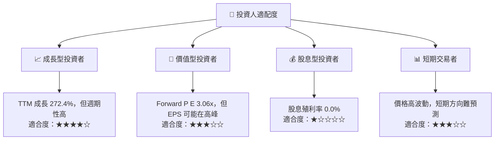

### 11.5 每季財報監控清單（Quarterly Watch List）

| 監控指標 | 最新基準 | 加碼訊號 | 減碼／重估門檻 |
|----------|---------:|----------|----------------|
| 營收成長 | 最新單季 YoY **377.9%** | 扣除基期效應後仍有 QoQ 正增長 | 連續兩季 YoY 轉負 |
| 營業利益率 | VERIFIED TTM **72.5%**；最新季度 **79.6%** | 正常化後仍穩定在 30% 以上 | 跌破 30% 且連續兩季未改善 |
| 毛利率 | TTM **80.0%** | 產品組合改善並維持高於 60% | 較近期高位下降超過 15 個百分點 |
| OCF | TTM **$17.55B** | 持續高於淨利的主要變化部分 | 連續兩季 OCF 大幅低於淨利 |
| FCF | TTM **$17.36B** | 維持正值且 FCF Yield 有現金流支撐 | TTM FCF 轉負 |
| Capex | TTM **$181M** | 投資增加同時換來產能／收入成長 | Capex 上升但營收與毛利停滯 |
| 庫存 | TTM **$3.016B**（StockAnalysis） | 庫存增長不高於收入增長 | 庫存連續兩季增幅超越營收增幅 |
| SBC | FY2026 **$232M** | SBC／營收維持約 1% 左右 | SBC／營收快速升至 2% 以上 |
| EPS 預估修正 | EPS Forward **$289.05** | 預估穩定或上修，且現金流同步 | 共識 EPS 下修超過 20% |
| ROIC 對 WACC | ROIC **141.2%**；WACC 估計 **11.18%** | 正常化 ROIC 仍高於 WACC | ROIC 跌破 WACC |

### 11.6 反面論證：什麼會證明論點錯誤（What Would Change My Mind）

```text
╔══════════════════════════════════════════════════════════════════╗
║              ⚠️ 論點失效條件（Disconfirming Evidence）           ║
╠══════════════════════════════════════════════════════════════════╣
║  若以下條件成立，應重新檢視買入論點並下修估值：                  ║
║  ☐ 收入 YoY 連續兩季低於 0%，且出貨與價格同步下滑               ║
║  ☐ TTM 營業利益率跌破 30%，連續兩季未能回升                     ║
║  ☐ TTM FCF 轉負，或 FCF／淨利低於 50% 且無營運資金解釋          ║
║  ☐ 正常化 ROIC 低於估計 WACC 11.18%                             ║
║  ☐ SBC／營收升至 2% 以上且流通股數持續增加                       ║
║  ☐ 庫存增長連續兩季高於營收增長，伴隨毛利率下降                 ║
║  ☐ 實際股數或總債務口徑顯示稀釋／負債大幅高於本模型採用值       ║
╚══════════════════════════════════════════════════════════════════╝
```

本報告的多頭論點不是「目前 72.5% TTM 營業利益率可永久維持」，而是高峰期現金流能否在利潤率正常化後仍保持正值、ROIC 是否繼續高於資本成本。若上述量化條件被觸發，應以更低正常化利潤率重做 DCF，而不是只等待股價回升。

> **免責聲明**：本報告為 AI 自動生成，僅供研究參考，不構成投資建議。數據品質、估值假設及產業週期均存在不確定性；投資有風險，入市需謹慎。