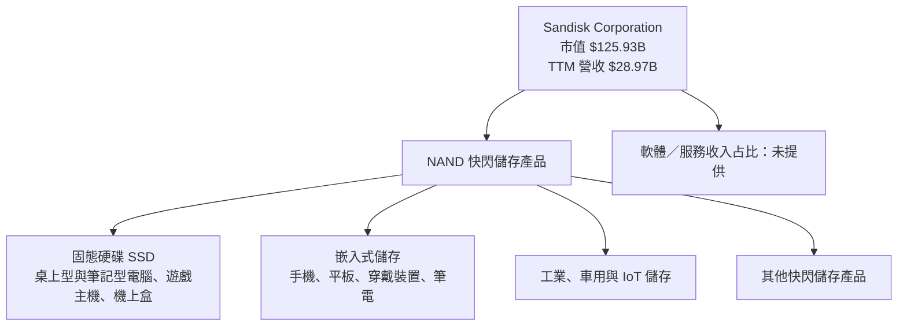
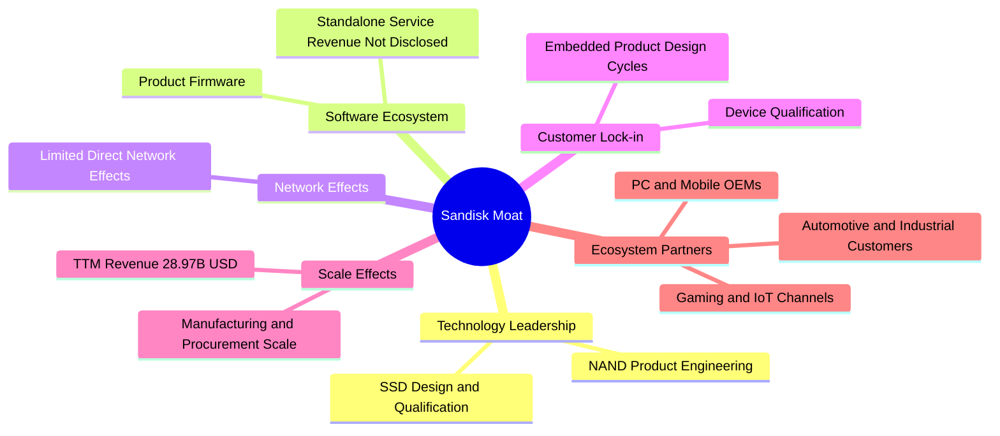
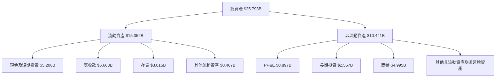
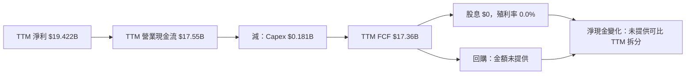
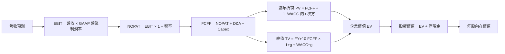
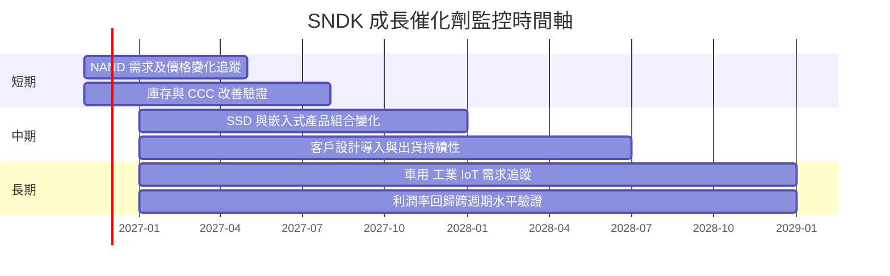
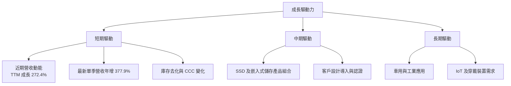
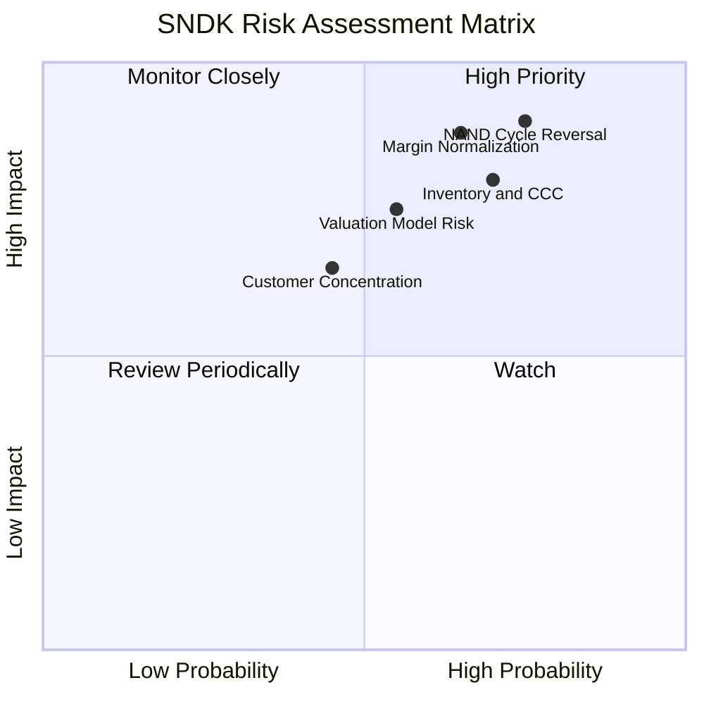
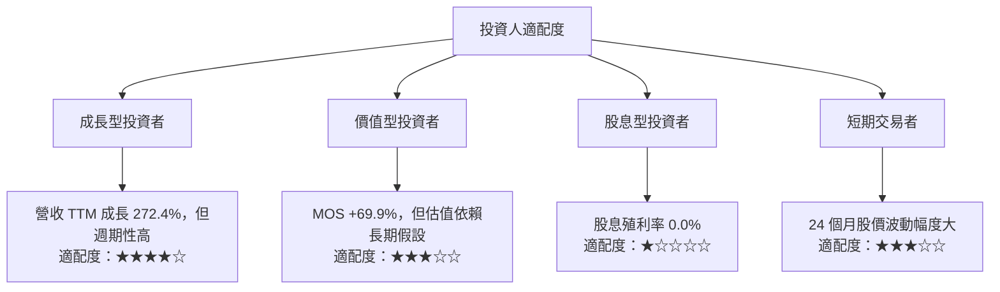

# SNDK 基本面深度分析報告
> **報告日期**：2026-11-15 ｜ **語言**：繁體中文 ｜ **數據來源**：SEC 申報資料 (XBRL)、Yahoo Finance、Finviz、StockAnalysis、Roic.ai ｜ **分析師**：CFA 級機構研究

## 目錄

| # | 章節 | 核心結論 |
|---|------|----------|
| 1 | 執行摘要 | 強烈買入；加權合理價值 $2,940.64；MOS +69.9% |
| 2 | 公司概覽與商業模式 | NAND 儲存產品組合廣泛；市場份額資料未提供，護城河主要來自技術、規模及客戶認證 |
| 3 | 損益表深度分析 | TTM 營收 $28.97B、TTM 成長 272.4%；最新單季年增 377.9%，利潤率處於高位 |
| 4 | 資產負債表分析 | 淨現金 $5.14B；CCC 由 154 天升至 226 天，營運資金效率轉弱 |
| 5 | 現金流量深度分析 | TTM FCF $17.36B、FCF Yield 13.79%；現金轉換率低於 100% |
| 6 | 獲利能力與資本效率 | ROIC 141.2% 對 WACC 10.19%，目前回報顯著高於資本成本 |
| 7 | 相對估值分析 | 同業倍數及分析師共識均低於基準 DCF；自身 P/S 位於五年區間第 43 百分位 |
| 8 | DCF 內在價值評估 | 基準 DCF $4,682.01／股；模型對終值及長期利潤率高度敏感 |
| 9 | 成長催化劑 | NAND 需求、產品組合及市場復甦可支持成長；TAM 數據未提供 |
| 10 | 風險矩陣 | 週期反轉、價格回落及營運資金惡化為主要風險 |
| 11 | 投資建議 | 依 MOS 為強烈買入；但極端股價波動及模型假設風險要求分批操作 |

---

## 1. 執行摘要

SNDK 的財務數據顯示，TTM 營收為 **$28.97B**、TTM 營收年增 **272.4%**，最新一季單季年增 **377.9%**，TTM FCF 為 **$17.36B**，ROIC **141.2%**，高於 **10.19% WACC**。同時，2026-11-13 收盤價 **$885.01**，依估值方法加權後合理價值為 **$2,940.64**，MOS **+69.9%**，符合規則 20 的「強烈買入」門檻。惟公司屬週期性 NAND 業務，股價由 2026 年 6 月月收盤價 $2,273.73 回落至 2026 年 11 月 $885.01，且 DCF 基準價值有 57.2% 來自終值；評級反映估值結果，不代表低波動或高確定性。

### 1.0 一頁式投資儀表板

| 項目 | 內容 |
|------|------|
| **投資論點（3 句）** | ① TTM 營收年增 272.4%，最新單季年增 377.9%，需求與價格／組合改善推升營收。② TTM FCF $17.36B、ROIC 141.2%，目前現金創造能力顯著高於資本成本。③ 加權合理價值 $2,940.64，相對現價 $885.01 的 MOS 為 +69.9%；估值對長期利潤率及終值假設敏感。 |
| **綜合評分** | **7.8/10**（引用 1.1 評分卡） |
| **財務健康** | 🟢 現金及短期投資 $5.14B，淨現金 $5.14B；但現金轉換週期增至 226 天 |
| **ROIC vs WACC** | **141.2% vs 10.19%**；依目前 TTM 指標，創造股東價值 |
| **FCF 趨勢** | FY2026 年 FCF $11.49B，TTM FCF $17.36B；TTM FCF Yield **13.79%** |
| **估值** | Forward P/E 3.06x ｜ EV/EBITDA 5.701x ｜ FCF Yield 13.79% |
| **DCF 內在價值（基準）** | **$4,682.01**；相對 DCF 基準值，現價折價約 **81.1%**（折溢價 −81.1%） |
| **安全邊際（MOS）** | **+69.9%**＝($2,940.64 − $885.01) ÷ $2,940.64；🟢 >25% 充足 |
| **預期報酬（基準情境 12M）** | DCF 模型未提供 12 個月期間目標；以 DCF 基準情境每股值計，相對現價為 **+429.0%**，非獨立的 12M 預測 |
| **關鍵風險（前二）** | NAND 週期回落導致價格及利潤率收縮；庫存與應收天數上升、CCC 延長 |
| **評級 + 信心度** | 🟢 **強烈買入** ｜ 信心：中（MOS 高，但週期性與 DCF 終值依賴度高） |

> 折溢價以 DCF 基準內在價值 $4,682.01 為分母；MOS 以 8.8 加權合理價值 $2,940.64 為分母，兩者定義不同。

### 1.1 綜合評分卡（全報告唯一）

| 維度 | 評分（1–10） | 主要依據（引用數字與其來源章節） |
|------|--------------|----------------------------------|
| 成長性 | 9.0 | TTM 營收成長 272.4%、最新單季年增 377.9%（第 3 章）；高成長含週期復甦因素 |
| 獲利能力 | 9.0 | TTM 營業利益率 72.5%、ROIC 141.2% 對 WACC 10.19%，但 F-Score 5/8（第 6 章） |
| 財務健康 | 7.0 | 淨現金 $5.14B；CCC 226 天，較一年前增加 72 天（第 4 章） |
| 估值 | 9.0 | MOS +69.9%；自有歷史 P/S 4.7x，五年中位數 4.8x（第 7–8 章） |
| 護城河 | 7.0 | NAND 技術、產品及客戶應用多元；但市場份額、定價持續性及客戶集中度資料未提供（第 2 章） |
| 管理層與資本配置 | 6.0 | FY2026 Capex $177M、SBC $232M，未提供完整回購與資本配置政策資料（第 5 章） |
| **綜合評分** | **7.8** | 六項算術平均： (9+9+7+9+7+6) ÷ 6 = 7.8 |

### 1.2 五大投資論點 + 三大核心風險

| 類型 | 項目 | 具體依據 | 信心度 |
|------|------|----------|--------|
| 🟢 **投資論點①** | 營收快速擴張 | TTM 營收 $28.97B，TTM 年增 272.4%；最新單季年增 377.9% | 🟢 高 |
| 🟢 **投資論點②** | 高現金創造能力 | TTM OCF $17.55B、Capex $181M、FCF $17.36B | 🟢 高 |
| 🟢 **投資論點③** | 資本回報超過資本成本 | ROIC 141.2%，WACC 10.19%；差距 131.01 個百分點 | 🟢 中高 |
| 🟢 **投資論點④** | 淨現金支撐週期韌性 | 現金及短期投資、淨現金均為 $5.14B（採程式計算指標） | 🟢 中高 |
| 🟢 **投資論點⑤** | 估值方法顯示折價 | 加權合理價值 $2,940.64，較 $885.01 現價高 232.3% | 🟡 中 |
| 🟡 **風險①** | NAND 週期反轉 | 最新單季 79.6% 的程式計算營業利益率及高成長未必能跨週期維持 | 🟡 中 |
| 🔴 **風險②** | 營運資金占用上升 | DIO 190 天、CCC 226 天；CCC 一年增加 72 天 | 🔴 高衝擊 |
| 🔴 **風險③** | 估值對長期假設敏感 | DCF 終值現值佔 EV 57.2%；不同 WACC 與 g 使估值大幅變動 | 🔴 高衝擊 |

### 1.3 快速統計卡片

同業中位數僅對 Peer multiples 有提供且可比較的指標列示；SKHY 的 P/S、EV/EBITDA 因混合幣別不可比較。

| 指標 | 公司實際值（期間） | 同業中位數 | 狀態 |
|------|--------------------|------------|------|
| 營收成長（TTM） | **272.4%** | — | 🟢 |
| 營收成長（最新一季年增） | **377.9%** | 327.9%（WDC、MU、SKHY） | 🟢 |
| 毛利率（TTM） | **80.0%** | 77.4%（WDC、MU、SKHY） | 🟢 |
| 營業利益率（TTM） | **72.5%** | — | 🟢 |
| ROIC（TTM） | **141.2%** | — | 🟢 |
| Forward P/E | **3.0617468x** | 3.7x（WDC、MU 中位數） | 🟢 |
| FCF Yield（TTM） | **13.79%** | — | 🟢 |
| Piotroski F-Score | **5 / 8** | — | 🟡 |

### 1.4 投資結論

```text
╔══════════════════════════════════════════════════════════════════╗
║                    📊 投資結論摘要                               ║
╠══════════════════════════════════════════════════════════════════╣
║  評級：強烈買入（MOS +69.9%，ROIC 141.2% > WACC 10.19%）        ║
║  價格（2026-11-13 收盤）：$885.01                               ║
║  DCF 內在價值（基準）：$4,682.01（折價 81.1%）                  ║
║  安全邊際 MOS：+69.9%（以加權合理價值 $2,940.64 為基準）        ║
║  加權合理價值（8.8）：$2,940.64                                  ║
║  DCF 情境價值：                                                   ║
║    悲觀情境：$1,998.21（+125.8%）                               ║
║    基準情境：$4,682.01（+429.0%）                               ║
║    樂觀情境：$10,390.78（+1,074.1%）                            ║
║  綜合評分：7.8/10（引用 1.1）                                    ║
║  適合投資人：可承受高波動、能追蹤 NAND 週期的成長型投資人       ║
╚══════════════════════════════════════════════════════════════════╝
```

---

## 2. 公司概覽與商業模式

### 2.1 業務結構與收入來源

公司開發、製造及銷售採用 NAND 快閃記憶體技術的儲存產品，涵蓋 SSD、嵌入式儲存及可移除／其他快閃產品。財務資料沒有提供各產品線營收占比，也沒有單獨列示軟體或服務收入，因此以下不推算產品占比。



### 2.2 市場份額

市場份額數據未提供，無法可靠列示公司在 NAND、SSD 或嵌入式儲存市場的占比。以目前可比較數據看，SNDK TTM 營收 $28.97B、TTM 成長 272.4%，最新單季年增 377.9%；但成長幅度可能反映週期復甦及低基期，不能單獨視為市場份額提升的證據。

### 2.3 競爭護城河分析



### 2.4 護城河強度

| 護城河項目 | 強度（強／中／弱） | 證據（引用數字或事實） | 會削弱它的情況 |
|------------|--------------------|------------------------|----------------|
| 技術與產品工程 | 中 | NAND 儲存產品涵蓋 SSD、嵌入式、車用、工業及 IoT；研發費用 FY2026 為 $1.33B | 競爭者縮短製程差距、產品性能差異化減弱 |
| 軟體生態系統 | 弱至中 | 有產品韌體相關能力的業務型態，但獨立軟體收入未提供 | 產品規格同質化，軟體不能形成額外付費或續約收入 |
| 網路效應 | 弱 | 未有資料顯示儲存產品具有直接網路效應 | 客戶可低成本切換供應商 |
| 客戶鎖定 | 中 | 嵌入式產品需配合手機、車用及工業設計導入，存在認證及設計週期 | 新設計導入失敗、客戶雙供應商策略 |
| 規模效應 | 中 | TTM 營收 $28.97B，產品覆蓋多類終端市場 | NAND 供給擴張快於需求，規模未能抵銷 ASP 下跌 |
| 生態夥伴 | 中 | 服務多類 OEM 及終端應用 | 客戶集中、替代來源增加或終端需求疲弱 |

護城河評分理由：產品工程、認證及業務覆蓋具一定支持，但市場份額、客戶集中度及軟體收入證據不足，因此 1.1 評分卡的護城河評分為 **7.0/10**。

---

## 3. 損益表深度分析

### 3.1 年度收入成長趨勢（近 4 年）

以下年度營收取自年度損益表；成長率依相鄰年度營收計算。FY2026 相對 FY2023 三年 CAGR 約為 49.3%，但過去數年營收先下滑再急升，CAGR 不代表穩態成長。

```text
╔══════════════════════════════════════════════════════════════════╗
║              Sandisk 年度收入趨勢（FY2023-FY2026）               ║
╠══════════════════════════════════════════════════════════════════╣
║  FY2023  $6.09B   ██████░░░░░░░░░░░░░░░░░░░  YoY：—            ║
║  FY2024  $6.66B   ███████░░░░░░░░░░░░░░░░░░  YoY：+9.5%        ║
║  FY2025  $7.36B   ████████░░░░░░░░░░░░░░░░░  YoY：+10.4%       ║
║  FY2026  $20.25B  █████████████████████████  YoY：+175.3%      ║
╠══════════════════════════════════════════════════════════════════╣
║  FY2023-FY2026 三年收入 CAGR：約 +49.3%                           ║
╚══════════════════════════════════════════════════════════════════╝
```

FY2026 年營收跳升至 $20.25B，與 FY2025 的 $7.36B 相比增長 175.3%。這種跨越式變化與儲存產業供需、價格及產品組合高度相關；若供需轉弱，營收成長及利潤率均可能快速回落。

### 3.2 季度收入趨勢分析

| 季度 | 營收 | QoQ 成長 | YoY 成長 | 備註 |
|------|------:|---------:|---------:|------|
| FY2026 Q2（2026-01-02） | $3.025B | 31.5% | 61.25% | 相較前季擴張 |
| FY2026 Q3（2026-04-03） | $5.950B | 96.7% | 251.03% | 需求／定價回升加速 |
| FY2026 Q4（2026-07-03） | $8.965B | 50.7% | 371.59% | 營收規模續增 |
| FY2027 Q1（2026-10-02） | $11.031B | 23.0% | 377.9% | 單季年增率；不是 TTM 成長率 |

QoQ 計算例：FY2027 Q1 QoQ = ($11.031B ÷ $8.965B) − 1 = **23.0%**。連續季度營收增加與單季年增率上升顯示本輪復甦仍在延續，但高速成長也提高高基期及供需正常化的風險。

### 3.3 利潤率演變分析

| 利潤率指標 | FY2023 | FY2024 | FY2025 | FY2026 | 趨勢 | 評估 |
|------------|-------:|-------:|-------:|-------:|------|------|
| **毛利率** | 7.1% | 16.1% | 30.1% | 71.5% | 大幅上升 | 🟢 |
| **營業利益率** | −21.3% | −6.7% | 6.9% | 61.6% | 從虧損轉為高利潤 | 🟢 |
| **淨利率** | −35.2% | −10.1% | −22.3% | 56.4% | FY2025 仍虧損，FY2026 急升 | 🟡 |

表中年度利潤率為年度毛利、營業利益及淨利分別除以年度營收計算。另依程式計算的 TTM 指標，毛利率為 80.0%、營業利益率為 72.5%、淨利率為 67.0%；年度與 TTM 期間不同，不應互相替代。

利潤率改善主要與產品供需、價格、產品組合及產能利用率改善相符；在半導體儲存產業，固定成本吸收使營收上升可能帶來顯著營業槓桿。反過來說，若 ASP 回落或產品組合轉差，利潤率亦可能比營收更快下降。數據未拆分 ASP、出貨量及各產品線貢獻，故不能把利潤率變化歸因於單一因素。

### 3.4 費用結構分析

FY2026 年營收 $20.25B、毛利 $14.47B、營業利益 $12.47B、研發費用 $1.33B。其他營業費用的完整拆分資料未提供，不以推算方式補足 pie chart。

```text
╔══════════════════════════════════════════════════════════════════╗
║ FY2026 費用與利潤結構（已披露數字）                              ║
╠══════════════════════════════════════════════════════════════════╣
║ 營收               $20.25B  █████████████████████████           ║
║ 毛利               $14.47B  ██████████████████░░░░░░░           ║
║ 營業利益           $12.47B  ███████████████░░░░░░░░░░           ║
║ 研發費用            $1.33B  ██░░░░░░░░░░░░░░░░░░░░░░           ║
║ 其他費用拆分：未提供                                               ║
╚══════════════════════════════════════════════════════════════════╝
```

### 3.5 季度 EPS 趨勢與盈餘品質（Quality of Earnings）

| 盈餘品質項目 | 數值／佔比 | 評估 |
|--------------|-----------:|------|
| 股權薪酬 SBC / 營收 | TTM 估算 $270M ÷ $28.97B = **0.93%** | 🟢 占營收比例低；但仍會稀釋股東，Piotroski 稀釋股數測試未通過 |
| SBC / 營業現金流 | $270M ÷ $17.55B = **1.54%** | 🟢 相對 OCF 不高 |
| FCF / 淨利（現金轉換率） | $17.36B ÷ TTM 淨利 $19.422B = **89.4%** | 🟡 現金轉換低於淨利，應收與庫存增加可能是因素 |
| 一次性／非經常性損益 | 缺少足夠明細，**無法判定** | 🟡 不宜將全部利潤改善視為可持續 |
| 有效稅率 | **12.2%**（最新年度） | 🟡 可用於模型；一次性稅務項目明細未提供 |
| 資本化支出 vs 費用化 | FY2026 Capex $177M；費用資本化細項未提供 | 🟡 無法判定是否有重大成本遞延 |

SBC 的 TTM 估算為所列最近四季 $91M、$67M、$54M、$58M 合計 $270M；不是獨立披露的已核實 TTM 欄位。EPS 實際值依季度資料為 $5.15、$23.03、$43.96、$52.60；但最近四季 EPS 預估值欄位為 NaN，因此不能判定各季「超預期／不及預期」。最新一季 EPS 年增 6,913.3%，高增幅部分來自較低比較基期，不能直接外推。

**盈餘品質結論**：目前有 $17.36B TTM FCF 支持獲利，SBC 占營收比例約 0.93%，但 FCF／淨利僅 89.4%，Piotroski 的應計品質測試未通過，且營運資金天數增加。整體 GAAP 盈利含有實質現金流支持，但現金轉換及週期持續性需要持續驗證。

---

## 4. 資產負債表分析

### 4.1 資產結構分解

StockAnalysis 的 TTM 資產負債表列示總資產 $25.793B；流動資產 $15.352B，另有 PP&E、長期投資、商譽及其他資產。不同資料源的日期及口徑不完全一致，以下按該表所列 TTM 餘額呈現。



### 4.2 流動性與營運資金分析

不同來源對最新流動資產及流動比率口徑有差異；市場資料列示 current ratio 2.58、quick ratio 1.994，StockAnalysis 的 TTM 資產負債表列示流動資產 $15.352B。此處流動比率採市場資料列示值，不另以不同期間數據重算。

| 指標 | 最新 TTM | 一年前 TTM | 變化 | 解讀 |
|------|----------|------------|------|------|
| DSO 應收帳款天數 | 83 天 | 56 天 | +27 天 | 收款週期拉長；營收快速上升可能造成應收增加，但仍需確認回款品質 |
| DIO 存貨天數 | 190 天 | 124 天 | +66 天 | 庫存占用增加；若需求未能吸收，可能帶來降價及存貨減值風險 |
| DPO 應付帳款天數 | 46 天 | 26 天 | +20 天 | 付款週期延長，可能反映採購規模與供應商付款安排變化 |
| CCC 現金轉換週期 | 226 天 | 154 天 | +72 天 | 現金轉換變慢，需追蹤存貨去化與應收回款 |

CCC 變化為 83 + 190 − 46 = 227 天，QUALITY FIGURES 原值為 **226 天**；依要求照抄原值，差異可能來自未四捨五入的底層天數。流動比率 2.58 顯示短期資產高於短期負債，但庫存與應收天數上升削弱資產流動性品質。

### 4.3 債務結構分析

Verified Figures 的總債務為 **N/A**，不可用其他來源的債務數值替代或推算其總額。本報告照抄其淨現金指標 $5.14B；其他市場資料另列總債務 $201M、淨現金 $5.01B，屬不同來源／口徑，故不混用於核心評價。

```text
╔══════════════════════════════════════════════════════════════════╗
║                   Sandisk 債務健康診斷                           ║
╠══════════════════════════════════════════════════════════════════╣
║  VERIFIED FIGURES 總債務：N/A（不可回推）                         ║
║  現金及短期投資：$5.14B                                           ║
║  淨現金：       $5.14B  ████████████████████  🟢                 ║
║  Debt/EBITDA：  N/A（核心區塊未提供一致總債務）                   ║
║  利息保障倍數： N/A（利息費用及可比口徑未提供）                   ║
║  流動比率：     2.58x（市場資料列示）                             ║
╚══════════════════════════════════════════════════════════════════╝
```

### 4.4 股東權益趨勢

| 財年 | 股東權益 | 年變化 | 說明 |
|------|---------:|-------:|------|
| FY2024 | $11.08B | — | 年度資產負債表列示 |
| FY2025 | $9.22B | −16.8% | 淨虧損對權益造成壓力 |
| FY2026 | $15.74B | +70.7% | FY2026 淨利回升，權益增加 |

```text
╔══════════════════════════════════════════════════════════════════╗
║               股東權益趨勢（年度資料）                           ║
╠══════════════════════════════════════════════════════════════════╣
║ FY2024  $11.08B  ██████████████░░░░░░░░░░░                      ║
║ FY2025   $9.22B  ████████████░░░░░░░░░░░░░                      ║
║ FY2026  $15.74B  ████████████████████░░░░░                      ║
╚══════════════════════════════════════════════════════════════════╝
```

---

## 5. 現金流量深度分析

### 5.1 現金流量瀑布圖

TTM 淨利引用 StockAnalysis TTM $19.422B；OCF、Capex 及 FCF 引用 SEC／程式計算口徑。股息收益率及派息率為 0.0%；回購金額及淨現金變化的完整 TTM 拆分未提供。



### 5.2 FCF 轉換率趨勢

| 財年 | OCF | Capex | FCF | 淨利 | FCF／淨利 |
|------|----:|------:|----:|----:|----------:|
| FY2023 | −$0.713B | $0.219B | −$0.932B | −$2.143B | 43.5%（虧損口徑，解讀有限） |
| FY2024 | −$0.309B | $0.166B | −$0.475B | −$0.672B | 70.7%（虧損口徑，解讀有限） |
| FY2025 | $0.084B | $0.204B | −$0.120B | −$1.641B | 7.3%（虧損口徑，解讀有限） |
| FY2026 | $11.67B | $0.177B | $11.49B | $11.43B | 100.5% |
| TTM | $17.55B | $0.181B | $17.36B | $19.422B | 89.4% |

年度歷史現金流顯示 FY2026 從前幾年的負 FCF 急轉為正值，反映獲利及營運現金流在週期復甦期間快速反彈。TTM 現金轉換率低於 100%，與應收及庫存天數增加方向一致。

### 5.3 自由現金流趨勢

```text
╔══════════════════════════════════════════════════════════════════╗
║                    自由現金流趨勢                                ║
╠══════════════════════════════════════════════════════════════════╣
║ FY2023  −$0.932B  ◀ 負值                                          ║
║ FY2024  −$0.475B  ◀ 負值                                          ║
║ FY2025  −$0.120B  ◀ 負值                                          ║
║ FY2026 +$11.49B  █████████████████████████                       ║
║ TTM     +$17.36B  █████████████████████████████████████           ║
║ TTM FCF Yield：13.79%                                             ║
╚══════════════════════════════════════════════════════════════════╝
```

### 5.4 資本配置評估

資料顯示 FY2026 Capex $177M、SBC $232M，股息殖利率及派息率均為 0.0%。回購與留存現金的完整金額拆分未提供，不繪製缺少分配比例的圓餅圖。

| 資本配置項目 | 已知數值 | 評估 |
|--------------|---------:|------|
| 資本支出 | FY2026 $177M；TTM $181M | 相對 TTM FCF 小，但不能據此假設未來維持同等投資強度 |
| 股息 | 殖利率 0.0%；派息率 0.0% | 現金回報主要不是透過股息 |
| SBC | FY2026 $232M；季度資料推估 TTM $270M | 金額相對營收不高，但仍有稀釋 |
| 回購 | N/A | 沒有可引用的回購金額 |
| 留存／投資 | N/A | 未提供完整用途拆分 |

---

## 6. 獲利能力與資本效率

### 6.1 ROE / ROA / ROIC 趨勢

| 指標 | FY2024／歷史狀況 | FY2025／歷史狀況 | 最新 TTM | 評估 |
|------|------------------|------------------|---------:|------|
| ROE | N/A（同口徑歷史序列未提供） | N/A | 107.1%（DuPont QUALITY FIGURES） | 🟢 高回報，但須注意週期盈利及權益基數 |
| ROA | N/A | N/A | 68.3%（市場資料）；F-Score 測試顯示 ROA 為正且高於一年前 | 🟢 |
| ROIC | N/A | N/A | 141.2% | 🟢 顯著高於 WACC |

不同來源的 ROE 指標存在差異：市場資料列 ROE 141.2%，QUALITY FIGURES 的 DuPont 計算列 ROE 107.1%。依規則，杜邦及 ROE 分解採 QUALITY FIGURES 的 **107.1%**；ROIC 則採 VERIFIED FIGURES 的 **141.2%**。

### 6.2 ROIC vs WACC 分析（核心價值創造判斷）

```text
╔══════════════════════════════════════════════════════════════════╗
║                ROIC vs WACC 深度分析                            ║
╠══════════════════════════════════════════════════════════════════╣
║  WACC（程式計算採用值）：10.19%                                  ║
║  ├── 無風險利率（10Y 美債）：5.15%                               ║
║  ├── 市場風險溢酬 ERP：5.00%                                    ║
║  ├── 原始 Beta：N/A；採用調整後 Beta：1.00（假設）              ║
║  ├── 股權成本 Ke：5.15% + 1.00 × 5.00% = 10.15%                ║
║  ├── 稅前債務成本：36.32%；稅率：12.2%                           ║
║  ├── 股權／債務權重：99.8%／0.2%                                ║
║  └── WACC：10.19%                                                ║
║                                                                  ║
║  ROIC（TTM）：141.2%                                              ║
║  EVA spread = ROIC − WACC = 141.2% − 10.19% = 131.01 個百分點   ║
║                                                                  ║
║  ROIC 141.2%  ▓▓▓▓▓▓▓▓▓▓▓▓▓▓▓▓▓▓▓▓▓▓▓▓░░                        ║
║  WACC  10.19% ▓▓░░░░░░░░░░░░░░░░░░░░░░░░                        ║
║                                                                  ║
║  判斷：按提供的 TTM 指標，ROIC 顯著高於 WACC，正在創造價值。   ║
╚══════════════════════════════════════════════════════════════════╝
```

ROIC／WACC 差距為 131.01 個百分點，代表當前盈利環境下資本回報高於資本成本。不過 ROIC 是週期高點期間的 TTM 指標，而 WACC 的 Beta 使用假設值 1.00；因此此差距不應被視為跨週期保證。

### 6.3 杜邦三因素分解

| 因素 | 數值（TTM） | 解讀 |
|------|-------------|------|
| 淨利率 | 67.0% | 利潤率高，反映當前產業供需與營業槓桿有利 |
| 資產週轉率 | 1.12 | 每單位資產對應約 1.12 倍營收 |
| 權益乘數 | 1.42 | 財務槓桿不是 ROE 的主要來源 |
| **ROE** | **107.1%** | 67.0% × 1.12 × 1.42 = 106.6%，與原列 107.1% 存在四捨五入差異 |

杜邦三因素原值照抄；顯示值相乘與原列 ROE 有約 0.5 個百分點差異，應以未四捨五入底層數據計算為由，不自行改動原列數字。ROE 的主要推動因子是高淨利率，而非高權益乘數。

### 6.4 財務體質：Piotroski F-Score

Piotroski F-Score 為 **5 / 8**；因一項缺少輸入未計入可判定分母，故不是 9 項滿分制的 5/9。

| 測試 | 結果 | 解讀 |
|------|------|------|
| ROA > 0 | ✅ 通過 | 近期獲利為正 |
| 營業現金流 > 0 | ✅ 通過 | TTM OCF 為 $17.55B |
| ROA 高於一年前 | ✅ 通過 | 獲利環境較前期改善 |
| 營業現金流 > 淨利（應計品質） | ❌ 未通過 | TTM OCF 低於 TTM 淨利，現金轉換不足 100% |
| 長期負債 ÷ 總資產低於一年前 | — 無法判定（缺資料） | 不推算 |
| 流動比率高於一年前 | ❌ 未通過 | 流動性指標未改善 |
| 稀釋股數未增加 | ❌ 未通過 | 股數測試顯示稀釋增加 |
| 毛利率高於一年前 | ✅ 通過 | 毛利率改善 |
| 資產週轉率高於一年前 | ✅ 通過 | 資產周轉改善 |

---

## 7. 相對估值分析

### 7.1 同業估值比較表格

倍數來源為 Yahoo Finance 的 Peer multiples。SKHY 的市銷率及 EV/EBITDA 因混合幣別標示為 N/A；本公司倍數採市場估值區塊所列值，並不與同業中位數混作同一資料源。

| 估值指標 | **SNDK** | **WDC** | **MU** | **SKHY** | 本公司評估 |
|----------|---------:|-------:|-------:|--------:|-----------|
| **Trailing P/E** | 7.0732894x | 10.4x | 10.5x | 8.4x | 🟢 低於列示同業 |
| **Forward P/E** | 3.0617468x | 7.3x | 3.7x | 3.2x | 🟢 偏低，但未來 EPS 對週期假設敏感 |
| **P/S Ratio** | 4.3466744x | 7.6x | 6.6x | N/A（混合幣別） | 🟢 低於 WDC、MU |
| **EV/EBITDA** | 5.701x | 17.5x | 7.7x | N/A（混合幣別） | 🟢 低於 WDC、MU |
| **最新一季營收 YoY** | 377.9% | 55.5% | 379.3% | 327.9% | 🟢 成長接近 MU、高於 WDC |
| **Gross Margin（TTM）** | 80.0% | 52.6% | 80.7% | 77.4% | 🟢 接近 MU、高於 WDC |

低 P/E 和 EV/EBITDA 反映在當前盈利高點下估值看似較低，但週期股的高峰盈利會機械性壓低倍數。若營業利潤率向歷史中位回落，現有 Forward P/E 的分母可能迅速下修。

### 7.2 歷史估值區間分析

可核實的自有歷史數據是 P/S，沒有一致的歷史 P/E 區間。現行 P/S 4.7x，五年中位數 4.8x，區間 0.9x–13.4x，當前百分位第 43 百分位。

```text
╔══════════════════════════════════════════════════════════════════╗
║          自身歷史估值區間：P/S（TTM，五年）                      ║
╠══════════════════════════════════════════════════════════════════╣
║ 低點 0.9x ├──────────●──────────┼──────────────────┤ 高點 13.4x ║
║                         現值 4.7x                                 ║
║               中位數 4.8x；當前第 43 百分位                       ║
╚══════════════════════════════════════════════════════════════════╝
```

### 7.3 情境價值（照抄 DCF MODEL 的 Scenarios）

| 情境 | 第 1 年營收成長 | 期末營業利潤率 | WACC | 每股價值 | 相對現價 | 機率 | 會發生的條件 |
|------|----------------:|----------------:|-----:|---------:|---------:|-----:|--------------|
| 🔴 悲觀 | 15.0% | 52.0% | 11.19% | $1,998.21 | +125.8% | 25% | 需求正常化快於預期、定價及產品組合轉弱 |
| 🟡 基準 | 30.0% | 61.2% | 10.19% | $4,682.01 | +429.0% | 50% | 首年延續高成長，往後成長線性遞減，利潤率收斂至模型期末值 |
| 🟢 樂觀 | 45.0% | 67.3% | 9.19% | $10,390.78 | +1,074.1% | 25% | 需求及定價強於基準，長期利潤率維持高位且折現率較低 |

以上每股值及假設照抄 DCF 情境表。模型亦列出機率加權情境值 $5,438.25，但第 8.8 節估值權重規定採用 DCF 基準值，不以機率加權情境替代。

### 7.4 相對估值隱含價格區間

```text
╔══════════════════════════════════════════════════════════════════╗
║                 估值方法回推每股價值                             ║
╠══════════════════════════════════════════════════════════════════╣
║ 分析師共識 $2,047.38 ─ 同業 P/S $1,451.05 ─ 現價 $885.01        ║
║ 同業 EV/EBITDA $1,909.62 ─ DCF 基準 $4,682.01                   ║
╚══════════════════════════════════════════════════════════════════╝
```

| 方法 | 每股價值 | 依據 |
|------|---------:|------|
| 同業 EV/EBITDA | $1,909.62 | WDC、MU 同業中位數 12.6x × TTM EBITDA，再加回淨現金 |
| 同業 P/S | $1,451.05 | WDC、MU 同業中位數 7.1x × TTM 營收 |
| 分析師共識 | $2,047.38 | 24 位分析師平均目標價 |
| DCF 基準 | $4,682.01 | 10 年 FCFF、WACC 10.19%、永續成長 3.0% |

同業倍數法顯示的價值低於 DCF 基準值，反映 DCF 對長期營業利潤率及終值較樂觀。這是本報告將多種方法加權，而不直接使用 DCF 單一估值作最終合理價值的原因。

---

## 8. DCF 內在價值評估（Discounted Cash Flow）

### 8.0 估值推理鏈（Thinking Logic）

**Step 1 — 價值由哪些變數決定？**  
模型價值主要由 NAND 產品現有現金流、未來營收成長及長期營業利潤率決定。公司沒有提供各產品線收入占比，故不能把營收拆分至 SSD、嵌入式、車用等細項；整體 TTM 營收為 $28.97B。模型敏感度顯示 WACC、g 及長期現金流對每股價值影響很大，特別是終值現值占企業價值 57.2%。

**Step 2 — 模型選擇**

| 決策點 | 本報告採用 | 理由（含數字） | 曾考慮但否決 | 否決理由 |
|--------|-----------|----------------|--------------|----------|
| 現金流定義 | FCFF | 以 WACC 10.19% 折現，先求 EV 再加淨現金 | FCFE | 資本結構及負債資料不完整 |
| 預測期 N | 10 年 | DCF MODEL 固定 10 年，長期成長由 30% 線性下降至 3% | 5 年 | 會改變模型輸出，且不符合提供的模型 |
| 終值方法 | Gordon Growth | 模型提供 g=3.0%、WACC=10.19% 的終值 | 退出倍數作主模型 | 未提供獨立退出倍數終值計算 |
| EBIT 基礎 | GAAP | 模型明示 GAAP EBIT，SBC 已列為費用 | 非 GAAP | 可能加回 SBC 而須另行扣回 |

**Step 3 — 關鍵假設的推導鏈**

- **營收成長路徑**：錨點＝TTM 營收成長 272.4%；調整＝如此高的週期反彈不能長期延續，模型把 FY+1 上限設在 30%，其後線性降至 FY+10 的 3%；**採用 30% 至 3% 的逐年路徑**；曾考慮維持 272.4%，但因其遠高於模型設定且無法作永續外推而否決。
- **期末營業利潤率**：錨點＝TTM GAAP 營業利益率 72.5%；調整＝以過去三個財年（含 TTM）中位數作長期收斂錨點；**採用 FY+10 61.2%**；未採用永久維持 72.5%，因週期高峰利潤率不宜直接視為長期穩態。
- **預測期 N**：錨點＝模型提供 10 年；調整＝以 10 年讓成長率及利潤率逐步收斂；**採用 10 年**；未採用更短或更長期間，以免偏離唯一指定模型。
- **永續成長率 g**：錨點＝模型設定 3.0%；調整＝採用低於 WACC 的永續成長率；**採用 3.0%**；不採用高於或等於 WACC 的數值，因 Gordon Growth 分母將失效。
- **Capex／營收**：錨點＝TTM Capex $181M、模型 D&A／營收 0.5%；**採用模型列示的 Capex／營收 0.6%**；未使用更高資本密集度，因模型指定值為 0.6%，但這可能低估長期週期投資需求。
- **GAAP EBIT、SBC 與年稀釋率**：錨點＝FY2026 SBC $232M；模型採 GAAP EBIT，並設定固定股數、不再稀釋；**採用組合 (A)**，即 SBC 已包含於 GAAP 費用、不再扣 SBC、年稀釋率為 0%；不採用「再扣 SBC」或另加稀釋，避免重複計算。
- **WACC**：錨點＝Cost of capital 指標 WACC 10.19%；原始 Beta N/A，調整後 Beta 假設 1.00；**採用 10.19%**；不另行重估 WACC，以免改動指定模型。
- **營運資金變動**：模型明示未建模 ΔWC；**採用零增量營運資金扣除**；由於 CCC 由 154 天升至 226 天，這是偏樂觀的簡化，實際營運資金若持續增加將降低 FCFF。

**Step 4 — 最脆弱環節**  
最脆弱的假設是長期營業利潤率與營運資金：若 61.2% 的期末營業利潤率不能維持，或 CCC 上升造成實質現金需求，DCF 價值將下降；敏感度矩陣顯示即使維持同一營運預測，WACC 上升 1 個百分點也會使基準每股值由 $4,682.01 降至 $4,056.95。

**Step 5 — 計算路徑**



### 8.1 模型假設總表（Model Inputs）

| 假設項目 | 採用值 | 依據／來源 | 敏感度 |
|----------|--------|-------------|--------|
| 預測期長度 N | 10 年 | DCF MODEL 固定假設 | 🟡 中 |
| 營收成長率 | FY+1 30.0%，FY+10 3.0%，中間線性遞減 | TTM 成長 272.4%，模型限制 FY+1 於 0%–30% | 🔴 高 |
| 營業利潤率 | 72.5% 降至 61.2% | TTM 72.5%，向過去三財年中位數收斂 | 🔴 高 |
| 有效稅率 | 12.2% | 最新年度有效稅率 | 🟢 低 |
| Capex／營收 | 0.6% | 模型列示值；TTM Capex $181M | 🟡 中 |
| D&A／營收 | 0.5% | 模型列示 TTM 比率 | 🟢 低 |
| 營運資金變動 | 未建模 | DCF MODEL 明示未建模；CCC 226 天 | 🟡 中 |
| EBIT 基礎 | GAAP | 模型列示 GAAP EBIT | 🟡 中 |
| SBC 處理 | 組合 (A)：不另扣 SBC | GAAP EBIT 已含 SBC 費用 | 🟡 中 |
| 年稀釋率 | 0%（固定股數） | DCF MODEL 組合 A | 🟡 中 |
| 永續成長率 g | 3.0% | DCF MODEL 假設，且低於 WACC | 🔴 高 |
| 終值方法 | Gordon Growth | DCF MODEL 提供 | 🔴 高 |
| WACC | 10.19% | Cost of capital 指標 | 🔴 高 |

本模型採用 **(A) GAAP EBIT + 固定股數**，故 SBC 影響已計入一次；FCFF 不另扣 SBC，股數不作額外稀釋。

### 8.2 折現率推導（WACC）

WACC 直接採用 Cost of capital 區塊的輸入值與權重。10Y Treasury 為 5.15%；資料未提供日期，故不自行補上日期。Beta 原始值為 N/A，採用調整後 Beta 1.00，且該數值標示為假設。未加計規模／國別溢酬，原因是指定成本資本資料未列此項。債務成本及權重照指定值引用；債務成本的利息費用、平均計息負債底層明細未提供，不能另造分母。

```text
╔══════════════════════════════════════════════════════════════════╗
║                    WACC 推導（折現率）                           ║
╠══════════════════════════════════════════════════════════════════╣
║  股權成本 Ke（CAPM）：                                           ║
║  ├── 無風險利率 Rf：5.15%                                        ║
║  ├── ERP：5.00%（假設值，依 Cost of capital inputs）             ║
║  ├── 原始 Beta：N/A；調整後 Beta：1.00（假設值）                 ║
║  ├── 規模／國別溢酬：0.00%（模型未列加項）                       ║
║  └── Ke = 5.15% + 1.00 × 5.00% = 10.15%                         ║
║                                                                  ║
║  債務成本：                                                      ║
║  ├── 稅前 Kd：36.32%（照成本資本資料；底層利息與平均債務明細未列）║
║  ├── 有效稅率：12.2%                                             ║
║  └── 稅後 Kd = 36.32% × (1 − 12.2%) = 31.89%                    ║
║                                                                  ║
║  資本結構（市場權重）：股權 99.8%；債務 0.2%                    ║
║  └── WACC = 99.8% × 10.15% + 0.2% × 31.89% = 10.19%             ║
╚══════════════════════════════════════════════════════════════════╝
```

逐步演算：

1. **Ke（CAPM）** = Rf + β × ERP = 5.15% + 1.00 × 5.00% = **10.15%**
2. **稅前 Kd** = **36.32%**（成本資本區塊直接提供；利息費用及平均計息負債分母細項未提供，故不可獨立複算）
3. **稅後 Kd** = 36.32% × (1 − 12.2%) = **31.89%**
4. **權重** = 股權 **99.8%**；債務 **0.2%**；合計 99.8% + 0.2% = **100.0%**。股權市值基礎對應市值 $125.93B、2026-11-13 收盤價 $885.01；債務權重照成本資本資料引用。計息負債範圍及期末負債明細資料不足，不能按要求獨立重建 D。
5. **WACC** = 99.8% × 10.15% + 0.2% × 31.89% = 10.1297% + 0.0638% = **10.19%**（照採用 WACC；未四捨五入輸入可能造成尾差）。

第 6.2 節與本節均採 WACC **10.19%**。由於 Kd 原始明細不足，此 WACC 依指定成本資本輸入使用，債務成本分項的可稽核度低於股權成本部分。

### 8.3 逐年自由現金流預測（基準情境）

金額單位為 $B；折現因子取三位小數。模型採 FCFF = NOPAT + D&A − Capex，沒有 ΔWC 列，與模型「working capital is not modelled」一致。

| 年度 | FY+1 | FY+2 | FY+3 | FY+4 | FY+5 | FY+6 | FY+7 | FY+8 | FY+9 | FY+10 |
|------|-----:|-----:|-----:|-----:|-----:|-----:|-----:|-----:|-----:|------:|
| 營收 | 37.66 | 47.83 | 59.31 | 71.77 | 84.68 | 97.39 | 109.07 | 118.89 | 126.02 | 129.80 |
| 營收 YoY | 30.0% | 27.0% | 24.0% | 21.0% | 18.0% | 15.0% | 12.0% | 9.0% | 6.0% | 3.0% |
| 營業利潤率 | 72.5% | 71.2% | 70.0% | 68.7% | 67.5% | 66.2% | 64.9% | 63.7% | 62.4% | 61.2% |
| EBIT（GAAP） | 27.29 | 34.06 | 41.49 | 49.31 | 57.12 | 64.47 | 70.84 | 75.72 | 78.69 | 79.42 |
| − 稅 | (3.32) | (4.14) | (5.05) | (6.00) | (6.95) | (7.84) | (8.62) | (9.21) | (9.58) | (9.66) |
| = NOPAT | 23.97 | 29.92 | 36.44 | 43.31 | 50.17 | 56.62 | 62.22 | 66.51 | 69.11 | 69.76 |
| + D&A | 0.20 | 0.26 | 0.32 | 0.39 | 0.46 | 0.52 | 0.59 | 0.64 | 0.68 | 0.70 |
| − Capex | (0.24) | (0.30) | (0.37) | (0.44) | (0.52) | (0.59) | (0.66) | (0.71) | (0.75) | (0.77) |
| **= FCFF** | **23.94** | **29.88** | **36.40** | **43.25** | **50.11** | **56.56** | **62.15** | **66.44** | **69.04** | **69.69** |
| 折現因子 @10.19% | 0.908 | 0.824 | 0.747 | 0.678 | 0.616 | 0.559 | 0.507 | 0.460 | 0.418 | 0.379 |
| **FCFF 現值 PV** | **21.72** | **24.61** | **27.20** | **29.34** | **30.85** | **31.60** | **31.51** | **30.57** | **28.83** | **26.41** |

**逐步演算（FY+1，代表年度）**

1. **營收** = $28.97B × (1 + 30.0%) = **$37.66B**
2. **EBIT** = $37.66B × 72.5% = **$27.29B**
3. **稅** = $27.29B × 12.2% = **$3.32B**
4. **NOPAT** = $27.29B − $3.32B = **$23.97B**
5. **D&A** = $37.66B × 0.5% = **$0.20B**
6. **Capex** = $37.66B × 0.6% = **$0.24B**
7. **ΔWC**：模型未建模，故 FCFF 不含此項；不是以零營運資金需求作為實際預測。
8. **FCFF** = $23.97B + $0.20B − $0.24B = **$23.94B**（使用未四捨五入底層數字）
9. **折現因子** = 1 ÷ (1 + 10.19%)¹ = **0.908**；PV = $23.94B × 0.908 ≈ **$21.72B**（依模型底層未四捨五入數值）。

預測期 PV 合計依模型原值為 **$282.64B**。列示的逐年 PV 四捨五入後相加為 $282.64B，尾差在允許範圍內。

**合理性自檢**

- 預測 FCFF CAGR：FY+1 $23.94B 至 FY+10 $69.69B，九個年度間隔的 CAGR 約為 **12.6%**；歷史 FCF 由負值轉正，負基期下歷史 CAGR **N/A**，不能做有意義的正負增長率比較。
- FY+10 FCFF 利潤率 = $69.69B ÷ $129.80B = 約 **53.7%**；目前 TTM FCF 利潤率 = $17.36B ÷ $28.97B = 約 **59.9%**。可比同業 FCF 利潤率未提供，不能判定是否高於同業最佳。
- 模型各年度 FCFF 均為正；但未建模營運資金，當前 CCC 226 天帶來的現金需求沒有反映在模型內。

```text
╔══════════════════════════════════════════════════════════════════╗
║            自由現金流：歷史實際 vs 模型預測                      ║
╠══════════════════════════════════════════════════════════════════╣
║ FY2025(實)  −$0.12B  ◀                                           ║
║ FY2026(實) +$11.49B  █████                                       ║
║ TTM       +$17.36B  ████████                                     ║
║ FY+1 (預) +$23.94B  ███████████                                  ║
║ FY+10(預) +$69.69B  ████████████████████████████████             ║
╠══════════════════════════════════════════════════════════════════╣
║ 預測期間 FCFF CAGR 約 12.6%；歷史 FCF CAGR 因負基期而 N/A       ║
╚══════════════════════════════════════════════════════════════════╝
```

### 8.4 終值計算（Terminal Value）

**適用性檢查**：WACC **10.19%** vs g **3.0%** → WACC > g？✅

| 方法 | 計算式 | 終值 TV | TV 現值 | 佔總 EV 比重 |
|------|--------|---------:|--------:|-------------:|
| Gordon Growth | $69.69B × (1 + 3.0%) ÷ (10.19% − 3.0%) | $998.49B（模型值） | $378.42B（模型值） | 57.2% |
| 退出倍數法 | N/A（DCF MODEL 未提供退出倍數終值） | N/A | N/A | N/A |

**逐步演算（Gordon Growth）**

1. **FY+10 FCFF** = **$69.69B**。
2. **分子** = $69.69B × (1 + 3.0%) = **$71.7807B**。
3. **分母** = 10.19% − 3.0% = **7.19%**；以四捨五入列示值計算，$71.7807B ÷ 7.19% 約為 $998.34B；模型原值為 **$998.49B**，差額來自底層未四捨五入輸入。
4. **PV(TV)** = 模型終值 $998.49B × 模型折現因子 0.379 = **$378.42B**（模型使用未四捨五入折現因子）。
5. **終值佔比** = $378.42B ÷ $661.06B = **57.2%**。

以顯示到兩位小數的 FY+10 FCFF、WACC 及 g 重算，不能精確得到模型列示的 $998.49B；本報告保留程式模型輸出，不以重算值替換。退出倍數法沒有模型數值，故不自行另建一個終值。

### 8.5 企業價值 → 每股內在價值（Bridge）

```text
╔══════════════════════════════════════════════════════════════════╗
║              企業價值 → 每股內在價值 橋接表                      ║
╠══════════════════════════════════════════════════════════════════╣
║  預測期 FCF 現值合計             +$282.64B                       ║
║  終值現值 PV(TV)                 +$378.42B                       ║
║  = 企業價值 EV                    $661.06B                       ║
║  + 淨現金                          +$5.14B                        ║
║  = 股權價值                        $666.20B                       ║
║  每股價值（模型市場資本化率換算）   $4,682.01                     ║
║  當前股價（2026-11-13）              $885.01                     ║
║  折溢價（現價÷DCF價值−1）             −81.1%（折價）             ║
╚══════════════════════════════════════════════════════════════════╝
```

1. **EV** = $282.64B + $378.42B = **$661.06B**。
2. **股權價值** = $661.06B + $5.14B = **$666.20B**。
3. **每股內在價值**：模型指定換算式為股權價值 × 現價 ÷ 市值；$666.20B × $885.01 ÷ $125.93B = **$4,682.01**（按模型輸出）。
4. **折溢價** = $885.01 ÷ $4,682.01 − 1 = **−81.1%**。
5. **本節不計算 MOS**；MOS 僅在 8.8 以加權合理價值作分母。

模型每股換算採「股權價值 × 價格 ÷ 市值」的指定公式，並非直接使用股數除法。公司市場資料列示流通股數 142.29M，但股權價值與該股數直接相除的結果會因市值、股數及不同資料源的股本口徑差異而略有不同；本節依 DCF MODEL 原值引用。現金及淨現金採 DCF MODEL 的 $5.14B；Verified Figures 總債務為 N/A，淨現金為模型所列數值。

### 8.6 敏感性分析（WACC × 永續成長率）

下表每股價值照抄 DCF 敏感度矩陣；括號上行空間依每股值相對 $885.01 計算，約數至整數百分比。基準格以粗體表示。

| g（列）／WACC（欄） | 8.19% | 9.19% | **10.19%（基準）** | 11.19% | 12.19% |
|-----------|------:|------:|-------------------:|-------:|-------:|
| 2.0% | $5,916.92（+568%） | $5,013.61（+466%） | $4,334.56（+390%） | $3,806.35（+330%） | $3,384.40（+282%） |
| 2.5% | $6,259.45（+607%） | $5,244.48（+493%） | $4,496.99（+408%） | $3,924.44（+343%） | $3,472.51（+292%） |
| **3.0%（基準）** | $6,668.01（+653%） | $5,512.66（+523%） | **$4,682.01（+429%）** | $4,056.95（+358%） | $3,570.21（+303%） |
| 3.5% | $7,163.70（+710%） | $5,827.97（+559%） | $4,894.69（+453%） | $4,206.69（+375%） | $3,679.15（+316%） |
| 4.0% | $7,777.74（+779%） | $6,204.06（+601%） | $5,141.74（+481%） | $4,377.26（+395%） | $3,801.40（+329%） |

模型矩陣沒有提供各敏感度格的預測期 PV、TV 及橋接拆分；依規則不重新建模，因此無法以獨立算式還原矩陣某一格的全部中間值。矩陣顯示在固定 WACC 下 g 上升推高估值，在固定 g 下 WACC 上升降低估值。

**三情境 DCF**

| 情境 | 營收成長假設 | 期末營業利潤率 | g | WACC | 每股內在價值 | 相對現價 | 機率 |
|------|------------|----------------:|---:|-----:|--------------:|---------:|-----:|
| 🔴 悲觀 | Year-1 15.0% | 52.0% | 未另列情境值，採情境模型 | 11.19% | $1,998.21 | +125.8% | 25% |
| 🟡 基準 | Year-1 30.0% | 61.2% | 3.0% | 10.19% | $4,682.01 | +429.0% | 50% |
| 🟢 樂觀 | Year-1 45.0% | 67.3% | 未另列情境值，採情境模型 | 9.19% | $10,390.78 | +1,074.1% | 25% |
| **機率加權** | — | — | — | — | **$5,438.25** | **+514.5%** | **100%** |

情境表未提供各情境的 FY+10 營收、FCFF、TV 及每股橋接明細；不能用不透明的自建假設補成逐步推導鏈。模型列示的三個每股價值及機率照抄。機率加權算式為 $1,998.21 × 25% + $4,682.01 × 50% + $10,390.78 × 25% = **$5,438.25**（依模型輸出，底層精度可能造成尾差）。

**敏感度結論**

- g 每上升 1 個百分點，在基準 WACC 下，矩陣未提供精確 4.0% 對 3.0% 差值的「每 1pp 線性」結果；端點為 $4,682.01 至 $5,141.74，增加 **$459.73／約 9.8%**。
- WACC 每上升 1 個百分點、g 固定 3.0%，$4,682.01 → $4,056.95，減少 **$625.06／約 13.4%**。
- 期末營業利潤率每 +1pp 的單變數敏感值未提供；不另行重算。
- 以已提供矩陣端點比較，WACC 對估值的敏感度高於 1 個百分點 g 變化的端點平均，與 8.0 指出終值及折現率是主要脆弱環節一致。

### 8.7 反推 DCF（Reverse DCF）

固定基準值為 WACC 10.19%、有效稅率 12.2%、Capex／營收 0.6%、營運資金未建模、預測期 10 年、固定股數、不另行稀釋。模型回報：

| 求解的變數（一次一個） | 其餘變數設定 | 市場隱含值（令 DCF = 現價） | 歷史／基準參考 | 判斷 |
|------------------------|--------------|------------------------------|----------------|------|
| 年 1 營收成長率 | 其他基準假設固定 | **−10% 至 100% 區間內無解** | 基準 Year-1 30.0%；TTM 成長 272.4% | 以模型該範圍無法由單獨調整此變數對應現價 |
| 固定營業利潤率 | 其他變數固定 | **11.6%** | 基準路徑 72.5% 降至 61.2% | 模型顯示現價只需遠低於基準的固定利潤率即可解釋 |

模型未提供可重現的逐點迭代軌跡，也沒有提供固定營業利潤率以外其他變數的解，故不捏造試算表。反推結果顯示，若固定其他基準假設，市場價格與基準現金流估值之差異不能僅由年 1 成長率單變數在 −10% 至 100% 範圍內解釋；固定營業利潤率降至 11.6% 則可使模型價值對應現價。這是模型的機械性結果，不等同市場實際只預期 11.6% 利潤率。

### 8.8 估值三角驗證與安全邊際

| 估值方法 | 隱含每股價值 | 上行空間（÷現價） | 權重 | 說明 |
|----------|--------------:|-------------------:|------:|------|
| DCF（基準） | $4,682.01 | +429.0% | 40% | 10 年 FCFF、WACC 10.19%、g 3.0% |
| 同業 EV/EBITDA | $1,909.62 | +115.8% | 30% | WDC、MU 同業中位數 12.6x × TTM EBITDA，加回淨現金 |
| 同業 P/S | $1,451.05 | +64.0% | 20% | WDC、MU 同業中位數 7.1x × TTM 營收 |
| 分析師共識目標價 | $2,047.38 | +131.3% | 10% | 24 位分析師平均目標價 |
| **加權合理價值** | **$2,940.64** | **+232.3%** | **100%** | 週期性公司固定權重 |

**逐步演算（權重外顯）**

加權合理價值  
= $4,682.01 × 40% + $1,909.62 × 30% + $1,451.05 × 20% + $2,047.38 × 10%  
= $1,872.804 + $572.886 + $290.210 + $204.738  
= **$2,940.638 ≈ $2,940.64**

權重合計 40% + 30% + 20% + 10% = 100%。公司類型為 cyclical，權重依估值方法規則固定；沒有增加或刪除方法。

**安全邊際及區間**

- **MOS** = ($2,940.64 − $885.01) ÷ $2,940.64 = $2,055.63 ÷ $2,940.64 = **69.9%**。
- **上行空間** = ($2,940.64 − $885.01) ÷ $885.01 = $2,055.63 ÷ $885.01 = **232.3%**。
- **折溢價**（以 DCF 基準 $4,682.01 為分母）= $885.01 ÷ $4,682.01 − 1 = **−81.1%**。

```text
╔══════════════════════════════════════════════════════════════════╗
║                  估值區間與安全邊際                              ║
╠══════════════════════════════════════════════════════════════════╣
║ 悲觀 DCF          現價          加權合理值         基準 DCF      ║
║ $1,998.21 ───── $885.01 ───── $2,940.64 ───── $4,682.01        ║
║                                                                  ║
║ MOS = ($2,940.64 − $885.01) ÷ $2,940.64 = +69.9%               ║
║ 上行空間 = ($2,940.64 − $885.01) ÷ $885.01 = +232.3%           ║
║                                                                  ║
║ 建議買入價上限：$2,646.58（MOS 至少 10% 的價格界線）             ║
║ 合理持有區間：$2,646.58–$3,267.38（約對應 MOS −10% 至 +10%）    ║
║ 減碼考慮：高於 $10,390.78（高於模型樂觀情境值）                  ║
╚══════════════════════════════════════════════════════════════════╝
```

建議買入上限計算：$2,940.64 × (1 − 10%) = **$2,646.58**。持有區間上端按 MOS −10% 邊界反推：$2,940.64 ÷ (1 − 10%) = **$3,267.38**。上述是估值門檻推導，不代表股價會在短期達成。

> 🔎 **程式複算（Python，依本節各項自動重算）**
>
> 加權合理價值 = $4,682.01 × 40% + $1,909.62 × 30% + $1,451.05 × 20% + $2,047.38 × 10% = **$2,940.64**（權重合計 100%）
>
> 以價格 $885.01 計：MOS = **+69.9%**，上行空間 = **+232.3%**
>
> ✅ 與本節所寫數值一致。

### 8.9 DCF 模型的局限與失效條件

- **終值依賴度**：PV(TV) $378.42B ÷ EV $661.06B = **57.2%**；估值過半依賴 FY+10 以後的現金流假設。
- **最脆弱假設一：利潤率**。FY+10 營業利潤率採 61.2%，遠高於多數成熟硬體企業常見的穩態水準；若 NAND 供需轉差、ASP 下跌，價值可能大幅低於基準 DCF。
- **最脆弱假設二：未建模營運資金**。CCC 已由 154 天增至 226 天，若庫存及應收繼續增加，FCFF 會低於模型。
- **適用性**：現有 TTM FCF 為正，且 TTM FCF $17.36B；但 FY2023–FY2025 年度 FCF 均為負值，代表公司盈利具有週期性。DCF 應與同業 EV/EBITDA、P/S 及情境分析並用，不宜把單一基準價值視為精確目標。
- **風險連結**：供給過剩會削弱營收成長及 EBIT margin；庫存升高會壓低 ΔWC 後的真實 FCFF；折現率升高會降低終值現值。

### 8.10 複算檢核表（Audit Trail）

| # | 檢核項目 | 檢查方式 | 結果 |
|---|----------|----------|------|
| 1 | 高／中敏感度輸入都有推導邏輯 | 8.0 逐項列示主要假設；情境中間現金流明細缺漏 | ⚠️ 部分未提供 |
| 2 | 每個假設都有來歷 | 8.1 依據欄逐項列示來源或模型指定值 | ✅ |
| 3 | WACC 五步算式齊全且正確 | 權重合計 100%；Kd 底層分母未提供 | ⚠️ WACC 採原值，Kd 無法獨立驗算 |
| 4 | Kd 分母與債務權重同範圍 | 計息債務口徑明細缺失 | ⚠️ 無法獨立確認 |
| 5 | WACC 與第 6.2 節相同 | 兩處均為 10.19% | ✅ |
| 6 | 逐年表格年度數等於 N | FY+1 至 FY+10，共 10 年 | ✅ |
| 7 | FY+1 算式可複算 | 依已四捨五入數值存在尾差，模型用未四捨五入底層數值 | ⚠️ 尾差已註明 |
| 8 | 預測期 PV 加總 | 模型合計 $282.64B；列示值四捨五入後相符 | ✅ |
| 9 | WACC > g | 10.19% > 3.0% | ✅ |
| 10 | 終值以 FY+N FCFF 折現 N 期 | 使用 FY+10 FCFF $69.69B、折現因子 0.379 | ✅ |
| 11 | EV 至每股橋接 | EV、淨現金及模型每股換算均列示；股數口徑換算採指定公式 | ⚠️ 模型市值／股數口徑有差異 |
| 12 | SBC 組合相容 | 組合 A：GAAP、不另扣 SBC、固定股數 | ✅ |
| 13 | 敏感度基準格 = DCF 基準值 | 基準格 $4,682.01 | ✅ |
| 14 | 矩陣 WACC 均高於 g | 最低 WACC 8.19%，最高 g 4.0%，全部有效 | ✅ |
| 15 | 情境機率合計 | 25% + 50% + 25% = 100% | ✅ |
| 16 | 反推每列一次解一個變數 | 提供年 1 成長率無解、固定利潤率 11.6%；沒有迭代軌跡 | ⚠️ 原始模型未提供 |
| 17 | MOS 與折溢價基準一致 | MOS 用 $2,940.64；折溢價用 $4,682.01 | ✅ |
| 18 | 報告完整到第 11 章 | 章節 1–11 均列示 | ✅ |
| 19 | 加權合理價值等於加總 | 四方法加權合計 $2,940.638 ≈ $2,940.64 | ✅ |
| 20 | 評級符合 MOS 門檻 | MOS +69.9%、ROIC 141.2% > WACC 10.19%，強烈買入 | ✅ |

未能獨立驗證項目已標示原因；DCF 的指定數值照原模型引用，沒有改動模型表格輸出。

---

## 9. 成長催化劑

### 9.1 催化劑時間軸

下列為業務監控時間軸，不代表公司已公告具體日期的事件。



### 9.2 TAM 市場規模分析

**N/A（TAM 數據未提供）**。目前可用數字為 TTM 營收 $28.97B、TTM 成長 272.4%，最新一季單季年增 377.9%；成長顯示近期市場需求及公司營收快速擴大，但沒有 TAM、公司市占率及各產品線市場規模資料，不能推算滲透率。

### 9.3 成長驅動力結構圖



---

## 10. 風險矩陣

### 10.1 風險評分矩陣

機率與衝擊座標是分析師定性判斷，不是財報數據；圖中沒有使用未披露的財務金額。



### 10.2 風險清單詳細分析

| # | 風險項目 | 發生機率 | 財務衝擊 | 風險評分 | 緩解措施 |
|---|----------|----------|----------|----------|----------|
| 1 | 🔴 **NAND 週期反轉** | 中高（主觀 65%） | 高；營收與利潤率可能快速收縮，未能由資料精確量化 | 🔴 8.5/10 | 追蹤 ASP、出貨量、供需及管理層展望；避免以單季年增外推 |
| 2 | 🔴 **庫存與 CCC 上升** | 高（主觀 70%） | 高；DIO 190 天、CCC 226 天，CCC 年增 72 天 | 🔴 8.0/10 | 逐季監控 DIO、DSO、存貨減值及 OCF／淨利 |
| 3 | 🟠 **利潤率回歸常態** | 中高（主觀 65%） | 高；TTM 營業利益率 72.5%，高基期令下滑風險增加 | 🟠 7.8/10 | 監控毛利率、價格／產品組合與營業費用率 |
| 4 | 🟡 **估值模型假設偏樂觀** | 中（主觀 55%） | 高；DCF 終值佔 EV 57.2%，ΔWC 未建模 | 🟡 7.5/10 | 同時參考 EV/EBITDA、P/S、分析師共識及實際現金轉換 |
| 5 | 🟡 **營運資金與回款品質** | 中（主觀 50%） | 中高；DSO 增 27 天，淨利高於 OCF | 🟡 6.5/10 | 追蹤應收帳款帳齡、客戶回款及營運現金流 |
| 6 | 🟡 **股權稀釋** | 中（主觀 45%） | 中；F-Score 稀釋股數未通過，TTM SBC 估算 $270M | 🟡 5.5/10 | 檢視季度稀釋股數、SBC 及回購是否抵銷稀釋 |

---

## 11. 投資建議

### 11.1 最終評級與評分

SNDK 依 MOS **+69.9%**，且 ROIC **141.2%** 高於 WACC **10.19%**，按規則 20 評級為 **強烈買入**，不作質化降級或升級。1.1 評分卡綜合評分 **7.8/10**，六項分數依序為成長性 9.0、獲利能力 9.0、財務健康 7.0、估值 9.0、護城河 7.0、管理層與資本配置 6.0。

### 11.2 合理價值與隱含報酬率

| 估值 | 每股價值 | 相對現價 $885.01 | 機率／權重 |
|------|---------:|-----------------:|-----------:|
| 加權合理價值 | $2,940.64 | +232.3% | 估值方法加權 100% |
| 悲觀 DCF 情境 | $1,998.21 | +125.8% | 25% |
| 基準 DCF 情境 | $4,682.01 | +429.0% | 50% |
| 樂觀 DCF 情境 | $10,390.78 | +1,074.1% | 25% |
| DCF 情境機率加權參考值 | $5,438.25 | +514.5% | 100% |

加權合理價值來自 DCF 40%、同業 EV/EBITDA 30%、同業 P/S 20%、分析師共識 10%。情境值高度依賴 DCF 假設，不等同預測在特定期間內必然達成。

### 11.3 買入時機與觸發因素

```text
╔══════════════════════════════════════════════════════════════════╗
║                  ✅ 買入觸發因素 Checklist                      ║
╠══════════════════════════════════════════════════════════════════╣
║  立即分批配置可觀察條件：                                        ║
║  ✅ 現價 $885.01 低於加權合理價值 $2,940.64                      ║
║  ✅ MOS +69.9%，超過規則 20 的 25% 強烈買入門檻                 ║
║  ✅ TTM FCF $17.36B 且 ROIC 141.2% 高於 WACC 10.19%             ║
║                                                                  ║
║  加碼觸發條件（任一項出現）：                                    ║
║  ☐ CCC 由 226 天連續下降，且 DIO／DSO 同步改善                  ║
║  ☐ 單季營收維持正 QoQ，營業利益率未顯著跌破目前 TTM 水準       ║
║  ☐ FCF／淨利回升至 100% 以上，且不是由應付帳款延長單獨帶動     ║
║                                                                  ║
║  減碼／重新評估條件（任一項出現）：                              ║
║  ☐ NAND 需求轉弱使營收或毛利率連續兩季下降                     ║
║  ☐ DIO 高於 190 天且 CCC 高於 226 天，存貨跌價風險擴大          ║
║  ☐ ROIC 跌至 WACC 10.19% 以下                                  ║
║  ☐ FCF 轉負，或營業利益率較目前 TTM 水準收縮超過 10 個百分點    ║
╚══════════════════════════════════════════════════════════════════╝
```

### 11.4 投資人適配度分析



### 11.5 每季財報監控清單（Quarterly Watch List）

| 監控指標 | 最新基準 | 加碼觀察條件 | 減碼／警戒條件 |
|----------|---------:|--------------|----------------|
| 營收成長 | TTM +272.4%；最新單季 YoY +377.9% | 季度營收維持正 QoQ 且需求趨勢未轉弱 | YoY 與 QoQ 均連續兩季下降 |
| 營業利益率 | TTM 72.5%；最新一季模型口徑 79.6% | 利潤率大致穩定、未由一次性項目支撐 | 相較 TTM 基準收縮超過 10 個百分點 |
| FCF | TTM $17.36B | FCF 連續為正且 OCF 不落後於淨利 | FCF 轉負 |
| FCF Yield | 13.79% | 股價下跌但現金流未惡化時，可重新評估風險報酬 | FCF 明顯下降而估值仍依賴高峰盈利 |
| DIO | 190 天 | 連續下降 | 高於 190 天且存貨增加快於營收 |
| DSO | 83 天 | 回落並改善現金收款 | 持續上升、OCF／淨利進一步低於 89.4% |
| CCC | 226 天 | 從 226 天逐季下降 | 高於 226 天並延續上升 |
| Capex | TTM $181M | 支出與產能／需求匹配 | 投資增長而現金流及需求未同步改善 |
| 股權薪酬 | FY2026 $232M；TTM 估算 $270M | SBC／營收維持低位且股數增幅受控 | 稀釋股數持續增加且回購未抵銷 |
| 管理層財測 | 未提供統一財測數值 | 後續財報需逐季比對收入、利潤率及現金流 | 多次下修或實績低於指引 |

### 11.6 反面論證：什麼會證明論點錯誤（What Would Change My Mind）

```text
╔══════════════════════════════════════════════════════════════════╗
║              ⚠️ 論點失效條件（Disconfirming Evidence）           ║
╠══════════════════════════════════════════════════════════════════╣
║  本投資論點在下列情況成立時應重新檢視或退出：                    ║
║  ☐ 最新一季營收 YoY 連續兩季低於 0%，或 QoQ 持續收縮             ║
║  ☐ TTM 營業利益率較目前 72.5% 收縮超過 10 個百分點              ║
║  ☐ TTM FCF 轉負，或 FCF／淨利連續兩季低於 70%                   ║
║  ☐ CCC 超過 226 天並連續上升，且 DIO 高於 190 天                 ║
║  ☐ ROIC 跌破 WACC 10.19%，表示資本回報不再覆蓋資本成本          ║
║  ☐ 股數稀釋持續增加，SBC 占營收明顯高於目前估算 0.93%           ║
║  ☐ NAND 供需轉弱導致價格及產品組合惡化，無法支撐模型利潤率      ║
╚══════════════════════════════════════════════════════════════════╝
```

> **免責聲明**：本報告為 AI 自動生成，僅供研究參考，不構成投資建議。投資有風險，入市需謹慎。

---

## 資料與來源

| 項目 | 內容 |
|------|------|
| 價格 | 885.01 USD，2026-11-13 收盤（Yahoo Finance 日線） |
| 財務報表 | SEC 10-Q filed 2026-10-30，最新季度 2026-10-02（FY2027 Q1） |
| 有回應的資料來源 | SEC 申報資料 (XBRL)、Yahoo Finance、Finviz、StockAnalysis、Roic.ai |
| 由程式計算 | TTM 數字、WACC、DCF 模型、估值方法與權重、加權合理價值、MOS、評級門檻、F-Score、杜邦分解、營運資金天數、綜合評分 |
| 撰寫模型 | openai / gpt-6-luna |

> 本區塊由產生報告的程式依實際取得的資料填寫，非模型撰寫。「由程式計算」的數字不是模型的估計；其餘判斷（評分、情境、策略）是模型的分析。
