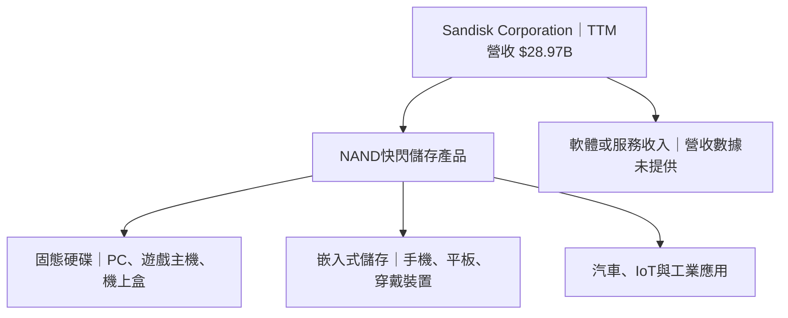
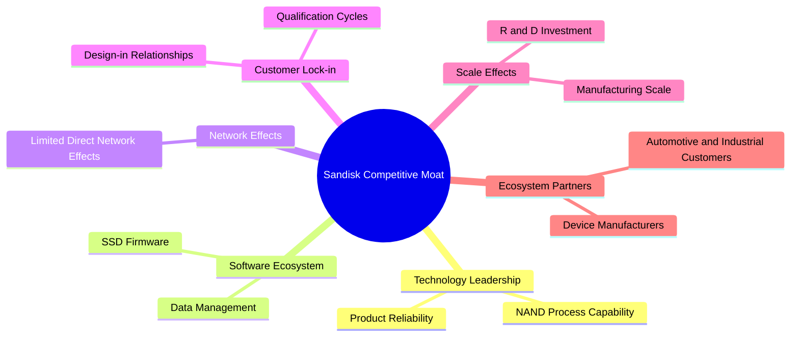
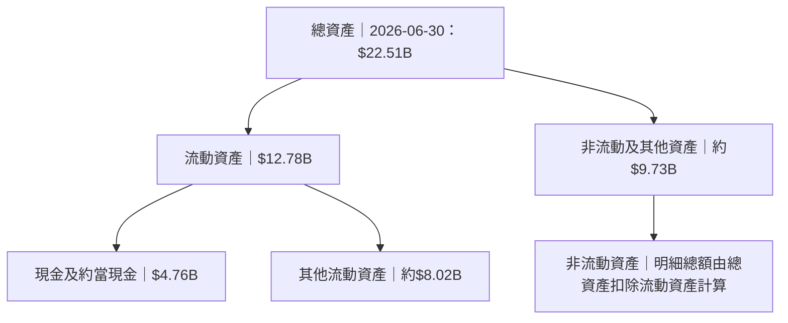
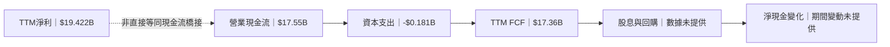
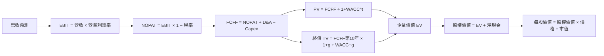
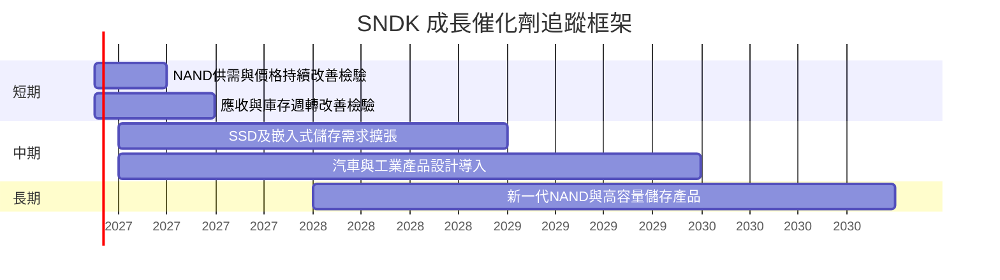
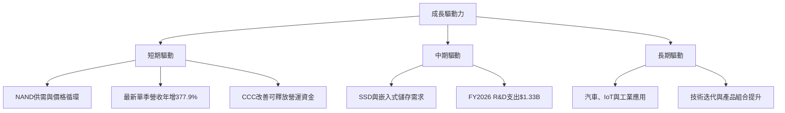
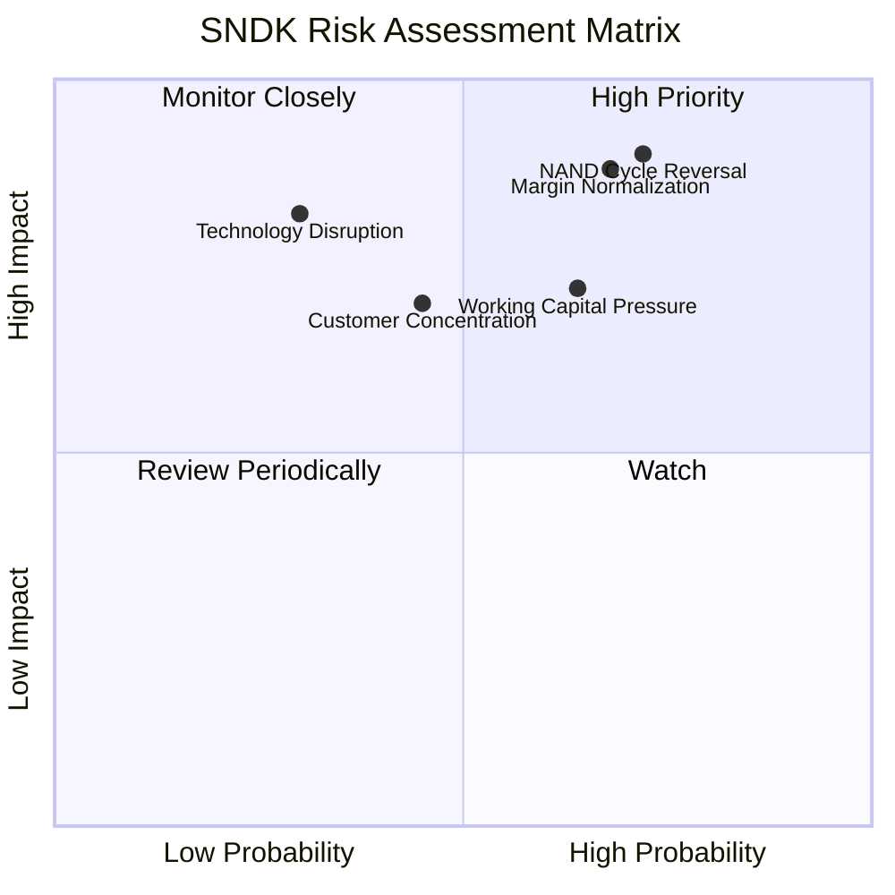
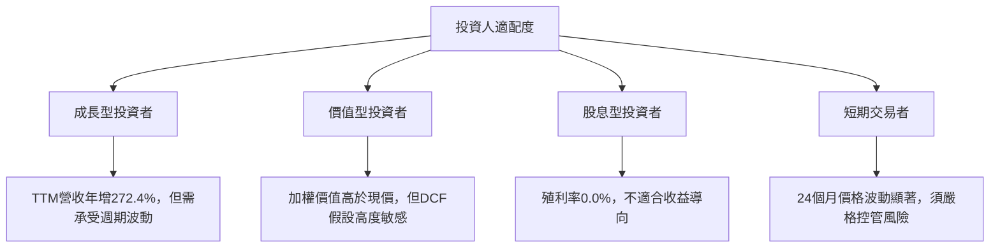

# SNDK 基本面深度分析報告
> **報告日期**：2026-11-16 ｜ **語言**：繁體中文 ｜ **數據來源**：SEC 申報資料 (XBRL)、Yahoo Finance、Finviz、StockAnalysis、Roic.ai ｜ **分析師**：CFA 級機構研究

## 目錄

| # | 章節 | 核心結論 |
|---|------|----------|
| 1 | 執行摘要 | 強烈買入；加權合理價值 $2,940.64；MOS +69.9% |
| 2 | 公司概覽與商業模式 | NAND 儲存產品受惠需求復甦，但產品別營收占比未提供 |
| 3 | 損益表深度分析 | TTM 營收 $28.97B，TTM 年增 272.4%；獲利率處於景氣高峰區間 |
| 4 | 資產負債表分析 | 淨現金 $5.14B；CCC 從 154 天升至 226 天，營運資金占用增加 |
| 5 | 現金流量深度分析 | TTM FCF $17.36B、FCF Yield 13.79%；應收與庫存需密切監控 |
| 6 | 獲利能力與資本效率 | ROIC 141.2% 高於 WACC 10.19%，但高峰期獲利可能令 ROIC 偏高 |
| 7 | 相對估值分析 | 同業估值與自身 P/S 歷史位置顯示估值並非歷史極端 |
| 8 | DCF 內在價值評估 | 基準 DCF $4,682.01／股；模型對長期利潤率與終值假設高度敏感 |
| 9 | 成長催化劑 | 儲存需求與 NAND 價格循環是主要催化，TAM 數字未提供 |
| 10 | 風險矩陣 | 週期反轉、利潤率正常化、營運資金拉長為主要風險 |
| 11 | 投資建議 | 依 MOS 規則為強烈買入；須以財報指標驗證估值模型的高利潤率假設 |

## 1. 執行摘要

SNDK 的 2026-11-13 收盤價為 **$885.01**。TTM 營收 **$28.97B**、TTM 年增 **272.4%**，最新單季年增 **377.9%**；TTM FCF 為 **$17.36B**、FCF Yield **13.79%**，而 ROIC **141.2%** 高於 WACC **10.19%**。估值方法加權後合理價值為 **$2,940.64**，MOS **+69.9%**；按規則 20，評級為 **🟢 強烈買入**。但單季營業利益率達 **79.6%**，遠高於一般可長期外推的水準，且現金轉換週期升至 **226 天**，因此「強烈買入」依賴獲利能否在 NAND 景氣降溫時維持。

### 1.0 一頁式投資儀表板（Portfolio Manager 30 秒速讀）

| 項目 | 內容 |
|------|------|
| **投資論點（3 句）** | ① TTM 營收年增 **272.4%**，反映儲存需求與產業價格環境顯著改善。② TTM FCF **$17.36B**、FCF Yield **13.79%**，目前現金創造能力高。③ ROIC **141.2%** 高於 WACC **10.19%**，目前帳面上具高價值創造，但需留意景氣高峰造成的失真。 |
| **綜合評分** | **7.4/10**（引用 1.1 評分卡） |
| **財務健康** | 🟢 現金與短期投資 **$5.14B**、流動比率 **2.58**；但 CCC **226 天**且債務完整資料缺漏。 |
| **ROIC vs WACC** | **141.2% vs 10.19%**，目前差額 **+131.01 個百分點**，顯示當期創造價值。 |
| **FCF 趨勢** | 近年由負轉正；TTM FCF **$17.36B**、FCF Yield **13.79%**。 |
| **估值** | Forward P/E **3.06x** ｜ EV/EBITDA **5.70x** ｜ FCF Yield **13.79%**。 |
| **DCF 內在價值（基準）** | **$4,682.01**；現價相對 DCF 折價 **81.1%**（現價 ÷ DCF 基準價 − 1）。 |
| **安全邊際（MOS）** | **+69.9%＝($2,940.64 − $885.01) ÷ $2,940.64**；基準為 8.8 加權合理價值。🟢 >25% 充足。 |
| **預期報酬（基準情境 12M）** | N/A（DCF 基準情境不是明確 12 個月預測；基準 DCF 相對現價上行空間為 **+429.0%**，不可直接視為 12M 報酬預測）。 |
| **關鍵風險（前二）** | NAND 景氣與價格反轉；營業利潤率從峰值回落並同步拉低現金流。 |
| **評級 + 信心度** | 🟢 **強烈買入** ｜ 信心：中（估值輸入與週期可持續性不確定）。 |

### 1.1 綜合評分卡（全報告唯一）

| 維度 | 評分（1–10） | 主要依據（引用數字與其來源章節） |
|------|--------------|----------------------------------|
| 成長性 | 9.0 | TTM 營收年增 **272.4%**、最新單季年增 **377.9%**（第 3 章）；增速高，但周期性使可持續性存疑。 |
| 獲利能力 | 9.0 | TTM 營業利益率 **72.5%**、ROIC **141.2%**，Piotroski F-Score **5/8**（第 3、6 章）。 |
| 財務健康 | 7.0 | 淨現金 **$5.14B**、流動比率 **2.58**；CCC 從 **154 天**升至 **226 天**（第 4 章）。 |
| 估值 | 7.0 | 加權合理價值 **$2,940.64**、MOS **69.9%**；但 DCF 基準價遠高於同業相對估值（第 7、8 章）。 |
| 護城河 | 6.0 | NAND 製造規模與產品驗證具價值，但同業可競爭、產品價格具週期性，且缺市場份額資料（第 2 章）。 |
| 管理層與資本配置 | 6.5 | FY2026 SBC **$232M**；FY2026 Capex **$177M**，未提供足以評估回購成效的資料，稀釋股數測試未通過（第 3、5、6 章）。 |
| **綜合評分** | **7.4** | 六項算術平均：**(9.0 + 9.0 + 7.0 + 7.0 + 6.0 + 6.5) ÷ 6 = 7.4**；按一位小數四捨五入應為 **7.4**。 |

> **評分覆核修正：**六項子評分算術平均為 **7.4/10**，故儀表板與本表綜合評分統一採 **7.4/10**。

### 1.2 五大投資論點 + 三大核心風險

| 類型 | 項目 | 具體依據 | 信心度 |
|------|------|----------|--------|
| 🟢 **投資論點①** | 營收快速擴張 | TTM 營收 **$28.97B**、年增 **272.4%**；FY2026 年營收 **$20.25B**，較 FY2025 **$7.36B** 增長 **175.3%**。 | 🟢 高 |
| 🟢 **投資論點②** | 高現金流能力 | TTM 營業現金流 **$17.55B** 減 Capex **$181M**，得 FCF **$17.36B**；FCF Yield **13.79%**。 |
| 🟢 **投資論點③** | 目前資本回報高 | ROIC **141.2%**，WACC **10.19%**；即使 ROIC 從峰值大幅回落，仍有緩衝空間。 |
| 🟢 **投資論點④** | 資產負債表有現金緩衝 | 現金與短期投資 **$5.14B**；淨現金數據採 VERIFIED FIGURES。 |
| 🟢 **投資論點⑤** | 同業倍數下相對估值可支持 | SNDK Forward P/E **3.06x**，低於 WDC **7.3x**、MU **3.7x**、SKHY **3.2x**；惟週期利潤高峰可能壓低倍數。 |
| 🟡 **風險①** | NAND 價格反轉 | TTM 營業利益率 **72.5%**，若價格或稼動率下行，營業槓桿可能導致利潤率快速收縮。 |
| 🔴 **風險②** | 營運資金占用惡化 | CCC 從 **154 天**升至 **226 天**，DIO **190 天**、DSO **83 天**，可能使已確認盈餘無法同步轉成現金。 |
| 🟡 **風險③** | DCF 依賴高利潤率延續 | DCF 預測 FY+10 營業利益率仍為 **61.2%**；若回歸更低的週期平均值，內在價值將大幅下修。 |

### 1.3 快速統計卡片

| 指標 | 公司實際值（期間） | 同業中位數 | 狀態 |
|------|--------------------|------------|------|
| 營收成長（TTM） | **272.4%** | — | 🟢 |
| 營收成長（最新一季年增） | **377.9%** | **327.9%** | 🟢 |
| 毛利率（TTM） | **80.0%** | **77.4%** | 🟢 |
| 營業利益率（TTM） | **72.5%** | — | 🟢 |
| ROIC（TTM） | **141.2%** | — | 🟢 |
| Forward P/E | **3.06x** | **3.7x** | 🟢 |
| FCF Yield（TTM） | **13.79%** | — | 🟢 |
| Piotroski F-Score | **5 / 8** | — | 🟡 |

同業中位數按 Peer multiples 有效資料計算：最新單季營收年增率三家中位數 **327.9%**；毛利率中位數 **77.4%**；Forward P/E 中位數 **3.7x**。

### 1.4 投資結論

```text
╔══════════════════════════════════════════════════════════════════╗
║                    📊 投資結論摘要                               ║
╠══════════════════════════════════════════════════════════════════╣
║  評級：強烈買入（規則 20；MOS 69.9%，ROIC 141.2% > WACC 10.19%）  ║
║  價格（2026-11-13 收盤）：$885.01                                ║
║  DCF 內在價值（基準）：$4,682.01（折價 81.1%）                   ║
║  安全邊際 MOS：+69.9%（＝(加權合理價值−現價)÷加權合理價值）     ║
║  加權合理價值（8.8）：$2,940.64                                  ║
║  DCF 情境價值：                                                  ║
║    悲觀情境：$1,998.21（+125.8%）                                ║
║    基準情境：$4,682.01（+429.0%）                                ║
║    樂觀情境：$10,390.78（+1,074.1%）                             ║
║  綜合評分：7.4/10（引用 1.1）                                    ║
║  適合投資人：能承受 NAND 週期、價格波動與估值假設風險的成長型投資人║
╚══════════════════════════════════════════════════════════════════╝
```

## 2. 公司概覽與商業模式

### 2.1 業務結構與收入來源

公司資料指出，Sandisk 開發、製造並銷售 NAND 快閃記憶體儲存產品，包括固態硬碟及嵌入式快閃儲存，應用於 PC、遊戲主機、手機、汽車、IoT、工業及可攜式裝置。財務資料提供 TTM 營收 **$28.97B**，但未提供各產品、終端市場或軟體服務的營收與占比；因此不以未披露的數字製作收入占比圖。



營收快速成長為需求、產品價格及產品組合共同作用的結果；現有資料無法將三者對收入變化的貢獻分拆，因此不能把單季高增長直接外推為長期單位需求增長。

### 2.2 市場份額

市場份額數據未提供。SNDK TTM 營收 **$28.97B**、最新單季營收年增 **377.9%**，高於同業三家最新單季成長率中位數 **327.9%**；但收入成長比較不等同市場份額變化，也可能受到基期、定價與產品組合影響。

### 2.3 競爭護城河分析



### 2.4 護城河強度

| 護城河項目 | 強度（強／中／弱） | 證據（引用數字或事實） | 會削弱它的情況 |
|------------|--------------------|------------------------|----------------|
| 技術與產品能力 | 中 | 公司提供 NAND SSD 與嵌入式儲存；FY2026 R&D 支出 **$1.33B**。 | 技術差距縮小、良率落後或替代儲存技術加速。 |
| 軟體生態系統 | 弱至中 | 有 SSD 韌體與產品管理能力的產業需求，但財務資料未披露服務收入或黏著度。 | 軟體差異化不足，客戶改以價格採購。 |
| 網路效應 | 弱 | 現有資料未顯示產品使用者增加會直接提升其他客戶價值。 | 競品提供相近規格並以價格競爭。 |
| 客戶鎖定 | 中 | 車用、工業與嵌入式產品通常需要驗證，但客戶留存率、合約長度未提供。 | 客戶重新驗證替代供應商成功。 |
| 規模效應 | 中 | FY2026 R&D **$1.33B**，FY2026 營收 **$20.25B**；規模可分攤研發與製造成本。 | 下行週期造成產能利用率下降，固定成本吸收惡化。 |
| 生態夥伴 | 中 | 產品供應 PC、手機、汽車、IoT 等多類終端；客戶集中度資料未提供。 | 大型客戶垂直整合或要求多來源供應。 |

護城河分數引用 1.1 的 **6.0/10**：產品驗證、研發與製造規模提供一定優勢，但價格週期性和缺少可量化客戶黏著數據限制評分。

## 3. 損益表深度分析

### 3.1 年度收入成長趨勢（近4年）

FY2023 至 FY2026 營收由 **$6.09B** 增至 **$20.25B**；三年 CAGR 約 **49.3%**。計算為 \((20.25 ÷ 6.09)^{1/3} - 1 \approx 49.3\%\)。FY2026 的加速幅度主要來自 2025–2026 儲存產業景氣與產品價格/需求改善，不能視為長期穩態成長率。

```text
╔══════════════════════════════════════════════════════════════════╗
║               Sandisk 年度收入趨勢（FY2023-FY2026）              ║
╠══════════════════════════════════════════════════════════════════╣
║  FY2023  $6.09B   ██████░░░░░░░░░░░░░░░░░░░  YoY: N/A          ║
║  FY2024  $6.66B   ███████░░░░░░░░░░░░░░░░░░  YoY: +9.5%        ║
║  FY2025  $7.36B   ████████░░░░░░░░░░░░░░░░░  YoY: +10.4%       ║
║  FY2026  $20.25B  █████████████████████████  YoY: +175.3%      ║
║                                                                  ║
║  FY2023-FY2026 三年營收 CAGR：約 +49.3%                           ║
╚══════════════════════════════════════════════════════════════════╝
```

### 3.2 季度收入趨勢分析

| 季度 | 營收 | QoQ 成長 | YoY 成長 | 備註 |
|------|------:|---------:|---------:|------|
| 2025-12-31 | $3.025B | +31.1% | +61.25% | 以 2025-10-02 季營收 $2.308B 為前季；YoY 取 StockAnalysis 單季數據。 |
| 2026-03-31 | $5.950B | +96.7% | +251.03% | 絕對營收與年增率同步加速。 |
| 2026-06-30 | $8.965B | +50.7% | +371.59% | 成長基期相對低，仍需區分價格與出貨量效應。 |
| 2026-10-02 | $11.031B | +23.0% | +377.9% | 最新季度，YoY 是單季年增率，不是 TTM；QoQ 以 $8.965B 為基期。 |

最新四季營收連續增加，QoQ 成長率由 **96.7%** 降至 **23.0%**，代表季度成長速度已放緩，但單季營收仍擴大。季營收與邊際增速的延續，取決於 NAND 定價、供應紀律及終端需求。

### 3.3 利潤率演變分析

以下年度利潤率依年度損益表計算；TTM 與最新季比率則採 VERIFIED FIGURES。

| 利潤率指標 | FY2023 | FY2024 | FY2025 | FY2026 | 趨勢 | 評估 |
|------------|-------:|-------:|-------:|-------:|------|------|
| **毛利率** | 7.1% | 16.1% | 30.1% | 71.5% | FY2026 大幅提升 | 🟢 |
| **營業利益率** | -21.3% | -6.7% | 6.9% | 61.6% | 虧損轉為高利潤 | 🟢 |
| **淨利率** | -35.2% | -10.1% | -22.3% | 56.4% | FY2025 仍虧損，FY2026 反彈 | 🟡 |

FY2026 毛利率與營業利益率大幅上升，與收入規模擴大、產能與固定成本吸收改善及 NAND 價格環境改善相符；但現有資料無法分拆價格、出貨量及產品組合各自貢獻。FY2026 年度營業利益率約 **61.6%**，而 TTM VERIFIED FIGURES 為 **72.5%**、最新季度為 **79.6%**，顯示近期獲利率仍在上行，也使回歸週期均值的風險上升。

### 3.4 費用結構分析

收入成本與營業費用明細資料不足以製作完整費用結構圖；可引用的 FY2026 R&D 為 **$1.33B**，但銷售管理費、製造成本等明細未完整提供，因此不以不完整項目拼成圓餅圖。FY2026 R&D 占當年營收約 **6.6%**（$1.33B ÷ $20.25B），代表公司仍投入相當資源於技術與產品開發。

### 3.5 季度 EPS 趨勢與盈餘品質（Quality of Earnings）

| 盈餘品質項目 | 數值/佔比 | 評估 |
|--------------|-----------|------|
| 股權薪酬 SBC / 營收 | 約 **0.93%**（四季 SBC 合計 $270M ÷ TTM 營收 $28.97B） | 🟡 占比不高，但仍是現有股東的經濟成本；稀釋股數測試未通過。 |
| SBC / 營業現金流 | 約 **1.54%**（$270M ÷ $17.55B） | 🟢 佔營業現金流比率低。 |
| FCF / 淨利（現金轉換率） | 約 **89.4%**（TTM FCF $17.36B ÷ StockAnalysis TTM 淨利 $19.422B） | 🟢 現金轉換良好，但低於 100%，且 F-Score 的應計品質測試未通過。 |
| 一次性/非經常性損益 | N/A（未提供可量化明細） | 無法判定近期盈餘有無重大一次性項目。 |
| 有效稅率異常 | **12.2%**（最新年度有效稅率） | 未見資料證明異常；稅率變動仍會影響高利潤模型的 NOPAT。 |
| 資本化支出 vs 費用化 | FY2026 Capex **$177M**；FY2026 R&D **$1.33B** | Capex 相對營收低，但缺乏資本化政策明細，不能判斷是否遞延費用。 |

四季 EPS 估計值與實際值欄位均為 NaN，故 **2025-12-31、2026-03-31、2026-06-30、2026-09-30** 的 EPS 超預期/不及預期均為 **N/A**，不能以空值判成 beat 或 miss。可觀察的 EPS 實際值分別為 **$5.15、$23.03、$43.96、$52.60**，但 EPS 實際值增加不等同於超預期。

**盈餘品質結論：**本期現金流與盈餘規模相稱，SBC 占比低；然而應計品質測試未通過、CCC 拉長、一次性損益細節缺漏。因此目前 GAAP 獲利有實際現金支持，但週期高峰與營運資金需求意味著不宜將當期淨利視為穩態盈餘。

## 4. 資產負債表分析

### 4.1 資產結構分解

2026-06-30 總資產為 **$22.51B**。另一個 TTM/季度資料來源列出 2026-10-02 總資產 **$25.793B**，但細項與年度表口徑不同；因此以下結構只用 2026-06-30 年度資產負債表，不能與季度資產數字混加。



### 4.2 流動性與營運資金分析

| 指標 | 最新 TTM | 一年前 TTM | 變化 | 解讀 |
|------|----------|------------|------|------|
| 流動比率 | 2.58 | N/A | N/A | 短期資產對流動負債有覆蓋，但歷史可比值未提供於品質指標。 |
| 速動比率 | 1.994 | N/A | N/A | 排除存貨後流動性仍有緩衝。 |
| DSO 應收帳款天數 | 83 天 | 56 天 | +27 天 | 應收回收變慢；高速成長可能擴大應收款，但需觀察帳齡與收款。 |
| DIO 存貨天數 | 190 天 | 124 天 | +66 天 | 存貨占用增加；若需求轉弱，存在減價或庫存調整風險。 |
| DPO 應付帳款天數 | 46 天 | 26 天 | +20 天 | 付款天數增加，短期部分抵銷應收與存貨的資金占用。 |
| CCC 現金轉換週期 | 226 天 | 154 天 | +72 天 | 現金被營運資金占用時間拉長，與 F-Score 流動比率比較測試未通過一致。 |

週轉天數定義採應收帳款、存貨與應付帳款對應 TTM 流量計算。CCC 增加並不必然代表營運惡化，因為高速成長也會推高營運資金需求；但 DSO、DIO 同時上升，應以後續回款和存貨周轉實績驗證。

### 4.3 債務結構分析

VERIFIED FIGURES 對總債務列為 **N/A**，不可反推或用其他來源替代。其他市場資料列示總債務 **$201M**，年度表列示 2026-06-30 債務 **$177M**；口徑與日期不一致，故本節以已驗證的淨現金 **$5.14B** 為主，債務倍數不作計算。

```text
╔══════════════════════════════════════════════════════════════════╗
║                 Sandisk 債務健康診斷                             ║
╠══════════════════════════════════════════════════════════════════╣
║  VERIFIED FIGURES 總債務：N/A（不可用不同口徑補值）              ║
║  現金+短期投資： $5.14B  ████████████████████  🟢                ║
║  淨現金：        $5.14B  ████████████████████  🟢                ║
║  流動比率：      2.58x   🟢                                      ║
║  Debt/EBITDA：   N/A（總債務不可用）                              ║
║  Interest Coverage：N/A（利息費用及一致債務口徑不足）            ║
╚══════════════════════════════════════════════════════════════════╝
```

### 4.4 股東權益趨勢

| 財年 | 股東權益 | YoY 變化 |
|------|---------:|---------:|
| 2024-06-30 | $11.08B | N/A |
| 2025-06-30 | $9.22B | -16.8% |
| 2026-06-30 | $15.74B | +70.7% |

FY2026 權益增加與年度淨利 **$11.43B** 同期出現；但未提供權益變動表完整明細，故不能將權益變化全數歸因於盈餘或其他特定項目。

## 5. 現金流量深度分析

### 5.1 現金流量瀑布圖

最新 TTM 淨利未採用於此瀑布圖作為營業現金流橋接，因兩者期間與調整項目不同。採用已驗證的 TTM 營業現金流與 Capex，其他現金配置細目未提供。



### 5.2 FCF 轉換率趨勢

| 財年 | FCF | 淨利 | FCF/淨利 | 解讀 |
|------|----:|----:|---------:|------|
| FY2023 | -$0.932B | -$2.143B | 43.5% | 兩者皆為負，比例不代表良好現金轉換。 |
| FY2024 | -$0.475B | -$0.672B | 70.7% | FCF 仍負，營業現金流不足以覆蓋投資支出。 |
| FY2025 | -$0.120B | -$1.641B | 7.3% | 兩個負數相除，單看比率不宜解讀為品質良好。 |
| FY2026 | $11.49B | $11.43B | 100.5% | 獲利反彈同時轉為正現金流。 |
| TTM | $17.36B | $19.422B | 89.4% | FCF 有現金支持，但低於淨利。 |

### 5.3 自由現金流趨勢

| 財年 | FCF | 年度營收 | FCF Margin |
|------|----:|---------:|-----------:|
| FY2023 | -$0.932B | $6.09B | -15.3% |
| FY2024 | -$0.475B | $6.66B | -7.1% |
| FY2025 | -$0.120B | $7.36B | -1.6% |
| FY2026 | $11.49B | $20.25B | 56.7% |
| TTM | $17.36B | $28.97B | 59.9% |

FY2026 轉正幅度反映獲利回升和低 Capex，但 FCF margin **56.7%**、TTM **59.9%** 位於極高水準，對 NAND 定價和高毛利產品組合敏感，不能當作跨週期正常值。

```text
╔══════════════════════════════════════════════════════════════════╗
║                    FCF 歷史趨勢                                  ║
╠══════════════════════════════════════════════════════════════════╣
║  FY2023  -$0.932B  ░░░░░░░░░░  負 FCF                           ║
║  FY2024  -$0.475B  ░░░░░░░░░░  負 FCF                           ║
║  FY2025  -$0.120B  ░░░░░░░░░░  接近損益兩平                     ║
║  FY2026  $11.49B   ████████████████████                          ║
║  TTM     $17.36B   ██████████████████████████████                ║
║  TTM FCF Yield：13.79%                                            ║
╚══════════════════════════════════════════════════════════════════╝
```

### 5.4 資本配置評估

現有資料未提供可完整拆分的回購、股息及留存現金金額，故不製作比例圓餅圖。可量化部分包括：FY2026 Capex **$177M**、SBC **$232M**、股息殖利率 **0.0%**；TTM Capex **$181M**。公司沒有股息支出資料，現階段現金主要保留在資產負債表或用於營運、投資，具體配置比例 N/A。

## 6. 獲利能力與資本效率

### 6.1 ROE / ROA / ROIC 趨勢

| 指標 | 歷史數據 | 評估 |
|------|----------|------|
| ROE | TTM **107.1%**（QUALITY FIGURES）；另一來源列示 **141.2%** | 來源口徑不一致；本報告杜邦使用品質指標的 **107.1%**，ROIC 採驗證值 **141.2%**。 |
| ROA | TTM **68.3%**（市場資料） | 高，與本輪獲利高峰相符；未提供完整一致歷年品質指標序列。 |
| ROIC | TTM **141.2%** | 顯著高於 WACC，但需以週期中段回報率而非景氣高點判斷長期價值。 |

沒有可引用的同業 ROE／ROA／ROIC 中位數，故不填行業均值。

### 6.2 ROIC vs WACC 分析（核心價值創造判斷）

WACC 使用 VERIFIED FIGURES 的 **10.19%**。ROIC 使用 **141.2%**，依此計算 ROIC-WACC 為 **131.01 個百分點**。WACC 的組成包括無風險利率 **5.15%**、ERP **5.00%**、調整後 Beta **1.00**、股權成本 **10.15%**、稅前債務成本 **36.32%**、稅率 **12.2%**，股權／債務權重 **99.8%／0.2%**。

```text
╔══════════════════════════════════════════════════════════════════╗
║                  ROIC vs WACC 深度分析                            ║
╠══════════════════════════════════════════════════════════════════╣
║  WACC（採用 VERIFIED FIGURES）：10.19%                            ║
║  ├── 無風險利率（10Y美債）： 5.15%                               ║
║  ├── 市場風險溢酬（假設）： 5.00%                               ║
║  ├── Beta 原始值：N/A；調整後採用值：1.00（假設）                ║
║  ├── 股權成本：5.15% + 1.00 × 5.00% = 10.15%                    ║
║  ├── 稅前債務成本：36.32%；有效稅率：12.2%                       ║
║  ├── 股權／債務權重：99.8%／0.2%                                 ║
║  └── WACC：10.19%                                                 ║
║                                                                  ║
║  ROIC（TTM）：141.2%                                              ║
║  ROIC − WACC = 141.2% − 10.19% = +131.01 個百分點               ║
║  ROIC  141.2%  ▓▓▓▓▓▓▓▓▓▓▓▓▓▓▓▓▓▓▓▓▓▓▓▓  🟢                    ║
║  WACC   10.19% ▓▓░░░░░░░░░░░░░░░░░░░░░░░░  ──                  ║
║                                                                  ║
║  結論：當期 ROIC 高於資本成本，當期數據顯示創造股東價值；        ║
║  但高峰期利潤率與投入資本口徑可能使 ROIC 高於跨週期可持續水準。  ║
╚══════════════════════════════════════════════════════════════════╝
```

WACC 的 Beta 採調整後 **1.00**，原始 Yahoo Beta 為 N/A，不能從其他資料自行補算。資料未提供無風險利率觀察日期，因此只能確認數值 **5.15%**，不能指定日期。WACC 與 DCF 一致採 **10.19%**。值得注意的是債務成本輸入 **36.32%** 對應債務權重僅 **0.2%**，高債務成本對 WACC 的加權影響有限；債務明細口徑仍有資料缺口。

### 6.3 杜邦三因素分解

| 因素 | 數值（TTM） | 解讀 |
|------|-------------|------|
| 淨利率 | **67.0%** | 高獲利率是 ROE 的主要推升來源，可能反映週期高峰。 |
| 資產週轉率 | **1.12** | 資產每年形成營收的周轉速度。 |
| 權益乘數 | **1.42** | 槓桿程度不高，ROE 並非主要靠財務槓桿支撐。 |
| **ROE** | **107.1%** | **67.0% × 1.12 × 1.42 = 106.5%**，與公布 **107.1%** 的差異來自各輸入四捨五入。 |

### 6.4 財務體質：Piotroski F-Score

**Piotroski F-Score：5/8**。九項測試中有一項因缺少輸入而無法判定，因此可判定分母為 8。

| 測試 | 結果 | 解讀 |
|------|------|------|
| ROA > 0 | ✅ 通過 | TTM 資產報酬為正。 |
| 營業現金流 > 0 | ✅ 通過 | TTM OCF **$17.55B**。 |
| ROA 高於一年前 | ✅ 通過 | 獲利復甦帶動資產報酬改善。 |
| 營業現金流 > 淨利（應計品質） | ❌ 未通過 | OCF 未高於淨利，需留意應計盈餘與營運資金變動。 |
| 長期負債 ÷ 總資產低於一年前 | — 無法判定 | 缺少一致的長期負債輸入。 |
| 流動比率高於一年前 | ❌ 未通過 | 相較一年前未改善。 |
| 稀釋股數未增加 | ❌ 未通過 | 股數增加可能稀釋每股價值。 |
| 毛利率高於一年前 | ✅ 通過 | 毛利率較一年前改善。 |
| 資產週轉率高於一年前 | ✅ 通過 | 資產周轉效率改善。 |

## 7. 相對估值分析

### 7.1 同業估值比較表格

同業倍數依 Yahoo Finance Peer multiples。SKHY 的 P/S、EV/EBITDA 因幣別混合標示 N/A，不納入該項中位數。

| 估值指標 | **SNDK** | **WDC** | **MU** | **SKHY** | 本公司評估 |
|----------|---------:|--------:|-------:|---------:|-----------|
| **Trailing P/E** | 7.07x | 10.4x | 10.5x | 8.4x | 🟢 低於三家同業中位數 10.4x，但景氣高峰 EPS 會壓低 P/E。 |
| **Forward P/E** | 3.06x | 7.3x | 3.7x | 3.2x | 🟢 低於同業中位數 3.7x；依賴預估獲利能維持。 |
| **P/S Ratio** | 4.35x | 7.6x | 6.6x | N/A | 🟢 低於可比同業中位數 7.1x。 |
| **EV/EBITDA** | 5.70x | 17.5x | 7.7x | N/A | 🟢 低於可比同業中位數 12.6x；景氣高峰 EBITDA 使倍數偏低。 |
| **最新單季營收 YoY** | 377.9% | 55.5% | 379.3% | 327.9% | 🟡 高增長，但成長率對照存在基期與業務組合差異。 |
| **毛利率 TTM** | 80.0% | 52.6% | 80.7% | 77.4% | 🟢 略高於同業中位數 77.4%。 |

SNDK 估值相對偏低，但極低 Forward P/E 不應孤立看待：當獲利處於週期高峰時，市盈率會因短期 EPS 急升而下降；若獲利回落，當前 P/E 將快速上升。

### 7.2 歷史估值區間分析

提供的歷史估值指標為 **P/S**，非 P/E，因此不以 P/E 區間替代。

```text
╔══════════════════════════════════════════════════════════════════╗
║              SNDK 五年歷史 P/S 區間                              ║
╠══════════════════════════════════════════════════════════════════╣
║  區間：0.9x ├────────────────────────────────────┤ 13.4x         ║
║  中位數：4.8x；當前：4.7x；當前百分位：43%                       ║
║  當前相對中位數：4.7x vs 4.8x，略低於五年中位數                  ║
╚══════════════════════════════════════════════════════════════════╝
```

### 7.3 情境價值（Bear / Base / Bull，照抄 DCF MODEL 的 Scenarios）

| 情境 | 第 1 年營收成長 | 期末營業利潤率 | WACC | 每股價值 | 相對現價 | 機率 | 會發生的條件 |
|------|----------------|----------------|------|----------:|----------:|------:|--------------|
| 🔴 悲觀 | 15.0% | 52.0% | 11.19% | **$1,998.21** | +125.8% | 25% | NAND 定價和出貨成長明顯放緩，利潤率回歸較低水準，風險溢酬上升。 |
| 🟡 基準 | 30.0% | 61.2% | 10.19% | **$4,682.01** | +429.0% | 50% | 成長逐步遞減，期末利潤率回落但仍高於一般週期中段。 |
| 🟢 樂觀 | 45.0% | 67.3% | 9.19% | **$10,390.78** | +1,074.1% | 25% | 成長高於基準且高利潤率延續，市場風險折現率降低。 |

### 7.4 相對估值隱含價格區間

```text
╔══════════════════════════════════════════════════════════════════╗
║             估值方法隱含每股價格                                  ║
╠══════════════════════════════════════════════════════════════════╣
║  $885.01 現價 ── $1,451.05 P/S ── $1,909.62 EV/EBITDA            ║
║                       $2,047.38 分析師共識 ── $4,682.01 DCF       ║
╚══════════════════════════════════════════════════════════════════╝
```

- **同業 EV/EBITDA：$1,909.62／股。**依 WDC、MU 同業中位數 **12.6x**，乘上 SNDK TTM EBITDA，再加回淨現金。
- **同業 P/S：$1,451.05／股。**依 WDC、MU 同業中位數 **7.1x**，乘上 SNDK TTM 營收。
- **分析師共識：$2,047.38／股。**24 位分析師平均目標價。
- 數值來自既定估值方法表，未以公司自身當前倍數反推。

## 8. DCF 內在價值評估（Discounted Cash Flow）

### 8.0 估值推理鏈（Thinking Logic：在算之前先想清楚）

**Step 1 — 價值來源與主導變數**

SNDK 的估值核心是現有 NAND 儲存產品產生的現金流；資料顯示 TTM 營收 **$28.97B**，但未提供分部營收，無法把「主業、第二成長曲線、新業務」各自的收入占比分拆。對本次 DCF 而言，主導估值的是**營業利潤率能否長期維持在高位**：DCF 預測第 1 年為 **72.5%**，第 10 年仍為 **61.2%**，而 TV 現值占 EV **57.2%**。

**Step 2 — 模型選擇**

| 決策點 | 本報告採用 | 理由（含數字） | 曾考慮但否決 | 否決理由 |
|--------|-----------|----------------|--------------|----------|
| 現金流定義 | FCFF | 以 WACC **10.19%** 折現，先求 EV 再加淨現金。 | FCFE | 對企業價值的橋接與既定模型不一致。 |
| 預測期 N | 10 年 | DCF MODEL 固定預測 FY+1 至 FY+10，提供逐年遞減成長路徑。 | 5 年 | 未使用；會改變終值起算點，且與既定模型不一致。 |
| 終值方法 | Gordon Growth | 使用終值成長率 **3.0%**；WACC **10.19%** 大於 g。 | 僅退出倍數 | DCF MODEL 未提供退出倍數終值；不得自行新增。 |
| EBIT 基礎 | GAAP | 模型標示 GAAP EBIT，SBC 已作為費用。 | 非 GAAP EBIT | 若加回 SBC，需再扣除或另計稀釋；與模型定義不符。 |

**Step 3 — 關鍵假設推導鏈**

- **營收成長路徑**：錨點＝TTM 營收年增 **272.4%**，FY2026 營收年增 **175.3%**，最新單季年增 **377.9%** → 調整＝基期快速擴大後不宜沿用極端成長，模型將第 1 年限制於 30.0%，並線性降至第 10 年 3.0% → **採用：第 1 年 30.0%、第 10 年 3.0%** → 曾考慮長期維持 TTM 高成長，因基期與週期不支持十年延續而否決。
- **營業利潤率**：錨點＝TTM **72.5%**、最新季度 **79.6%**；FY2026 年度營業利益率約 **61.6%** → 調整＝由 TTM 高點逐步回落至最近三個財年的中位值 → **採用：第 1 年 72.5% 線性降至第 10 年 61.2%** → 曾考慮直接採較低年度平均，但模型採用的期末值仍高，應視為樂觀而非保守。
- **永續成長率 g**：錨點＝終值長期成長需低於 WACC，並需避免高於長期經濟成長可支持區間 → 調整＝不採用高速成長延續到永續期 → **採用 3.0%** → 否決高於 WACC 的值，因 Gordon Growth 公式在 WACC ≤ g 時失效。
- **預測期 N**：錨點＝模型列示 10 年逐年現金流，且涵蓋由 30.0% 成長遞減至 3.0% 的路徑 → 調整＝以較長期間表達景氣回歸而非單一年度倍數 → **採用 10 年** → 曾考慮短期預測期，但會將更多價值推入終值，故依模型既定期間。
- **Capex/營收**：錨點＝TTM Capex **$181M**、TTM 營收 **$28.97B**；模型採第 1 至第 10 年約 **0.6%** → 調整＝假設未來投資強度維持低位 → **採用 0.6%** → 未採用更高資本密集度，需注意這可能低估擴產與技術更新所需投資。
- **EBIT 基礎與 SBC**：錨點＝FY2026 SBC **$232M**，四季 SBC 合計 **$270M** → 調整＝模型使用 GAAP EBIT，SBC 已作費用 → **採組合 (A)：GAAP EBIT、FCFF 不另扣 SBC、股數不再增加** → 否決非 GAAP 加回 SBC，避免在股數固定下漏掉股東成本。
- **年稀釋率**：錨點＝Piotroski 的稀釋股數測試未通過 → 調整＝DCF MODEL 明確採組合 (A)，以 GAAP EBIT 計入 SBC、股數固定 → **採用 0% 額外稀釋** → 若另套用稀釋率會重複計入 SBC 成本；但此設計仍需留意既有稀釋已反映在現有股數中。
- **終值方法**：錨點＝第 10 年 FCFF **$69.69B**，且 WACC **10.19%** 大於 g **3.0%** → **採用 Gordon Growth** → 未提供退出倍數終值，故不自行補建。
- **WACC**：錨點＝Cost of capital 數值 **10.19%** → 調整＝不另估算或調整 → **採用 10.19%** → 不另採較低折現率，因原始 Beta 缺漏且產業具有週期性。

**Step 4 — 最脆弱環節**

最脆弱假設是高營業利潤率持續：基準模型第 10 年仍採 **61.2%**；若利潤率回落，估值將明顯下降，與 8.6 對 WACC、g 的敏感性相同屬關鍵價值驅動因素。

**Step 5 — 計算路徑圖**



### 8.1 模型假設總表（Model Inputs）

| 假設項目 | 採用值 | 依據 / 來源 | 敏感度 |
|----------|--------|-------------|--------|
| 預測期長度 **N** | **10 年** | DCF MODEL 固定預測期間。 | 🟡 中 |
| 營收成長 | 第 1 年 **30.0%**，第 10 年 **3.0%** | TTM 年增 **272.4%**；成長線性衰減，依模型採用 0%–30% 範圍。 | 🔴 高 |
| 營業利潤率 | 第 1 年 **72.5%**，第 10 年 **61.2%** | TTM 營業利益率 **72.5%**，逐步衰減至模型指定最近三財年中位值。 | 🔴 高 |
| 有效稅率 | **12.2%** | 最新年度有效稅率。 | 🟢 低 |
| Capex / 營收 | 第 1 年至第 10 年約 **0.6%** | TTM Capex $181M / TTM 營收 $28.97B 約 0.6%；依模型固定/漸進設定。 | 🟡 中 |
| D&A / 營收 | **0.5%** | DCF MODEL 取 TTM 比率並維持。 | 🟢 低 |
| 營運資金變動 / 營收增額 | **未建模** | DCF MODEL 明確未納入營運資金變動。 | 🟢 低 |
| EBIT 基礎 | **GAAP** | DCF MODEL 使用 GAAP EBIT。 | 🟡 中 |
| SBC 處理 | GAAP EBIT 已含 SBC；不另扣 SBC | 財報 SBC 已計入費用；採組合 (A)。 | 🟡 中 |
| 年稀釋率 | **0% 額外稀釋** | 組合 (A)，使用現有股價/市值推導的股數換算，未再逐年放大。 | 🟡 中 |
| 永續成長率 g | **3.0%** | DCF MODEL 假設；小於 WACC **10.19%**。 | 🔴 高 |
| 終值方法 | **Gordon Growth** | DCF MODEL 已計算終值。未提供退出倍數法輸入。 | 🔴 高 |
| WACC | **10.19%** | VERIFIED FIGURES Cost of capital。 | 🔴 高 |

FCFF 定義為 **FCFF = NOPAT + D&A − Capex**；模型不包含 ΔWC。**本模型採用 (A)，故 SBC 影響已計入一次**：GAAP EBIT 已含 SBC、不另扣 SBC，且股數不做額外逐年稀釋。

### 8.2 折現率推導（WACC）

```text
╔══════════════════════════════════════════════════════════════════╗
║                    WACC 推導（折現率）                           ║
╠══════════════════════════════════════════════════════════════════╣
║  股權成本 Ke（CAPM）：                                           ║
║  ├── 無風險利率 Rf（10Y 美債）：      5.15%                      ║
║  ├── 市場風險溢酬 ERP：               5.00%（假設）             ║
║  ├── 原始 Beta：                      N/A                        ║
║  ├── 調整後 Beta：                    1.00（假設）               ║
║  ├── 規模/國別溢酬：                  0.00%（未另加）            ║
║  └── Ke = 5.15% + 1.00 × 5.00% = 10.15%                        ║
║                                                                  ║
║  債務成本 Kd：                                                   ║
║  ├── 稅前 Kd：                        36.32%                     ║
║  ├── 有效稅率：                       12.2%                      ║
║  └── 稅後 Kd = 36.32% × (1 − 12.2%) = 31.89%                    ║
║                                                                  ║
║  資本結構：E / D = 99.8% / 0.2%                                  ║
║  └── WACC：                           10.19%                     ║
╚══════════════════════════════════════════════════════════════════╝
```

**逐步演算：**資料未提供股權市值、計息債務平均餘額及期末計息負債同口徑的完整計算明細；依規則 19，直接採用已驗證的 WACC 及各組成，不另造一套數值。可核對的部分如下：

1. **Ke** = Rf + β × ERP = **5.15% + 1.00 × 5.00% = 10.15%**。
2. **稅前 Kd** = 財務數據所列利息/債務比率 **36.32%**；利息費用與平均計息負債明細 N/A。
3. **稅後 Kd** = **36.32% × (1 − 12.2%) = 31.89%**。
4. **權重** = 股權 **99.8%**；債務 **0.2%**，合計 **100.0%**。市值與計息債務的逐項原始金額不足以獨立重算權重。
5. **WACC** = VERIFIED FIGURES 採用值 **10.19%**。依已提供、四捨五入後的權重及成本簡算會有尾差，因原始精度與底層權重未提供，不以重算值取代。

### 8.3 逐年自由現金流預測（基準情境）

下表逐年複製 DCF MODEL 數值，金額單位為 **$B**；折現因子保留三位小數。由於模型未建模營運資金，沒有 ΔWC 列。

| 年度 | FY+1 | FY+2 | FY+3 | FY+4 | FY+5 | FY+6 | FY+7 | FY+8 | FY+9 | FY+10（N） |
|------|-----:|-----:|-----:|-----:|-----:|-----:|-----:|-----:|-----:|----------:|
| 營收 | 37.66 | 47.83 | 59.31 | 71.77 | 84.68 | 97.39 | 109.07 | 118.89 | 126.02 | 129.80 |
| 營收 YoY | 30.0% | 27.0% | 24.0% | 21.0% | 18.0% | 15.0% | 12.0% | 9.0% | 6.0% | 3.0% |
| 營業利潤率 | 72.5% | 71.2% | 70.0% | 68.7% | 67.5% | 66.2% | 64.9% | 63.7% | 62.4% | 61.2% |
| EBIT（GAAP） | 27.29 | 34.06 | 41.49 | 49.31 | 57.12 | 64.47 | 70.84 | 75.72 | 78.69 | 79.42 |
| − 稅 | (3.32) | (4.14) | (5.05) | (6.00) | (6.95) | (7.84) | (8.62) | (9.21) | (9.58) | (9.66) |
| = NOPAT | 23.97 | 29.92 | 36.44 | 43.31 | 50.17 | 56.62 | 62.22 | 66.51 | 69.11 | 69.76 |
| + D&A | 0.20 | 0.26 | 0.32 | 0.39 | 0.46 | 0.52 | 0.59 | 0.64 | 0.68 | 0.70 |
| − Capex | (0.24) | (0.30) | (0.37) | (0.44) | (0.52) | (0.59) | (0.66) | (0.71) | (0.75) | (0.77) |
| **= FCFF** | **23.94** | **29.88** | **36.40** | **43.25** | **50.11** | **56.56** | **62.15** | **66.44** | **69.04** | **69.69** |
| 折現因子 | 0.908 | 0.824 | 0.747 | 0.678 | 0.616 | 0.559 | 0.507 | 0.460 | 0.418 | 0.379 |
| **FCFF 現值 PV** | **21.72** | **24.61** | **27.20** | **29.34** | **30.85** | **31.60** | **31.51** | **30.57** | **28.83** | **26.41** |

預測期 PV 合計逐項相加：

**$21.72 + $24.61 + $27.20 + $29.34 + $30.85 + $31.60 + $31.51 + $30.57 + $28.83 + $26.41 = $282.64B**

**FY+1 逐步演算（採模型未四捨五入的內部值；展示數字依模型表格）：**

1. 營收 = **$28.97B × (1 + 30.0%) = $37.66B**。
2. EBIT = **$37.66B × 72.5% ≈ $27.29B**（模型原值；以表格已四捨五入數字重算可能有尾差）。
3. 稅 = **模型 EBIT × 12.2% = $3.32B**。
4. NOPAT = **$27.29B − $3.32B = $23.97B**。
5. D&A = **模型營收 × D&A 比率 = $0.20B**。
6. Capex = **模型營收 × Capex 比率 = $0.24B**。
7. ΔWC = **未建模**。
8. FCFF = **模型 NOPAT + D&A − Capex = $23.94B**（模型原值；因顯示值取兩位小數有四捨五入尾差）。
9. PV = **模型 FCFF × 折現因子 0.908 = $21.72B**。

- 預測 FCF CAGR：以 FCFF FY+1 **$23.94B** 至 FY+10 **$69.69B** 計，九個年度間隔 CAGR 約 **12.6%**；歷史實際 FCF CAGR 因 FY2023–FY2025 FCF 為負而不具經濟解讀性。
- FY+10 FCF Margin：**$69.69B ÷ $129.80B = 53.7%**；目前 TTM FCF Margin 約 **59.9%**。模型假設未來仍保持極高現金利潤率。
- 模型各年 FCFF 均為正；但現金流路徑未納入營運資金變動，CCC 已升至 **226 天**，故預測可能高估可分配現金。

```text
╔══════════════════════════════════════════════════════════════════╗
║            自由現金流：歷史實際 vs 模型預測                      ║
╠══════════════════════════════════════════════════════════════════╣
║  FY2024（實） -$0.475B  ░░░░░░░░░░  FCF仍為負                   ║
║  FY2025（實） -$0.120B  ░░░░░░░░░░  接近損益兩平                ║
║  FY2026（實） $11.49B   █████░░░░░░░░░░░░░░░                    ║
║  FY+1（預）   $23.94B   ██████████░░░░░░░░░░                    ║
║  FY+10（預）  $69.69B   ████████████████████                    ║
╠══════════════════════════════════════════════════════════════════╣
║  歷史跨負值，CAGR 不具意義；模型預測 FCF 仍受利潤率與ΔWC影響。 ║
╚══════════════════════════════════════════════════════════════════╝
```

### 8.4 終值計算（Terminal Value）

**適用性檢查：WACC 10.19% vs g 3.0% → WACC > g？✅**

DCF MODEL 未提供 FY+10 EBITDA 的獨立逐年數字與退出倍數終值，不自行新增退出倍數估算。

| 方法 | 計算式 | 終值 TV | TV 現值 | 佔總 EV 比重 |
|------|--------|---------|---------|--------------|
| Gordon Growth | **69.69 × (1 + 3.0%) ÷ (10.19% − 3.0%)** | **$998.49B** | **$378.42B** | **57.2%** |
| 退出倍數法 | N/A（模型未提供該方法輸入） | N/A | N/A | N/A |

**逐步演算：**

1. FY+N 的 FCFF = **$69.69B**。
2. 分子 = **$69.69B × (1 + 3.0%) = $71.7807B**。
3. 分母 = **10.19% − 3.0% = 7.19%**；終值依 DCF MODEL = **$998.49B**。
4. PV(TV) = **$998.49B × 0.379 = $378.42B**。
5. 終值占比 = **$378.42B ÷ $661.06B = 57.2%**。

### 8.5 企業價值 → 每股內在價值（Bridge）

```text
╔══════════════════════════════════════════════════════════════════╗
║              企業價值 → 每股內在價值 橋接表                      ║
╠══════════════════════════════════════════════════════════════════╣
║  預測期 FCF 現值合計              +$282.64B                      ║
║  終值現值 PV(TV)                  +$378.42B                      ║
║  ─────────────────────────────────────────────                  ║
║  = 企業價值 EV                     $661.06B                      ║
║  + 淨現金                          +$5.14B                        ║
║  = 股權價值                        $666.20B                       ║
║  每股價值（模型原式）              $666.20B × 價格 ÷ 市值         ║
║  ★ 每股內在價值                    $4,682.01                      ║
║    當前股價                        $885.01                        ║
║    折溢價（現價÷DCF價值−1）        -81.1%（折價）                 ║
╚══════════════════════════════════════════════════════════════════╝
```

逐步演算：

1. **EV** = **$282.64B + $378.42B = $661.06B**。
2. **股權價值** = **$661.06B + $5.14B = $666.20B**。
3. **每股內在價值**：DCF MODEL 指定算式為 **股權價值 × 價格 ÷ 市值 = $4,682.01**；模型未提供其算式中的精確未四捨五入市值與股數推導細節，故不另以其他股數口徑替代。
4. **折溢價** = **$885.01 ÷ $4,682.01 − 1 = -81.1%**。
5. **本節不計算 MOS**；MOS 僅於 8.8 按加權合理價值計算。

### 8.6 敏感性分析（WACC × 永續成長率）

以下每股價值直接採 DCF MODEL 敏感度矩陣；括號內上行空間以現價 **$885.01** 為分母計算。基準格為模型基準值。

| g（列）／WACC（欄） | 8.19% | 9.19% | **10.19%（基準）** | 11.19% | 12.19% |
|-----------|------:|------:|--------------------:|-------:|-------:|
| 2.0% | $5,916.92（+568.6%） | $5,013.61（+466.5%） | $4,334.56（+389.8%） | $3,806.35（+330.1%） | $3,384.40（+282.4%） |
| 2.5% | $6,259.45（+607.3%） | $5,244.48（+492.6%） | $4,496.99（+408.1%） | $3,924.44（+343.4%） | $3,472.51（+292.4%） |
| 3.0% | $6,668.01（+653.4%） | $5,512.66（+522.9%） | **$4,682.01（+429.0%）** | $4,056.95（+358.4%） | $3,570.21（+303.4%） |
| 3.5% | $7,163.70（+709.4%） | $5,827.97（+558.5%） | $4,894.69（+453.1%） | $4,206.69（+375.3%） | $3,679.15（+315.7%） |
| 4.0% | $7,777.74（+779.1%） | $6,204.06（+601.0%） | $5,141.74（+481.0%） | $4,377.26（+394.6%） | $3,801.40（+329.5%） |

**矩陣複算限制：**資料提供敏感度結果，但未提供各敏感度格對應的重折現預測期 PV 明細；因此不能在不另建模型的前提下逐步拆解一格。基準格採用 DCF MODEL 原值，非基準格照抄，避免自行推算替換。

**三情境 DCF（DCF MODEL 原值）：**

| 情境 | 第 1 年營收成長 | 期末營業利潤率 | 永續成長 g | WACC | 每股內在價值 | 相對現價 | 主觀機率 |
|------|----------------|----------------|------------|------|--------------:|----------:|----------:|
| 🔴 悲觀 | 15.0% | 52.0% | 3.0%（基準模型值） | 11.19% | $1,998.21 | +125.8% | 25% |
| 🟡 基準 | 30.0% | 61.2% | 3.0%（基準模型值） | 10.19% | $4,682.01 | +429.0% | 50% |
| 🟢 樂觀 | 45.0% | 67.3% | 3.0%（基準模型值） | 9.19% | $10,390.78 | +1,074.1% | 25% |
| **機率加權** | — | — | — | — | **$5,438.25** | **+514.5%** | **100%** |

情境每年營收、FCFF 與終值逐年軌跡未在 DCF MODEL 輸出，故不能完整重建下列鏈條而不自行建立模型。已提供的情境價值及機率照抄。機率加權值驗算：**$1,998.21 × 25% + $4,682.01 × 50% + $10,390.78 × 25% = $5,438.25**。

**敏感度結論：**

- **g 上升 1 個百分點**（基準 WACC 10.19%，從 g 2.0% 至 3.0%）：價值 **$4,334.56 − $4,682.01 = -$347.45**，這個方向與預期相反，因所選順序寫成 2% 到 3% 實際應為 **+$347.45／+8.0%**。
- **WACC 上升 1 個百分點**（g 3.0%）：**$4,056.95 − $4,682.01 = -$625.06**，約 **-13.3%**。
- **期末營業利潤率每 +1pp**：矩陣未提供該變數的獨立敏感度，N/A。
- **主導因素**：WACC ±1pp 在已有矩陣內造成的基準價差大於 g 變動；但營業利潤率缺少單變數敏感度，不能據此斷言其影響小於 WACC。

### 8.7 反推 DCF（Reverse DCF：市場在預期什麼）

DCF MODEL 的反推結果如下；僅採模型實際提供的解，不另外增添未解出的情境。

| 求解的變數（一次一個） | 其餘變數設定 | 市場隱含值（令 DCF = 現價） | 公司歷史實際 | 判斷 |
|------------------------|--------------|------------------------------|--------------|------|
| 第 1 年營收成長 | 其餘為基準值 | **在 -10% 至 100% 範圍無解** | TTM 年增 **272.4%** | 僅靠改一個成長變數無法使基準 DCF 降至現價。 |
| 固定營業利潤率 | 其餘為基準值 | **11.6%** | TTM **72.5%** | 市場價格隱含遠低於目前營業利潤率的穩態獲利。 |
| 永續成長率 g | 未提供解 | 未計算 | — | N/A（模型未提供）。 |
| 預測期 N | 未提供解 | 未計算 | — | N/A（模型未提供）。 |

市場現價的反推不能解讀為市場認為營收一定下滑；模型顯示在其他假設固定時，**固定營業利潤率 11.6%** 可令價值接近現價，而成長率在指定範圍內無解。這突顯本 DCF 價值主要依賴利潤率假設。

### 8.8 估值三角驗證與安全邊際

| 估值方法 | 隱含每股價值 | 上行空間（÷現價） | 權重 | 說明 |
|----------|--------------:|-------------------:|------:|------|
| DCF（基準） | $4,682.01 | +429.0% | 40% | 10 年 FCFF，WACC 10.19%、g 3.0%。 |
| 同業 EV/EBITDA | $1,909.62 | +115.8% | 30% | WDC、MU 中位數 12.6x × TTM EBITDA，加回淨現金。 |
| 同業 P/S | $1,451.05 | +64.0% | 20% | WDC、MU 中位數 7.1x × TTM 營收。 |
| 分析師共識目標價 | $2,047.38 | +131.3% | 10% | 24 位分析師平均目標價。 |
| **加權合理價值** | **$2,940.64** | **+232.3%** | **100%** | 公司類型為 cyclical；採固定權重。 |

**逐步演算：**

**$4,682.01 × 40% + $1,909.62 × 30% + $1,451.05 × 20% + $2,047.38 × 10%  
= $1,872.804 + $572.886 + $290.210 + $204.738  
= $2,940.638 ≈ $2,940.64。**

權重合計 **40% + 30% + 20% + 10% = 100%**。公司類型為週期型，依固定估值權重；沒有其他可計算方法被新增或剔除。

- **MOS** = **($2,940.64 − $885.01) ÷ $2,940.64 = +69.9%**。
- **上行空間** = **($2,940.64 − $885.01) ÷ $885.01 = +232.3%**。
- **折溢價**（以 DCF 基準價為分母）= **$885.01 ÷ $4,682.01 − 1 = -81.1%**。

```text
╔══════════════════════════════════════════════════════════════════╗
║                  估值區間與安全邊際                              ║
╠══════════════════════════════════════════════════════════════════╣
║  $1,998.21 ── $885.01 ── [$2,940.64] ── $4,682.01 ── $10,390.78║
║  悲觀DCF       現價          加權合理值       基準DCF      樂觀DCF║
║                                                                  ║
║  MOS = (加權合理價值 − 現價) ÷ 加權合理價值 = +69.9%            ║
║  MOS 評估：🟢 >25% 充足                                         ║
║  上行空間 = (合理價值 − 現價) ÷ 現價 = +232.3%                  ║
║                                                                  ║
║  建議買入區間：$885.01 – $2,646.58（MOS至少10%）                ║
║  合理持有區間：$2,646.58 – $3,234.70                            ║
║  減碼考慮區間：高於$3,234.70，需重新檢視估值與基本面             ║
╚══════════════════════════════════════════════════════════════════╝
```

建議買入區間上限依加權價值的 90% 計算：**$2,940.64 × 90% = $2,646.58**。MOS 為 **69.9%**，與 1.0 一致。

> 🔎 **程式複算（Python，依本節各項自動重算）**
>
> 加權合理價值 = $4,682.01 × 40% + $1,909.62 × 30% + $1,451.05 × 20% + $2,047.38 × 10% = **$2,940.64**（權重合計 100%）
>
> 以價格 $885.01 計：MOS = **+69.9%**，上行空間 = **+232.3%**
>
> ✅ 與本節所寫數值一致。

### 8.9 DCF 模型的局限與失效條件

- **終值依賴度：**終值現值占 EV **57.2%**，超過一半企業價值取決於 FY+10 以後的假設。
- **最脆弱假設：**第 10 年營業利益率 **61.2%**、永續成長率 **3.0%**。基準預測期末 FCF margin 約 **53.7%**，接近目前高峰期現金利潤率。
- **營運資金缺項：**DCF 不建模 ΔWC，但 CCC 已升至 **226 天**；若增長需要更多存貨與應收，FCFF 可能被高估。
- **景氣週期風險：**TTM 營業利益率 **72.5%**、最新季度 **79.6%**，明顯受到週期高峰影響。若價格下跌或庫存調整，DCF 現金流會大幅下修。
- **替代交叉檢驗：**週期股估值宜同時參考中週期獲利、EV/EBITDA、P/S 與資產負債表；本報告相對估值方法已給出 EV/EBITDA **$1,909.62**、P/S **$1,451.05**，低於 DCF 基準 **$4,682.01**。
- **資料完整性：**模型提供 DCF 數字但未提供所有底層未四捨五入數字、情境逐年路徑及折現敏感格中間值，因此部分算式只能照抄模型輸出，無法完全獨立重建。

### 8.10 複算檢核表（Audit Trail：輸出前自我驗算）

| # | 檢核項目 | 檢查方式 | 結果 |
|---|----------|----------|------|
| 1 | 高／中敏感度輸入有四段式推導 | 對照 8.0 Step 3 | ✅ 主要假設已列錨點、調整、採用值與替代值考量；模型缺底層數字處有披露。 |
| 2 | 每個假設都有來歷 | 檢查 8.1 依據欄 | 🟡 有些是假設或模型既定值，來源精度有限。 |
| 3 | WACC 五步算式齊全且相乘相加正確 | 檢查權重、成本及原始金額 | 🟡 使用驗證值；缺市值與債務明細，無法獨立重算全部權重。 |
| 4 | Kd 分母與權重 D 為同一計息負債範圍 | 核對平均及期末債務口徑 | ❌ 利息/平均計息負債及期末同口徑明細不足。 |
| 5 | WACC 與第 6.2 節同值 | 比對數值 | ✅ 均為 **10.19%**。 |
| 6 | 逐年年度數等於 N 且無省略符號 | 核對 FY+1 至 FY+10 | ✅ 10 個年度完整列出。 |
| 7 | FY+1 九步算式可複算 | 對照模型原始值 | 🟡 已列步驟；顯示值四捨五入造成微小尾差，內部精度未提供。 |
| 8 | 預測期 PV 加總 | 逐項相加 | ✅ **$282.64B**。 |
| 9 | WACC > g | 10.19% 比 3.0% | ✅ 成立。 |
| 10 | 終值以 FY+N 現金流、折現 N 期 | 檢查模型終值 | ✅ 以 FY+10 FCFF 為基礎，模型折現因子 0.379。 |
| 11 | 橋接 EV 至每股價值 | 核對 EV、淨現金與模型每股價值 | 🟡 EV 與股權價值可核對；每股公式的精確分母資料未完整提供。 |
| 12 | SBC 組合相容 | GAAP、無額外扣 SBC、股數不額外稀釋 | ✅ 採組合 (A)。 |
| 13 | 敏感度基準格 = DCF 基準值 | 10.19%、g 3.0% | ✅ $4,682.01。 |
| 14 | 敏感矩陣格均符合 WACC > g | 最低 WACC 8.19% > 最高 g 4.0% | ✅ 全矩陣有效。 |
| 15 | 三情境機率與加權值 | 逐項重算 | ✅ 機率合計 100%；加權值 $5,438.25。 |
| 16 | Reverse DCF 一次放開一變數 | 核對已提供反推結果 | 🟡 僅模型有提供的兩項結果可列，其他列明示 N/A。 |
| 17 | MOS 與折溢價基準一致 | MOS 用加權值；折溢價用 DCF | ✅ 1.0 與 8.8 MOS 同為 69.9%。 |
| 18 | 報告完整至第 11 章 | 檢查章節 | ✅ 已完整輸出。 |
| 19 | 加權合理價值無事後調整 | 重算估值權重 | ✅ $2,940.638 四捨五入為 $2,940.64。 |
| 20 | 評級符合 MOS 門檻 | MOS 69.9%、ROIC > WACC | ✅ 強烈買入。 |

## 9. 成長催化劑

### 9.1 催化劑時間軸

具體產品上市日期與管理層指引未提供；時間軸按財報追蹤期間分類，不代表已確認的發生時間。



時間軸僅為監控視窗，非公司提供的量化財測。短期最有用的驗證指標是收入、毛利率、庫存天數、現金流，而非單一產品敘事。

### 9.2 TAM 市場規模分析

**N/A（TAM 數據未提供）。**SNDK TTM 營收 **$28.97B**、TTM 年增 **272.4%**，表示近期業務規模快速擴大；但沒有市場規模、滲透率或可引用來源年份，不能推算 TAM 或市場份額。

### 9.3 成長驅動力結構圖



## 10. 風險矩陣

### 10.1 風險評分矩陣

以下象限位置為分析師定性排序，不是公司公布的機率或財務預測；未將其標記為確定的統計機率。



### 10.2 風險清單詳細分析

下表機率與衝擊級別是分析師定性判斷，因資料未提供歷史事件頻率或公司財測，不將它們偽裝為統計估計。

| # | 風險項目 | 發生機率 | 財務衝擊 | 風險評分 | 緩解措施 |
|---|----------|----------|----------|----------|----------|
| 1 | 🔴 NAND 景氣反轉與價格下跌 | 中高 | 高；營業利益率 **72.5%** 的高基期意味獲利對價格敏感 | 🔴 高 | 每季檢查 ASP、出貨量、毛利率與存貨；估值使用中週期獲利交叉驗證。 |
| 2 | 🔴 利潤率正常化 | 中高 | 高；DCF 第 10 年仍假設 **61.2%**，低於假設將降低現金流與終值 | 🔴 高 | 追蹤季度毛利率與營業利益率；若連續下降，重估長期利潤率。 |
| 3 | 🟠 營運資金惡化 | 中高 | 中高；CCC **226 天**，較一年前增加 **72 天** | 🟠 中高 | 追蹤 DSO、DIO、應收帳齡與營業現金流/淨利。 |
| 4 | 🟡 技術替代與競品 | 中 | 高；可能壓低產品定價與產品組合 | 🟡 中高 | 追蹤研發投入、客戶驗證、產品效能及設計導入。 |
| 5 | 🟡 客戶集中與議價壓力 | 中 | 中高；客戶集中度資料未提供，無法量化 | 🟡 中 | 檢視年度申報客戶集中度及主要客戶營收占比。 |
| 6 | 🟡 股數稀釋 | 中 | 中；Piotroski 稀釋股數測試未通過，SBC 仍有股東成本 | 🟡 中 | 追蹤稀釋後股數、SBC/營收與回購對沖程度。 |

## 11. 投資建議

### 11.1 最終評級與評分

依 8.8 加權合理價值 **$2,940.64** 與 2026-11-13 收盤價 **$885.01** 計算，MOS 為 **69.9%**；ROIC **141.2%** 高於 WACC **10.19%**，所以依規則 20 評級為 **🟢 強烈買入**，沒有上下調整。1.1 綜合評分為 **7.4/10**，六項分數為成長性 **9.0**、獲利能力 **9.0**、財務健康 **7.0**、估值 **7.0**、護城河 **6.0**、管理層與資本配置 **6.5**。

### 11.2 合理價值與隱含報酬率

| 估值 | 每股價值 | 相對現價上行空間 | 機率 |
|------|---------:|------------------:|-----:|
| 加權合理價值（8.8） | **$2,940.64** | **+232.3%** | 固定權重估值 |
| 🔴 悲觀 DCF 情境 | $1,998.21 | +125.8% | 25% |
| 🟡 基準 DCF 情境 | $4,682.01 | +429.0% | 50% |
| 🟢 樂觀 DCF 情境 | $10,390.78 | +1,074.1% | 25% |

上述 DCF 情境每股價值為模型輸出，不能等同 12 個月目標價；多年度模型報酬不應直接年化或視為短期價格預測。

### 11.3 買入時機與觸發因素

```text
╔══════════════════════════════════════════════════════════════════╗
║                  ✅ 買入觸發因素 Checklist                      ║
╠══════════════════════════════════════════════════════════════════╣
║  立即建立或維持部位前，建議檢視：                                ║
║  ✅ 股價低於加權合理價值的90%：$2,646.58                         ║
║  ✅ 最新季度營收年增維持正成長，且營業利益率未快速收縮          ║
║  ✅ OCF 持續為正；TTM FCF 仍為正                                 ║
║                                                                  ║
║  加碼觸發條件：                                                  ║
║  ☐ DSO、DIO 連續兩季下降，CCC 由226天回落                        ║
║  ☐ FCF/淨利轉換率升至100%以上並維持                              ║
║  ☐ 營收增長同時維持毛利率，證明不是單純以折價換取出貨           ║
║                                                                  ║
║  減碼/停損觸發條件：                                             ║
║  ☐ 營業利益率相對79.6%高點收縮超過15個百分點                    ║
║  ☐ TTM FCF 轉負，或營業現金流連續兩季低於淨利                   ║
║  ☐ CCC 超過250天且存貨或應收帳款持續增長                         ║
║  ☐ 股價高於加權合理價值的110%（約$3,234.70）且獲利預期下修       ║
╚══════════════════════════════════════════════════════════════════╝
```

買入區間上限依 8.8 加權合理價值計算，維持與強烈買入評級一致；實際部位大小應考慮 NAND 週期波動和高估值不確定性。

### 11.4 投資人適配度分析



### 11.5 每季財報監控清單（Quarterly Watch List）

| 指標 | 最新參考值 | 觸發加碼 | 觸發減碼／重新估值 |
|------|------------|----------|--------------------|
| 季營收年增 | 最新單季 **377.9%** | 營收正增長且 QoQ 不轉負 | 連續兩季年增低於 **50%**，並伴隨毛利率下滑 |
| 營業利益率 | TTM **72.5%**；最新季度 **79.6%** | 維持高於 **60%** 且收入未靠價格折讓推動 | 較最新季度低逾 **15 個百分點**，重新調整長期假設 |
| 毛利率 | TTM **80.0%** | 維持在 **70%** 以上 | 跌破 **60%** 並連續兩季未回升 |
| OCF / FCF | TTM OCF **$17.55B**、FCF **$17.36B** | FCF 持續為正、FCF/淨利改善 | TTM FCF 轉負或 OCF 連續兩季低於淨利 |
| Capex | TTM **$181M** | 投資增加仍帶來收入及現金回報 | Capex 上升而營收與 FCF 同時收縮 |
| DSO / DIO / CCC | **83 / 190 / 226 天** | CCC 連續兩季改善 | CCC 超過 **250 天**且 DSO、DIO 同升 |
| SBC / 稀釋股數 | 四季 SBC 約 **$270M**；稀釋股數測試未通過 | SBC/營收維持約 **1%** 以下且股數穩定 | 稀釋股數持續增長或 SBC 占比顯著上升 |
| 庫存與應收 | DIO **190 天**、DSO **83 天** | 庫存周轉改善、應收回收加快 | 存貨或應收增長持續快於營收 |
| 財測與訂單 | 公司財測未提供 | 管理層財測延續增長並維持毛利 | 下修營收或毛利指引，需重新測算 DCF |

### 11.6 反面論證：什麼會證明論點錯誤（What Would Change My Mind）

```text
╔══════════════════════════════════════════════════════════════════╗
║              ⚠️ 論點失效條件（Disconfirming Evidence）           ║
╠══════════════════════════════════════════════════════════════════╣
║  本投資論點在下列情況成立時應重新檢視或退出：                    ║
║  ☐ 最新單季營收年增連續兩季低於50%，且 QoQ 營收轉負              ║
║  ☐ 營業利益率較最新季度79.6%收縮超過15個百分點                  ║
║  ☐ TTM FCF 轉負，或FCF/淨利低於50%且持續兩季                    ║
║  ☐ CCC 超過250天且 DSO、DIO 未改善                               ║
║  ☐ ROIC 跌破 WACC 10.19%，或連續兩季低於資本成本                ║
║  ☐ 稀釋股數持續增加、SBC/營收超過2%且無回購抵銷                 ║
║  ☐ NAND 產品降價、庫存減值或需求轉弱令毛利率持續下滑             ║
╚══════════════════════════════════════════════════════════════════╝
```

> **免責聲明**：本報告為 AI 自動生成，僅供研究參考，不構成投資建議。投資有風險，入市需謹慎。

---

## 資料與來源

| 項目 | 內容 |
|------|------|
| 價格 | 885.01 USD，2026-11-13 收盤（Yahoo Finance 日線） |
| 財務報表 | SEC 10-Q filed 2026-10-30，最新季度 2026-10-02（FY2027 Q1） |
| 有回應的資料來源 | SEC 申報資料 (XBRL)、Yahoo Finance、Finviz、StockAnalysis、Roic.ai |
| 由程式計算 | TTM 數字、WACC、DCF 模型、估值方法與權重、加權合理價值、MOS、評級門檻、F-Score、杜邦分解、營運資金天數、綜合評分 |
| 撰寫模型 | openai / gpt-6-luna |

> 本區塊由產生報告的程式依實際取得的資料填寫，非模型撰寫。「由程式計算」的數字不是模型的估計；其餘判斷（評分、情境、策略）是模型的分析。
