# SNDK 基本面深度分析報告
> **報告日期**：2026-11-17 ｜ **語言**：繁體中文 ｜ **數據來源**：SEC 申報資料 (XBRL)、Yahoo Finance、Finviz、StockAnalysis、Roic.ai ｜ **分析師**：CFA 級機構研究

## 目錄

| # | 章節 | 核心結論 |
|---|------|----------|
| 1 | 執行摘要 | 強烈買入；加權合理價值 $2,897.95；MOS +72.1% |
| 2 | 公司概覽與商業模式 | NAND 閃存產品組合廣泛，但市場份額與分部營收資料不足，護城河需審慎看待 |
| 3 | 損益表深度分析 | TTM 營收 $28.97B、TTM 成長 272.4%；單季年增 377.9%，利潤率處於高位 |
| 4 | 資產負債表分析 | 淨現金 $5.14B；營運資金天數惡化、CCC 增至 226 天 |
| 5 | 現金流量深度分析 | TTM FCF $17.36B、FCF Yield 15.08%；須留意週期高峰及現金轉換率 |
| 6 | 獲利能力與資本效率 | ROIC 141.2% 對 WACC 10.16%，現階段大幅高於資本成本 |
| 7 | 相對估值分析 | SNDK P/E 低於同業，但估值仍高度受記憶體週期與獲利正常化影響 |
| 8 | DCF 內在價值評估 | 基準 DCF $4,703.29；終值佔 EV 57.4%，估值對假設敏感 |
| 9 | 成長催化劑 | AI／資料儲存需求與產品組合可能延續成長；TAM 數據未提供 |
| 10 | 風險矩陣 | NAND 價格反轉、利潤率均值回歸、營運資金占用為主要風險 |
| 11 | 投資建議 | 依 MOS 評級為強烈買入；以分批持有、追蹤價格與週期指標為宜 |

---

## 1. 執行摘要

SNDK 2026-11-16 收盤價為 **$809.11**。公司 TTM 營收 **$28.97B**，TTM 年增 **272.4%**，最新一季年增 **377.9%**；TTM FCF **$17.36B**、FCF Yield **15.08%**，ROIC **141.2%**，高於 WACC **10.16%**。程式計算的基準 DCF 每股價值為 **$4,703.29**，但估值三角驗證後的加權合理價值為 **$2,897.95**；按加權合理價值計算 MOS 為 **+72.1%**。因此依規則 20 評級為 **🟢 強烈買入**。主要保留是 NAND 記憶體獲利具有週期性，DCF 仍有 57.4% 企業價值來自終值。

### 1.0 一頁式投資儀表板（Portfolio Manager 30 秒速讀）

| 項目 | 內容 |
|------|------|
| **投資論點（3 句）** | ① TTM 營收年增 **272.4%**，反映目前需求與定價環境快速改善。② TTM FCF **$17.36B**、FCF Yield **15.08%**，現金生成能力在本期獲利高峰中顯著。③ ROIC **141.2%** 對 WACC **10.16%**，目前回報率遠超資本成本，但不可假定週期高利潤永久延續。 |
| **綜合評分** | **7.6/10**（引用 1.1 評分卡） |
| **財務健康** | 🟢 現金及短期投資 **$5.14B**、淨現金 **$5.14B**；但 CCC 由 154 天升至 226 天。 |
| **ROIC vs WACC** | **141.2% vs 10.16%**；現階段創造股東價值。 |
| **FCF 趨勢** | FY2026 與最新 TTM 均為正；TTM FCF Yield **15.08%**。 |
| **估值** | Forward P/E **2.80x** ｜ EV/EBITDA **5.192x** ｜ FCF Yield **15.08%** |
| **DCF 內在價值（基準）** | **$4,703.29** ｜現價相對 DCF 折價 **82.8%**（折溢價以 DCF 為基準） |
| **安全邊際（MOS）** | **+72.1%＝($2,897.95 − $809.11) ÷ $2,897.95**｜🟢 充足；分母為 8.8 加權合理價值 |
| **預期報酬（基準情境 12M）** | **+481.3%**（DCF 基準情境相對現價；非加權合理價值報酬） |
| **關鍵風險（前二）** | NAND 價格回落導致利潤率迅速收縮；CCC 拉長與存貨累積削弱現金轉換。 |
| **評級 + 信心度** | 🟢 **強烈買入** ｜信心：中（估值安全邊際高，但週期和 DCF 假設風險亦高） |

### 1.1 綜合評分卡（全報告唯一）

| 維度 | 評分（1–10） | 主要依據（引用數字與其來源章節） |
|------|--------------|----------------------------------|
| 成長性 | 9.0 | TTM 營收年增 272.4%、最新一季年增 377.9%（第 3 章）；成長率包含週期反彈效應。 |
| 獲利能力 | 9.0 | TTM 營業利益率 72.5%、ROIC 141.2% 對 WACC 10.16%、F-Score 5/8（第 3、6 章）。 |
| 財務健康 | 7.5 | 淨現金 $5.14B、TTM OCF $17.55B，但 CCC 從 154 天升至 226 天（第 4、5 章）。 |
| 估值 | 8.0 | MOS +72.1%；但 DCF 終值佔 EV 57.4%，獲利高峰的持續性仍是關鍵（第 7、8 章）。 |
| 護城河 | 6.5 | 產品涵蓋 SSD、嵌入式與多種終端用途；可引用的市占率、客戶集中度與軟體收入資料未提供（第 2 章）。 |
| 管理層與資本配置 | 5.5 | FY2026 Capex $177M、SBC $232M；未提供回購或資本配置承諾資料，且稀釋股數測試未通過（第 3、5 章）。 |
| **綜合評分** | **7.6** | 六項算術平均：\((9.0+9.0+7.5+8.0+6.5+5.5)÷6=7.583\)，四捨五入為 **7.6/10**。 |

### 1.2 五大投資論點 + 三大核心風險

| 類型 | 項目 | 具體依據 | 信心度 |
|------|------|----------|--------|
| 🟢 **投資論點①** | 營收快速擴張 | TTM 營收 $28.97B，TTM 年增 272.4%；最新一季營收 $11.03B、單季年增 377.9%。 | 🟢 高 |
| 🟢 **投資論點②** | 現金生成與資產負債表改善 | TTM OCF $17.55B、FCF $17.36B；現金及短期投資 $5.14B。 | 🟢 高 |
| 🟢 **投資論點③** | 資本回報高於資本成本 | ROIC 141.2%，WACC 10.16%，差距 131.04 個百分點。 | 🟢 中高 |
| 🟢 **投資論點④** | 相對估值倍數較低 | 公司 Forward P/E 2.80x，低於 WDC 7.0x、MU 3.5x、SKHY 3.0x。 | 🟡 中 |
| 🟢 **投資論點⑤** | 模型估值與現價有大幅差距 | 加權合理價值 $2,897.95，較 $809.11 現價高；MOS +72.1%。 | 🟡 中 |
| 🟡 **風險①** | 記憶體週期逆轉 | FY2026 營業利益率遠高於過往低迷年度；價格／供需反轉可能迅速壓縮利潤。 | 🔴 高衝擊 |
| 🔴 **風險②** | 營運資金占用惡化 | CCC 由 154 天增至 226 天，DIO 增至 190 天，存貨與回款占用提高。 | 🟡 中高 |
| 🟡 **風險③** | DCF 假設和終值依賴 | DCF 假設第一年營收成長 30%、第十年營業利潤率 61.2%；終值佔 EV 57.4%。 | 🔴 高衝擊 |

### 1.3 快速統計卡片

| 指標 | 公司實際值（期間） | 同業中位數 | 狀態 |
|------|--------------------|------------|------|
| 營收成長（TTM） | **272.4%** | — | 🟢 |
| 營收成長（最新一季年增） | **377.9%** | **327.9%**（WDC、MU、SKHY） | 🟢 |
| 毛利率（TTM） | **80.0%** | **77.4%**（WDC、MU、SKHY） | 🟢 |
| 營業利益率（TTM） | **72.5%** | — | 🟢 |
| ROIC（TTM） | **141.2%** | — | 🟢 |
| Forward P/E | **2.80x** | **3.25x**（WDC、MU、SKHY） | 🟢 |
| FCF Yield（TTM） | **15.08%** | — | 🟢 |
| Piotroski F-Score | **5 / 8** | — | 🟡 |

### 1.4 投資結論

╔══════════════════════════════════════════════════════════════════╗  
║　　　　　　　　　📊 投資結論摘要　　　　　　　　　　　　　　　║  
╠══════════════════════════════════════════════════════════════════╣  
║ 評級：🟢 強烈買入（MOS +72.1%，ROIC 141.2% > WACC 10.16%）　　 ║  
║ 價格（2026-11-16 收盤）：$809.11　　　　　　　　　　　　　　　║  
║ DCF 內在價值（基準）：$4,703.29（折價 82.8%）　　　　　　　　║  
║ 安全邊際 MOS：+72.1%＝($2,897.95−$809.11)÷$2,897.95　　　　 ║  
║ 加權合理價值（8.8）：$2,897.95　　　　　　　　　　　　　　　　║  
║ 悲觀情境：$2,005.62（+147.9%）　　　　　　　　　　　　　　　║  
║ 基準情境：$4,703.29（+481.3%）　　　　　　　　　　　　　　　║  
║ 樂觀情境：$10,447.70（+1,191.3%）　　　　　　　　　　　　　　║  
║ 綜合評分：7.6/10（引用 1.1）　　　　　　　　　　　　　　　　║  
║ 適合投資人：可承受週期波動、以長期成長為目標的投資人　　　　 ║  
╚══════════════════════════════════════════════════════════════════╝

---

## 2. 公司概覽與商業模式

### 2.1 業務結構與收入來源

公司描述顯示 Sandisk 以 NAND 閃存技術開發、製造和銷售儲存產品，涵蓋消費、嵌入式及其他應用。未提供各分部營收拆分，因此圖中不呈現分部佔比或推算金額；公司總 TTM 營收為 $28.97B。

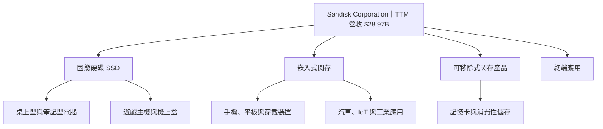

### 2.2 市場份額

市場份額數據未提供，故不製作市占率圖表或估算比例。公司 TTM 營收 $28.97B、單季營收年增 377.9%，顯示現階段需求環境與公司營收均快速擴張；但僅憑成長率不能推斷市場份額增加，也不能判斷相對於競爭者的絕對出貨排名。

### 2.3 競爭護城河分析

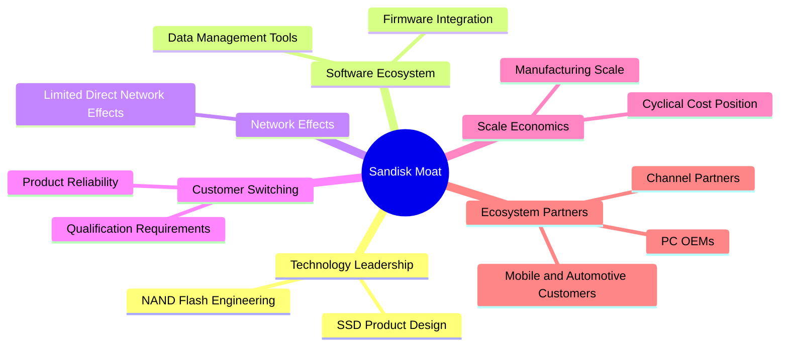

以上是質化分類，不代表財務數據已證明各項護城河強度。市場份額、研發成果與客戶留存等量化資料未提供。

### 2.4 護城河強度

| 護城河項目 | 強度（強／中／弱） | 證據（引用數字或事實） | 會削弱它的情況 |
|------------|--------------------|------------------------|----------------|
| 技術與產品 | 中 | 產品涵蓋 SSD、嵌入式儲存、汽車、IoT、工業等用途；研發費用 FY2026 為 $1.33B。 | NAND 技術快速迭代、競品追趕或產品性能差異縮小。 |
| 軟體生態系統 | 弱／資料不足 | 韌體或軟體服務營收與客戶採用數據未提供。 | 產品競爭只剩價格及容量。 |
| 網路效應 | 弱 | 儲存產品本身未呈現可量化的直接網路效應。 | 客戶跨品牌轉換成本低。 |
| 客戶鎖定 | 中 | OEM、汽車與工業應用通常涉及驗證流程，但客戶集中度及轉換成本數據未提供。 | 客戶更換供應商或多來源採購。 |
| 規模效應 | 中 | FY2026 營收 $20.25B；公司營收規模較大，但產業獲利受供需週期影響。 | 供過於求導致價格下跌，使規模未能維持利潤。 |
| 生態夥伴 | 中／資料不足 | 公司產品用於 PC、手機、遊戲、汽車與 IoT；合作夥伴貢獻未量化。 | OEM 自研、改用其他供應商或客戶集中度上升。 |

**1.1 護城河評分 6.5/10**：產品用途和規模提供一定差異化，但市場份額、軟體經常性收入與客戶鎖定的量化證據不足。

---

## 3. 損益表深度分析

### 3.1 年度收入成長趨勢（近 4 年）

年度營收與年度增幅依所列年度損益表計算，金額以十億美元表示。

╔══════════════════════════════════════════════════════════════════╗  
║　　　　　　 Sandisk 年度收入趨勢（FY2023–FY2026）　　　　　　　║  
╠══════════════════════════════════════════════════════════════════╣  
║ FY2023　$6.09B　██████░░░░░░░░░░░░░░░░　基期　　　　　　　　　 ║  
║ FY2024　$6.66B　███████░░░░░░░░░░░░░░░　YoY +9.4%　🟢　　　　 ║  
║ FY2025　$7.36B　████████░░░░░░░░░░░░░░　YoY +10.5% 🟢　　　　 ║  
║ FY2026　$20.25B ████████████████████　YoY +175.1% 🟢　　　　 ║  
╠══════════════════════════════════════════════════════════════════╣  
║ FY2023–FY2026 營收 CAGR：約 +49.3%　　　　　　　　　　　　　　║  
╚══════════════════════════════════════════════════════════════════╝

FY2026 營收加速與記憶體需求、價格及產品組合改善相符，但資料未提供 ASP 或出貨量拆分；因此不能把增長全數歸因於單一因素。週期性產業的高基期效應也意味後續年增率可能回落。

### 3.2 季度收入趨勢分析

| 季度 | 營收 | QoQ 成長 | YoY 成長 | 備註 |
|------|------|----------|----------|------|
| 2025-12-31 | $3.025B | N/A（前季數據未列） | N/A | 本表四季中最早季度。 |
| 2026-03-31 | $5.950B | **+96.7%** | **+251.0%** | 營收大幅加速。 |
| 2026-06-30 | $8.965B | **+50.7%** | **+371.6%** | 營收續增，年增率高。 |
| 2026-10-02 | $11.031B | **+23.0%** | **+377.9%** | SEC 10-Q 最新季度；最新一季年增率不是 TTM 成長率。 |

QoQ 成長計算示例：\((11.031÷8.965)-1=23.0\%\)。季增率仍為正，但由前季 50.7% 降至 23.0%，表示增速已較前幾季放緩；目前資料不足以區分是供應、需求、價格或基期造成。

### 3.3 利潤率演變分析

| 利潤率指標 | FY2023 | FY2024 | FY2025 | FY2026 | 趨勢 | 評估 |
|------------|--------|--------|--------|--------|------|------|
| **毛利率** | 7.1% | 16.1% | 30.1% | 71.5% | 連續上升，FY2026 擴張幅度最大 | 🟢 |
| **營業利益率** | -21.3% | -6.7% | 6.9% | 61.6% | 由虧轉盈，並於 FY2026 快速擴張 | 🟢 |
| **淨利率** | -35.2% | -10.1% | -22.3% | 56.4% | FY2025 淨損後大幅轉正 | 🟢 |

表內年度比率以年度損益表毛利、營業利益、淨利除以營收計算；TTM 核心指標依 VERIFIED FIGURES 使用：毛利率 80.0%、營業利益率 72.5%、淨利率 67.0%。兩類期間不可混用。

利潤率上升與營收放量、產品組合及產業價格環境轉佳相符，固定成本攤薄亦可能形成營業槓桿。由 FY2025 的營業利益 $507M 到 FY2026 的 $12.47B，改善幅度極大；但單憑財務數字無法分解價格、成本與產品組合的貢獻。由於儲存產業週期性強，當前高毛利和營業利益率應視為景氣狀態而非永久性結構水平。

### 3.4 費用結構分析

FY2026 收入 $20.25B、毛利 $14.47B、營業利益 $12.47B。依此計算銷貨成本為 **$5.78B**，營業費用合計為 **$2.00B**；其中 R&D 為 **$1.33B**，其他營業費用約 **$0.67B**。下圖只展示由 FY2026 損益表導出的營業成本與費用項目，不包含利息、稅項或營業外項目。

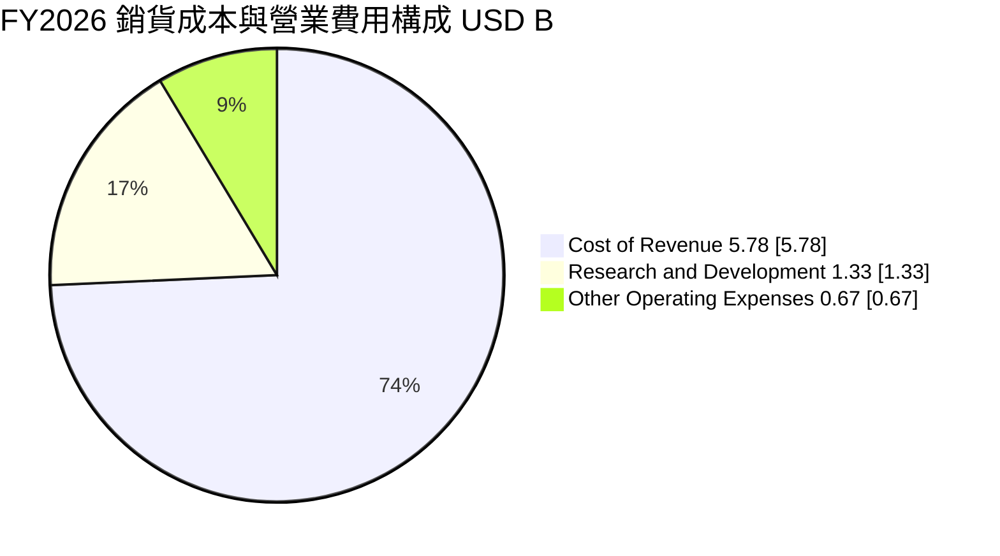

╔══════════════════════════════════════════════════════════════════╗  
║ FY2026 銷貨成本　　 $5.78B　████████████████████　　　　　　　 ║  
║ FY2026 R&D　　　　　$1.33B　█████　　　　　　　　　　　　　　║  
║ 其他營業費用　　　　$0.67B　███　　　　　　　　　　　　　　　║  
║ 依據：營收 $20.25B、毛利 $14.47B、營業利益 $12.47B　　　　　║  
╚══════════════════════════════════════════════════════════════════╝

### 3.5 季度 EPS 趨勢與盈餘品質（Quality of Earnings）

過去四季 EPS 預期與實際值均為 N/A，故不能判斷財報是超預期或不及預期。已知季度 EPS 實際值為 2025-12-31 $5.15、2026-03-31 $23.03、2026-06-30 $43.96、2026-09-30 $52.60；預期值缺失，不以 EPS 增幅替代 beat/miss 判斷。

| 盈餘品質項目 | 數值/佔比 | 評估 |
|--------------|-----------|------|
| 股權薪酬 SBC / 營收 | 最新四季 SBC **$270M**（91+67+54+58）；占 TTM 營收 **0.93%** | 🟢 佔營收比例較低；但仍會造成股權稀釋，F-Score 的稀釋股數測試未通過。 |
| SBC / 營業現金流 | **1.54%**（$0.270B÷$17.55B） | 🟢 比重不高，惟非現金費用不能忽略。 |
| FCF / 淨利（現金轉換率） | **89.4%**（$17.36B÷TTM 淨利 $19.422B） | 🟡 有相當現金轉換能力，但 FCF 低於淨利，且 CCC 拉長。 |
| 一次性/非經常性損益 | 明細未提供 | 🟡 無法確認本期是否受一次性項目顯著影響。 |
| 有效稅率異常 | **12.2%**（DCF 採用；有效稅率來源為最新年度） | 🟡 稅率偏低會提高模型 NOPAT；需追蹤是否可持續。 |
| 資本化支出 vs 費用化 | TTM Capex $181M；FY2026 Capex $177M；資本化明細未提供 | 🟡 未見可量化資本化異常證據，仍需留意設備投資及折舊周期。 |

**盈餘品質結論**：本期 FCF 轉換率約 89.4%、SBC 佔營收約 0.93%，支持獲利具一定現金含量。但 F-Score 中「營業現金流高於淨利」未通過，CCC 明顯拉長，且一次性損益明細未提供。估值不宜單看 EPS，應同時追蹤 FCF、庫存、應收帳款及記憶體價格。

---

## 4. 資產負債表分析

### 4.1 資產結構分解

以下以 FY2026 年度資產負債表為基礎；非流動資產為總資產減流動資產的計算值。

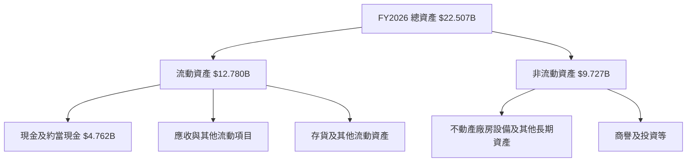

FY2026 詳細資產項目依年度財報來源；應收、存貨的更完整拆分使用 TTM 資產負債表來源，期間不同，故不在圖中將其拼成同一期總數。

### 4.2 流動性與營運資金分析

| 指標 | 最新 TTM | 一年前 TTM | 變化 | 解讀 |
|------|----------|------------|------|------|
| DSO 應收帳款天數 | 83 天 | 56 天 | +27 天 | 收款周期拉長，須觀察客戶付款條件和應收款品質。 |
| DIO 存貨天數 | 190 天 | 124 天 | +66 天 | 存貨周轉變慢或為供應安排增加庫存；若需求轉弱，存在減值與降價風險。 |
| DPO 應付帳款天數 | 46 天 | 26 天 | +20 天 | 延長供應商付款時間，部分抵銷存貨及應收款占用。 |
| CCC 現金轉換週期 | 226 天 | 154 天 | +72 天 | 現金回收週期顯著拉長，應視為本期財務品質的重要監控項目。 |

流動性比率來源呈現 Current Ratio **2.58**、Quick Ratio **1.994**；另一來源的資產負債表餘額口徑不完全一致，故不以這些比率反推資產或負債。Piotroski 流動比率年增測試未通過，與營運資金指標惡化方向一致。

### 4.3 債務結構分析

VERIFIED FIGURES 將 Total Debt 列為 N/A，故不使用其他來源的債務數字替換該項，也不計算 Debt/EBITDA 或利息保障倍數。

╔══════════════════════════════════════════════════════════════════╗  
║　　　　　　　 Sandisk 債務健康診斷　　　　　　　　　　　　　　║  
╠══════════════════════════════════════════════════════════════════╣  
║ 總債務：　　　　 N/A（VERIFIED FIGURES 未提供）　　　　　　　 ║  
║ 現金＋短期投資： $5.14B　　　　　　　　　　　　　　　　　　　║  
║ 淨現金：　　　　 $5.14B（依 VERIFIED FIGURES）　🟢　　　　　 ║  
║ Debt/EBITDA：　　N/A（總債務資料缺漏）　　　　　　　　　　　 ║  
║ Interest Coverage：N/A（利息費用及一致口徑債務資料不足）　　 ║  
╚══════════════════════════════════════════════════════════════════╝

### 4.4 股東權益趨勢

| 財年 | 股東權益 | 年度變化 |
|------|----------|----------|
| FY2024 | $11.08B | — |
| FY2025 | $9.22B | -16.8% |
| FY2026 | $15.74B | +70.7% |

FY2026 權益增加與由虧轉盈及累積獲利相符；未提供股東權益變化的完整分項橋接，不能將全部增加額歸因於單一項目。

╔══════════════════════════════════════════════════════════════════╗  
║ FY2024　$11.08B　██████████████　　　　　　　　　　　　　　　║  
║ FY2025　 $9.22B　████████████　　　　　　　　　　　　　　　　║  
║ FY2026　$15.74B　████████████████████　🟢　　　　　　　　　　║  
╚══════════════════════════════════════════════════════════════════╝

---

## 5. 現金流量深度分析

### 5.1 現金流量瀑布圖

股息殖利率與 payout ratio 均為 0.0%；回購與期間淨現金變化資料不足，故以 N/A 表示。

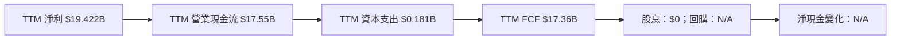

營業現金流低於淨利，表示現金轉換未完全跟上會計獲利；TTM FCF 仍達 $17.36B，主要是公司本期獲利與現金流規模大。不能由上述瀑布直接推斷回購或現金變化。

### 5.2 FCF 轉換率趨勢

| 期間 | FCF | 淨利 | FCF / 淨利 |
|------|-----|------|------------|
| FY2023 | -$0.932B | -$2.143B | N/A（虧損期，負分母不具可比性） |
| FY2024 | -$0.475B | -$0.672B | N/A（虧損期） |
| FY2025 | -$0.120B | -$1.641B | N/A（虧損期） |
| FY2026 | $11.49B | $11.43B | 約 **100.5%** |
| 最新 TTM | $17.36B | $19.422B | 約 **89.4%** |

FY2026 現金轉換接近 100%，而最新 TTM 降至約 89.4%。TTM 的營業現金流仍高，但淨利增幅較快、應收及存貨天數增加，均可能使現金流落後會計獲利。

### 5.3 自由現金流趨勢

| 期間 | FCF | 方向／說明 |
|------|-----|------------|
| FY2023 | -$0.932B | 負值 |
| FY2024 | -$0.475B | 虧損收窄 |
| FY2025 | -$0.120B | 接近損益兩平 |
| FY2026 | $11.49B | 轉正 |
| 最新 TTM | $17.36B | 進一步上升；FCF Yield 15.08% |

╔══════════════════════════════════════════════════════════════════╗  
║ FY2023　-$0.932B　（負值）　　　　　　　　　　　　　　　　　 ║  
║ FY2024　-$0.475B　（負值收窄）　　　　　　　　　　　　　　　║  
║ FY2025　-$0.120B　（接近損益兩平）　　　　　　　　　　　　　║  
║ FY2026　$11.49B　 █████████████　　　　　　　　　　　　　　 ║  
║ 最新TTM $17.36B　 ████████████████████　FCF Yield 15.08%　　 ║  
╚══════════════════════════════════════════════════════════════════╝

歷史由負轉正說明本輪營運改善對現金流有實質貢獻，但把目前 TTM FCF 外推為長期常態，會低估產業週期性。

### 5.4 資本配置評估

| 配置項目 | 已知數據 | 評估 |
|----------|----------|------|
| Capex | TTM $181M；FY2026 $177M | 相對本期現金流不高；未提供資本開支計畫或維持性／擴張性拆分。 |
| 股息 | 殖利率 0.0%、payout ratio 0.0% | 未見現金股息回報。 |
| 股票回購 | N/A | 回購數據未提供。 |
| SBC | FY2026 $232M；最新四季合計 $270M | 佔營收比例不高，但造成稀釋；F-Score 股數測試未通過。 |
| 現金留存 | 現金及短期投資 $5.14B | 支持流動性；現金用途與資本配置目標未提供。 |

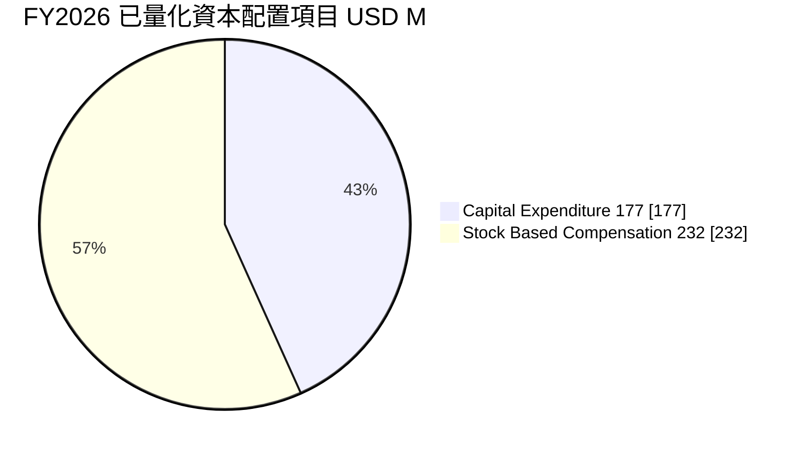

圖表僅比較有數字的 Capex 與 SBC，不代表公司全部資本配置；股息、回購及留存沒有足夠分配金額資料，不納入比例圖。

---

## 6. 獲利能力與資本效率

### 6.1 ROE / ROA / ROIC 趨勢

| 指標 | 歷史／最新值 | 評估 |
|------|-------------|------|
| ROE | TTM **107.1%**（QUALITY FIGURES 杜邦口徑） | 高獲利帶動，仍需警惕週期高峰。 |
| ROA | TTM **68.3%**（財務數據來源） | 反映高資產回報；與高營業利潤率相符。 |
| ROIC | TTM **141.2%**（VERIFIED FIGURES） | 遠高於 WACC 10.16%，但高度依賴當前高獲利。 |
| FY2023–FY2025 ROIC | N/A | 缺少同一口徑歷史 ROIC，不能補值。 |

ROE 的品質須與資產週轉及財務槓桿一併判讀，見 6.3；ROIC 不是應被視為永久水平的穩態回報率。

### 6.2 ROIC vs WACC 分析（核心價值創造判斷）

本節採用 VERIFIED FIGURES 的 WACC **10.16%**，與 DCF 折現率一致。成本資本表列 Beta 原始值 N/A，採用調整後 Beta **1.00**。

╔══════════════════════════════════════════════════════════════════╗  
║　　　　　　 ROIC vs WACC 深度分析　　　　　　　　　　　　　　 ║  
╠══════════════════════════════════════════════════════════════════╣  
║ WACC 輸入：　　　　　　　　　　　　　　　　　　　　　　　　　║  
║ ├── 無風險利率（10Y 美債）：5.12%　　　　　　　　　　　　　 ║  
║ ├── ERP：5.00%　　　　　　　　　　　　　　　　　　　　　　　║  
║ ├── 原始 Beta：N/A；調整後 Beta：1.00（假設）　　　　　　　　║  
║ ├── 股權成本：5.12% + 1.00 × 5.00% = 10.12%　　　　　　　　║  
║ ├── 稅前債務成本：36.32%；有效稅率：12.2%　　　　　　　　　║  
║ ├── 股權／債務權重：99.8%／0.2%　　　　　　　　　　　　　 ║  
║ └── 採用 WACC：10.16%（程式計算值）　　　　　　　　　　　 ║  
║　　　　　　　　　　　　　　　　　　　　　　　　　　　　　　 ║  
║ ROIC（TTM）：141.2%　　　　　　　　　　　　　　　　　　　　 ║  
║ EVA 利差：141.2% − 10.16% = +131.04 個百分點　　　　　　　 ║  
║ ROIC / WACC：約 13.9 倍　　　　　　　　　　　　　　　　　　 ║  
║ 結論：現階段回報顯著高於資本成本；週期正常化可能收窄利差。　║  
╚══════════════════════════════════════════════════════════════════╝

WACC 各組成數字因四捨五入，直接以程式計算的 **10.16%** 為準，不另替換折現率。原始 Beta 不可得，因此 Beta 1.00 為假設值；資金成本估算並非獨立可驗證的債券定價模型。

### 6.3 杜邦三因素分解

| 因素 | 數值（TTM） | 解讀 |
|------|-------------|------|
| 淨利率 | 67.0% | 本期高獲利的重要來源。 |
| 資產週轉率 | 1.12 | 每單位資產創造的營收；營收放量帶動週轉。 |
| 權益乘數 | 1.42 | 財務槓桿倍數不高，ROE 並非主要靠高槓桿撐起。 |
| **ROE** | **107.1%** | 67.0% × 1.12 × 1.42 = **約 107.1%**（杜邦資料列示值）。 |

按所列因子計算：\(67.0\%\times1.12\times1.42=106.6\%\)，與資料列示 ROE 107.1% 有約 0.5 個百分點差異，來自因子四捨五入；引用列示 ROE，不重算替換。

### 6.4 財務體質：Piotroski F-Score

Piotroski F-Score **5/8**；有一項測試因缺資料而無法判定，分母為 8，而不是 9。

| 測試 | 結果 | 解讀 |
|------|------|------|
| ROA > 0 | ✅ 通過 | TTM 獲利為正。 |
| 營業現金流 > 0 | ✅ 通過 | TTM OCF $17.55B。 |
| ROA 高於一年前 | ✅ 通過 | 資產獲利能力改善。 |
| 營業現金流 > 淨利（應計品質） | ❌ 未通過 | 會計淨利高於營業現金流，需留意現金轉換。 |
| 長期負債 ÷ 總資產低於一年前 | — 無法判定 | 缺少測試所需資料。 |
| 流動比率高於一年前 | ❌ 未通過 | 相對一年前未改善。 |
| 稀釋股數未增加 | ❌ 未通過 | 股數增加造成股東持股稀釋。 |
| 毛利率高於一年前 | ✅ 通過 | 毛利率改善。 |
| 資產週轉率高於一年前 | ✅ 通過 | 資產使用效率改善。 |

5/8 表示營運轉佳，但現金轉換、流動性趨勢及稀釋股數仍是弱項；不宜把單一季度的獲利表現等同於全面財務品質提升。

---

## 7. 相對估值分析

### 7.1 同業估值比較表格

本公司估值採財務資料所列公司倍數；同業倍數照 Peer multiples。SKHY 的 P/S、EV/EBITDA 為 N/A（幣別混合）。

| 估值指標 | **SNDK** | **WDC** | **MU** | **SKHY** | 本公司評估 |
|----------|----------|--------|-------|---------|-----------|
| **Trailing P/E** | 6.47x | 9.9x | 9.7x | 7.8x | 🟢 低於同業列示倍數；須留意週期高峰令 trailing EPS 偏高。 |
| **Forward P/E** | 2.80x | 7.0x | 3.5x | 3.0x | 🟢 同業中最低，代表市場採用的預期獲利相對低估值，但預期本身不保證實現。 |
| **P/S Ratio** | 3.97x | 7.3x | 6.1x | N/A | 🟢 低於 WDC、MU；SKHY 不可比較。 |
| **EV/EBITDA** | 5.192x | 16.6x | 7.1x | N/A | 🟢 倍數較低；須用週期中段 EBITDA 驗證低估值是否持續。 |
| **最新一季營收年增** | 377.9% | 55.5% | 379.3% | 327.9% | 🟢 成長率高於 WDC、與 MU 接近。 |
| **TTM 毛利率** | 80.0% | 52.6% | 80.7% | 77.4% | 🟢 高於 WDC、SKHY，略低於 MU。 |

### 7.2 歷史估值區間分析

歷史估值資料提供的是 P/S，而非 P/E。

╔══════════════════════════════════════════════════════════════════╗  
║　　　　　　 SNDK 過去五年 TTM P/S　　　　　　　　　　　　　　║  
╠══════════════════════════════════════════════════════════════════╣  
║ 歷史低點：0.9x　━━━━━━━━━━━━━━━━━━━━━━━━━━━━━━━━　　　　　 ║  
║ 五年中位數：4.8x━━━━━━━━━━━━━━━━━━━━━━━━　　　　　　　　　 ║  
║ 目前：4.3x　　━━━━━━━━━━━━━━━━━━●━━━━━━━━　　　　　　　　║  
║ 歷史高點：13.4x━━━━━━━━━━━━━━━━━━━━━━━━━━━━━━━━━━━━　　 ║  
║ 目前歷史百分位：43%　　　　　　　　　　　　　　　　　　　　　║  
╚══════════════════════════════════════════════════════════════════╝

目前 P/S **4.3x** 低於五年中位數 **4.8x**，百分位 **43%**。這是相對公司自身歷史估值，並不代表週期調整後營收或利潤估值已便宜。

### 7.3 情境價值（Bear / Base / Bull，依 DCF MODEL）

| 情境 | 第 1 年營收成長 | 期末營業利潤率 | WACC | 每股價值 | 相對現價 | 機率 | 會發生的條件 |
|------|----------------|----------------|------|----------|----------|------|--------------|
| 🔴 悲觀 | 15.0% | 52.0% | 11.16% | $2,005.62 | +147.9% | 25% | NAND 需求或定價轉弱，營收增速及成熟期利潤率均低於基準，資本成本上升。 |
| 🟡 基準 | 30.0% | 61.2% | 10.16% | $4,703.29 | +481.3% | 50% | 成長逐年淡出，利潤率收斂至模型所列成熟值，折現率維持基準。 |
| 🟢 樂觀 | 45.0% | 67.3% | 9.16% | $10,447.70 | +1,191.3% | 25% | 需求與定價強於基準、長期利潤率較高，且風險折現率下降。 |

機率加權值為 DCF MODEL 提供的 **$5,464.97**，僅作情境參考；第 8.8 節估值權重依固定方法採用基準 DCF，不以機率加權 DCF 替換。

### 7.4 相對估值隱含價格區間

╔══════════════════════════════════════════════════════════════════╗  
║　　　　　方法隱含每股價值與 2026-11-16 現價　　　　　　　　　　║  
╠══════════════════════════════════════════════════════════════════╣  
║ $809.11 現價 ─ $1,361.04 同業 P/S ─ $1,798.97 同業 EV/EBITDA ║  
║ 分析師共識 $2,047.38 ─ 基準 DCF $4,703.29　　　　　　　　　　║  
╚══════════════════════════════════════════════════════════════════╝

| 方法 | 每股價值 | 依據 |
|------|----------|------|
| 同業 EV/EBITDA | **$1,798.97** | WDC、MU 同業中位數 EV/EBITDA **11.9x** × 公司 TTM EBITDA，再加淨現金。 |
| 同業 P/S | **$1,361.04** | WDC、MU 同業中位數 P/S **6.7x** × 公司 TTM 營收。 |
| 分析師共識 | **$2,047.38** | 24 位分析師平均目標價。 |

---

## 8. DCF 內在價值評估（Discounted Cash Flow）

> DCF 表格及假設照程式計算模型引用；金額除每股數字外均為 USD B。模型採用 GAAP EBIT，沒有營運資金變動列，FCFF 定義為 NOPAT + D&A − Capex。

### 8.0 估值推理鏈（Thinking Logic）

**Step 1 — 價值來源與主導變數**

模型將價值拆成既有儲存產品現金流與其後續成長的現值，再加上第十年後終值。公司各產品線的營收佔比未提供，無法把兩類價值映射到特定分部。估值對營收成長、成熟期營業利潤率及 WACC 敏感；基準模型終值佔 EV **57.4%**，故成熟期現金流與 WACC 對估值尤其重要。

**Step 2 — 模型選擇**

| 決策點 | 本報告採用 | 理由（含數字） | 曾考慮但否決 | 否決理由 |
|--------|-----------|----------------|--------------|----------|
| 現金流定義 | FCFF | 與 WACC 折現並推導 EV 一致；模型提供 FCFF。 | FCFE | 無相應股權現金流模型輸入。 |
| 預測期 N | 10 年 | DCF MODEL 固定 10 年，逐年收入成長由 30.0% 淡出至 3.0%。 | 5 年 | 不符合指定模型輸入，且不採自建模型。 |
| 終值方法 | Gordon Growth | 模型使用永續成長率 3.0%，WACC 10.16%。 | 退出倍數主法 | 模型未提供退出倍數估值結果；不自行補建。 |
| EBIT 基礎 | GAAP | 模型明示 GAAP EBIT。 | 非 GAAP | 會造成與模型及 SBC 處理不一致。 |

**Step 3 — 關鍵假設推導鏈**

- **營收成長**：錨點＝TTM 營收年增 **272.4%**、最新一季年增 **377.9%**；調整＝這些增長屬於極高成長期，不能線性外推十年，因此模型將第一年限制在 30.0%，再線性淡出至 3.0%；**採用 FY+1 30.0%、FY+10 3.0%**；曾考慮直接使用 TTM 272.4%，因週期及基期效應會造成不合理外推而否決。
- **期末營業利潤率**：錨點＝TTM 營業利益率 **72.5%**；調整＝模型逐年下調至最近三財年中位數（含 TTM）所指向的成熟期水平；**採用 FY+10 61.2%**；曾考慮維持 72.5%，但未把當前高利潤率假設為永久水平。
- **永續成長率 g**：錨點＝長期名目經濟成長的一般方向，精確 GDP／通膨預測未提供；**採用 3.0%**，且低於 WACC 10.16%；曾考慮更高 g，因會提高終值且不利於保守性而否決。
- **預測期 N**：錨點＝模型指定 10 年；**採用 10 年**，讓成長率由 30.0% 線性淡出至 3.0%；曾考慮更短期限，但模型未提供相應輸出，故不改變 N。
- **Capex／營收**：錨點＝TTM Capex **$181M**、TTM 營收 **$28.97B**；模型以 TTM 比率為基礎，列示 FY+1 與 FY+10 均為 **0.6%**；曾考慮更高的再投資比例，模型未提供可支持的替代序列，故不改輸入值。
- **EBIT 與 SBC**：錨點＝模型明示 GAAP EBIT；FY2026 SBC $232M，最新四季 SBC $270M；**採用組合 (A)：GAAP EBIT、FCFF 不再扣 SBC、股數不作額外稀釋**，SBC 已計入 GAAP 費用；曾考慮另扣 SBC 或另加股數稀釋，因會重複計入而否決。
- **年稀釋率**：錨點＝組合 (A) 固定股數；**採用 0% 額外稀釋**；資料顯示 F-Score 稀釋股數測試未通過，但模型選定 GAAP EBIT＋固定股數組合；未另套用正稀釋率，以避免改動模型。
- **ΔWC／營收增額**：模型明示不建模營運資金；採用值為未建模，**不在 FCFF 表中新增 ΔWC 數字**。營運資金天數已從 154 天增至 226 天，因此這項簡化可能高估價值。
- **終值方法**：錨點＝模型提供 Gordon Growth 終值；**採用該終值**；退出倍數交叉驗證值未提供，不以自建方法替代。
- **WACC**：錨點＝Cost of capital 的 WACC **10.16%**；調整＝不另行重算或取代程式輸出；**採用 10.16%**；曾考慮自行以四捨五入權重重算，但會偏離提供的模型折現率，故否決。

**Step 4 — 最脆弱環節**

最脆弱的是高利潤率和長期現金流延續假設；若獲利落向模型悲觀情境，DCF 每股價值為 **$2,005.62**，仍高於現價，但跌幅相對基準 DCF 顯著。

**Step 5 — 計算路徑**

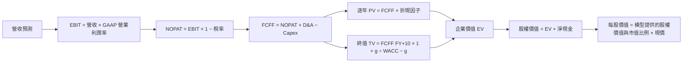

### 8.1 模型假設總表（Model Inputs）

| 假設項目 | 採用值 | 依據 / 來源 | 敏感度 |
|----------|--------|-------------|--------|
| 預測期長度 **N** | 10 年 | DCF MODEL 指定 10 年，成長率逐年淡出。 | 🟡 中 |
| 營收成長 | FY+1 30.0% → FY+10 3.0% | TTM 成長 272.4%，模型將首年封頂於 30.0%，之後線性下降。 | 🔴 高 |
| 營業利潤率 | FY+1 72.5% → FY+10 61.2% | 起點採 TTM 營業利潤率；終點為模型所列最近三財年中位數。 | 🔴 高 |
| 有效稅率 | 12.2% | 最新年度有效稅率。 | 🟢 低 |
| Capex / 營收 | FY+1 至 FY+10 0.6% | 模型以 TTM Capex 比率為基礎，沿用程式值。 | 🟡 中 |
| D&A / 營收 | 0.5% | 模型列示 TTM 比率並固定。 | 🟢 低 |
| 營運資金變動 | 不建模 | DCF MODEL 明示 Working capital is not modelled；CCC 最新值 226 天。 | 🔴 高 |
| EBIT 基礎 | GAAP EBIT | 模型明示採 GAAP EBIT。 | 🟡 中 |
| SBC 處理 | 組合 (A)：不再扣 SBC | GAAP EBIT 已將 SBC 作為費用；FCFF 不減 SBC。 | 🟡 中 |
| 年稀釋率 | 0% 額外稀釋 | 組合 (A) 固定股數模型處理。 | 🟡 中 |
| 永續成長率 g | 3.0% | DCF MODEL 指定，低於 WACC。 | 🔴 高 |
| 終值方法 | Gordon Growth | DCF MODEL 直接提供終值計算。 | 🔴 高 |
| WACC | 10.16% | 直接採用 Cost of capital 的程式值。 | 🔴 高 |

**本模型採用 (A)，故 GAAP EBIT 已反映 SBC 影響，FCFF 不再扣 SBC，股數不額外放大。**營運資金不建模，故下表不列 ΔWC 列；這是模型限制，不代表實際營運資金變動為零。

### 8.2 折現率推導（WACC）

╔══════════════════════════════════════════════════════════════════╗  
║　　　　　　　　　WACC 推導（折現率）　　　　　　　　　　　　　║  
╠══════════════════════════════════════════════════════════════════╣  
║ 股權成本 Ke（CAPM）：　　　　　　　　　　　　　　　　　　　　║  
║ ├── 無風險利率 Rf：5.12%（資料未另列觀測日）　　　　　　　　 ║  
║ ├── 市場風險溢酬 ERP：5.00%（假設值）　　　　　　　　　　　 ║  
║ ├── 原始 Beta：N/A；調整後 Beta：1.00（無原始值，採模型假設）║  
║ ├── 規模／國別溢酬：未列，按 0.00% 處理　　　　　　　　　　 ║  
║ └── Ke = 5.12% + 1.00 × 5.00% + 0.00% = 10.12%　　　　　　　 ║  
║　　　　　　　　　　　　　　　　　　　　　　　　　　　　　　 ║  
║ 債務成本：稅前 36.32%；稅率 12.2%　　　　　　　　　　　　　　║  
║ 資本權重：E 99.8%／D 0.2%　　　　　　　　　　　　　　　　　 ║  
║ 程式計算並採用 WACC：10.16%　　　　　　　　　　　　　　　　 ║  
╚══════════════════════════════════════════════════════════════════╝

1. **Ke** = 5.12% + 1.00 × 5.00% + 0.00% = **10.12%**。  
2. **稅前 Kd** = **36.32%**（直接引用已計算資金成本；計息負債、平均餘額與利息費用明細未提供，故無法獨立重算分子／分母）。  
3. **稅後 Kd** = 36.32% × (1 − 12.2%) = 36.32% × 87.8% = **31.90%**（四捨五入）。  
4. **權重** = E **99.8%**；D **0.2%**；兩者相加為 **100.0%**。市值及計息負債的組成明細未在 Cost of capital 區塊提供，故照抄權重，不自行反推。  
5. **WACC**：直接採用程式提供值 **10.16%**。以顯示至一位小數的權重和股權成本、稅前債務成本重算會受輸入精度與口徑影響；不得以四捨五入輸入另造 WACC。

### 8.3 逐年自由現金流預測（基準情境）

| 年度 | FY+1 | FY+2 | FY+3 | FY+4 | FY+5 | FY+6 | FY+7 | FY+8 | FY+9 | FY+10 |
|------|------|------|------|------|------|------|------|------|------|-------|
| 營收 | 37.66 | 47.83 | 59.31 | 71.77 | 84.68 | 97.39 | 109.07 | 118.89 | 126.02 | 129.80 |
| 營收 YoY | 30.0% | 27.0% | 24.0% | 21.0% | 18.0% | 15.0% | 12.0% | 9.0% | 6.0% | 3.0% |
| 營業利潤率 | 72.5% | 71.2% | 70.0% | 68.7% | 67.5% | 66.2% | 64.9% | 63.7% | 62.4% | 61.2% |
| EBIT（GAAP） | 27.29 | 34.06 | 41.49 | 49.31 | 57.12 | 64.47 | 70.84 | 75.72 | 78.69 | 79.42 |
| − 稅（12.2%） | (3.32) | (4.14) | (5.05) | (6.00) | (6.95) | (7.84) | (8.62) | (9.21) | (9.58) | (9.66) |
| = NOPAT | 23.97 | 29.92 | 36.44 | 43.31 | 50.17 | 56.62 | 62.22 | 66.51 | 69.11 | 69.76 |
| + D&A | 0.20 | 0.26 | 0.32 | 0.39 | 0.46 | 0.52 | 0.59 | 0.64 | 0.68 | 0.70 |
| − Capex | (0.24) | (0.30) | (0.37) | (0.44) | (0.52) | (0.59) | (0.66) | (0.71) | (0.75) | (0.77) |
| **= FCFF** | **23.94** | **29.88** | **36.40** | **43.25** | **50.11** | **56.56** | **62.15** | **66.44** | **69.04** | **69.69** |
| 折現因子 @10.16% | 0.908 | 0.824 | 0.748 | 0.679 | 0.616 | 0.560 | 0.508 | 0.461 | 0.419 | 0.380 |
| **FCFF 現值 PV** | **21.73** | **24.62** | **27.23** | **29.37** | **30.89** | **31.65** | **31.57** | **30.64** | **28.90** | **26.48** |

預測期 FCF 現值合計：  
**$21.73 + $24.62 + $27.23 + $29.37 + $30.89 + $31.65 + $31.57 + $30.64 + $28.90 + $26.48 = $283.08B**。

**FY+1 逐步演算**

1. 營收 = $28.97B × (1 + 30.0%) = **$37.66B**（依模型列示，基礎營收為 $28.97B）。
2. EBIT = $37.66B × 72.5% = **$27.29B**。
3. 稅 = $27.29B × 12.2% = **$3.32B**。
4. NOPAT = $27.29B − $3.32B = **$23.97B**。
5. D&A = 模型列示 **$0.20B**（D&A／營收比率為 0.5%，依模型四捨五入）。
6. Capex = 模型列示 **$0.24B**（依模型比例與四捨五入）。
7. ΔWC = **不建模**，未納入 FCFF。
8. FCFF = $23.97B + $0.20B − $0.24B = **$23.93B**；模型列示 **$23.94B**，差異為各輸入四捨五入造成，後續均引用模型列示值。
9. 折現因子 = \(1÷(1+10.16\%)^1\) = **0.908**；PV = $23.94B × 0.908 = **$21.73B**（四捨五入）。

**合理性自檢**
- 預測 FY+1 至 FY+10 FCFF CAGR 約 **12.6%**；歷史 FCF 曾由 FY2023 **-$0.932B** 轉為 FY2026 **$11.49B**，負值起點使歷史 CAGR **N/A**，兩者不宜直接比較。
- FY+10 FCF 利潤率 = $69.69B ÷ $129.80B = **53.7%**；TTM FCF／營收 = $17.36B ÷ $28.97B = **59.9%**。模型長期利潤率較目前低，但仍很高。
- 預測各年 FCFF 均為正；模型未納入營運資金變動，故正 FCF 不代表在營運資金天數惡化時沒有額外資金需求。

╔══════════════════════════════════════════════════════════════════╗  
║　　　　　　自由現金流：歷史實際 vs 模型預測　　　　　　　　　　║  
╠══════════════════════════════════════════════════════════════════╣  
║ FY2024（實） -$0.475B　負值　　　　　　　　　　　　　　　　 ║  
║ FY2025（實） -$0.120B　負值收窄　　　　　　　　　　　　　　 ║  
║ FY2026（實） $11.49B　████████　　　　　　　　　　　　　　 ║  
║ FY+1（預）　 $23.94B　████████████████　　　　　　　　　　　║  
║ FY+10（預）　$69.69B　████████████████████　FCF 利潤率 53.7%║  
╠══════════════════════════════════════════════════════════════════╣  
║ ⚠️ 預測由正向高現金流延伸；歷史負值起點使 CAGR 不可比。　　　║  
╚══════════════════════════════════════════════════════════════════╝

### 8.4 終值計算（Terminal Value）

**適用性檢查**：WACC **10.16%** vs g **3.0%** → WACC > g？✅

| 方法 | 計算式 | 終值 TV | TV 現值 | 佔總 EV 比重 |
|------|--------|---------|---------|--------------|
| Gordon Growth | $69.69 × (1 + 3.0%) ÷ (10.16% − 3.0%) | $1,002.63B | $381.02B | 57.4% |
| 退出倍數法 | N/A（DCF MODEL 未提供退出倍數終值） | N/A | N/A | N/A |

**逐步演算**

1. FY+N FCFF = **$69.69B**。
2. 分子 = $69.69B × (1 + 3.0%) = **$71.7807B**。
3. 分母 = 10.16% − 3.0% = **7.16%**；TV = $71.7807B ÷ 7.16% = **$1,002.63B**。
4. PV(TV) = $1,002.63B × **0.380** = **$381.02B**（使用模型列示折現因子）。
5. 終值佔比 = $381.02B ÷ $664.09B = **57.4%**。

### 8.5 企業價值 → 每股內在價值（Bridge）

╔══════════════════════════════════════════════════════════════════╗  
║　　　　　　企業價值 → 每股內在價值 橋接表　　　　　　　　　　　║  
╠══════════════════════════════════════════════════════════════════╣  
║ 預測期 FCF 現值合計　　　　　 +$283.08B　　　　　　　　　　　║  
║ 終值現值 PV(TV)　　　　　　　+$381.02B　　　　　　　　　　　║  
║ = 企業價值 EV　　　　　　　　 $664.09B　　　　　　　　　　　║  
║ + 淨現金　　　　　　　　　　　+$5.14B　　　　　　　　　　　 ║  
║ = 股權價值　　　　　　　　　 $669.23B　　　　　　　　　　　║  
║ DCF 基準每股價值　　　　　　 $4,703.29　　　　　　　　　　 ║  
║ 現價（2026-11-16）　　　　　 $809.11　　　　　　　　　　　　║  
║ 折溢價（現價÷DCF價值−1）　　 -82.8%（折價）　　　　　　　　║  
╚══════════════════════════════════════════════════════════════════╝

1. EV = $283.08B + $381.02B = **$664.10B**；DCF MODEL 列示 EV **$664.09B**，約 $0.01B 差異來自底層未四捨五入數值；遵照程式列示 EV。
2. 股權價值 = $664.09B + $5.14B = **$669.23B**。
3. 每股價值依模型公式 = 股權價值 × 最新股價 ÷ 市值 = $669.23B × $809.11 ÷ $115.13B = **$4,703.29**（模型列示）。
4. 折溢價 = $809.11 ÷ $4,703.29 − 1 = **−82.8%**。
5. **本節不計算 MOS**；MOS 唯一使用 8.8 加權合理價值作分母。

股數來歷：DCF 模型的每股換算採「股權價值 × 價格 ÷ 市值」，沒有另提供單獨稀釋股數輸入；市場資料列流通股數 142.29M，但為避免重建模型，引用 DCF MODEL 的每股價值。現金及短期投資採 VERIFIED FIGURES 淨現金 $5.14B；總債務資料列 N/A，模型以該淨現金作橋接。

### 8.6 敏感性分析（WACC × 永續成長率）

下表內在價值照 DCF MODEL；括號為相對現價的上行空間，按「價值 ÷ $809.11 − 1」計算，百分比四捨五入至一位小數。

| g（列）／WACC（欄） | 8.16% | 9.16% | **10.16%（基準）** | 11.16% | 12.16% |
|-----------|------:|------:|------------------:|-------:|-------:|
| **2.0%** | $5,948.30 (+635.0%) | $5,036.74 (+522.4%) | $4,352.28 (+437.9%) | $3,820.33 (+372.1%) | $3,395.70 (+319.7%) |
| **2.5%** | $6,295.16 (+678.1%) | $5,270.17 (+551.2%) | $4,516.33 (+458.2%) | $3,939.50 (+386.6%) | $3,484.55 (+330.6%) |
| **3.0%** | $6,709.24 (+729.0%) | $5,541.51 (+584.8%) | **$4,703.29 (+481.3%)** | $4,073.26 (+403.4%) | $3,583.10 (+342.8%) |
| **3.5%** | $7,212.21 (+791.3%) | $5,860.79 (+624.3%) | $4,918.33 (+507.8%) | $4,224.50 (+422.1%) | $3,693.04 (+356.4%) |
| **4.0%** | $7,836.11 (+868.4%) | $6,241.96 (+671.4%) | $5,168.28 (+538.8%) | $4,396.86 (+443.7%) | $3,816.44 (+371.7%) |

**矩陣演算限制**：DCF MODEL 已提供完整矩陣，但沒有提供各非基準格的預測期 PV 分項。依規則不另建模型，因此不以不可驗證的中間數字重算矩陣格；各格價值照抄模型，非基準格完整重算所需資料 N/A。

**三情境 DCF（程式所列情境）**

| 情境 | 營收假設 | 期末營業利潤率 | g | WACC | 每股內在價值 | 相對現價 | 主觀機率 |
|------|----------|----------------|---|------|--------------|----------|----------|
| 🔴 悲觀 | 第 1 年 15.0% | 52.0% | N/A（情境欄未提供） | 11.16% | $2,005.62 | +147.9% | 25% |
| 🟡 基準 | 第 1 年 30.0% | 61.2% | 3.0% | 10.16% | $4,703.29 | +481.3% | 50% |
| 🟢 樂觀 | 第 1 年 45.0% | 67.3% | N/A（情境欄未提供） | 9.16% | $10,447.70 | +1,191.3% | 25% |
| **機率加權** | — | — | — | — | **$5,464.97** | **+575.4%** | **100%** |

DCF MODEL 僅提供各情境的第 1 年成長率、期末利潤率、WACC、估值與機率，未提供各情境 FY+10 營收、FCFF、終值分項或情境 g，故不反推缺項，也不將基準情境分項冒充為悲觀／樂觀情境分項。加權演算：**$2,005.62 × 25% + $4,703.29 × 50% + $10,447.70 × 25% = $5,464.975**，模型列示 **$5,464.97**（未四捨五入底層金額造成尾差）。

**敏感度結論**
- g 由 2.5% 至 3.5%（跨 +1pp），基準 WACC 下每股價值由 $4,516.33 至 $4,918.33：**+$402.00，約 +8.9%**（相對區間起點）。
- WACC 由基準 10.16% 升至 11.16%，g 3.0% 下每股價值由 $4,703.29 降至 $4,073.26：**−$630.03，約 −13.4%**。
- 期末營業利潤率每 +1pp 的內在價值變動：**N/A（模型未提供該維度敏感性矩陣，不另建模）**。
- 已有資料顯示折現率與 g 對價值十分敏感；這與 8.0 所述「終值和長期現金流假設主導估值」一致。

### 8.7 反推 DCF（Reverse DCF：市場在預期什麼）

固定基準輸入：WACC **10.16%**、稅率 **12.2%**、Capex 比例依模型逐年設定、營運資金不建模、預測期 **10 年**、股數處理為 GAAP 固定股數組合。資料未提供可單獨核驗的模型稀釋股數輸入。

| 求解的變數（一次一個） | 其餘變數設定 | 市場隱含值 | 公司歷史實際 | 判斷 |
|------------------------|--------------|--------------|--------------|------|
| 第 1 年營收成長 | 其餘基準假設固定 | **−10% 至 100% 區間無解** | TTM 成長 272.4% | 在給定求解區間內，無法以單一成長率解釋現價。 |
| 固定營業利潤率 | 成長、WACC、稅率與 g 固定於基準 | **10.5%** | TTM 營業利益率 72.5% | 固定利潤率 10.5% 才使模型值等於現價，反映市場不必接受基準高利潤率。 |

模型只提供上述兩項反推結果。g、預測期 N 及其迭代軌跡未提供，故標示未計算，不自行虛構試算點。反推結論：以此模型的其他基準輸入不變，現價隱含的固定營業利潤率約 10.5%，遠低於目前 TTM 72.5%；市場價格可能已折入獲利大幅正常化，但此反推值對模型的週期假設敏感。

### 8.8 估值三角驗證與安全邊際

| 估值方法 | 隱含每股價值 | 上行空間（÷現價） | 權重 | 說明 |
|----------|--------------|-------------------|------|------|
| DCF（基準） | $4,703.29 | +481.3% | 40% | 10 年 FCFF、WACC 10.16%、g 3.0%。 |
| 同業 EV/EBITDA | $1,798.97 | +122.3% | 30% | WDC、MU 中位數倍數 11.9x × TTM EBITDA，加淨現金。 |
| 同業 P/S | $1,361.04 | +68.2% | 20% | WDC、MU 中位數倍數 6.7x × TTM 營收。 |
| 分析師共識目標價 | $2,047.38 | +153.0% | 10% | 24 位分析師平均目標價。 |
| **加權合理價值** | **$2,897.95** | **+258.2%** | **100%** | 公司類型為週期股；估值方法及權重依固定分類。 |

**逐步演算（權重外顯）**：  
$4,703.29 × 40% + $1,798.97 × 30% + $1,361.04 × 20% + $2,047.38 × 10%  
= $1,881.316 + $539.691 + $272.208 + $204.738  
= **$2,897.953 ≈ $2,897.95**。

權重適用於週期股分類，四種方法均照列；沒有可計算方法被剔除。

╔══════════════════════════════════════════════════════════════════╗  
║　　　　　　　　　估值區間與安全邊際　　　　　　　　　　　　　║  
╠══════════════════════════════════════════════════════════════════╣  
║ 悲觀 DCF $2,005.62 ─ 現價 $809.11 ─ 加權合理值 $2,897.95　　 ║  
║　　　　　　　　　　　　 ─ 基準 DCF $4,703.29 ─ 樂觀 $10,447.70║  
║　　　　　　　　　　　　　　　　　　　　　　　　　　　　　　 ║  
║ MOS = ($2,897.95 − $809.11) ÷ $2,897.95 = +72.1%　🟢　　　 ║  
║ 上行空間 = ($2,897.95 − $809.11) ÷ $809.11 = +258.2%　　　 ║  
║ MOS 評估：🟢 >25% 充足　　　　　　　　　　　　　　　　　　　║  
║ 建議買入區間：$809.11–$2,608.16（上限為 MOS ≥10% 的價格界線）║  
║ 合理持有區間：$2,608.16–$4,703.29（依估值模型參考）　　　　 ║  
║ 減碼考慮區間：>$4,703.29；不代表基本面必然反轉　　　　　　 ║  
╚══════════════════════════════════════════════════════════════════╝

買入區間上限計算：\(0.9×$2,897.95=$2,608.155\)，四捨五入至美分為 **$2,608.16**；此處的下限以 2026-11-16 收盤價作參考，不代表技術支撐位。

> 🔎 **程式複算（Python，依本節各項自動重算）**
>
> 加權合理價值 = $4,703.29 × 40% + $1,798.97 × 30% + $1,361.04 × 20% + $2,047.38 × 10% = **$2,897.95**（權重合計 100%）
>
> 以價格 $809.11 計：MOS = **+72.1%**，上行空間 = **+258.2%**
>
> ✅ 與本節所寫數值一致。

### 8.9 DCF 模型的局限與失效條件

- **終值依賴度**：終值現值佔 EV **57.4%**，估值有過半來自 FY+10 之後的假設。
- **最脆弱假設**：第一年營收成長 30.0%及成熟期營業利潤率 61.2%。若兩者不成立，應將估值參考移向悲觀情境 **$2,005.62**，而非基準 DCF $4,703.29。
- **營運資金缺項**：最新 CCC **226 天**，模型不納入營運資金變動，可能高估自由現金流。
- **週期性限制**：NAND 價格、供需及產能利用率可能令利潤大幅變化；以單一 TTM 起點估值的可靠度受景氣位置影響。應並用 EV/EBITDA、P/S 和週期中段獲利分析。
- **與第 10 章風險連結**：NAND 定價下跌會影響營收成長與營業利潤率；庫存及應收款增加會放大模型未納入的 ΔWC；利率或風險溢酬上升會提高 WACC、壓低現值。

### 8.10 複算檢核表（Audit Trail）

| # | 檢核項目 | 檢查方式 | 結果 |
|---|----------|----------|------|
| 1 | 所有 🔴高／🟡中敏感度輸入有推導鏈 | 對照 8.0 Step 3 與 8.1 | ⚠️ 已逐項說明；部分替代情境分項資料未提供。 |
| 2 | 每個假設都有來歷 | 檢視 8.1 依據欄 | ✅ 有來源或標示未建模。 |
| 3 | WACC 算式與權重可覆核 | 權重合計 100%；採用程式 WACC 10.16% | ⚠️ 權重與輸入值照抄；因輸入精度／債務明細不足，不自行重算替換 WACC。 |
| 4 | Kd 與 D 的負債範圍一致 | 核對計息負債、平均負債及期末負債資料 | ⚠️ 負債明細未提供，無法獨立驗證；採用程式 WACC。 |
| 5 | WACC 與第 6.2 節相同 | 比對章節數字 | ✅ 10.16%。 |
| 6 | 逐年表格年度數等於 N | 檢查 FY+1 至 FY+10 | ✅ 10 年，無省略。 |
| 7 | FY+1 FCFF 與 PV 可覆核 | 依模型列示值重算 | ⚠️ 四捨五入後 $23.93B，模型列示 $23.94B；引用程式值並揭露尾差。 |
| 8 | 預測期 PV 加總 | 逐項相加 | ✅ 列示金額合計 $283.08B。 |
| 9 | WACC > g | 10.16% > 3.0% | ✅ |
| 10 | 終值以 FY+N、折現 N 期 | 檢查 FCFF 與折現因子 | ✅ FY+10 FCFF $69.69B，折現因子 0.380。 |
| 11 | EV／股權價值及每股換算 | 比對模型橋接 | ⚠️ 底層四捨五入使分項合計與列示 EV 有約 $0.01B 差異，依程式值引用。 |
| 12 | SBC 組合相容 | GAAP、不扣 SBC、固定股數 | ✅ 組合 (A)，SBC 計入一次。 |
| 13 | 敏感度矩陣基準格等於 DCF | 比對基準值 | ✅ $4,703.29。 |
| 14 | 矩陣有效格符合 WACC > g | 檢查最小 WACC 8.16% 與最大 g 4.0% | ✅ 全部有效。 |
| 15 | 三情境機率合計及加權 | 25%+50%+25% | ⚠️ 機率為 100%；用列示四捨五入數字重算有約 $0.01 尾差。 |
| 16 | 反推 DCF 一次求一變數 | 檢查模型提供結果 | ⚠️ 只報告已提供的兩個求解結果；未提供變數不虛構迭代軌跡。 |
| 17 | MOS 分母與折溢價基準正確 | MOS 用加權合理價值；折溢價用 DCF | ✅ MOS +72.1%；DCF 折價 82.8%。 |
| 18 | 已完整輸出至第 11 章 | 檢查章節 | ✅ |
| 19 | 加權合理價值等於加權總和 | 逐項乘權重重加 | ✅ $2,897.95（四捨五入）。 |
| 20 | 評級符合 MOS 門檻 | MOS +72.1%、ROIC > WACC | ✅ 強烈買入。 |

---

## 9. 成長催化劑

### 9.1 催化劑時間軸

| 時間範圍 | 可觀察催化劑 | 量化觀察點 |
|----------|--------------|------------|
| 短期：未來 1–4 季 | 單季收入成長與 NAND 定價能否延續 | 最新季度營收 $11.031B、QoQ +23.0%、YoY +377.9%。 |
| 中期：1–3 年 | SSD、嵌入式與企業／終端應用產品組合 | 分部營收、出貨及 ASP 未提供，需待公司披露。 |
| 長期：3 年以上 | 汽車、工業、IoT 與其他儲存需求擴大 | 公司描述涵蓋多種應用，但市場 TAM 未提供。 |

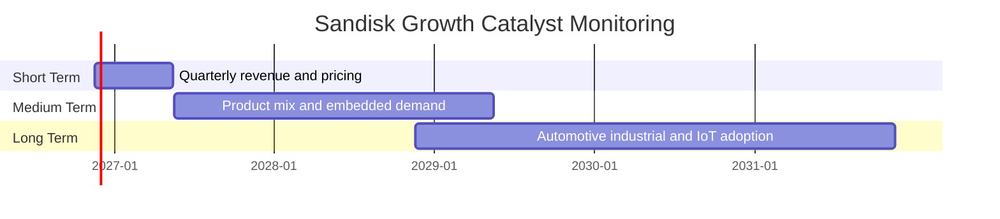

### 9.2 TAM 市場規模分析

**N/A（TAM 數據未提供）**。公司 TTM 營收 $28.97B、TTM 年增 272.4%，可作成長趨勢參考，但不足以推算 NAND、SSD 或嵌入式儲存市場規模與滲透率。市場份額及市場成長率亦未提供。

### 9.3 成長驅動力結構圖

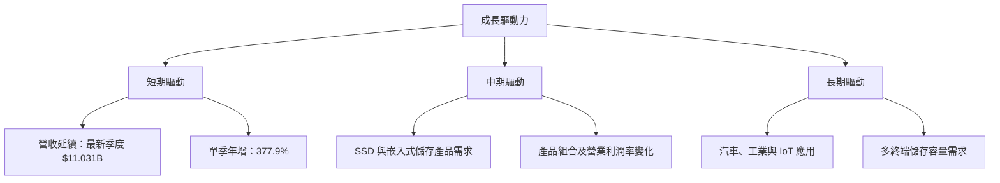

短期量化依據為最新季度營收與年增率；中長期驅動方向依公司業務描述，未提供各項目的營收佔比、TAM 或預測數字。

---

## 10. 風險矩陣

### 10.1 風險評分矩陣

下列位置為質化評估，不是財務資料庫提供的統計概率；風險清單不對缺少數據的概率作虛假精確估計。

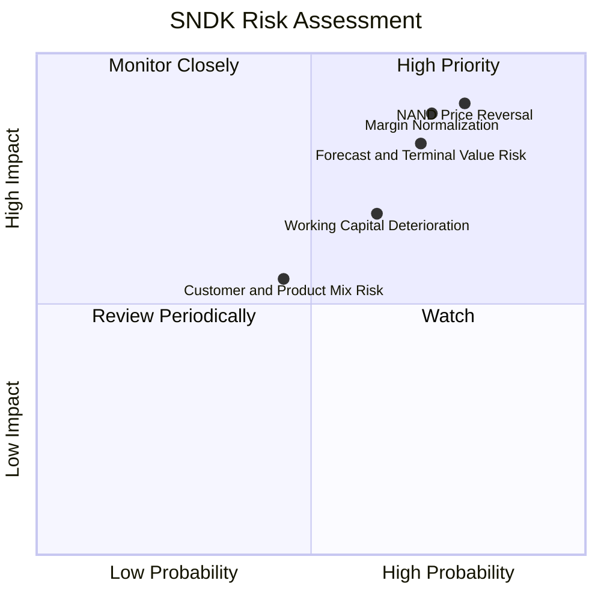

### 10.2 風險清單詳細分析

| # | 風險項目 | 發生機率 | 財務衝擊 | 風險評估 | 緩解措施 |
|---|----------|----------|----------|----------|----------|
| 1 | 🔴 **NAND 價格與供需反轉** | 高；無可靠數值 | 高；幅度 N/A | 🔴 高 | 追蹤毛利率、營收 QoQ、存貨天數及管理層指引；依分批原則控制持倉。 |
| 2 | 🔴 **營業利潤率正常化** | 高；當前利潤率處於高位 | 高；可觀察悲觀情境價值 $2,005.62 | 🔴 高 | 每季追蹤營業利益率相對 TTM 72.5% 及模型成熟期 61.2% 的變化。 |
| 3 | 🟠 **營運資金與庫存風險** | CCC 已上升，持續性未知 | 中高；DIO 190 天、CCC 226 天 | 🟠 中高 | 設定 CCC 回落或不再擴大的觀察門檻；追蹤存貨及應收帳款變動。 |
| 4 | 🟠 **DCF 終值與折現率風險** | 模型依賴明確 | 高；終值佔 EV 57.4% | 🟠 高 | 以相對估值交叉驗證，不把單一 DCF 數字當作確定目標價。 |
| 5 | 🟡 **營收與客戶組合集中風險** | N/A；客戶集中資料未提供 | N/A | 🟡 中 | 持續關注分部披露、主要客戶與應用組合。 |

---

## 11. 投資建議

### 11.1 最終評級與評分

依加權合理價值 **$2,897.95** 計算，MOS **+72.1%**，且 ROIC **141.2%** 高於 WACC **10.16%**，依規則 20 評級為 **🟢 強烈買入**，未作質化調整。1.1 的綜合評分為 **7.6/10**，六項依序為成長性 9.0、獲利能力 9.0、財務健康 7.5、估值 8.0、護城河 6.5、管理層與資本配置 5.5。

### 11.2 合理價值與隱含報酬率

| 估值參考 | 每股價值 | 相對現價變化 | 機率／權重 |
|----------|----------|--------------|-----------|
| 加權合理價值 | **$2,897.95** | **+258.2%** | 估值方法加權 |
| 悲觀 DCF 情境 | $2,005.62 | +147.9% | 25% |
| 基準 DCF 情境 | $4,703.29 | +481.3% | 50% |
| 樂觀 DCF 情境 | $10,447.70 | +1,191.3% | 25% |
| DCF 機率加權參考 | $5,464.97 | +575.4% | 100% |

加權合理價值採估值方法固定權重；DCF 機率加權參考不替代 8.8 的加權合理價值。

### 11.3 買入時機與觸發因素

╔══════════════════════════════════════════════════════════════════╗  
║　　　　　　　　✅ 買入觸發因素 Checklist　　　　　　　　　　 ║  
╠══════════════════════════════════════════════════════════════════╣  
║ 目前參考價：$809.11（2026-11-16 收盤）　　　　　　　　　　　 ║  
║ 立即／分批建倉觀察條件：　　　　　　　　　　　　　　　　　　 ║  
║ ✅ 最新季度營收 $11.031B，確認收入仍高於上一季 $8.965B　　　 ║  
║ ✅ TTM FCF 為 $17.36B，維持正值且現金流品質未明顯惡化　　　　║  
║ ☐ 存貨天數由 190 天趨穩或回落；持續上升則不宜只看 EPS　　　　║  
║　　　　　　　　　　　　　　　　　　　　　　　　　　　　　　 ║  
║ 加碼觸發條件：　　　　　　　　　　　　　　　　　　　　　　　║  
║ ☐ 營收及毛利率維持成長，且 CCC 不再擴大　　　　　　　　　　　║  
║ ☐ ROIC 持續高於 WACC 10.16%　　　　　　　　　　　　　　　　 ║  
║　　　　　　　　　　　　　　　　　　　　　　　　　　　　　　 ║  
║ 減碼／重新評估觸發條件：　　　　　　　　　　　　　　　　　　║  
║ ☐ 連續兩季營收年增低於 20%（研究監控門檻，非公司財測）　　　║  
║ ☐ 營業利益率較 TTM 72.5% 收縮超過 10 個百分點　　　　　　　 ║  
║ ☐ FCF 轉負，或 CCC 持續高於 226 天且存貨增加　　　　　　　 ║  
╚══════════════════════════════════════════════════════════════════╝

**買入區間**：參考現價 $809.11 至 **$2,608.16**；後者是使 MOS 維持至少 10% 的估值界線，不是對短期價格波動的預測。相較於高波動記憶體個股，分批建倉與設定基本面停看條件較合適。

### 11.4 投資人適配度分析

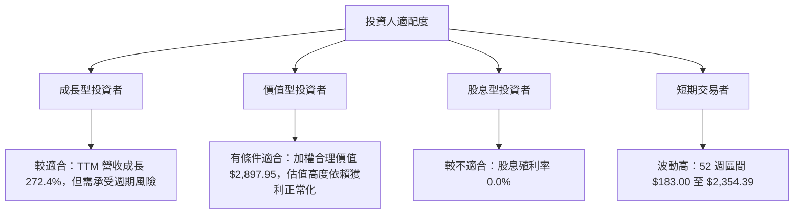

### 11.5 每季財報監控清單（Quarterly Watch List）

| 指標 | 最新參考值 | 加碼／減碼觀察門檻 |
|------|------------|--------------------|
| 營收及 YoY | 最新季度 $11.031B；YoY +377.9% | 加碼觀察：營收保持季增；若連續兩季 YoY <20%，重新評估成長論點。 |
| 毛利率 | TTM 80.0% | 若連續兩季下滑且價格／產品組合無改善，降低盈利預測。 |
| 營業利益率 | TTM 72.5%；最新季度 VERIFIED FIGURES 79.6% | 若較 TTM 基準收縮超過 10 個百分點，檢視週期假設。 |
| OCF、FCF | TTM OCF $17.55B、FCF $17.36B | FCF 轉負或 FCF／淨利持續低於 70%，加強審查現金轉換。 |
| Capex | TTM $181M | 大幅上升時確認是成長投資、維持性支出或產能建置。 |
| DIO／CCC | 190 天／226 天 | CCC 再上升且存貨同步增加，減碼或暫停加碼。 |
| SBC／稀釋股數 | 最新四季 SBC $270M；股數測試未通過 | SBC 佔營收持續上升或稀釋加速，重新檢視每股價值。 |
| 研發投入 | FY2026 R&D $1.33B | 追蹤研發投入是否帶來產品組合或收入改善；未有分部財測時不自行定量。 |
| 財測與管理層指引 | N/A（未提供未來指引） | 每季對照實際營收、利潤率與現金流，更新週期判斷。 |

### 11.6 反面論證：什麼會證明論點錯誤（What Would Change My Mind）

╔══════════════════════════════════════════════════════════════════╗  
║　　　　⚠️ 論點失效條件（Disconfirming Evidence）　　　　　　　 ║  
╠══════════════════════════════════════════════════════════════════╣  
║ ☐ 核心營收連續兩季年增低於 20%，且無產品組合改善抵銷　　　　 ║  
║ ☐ 營業利益率較 TTM 72.5% 收縮超過 10 個百分點並延續兩季　　　 ║  
║ ☐ TTM FCF 轉負，或 FCF／淨利轉換率低於 70% 並持續惡化　　　　║  
║ ☐ CCC 高於 226 天並連續擴大，尤其 DIO 高於 190 天　　　　　　 ║  
║ ☐ ROIC 跌至 WACC 10.16% 以下，代表經濟利差消失　　　　　　　 ║  
║ ☐ 實際成熟期營業利潤率走勢明顯低於悲觀情境假設 52.0%　　　　 ║  
║ ☐ 股權稀釋加速，且現金流未同步增加　　　　　　　　　　　　　 ║  
╚══════════════════════════════════════════════════════════════════╝

> **免責聲明**：本報告為 AI 自動生成，僅供研究參考，不構成投資建議。投資有風險，入市需謹慎。

---

## 資料與來源

| 項目 | 內容 |
|------|------|
| 價格 | 809.11 USD，2026-11-16 收盤（Yahoo Finance 日線） |
| 財務報表 | SEC 10-Q filed 2026-10-30，最新季度 2026-10-02（FY2027 Q1） |
| 有回應的資料來源 | SEC 申報資料 (XBRL)、Yahoo Finance、Finviz、StockAnalysis、Roic.ai |
| 由程式計算 | TTM 數字、WACC、DCF 模型、估值方法與權重、加權合理價值、MOS、評級門檻、F-Score、杜邦分解、營運資金天數、綜合評分 |
| 撰寫模型 | openai / gpt-6-luna |

> 本區塊由產生報告的程式依實際取得的資料填寫，非模型撰寫。「由程式計算」的數字不是模型的估計；其餘判斷（評分、情境、策略）是模型的分析。
