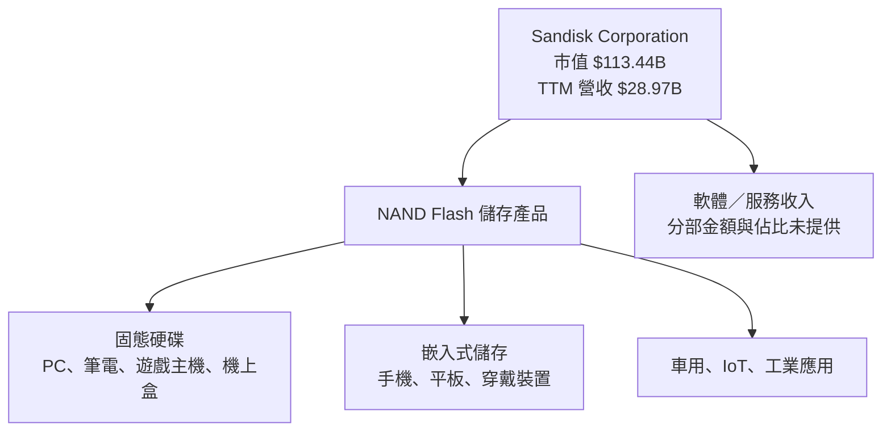
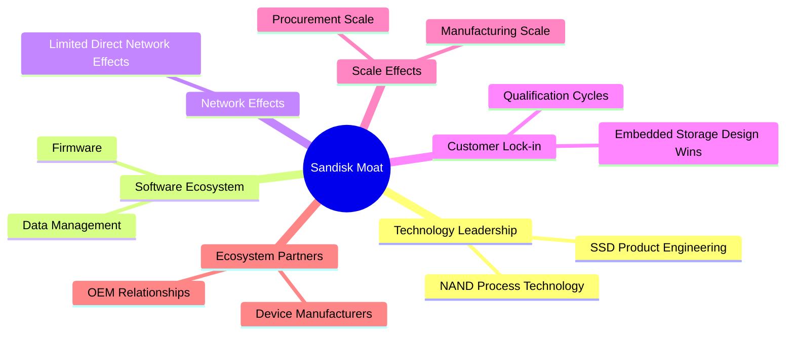
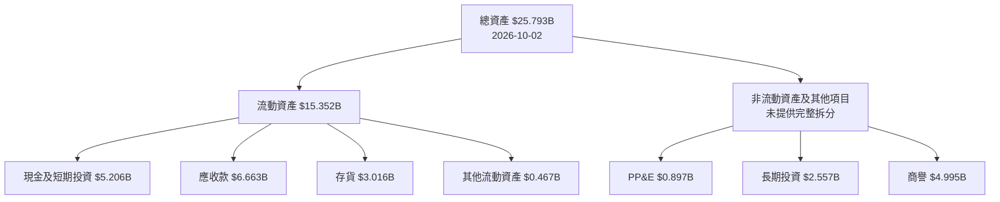
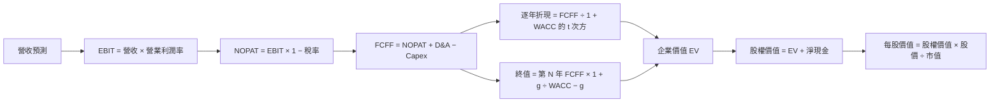
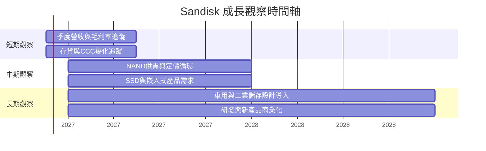
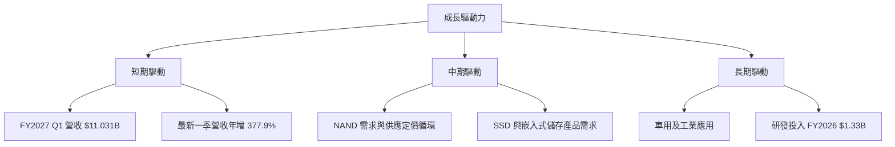
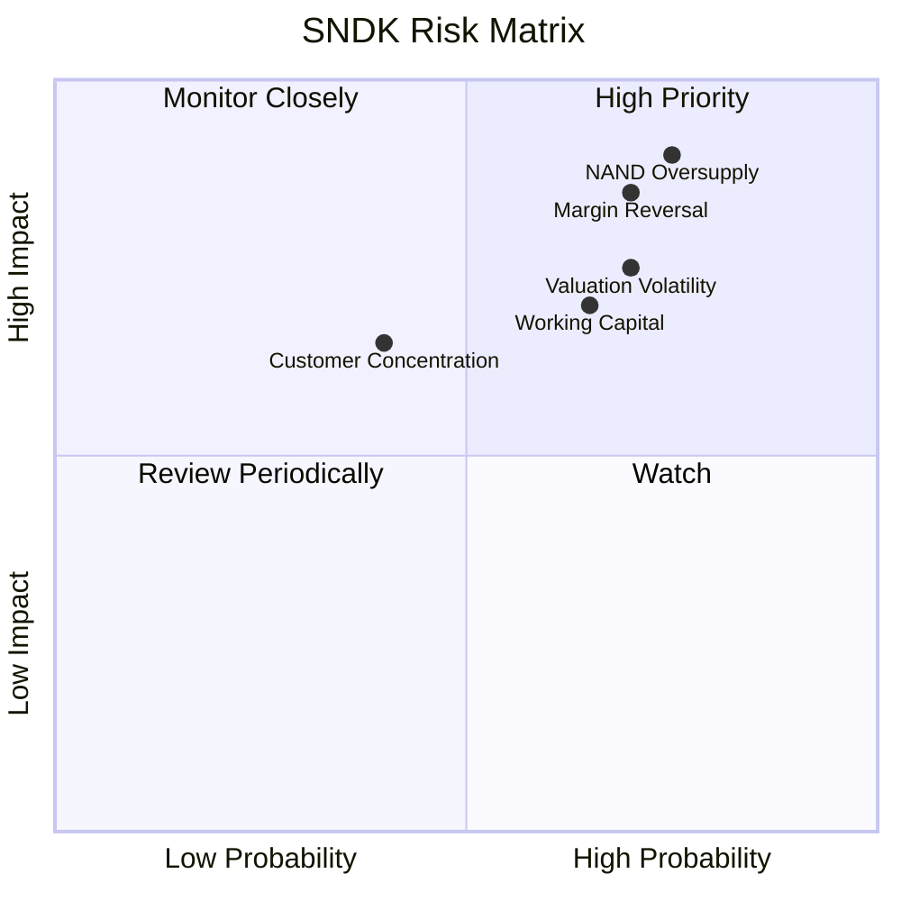
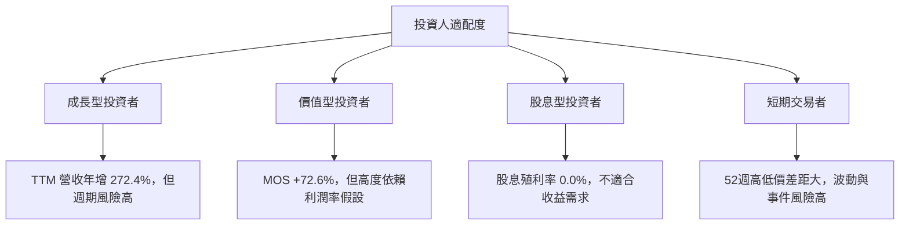

# SNDK 基本面深度分析報告
> **報告日期**：2026-11-18 ｜ **語言**：繁體中文 ｜ **數據來源**：SEC 申報資料 (XBRL)、Yahoo Finance、Finviz、StockAnalysis、Roic.ai ｜ **分析師**：CFA 級機構研究

## 目錄

| # | 章節 | 核心結論 |
|---|------|----------|
| 1 | 執行摘要 | 強烈買入；加權合理價值 $2,904.72；MOS +72.6% |
| 2 | 公司概覽與商業模式 | NAND Flash 需求擴張帶來成長，但市場份額及收入分部資料未提供 |
| 3 | 損益表深度分析 | TTM 營收 $28.97B、TTM 成長 272.4%；獲利率處於高位 |
| 4 | 資產負債表分析 | 淨現金 $5.14B；營運資金週期延長，需留意庫存及收款 |
| 5 | 現金流量深度分析 | TTM FCF $17.36B、FCF Yield 15.31%；現金轉換率仍需觀察 |
| 6 | 獲利能力與資本效率 | ROIC 141.2% 對 WACC 10.14%，目前顯示大幅價值創造 |
| 7 | 相對估值分析 | 同業倍數與分析師共識均低於基準 DCF，但 NAND 循環性高 |
| 8 | DCF 內在價值評估 | 基準 DCF 每股 $4,715.84；終值占 EV 57.5% |
| 9 | 成長催化劑 | 近期營收與利潤快速增長；TAM 數據未提供 |
| 10 | 風險矩陣 | NAND 供需反轉、價格下跌與營運資金攀升為主要風險 |
| 11 | 投資建議 | 依規則評級為強烈買入；分批建倉並監控利潤率、庫存與 FCF |

---

## 1. 執行摘要

### 1.0 一頁式投資儀表板（Portfolio Manager 30 秒速讀）

| 項目 | 內容 |
|------|------|
| **投資論點（3 句）** | ① TTM 營收年增 272.4%，最新一季年增 377.9%，顯示 NAND 需求與定價循環快速擴張。② TTM FCF 為 $17.36B、FCF Yield 15.31%，但 CCC 已由 154 天升至 226 天，現金轉換需持續監控。③ 基準 DCF 為 $4,715.84／股、加權合理價值為 $2,904.72／股；估值結論對長期利潤率與終值假設敏感。 |
| **綜合評分** | **7.8/10**（引用 1.1 評分卡） |
| **財務健康** | 🟢 現金及短期投資 $5.14B、程式計算淨現金 $5.14B；但債務資料來源有差異，CCC 拉長至 226 天 |
| **ROIC vs WACC** | 141.2% vs 10.14%；現有數據顯示創造價值，ROIC 高度受週期高峰獲利影響 |
| **FCF 趨勢** | FY2026 年度 FCF $11.49B、TTM FCF $17.36B；TTM FCF Yield 15.31% |
| **估值** | Forward P/E 2.76x ｜ EV/EBITDA 5.11x ｜ FCF Yield 15.31% |
| **DCF 內在價值（基準）** | $4,715.84 ｜ 現價相對 DCF 折價 **83.1%**（現價 ÷ DCF − 1） |
| **安全邊際（MOS）** | **+72.6%**＝($2,904.72 − $797.24) ÷ $2,904.72；🟢 >25% 充足 |
| **預期報酬（基準情境 12M）** | +491.5%（基準情境價值 $4,715.84 相對現價；非保證報酬預測） |
| **關鍵風險（前二）** | NAND 供給回升導致價格及毛利率下滑；DSO、DIO 上升使 CCC 延長 |
| **評級 + 信心度** | 🟢 **強烈買入** ｜ 信心：中（循環產業及模型假設令估值區間很寬） |

> 評級根據加權合理價值 $2,904.72、現價 $797.24 所得 MOS +72.6%，且 ROIC 141.2% 高於 WACC 10.14%，依 MOS 規則為強烈買入。估值結果須結合 NAND 循環性、營運資金天數惡化及 DCF 終值依賴度判斷。

### 1.1 綜合評分卡（全報告唯一）

| 維度 | 評分（1–10） | 主要依據（引用數字與其來源章節） |
|------|--------------|----------------------------------|
| 成長性 | 9.0 | TTM 營收成長 272.4%、最新一季年增 377.9%（第 3 章）；極高增速可能受週期低基期影響 |
| 獲利能力 | 9.0 | TTM 營業利益率 72.5%、ROIC 141.2%、Piotroski 5/8（第 3、6 章） |
| 財務健康 | 8.0 | 淨現金 $5.14B；流動比率 2.58（Yahoo Finance）；CCC 從 154 天增至 226 天（第 4 章） |
| 估值 | 8.0 | MOS +72.6%；P/S 4.2x，低於自身五年中位數 4.8x（第 7、8 章） |
| 護城河 | 7.0 | NAND 技術、製造規模及客戶認證具價值，但產品週期與同業競爭限制定價持久性（第 2 章） |
| 管理層與資本配置 | 6.0 | FY2026 SBC $232M，流通股數未通過 Piotroski 稀釋測試；股利殖利率 0%（第 3、5、6 章） |
| **綜合評分** | **7.8** | 六項算術平均：(9.0 + 9.0 + 8.0 + 8.0 + 7.0 + 6.0) ÷ 6 = 7.8 |

### 1.2 五大投資論點 + 三大核心風險

| 類型 | 項目 | 具體依據 | 信心度 |
|------|------|----------|--------|
| 🟢 **投資論點①** | 營收進入加速期 | TTM 營收 $28.97B、TTM 年增 272.4%；最新一季年增 377.9% | 🟢 高 |
| 🟢 **投資論點②** | 現金流改善 | TTM OCF $17.55B、FCF $17.36B；FY2026 年度 FCF $11.49B | 🟢 高 |
| 🟢 **投資論點③** | 高營運槓桿 | TTM 營業利益率 72.5%，最新一季 79.6%；在收入增加時，固定成本攤薄可推升利潤 | 🟡 中 |
| 🟢 **投資論點④** | 資產負債表有緩衝 | 現金及短期投資 $5.14B，淨現金 $5.14B（依 VERIFIED FIGURES） | 🟢 高 |
| 🟢 **投資論點⑤** | 估值具折價 | 加權合理價值 $2,904.72，現價 $797.24，MOS +72.6% | 🟡 中 |
| 🟡 **風險①** | NAND 循環反轉 | 新聞提及市場擔憂 2027 年 NAND 過剩；若供給增加，售價及目前高毛利率可能回落 | 🔴 高衝擊 |
| 🟡 **風險②** | 營運資金效率轉弱 | CCC 226 天，較一年前增加 72 天；DSO 增 27 天、DIO 增 66 天 | 🟡 中度 |
| 🔴 **風險③** | 盈餘與股數品質 | FCF/淨利僅約 89.4%（口徑差異見第 3.5 節）；稀釋股數未通過 F-Score 測試 | 🟡 中度 |

### 1.3 快速統計卡片

| 指標 | 公司實際值（期間） | 同業中位數 | 狀態 |
|------|--------------------|------------|------|
| 營收成長（TTM） | **272.4%** | — | 🟢 |
| 營收成長（最新一季年增） | **377.9%** | **327.9%**（WDC、MU、SKHY） | 🟢 |
| 毛利率（TTM） | **80.0%** | **77.4%**（WDC、MU、SKHY） | 🟢 |
| 營業利益率（TTM） | **72.5%** | — | 🟢 |
| ROIC（TTM） | **141.2%** | — | 🟢 |
| Forward P/E | **2.76x** | **3.4x**（WDC、MU、SKHY） | 🟢 |
| FCF Yield（TTM） | **15.31%** | — | 🟢 |
| Piotroski F-Score | **5 / 8** | — | 🟡 |

> 同業中位數按可用同業資料計算；P/E Forward 中位數為 3.4x，季度營收成長與毛利率中位數均以 WDC、MU、SKHY 三家資料計算。

### 1.4 投資結論

```text
╔══════════════════════════════════════════════════════════════════╗
║                    📊 投資結論摘要                               ║
╠══════════════════════════════════════════════════════════════════╣
║  評級：🟢 強烈買入（MOS +72.6%，ROIC 141.2% > WACC 10.14%）     ║
║  價格（2026-11-17 收盤）：$797.24                                ║
║  DCF 內在價值（基準）：$4,715.84（折價 83.1%）                  ║
║  安全邊際 MOS：+72.6%（＝(加權合理價值−現價)÷加權合理價值）    ║
║  加權合理價值（8.8）：$2,904.72                                  ║
║  DCF 情境價值：                                                  ║
║    悲觀情境：$2,009.98（+152.1%）                                ║
║    基準情境：$4,715.84（+491.5%）                                ║
║    樂觀情境：$10,481.32（+1214.7%）                              ║
║  綜合評分：7.8/10（引用 1.1）                                    ║
║  適合投資人：能承受半導體週期與高波動、採分批配置的成長型投資人║
╚══════════════════════════════════════════════════════════════════╝
```

---

## 2. 公司概覽與商業模式

### 2.1 業務結構與收入來源

Sandisk Corporation 設計、製造並銷售以 NAND Flash 為核心的資料儲存產品。財務資料未提供各業務板塊收入及佔比，因此以下只呈現公司總營收及產品類別，不推估分部比例。FY2026 營收為 $20.25B；TTM 營收為 $28.97B。



### 2.2 市場份額

市場份額數字及來源年份未提供，故不提供估算比例。以營收規模觀察，SNDK TTM 營收 $28.97B、成長 272.4%；同業最新一季營收年增率為 MU 379.3%、SKHY 327.9%、WDC 55.5%。SNDK 目前處於高成長階段，但單季成長率不能直接視作長期市場份額變化。

### 2.3 競爭護城河分析



### 2.4 護城河強度

| 護城河項目 | 強度（強／中／弱） | 證據（引用數字或事實） | 會削弱它的情況 |
|------------|--------------------|------------------------|----------------|
| 技術與產品工程 | 中 | 公司涵蓋 SSD、嵌入式、車用及工業儲存；TTM 毛利率 80.0% | 同業技術追上、NAND 產品差異縮小 |
| 軟體與韌體 | 中 | 產品類別包含儲存方案；軟體及服務收入未單獨揭露 | 軟體附加價值不足、客戶可轉換供應商 |
| 網路效應 | 弱 | 財務資料未顯示直接網路效應 | 產業供應鏈主要依產品性能與價格競爭 |
| 客戶鎖定 | 中 | 嵌入式與車用產品需設計導入與認證；具質化黏著性，但未提供續約率 | 客戶重新設計、轉用競爭產品 |
| 規模效應 | 中 | FY2026 營收 $20.25B、TTM 營收 $28.97B | 需求低迷造成產能利用率下滑或固定成本吸收惡化 |
| 生態夥伴 | 中 | 產品應用涵蓋 PC、手機、車用、IoT；未提供夥伴收入比例 | OEM 集中採購或供應鏈改變 |

1.1「護城河」評分為 7.0/10，依據是產品、客戶認證與規模具有一定防禦性，但市場份額、切換成本與服務收入數據不足，且 NAND 具有明顯週期性。

---

## 3. 損益表深度分析

### 3.1 年度收入成長趨勢（近4年）

年度收入使用財務表所列 FY2023–FY2026。FY2026 對 FY2025 增長 175.3%；FY2023 至 FY2026 三年 CAGR 約 49.2%。

```text
╔══════════════════════════════════════════════════════════════════╗
║                Sandisk 年度收入趨勢（FY2023–FY2026）             ║
╠══════════════════════════════════════════════════════════════════╣
║  FY2023  $6.09B   ██████░░░░░░░░░░░░░░░░░░░  YoY：—            ║
║  FY2024  $6.66B   ███████░░░░░░░░░░░░░░░░░░  YoY：+9.5%         ║
║  FY2025  $7.36B   ████████░░░░░░░░░░░░░░░░  YoY：+10.4%        ║
║  FY2026  $20.25B  ████████████████████████░  YoY：+175.3%       ║
║                                                                  ║
║  FY2023–FY2026 三年收入 CAGR：約 +49.2%                          ║
╚══════════════════════════════════════════════════════════════════╝
```

FY2026 收入由 FY2025 的 $7.36B 增至 $20.25B，主要反映最新 NAND 循環上行；FY2026 Q1–Q4 季收入從 $2.31B 增至 $8.97B。這表示需求、出貨及定價共同推升收入，但也意味基期與高峰週期風險增加。

### 3.2 季度收入趨勢分析

| 季度 | 營收 | QoQ 成長 | YoY 成長 | 備註 |
|------|------:|---------:|---------:|------|
| FY2026 Q2（2026-01-02） | $3.025B | +61.3% | +61.25% | 由前季 $3.02B 近似值計算 QoQ；YoY 採 StockAnalysis |
| FY2026 Q3（2026-04-03） | $5.950B | +96.7% | +251.03% | 出貨及價格改善推升收入 |
| FY2026 Q4（2026-07-03） | $8.965B | +50.7% | +371.59% | 高增長延續 |
| FY2027 Q1（2026-10-02） | $11.031B | +23.0% | +377.9% | 最新一季年增率，非 TTM |

QoQ 以相鄰季度營收相除計算；FY2026 Q2 財務表列 $3.025B，前季 $3.02B 取資料表四捨五入值，因此 QoQ 為近似值。最新一季營收增速雖略低於前季 QoQ 增幅，YoY 仍達 377.9%，代表需求相較去年同期大幅改善。

### 3.3 利潤率演變分析

| 利潤率指標 | FY2023 | FY2024 | FY2025 | FY2026 | 趨勢 | 評估 |
|------------|-------:|-------:|-------:|-------:|------|------|
| **毛利率** | 7.1% | 16.1% | 30.1% | 71.5% | ↗️ FY2026 大幅上升 | 🟢 |
| **營業利益率** | -21.3% | -6.7% | 6.9% | 61.6% | ↗️ 從虧損轉為高利潤 | 🟢 |
| **淨利率** | -35.2% | -10.1% | -22.3% | 56.4% | FY2025 受虧損影響，FY2026 轉正 | 🟡 |

年度比率由年度營收、毛利、營業利益及淨利相除計算；與 TTM 指標不同，不應混用。TTM 毛利率為 80.0%、TTM 營業利益率採 VERIFIED FIGURES 的 72.5%。FY2026 利潤率急升，與營收擴大、產品組合及 NAND 定價改善相符；由於 NAND 價格具有週期性，不能將此高峰直接外推為長期常態。

### 3.4 費用結構分析

完整 SG&A、銷售成本拆分及分部費用明細未提供，故不以不完整資料繪製費用結構圓餅圖。FY2026 R&D 為 $1.33B，約為 FY2026 營收 $20.25B 的 6.6%；FY2026 毛利 $14.47B、營業利益 $12.47B，毛利與營業利益差額為 $2.00B，該差額包含多項營業費用，不能全部歸類為 SG&A。

### 3.5 季度 EPS 趨勢與盈餘品質（Quality of Earnings）

StockAnalysis 顯示最近四季每股盈餘實際值為 $5.15、$23.03、$43.96、$52.60；季度 EPS estimates 均為 nan，無法判斷實際盈餘是否超預期。最近一季 EPS 年增 6,913.3%，比較基期極低；此增幅不宜直接視為可持續常態。

| 盈餘品質項目 | 數值/佔比 | 評估 |
|--------------|-----------|------|
| 股權薪酬 SBC / 營收 | FY2026 $232M ÷ FY2026 營收 $20.25B = **1.15%** | 🟡 SBC 比例不高，但仍會稀釋股東；F-Score 稀釋股數項未通過 |
| SBC / 營業現金流 | FY2026 $232M ÷ OCF $11.67B = **1.99%** | 🟢 比例有限；仍須與股數變化一併觀察 |
| FCF / 淨利（現金轉換率） | TTM FCF $17.36B ÷ TTM 淨利 $19.422B = **約 89.4%** | 🟡 現金轉換略低於淨利；兩者期間口徑均為 TTM，但 TTM 淨利為 StockAnalysis 數值 |
| 一次性/非經常性損益 | N/A（未提供可辨識明細） | ⚪ 無法確認一次性項目是否影響盈餘 |
| 有效稅率 | **12.2%**（最新年度） | 🟡 稅率較低但未見足夠稅務附註，不能判定是否有一次性稅務利益 |
| 資本化支出 vs 費用化 | TTM Capex $181M；資本化研發明細 N/A | 🟡 資本支出低，但不能據此推論所有研發成本均已適當費用化 |

TTM FCF 使用固定定義 OCF − Capex，為 $17.36B。因 TTM 淨利數據來自 StockAnalysis，與不同資料源列示的淨利或 EPS 口徑可能不同，89.4% 僅作方向性評估。高額現金流支持獲利含金量，但營運資金增加與應計品質測試未通過，需關注現金流是否能持續追上淨利。

---

## 4. 資產負債表分析

### 4.1 資產結構分解

截至 2026-10-02，StockAnalysis 列示總資產 $25.793B。以下只列有明確數字的項目；部分細項並非完整資產負債表拆分，因此不要求各節點加總等於總資產。



### 4.2 流動性與營運資金分析

| 指標 | 最新 TTM | 一年前 TTM | 變化 | 解讀 |
|------|----------:|----------:|------:|------|
| DSO 應收帳款天數 | 83 天 | 56 天 | +27 天 | 收款週期延長；營收快速擴張可能增加應收，但亦需留意回款品質 |
| DIO 存貨天數 | 190 天 | 124 天 | +66 天 | 存貨佔用增加；在 NAND 供需反轉時，存貨跌價風險更高 |
| DPO 應付帳款天數 | 46 天 | 26 天 | +20 天 | 對供應商付款週期延長，可能部分抵銷應收與存貨佔用 |
| CCC 現金轉換週期 | 226 天 | 154 天 | +72 天 | 現金轉換速度下降，需以後續季度存貨與應收變化確認是否持續 |

流動性參考 Yahoo Finance：流動比率 2.58、速動比率 1.994。營運資金天數照抄 QUALITY FIGURES；CCC 延長主要由 DSO 與 DIO 上升造成，DPO 增長只部分緩衝。應收及存貨水位須與營收成長同步檢視，而不能只看當期利潤率。

### 4.3 債務結構分析

```text
╔══════════════════════════════════════════════════════════════════╗
║                   Sandisk 債務健康診斷                            ║
╠══════════════════════════════════════════════════════════════════╣
║  總債務：        $N/A（VERIFIED FIGURES 未提供）                  ║
║  其他資料源債務：$0.201B（市場資料；不同口徑）                    ║
║  總現金+投資：   $5.14B（VERIFIED FIGURES）                       ║
║  淨現金：        $5.14B（VERIFIED FIGURES）  🟢                  ║
║  Debt/EBITDA：   N/A（總債務在核心數據中缺漏）                    ║
║  Interest Coverage：N/A（利息費用數據未提供）                    ║
║  備註：Yahoo 財務表列 FY2026 債務 $0.177B；市場資料列 $0.201B，   ║
║        不同期間與來源並存，不以其中一項替代 VERIFIED FIGURES。   ║
╚══════════════════════════════════════════════════════════════════╝
```

核心數據列示總債務 N/A，故不得用其他來源倒推出 VERIFIED 淨現金以外的債務指標。現金充足提供週期低谷緩衝，但若需求轉弱、庫存增加，仍可能消耗現金。

### 4.4 股東權益趨勢

| 財年 | 股東權益 | 年變化 | 解讀 |
|------|---------:|------:|------|
| FY2024 | $11.08B | — | 虧損期間權益下滑 |
| FY2025 | $9.22B | -16.8% | 淨虧損 $1.64B 對權益構成壓力 |
| FY2026 | $15.74B | +70.7% | 轉盈後權益回升；淨利 $11.43B |

```text
╔══════════════════════════════════════════════════════════════════╗
║                  股東權益趨勢                                    ║
╠══════════════════════════════════════════════════════════════════╣
║  FY2024  $11.08B  ██████████████░░░░░░░░                        ║
║  FY2025   $9.22B  ████████████░░░░░░░░░░                        ║
║  FY2026  $15.74B  ████████████████████                          ║
╚══════════════════════════════════════════════════════════════════╝
```

---

## 5. 現金流量深度分析

### 5.1 現金流量瀑布圖

最近四季合計現金流列示於下表；季度收入與現金流資料以不同期間結束日為準。股息及回購金額未提供，故不填造數字。


### 5.2 FCF 轉換率趨勢

| 財年 | OCF | Capex | FCF | 淨利 | FCF / 淨利 |
|------|----:|------:|----:|-----:|-----------:|
| FY2023 | -$0.713B | $0.219B | -$0.932B | -$2.143B | 比率不具解讀性 |
| FY2024 | -$0.309B | $0.166B | -$0.475B | -$0.672B | 比率不具解讀性 |
| FY2025 | $0.084B | $0.204B | -$0.120B | -$1.641B | 比率不具解讀性 |
| FY2026 | $11.67B | $0.177B | $11.49B | $11.43B | 約 100.5% |
| TTM | $17.55B | $0.181B | $17.36B | $19.422B | 約 89.4% |

年度 FCF 與淨利的比例在虧損期間不宜直接比較。FY2026 FCF 略高於淨利，TTM 比率約 89.4%；現金流改善明確，但營運資金天數惡化令未來轉換率仍需檢驗。

### 5.3 自由現金流趨勢

```text
╔══════════════════════════════════════════════════════════════════╗
║                   自由現金流趨勢                                 ║
╠══════════════════════════════════════════════════════════════════╣
║  FY2023  -$0.932B  ░░░░░░░░░░░░░░░░░░░░  FCF 為負              ║
║  FY2024  -$0.475B  ░░░░░░░░░░░░░░░░░░░░  FCF 為負              ║
║  FY2025  -$0.120B  ░░░░░░░░░░░░░░░░░░░░  接近損益兩平          ║
║  FY2026  $11.49B   ████████████████████  FCF Yield 未提供       ║
║  TTM     $17.36B   █████████████████████████  FCF Yield 15.31%  ║
╚══════════════════════════════════════════════════════════════════╝
```

### 5.4 資本配置評估

資本配置完整流向及回購、股息金額未提供，故不繪製比例圓餅圖。

| 項目 | 可用數據 | 評估 |
|------|---------|------|
| 資本支出 | FY2026 $177M；TTM $181M | 相對 TTM 收入 $28.97B 約 0.6%，目前較低；需觀察是否足以支援長期產能與技術投資 |
| 股權薪酬 | FY2026 $232M | 約為年度收入 1.15%；仍對股東造成稀釋 |
| 股息 | 殖利率 0.0%、派息率 0.0% | 無現金股息回饋 |
| 回購 | 金額未提供 | 不判定回購是否抵銷 SBC |
| 留存／投資 | 分項金額未提供 | FCF 留存用途無法量化 |

---

## 6. 獲利能力與資本效率

### 6.1 ROE / ROA / ROIC 趨勢

| 指標 | 可用期間與數值 | 評估 |
|------|----------------|------|
| ROIC | TTM 141.2% | 大幅高於 WACC 10.14%，但受 NAND 高峰期獲利及資本基數影響 |
| ROE | TTM 107.1%（QUALITY FIGURES 杜邦） | 高報酬主要由淨利率及資產週轉推升，不是高權益乘數所致 |
| ROA | 歷史年度序列 N/A | 最新 TTM 同一資料包其他欄位有不同口徑；此處不混用 |
| 同業均值 | N/A（未提供可一致比較的 ROE／ROA／ROIC） | 不填入估算值 |

### 6.2 ROIC vs WACC 分析（核心價值創造判斷）

```text
╔══════════════════════════════════════════════════════════════════╗
║                ROIC vs WACC 深度分析                            ║
╠══════════════════════════════════════════════════════════════════╣
║  WACC（程式計算，採用 VERIFIED FIGURES）：10.14%                ║
║  ├── 無風險利率（10Y 美債）：5.10%                               ║
║  ├── 市場風險溢酬 ERP：5.00%                                     ║
║  ├── 原始 Beta：N/A；採用調整後 Beta：1.00（假設值）             ║
║  ├── 股權成本：5.10% + 1.00 × 5.00% = 10.10%                   ║
║  ├── 稅前債務成本：36.32%；有效稅率：12.2%                      ║
║  ├── E / D 權重：99.8% / 0.2%                                    ║
║  └── 採用 WACC：10.14%                                          ║
║                                                                  ║
║  ROIC（TTM）：141.2%                                             ║
║  EVA spread：141.2% − 10.14% = 131.06 個百分點                  ║
║  ROIC / WACC：約 13.9 倍                                         ║
║                                                                  ║
║  判斷：目前數據顯示創造股東價值；高 ROIC 的可持續性取決於       ║
║        NAND 供需及利潤率，不能把週期高峰直接視作常態。          ║
╚══════════════════════════════════════════════════════════════════╝
```

Beta 原始值未提供，調整後 Beta 1.00 為成本資本資料採用的假設值；此處按規定採用已提供 WACC 10.14%，不另建 WACC。債務成本及權重亦照用資本成本資料。ROIC 141.2% 高於 WACC 130.??? 注意按算式差值為 **131.06 個百分點**，代表當前營運回報遠高於資金成本；若週期反轉，ROIC 可能快速回落。

### 6.3 杜邦三因素分解

| 因素 | 數值（TTM） | 解讀 |
|------|-------------|------|
| 淨利率 | 67.0% | 營收轉為淨利的比例高，主要受目前高毛利及低費用率影響 |
| 資產週轉率 | 1.12 | 每單位資產帶來 1.12 倍營收 |
| 權益乘數 | 1.42 | 槓桿程度有限，不是 ROE 的主要來源 |
| **ROE** | **107.1%** | 67.0% × 1.12 × 1.42 = 約 106.5%；與資料列示 107.1% 的差異來自未四捨五入底層值 |

### 6.4 財務體質：Piotroski F-Score

Piotroski F-Score 為 **5 / 8**；一項測試因缺資料排除，分母為 8，非九項全部可判定。

| 測試 | 結果 | 解讀 |
|------|------|------|
| ROA > 0 | ✅ 通過 | TTM 盈利為正 |
| 營業現金流 > 0 | ✅ 通過 | TTM OCF $17.55B |
| ROA 高於一年前 | ✅ 通過 | 盈利狀況較前期改善 |
| 營業現金流 > 淨利 | ❌ 未通過 | 應計品質測試未過；需留意現金與會計盈餘差異 |
| 長期負債 ÷ 總資產低於一年前 | — 無法判定 | 缺少測試所需資料 |
| 流動比率高於一年前 | ❌ 未通過 | 流動比率未改善，雖當前 Yahoo 列示 2.58 |
| 稀釋股數未增加 | ❌ 未通過 | 流通股數增加，SBC 對股東造成稀釋 |
| 毛利率高於一年前 | ✅ 通過 | 毛利率隨週期改善 |
| 資產週轉率高於一年前 | ✅ 通過 | 資產效率改善 |

---

## 7. 相對估值分析

### 7.1 同業估值比較表格

本公司數值採估值資料表；同業數值直接採 Peer multiples。SKHY 的 P/S 與 EV/EBITDA 因幣別混用而不可比較，故不填該兩格。

| 估值指標 | **SNDK** | **WDC** | **MU** | **SKHY** | 本公司評估 |
|----------|---------:|-------:|------:|--------:|-----------|
| **Trailing P/E** | 6.37x | 10.0x | 9.6x | 7.8x | 🟢 SNDK 低於同業三家數值；盈餘處於週期高點 |
| **Forward P/E** | 2.76x | 7.0x | 3.4x | 3.0x | 🟢 低於同業中位數 3.4x |
| **P/S Ratio** | 3.92x | 7.3x | 6.1x | N/A | 🟢 低於 WDC、MU 中位數 6.7x |
| **EV/EBITDA** | 5.11x | 16.7x | 7.1x | N/A | 🟢 低於同業中位數 11.9x |
| **最新一季營收年增** | 377.9% | 55.5% | 379.3% | 327.9% | 🟢 高於 WDC、SKHY，接近 MU |
| **TTM 毛利率** | 80.0% | 52.6% | 80.7% | 77.4% | 🟢 接近 MU，略高於 SKHY |

SNDK 的低倍數可能反映市場認為目前獲利處於 NAND 循環高峰；不能單看 P/E 低便認定長期便宜。相對估值回推價格採程式提供的同業中位數方法，見 7.4。

### 7.2 歷史估值區間分析

```text
╔══════════════════════════════════════════════════════════════════╗
║              SNDK 歷史 P/S 估值區間（TTM）                      ║
╠══════════════════════════════════════════════════════════════════╣
║  五年區間：0.9x ─────────────────────────────── 13.4x           ║
║  五年中位數：4.8x                                                ║
║  當前：4.2x                                                      ║
║  當前百分位：43%                                                 ║
║  判讀：低於五年中位數，但歷史區間寬，反映週期估值波動。          ║
╚══════════════════════════════════════════════════════════════════╝
```

### 7.3 情境價值（Bear / Base / Bull，照抄 DCF MODEL 的 Scenarios）

| 情境 | 第 1 年營收成長 | 期末營業利潤率 | WACC | 每股價值 | 相對現價 | 機率 | 會發生的條件 |
|------|----------------:|---------------:|-----:|---------:|---------:|-----:|--------------|
| 🔴 悲觀 | 15.0% | 52.0% | 11.14% | $2,009.98 | +152.1% | 25% | NAND 需求增速放緩、供應回升，長期利潤率收斂較快 |
| 🟡 基準 | 30.0% | 61.2% | 10.14% | $4,715.84 | +491.5% | 50% | 首年保持成長，之後逐年衰減至第十年 3% 成長 |
| 🟢 樂觀 | 45.0% | 67.3% | 9.14% | $10,481.32 | +1214.7% | 25% | 需求、產品組合及定價持續優於基準，資本成本下降 |

以上情境按 DCF MODEL 原值呈列；情境不是對未來報酬的保證，且其高價值反映預測期長、利潤率高與終值假設共同作用。

### 7.4 相對估值隱含價格區間

```text
╔══════════════════════════════════════════════════════════════════╗
║             估值方法回推每股價值與現價位置                      ║
╠══════════════════════════════════════════════════════════════════╣
║  $797.24 現價                                                    ║
║      │                                                           ║
║      ├── 同業 P/S：$1,361.65                                     ║
║      ├── 同業 EV/EBITDA：$1,804.39                               ║
║      ├── 分析師共識：$2,047.38                                   ║
║      └── DCF 基準：$4,715.84                                     ║
╚══════════════════════════════════════════════════════════════════╝
```

同業 EV/EBITDA 依 WDC、MU 中位數 11.9x 乘以公司 TTM EBITDA，再加淨現金；同業 P/S 依 WDC、MU 中位數 6.7x 乘以 TTM 營收。方法估值與權重固定於第 8.8 節。

---

## 8. DCF 內在價值評估（Discounted Cash Flow）

### 8.0 估值推理鏈（Thinking Logic）

#### Step 1 — 價值由哪些變數決定？

本模型以 NAND 儲存主業作為唯一可量化的現金流來源；公司 TTM 營收 $28.97B，但分部營收比例、新產品獨立營收及服務收入未提供，不能拆成第二成長曲線或另加選擇權價值。估值最敏感的已量化變數為 WACC 與永續成長率：敏感度矩陣顯示基準值 $4,715.84 在 WACC 11.14% 時降至 $4,082.88，在 WACC 9.14% 時升至 $5,558.54。

#### Step 2 — 模型選擇

| 決策點 | 本報告採用 | 理由（含數字） | 曾考慮但否決 | 否決理由 |
|--------|-----------|----------------|--------------|----------|
| 現金流定義 | FCFF | 使用 WACC 折現並先求 EV；模型明列 FCFF = NOPAT + D&A − Capex | FCFE | 模型未提供融資現金流預測 |
| 預測期 N | 10 年 | DCF 模型固定 N=10 年，收入成長由 30.0% 線性降至 3.0% | 縮短預測期 | 會改動既定模型輸入，故不另建模型 |
| 終值方法 | Gordon Growth | 模型以第 10 年 FCFF 與 g=3.0% 計算 | 退出倍數 | DCF MODEL 未提供退出倍數終值數值，不另行推算 |
| EBIT 基礎 | GAAP EBIT | DCF 指明採 GAAP EBIT | 非 GAAP EBIT | 避免把 SBC 加回後再忽略其成本 |

#### Step 3 — 關鍵假設推導鏈

- **營收成長**：錨點＝TTM 年增 272.4%、最新一季年增 377.9%；調整＝極端週期增速不可持續，因此模型把第一年成長限制在 30.0%，其後線性降至第十年 3.0%；**採用模型原值：30.0% 至 3.0%**；曾考慮直接延續 TTM 272.4%，但基期及週期性令此替代值不可持續，予以否決。
- **期末營業利潤率**：錨點＝TTM 營業利益率 72.5%；調整＝模型按最近三個財年中位水準逐步回歸；**第十年採用 61.2%**；曾考慮維持 72.5%，但該值接近當期週期高位，未反映成熟期價格競爭，予以否決。
- **永續成長率 g**：錨點＝模型設定 3.0%，與長期名目成長常用區間相符；調整＝無，且低於 WACC 10.14%；**採用 3.0%**；曾考慮 4.0%（敏感度矩陣列有此值），但不作基準是因永續成長率高於成熟期保守假設。
- **預測期 N**：錨點＝模型固定 10 年；調整＝無；**採用 10 年**；不採更短期限，因那會改變模型現值及終值起算年度。
- **Capex / 營收**：錨點＝TTM Capex $181M ÷ TTM 營收 $28.97B 約 0.6%；模型 FY+1 至 FY+10 均列 0.6%；**採用模型原值**；更高投資比率未採用，因模型明確依 TTM 比率設定，但這是偏低資本需求假設。
- **GAAP EBIT、SBC 與稀釋**：錨點＝SBC 已反映於 GAAP 費用；調整＝不另扣 SBC、不再加稀釋；**採組合 (A)，年稀釋率 0%**；不採用非 GAAP 加回，避免在固定股數下完全漏計 SBC 成本。
- **WACC**：錨點＝成本資本資料所列 WACC 10.14%；調整＝不另調整；**採用 10.14%**；不自行改用不同 Beta、ERP 或債務權重，因規定要求採用已計算資本成本資料。

#### Step 4 — 最脆弱的一環

最脆弱的是高營業利潤率可維持並逐步收斂至 61.2% 的假設；若 NAND 供需反轉，利潤率與營收增速同時下修，DCF 可能落向悲觀情境 $2,009.98，而非基準 $4,715.84。

#### Step 5 — 計算路徑圖



### 8.1 模型假設總表（Model Inputs）

| 假設項目 | 採用值 | 依據 / 來源 | 敏感度 |
|----------|--------|-------------|--------|
| 預測期長度 N | 10 年 | DCF MODEL 固定預測期；營收成長逐年遞減 | 🟡 中 |
| 營收成長 | FY+1 30.0%，FY+10 3.0% | TTM 成長 272.4%，模型將增速限制在 0%–30% | 🔴 高 |
| 營業利潤率 | 72.5% 降至 61.2% | 以 TTM 72.5% 為起點，向近三個財年中位數回歸 | 🔴 高 |
| 有效稅率 | 12.2% | 最新年度有效稅率 | 🟢 低 |
| Capex / 營收 | FY+1 至 FY+10 約 0.6% | TTM Capex / TTM 營收，模型列值 0.6% | 🟡 中 |
| D&A / 營收 | 0.5% | 模型採 TTM 比率並固定 | 🟢 低 |
| 營運資金變動 | 未建模 | DCF MODEL 明示 working capital is not modelled | 🟡 中 |
| EBIT 基礎 | GAAP EBIT | 模型明列 GAAP EBIT | 🟡 中 |
| SBC 處理 | 組合 (A)：不另扣 SBC | GAAP EBIT 已含 SBC 費用 | 🟡 中 |
| 年稀釋率 | 0% | 固定股數處理，與組合 (A) 相容 | 🟡 中 |
| 永續成長率 g | 3.0% | DCF MODEL 假設，且小於 WACC | 🔴 高 |
| 終值方法 | Gordon Growth | 模型直接提供終值 | 🔴 高 |
| WACC | 10.14% | 成本資本資料；見 8.2 | 🔴 高 |

**FCFF 定義**：FCFF = NOPAT + D&A − Capex；模型沒有營運資金變動列。  
**SBC 防呆**：本模型採用 **(A) GAAP EBIT + 固定股數**，故 SBC 影響已計入一次，不另設 SBC 扣除列，也不對股數作年度稀釋放大。

### 8.2 折現率推導（WACC）

原始 Beta 未提供；成本資本資料採調整後 Beta 1.00，並標為假設。無風險利率日期未提供，故不虛構觀察日期，採已提供 5.10%。

```text
╔══════════════════════════════════════════════════════════════════╗
║                    WACC 推導（折現率）                           ║
╠══════════════════════════════════════════════════════════════════╣
║  股權成本 Ke（CAPM）：                                           ║
║  ├── 無風險利率 Rf：5.10%（資料未列觀察日）                     ║
║  ├── 市場風險溢酬 ERP：5.00%（假設值）                           ║
║  ├── 原始 Beta：N/A；調整後 Beta：1.00（假設值）                 ║
║  ├── 規模／國別溢酬：未另加（資料未提供）                        ║
║  └── Ke = 5.10% + 1.00 × 5.00% = 10.10%                        ║
║                                                                  ║
║  債務成本 Kd：                                                   ║
║  ├── 稅前 Kd：36.32%（直接採用資本成本資料）                     ║
║  ├── 有效稅率：12.2%                                             ║
║  └── 稅後 Kd = 36.32% × (1 − 12.2%) = 31.89%                  ║
║                                                                  ║
║  資本結構：E / D = 99.8% / 0.2%（採用原始權重）                 ║
║  └── 採用 WACC：10.14%（直接採用資本成本資料）                 ║
╚══════════════════════════════════════════════════════════════════╝
```

逐步演算如下：

1. **Ke（CAPM）** = 5.10% + 1.00 × 5.00% + 0% = **10.10%**。
2. **稅前 Kd** = **36.32%（直接採用資本成本資料）**；利息費用與可一致核對的平均計息負債未提供，不能自行反推。
3. **稅後 Kd** = 36.32% × (1 − 12.2%) = **31.89%**。
4. **權重** = E 99.8%、D 0.2%；權重相加 = 100.0%。E、D 的詳細市值及同一期計息債務明細未完整提供，採用程式計算權重。
5. **WACC** = **10.14%（照採成本資本資料）**。用已四捨五入的 Ke、Kd 與權重重新相乘，可能與底層未四捨五入值略有差異；不以自行重算替代指定 WACC。

### 8.3 逐年自由現金流預測（基準情境）

以下逐年數據、折現因子、PV 及預測期現值合計均照抄 DCF MODEL。金額單位 $B；折現因子列示至三位小數。模型未建模 ΔWC，沒有新增該列。因模型以底層未四捨五入數值計算，表內兩位小數相加可能產生小額尾差。

| 年度 | FY+1 | FY+2 | FY+3 | FY+4 | FY+5 | FY+6 | FY+7 | FY+8 | FY+9 | FY+10 |
|------|------:|------:|------:|------:|------:|------:|------:|------:|------:|------:|
| 營收 | 37.66 | 47.83 | 59.31 | 71.77 | 84.68 | 97.39 | 109.07 | 118.89 | 126.02 | 129.80 |
| 營收 YoY | 30.0% | 27.0% | 24.0% | 21.0% | 18.0% | 15.0% | 12.0% | 9.0% | 6.0% | 3.0% |
| 營業利潤率 | 72.5% | 71.2% | 70.0% | 68.7% | 67.5% | 66.2% | 64.9% | 63.7% | 62.4% | 61.2% |
| EBIT（GAAP） | 27.29 | 34.06 | 41.49 | 49.31 | 57.12 | 64.47 | 70.84 | 75.72 | 78.69 | 79.42 |
| − 稅 | (3.32) | (4.14) | (5.05) | (6.00) | (6.95) | (7.84) | (8.62) | (9.21) | (9.58) | (9.66) |
| = NOPAT | 23.97 | 29.92 | 36.44 | 43.31 | 50.17 | 56.62 | 62.22 | 66.51 | 69.11 | 69.76 |
| + D&A | 0.20 | 0.26 | 0.32 | 0.39 | 0.46 | 0.52 | 0.59 | 0.64 | 0.68 | 0.70 |
| − Capex | (0.24) | (0.30) | (0.37) | (0.44) | (0.52) | (0.59) | (0.66) | (0.71) | (0.75) | (0.77) |
| **= FCFF** | **23.94** | **29.88** | **36.40** | **43.25** | **50.11** | **56.56** | **62.15** | **66.44** | **69.04** | **69.69** |
| 折現因子 @10.14% | 0.908 | 0.824 | 0.748 | 0.680 | 0.617 | 0.560 | 0.509 | 0.462 | 0.419 | 0.381 |
| **FCFF 現值 PV** | **21.73** | **24.63** | **27.24** | **29.39** | **30.91** | **31.68** | **31.61** | **30.68** | **28.94** | **26.52** |

**預測期現值合計**：$21.73 + $24.63 + $27.24 + $29.39 + $30.91 + $31.68 + $31.61 + $30.68 + $28.94 + $26.52 = **$283.33B**（採用模型底層未四捨五入合計）。

**逐步演算（FY+1；公式 → 代入 → 結果）**

1. 營收 = $28.97B × (1 + 30.0%) = **$37.66B**。
2. EBIT = $37.66B × 72.5% = **$27.29B**。
3. 稅 = $27.29B × 12.2% = **$3.32B**。
4. NOPAT = $27.29B − $3.32B = **$23.97B**。
5. D&A = $37.66B × 模型採用比率，表列 **$0.20B**。
6. Capex = $37.66B × 模型採用比率，表列 **$0.24B**。
7. ΔWC = **未建模**；DCF MODEL 明示不納入營運資金。
8. FCFF = $23.97B + $0.20B − $0.24B = **約 $23.94B**；表列值採未四捨五入底層輸入。
9. 折現因子 = 1 ÷ (1 + 10.14%)¹ = **0.908**；PV = $23.94B × 0.908 = **約 $21.73B**。

**合理性自檢**

- 模型 FCFF 從 FY+1 $23.94B 增至 FY+10 $69.69B；十年端點 CAGR 約 **12.6%**。歷史 FCF 曾由 FY2025 -$0.120B 轉為 FY2026 $11.49B，因基數為負，歷史 CAGR 不具數學意義；預測依賴當前高獲利延續。
- FY+10 FCFF 利潤率 = $69.69B ÷ $129.80B = **53.7%**；TTM FCFF 利潤率 = $17.36B ÷ $28.97B = **59.9%**。同業最佳可比 FCFF 利潤率未提供，不能判定是否超越產業最佳。
- 模型預測各年度 FCFF 均為正；營運資金未建模，可能使實際現金流低於預測。

```text
╔══════════════════════════════════════════════════════════════════╗
║            自由現金流：歷史實際 vs 模型預測                      ║
╠══════════════════════════════════════════════════════════════════╣
║  FY2024(實)  -$0.475B  ░░░░░░░░░░░░░░░░░░░░  FCF 為負           ║
║  FY2025(實)  -$0.120B  ░░░░░░░░░░░░░░░░░░░░  FCF 為負           ║
║  FY2026(實)  $11.49B   █████░░░░░░░░░░░░░░░  年度實際            ║
║  FY+1 (預)   $23.94B   ██████████░░░░░░░░░░  模型預測            ║
║  FY+10(預)   $69.69B   ████████████████████  模型預測            ║
╠══════════════════════════════════════════════════════════════════╣
║  ⚠️ 預測建立在高利潤率延續及營運資金不額外佔用現金的假設上。    ║
╚══════════════════════════════════════════════════════════════════╝
```

### 8.4 終值計算（Terminal Value）

**適用性檢查**：WACC 10.14% vs g 3.0% → **WACC > g ✅**

| 方法 | 計算式 | 終值 TV | TV 現值 | 佔總 EV 比重 |
|------|--------|--------:|--------:|-------------:|
| Gordon Growth | $69.69B × (1 + 3.0%) ÷ (10.14% − 3.0%) | $1,005.07B | $382.55B（模型值） | 57.5% |
| 退出倍數法 | N/A（模型未提供終值退出倍數與對應估值） | N/A | N/A | N/A |

逐步演算：

1. FY+10 FCFF = **$69.69B**。
2. 分子 = $69.69B × (1 + 3.0%) = **約 $71.78B**（模型以未四捨五入底層值計算）。
3. 分母 = 10.14% − 3.0% = **7.14%**；TV = $69.69B × 1.03 ÷ 7.14% = **$1,005.07B**（模型列值）。
4. PV(TV) = DCF MODEL 列示 **$382.55B**。
5. 終值佔 EV = $382.55B ÷ $665.88B = **57.5%**。

模型列示折現因子 0.381，與 $1,005.07B 直接相乘的結果會受顯示精度影響；底層模型 PV(TV) 為 $382.55B，以下採用該指定值而不改寫。

### 8.5 企業價值 → 每股內在價值（Bridge）

```text
╔══════════════════════════════════════════════════════════════════╗
║              企業價值 → 每股內在價值 橋接表                      ║
╠══════════════════════════════════════════════════════════════════╣
║  預測期 FCF 現值合計             +$283.33B                       ║
║  終值現值 PV(TV)                 +$382.55B                       ║
║  ─────────────────────────────────────────────                  ║
║  = 企業價值 EV                    $665.88B                       ║
║  + 淨現金                         +$5.14B                        ║
║  = 股權價值                       $671.01B（模型列值）           ║
║  每股價值（模型指定換算）         $4,715.84                       ║
║  當前股價（2026-11-17 收盤）      $797.24                         ║
║  折溢價（現價÷DCF價值−1）         -83.1%（折價）                 ║
╚══════════════════════════════════════════════════════════════════╝
```

1. EV = $283.33B + $382.55B = **$665.88B**。
2. 股權價值 = $665.88B + $5.14B = **$671.02B**；模型因底層未四捨五入列示 **$671.01B**，相差 $0.01B。
3. 每股內在價值依模型公式：股權價值 × 價格 ÷ 市值 = **$4,715.84**。
4. 折溢價 = ($797.24 ÷ $4,715.84) − 1 = **-83.1%**。
5. 本節不計算 MOS；MOS 唯一採第 8.8 節加權合理價值為分母。

股數使用模型指定的價格及市值換算方式，對應固定股數設定；淨現金採 $5.14B。總債務核心欄位為 N/A，模型以其淨現金橋接輸入處理。算式中 $0.01B 差額來自模型四捨五入，未自行改動 DCF 模型結果。

### 8.6 敏感性分析（WACC × 永續成長率）

| g（列）／WACC（欄） | 8.14% | 9.14% | **10.14%（基準）** | 11.14% | 12.14% |
|-----------|------:|------:|-------------------:|-------:|-------:|
| **2.0%** | $5,966.84 | $5,050.39 | $4,362.72 | $3,828.57 | $3,402.35 |
| **2.5%** | $6,316.25 | $5,285.34 | $4,527.73 | $3,948.37 | $3,491.64 |
| **3.0%（基準）** | $6,733.63 | $5,558.54 | **$4,715.84** | $4,082.88 | $3,590.70 |
| **3.5%** | $7,240.92 | $5,880.18 | $4,932.28 | $4,235.00 | $3,701.22 |
| **4.0%** | $7,870.71 | $6,264.37 | $5,183.95 | $4,408.41 | $3,825.31 |

矩陣所有格子 WACC 均大於 g，故均有效。非基準格演算：所選格 WACC 11.14% > g 3.0% ✅；對應每股價值 **$4,082.88**（照抄 DCF MODEL）。該點所需的新折現現值、終值及股權價值分項未提供，依規則不另建模型重算。

**敏感度結論**

- g +1pp：WACC 10.14% 時由 $4,715.84 增至 $5,183.95，增加 **$468.11／9.9%**。
- WACC +1pp：g 3.0% 時由 $4,715.84 降至 $4,082.88，減少 **$632.96／13.4%**。
- 期末營業利潤率每 +1pp：**N/A（模型未提供該項敏感度數值）**，不另行推算。
- 已有數值顯示 WACC 的 ±1pp 對價值影響較大；這支持 8.0 Step 1 所述折現率及終值假設重要，同時營收與長期利潤率仍是核心營運假設。

**DCF MODEL 情境（照抄）**

| 情境 | 第一年成長 | 第十年營業利潤率 | WACC | 每股價值 | 相對現價 | 機率 |
|------|-----------:|-----------------:|-----:|---------:|---------:|-----:|
| 悲觀 | 15.0% | 52.0% | 11.14% | $2,009.98 | +152.1% | 25% |
| 基準 | 30.0% | 61.2% | 10.14% | $4,715.84 | +491.5% | 50% |
| 樂觀 | 45.0% | 67.3% | 9.14% | $10,481.32 | +1214.7% | 25% |

情境模型逐年營收、FCFF 與各自終值未在資料中提供，依規則不自行推導。機率加權值複核：$2,009.98 × 25% + $4,715.84 × 50% + $10,481.32 × 25% = **$5,480.75**（採模型列值）。

### 8.7 反推 DCF（Reverse DCF：市場在預期什麼）

固定輸入按基準情境：WACC 10.14%、稅率 12.2%、Capex 比率約 0.6%、營運資金未建模、N=10 年、股數採模型固定處理。

| 求解的變數（一次一個） | 其餘變數設定 | 市場隱含值（令 DCF = 現價） | 公司歷史實際 | 判斷 |
|------------------------|--------------|------------------------------|--------------|------|
| 第一年營收成長 | 其餘基準固定 | **-10% 至 100% 區間無解** | TTM 年增 272.4% | 不能由模型結果判斷 |
| 固定營業利潤率 | 其餘基準固定 | **10.4%** | TTM 72.5% | 基準模型利潤率遠高於現價所隱含水準 |
| 永續成長率 | N/A | 未計算 | — | 未提供求解結果 |
| 預測期 N | N/A | 未計算 | — | 未提供求解結果 |

逐步試算軌跡未提供；Reverse DCF 僅列模型解答，沒有每個測試點的營收、FCFF 與每股價值，因此不虛構迭代表。反推結果的可用結論是：在其他基準假設不變時，若長期營業利潤率固定為 10.4%，模型每股價值可對應現價；基準模型預測第十年營業利潤率則為 61.2%，差距甚大，顯示現價與基準 DCF 的差異主要涉及市場對長期高利潤率可持續性的折價。

### 8.8 估值三角驗證與安全邊際

| 估值方法 | 隱含每股價值 | 上行空間（÷現價） | 權重 | 說明 |
|----------|--------------:|------------------:|-----:|------|
| DCF（基準） | $4,715.84 | +491.5% | 40% | 10 年 FCFF、WACC 10.14%、永續成長 3.0% |
| 同業 EV/EBITDA | $1,804.39 | +126.3% | 30% | 同業中位數 11.9x（WDC、MU）乘 TTM EBITDA，加淨現金 |
| 同業 P/S | $1,361.65 | +70.8% | 20% | 同業中位數 6.7x（WDC、MU）乘 TTM 營收 |
| 分析師共識目標價 | $2,047.38 | +156.8% | 10% | 24 位分析師平均目標價 |
| **加權合理價值** | **$2,904.72** | **+264.3%** | **100%** | 循環型公司固定權重 |

逐步演算：  
$4,715.84 × 40% + $1,804.39 × 30% + $1,361.65 × 20% + $2,047.38 × 10%  
= $1,886.336 + $541.317 + $272.330 + $204.738  
= **$2,904.721 ≈ $2,904.72**。  
權重合計 40% + 30% + 20% + 10% = 100%。公司類型為循環型；資料未列出、可納入加權的其他估值方法，故不增刪方法或調整權重。

MOS = ($2,904.72 − $797.24) ÷ $2,904.72 = **+72.6%**。  
上行空間 = ($2,904.72 − $797.24) ÷ $797.24 = **+264.3%**。  
兩者分母不同，不可互換。

```text
╔══════════════════════════════════════════════════════════════════╗
║                  估值區間與安全邊際                              ║
╠══════════════════════════════════════════════════════════════════╣
║  $797.24 ─── $2,009.98 ─── [$2,904.72] ─── $4,715.84 ─── $10,481.32║
║   現價          悲觀DCF       加權合理值       基準DCF       樂觀DCF║
║                                                                  ║
║  安全邊際 MOS = ($2,904.72 − $797.24) ÷ $2,904.72 = +72.6%     ║
║  MOS 評估：🟢 >25% 充足                                         ║
║  上行空間 = ($2,904.72 − $797.24) ÷ $797.24 = +264.3%         ║
║                                                                  ║
║  建議買入區間：$797.24 – $2,614.25                              ║
║  （上限按加權合理價值 × 90%，對應 MOS 至少 10%）                 ║
║  合理持有觀察區：$2,614.25 – $2,904.72                          ║
║  減碼考慮：高於加權合理價值後重新評估；不將樂觀情境當作目標價。  ║
╚══════════════════════════════════════════════════════════════════╝
```

$2,614.25 = $2,904.72 × (1 − 10%)；依規則 20，評級為買入或強烈買入時，買入區間上限不低於現價，故下限採現價 $797.24。

> 🔎 **程式複算（Python，依本節各項自動重算）**
>
> 加權合理價值 = $4,715.84 × 40% + $1,804.39 × 30% + $1,361.65 × 20% + $2,047.38 × 10% = **$2,904.72**（權重合計 100%）
>
> 以價格 $797.24 計：MOS = **+72.6%**，上行空間 = **+264.3%**
>
> ✅ 與本節所寫數值一致。

### 8.9 DCF 模型的局限與失效條件

- **終值依賴度**：PV(TV) 佔 EV 57.5%，超過一半企業價值取決於第十年後假設。
- **最脆弱假設**：長期營業利潤率由 72.5% 只收斂至 61.2%；悲觀情境將第十年利潤率降至 52.0%，價值為 $2,009.98。若供給過剩令利潤率下滑，價值將下降。
- **營運資金未建模**：CCC 已達 226 天；若 DSO、DIO 繼續拉長，實際 FCFF 可能低於模型。
- **資本支出假設偏低**：模型 Capex / 營收約 0.6%，且目前 DCF 與 TTM 資本開支都低；若未來維持技術與產能所需投資上升，價值會受壓。
- **適用性**：公司由 FY2023–FY2025 FCF 為負轉至 FY2026 正值，且獲利週期性高，DCF 可靠度低於穩態公司；應同時參考同業 EV/EBITDA、P/S 與情境分析。
- **連結第 10 章**：NAND 過剩衝擊營收成長與營業利潤率；存貨增加衝擊營運資金；資本支出上升則降低 FCFF。

### 8.10 複算檢核表（Audit Trail）

| # | 檢核項目 | 檢查方式 | 結果 |
|---|----------|----------|------|
| 1 | 高／中敏感度輸入均有推導 | 對照 8.0 Step 3 | ✅（部分輸入因模型未提供只採原值解釋） |
| 2 | 每個假設均有依據 | 對照 8.1 依據欄 | ✅ |
| 3 | WACC 五步與算式 | Ke、稅後 Kd、權重、WACC | ⚠️ 缺平均計息負債、利息費用與未四捨五入權重細節；採指定 WACC |
| 4 | Kd 分母與權重 D 同範圍 | 檢查債務明細 | ⚠️ 債務分類資料不足，依規則採用指定成本資本數值 |
| 5 | WACC 與 6.2 相同 | 兩處比對 | ✅ 10.14% |
| 6 | 年度數等於 N 且無省略 | 檢查 FY+1 至 FY+10 | ✅ |
| 7 | FY+1 可複算 | 依底層未四捨五入值檢查 | ⚠️ 表列值四捨五入後有小額尾差 |
| 8 | 預測期 PV 合計 | 按列示 PV 相加 | ⚠️ 兩位小數相加為 $283.33B，模型總和採底層值 |
| 9 | WACC > g | 10.14% > 3.0% | ✅ |
| 10 | 終值基於 FY+N 並折現 N 期 | FY+10、10 年 | ✅ |
| 11 | EV 與每股橋接 | 核對 EV、股權價值及模型換算 | ⚠️ $665.88B + $5.14B = $671.02B，模型列 $671.01B |
| 12 | SBC 組合相容 | GAAP EBIT、無 SBC 列、0% 稀釋 | ✅ 組合 (A) |
| 13 | 敏感度基準格等於 DCF 基準值 | 矩陣交叉核對 | ✅ $4,715.84 |
| 14 | 矩陣格皆滿足 WACC > g | 逐列檢查 | ✅ |
| 15 | 情境機率與加權值 | 25% + 50% + 25%；加權重算 | ✅ |
| 16 | Reverse DCF 解法及軌跡 | 核對已提供變數 | ⚠️ 只有模型解答，無完整迭代軌跡 |
| 17 | MOS 與折溢價分母一致 | 比對 1.0、8.5、8.8 | ✅ MOS 以 $2,904.72；折溢價以 $4,715.84 |
| 18 | 完整至第 11 章 | 檢查章節 | ✅ |
| 19 | 加權合理價值無事後微調 | 重算權重乘積 | ✅ $2,904.72 |
| 20 | 評級符合 MOS 門檻 | MOS +72.6%、ROIC > WACC | ✅ 強烈買入 |

模型橋接、折現現值及逐年 FCFF 存在由顯示精度造成的小額尾差；本報告保留 DCF MODEL 原值，不另建或改動模型。其餘缺少底層資料的檢核項目已明確標示，降低 DCF 數值的精確性信心。

---

## 9. 成長催化劑

### 9.1 催化劑時間軸

具體產品上市日期與管理層財測未提供；下圖的時間為觀察區間，不代表公司已承諾的產品時程。



### 9.2 TAM 市場規模分析

N/A（TAM 數據未提供）。可以確認的營收規模為 FY2026 $20.25B、TTM $28.97B；TTM 營收成長 272.4%，反映需求週期與產品銷售擴張，但無法據此計算市場滲透率或剩餘可服務市場。

### 9.3 成長驅動力結構圖



---

## 10. 風險矩陣

### 10.1 風險評分矩陣

機率與衝擊座標為分析師定性判斷，不是公司財務指引或程式預測。



### 10.2 風險清單詳細分析

| # | 風險項目 | 發生機率 | 財務衝擊 | 風險評分 | 緩解措施 |
|---|----------|----------|----------|----------|----------|
| 1 | 🔴 **NAND 供給過剩與價格回落** | 高（分析師判斷 50%–70%） | 高；TTM 營業利益率 72.5%，若價格下滑可能造成利潤率快速收縮；百分比影響無法由資料量化 | 🔴 高 | 追蹤 NAND 報價、存貨量、毛利率及管理層供需評論 |
| 2 | 🔴 **利潤率由高峰回歸** | 高（分析師判斷 50%–70%） | DCF 第十年利潤率採 61.2%；悲觀情境 52.0% 時估值 $2,009.98 | 🔴 高 | 每季比較毛利率、營業利益率與收入增長是否同步 |
| 3 | 🟡 **存貨與應收款佔用現金** | 中高（分析師判斷 40%–60%） | CCC 226 天，較一年前增加 72 天 | 🟠 中高 | 設定 DIO、DSO及 CCC 門檻；檢視存貨跌價及回款 |
| 4 | 🟡 **估值與股價波動** | 高（分析師判斷 50%–70%） | 過去 52 週高低價 $2,354.39 / $183.00；現價 $797.24 | 🟠 中高 | 分批交易，不以單一情境價值作倉位依據 |
| 5 | 🟡 **SBC 與股數稀釋** | 中（分析師判斷 30%–50%） | FY2026 SBC $232M；稀釋股數測試未通過 | 🟡 中 | 追蹤稀釋股數、SBC/營收及回購是否抵銷稀釋 |

---

## 11. 投資建議

### 11.1 最終評級與評分

MOS +72.6% 且 ROIC 141.2% 高於 WACC 10.14%，依規則 20 為 **🟢 強烈買入**；不作質化調整。1.1 綜合評分為 **7.8/10**，六項分數依序為成長性 9.0、獲利能力 9.0、財務健康 8.0、估值 8.0、護城河 7.0、管理層與資本配置 6.0。

### 11.2 合理價值與隱含報酬率

| 估值參考 | 每股價值 | 相對現價 | 機率／權重 |
|----------|---------:|---------:|-----------:|
| 加權合理價值 | $2,904.72 | +264.3% | 權重合計 100% |
| DCF 悲觀情境 | $2,009.98 | +152.1% | 25% |
| DCF 基準情境 | $4,715.84 | +491.5% | 50% |
| DCF 樂觀情境 | $10,481.32 | +1214.7% | 25% |

上述相對現價數字為模型情境估值差，不代表預期報酬承諾；高幅度上行主要取決於收入與利潤率延續。

### 11.3 買入時機與觸發因素

```text
╔══════════════════════════════════════════════════════════════════╗
║                  ✅ 買入觸發因素 Checklist                      ║
╠══════════════════════════════════════════════════════════════════╣
║  分批買入考量：                                                  ║
║  ✅ 價格不高於現價 $797.24，且投資人可承受 NAND 週期風險        ║
║  ✅ 下季營業利益率維持在 70% 附近，或至少未連續兩季大幅收縮     ║
║  ✅ DIO、DSO、CCC 不再連續上升                                   ║
║                                                                  ║
║  加碼觸發條件：                                                  ║
║  ☐ 營收增長保持正向，且毛利率未出現快速反轉                     ║
║  ☐ TTM FCF 仍為正，並保持高於資本支出與營運資金需求             ║
║  ☐ CCC 由 226 天回落，存貨與應收款增幅低於營收增幅               ║
║                                                                  ║
║  減碼／重新評估條件：                                            ║
║  ☐ 營業利益率較 TTM 72.5% 下滑超過 10 個百分點                  ║
║  ☐ FCF 轉負，或 DIO、DSO 持續增加導致 CCC 超過 226 天            ║
║  ☐ NAND 供給過剩令公司財測下修或存貨減值                         ║
╚══════════════════════════════════════════════════════════════════╝
```

### 11.4 投資人適配度分析



### 11.5 每季財報監控清單（Quarterly Watch List）

| 監控指標 | 目前基準 | 觸發加碼 | 觸發減碼／重估 |
|----------|---------:|----------|----------------|
| 營收年增 | 最新一季 377.9% | 營收仍年增且連續擴張 | 連續兩季年增低於 20% |
| 營業利益率 | TTM 72.5%；最新一季 VERIFIED 79.6% | 維持高位且收入同步增長 | 連續兩季低於 62.5%（較 TTM 低 10pp） |
| 毛利率 | TTM 80.0% | 維持接近目前高位 | 連續兩季收縮且產品價格下跌 |
| FCF | TTM $17.36B | 維持正值、現金轉換改善 | TTM FCF 轉負 |
| Capex | TTM $181M | Capex 上升同時營收及產能回報改善 | 投資增加但營收與回報沒有改善 |
| 存貨天數 DIO | 190 天 | 持平或下降 | 高於 190 天並連續上升 |
| CCC | 226 天 | 下降 | 超過 226 天且持續惡化 |
| SBC／股數 | FY2026 SBC $232M；稀釋股數測試未過 | SBC/營收下降、稀釋放緩 | 稀釋持續加快且回購未抵銷 |
| 財測與 NAND 供需 | 公司具體財測未提供 | 管理層維持需求與定價展望 | 預期供給過剩或公司下調營收、毛利指引 |

### 11.6 反面論證：什麼會證明論點錯誤（What Would Change My Mind）

```text
╔══════════════════════════════════════════════════════════════════╗
║              ⚠️ 論點失效條件（Disconfirming Evidence）           ║
╠══════════════════════════════════════════════════════════════════╣
║  ☐ 核心營收連續兩季年增低於 20%                                  ║
║  ☐ TTM 營業利益率由 72.5% 下滑超過 10 個百分點                  ║
║  ☐ TTM FCF 轉負，或 FCF / 淨利持續低於 70%                       ║
║  ☐ ROIC 跌破 WACC 10.14%，且連續兩季未回升                       ║
║  ☐ DIO 高於 190 天並持續增加，CCC 高於 226 天且應收款惡化        ║
║  ☐ NAND 供給過剩造成存貨減值、售價下調或公司下修指引             ║
║  ☐ 股數稀釋加速，SBC／營收高於 FY2026 約 1.15% 且持續上升        ║
╚══════════════════════════════════════════════════════════════════╝
```

> **免責聲明**：本報告為 AI 自動生成，僅供研究參考，不構成投資建議。投資有風險，入市需謹慎。

---

## 資料與來源

| 項目 | 內容 |
|------|------|
| 價格 | 797.24 USD，2026-11-17 收盤（Yahoo Finance 日線） |
| 財務報表 | SEC 10-Q filed 2026-10-30，最新季度 2026-10-02（FY2027 Q1） |
| 有回應的資料來源 | SEC 申報資料 (XBRL)、Yahoo Finance、Finviz、StockAnalysis、Roic.ai |
| 由程式計算 | TTM 數字、WACC、DCF 模型、估值方法與權重、加權合理價值、MOS、評級門檻、F-Score、杜邦分解、營運資金天數、綜合評分 |
| 撰寫模型 | openai / gpt-6-luna |

> 本區塊由產生報告的程式依實際取得的資料填寫，非模型撰寫。「由程式計算」的數字不是模型的估計；其餘判斷（評分、情境、策略）是模型的分析。
