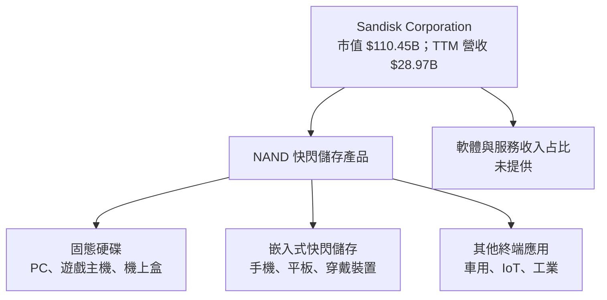
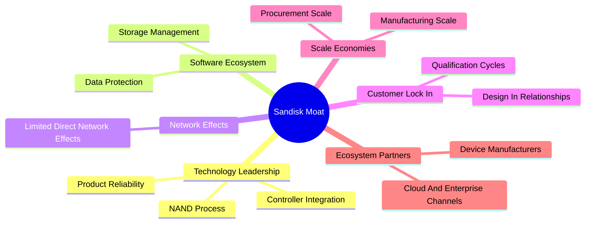
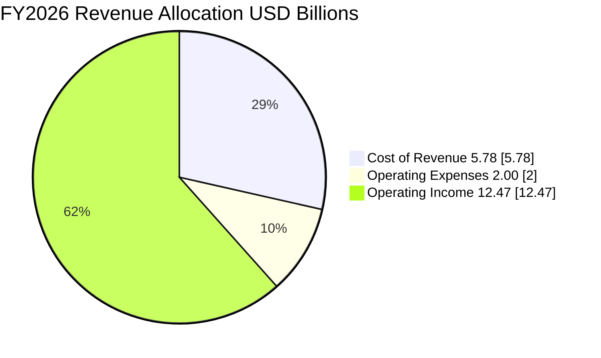
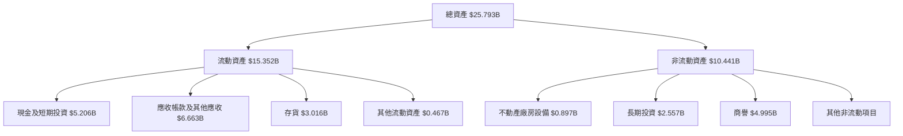
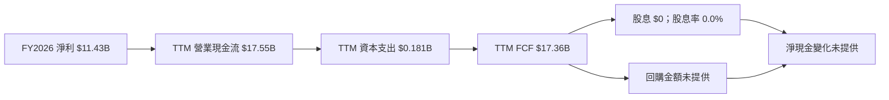
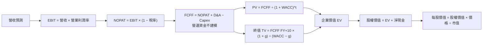
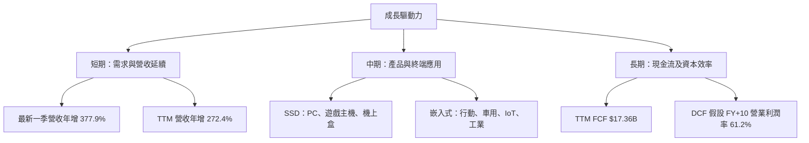
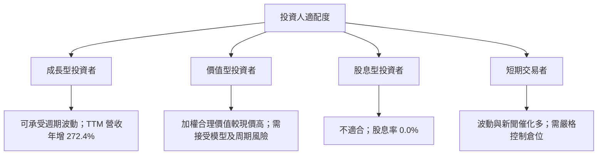

# SNDK 基本面深度分析報告
> **報告日期**：2026-11-19 ｜ **語言**：繁體中文 ｜ **數據來源**：SEC 申報資料 (XBRL)、Yahoo Finance、Finviz、StockAnalysis、Roic.ai ｜ **分析師**：CFA 級機構研究

## 目錄

| # | 章節 | 核心結論 |
|---|------|----------|
| 1 | 執行摘要 | 強烈買入；加權合理價值 $2,921.27；MOS +73.4% |
| 2 | 公司概覽與商業模式 | NAND 儲存產品受惠於需求復甦；市場份額數據未提供，護城河仍需以跨週期表現驗證 |
| 3 | 損益表深度分析 | TTM 營收 $28.97B，TTM YoY +272.4%；最新一季 YoY +377.9%，獲利率處於高峰區間 |
| 4 | 資產負債表分析 | TTM 現金及短期投資 $5.14B；營運資金天數增加，庫存與收款週期需監控 |
| 5 | 現金流量深度分析 | TTM FCF $17.36B、FCF Yield 15.72%；現金流轉換仍須與高峰獲利一起觀察 |
| 6 | 獲利能力與資本效率 | ROIC 141.2% 高於 WACC 10.11%，目前創造價值；週期反轉可能使 ROIC 快速回落 |
| 7 | 相對估值分析 | 本公司倍數低於部分同業；自身 P/S 位於五年區間第 43 百分位 |
| 8 | DCF 內在價值評估 | DCF 基準值 $4,741.93；加權合理價值 $2,921.27，MOS +73.4% |
| 9 | 成長催化劑 | 財報顯示營收快速擴張；AI、資料中心等終端市場的量化 TAM 未提供 |
| 10 | 風險矩陣 | NAND 供需反轉、利潤率下滑及營運資金惡化為主要風險 |
| 11 | 投資建議 | 按 MOS 門檻為強烈買入；以分批建倉與季度營運指標監控風險 |

---

## 1. 執行摘要

### 1.0 一頁式投資儀表板

| 項目 | 內容 |
|------|------|
| **投資論點（3 句）** | ① TTM 營收 $28.97B、TTM 年增 272.4%，反映 NAND 需求與價格週期大幅回升。② TTM ROIC 141.2%，高於 WACC 10.11%，當期資本回報顯著高於資本成本。③ TTM FCF $17.36B、FCF Yield 15.72%，但營運資金週期由 154 天升至 226 天，且現行利潤率未必可持續。 |
| **綜合評分** | **7.5/10**（引用 1.1 評分卡） |
| **財務健康** | 🟢 現金及短期投資 $5.14B、流動比率 2.58；但 CCC 增至 226 天，營運資金占用上升 |
| **ROIC vs WACC** | **141.2% vs 10.11%**；目前創造股東價值，但 ROIC 受週期高峰獲利影響 |
| **FCF 趨勢** | FY2026 FCF $11.49B，TTM FCF $17.36B；TTM FCF Yield **15.72%** |
| **估值** | Forward P/E 2.685381x ｜ EV/EBITDA 4.971x ｜ FCF Yield 15.72% |
| **DCF 內在價值（基準）** | **$4,741.93** ｜ 現價相對 DCF 折價 **83.6%**（以 DCF 基準值計算，見 8.5） |
| **安全邊際（MOS）** | **+73.4%**＝($2,921.27 − $776.22) ÷ $2,921.27；🟢 >25% 充足（加權合理價值基準，見 8.8） |
| **預期報酬（基準情境 12M）** | DCF 基準情境相對現價 **+510.9%**；這是模型價值差，不代表 12 個月可實現報酬 |
| **關鍵風險（前二）** | NAND 供需轉弱導致價格及毛利回落；庫存天數與 CCC 上升，現金轉換可能轉差 |
| **評級 + 信心度** | 🟢 **強烈買入** ｜ 信心：中（估值折價大，但週期與模型假設風險高） |

### 1.1 綜合評分卡（全報告唯一）

| 維度 | 評分（1–10） | 主要依據（引用數字與其來源章節） |
|------|--------------|----------------------------------|
| 成長性 | 9.0 | TTM 營收年增 272.4%、最新一季年增 377.9%（第 3 章）；基期與 NAND 週期影響顯著 |
| 獲利能力 | 9.0 | TTM 營業利益率 72.5%、ROIC 141.2%、Piotroski 5/8（第 3、6 章） |
| 財務健康 | 7.0 | 現金及短期投資 $5.14B、流動比率 2.58；CCC 由 154 天增至 226 天（第 4 章） |
| 估值 | 8.0 | MOS +73.4%；但 DCF 基準值對長期成長與高營業利潤率假設敏感（第 7、8 章） |
| 護城河 | 6.0 | NAND 技術、產品與客戶關係具價值，但市場份額及分部收入數據未提供；商品週期限制定價持久性（第 2 章） |
| 管理層與資本配置 | 6.0 | FY2026 SBC $232M、TTM 股數稀釋測試未通過；回購及資本配置完整紀錄未提供（第 3、5、6 章） |
| **綜合評分** | **7.5** | 六項算術平均：(9.0 + 9.0 + 7.0 + 8.0 + 6.0 + 6.0) ÷ 6 = **7.5** |

### 1.2 五大投資論點 + 三大核心風險

| 類型 | 項目 | 具體依據 | 信心度 |
|------|------|----------|--------|
| 🟢 **投資論點①** | 營收復甦速度高 | TTM 營收 $28.97B、年增 272.4%；最新一季營收年增 377.9%，反映出貨與價格週期同步改善的可能性 | 🟢 高 |
| 🟢 **投資論點②** | 高獲利轉成現金 | TTM 營業現金流 $17.55B、FCF $17.36B、FCF Yield 15.72%，資本支出僅 $181M | 🟢 高 |
| 🟢 **投資論點③** | 資本回報高於資本成本 | ROIC 141.2% 對 WACC 10.11%，目前經濟利潤差距顯著 | 🟡 中 |
| 🟢 **投資論點④** | 估值方法交叉驗證偏向折價 | 加權合理價值 $2,921.27，相對 2026-11-18 收盤價 $776.22 的 MOS 為 +73.4% | 🟡 中 |
| 🟢 **投資論點⑤** | 資產負債表有現金緩衝 | 現金及短期投資 $5.14B；流動比率 2.58，可部分緩衝下行週期 | 🟢 中 |
| 🟡 **風險①** | NAND 供需與價格反轉 | 最新季度營業利益率 79.6%；若供給增加或平均售價下跌，固定成本與價格競爭可能放大利潤率回落 | 🔴 高衝擊 |
| 🔴 **風險②** | 估值依賴長期假設 | DCF 終值現值占企業價值 57.6%；終值利潤率與永續成長率變動會顯著改變估值 | 🔴 高 |
| 🟡 **風險③** | 營運資金週期延長 | DIO 190 天、DSO 83 天，CCC 由 154 天升至 226 天；庫存與收款週期拉長 | 🟡 中 |

### 1.3 快速統計卡片

| 指標 | 公司實際值（期間） | 同業中位數 | 狀態 |
|------|--------------------|------------|------|
| 營收成長（TTM） | **272.4%** | — | 🟢 |
| 營收成長（最新一季年增） | **377.9%** | 327.9%（WDC、MU、SKHY） | 🟢 |
| 毛利率（TTM） | **80.0%** | 77.4%（WDC、MU、SKHY） | 🟢 |
| 營業利益率（TTM） | **72.5%** | — | 🟢 |
| ROIC（TTM） | **141.2%** | — | 🟢 |
| Forward P/E | **2.685381x** | 3.2x（WDC、MU、SKHY） | 🟢 |
| FCF Yield（TTM） | **15.72%** | — | 🟢 |
| Piotroski F-Score | **5 / 8** | — | 🟡 |

> 同業中位數為可用同業數據的中位數：最新一季營收成長採 WDC、MU、SKHY；毛利率採三家公司；Forward P/E 採三家公司。SNDK 的 TTM 毛利率來源欄位與其他財務區塊可能存在口徑差異，因此比較時以該指標來源值呈現，不與單季毛利率混用。

### 1.4 投資結論

╔══════════════════════════════════════════════════════════════════╗  
║　　　　　　　　　📊 投資結論摘要　　　　　　　　　　　　　　　║  
╠══════════════════════════════════════════════════════════════════╣  
║ 評級：強烈買入（依加權合理價值 MOS +73.4%，符合 ≥25% 門檻）　　║  
║ 價格（2026-11-18 收盤）：$776.22　　　　　　　　　　　　　　　║  
║ DCF 內在價值（基準）：$4,741.93（現價折價 83.6%）　　　　　　　║  
║ 安全邊際 MOS：+73.4%（以加權合理價值 $2,921.27 為分母）　　　　║  
║ 加權合理價值（8.8）：$2,921.27　　　　　　　　　　　　　　　　║  
║ DCF 情境價值：悲觀 $2,019.05（+160.1%）　　　　　　　　　　　║  
║　　　　　　　 基準 $4,741.93（+510.9%）　　　　　　　　　　　║  
║　　　　　　　 樂觀 $10,551.27（+1,259.3%）　　　　　　　　　║  
║ 綜合評分：7.5/10（引用 1.1）　　　　　　　　　　　　　　　　　║  
║ 適合投資人：能承受記憶體週期與高波動、採分批建倉的長線投資人　║  
╚══════════════════════════════════════════════════════════════════╝  

---

## 2. 公司概覽與商業模式

### 2.1 業務結構與收入來源

公司提供 NAND 快閃記憶體儲存裝置與解決方案，應用涵蓋 PC、遊戲主機、行動裝置、車用、IoT、工業與穿戴裝置。公司總市值為 $110.45B，TTM 營收為 $28.97B。財務資料未提供各產品線收入、分部占比或軟體服務收入，故不推算其組成。

### 2.2 市場份額

市場份額及年份數據未提供，因此不繪製份額圖、不推估市占率。SNDK TTM 營收 $28.97B，且最新一季營收年增 377.9%，顯示其近期營運規模快速擴張；但營收增長不能直接等同市占提升，因市場總需求及 NAND 價格週期也會影響收入。

### 2.3 競爭護城河分析

圖中為產業與產品層面的質化分析；未提供可量化的技術領先幅度、客戶轉換成本或合作夥伴收入貢獻，不將其視為已證實的量化護城河。

### 2.4 護城河強度

| 護城河項目 | 強度（強／中／弱） | 證據（引用數字或事實） | 會削弱它的情況 |
|------------|--------------------|------------------------|----------------|
| 技術與產品能力 | 中 | 產品覆蓋 SSD、嵌入式儲存、車用及工業應用；研發費 FY2026 為 $1.33B | 製程競爭、良率落後或新技術替代 |
| 軟體生態系統 | 弱至中 | 有儲存解決方案，但軟體收入、黏著度數據未提供 | 產品差異化不足、客戶可多供應商採購 |
| 網路效應 | 弱 | 儲存產品通常不具明顯雙邊網路效應；無用戶網路數據 | 競爭者產品標準化、客戶轉換成本下降 |
| 客戶鎖定 | 中 | 車用、工業等應用可能需要長期驗證；具體週期與收入占比未提供 | 客戶重新認證成本低、設計案遭替換 |
| 規模效應 | 中 | FY2026 營收 $20.25B，研發費 $1.33B，可支持研發與供應鏈投入 | 同業規模擴大、產業供過於求 |
| 生態夥伴 | 中 | 產品面向多種終端裝置；夥伴及渠道收入占比未提供 | 終端廠垂直整合或改用其他供應商 |

**1.1 護城河評分為 6.0/10**：產品涵蓋多元終端且研發支出 FY2026 達 $1.33B，但市場份額、產品分部營收、客戶集中度及轉換成本數據不足，且 NAND 仍具週期性。

---

## 3. 損益表深度分析

### 3.1 年度收入成長趨勢（近 4 年）

FY2023 至 FY2026 營收資料來自年度損益表；YoY 按年度收入計算。FY2026 年增 175.3% 是年度增幅，不等同 TTM 成長率 272.4%。

╔══════════════════════════════════════════════════════════════════╗  
║　　　　　　Sandisk 年度收入趨勢（FY2023–FY2026）　　　　　　　║  
╠══════════════════════════════════════════════════════════════════╣  
║ FY2023　$6.09B　 ██████░░░░░░░░░░░░░░　基期　　　　　　　　　║  
║ FY2024　$6.66B　 ███████░░░░░░░░░░░░░　YoY +9.5%　🟡　　　　　║  
║ FY2025　$7.36B　 ███████░░░░░░░░░░░░░　YoY +10.4% 🟡　　　　　║  
║ FY2026 $20.25B　 ████████████████████　YoY +175.3% 🟢　　　　║  
║ 　　　　　　　　　　　　　　　　　　　　　　　　　　　　　　║  
║ FY2023–FY2026 年收入 CAGR：(20.25 ÷ 6.09)^(1/3) − 1 ≈ 49.3%　║  
╚══════════════════════════════════════════════════════════════════╝  

FY2026 營收加速與 NAND 行業復甦相符，但尚不能單靠年度營收區分出貨量、平均售價和產品組合各自的貢獻。

### 3.2 季度收入趨勢分析

| 季度 | 營收 | QoQ | YoY | 備註 |
|------|------:|----:|----:|------|
| 2025-12-31 | $3.025B | N/A | +61.25% | 前一季 2025-09 季度未列入該四季季度損益表，故不計 QoQ |
| 2026-03-31 | $5.950B | +96.7% | +251.03% | 年增率引用季度資料 |
| 2026-06-30 | $8.965B | +50.7% | +371.59% | 收入規模繼續上升 |
| 2026-09-30 | $11.031B | +23.0% | +377.9% | 最新一季；年增率是單季 YoY，並非 TTM |

計算示例：最新一季 QoQ = ($11.031B ÷ $8.965B) − 1 = 23.0%。收入仍在增加，但 QoQ 增幅由前兩季的 96.7% 和 50.7% 降至 23.0%；高基期下後續增速放緩並不意外，需確認是正常化還是需求轉弱。

### 3.3 利潤率演變分析

| 利潤率指標 | FY2023 | FY2024 | FY2025 | FY2026 | 趨勢 | 評估 |
|------------|-------:|-------:|-------:|-------:|------|------|
| **毛利率** | 7.1% | 16.1% | 30.1% | 71.5% | ↗️ FY2026 大幅擴張 | 🟢 |
| **營業利益率** | -21.3% | -6.7% | 6.9% | 61.6% | ↗️ 由虧轉盈 | 🟢 |
| **淨利率** | -35.2% | -10.1% | -22.3% | 56.4% | ↗️ FY2026 顯著改善 | 🟢 |

年度比率以年度收入、毛利、營業利益和淨利計算；TTM 口徑則以已核實數據為準：TTM 營業利益率 72.5%、TTM 淨利率 67.0%、TTM 毛利率 80.0%。另有合併資料顯示營業利益率 72.7%，與核實口徑 72.5% 不同；本報告統一採用核實的 72.5%。

**利潤率演變深度解析：** FY2026 毛利率由 FY2025 的 30.1% 升至 71.5%，營業利益率由 6.9% 升至 61.6%。此幅度與營收同步大幅回升，可能反映 NAND 售價、產品組合、產能利用率及營運槓桿改善；資料未提供 ASP、位元出貨量與產品組合拆分，不能將改善歸因於單一因素。NAND 價格周期反轉時，現有高利潤率可能回落。

### 3.4 費用結構分析

FY2026 年度營收 $20.25B、毛利 $14.47B、營業利益 $12.47B。由此計算銷貨成本約 $5.78B、毛利以下營業費用約 $2.00B；營業利益不是費用，而是營收扣除上述項目後的餘額。

上述為營收分配的簡化展示，未拆解研發、銷售管理等營業費用細項。

### 3.5 季度 EPS 趨勢與盈餘品質（Quality of Earnings）

**季度 EPS 超預期／不及預期：** Yahoo Finance EPS Est 與 EPS Act 的最近四季資料均為 NaN，無法判定超預期或不及預期。StockAnalysis 列示季度 EPS：2025-12 季 $5.15、2026-03 季 $23.03、2026-06 季 $43.96、2026-09 季 $52.60；EPS 大幅上升與淨利擴張一致，但季度估計值缺失，不能據此宣稱財報 beat 或 miss。

| 盈餘品質項目 | 數值/佔比 | 評估 |
|--------------|-----------|------|
| 股權薪酬 SBC / 營收 | 估計 0.93%：近四季 SBC $270M ÷ TTM 營收 $28.97B | 🟢 占比不高；但 SBC 仍會稀釋股東權益 |
| SBC / 營業現金流 | 估計 1.54%：$270M ÷ $17.55B | 🟢 現金流相對 SBC 規模大 |
| FCF / 淨利（現金轉換率） | 估計 89.4%：TTM FCF $17.36B ÷ TTM 淨利 $19.422B | 🟡 現金轉換尚可，低於 100% |
| 一次性/非經常性損益 | N/A；未提供可核實的一次性損益拆分 | 🟡 無法確定本期盈餘是否受一次性項目影響 |
| 有效稅率異常 | DCF 使用有效稅率 12.2%；歷史單季稅率拆分 N/A | 🟡 稅率偏低可能抬升稅後利潤，需核對年度申報 |
| 資本化支出 vs 費用化 | FY2026 Capex $177M；TTM Capex $181M；資本化研發拆分 N/A | 🟡 無證據顯示費用被大規模資本化，但缺少完整資本化明細 |

近四季 SBC 合計為 $91M + $67M + $54M + $58M = $270M。近四季與 TTM 的期間邊界不完全一致，因此 SBC 比率為估計值，不冒充 SEC TTM 精確指標。

**盈餘品質結論：** TTM FCF $17.36B 相當於淨利 $19.422B 的約 89.4%，支持獲利有實際現金流支撐；SBC 對收入比例估計約 0.93%，不是目前主要盈利品質問題。但營業現金流低於淨利的 Piotroski 應計品質測試未通過，且缺少一次性項目與稅務明細。高週期獲利不宜直接外推為常態盈利。

---

## 4. 資產負債表分析

### 4.1 資產結構分解

以下為 2026-10-02 TTM 資產負債表明細，單位為 $B；細項按已披露數字呈現，未列項目不推算。

非流動資產餘額為總資產扣除流動資產的差額 $25.793B − $15.352B = $10.441B；其他非流動項目金額未在圖中反推細拆。

### 4.2 流動性與營運資金分析

| 指標 | 最新 TTM | 一年前 TTM | 變化 | 解讀 |
|------|----------|------------|------|------|
| 流動比率 | 2.58 | N/A | N/A | 流動資產對短期負債有覆蓋，但同年度資料口徑不一，未與一年期比較 |
| 速動比率 | 1.994 | N/A | N/A | 高於 1，仍應觀察應收帳款回收 |
| DSO 應收帳款天數 | 83 天 | 56 天 | +27 天 | 收款周期延長，可能反映出貨、客戶付款條件或季度時點變化 |
| DIO 存貨天數 | 190 天 | 124 天 | +66 天 | 庫存天數明顯增加；可能是備貨擴張，也可能是供需轉弱的前兆 |
| DPO 應付帳款天數 | 46 天 | 26 天 | +20 天 | 付款天數增加，對供應商付款延後有助現金，但需觀察是否反映供應鏈條件變化 |
| CCC 現金轉換週期 | 226 天 | 154 天 | +72 天 | 現金被營運資金占用時間拉長，需追蹤是否伴隨收入成長而改善 |

上述 DSO、DIO、DPO、CCC 為品質指標程式計算結果，照錄不重算。CCC 變長是本期財務狀況的重要警訊，不能只因現金餘額充足而忽略。

### 4.3 債務結構分析

╔══════════════════════════════════════════════════════════════════╗  
║　　　　　　　　 Sandisk 債務健康診斷　　　　　　　　　　　　　║  
╠══════════════════════════════════════════════════════════════════╣  
║ 總債務：　　　　　 N/A（核實口徑未提供）　　　　　　　　　　　║  
║ 現金及短期投資：　 $5.14B　　　　　　　　　　　　　　　　　　║  
║ 淨現金：　　　　　 $5.14B（核實口徑，正值）　🟢　　　　　　　║  
║ 補充財務資料：　　 總債務 $201M；淨現金 $5.01B　　　　　　　　║  
║ Debt/EBITDA：　　　N/A（債務口徑未一致，且總債務核實欄缺值）　║  
║ Interest Coverage：N/A（利息費用未提供）　　　　　　　　　　　║  
╚══════════════════════════════════════════════════════════════════╝  

不同資料欄位的總債務與淨現金數字不一致。按核實口徑，總債務 N/A、淨現金 $5.14B；另有資料列示總債務 $201M、淨現金 $5.01B。估值橋接遵循核實口徑，不使用未核實的債務數字。

### 4.4 股東權益趨勢

╔══════════════════════════════════════════════════════════════════╗  
║　　　　　　股東權益年度趨勢（年度財報，$B）　　　　　　　　　　║  
╠══════════════════════════════════════════════════════════════════╣  
║ FY2024　$11.08B　██████████████░░░░░░░░　　　　　　　　　　　　║  
║ FY2025　 $9.22B　████████████░░░░░░░░░░　　　　　　　　　　　　║  
║ FY2026　$15.74B　████████████████████　　　　　　　　　　　　　║  
╚══════════════════════════════════════════════════════════════════╝  

FY2025 權益下滑、FY2026 回升；資料未提供股東權益變動表拆分，不能將變化完全歸因於盈餘、股份發行或其他綜合損益。

---

## 5. 現金流量深度分析

### 5.1 現金流量瀑布圖

最近完整年度 FY2026 淨利為 $11.43B；TTM 營業現金流 $17.55B、Capex $181M、FCF $17.36B。股息率及派息率均為 0.0%；回購數據未提供，故不為回購或淨現金變動填入數字。

瀑布圖跨用 FY2026 淨利與 TTM 現金流，兩者期間不同，僅呈現現金流關係，不作期間一致的會計調節表。

### 5.2 FCF 轉換率趨勢

| 期間 | FCF | 淨利 | FCF / 淨利 | 解讀 |
|------|----:|----:|-----------:|------|
| FY2023 | -$0.932B | -$2.14B | 43.5% | 虧損期比率解讀有限 |
| FY2024 | -$0.475B | -$0.672B | 70.7% | FCF 與淨利均為負 |
| FY2025 | -$0.120B | -$1.64B | 7.3% | 虧損與現金流呈現差異，不能以比率判斷品質 |
| FY2026 | $11.49B | $11.43B | 100.5% | FCF 略高於淨利 |
| TTM 至 2026-10-02 | $17.36B | $19.422B | 89.4% | 現金轉換仍高，但低於 100% |

年度數據依年度現金流量表與年度淨利計算；TTM 比率採現有 TTM FCF 與 StockAnalysis TTM 淨利，期間對齊存在來源口徑限制。

### 5.3 自由現金流趨勢

╔══════════════════════════════════════════════════════════════════╗  
║　　　　　　　　自由現金流：歷史實際　　　　　　　　　　　　　　║  
╠══════════════════════════════════════════════════════════════════╣  
║ FY2023　−$0.932B　░░░░░░░░░░░░░░░░░░░░　FCF 為負　　　　　　　║  
║ FY2024　−$0.475B　░░░░░░░░░░░░░░░░░░░░　FCF 為負　　　　　　　║  
║ FY2025　−$0.120B　░░░░░░░░░░░░░░░░░░░░　接近損益兩平　　　　　║  
║ FY2026　+$11.49B　████████████████████　FCF Yield N/A　　　　　║  
║ TTM　　 +$17.36B　████████████████████　FCF Yield 15.72%　　　 ║  
╚══════════════════════════════════════════════════════════════════╝  

FY2026 FCF 相較 FY2025 明顯轉正，與營收和獲利回升同步；但 FCF Yield 對應市值為 TTM 指標，僅引用核實值 15.72%。

### 5.4 資本配置評估

| 資本配置項目 | 已知數據 | 評估 |
|--------------|----------|------|
| 資本支出 | FY2026 $177M；TTM $181M | 相對 TTM 營收 $28.97B 占比低；需確認未來產能或技術投資是否增加 |
| 股息 | 殖利率 0.0%、派息率 0.0% | 未見現金股息回饋 |
| 回購 | N/A（回購金額未提供） | 不對是否回購作推斷 |
| 研發 | FY2026 $1.33B | 對 NAND 技術、產品與控制器能力有持續投資 |
| 留存現金 | 現金及短期投資 $5.14B | 提供流動性與週期下行緩衝 |

各項資本配置數字不完整，不能繪製占比圓餅圖，亦不以缺失項目補足至 100%。

---

## 6. 獲利能力與資本效率

### 6.1 ROE / ROA / ROIC 趨勢

| 指標 | FY2024 | FY2025 | FY2026 / TTM | 評估 |
|------|-------:|-------:|-------------:|------|
| ROE | N/A | N/A | 107.1%（品質指標 TTM） | 高報酬，但週期高峰淨利及權益基數會放大比率 |
| ROA | N/A | N/A | 68.3%（補充財務資料） | 顯示高峰獲利對資產有強回報 |
| ROIC | N/A | N/A | 141.2%（核實 TTM） | 大幅高於資本成本，需避免外推至整個週期 |

歷史年度 ROIC／ROA／ROE 的一致口徑序列未提供。行業均值亦未提供，故不列行業均值比較。

### 6.2 ROIC vs WACC 分析（核心價值創造判斷）

╔══════════════════════════════════════════════════════════════════╗  
║　　　　　　　 ROIC vs WACC 深度分析　　　　　　　　　　　　　　║  
╠══════════════════════════════════════════════════════════════════╣  
║ WACC 輸入（核實資本成本）：　　　　　　　　　　　　　　　　　　║  
║ ├─ 無風險利率：5.07%　　　　　　　　　　　　　　　　　　　　║  
║ ├─ 市場風險溢酬：5.00%　　　　　　　　　　　　　　　　　　　║  
║ ├─ 原始 Beta：N/A；採用調整後 Beta：1.00（假設）　　　　　　║  
║ ├─ 股權成本：10.07%　　　　　　　　　　　　　　　　　　　　║  
║ ├─ 稅前債務成本：36.32%；有效稅率：12.2%　　　　　　　　　　║  
║ ├─ 股權／債務權重：99.8%／0.2%　　　　　　　　　　　　　　　║  
║ └─ WACC：10.11%　　　　　　　　　　　　　　　　　　　　　　║  
║　　　　　　　　　　　　　　　　　　　　　　　　　　　　　　║  
║ ROIC（TTM）：141.2%　　　　　　　　　　　　　　　　　　　　║  
║ 價值利差：141.2% − 10.11% = +131.09 個百分點　　　　　　　║  
║ ROIC / WACC = 141.2% ÷ 10.11% ≈ 14.0 倍　　　　　　　　　　　║  
║　　　　　　　　　　　　　　　　　　　　　　　　　　　　　　║  
║ 結論：按 TTM 數據，公司目前創造經濟價值；但 ROIC 受周期高峰　║  
║ 獲利影響，不能把 141.2% 視為長期穩態回報。　　　　　　　　　║  
╚══════════════════════════════════════════════════════════════════╝  

資本成本組成的簡化核對：股權成本 = 5.07% + 1.00 × 5.00% = 10.07%；稅後債務成本 = 36.32% × (1 − 12.2%) = 31.89%；依核實權重計算，WACC = 99.8% × 10.07% + 0.2% × 31.89% = 10.11%（四捨五入）。6.2 與 8.2 均採同一 WACC。

### 6.3 杜邦三因素分解

| 因素 | 數值（TTM） | 解讀 |
|------|-------------|------|
| 淨利率 | 67.0% | 高淨利率是 ROE 主要來源，受本輪獲利週期影響 |
| 資產週轉率 | 1.12 | 資產周轉配合高淨利率提升 ROE |
| 權益乘數 | 1.42 | 槓桿程度不是主要放大來源 |
| **ROE** | **107.1%** | 67.0% × 1.12 × 1.42 = 107.1%（照錄品質指標） |

### 6.4 財務體質：Piotroski F-Score

**Piotroski F-Score：5 / 8。** 原始品質指標列有九項測試，其中一項缺少輸入而不納入分母，因此分母為 8。

| 測試 | 結果 | 解讀 |
|------|------|------|
| ROA > 0 | ✅ 通過 | 公司目前有正向資產報酬 |
| 營業現金流 > 0 | ✅ 通過 | 營業現金流為正 |
| ROA 高於一年前 | ✅ 通過 | 獲利能力較去年改善 |
| 營業現金流 > 淨利（應計品質） | ❌ 未通過 | 現金流未高於會計淨利，需持續檢查應收與營運資金 |
| 長期負債 ÷ 總資產低於一年前 | — 無法判定 | 缺少該測試輸入 |
| 流動比率高於一年前 | ❌ 未通過 | 短期流動性指標未改善 |
| 稀釋股數未增加 | ❌ 未通過 | 稀釋股數增加，股東持份有稀釋風險 |
| 毛利率高於一年前 | ✅ 通過 | 本輪毛利率改善 |
| 資產週轉率高於一年前 | ✅ 通過 | 資產效率較去年提高 |

5/8 顯示營運改善有支持，但應計品質、流動性趨勢及股數稀釋測試未通過，品質信號並非全面正向。

---

## 7. 相對估值分析

### 7.1 同業估值比較

同業倍數採 Yahoo Finance 的指定同業資料；SNDK 倍數來自估值資料。SKHY 的 P/S、EV/EBITDA 因幣別混合而不可比，保留為 N/A。

| 估值指標 | **SNDK** | **WDC** | **MU** | **SKHY** | SNDK 評估 |
|----------|---------:|-------:|------:|-------:|-----------|
| **Trailing P/E** | 6.203804x | 10.1x | 9.5x | 6.8x | 🟢 低於所列同業 |
| **Forward P/E** | 2.685381x | 7.1x | 3.4x | 3.0x | 🟢 較低，但 forward 盈餘預期可能隨週期變化 |
| **P/S** | 3.8123589x | 7.4x | 6.0x | N/A（混合幣別） | 🟢 低於 WDC、MU |
| **EV/EBITDA** | 4.971x | 17.0x | 7.0x | N/A（混合幣別） | 🟢 低於 WDC、MU |
| **最新一季營收年增** | 377.9% | 55.5% | 379.3% | 327.9% | 🟡 接近 MU，高於 WDC、SKHY |
| **TTM 毛利率** | 80.0% | 52.6% | 80.7% | 77.4% | 🟢 接近 MU；數據來源口徑須留意 |

低倍數與高速成長並存，但週期性高峰 EPS 會令 P/E 暫時偏低；若獲利回落，當前 P/E 可能迅速上升。不能僅憑低 P/E 判斷長期便宜。

### 7.2 歷史估值區間分析

核實歷史估值提供的是 P/S，而非 P/E。五年 P/S 區間為 0.9x–13.4x，中位數 4.8x；當前 4.1x，歷史百分位第 43 位。

╔══════════════════════════════════════════════════════════════════╗  
║　　　　　　SNDK 五年 P/S 歷史區間（TTM）　　　　　　　　　　　║  
╠══════════════════════════════════════════════════════════════════╣  
║ 最低 0.9x ───────── 當前 4.1x ── 中位數 4.8x ───── 最高 13.4x ║  
║　　　　　　　　　歷史百分位：43%　　　　　　　　　　　　　　　║  
╚══════════════════════════════════════════════════════════════════╝  

自身歷史位置並未處於區間極端低端；由於價格和收入均受 NAND 週期影響，歷史 P/S 的比較價值高於單看當期 P/E，但仍不能取代跨週期盈利分析。

### 7.3 情境價值（Bear / Base / Bull）

下表逐項照錄 DCF MODEL 情境值；情境機率為模型假設，非市場實際發生機率。

| 情境 | 第 1 年營收成長 | 期末營業利潤率 | WACC | 每股價值 | 相對現價 | 機率 | 會發生的條件 |
|------|----------------|----------------|------|----------|----------|------|--------------|
| 🔴 悲觀 | 15.0% | 52.0% | 11.11% | $2,019.05 | +160.1% | 25% | NAND 復甦速度降溫、競爭壓低期末利潤率且風險折現率上升 |
| 🟡 基準 | 30.0% | 61.2% | 10.11% | $4,741.93 | +510.9% | 50% | 成長由高點逐步放緩、利潤率向模型假設回落 |
| 🟢 樂觀 | 45.0% | 67.3% | 9.11% | $10,551.27 | +1,259.3% | 25% | 需求持續強、產品組合和定價支持較高利潤率、資本成本下降 |

三種情境均顯示高於現價的模型價值，但其結果主要受十年現金流與終值假設推動，不能把高幅度模型上行解讀為短期報酬承諾。

### 7.4 相對估值隱含價格區間

╔══════════════════════════════════════════════════════════════════╗  
║　　　　　　估值方法推導的每股價格　　　　　　　　　　　　　　　║  
╠══════════════════════════════════════════════════════════════════╣  
║ $776.22 現價 ─ $1,368.26 同業 P/S ─ $1,820.37 同業 EV/EBITDA　║  
║　　　　　　　 ─ $2,047.38 分析師共識 ─ $4,741.93 基準 DCF　　　║  
╚══════════════════════════════════════════════════════════════════╝  

- **同業 EV/EBITDA：$1,820.37**，依同業中位數 12.0x（WDC、MU）乘 SNDK TTM EBITDA，再加淨現金。
- **同業 P/S：$1,368.26**，依同業中位數 6.7x（WDC、MU）乘 SNDK TTM 營收。
- 同業相對估值結果高於現價，但兩者均依賴本輪 TTM 營收與 EBITDA；若週期盈利回落，倍數回推價值亦會下降。

---

## 8. DCF 內在價值評估（Discounted Cash Flow）

> 本節逐年數字及模型輸出依程式 DCF MODEL 原值列示，不另建模型。模型使用 FCFF 對 WACC 折現、GAAP EBIT、營運資金不建模，SBC 採組合 (A)。

### 8.0 估值推理鏈（Thinking Logic）

**Step 1 — 價值由哪些變數決定？**  
模型將價值拆為 NAND 主業營收成長、營業利潤率與資本需求三個可驗證來源。已披露資料沒有各產品收入占比，也沒有第二成長曲線的收入占比，因此不能將 AI、資料中心或其他終端市場額外拆成獨立估值。模型敏感度中，WACC 與永續成長率會顯著改變終值；對營運面而言，長期營業利潤率是核心變數。

**Step 2 — 模型選擇**

| 決策點 | 本報告採用 | 理由（含數字） | 曾考慮但否決 | 否決理由 |
|--------|-----------|----------------|--------------|----------|
| 現金流定義 | FCFF | 對應 WACC 折現並先得企業價值；核實權重為股權 99.8%、債務 0.2% | FCFE | 與程式模型定義不符 |
| 預測期 N | 10 年 | DCF MODEL 固定預測期 10 年，逐年列示至 FY+10 | 5 年 | 不符合程式模型設定，不另改模型 |
| 終值方法 | Gordon Growth | 模型採永續成長 3.0%，低於 WACC 10.11% | 退出倍數作主方法 | 程式模型未提供終值 EBITDA 及退出倍數，不能補建 |
| EBIT 基礎 | GAAP EBIT | 模型採 GAAP EBIT，已將 SBC 作費用 | 非 GAAP EBIT | 不與模型輸入一致 |

**Step 3 — 重要假設推導鏈**

- **營收成長**：錨點＝TTM 年增 272.4%、FY2026 年增 175.3%；調整＝高成長基期不宜直接延續，模型把第一年限制在 0%–30% 上限，並逐年線性降至第十年 3.0%；**採用第一年 30.0%、第十年 3.0%**；曾考慮把 TTM 272.4% 外推，因基期與 NAND 價格週期效應而否決。
- **營業利潤率**：錨點＝TTM 72.5%；調整＝長期利潤率向最近三個財年中位數收斂；**採用 FY+1 72.5%、FY+10 61.2%**；曾考慮維持 72.5% 至期末，因高峰利潤率未必可長期持續而否決。
- **永續成長率 g**：錨點＝長期名目經濟成長的常用低個位數假設，但這不是公司特定財測；調整＝考量成熟儲存產業及終端多元化；**採用 3.0%**；曾考慮更高長期增長，因永續成長須低於 WACC 且高於長期經濟增速的假設不宜採用而否決。
- **預測期 N**：錨點＝程式模型指定 10 年；調整＝不擅自改動已計算模型；**採用 10 年**；曾考慮縮短預測期以反映記憶體週期，因模型輸出已固定而不另建。
- **Capex / 營收**：錨點＝TTM Capex $181M、營收 $28.97B；模型列示 FY+1 與 FY+10 皆為 0.6%；**採用 0.6%**；未使用更高再投資率，因模型未提供相應替代情境。此假設可能低估長期產能投資需求。
- **D&A / 營收**：錨點＝模型採 TTM 水準；**採用 0.5% 並保持不變**；屬模型固定輸入。
- **有效稅率**：錨點＝最近年度有效稅率 12.2%；**採用 12.2%**；未自行調高，稅率正常化風險列為模型限制。
- **EBIT 與 SBC**：錨點＝模型指定 GAAP EBIT；**採用組合 (A)：GAAP EBIT、FCFF 不再扣 SBC、股數固定不另稀釋**。SBC 在 EBIT 費用中計入一次；DCF 的股數不另行放大。
- **營運資金**：模型明載不建模，故 **ΔWC 不納入 FCFF**。未以 CCC 或營收增額自行估計，因模型未提供相應係數。
- **WACC**：錨點＝核實資本成本 WACC 10.11%；採用該值，不另算替代 WACC。Beta 原始值缺失，模型採調整後 Beta 1.00。
- **終值方法**：錨點＝DCF MODEL 使用 Gordon Growth；採用永續成長率 3.0%；未另行增加退出倍數終值，因模型沒有該組輸入與輸出。

**Step 4 — 最脆弱的一環**  
最脆弱假設是高獲利能否維持至終值期：若 FY+10 的利潤率顯著低於模型 61.2%，或長期成長低於 3.0%，估值將下修；終值現值占 EV 57.6%，故此風險不是邊際因素。

**Step 5 — 計算路徑圖**

### 8.1 模型假設總表（Model Inputs）

| 假設項目 | 採用值 | 依據 / 來源 | 敏感度 |
|----------|--------|-------------|--------|
| 預測期長度 N | 10 年 | DCF MODEL 固定預測年限 | 🟡 中 |
| 營收成長 | FY+1 30.0%，FY+10 3.0%，逐年線性下降 | TTM 成長 272.4%；模型設上限並逐年淡化 | 🔴 高 |
| 營業利潤率 | FY+1 72.5% → FY+10 61.2% | TTM 72.5%，末期取最近三年財年中位數 | 🔴 高 |
| 有效稅率 | 12.2% | 最近年度有效稅率 | 🟢 低 |
| Capex / 營收 | FY+1 至 FY+10 為 0.6% | TTM 約 0.6%，模型固定列示 | 🟡 中 |
| D&A / 營收 | 0.5% | 模型採 TTM 水準並固定 | 🟢 低 |
| 營運資金變動 / 營收增額 | 不建模 | DCF MODEL 明載 working capital is not modelled | 🟢 低 |
| EBIT 基礎 | GAAP EBIT | DCF MODEL 明載 GAAP | 🟡 中 |
| SBC 處理 | 組合 (A)：不另扣 SBC | GAAP EBIT 已含 SBC 費用；固定股數 | 🟡 中 |
| 年稀釋率 | 0%（模型採固定股數） | 組合 (A)；稀釋成本已在 GAAP EBIT 中反映 | 🟡 中 |
| 永續成長率 g | 3.0% | DCF MODEL 輸入；低於 WACC 10.11% | 🔴 高 |
| 終值方法 | Gordon Growth | DCF MODEL 公式 | 🔴 高 |
| WACC | 10.11% | 核實 Cost of capital 數值 | 🔴 高 |

FCFF 定義為 **NOPAT + D&A − Capex**；因模型未建模營運資金，沒有 ΔWC 項。SBC 只計入一次：本模型採用組合 **(A)**，GAAP EBIT 已含 SBC 費用，因此 FCFF 不再減 SBC，股數不另行稀釋。

### 8.2 折現率推導（WACC）

╔══════════════════════════════════════════════════════════════════╗  
║　　　　　　　　　WACC 推導（折現率）　　　　　　　　　　　　　║  
╠══════════════════════════════════════════════════════════════════╣  
║ 股權成本 Ke（CAPM）：　　　　　　　　　　　　　　　　　　　　　║  
║ ├─ Rf（10Y 美債）：5.07%　　　　　　　　　　　　　　　　　　║  
║ ├─ ERP（假設）：5.00%　　　　　　　　　　　　　　　　　　　　║  
║ ├─ 原始 Beta：N/A；調整後 Beta：1.00（無原始 Beta 可用）　　　║  
║ ├─ 額外規模／國別溢酬：0%（模型未列入）　　　　　　　　　　　║  
║ └─ Ke = 5.07% + 1.00 × 5.00% = 10.07%　　　　　　　　　　　║  
║　　　　　　　　　　　　　　　　　　　　　　　　　　　　　　║  
║ 債務成本：　　　　　　　　　　　　　　　　　　　　　　　　　║  
║ ├─ 稅前 Kd：36.32%（核實輸入）　　　　　　　　　　　　　　　║  
║ ├─ 有效稅率：12.2%　　　　　　　　　　　　　　　　　　　　　║  
║ └─ 稅後 Kd = 36.32% × (1 − 12.2%) = 31.89%　　　　　　　　　║  
║　　　　　　　　　　　　　　　　　　　　　　　　　　　　　　║  
║ 資本結構：股權 99.8%，債務 0.2%　　　　　　　　　　　　　　　║  
║ WACC = 99.8% × 10.07% + 0.2% × 31.89% = 10.11%　　　　　　　║  
╚══════════════════════════════════════════════════════════════════╝  

**逐步演算（WACC）**

1. **Ke（CAPM）** = 5.07% + 1.00 × 5.00% + 0% = **10.07%**。
2. **稅前 Kd** = **36.32%（核實資本成本輸入）**；原始利息費用及計息負債平均餘額未提供，不能由利率反推金額。
3. **稅後 Kd** = 36.32% × (1 − 12.2%) = **31.89%**。
4. **權重** = 股權 **99.8%**，債務 **0.2%**；總和 = 99.8% + 0.2% = **100.0%**。資本成本區塊未提供權重的美元級債務餘額，故不反推。
5. **WACC** = 99.8% × 10.07% + 0.2% × 31.89% = 10.0499% + 0.0638% = 10.1137% ≈ **10.11%**。

10Y 美債日期未於資本成本資料中提供，ERP 為假設輸入，Beta 原始值為 N/A；本報告不另加風險溢酬，也不另算 WACC。6.2 採同一 10.11%。

### 8.3 逐年自由現金流預測（基準情境）

單位：$B；折現因子保留三位小數。逐年模型表數字照錄 DCF MODEL。表內工作資本不建模，並非將其假設成零後另行計算。

| 年度 | FY+1 | FY+2 | FY+3 | FY+4 | FY+5 | FY+6 | FY+7 | FY+8 | FY+9 | FY+10 |
|------|-----:|-----:|-----:|-----:|-----:|-----:|-----:|-----:|-----:|------:|
| 營收 | 37.66 | 47.83 | 59.31 | 71.77 | 84.68 | 97.39 | 109.07 | 118.89 | 126.02 | 129.80 |
| 營收 YoY | 30.0% | 27.0% | 24.0% | 21.0% | 18.0% | 15.0% | 12.0% | 9.0% | 6.0% | 3.0% |
| 營業利潤率 | 72.5% | 71.2% | 70.0% | 68.7% | 67.5% | 66.2% | 64.9% | 63.7% | 62.4% | 61.2% |
| EBIT（GAAP） | 27.29 | 34.06 | 41.49 | 49.31 | 57.12 | 64.47 | 70.84 | 75.72 | 78.69 | 79.42 |
| − 稅 | (3.32) | (4.14) | (5.05) | (6.00) | (6.95) | (7.84) | (8.62) | (9.21) | (9.58) | (9.66) |
| NOPAT | 23.97 | 29.92 | 36.44 | 43.31 | 50.17 | 56.62 | 62.22 | 66.51 | 69.11 | 69.76 |
| + D&A | 0.20 | 0.26 | 0.32 | 0.39 | 0.46 | 0.52 | 0.59 | 0.64 | 0.68 | 0.70 |
| − Capex | (0.24) | (0.30) | (0.37) | (0.44) | (0.52) | (0.59) | (0.66) | (0.71) | (0.75) | (0.77) |
| **FCFF** | **23.94** | **29.88** | **36.40** | **43.25** | **50.11** | **56.56** | **62.15** | **66.44** | **69.04** | **69.69** |
| 折現因子 @10.11% | 0.908 | 0.825 | 0.749 | 0.680 | 0.618 | 0.561 | 0.510 | 0.463 | 0.420 | 0.382 |
| **FCFF 現值 PV** | **21.74** | **24.64** | **27.27** | **29.43** | **30.96** | **31.74** | **31.68** | **30.76** | **29.03** | **26.61** |

預測期 PV 合計的完整加總為：

`$21.74 + $24.64 + $27.27 + $29.43 + $30.96 + $31.74 + $31.68 + $30.76 + $29.03 + $26.61 = $283.86B`

DCF MODEL 列示合計為 **$283.85B**；兩者相差 $0.01B，為個別年度四捨五入累積尾差，低於 1%。

**逐步演算（FY+1）**

1. **營收** = $28.97B × (1 + 30.0%) = $37.661B ≈ **$37.66B**。
2. **EBIT** = $37.66B × 72.5% = **$27.29B**（以未四捨五入模型數值計算）。
3. **稅** = $27.29B × 12.2% ≈ **$3.32B**。
4. **NOPAT** = $27.29B − $3.32B = **$23.97B**。
5. **D&A** = $37.66B × 0.5% ≈ **$0.20B**。
6. **Capex** = $37.66B × 0.6% ≈ **$0.24B**。
7. **ΔWC**：模型不建模，沒有此列；不得自行添加估值輸入。
8. **FCFF** = NOPAT + D&A − Capex；模型列示 **$23.94B**。按顯示至小數兩位的數字計算為 $23.97B + $0.20B − $0.24B = $23.93B；差異來自模型未四捨五入的中間值，不能以顯示值重建出完全相同的末位。
9. **折現因子** = 1 ÷ (1 + 10.11%)^1 ≈ **0.908**；PV = $23.94B × 0.908 ≈ **$21.74B**。

**合理性自檢**

- 預測期 FCFF：FY+1 $23.94B 至 FY+10 $69.69B，九年間 CAGR = ($69.69 ÷ $23.94)^(1/9) − 1 ≈ **12.6%**。歷史 FCF 存在虧損至大幅轉正，不存在具有經濟意義的正值歷史 CAGR，故不作虛假比較。
- FY+10 FCF 利潤率 = $69.69B ÷ $129.80B ≈ **53.7%**；TTM FCF 利潤率 = $17.36B ÷ $28.97B ≈ **59.9%**。同業最佳 FCF 利潤率未提供，不能比較。
- 預測期 FCFF 全部為正；但模型未計營運資金增量，可能高估現金流，尤其 CCC 已升至 226 天。

╔══════════════════════════════════════════════════════════════════╗  
║　　　　　　自由現金流：歷史實際 vs 模型預測　　　　　　　　　　　║  
╠══════════════════════════════════════════════════════════════════╣  
║ FY2024（實） −$0.475B　負值　　　　　　　　　　　　　　　　　║  
║ FY2025（實） −$0.120B　負值　　　　　　　　　　　　　　　　　║  
║ FY2026（實）+$11.49B　歷史轉正　　　　　　　　　　　　　　　║  
║ FY+1（預）　+$23.94B　模型輸出　　　　　　　　　　　　　　　║  
║ FY+10（預） +$69.69B　模型輸出　　　　　　　　　　　　　　　║  
╠══════════════════════════════════════════════════════════════════╣  
║ 模型預測 FCFF CAGR 約 12.6%；歷史有負值，不宜直接比較 CAGR。　║  
╚══════════════════════════════════════════════════════════════════╝  

### 8.4 終值計算（Terminal Value）

**適用性檢查：WACC 10.11% vs g 3.0% → WACC > g？✅**

| 方法 | 計算式 | 終值 TV | TV 現值 | 佔總 EV 比重 |
|------|--------|---------|---------|--------------|
| Gordon Growth | DCF MODEL 列式：69.69 × (1 + 3.0%) ÷ (10.11% − 3.0%) | $1,010.15B（照錄） | $385.74B（照錄） | 57.6% |
| 退出倍數法 | N/A；模型未提供 FY+10 EBITDA 或終值退出倍數 | N/A | N/A | N/A |

**逐步演算（照錄模型數字）**

1. FY+10 FCFF = **$69.69B**。
2. 分子 = $69.69B × (1 + 3.0%) = **$71.7807B**。
3. 分母 = 10.11% − 3.0% = **7.11%**。DCF MODEL 列示 TV **$1,010.15B**。
4. PV(TV) = DCF MODEL 列示 **$385.74B**。
5. 終值佔比 = $385.74B ÷ $669.59B = **57.6%**。

**複算警示：**以展示的四捨五入輸入計算，$71.7807B ÷ 7.11% 約為 $1,010.98B，而非模型列示的 $1,010.15B；$1,010.15B × 0.382 亦不等於 $385.74B。遵照模型數值優先原則，本報告照錄 DCF MODEL 輸出，沒有自行替換；這是模型算式可稽核性的缺陷，見 8.10。

終值現值占企業價值 **57.6%**，尚未超過 75%警戒線，但估值仍有過半來自預測期以後的現金流，需重視永續假設。

### 8.5 企業價值 → 每股內在價值（Bridge）

╔══════════════════════════════════════════════════════════════════╗  
║　　　　　　企業價值 → 每股內在價值 橋接表　　　　　　　　　　　║  
╠══════════════════════════════════════════════════════════════════╣  
║ 預測期 FCF 現值合計　　　　　　+$283.85B　　　　　　　　　　　║  
║ 終值現值 PV(TV)　　　　　　　　+$385.74B　　　　　　　　　　　║  
║ = 企業價值 EV　　　　　　　　　 $669.59B　　　　　　　　　　　║  
║ + 淨現金　　　　　　　　　　　　+$5.14B　　　　　　　　　　　 ║  
║ = 股權價值　　　　　　　　　　　$674.73B　　　　　　　　　　　║  
║ 每股內在價值　　　　　　　　　　$4,741.93　　　　　　　　　　║  
║ 2026-11-18 收盤價　　　　　　　 $776.22　　　　　　　　　　　║  
║ 折溢價 = 現價 ÷ DCF 價值 − 1　　−83.6%（折價）　　　　　　　 ║  
║ 本節不計算 MOS；MOS 僅採第 8.8 節加權合理價值　　　　　　　║  
╚══════════════════════════════════════════════════════════════════╝  

**逐步演算（橋接）**

1. **EV** = $283.85B + $385.74B = **$669.59B**。
2. **股權價值** = $669.59B + $5.14B = **$674.73B**。
3. **每股內在價值** = 按模型公式「股權價值 × 價格 ÷ 市值」= **$4,741.93**。模型使用最新價格、市值所隱含的股數映射；不另行用不同股數重建。
4. **折溢價** = $776.22 ÷ $4,741.93 − 1 = **−83.6%**。
5. **本節不計算 MOS**：MOS 只以 8.8 加權合理價值為分母，本節只報告相對 DCF 基準值的折溢價。

淨現金與現金口徑取自 2026-10-02 TTM 核實數據。模型採組合 (A)，GAAP EBIT 已含 SBC，固定股數，不再另作稀釋。

### 8.6 敏感性分析（WACC × 永續成長率）

每格為程式 DCF MODEL 原列的每股價值；基準格以粗體標示。括號中的上行空間不在原矩陣輸出列示，為避免改寫矩陣格數字，以下照錄每股價值。

| g（列）／WACC（欄） | 8.11% | 9.11% | **10.11%（基準）** | 11.11% | 12.11% |
|----------------------|------:|------:|-------------------:|-------:|-------:|
| 2.0% | $6,005.41 | $5,078.74 | $4,384.41 | $3,845.66 | $3,416.14 |
| 2.5% | $6,360.19 | $5,316.87 | $4,551.42 | $3,966.79 | $3,506.35 |
| **3.0%（基準）** | $6,784.45 | $5,593.99 | **$4,741.93** | $4,102.85 | $3,606.45 |
| 3.5% | $7,300.83 | $5,920.55 | $4,961.28 | $4,256.81 | $3,718.19 |
| 4.0% | $7,942.99 | $6,311.08 | $5,216.56 | $4,432.43 | $3,843.72 |

**逐步演算限制：**矩陣由程式按模型內部精度計算；模型沒有提供每一格的預測期 PV 分項或未四捨五入折現現金流，因此無法在不另建模型的情況下完整重建非基準格。依要求不自行重算或替換敏感度矩陣的數值。

**三情境 DCF**

| 情境 | 營收成長假設 | 期末營業利潤率 | 永續成長率 | WACC | 每股內在價值 | 相對現價 | 主觀機率 |
|------|-------------|----------------|------------|------|--------------|----------|----------|
| 🔴 悲觀 | 第 1 年 15.0% | 52.0% | 未於情境輸出另列 | 11.11% | $2,019.05 | +160.1% | 25% |
| 🟡 基準 | 第 1 年 30.0% | 61.2% | 3.0% | 10.11% | $4,741.93 | +510.9% | 50% |
| 🟢 樂觀 | 第 1 年 45.0% | 67.3% | 未於情境輸出另列 | 9.11% | $10,551.27 | +1,259.3% | 25% |
| **機率加權** | — | — | — | — | **$5,513.54** | **+610.3%** | 100% |

基準情境加權值按模型照錄：$2,019.05 × 25% + $4,741.93 × 50% + $10,551.27 × 25% = **$5,513.54**。此為情境參考，8.8 仍採估值方法權重加權的 $2,921.27。

**三情境推導資訊限制：**DCF MODEL 只提供情境的第一年成長、期末營業利潤率、WACC、每股價值與機率，沒有提供各情境逐年營收、FY+10 FCFF、終值及情境所用 g 的完整計算表。依「不得另建模型」原則，不能補寫不存在的情境中間數字，也不虛構完整推導鏈。情境價值與假設照錄，讀者應將該資料缺口視為模型可稽核性限制。

**敏感度結論：**

- 基準 g 3.0%、WACC 10.11% 時，每股價值 $4,741.93；同一 WACC 下 g 2.0% 對應 $4,384.41，g 4.0% 對應 $5,216.56。以 1pp 變動區間觀察，g 從 2.0% 升至 3.0% 價值增加 $357.52；從 3.0% 升至 4.0% 增加 $474.63。
- g 3.0% 時，WACC 9.11% 對應 $5,593.99，11.11% 對應 $4,102.85；WACC 每上升 1pp，基準附近估值下行約 $639–$851，呈非線性。
- 期末營業利潤率每 +1pp 的獨立敏感度數值未提供，標示 **N/A**，不自行增加一個模型。
- 綜合敏感度表，WACC、g 與終值假設均具高影響，與 8.0 指出的長期利潤率和終值依賴相符。

### 8.7 反推 DCF（Reverse DCF：市場在預期什麼）

反推模型固定其餘基準輸入、一次只求解一個變數；程式輸出只提供以下已解結果：

| 求解變數 | 固定設定 | 市場隱含值 | 歷史／目前參照 | 判斷 |
|---------|----------|------------|----------------|------|
| 年 1 營收成長率 | 基準其他輸入固定 | −10% 至 100% 範圍內無解 | TTM 成長 272.4%，最新一季 YoY 377.9% | 現價無法用該單一變數在此區間解釋 |
| 固定營業利潤率 | 其他基準輸入固定 | 10.0% | 基準路徑 72.5% 降至 61.2% | 若把利潤率固定為 10.0%，模型價值接近現價 |

程式沒有提供「高成長持續年數」或「永續成長率」的反推結果，亦未提供營收成長反推迭代軌跡；故不補寫試算點。依已提供的固定利潤率反推結果，市場價格可由遠低於基準期利潤率的盈利假設解釋；但市場實際定價亦可能包含週期風險、供需不確定性與股價風險溢酬，不能視為市場只預期 10.0% 利潤率。

### 8.8 估值三角驗證與安全邊際

| 估值方法 | 隱含每股價值 | 上行空間（÷現價） | 權重 | 說明 |
|----------|--------------:|------------------:|------:|------|
| DCF（基準） | $4,741.93 | +510.9% | 40% | 十年 FCFF、WACC 10.11%、g 3.0% |
| 同業 EV/EBITDA | $1,820.37 | +134.5% | 30% | WDC、MU 同業中位數 12.0x × TTM EBITDA，加淨現金 |
| 同業 P/S | $1,368.26 | +76.3% | 20% | WDC、MU 同業中位數 6.7x × TTM 營收 |
| 分析師共識目標價 | $2,047.38 | +163.8% | 10% | 24 位分析師平均目標價 |
| **加權合理價值** | **$2,921.27** | **+276.3%** | **100%** | 公司類型為週期股；權重按類型固定 |

**逐步演算（權重外顯）**

加權合理價值  
= $4,741.93 × 40% + $1,820.37 × 30% + $1,368.26 × 20% + $2,047.38 × 10%  
= $1,896.772 + $546.111 + $273.652 + $204.738  
= **$2,921.273 ≈ $2,921.27**

權重合計 = 40% + 30% + 20% + 10% = **100%**。同業 Forward P/E 方法不在估值方法清單內，故未加入；各方法及權重均照公司週期股類型設定，不自行調整。

- **MOS** = ($2,921.27 − $776.22) ÷ $2,921.27 = $2,145.05 ÷ $2,921.27 = **73.4%**。
- **上行空間** = ($2,921.27 − $776.22) ÷ $776.22 = $2,145.05 ÷ $776.22 = **276.3%**。
- **折溢價（DCF 基準）** = $776.22 ÷ $4,741.93 − 1 = **−83.6%**。

╔══════════════════════════════════════════════════════════════════╗  
║　　　　　　　　估值區間與安全邊際　　　　　　　　　　　　　　　║  
╠══════════════════════════════════════════════════════════════════╣  
║ $776.22 現價 ─ $1,368.26 同業 P/S ─ $1,820.37 同業 EV/EBITDA　║  
║　　　　 $2,047.38 共識 ─ [$2,921.27 加權價值] ─ $4,741.93 DCF ║  
║　　　　　　　　　　　　　　　　　　　　　　　　　　　　　　║  
║ 安全邊際 MOS = (加權合理價值 − 現價) ÷ 加權合理價值 = +73.4%　║  
║ MOS 評估：🟢 >25% 充足　　　　　　　　　　　　　　　　　　　║  
║ 上行空間 = (合理價值 − 現價) ÷ 現價 = +276.3%　　　　　　　 ║  
║　　　　　　　　　　　　　　　　　　　　　　　　　　　　　　║  
║ 買入區間參考：不高於加權合理價值 $2,921.27；上限高於現價，　║  
║ 但非對股價短期走勢的保證。　　　　　　　　　　　　　　　　　║  
╚══════════════════════════════════════════════════════════════════╝  

> 🔎 **程式複算（Python，依本節各項自動重算）**
>
> 加權合理價值 = $4,741.93 × 40% + $1,820.37 × 30% + $1,368.26 × 20% + $2,047.38 × 10% = **$2,921.27**（權重合計 100%）
>
> 以價格 $776.22 計：MOS = **+73.4%**，上行空間 = **+276.3%**
>
> ✅ 與本節所寫數值一致。

### 8.9 DCF 模型的局限與失效條件

- **終值依賴度：**終值現值占 EV **57.6%**，超過一半企業價值取決於 FY+10 以後的現金流假設。
- **最脆弱的假設：**第一，營業利潤率從 FY+1 的 72.5% 到 FY+10 的 61.2%；若 NAND ASP 下跌、產品組合轉差或產能利用率降低，實際終值會低於模型。第二，營運資金未建模；但 CCC 已由 154 天增至 226 天，若這一趨勢延續，FCFF 可能低於模型。
- **不適用情境：**公司為高度週期性業務，歷史年度 FCF 曾為負值，而目前利潤率處於高位；單一穩態 DCF 可靠度有限。宜搭配同業 EV/EBITDA、P/S，以及跨週期獲利檢驗。
- **與第 10 章風險連結：**NAND 供需反轉會影響營收成長與營業利潤率；庫存積壓和收款變慢會影響營運資金；折現率上升會降低終值與所有預測現金流現值。
- **算式限制：**DCF MODEL 的終值列式與列示結果不能由已四捨五入數字完全複算；情境亦缺少完整中間年度推導。估值應視為模型輸出而非精確目標價。

### 8.10 複算檢核表（Audit Trail）

| # | 檢核項目 | 檢查方式 | 結果 |
|---|----------|----------|------|
| 1 | 高／中敏感度輸入有推導 | 逐項對照 8.0、8.1；已列出核心假設錨點及調整理由 | ✅（模型未提供的替代情境明確標示） |
| 2 | 每項假設有來歷 | 8.1 逐項提供數據來源或模型設定 | ✅ |
| 3 | WACC 五步算式及權重 | 99.8% + 0.2% = 100.0%；重算約 10.11% | ✅ |
| 4 | Kd 分母與債務權重範圍一致 | 原始利息與計息負債額缺失，只能照錄核實 Kd 和權重，無法金額級複算 | ❌（原始資料不足，未反推缺失數字） |
| 5 | WACC 與第 6.2 節一致 | 兩處均為 10.11% | ✅ |
| 6 | 逐年表格年度數與 N 相符 | FY+1 至 FY+10，共 10 年 | ✅ |
| 7 | FY+1 算式可複算 | 顯示位數下 FCFF 有 $0.01B 尾差；引用模型未四捨五入輸出 | ❌（原模型中間精度未提供） |
| 8 | 預測期 PV 加總 | 顯示數字相加 $283.86B；模型合計 $283.85B，差 $0.01B | ✅（尾差 <1%） |
| 9 | WACC > g | 10.11% > 3.0% | ✅ |
| 10 | 終值以 FY+N FCFF 為基礎並折現 | 使用 FY+10 FCFF $69.69B、因子 0.382 | ✅（依模型輸出；列式存在複算差異） |
| 11 | 橋接 EV 到每股價值 | EV、淨現金及股權價值可加總；每股按模型映射 | ✅（DCF 每股公式依模型原值） |
| 12 | SBC 組合相容 | GAAP EBIT；無 −SBC 列；固定股數、年稀釋率 0% | ✅ |
| 13 | 敏感性基準格一致 | 基準格 $4,741.93，等於 8.5 DCF 值 | ✅ |
| 14 | 矩陣格有效性 | 所有格 WACC 均高於最高 g 4.0% | ✅ |
| 15 | 三情境機率與加權 | 25% + 50% + 25% = 100%；加權值照錄 $5,513.54 | ✅ |
| 16 | 反推每列只放一個變數且有軌跡 | 已有變數結果；營收成長無解、固定利潤率 10.0%；沒有提供迭代軌跡 | ❌（模型輸出不足，未虛構軌跡） |
| 17 | MOS 與折溢價分母一致 | MOS 以 $2,921.27；折溢價以 $4,741.93 | ✅ |
| 18 | 報告完整至第 11 章 | 全章節均有輸出 | ✅ |
| 19 | 加權價值等於逐項加權總和 | 算式為 $2,921.273，四捨五入 $2,921.27 | ✅ |
| 20 | 評級符合 MOS 門檻 | MOS +73.4%、ROIC 141.2% > WACC 10.11% | ✅ |

**已知未修正限制：**核實輸入沒有足夠原始資料重算 Kd 的利息與平均計息負債；DCF 終值算式、情境中間值及反推迭代資料不足。依規定保留程式輸出原值，不用自行推算替代。

---

## 9. 成長催化劑

### 9.1 催化劑時間軸

財務資料中沒有提供公司產品上市、供應合約或管理層財測的確切時間，因此不為催化劑添加未經證實日期。下表為季度監控框架，不是公司承諾或事件日曆。

| 時間範圍 | 觀察事項 | 可量化依據 |
|---------|----------|------------|
| 短期：未來 1–4 季 | 營收成長能否延續、毛利與營業利益率是否穩定 | 最新一季營收年增 377.9%；最新季營業利益率 79.6% |
| 中期：1–3 年 | NAND 供需、庫存周轉與現金轉換 | DIO 190 天、CCC 226 天；需觀察回落或持續擴大 |
| 長期：3 年以上 | 成熟化利潤率與終端應用組合 | DCF 假設 FY+10 利潤率 61.2%、永續成長率 3.0%；屬模型假設而非管理層指引 |

### 9.2 TAM 市場規模分析

**N/A（TAM 數據未提供）**。公司涵蓋 SSD、嵌入式儲存、車用、IoT 和工業應用，但財務資料與新聞資料沒有可引用的市場規模及年份。TTM 營收 $28.97B、年增 272.4% 顯示近期擴張速度快，但不能用公司營收替代 TAM 或市占率。

### 9.3 成長驅動力結構圖

---

## 10. 風險矩陣

### 10.1 風險評分矩陣

發生機率與衝擊的歷史統計資料未提供；象限圖座標會造成主觀數值被誤認為公司財務事實，因此不繪製數字型 quadrantChart。以下以風險類別及可量化監控值呈現。

### 10.2 風險清單詳細分析

| # | 風險項目 | 發生機率 | 財務衝擊 | 風險評分 | 緩解措施 |
|---|----------|----------|----------|----------|----------|
| 1 | 🔴 **NAND 供需與價格反轉** | 高；定量機率未提供 | 高；FY2026 營業利益率 61.6%、TTM 72.5%，獲利對週期敏感 | 高 | 每季監控營收、毛利率、營業利益率與同業成長；避免以高峰 EPS 外推 |
| 2 | 🔴 **終值與利潤率假設落空** | 中高；屬研究判斷 | 高；終值占 EV 57.6%；基準 DCF 每股 $4,741.93 | 高 | 用加權合理價值而非單一 DCF 結論；檢查利潤率相對模型的偏離 |
| 3 | 🟠 **庫存增加及現金週期延長** | 中高；趨勢已觀察到 | 中高；DIO 190 天、CCC 226 天，分別較一年前增加 66 天及 72 天 | 高 | 追蹤 DIO、DSO、CCC 及營業現金流對淨利轉換 |
| 4 | 🟡 **股數稀釋與股權薪酬** | 中；Piotroski 稀釋測試未通過 | 中；近四季 SBC 約 $270M（估計），占 TTM 營收約 0.93% | 中 | 每季追蹤稀釋股數及 SBC，避免只看 EPS 增長 |
| 5 | 🟡 **估值模型輸入及來源口徑差異** | 中；模型與資料存在限制 | 中高；終值算式存在可複算差異，DCF 各來源營業利益率亦有 72.5%／72.7%差異 | 中高 | 以原始 SEC 報表逐季核對，並同時參考同業估值與情境分析 |

---

## 11. 投資建議

### 11.1 最終評級與評分

以加權合理價值 $2,921.27 與 2026-11-18 收盤價 $776.22 計算，MOS 為 +73.4%；ROIC 141.2% 高於 WACC 10.11%，依規則 20 評級為 **強烈買入**，不作一級調整。公司綜合評分為 **7.5/10**，六項分數依序為成長性 9.0、獲利能力 9.0、財務健康 7.0、估值 8.0、護城河 6.0、管理層與資本配置 6.0。  
此評級以估值輸出為條件，不代表股價短期不會因 NAND 週期而大幅波動。

### 11.2 合理價值與隱含報酬率

| 方法／情境 | 每股價值 | 相對現價 | 機率／權重 |
|------------|---------:|---------:|-----------:|
| 加權合理價值 | $2,921.27 | +276.3% | 估值方法加權 100% |
| DCF 悲觀情境 | $2,019.05 | +160.1% | 25% |
| DCF 基準情境 | $4,741.93 | +510.9% | 50% |
| DCF 樂觀情境 | $10,551.27 | +1,259.3% | 25% |
| DCF 情境機率加權參考值 | $5,513.54 | +610.3% | 100% |

情境價值為模型估值結果，且各情境缺少完整中間推導數據；本報告的 MOS 與評級以 **8.8 加權合理價值**為準，不以 DCF 情境機率加權值替代。

### 11.3 買入時機與觸發因素

╔══════════════════════════════════════════════════════════════════╗  
║　　　　　　　　✅ 買入觸發因素 Checklist　　　　　　　　　　　║  
╠══════════════════════════════════════════════════════════════════╣  
║ 立即／分批建倉前確認：　　　　　　　　　　　　　　　　　　　　║  
║ ✅ 最新一季營收年增仍為正，且沒有連續兩季明顯失速　　　　　　║  
║ ✅ 營業利益率未出現快速收縮，並以 72.5% TTM 作參照　　　　　　║  
║ ✅ CCC、DIO 停止惡化；目前 CCC 226 天、DIO 190 天　　　　　　║  
║　　　　　　　　　　　　　　　　　　　　　　　　　　　　　　║  
║ 加碼觸發條件：　　　　　　　　　　　　　　　　　　　　　　　║  
║ ☐ CCC 連續改善，且營業現金流維持正值　　　　　　　　　　　　║  
║ ☐ 毛利率及營業利益率穩定，收入增長非僅靠短期 ASP 上升　　　　║  
║ ☐ 股價回落時基本面與現金流仍符合基準論點　　　　　　　　　　║  
║　　　　　　　　　　　　　　　　　　　　　　　　　　　　　　║  
║ 減碼／重新評估條件：　　　　　　　　　　　　　　　　　　　　║  
║ ☐ 營業利益率連續兩季大幅回落　　　　　　　　　　　　　　　　║  
║ ☐ DIO、DSO、CCC 持續增加且營業現金流低於淨利　　　　　　　　║  
║ ☐ 週期反轉導致 FCF 轉負，或股數稀釋加速　　　　　　　　　　　║  
╚══════════════════════════════════════════════════════════════════╝  

按買入評級的區間一致性要求，參考買入區間上限不得低於現價。以加權合理價值為錨的分批買入上限可參考 **$2,921.27**；但此上限不是保證價格，且若基本面轉弱，應先重估價值而非機械式逢低加碼。

### 11.4 投資人適配度分析

### 11.5 每季財報監控清單（Quarterly Watch List）

| 監控指標 | 現況／參照值 | 加碼觸發參考 | 減碼／重估參考 |
|----------|-------------|-------------|---------------|
| 營收成長 | TTM +272.4%；最新一季 YoY +377.9% | 營收保持成長，並確認不是只靠 ASP | 連續兩季 YoY 低於 0% 或營收 QoQ 連續下滑 |
| 營業利益率 | TTM 72.5%；最新一季 79.6%（核實欄位） | 利潤率穩定且收入品質可持續 | 較最新高位收縮 10 個百分點以上，須重新檢視週期假設 |
| 毛利率 | TTM 80.0%（補充口徑） | 與產品組合、價格改善一致 | 連續兩季下降且收入同步轉弱 |
| 資本支出 | TTM $181M | 投資增加且有可觀察收入或效率回報 | Capex 上升但營收、FCF 無相應改善 |
| FCF | TTM $17.36B；FCF Yield 15.72% | FCF 持續為正、轉換率穩定 | FCF 轉負或 FCF／淨利低於 70% 並持續兩季 |
| 存貨與現金週期 | DIO 190 天、DSO 83 天、CCC 226 天 | CCC 回落、存貨天數改善 | CCC 超過 226 天且繼續上升，或庫存增幅高於營收 |
| SBC 與稀釋 | 近四季 SBC 約 $270M（估計）；稀釋股數測試未通過 | SBC 占營收不升、股數稀釋放緩 | SBC 或稀釋股數明顯加速 |
| 財測及供需 | 公司財測及 NAND 供需數據未提供 | 管理層財測支持市場需求延續 | 公司下修財測、供應增加並伴隨價格下跌 |

以上門檻是投資監控條件，不是公司指引或預測。每季應以最新 SEC 10-Q、公司財報及價格資料重新核對。

### 11.6 反面論證：什麼會證明論點錯誤（What Would Change My Mind）

╔══════════════════════════════════════════════════════════════════╗  
║　　　　　　⚠️ 論點失效條件（Disconfirming Evidence）　　　　　　║  
╠══════════════════════════════════════════════════════════════════╣  
║ 本投資論點在下列情況出現時應重新檢視或退出：　　　　　　　　　║  
║ ☐ 單季營收 YoY 連續兩季低於 0%，顯示需求或定價轉弱　　　　　　║  
║ ☐ 營業利益率較目前 TTM 72.5% 收縮 10 個百分點以上並持續兩季　　║  
║ ☐ TTM FCF 轉負，或 FCF／淨利低於 70% 並持續兩季　　　　　　　║  
║ ☐ ROIC 低於 WACC 10.11%，顯示資本回報已不再覆蓋資本成本　　　║  
║ ☐ CCC 高於 226 天且持續上升，並伴隨庫存增加或現金流下滑　　　　║  
║ ☐ 稀釋股數持續增加、SBC 占營收比重明顯上升　　　　　　　　　　║  
║ ☐ 新技術或新應用的投入未轉化為收入，且營業利潤率長期低於模型 ║  
║　　FY+10 的 61.2% 假設　　　　　　　　　　　　　　　　　　　　║  
╚══════════════════════════════════════════════════════════════════╝  

> **免責聲明**：本報告為 AI 自動生成，僅供研究參考，不構成投資建議。投資有風險，入市需謹慎。

---

## 資料與來源

| 項目 | 內容 |
|------|------|
| 價格 | 776.22 USD，2026-11-18 收盤（Yahoo Finance 日線） |
| 財務報表 | SEC 10-Q filed 2026-10-30，最新季度 2026-10-02（FY2027 Q1） |
| 有回應的資料來源 | SEC 申報資料 (XBRL)、Yahoo Finance、Finviz、StockAnalysis、Roic.ai |
| 由程式計算 | TTM 數字、WACC、DCF 模型、估值方法與權重、加權合理價值、MOS、評級門檻、F-Score、杜邦分解、營運資金天數、綜合評分 |
| 撰寫模型 | openai / gpt-6-luna |

> 本區塊由產生報告的程式依實際取得的資料填寫，非模型撰寫。「由程式計算」的數字不是模型的估計；其餘判斷（評分、情境、策略）是模型的分析。
