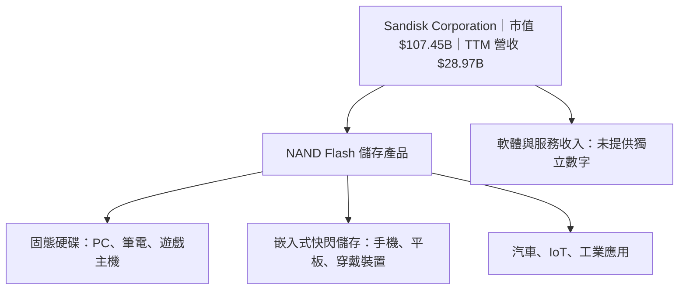
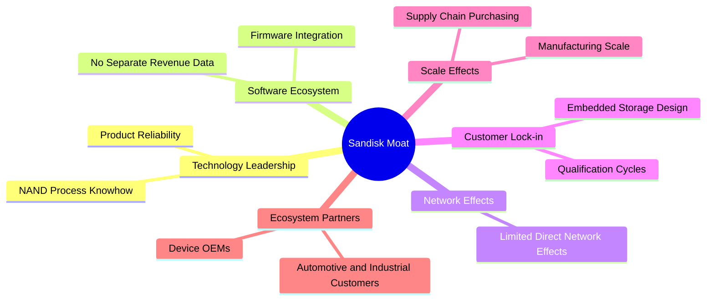
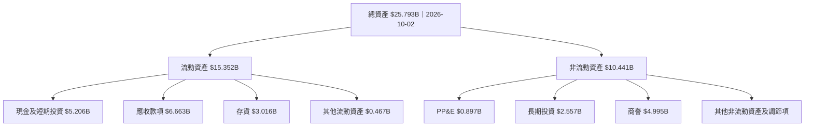
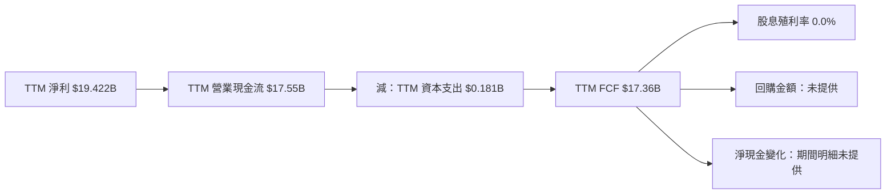
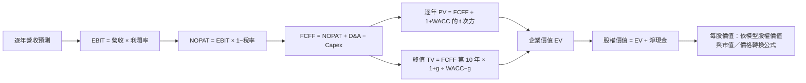
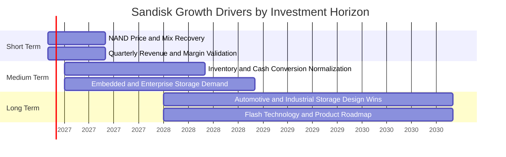
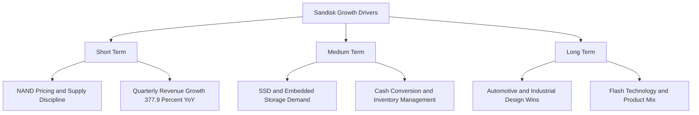
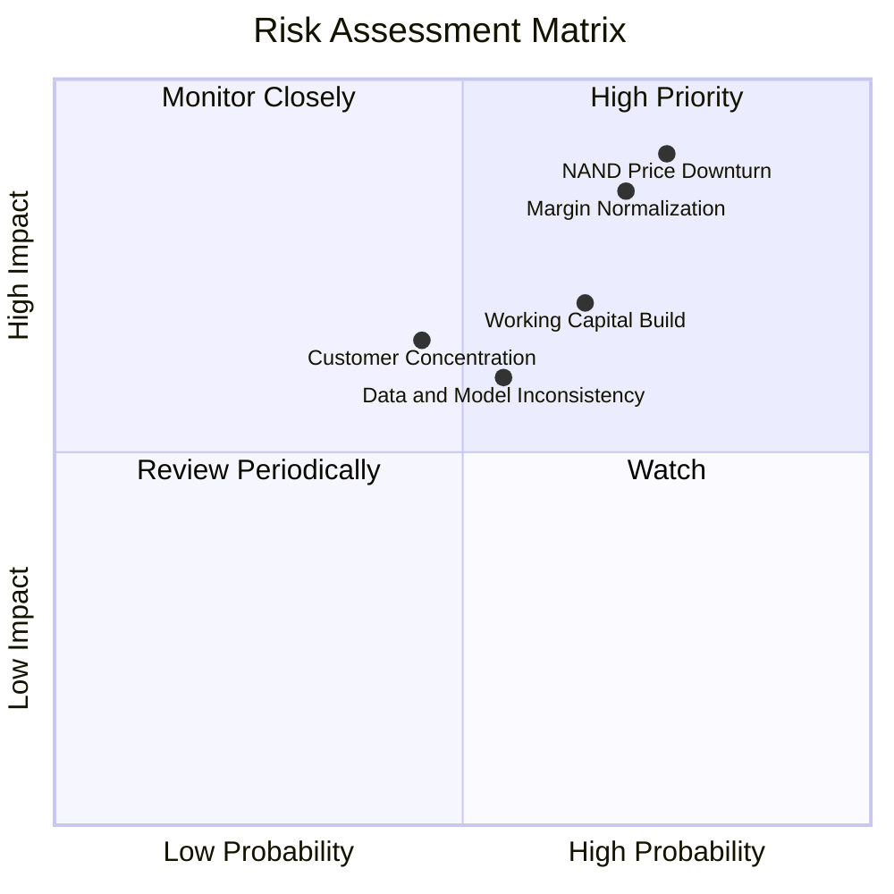
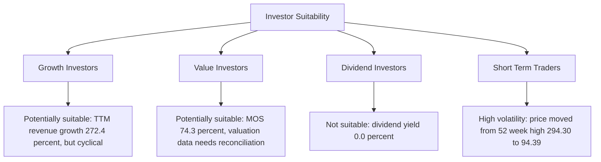

# SNDK 基本面深度分析報告
> **報告日期**：2026-11-20 ｜ **語言**：繁體中文 ｜ **數據來源**：SEC 申報資料 (XBRL)、Yahoo Finance、Finviz、StockAnalysis、Roic.ai ｜ **分析師**：CFA 級機構研究

## 目錄

| # | 章節 | 核心結論 |
|---|------|----------|
| 1 | 執行摘要 | 強烈買入；加權合理價值 $366.86；MOS +74.3% |
| 2 | 公司概覽與商業模式 | NAND 儲存受惠需求擴張，但市場份額及業務拆分資料未提供 |
| 3 | 損益表深度分析 | TTM 營收 $28.97B、TTM 成長 272.4%；利潤率急升但週期性高 |
| 4 | 資產負債表分析 | 淨現金 $5.14B；營運資金天數上升值得留意 |
| 5 | 現金流量深度分析 | TTM FCF $17.36B，FCF Yield 16.16% |
| 6 | 獲利能力與資本效率 | ROIC 141.2% 高於 WACC 10.09%，目前創造股東價值 |
| 7 | 相對估值分析 | 同業倍數與自身歷史估值資料呈現不同訊號 |
| 8 | DCF 內在價值評估 | DCF 基準值 $593.92；加權合理價值 $366.86 |
| 9 | 成長催化劑 | NAND 循環復甦與儲存需求是主要驅動；TAM 數字未提供 |
| 10 | 風險矩陣 | NAND 價格循環、超高利潤率回落及營運資金惡化是主要風險 |
| 11 | 投資建議 | MOS 支持強烈買入，但應以季度現金流與毛利趨勢分批驗證 |

---

## 1. 執行摘要

SNDK 的 FY2027 Q1 單季營收年增 **377.9%**，TTM 營收為 **$28.97B**、TTM 營業利益率 **72.5%**、TTM FCF **$17.36B**；ROIC **141.2%** 高於 WACC **10.09%**。以估值方法加權後合理價值 **$366.86**，相對 2026-11-19 收盤價 **$94.39**，MOS 為 **+74.3%**。依 MOS 門檻且 ROIC 高於 WACC，評級為 **強烈買入**；但 NAND 價格與公司當前極高利潤率有明顯循環風險，估值模型對長期現金流假設高度敏感。

### 1.0 一頁式投資儀表板（Portfolio Manager 30 秒速讀）

| 項目 | 內容 |
|------|------|
| **投資論點（3 句）** | ① TTM 營收 **$28.97B**，TTM 年增 **272.4%**，反映儲存需求與價格回升。② TTM FCF **$17.36B**、FCF Yield **16.16%**，現金流提供估值支撐。③ ROIC **141.2%** 對比 WACC **10.09%**，目前資本回報顯著高於資本成本。 |
| **綜合評分** | **7.3/10**（引用 1.1 評分卡） |
| **財務健康** | 🟢 淨現金 **$5.14B**；流動比率 **2.58**，惟 CCC 從 **154 天**升至 **226 天**。 |
| **ROIC vs WACC** | **141.2% vs 10.09%**；目前創造股東價值。 |
| **FCF 趨勢** | 年度 FCF 由 FY2025 **-$0.12B**轉至 FY2026 **$11.49B**；TTM FCF Yield **16.16%**。 |
| **估值** | Forward P/E **20.9x** ｜ EV/EBITDA **0.397x**（來源估值彙整數據，與其他市值／EV欄位存在不一致）｜ FCF Yield **16.16%** |
| **DCF 內在價值（基準）** | **$593.92** ｜現價相對 DCF 折溢價 **−84.1%**（折價；以 DCF 基準值計算） |
| **安全邊際（MOS）** | **+74.3%＝($366.86−$94.39)÷$366.86**｜🟢 >25% 充足；基準為 8.8 加權合理價值。 |
| **預期報酬（基準情境 12M）** | DCF 基準情境相對現價 **+529.2%**；此為模型情境結果，不等同一年期預測保證。 |
| **關鍵風險（前二）** | ① NAND 價格轉弱與 2027 年預測偏空；② 72.5% TTM 營業利益率難以長期維持。 |
| **評級 + 信心度** | 🟢 **強烈買入** ｜信心：中（估值折價幅度大，但循環性和資料一致性風險高） |

### 1.1 綜合評分卡（全報告唯一）

| 維度 | 評分（1–10） | 主要依據（引用數字與其來源章節） |
|------|--------------|----------------------------------|
| 成長性 | 9.0 | TTM 營收年增 **272.4%**、最新一季年增 **377.9%**（第 3 章）；須留意低基期與循環因素。 |
| 獲利能力 | 9.0 | TTM 營業利益率 **72.5%**、ROIC **141.2%** 對比 WACC **10.09%**，但 F-Score **5/8**（第 6 章）。 |
| 財務健康 | 7.5 | 淨現金 **$5.14B**、流動比率 **2.58**；CCC **226 天**，高於一年前 **154 天**（第 4 章）。 |
| 估值 | 9.0 | MOS **+74.3%**；同業 EV/EBITDA、P/S 方法估值低於 DCF（第 7–8 章）。 |
| 護城河 | 5.5 | NAND 技術、客戶認證與規模可形成一定門檻，但未提供市場份額及產品別收入數據（第 2 章）。 |
| 管理層與資本配置 | 5.5 | FY2026 SBC **$232M**；稀釋股數測試未通過，股息殖利率 **0.0%**，回購資料未提供。 |
| **綜合評分** | **7.6** | 六項算術平均：**(9.0+9.0+7.5+9.0+5.5+5.5)÷6 = 7.6**。 |

### 1.2 五大投資論點 + 三大核心風險

| 類型 | 項目 | 具體依據 | 信心度 |
|------|------|----------|--------|
| 🟢 **投資論點①** | 營收急速擴張 | TTM 營收 **$28.97B**、TTM 成長 **272.4%**；最新一季營收年增 **377.9%**。 | 🟢 高 |
| 🟢 **投資論點②** | 現金流轉強 | TTM OCF **$17.55B**、資本支出 **$181M**、TTM FCF **$17.36B**。 | 🟢 高 |
| 🟢 **投資論點③** | 高資本回報 | ROIC **141.2%**，高於 WACC **10.09%**。 | 🟢 高 |
| 🟢 **投資論點④** | 現金緩衝 | 現金及短期投資 **$5.14B**，Verified Figures 淨現金亦為 **$5.14B**。 | 🟢 高 |
| 🟢 **投資論點⑤** | 估值有明顯折價 | 加權合理價值 **$366.86** 對比現價 **$94.39**，MOS **+74.3%**。 | 🟡 中 |
| 🟡 **風險①** | NAND 價格循環反轉 | 新聞提及 2027 年 NAND 價格預測轉弱；公司 TTM 營業利益率 **72.5%**，回落可能大幅影響盈利。 | 🟡 中 |
| 🔴 **風險②** | 利潤率不具持續性 | FY2026 年營業利益率約 **61.6%**，最新 TTM 已達 **72.5%**；預測模型仍假設第 10 年為 **61.2%**。 | 🔴 高衝擊 |
| 🔴 **風險③** | 營運資金吸收現金 | CCC **226 天**，較一年前增加 **72 天**；DIO 增加 **66 天**。 | 🟡 中 |

### 1.3 快速統計卡片

| 指標 | 公司實際值（期間） | 同業中位數 | 狀態 |
|------|--------------------|------------|------|
| 營收成長（TTM） | **272.4%** | — | 🟢 |
| 營收成長（最新一季年增） | **377.9%** | **327.9%**（WDC、MU、SKHY） | 🟢 |
| 毛利率（TTM） | **80.0%** | **77.4%**（WDC、MU、SKHY） | 🟢 |
| 營業利益率（TTM） | **72.5%** | — | 🟢 |
| ROIC（TTM） | **141.2%** | — | 🟢 |
| Forward P/E | **20.9x** | **3.3x**（WDC、MU、SKHY） | 🔴 |
| FCF Yield（TTM） | **16.16%** | — | 🟢 |
| Piotroski F-Score | **5 / 8** | — | 🟡 |

> 同業中位數依同業區塊所列三家公司計算；SKHY 的 P/S 與 EV/EBITDA 因幣別混合不可用。

### 1.4 投資結論

```
╔══════════════════════════════════════════════════════════════════╗
║                    📊 投資結論摘要                               ║
╠══════════════════════════════════════════════════════════════════╣
║  評級：強烈買入（依 MOS 門檻；ROIC 141.2% > WACC 10.09%）         ║
║  價格（2026-11-19 收盤）：$94.39                                  ║
║  DCF 內在價值（基準）：$593.92（相對現價折價 84.1%）               ║
║  安全邊際 MOS：+74.3%（＝($366.86−$94.39)÷$366.86）              ║
║  加權合理價值（8.8）：$366.86                                     ║
║  DCF 情境價值：                                                   ║
║    悲觀情境：$252.79（+167.8%）                                   ║
║    基準情境：$593.92（+529.2%）                                   ║
║    樂觀情境：$1,322.07（+1300.6%）                                 ║
║  綜合評分：7.6/10（引用 1.1）                                     ║
║  適合投資人：可承受半導體週期波動、採分批配置的成長型投資人       ║
╚══════════════════════════════════════════════════════════════════╝
```

---

## 2. 公司概覽與商業模式

### 2.1 業務結構與收入來源

Sandisk Corporation 開發、製造及銷售 NAND 快閃儲存裝置與解決方案，應用涵蓋 PC、遊戲主機、手機與平板嵌入式儲存、汽車、IoT、工業及穿戴裝置。收入主要來自儲存硬體產品；各產品線收入佔比、服務收入及軟體收入數據未提供，因此不拆分收入比例。



### 2.2 市場份額

市場份額及其年份資料未提供，故不呈現市佔圖。公司 TTM 營收為 **$28.97B**，TTM 成長 **272.4%**，最新一季年增 **377.9%**；同業最新一季年增率包括 WDC **55.5%**、MU **379.3%**、SKHY **327.9%**，顯示 SNDK 正處於需求與價格快速擴張期，但不能由成長率直接推導市佔提升。

### 2.3 競爭護城河分析



### 2.4 護城河強度

| 護城河項目 | 強度（強／中／弱） | 證據（引用數字或事實） | 會削弱它的情況 |
|------------|--------------------|------------------------|----------------|
| 技術與產品整合 | 中 | 公司提供 SSD 及嵌入式儲存，涵蓋 PC、手機、汽車與工業用途。 | NAND 製程落後、產品可靠性或性能失去競爭力。 |
| 客戶鎖定與認證 | 中 | 汽車、工業及嵌入式儲存通常需產品驗證與設計導入；具體客戶續約率未提供。 | 客戶多來源採購、重新設計成本下降。 |
| 規模與供應鏈 | 中 | TTM 營收 **$28.97B**，具有一定營運規模。 | 供給過剩使規模無法轉化為定價能力。 |
| 軟體生態 | 弱／資料不足 | 軟體與服務收入未單獨披露。 | 軟體差異化有限、產品轉換成本低。 |
| 網路效應 | 弱 | 儲存硬體未呈現明顯雙邊網路效應。 | 同質化競爭加劇。 |
| 生態夥伴 | 中 | 應用橫跨多種終端與產業，但合作夥伴營收資料未提供。 | 大型 OEM 集中採購、議價能力轉向客戶。 |

1.1 的護城河分數 **5.5/10**，理由是產品整合與客戶認證可提供一定門檻，但市場份額、客戶集中度及軟體收入等可量化證據不足。

---

## 3. 損益表深度分析

### 3.1 年度收入成長趨勢（近 4 年）

| 財年 | 營收 | YoY |
|------|------|-----|
| FY2023 | $6.09B | — |
| FY2024 | $6.66B | +9.48% |
| FY2025 | $7.36B | +10.39% |
| FY2026 | $20.25B | +175.30% |

```
╔══════════════════════════════════════════════════════════════════╗
║              Sandisk 年度收入趨勢（FY2023-FY2026）               ║
╠══════════════════════════════════════════════════════════════════╣
║ FY2023  $6.09B   ██████░░░░░░░░░░░░░░░░░░░  起點               ║
║ FY2024  $6.66B   ███████░░░░░░░░░░░░░░░░░░  YoY +9.48%          ║
║ FY2025  $7.36B   ████████░░░░░░░░░░░░░░░░░  YoY +10.39%         ║
║ FY2026 $20.25B   █████████████████████████  YoY +175.30%        ║
╠══════════════════════════════════════════════════════════════════╣
║ FY2023–FY2026 年營收 CAGR：約 +49.3%                             ║
╚══════════════════════════════════════════════════════════════════╝
```

算式：**($20.25B ÷ $6.09B)^(1/3) − 1 ≈ 49.3%**。FY2026 的跳升主要反映 NAND 市場由前期低迷轉入急速復甦；這種基期與定價循環效應不宜直接外推為長期成長率。

### 3.2 季度收入趨勢分析

以下以財務數據的 FY2027 Q1 至 FY2026 Q2 季度序列計算 QoQ；YoY 採 StockAnalysis 季度資料所列數值。

| 財季 | 營收 | QoQ | YoY | 備註 |
|------|------|-----|-----|------|
| FY2026 Q2 | $3.025B | — | +61.25% | 復甦初期，低基期推升年增率。 |
| FY2026 Q3 | $5.950B | +96.7% | +251.03% | 營收加速，可能同時受需求、價格與出貨組合影響。 |
| FY2026 Q4 | $8.965B | +50.7% | +371.59% | 高速擴張持續，季度年增率不可當作 TTM 成長率。 |
| FY2027 Q1 | $11.031B | +23.0% | +377.9% | 單季年增 **377.9%**；QoQ 成長放緩但仍為正。 |

QoQ 算式例：**$11.031B ÷ $8.965B − 1 = 23.0%**。在快速成長期，出貨、售價與產品組合都可能造成季度跳動，應以多季平均與庫存變化確認趨勢。

### 3.3 利潤率演變分析

下表年度毛利率、營業利益率與淨利率依年度損益表計算；TTM 利潤率另採最新 SEC／程式計算數據，兩種期間不可混用。

| 利潤率指標 | FY2023 | FY2024 | FY2025 | FY2026 | 趨勢 | 評估 |
|------------|--------|--------|--------|--------|------|------|
| **毛利率** | 7.1% | 16.1% | 30.1% | 71.5% | 循環復甦期間快速擴張 | 🟢 |
| **營業利益率** | -21.3% | -6.7% | 6.9% | 61.6% | 由虧損轉至高利潤 | 🟢／需驗證 |
| **淨利率** | -35.2% | -10.1% | -22.3% | 56.4% | FY2025 仍受虧損拖累，FY2026 大幅轉盈 | 🟡 |
| **TTM 營業利益率** | — | — | — | **72.5%** | 高於 FY2026 全年，反映近期盈餘動能仍強 | 🟡 |

FY2026 毛利與營業利潤率改善，與 NAND 需求回升、售價環境轉佳及產能利用率提高相符；但資料沒有提供產品組合、單位售價及成本的拆分，不能把所有增幅歸因於單一因素。TTM 營業利益率 **72.5%** 高於 FY2026 全年 **61.6%**，是有利的近期訊號，也是週期高峰風險：若 NAND 定價回落，固定成本吸收與售價下跌可能令利潤率快速收縮。

### 3.4 費用結構分析

費用項目完整拆分未提供，因此不畫費用佔比圓餅圖。FY2026 研發費用 **$1.33B**，約為年度營收 **$20.25B** 的 **6.6%**；這顯示公司仍需持續投入製程與產品研發。單季或 TTM 銷售管理費用、製造成本細項與一次性項目未提供。

### 3.5 季度 EPS 趨勢與盈餘品質（Quality of Earnings）

EPS Surprise 資料庫中最近四季估計值與實際值均為 `nan`，無法判定超預期或不及預期；不得以 EPS 成長率代替盈餘驚喜幅度。

| 盈餘品質項目 | 數值／佔比 | 評估 |
|--------------|-----------|------|
| 股權薪酬 SBC / 營收 | TTM SBC 約 **$270M** / $28.97B = **0.93%** | 🟢 佔比不高，但會稀釋股東；TTM SBC 由最近四季 $91M+$67M+$54M+$58M 加總。 |
| SBC / 營業現金流 | 約 **$270M / $17.55B = 1.54%** | 🟢 相對 OCF 不高。 |
| FCF / 淨利（現金轉換率） | **$17.36B / $19.422B = 89.4%** | 🟢 有現金支撐；但 CCC 拉長可能令未來轉換率下滑。 |
| 一次性／非經常性損益 | N/A（未提供完整明細） | 🟡 無法判斷是否有一次性項目推升當期獲利。 |
| 有效稅率異常 | **12.2%**（最新年度有效稅率） | 🟢／🟡 稅率偏低可能支撐淨利，但缺少多年稅務調節表，不能確認是否可持續。 |
| 資本化支出 vs 費用化 | TTM Capex **$181M**；資本化政策明細未提供 | 🟡 低資本支出支撐高 FCF，但不能據此判定成本是否有過度資本化。 |

**EPS 趨勢與盈餘品質結論：**最近四季每股盈餘由 StockAnalysis 所列 **$0.64、$2.88、$5.50、$6.58** 持續上升，與營收和利潤擴張方向一致；但一致預期與實際 EPS 均缺失，無法驗證 beat/miss。TTM FCF 約為 TTM 淨利的 **89.4%**，現金轉換尚可；同時 F-Score 的應計品質測試未通過，因此不宜將帳面獲利完全視為低風險、可持續的週期性盈餘。

---

## 4. 資產負債表分析

### 4.1 資產結構分解

以 StockAnalysis 2026-10-02 資產負債表數據呈現；非流動資產為總資產減流動資產的計算值。



資產結構呈現應收款與存貨規模較大；兩者合計 **$9.679B**，約為總資產的 **37.5%**。這使營運資金管理成為資產負債表分析重點。

### 4.2 流動性與營運資金分析

| 指標 | 最新 TTM | 一年前 TTM | 變化 | 解讀 |
|------|----------|------------|------|------|
| 流動比率 | **2.58** | N/A | N/A | 短期流動性有緩衝；歷史同口徑數據未提供。 |
| 速動比率 | **1.994** | N/A | N/A | 排除存貨後仍有流動性緩衝。 |
| DSO 應收帳款天數 | **83 天** | **56 天** | **+27 天** | 收款週期拉長；可能與營收急增、客戶付款條件或季末應收餘額有關，需追蹤應收帳齡。 |
| DIO 存貨天數 | **190 天** | **124 天** | **+66 天** | 存貨天數升高，可能是為成長備貨，也可能反映出貨／需求錯配。 |
| DPO 應付帳款天數 | **46 天** | **26 天** | **+20 天** | 延長供應商付款時間，可部分抵銷應收與存貨占用；不等同已證明議價力提升。 |
| CCC 現金轉換週期 | **226 天** | **154 天** | **+72 天** | 現金被營運資金占用的時間明顯增加，是本期流動性監控重點。 |

營運資金天數依 QUALITY FIGURES 原值引用，不重算。公司營收快速增長可能推高應收與備貨需求，但若 DIO 持續上升且出貨未同步，將提高跌價與現金流逆轉風險。

### 4.3 債務結構分析

Verified Figures 的總債務為 **N/A**，故不以其他彙整來源的債務數字替代，也不計算 Debt/EBITDA 或利息保障倍數。市場資料其他欄位出現總債務 **$201M**，與 Verified Figures 的 N/A 不一致，故在本節標示來源差異，不把該值當作已核實數字。

```
╔══════════════════════════════════════════════════════════════════╗
║                   Sandisk 債務健康診斷                           ║
╠══════════════════════════════════════════════════════════════════╣
║  總債務：        N/A（SEC 最新資料口徑不可用）                    ║
║  現金+短期投資：  $5.14B（Verified Figures）                       ║
║  淨現金：        $5.14B（Verified Figures）              🟢      ║
║  Debt/EBITDA：   N/A（總債務口徑缺失）                             ║
║  Interest Coverage：N/A（利息費用與債務口徑不完整）                ║
║  判斷：現金緩衝充足；債務比例指標需待同口徑資料確認                ║
╚══════════════════════════════════════════════════════════════════╝
```

### 4.4 股東權益趨勢

| 財年 | 股東權益 | YoY 變化 |
|------|----------|----------|
| FY2024 | $11.08B | — |
| FY2025 | $9.22B | -16.8% |
| FY2026 | $15.74B | +70.7% |

```
╔══════════════════════════════════════════════════════════════════╗
║                   股東權益趨勢                                   ║
╠══════════════════════════════════════════════════════════════════╣
║ FY2024  $11.08B  ██████████████░░░░░░░░░░░░░░                   ║
║ FY2025   $9.22B  ████████████░░░░░░░░░░░░░░░░  YoY -16.8%       ║
║ FY2026  $15.74B  ████████████████████░░░░░░░░  YoY +70.7%       ║
╚══════════════════════════════════════════════════════════════════╝
```

FY2026 權益回升與獲利轉正相符；股東權益變化受淨利、分配與其他綜合損益共同影響，完整變動表未提供。

---

## 5. 現金流量深度分析

### 5.1 現金流量瀑布圖



上述是現金流指標的關係圖，不表示淨利必然直接轉化成 OCF。TTM FCF 按統一定義為 **OCF − Capex**。

### 5.2 FCF 轉換率趨勢

| 財年／期間 | FCF | 淨利 | FCF／淨利 | 解讀 |
|------------|-----|------|-----------|------|
| FY2023 | -$0.932B | -$2.143B | 不具可比性 | 虧損與負 FCF，負數相除不宜作轉換率判讀。 |
| FY2024 | -$0.475B | -$0.672B | 不具可比性 | OCF 與獲利皆為負。 |
| FY2025 | -$0.120B | -$1.641B | 不具可比性 | FCF 接近損益平衡，但淨利仍虧損。 |
| FY2026 | $11.49B | $11.43B | **約100.5%** | FCF 略高於淨利，現金轉換良好。 |
| TTM | $17.36B | $19.422B | **89.4%** | 仍具現金支撐，但低於 FY2026 比率。 |

年度 FCF、淨利資料來自年度報表；TTM 比率用 TTM FCF 與 TTM 淨利計算。

### 5.3 自由現金流趨勢

```
╔══════════════════════════════════════════════════════════════════╗
║                自由現金流趨勢（美元）                           ║
╠══════════════════════════════════════════════════════════════════╣
║ FY2023  -$0.932B  負值                                            ║
║ FY2024  -$0.475B  負值                                            ║
║ FY2025  -$0.120B  接近損益平衡                                    ║
║ FY2026  $11.49B   █████████████████████████                       ║
║ TTM     $17.36B   █████████████████████████████████████           ║
╠══════════════════════════════════════════════════════════════════╣
║ TTM FCF Yield：16.16%（程式計算，FCF ÷ 市值）                     ║
╚══════════════════════════════════════════════════════════════════╝
```

歷史 FCF 由負轉正，代表循環復甦不只反映在損益表，也反映在營業現金流；但 FCF Yield 的分母是市場市值，會隨股價波動，不能視為固定收益率。

### 5.4 資本配置評估

回購金額與長期資本配置拆分未提供，不畫資本配置比例圓餅圖。已知 FY2026 Capex **$177M**、SBC **$232M**，分析師共識股息殖利率 **0.0%**、派息率 **0.0%**。

| 項目 | 已知資料 | 評估 |
|------|----------|------|
| 資本支出 | FY2026 **$177M**；TTM **$181M** | 相對 TTM 營收低，利於現金流，但仍需驗證是否足以支撐產能與技術投資。 |
| 股息 | 殖利率 **0.0%** | 目前沒有股息回報。 |
| 股票回購 | N/A | 未提供回購金額與股數變化拆分。 |
| 股權薪酬 | FY2026 **$232M** | 對應股東稀釋成本；F-Score 稀釋股數測試未通過。 |
| 留存現金 | 現金及短期投資 **$5.14B** | 提供週期下行緩衝，但用途與回報率需後續追蹤。 |

---

## 6. 獲利能力與資本效率

### 6.1 ROE / ROA / ROIC 趨勢

| 指標 | 最新 TTM | 歷史趨勢資料 | 評估 |
|------|----------|--------------|------|
| ROE | **107.1%**（QUALITY FIGURES 杜邦） | 多年同口徑數據未提供 | 高回報主要與 67.0% 淨利率及 1.12x 資產週轉率有關。 |
| ROA | **68.3%** | 有資料指出 ROA 高於一年前，但前期數字未提供 | 近期盈利反彈使資產回報顯著上升。 |
| ROIC | **141.2%** | TTM | 高於資本成本，但受週期高點盈利影響，未必可持續。 |
| WACC | **10.09%** | 本報告採用同一數值 | ROIC 高於 WACC，當前創造價值。 |

### 6.2 ROIC vs WACC 分析（核心價值創造判斷）

```
╔══════════════════════════════════════════════════════════════════╗
║                ROIC vs WACC 深度分析                            ║
╠══════════════════════════════════════════════════════════════════╣
║  WACC（採用 Cost of capital 原值）：10.09%                       ║
║  ├── 無風險利率（10Y Treasury）：       5.05%                    ║
║  ├── 股權風險溢酬 ERP：                 5.00%                    ║
║  ├── Yahoo 原始 Beta：                  N/A                      ║
║  ├── 採用調整後 Beta：                  1.00（假設值）           ║
║  ├── 股權成本 Ke：                      10.05%                   ║
║  ├── 稅前債務成本：                     36.32%                   ║
║  ├── 資本結構 E / D：                   99.8% / 0.2%             ║
║  └── WACC：                             10.09%                   ║
║                                                                  ║
║  ROIC（TTM）：                           141.2%                   ║
║  ROIC − WACC：                           +131.11 個百分點         ║
║  ROIC / WACC：                           約 14.0 倍               ║
║                                                                  ║
║  ROIC 141.2%  ▓▓▓▓▓▓▓▓▓▓▓▓▓▓▓▓▓▓▓▓▓▓▓▓▓▓▓▓▓▓▓▓                 ║
║  WACC  10.09% ▓▓                                                   ║
║                                                                  ║
║  判斷：在目前 TTM 獲利水準下，公司創造股東價值；                 ║
║  但此 ROIC 可能包含 NAND 循環高點盈利，不宜直接當作常態值。        ║
╚══════════════════════════════════════════════════════════════════╝
```

股權成本依來源列示 **Rf 5.05% + 調整後 Beta 1.00 × ERP 5.00% = 10.05%**。原始 Beta 缺失，採用 1.00 是假設值。債務成本與資本權重直接引用 Cost of capital 數據；總債務細項不可用，因此不另行反推債務餘額。WACC **10.09%** 為本報告唯一折現率，亦用於第 8 章 DCF。

ROIC 與 WACC 相差 **141.2% − 10.09% = 131.11 個百分點**，顯示目前營運回報遠高於資本成本。但若循環下行令營業利潤率回落，ROIC 將同步下降；因此這個差距應視為當期價值創造證據，不代表長期固定超額報酬。

### 6.3 杜邦三因素分解

| 因素 | 數值（TTM） | 解讀 |
|------|-------------|------|
| 淨利率 | **67.0%** | 極高淨利率是 ROE 的主要驅動之一，對 NAND 售價與毛利變化敏感。 |
| 資產週轉率 | **1.12x** | 資產每年產生約 1.12 倍營收，亦對 ROE 有正貢獻。 |
| 權益乘數 | **1.42x** | 槓桿並非 ROE 的主要來源。 |
| **ROE** | **107.1%** | **67.0% × 1.12 × 1.42 = 106.6%**，與公布 ROE 107.1% 的差異來自底層未四捨五入數據。 |

以上 DuPont 因子依 QUALITY FIGURES 照列，依其說明計算結果與原報 ROE 有四捨五入差異，故不替換原列 **107.1%**。

### 6.4 財務體質：Piotroski F-Score

F-Score 原值為 **5 / 8**；九項測試中有一項因資料缺失而排除，故分母低於九。

| 測試 | 結果 | 解讀 |
|------|------|------|
| ROA > 0 | ✅ 通過 | TTM 獲利為正。 |
| 營業現金流 > 0 | ✅ 通過 | TTM OCF **$17.55B**。 |
| ROA 高於一年前 | ✅ 通過 | 獲利能力較前期改善。 |
| 營業現金流 > 淨利（應計品質） | ❌ 未通過 | TTM OCF 低於 TTM 淨利 **$19.422B**，現金轉換未完全追上帳面獲利。 |
| 長期負債 ÷ 總資產低於一年前 | — 無法判定 | 缺少判斷所需資料。 |
| 流動比率高於一年前 | ❌ 未通過 | 相對去年未改善，需與 CCC 上升一併觀察。 |
| 稀釋股數未增加 | ❌ 未通過 | 稀釋股數測試未過，SBC 可能造成股東稀釋。 |
| 毛利率高於一年前 | ✅ 通過 | 毛利率較前期改善。 |
| 資產週轉率高於一年前 | ✅ 通過 | 資產使用效率改善。 |

**解讀：**5/8 顯示盈利、現金流與效率指標有改善，但應計品質、流動性相對變化與稀釋股數未通過。F-Score 不支持把當前盈利反彈視為沒有風險的結構性改善。

---

## 7. 相對估值分析

### 7.1 同業估值比較表格

| 估值指標 | **SNDK** | **WDC** | **MU** | **SKHY** | SNDK 評估 |
|----------|----------|--------|--------|---------|-----------|
| **Trailing P/E** | **48.3x** | 10.4x | 9.3x | 6.6x | 🔴 高於同業；SNDK 估值彙整數據對循環盈利與市值口徑較敏感。 |
| **Forward P/E** | **20.9x** | 7.3x | 3.3x | 2.9x | 🔴 顯著高於同業，反映市場已計入較高盈利預期。 |
| **P/S Ratio** | **3.71x** | 7.7x | 5.9x | N/A | 🟢 對 WDC、MU 折價；SKHY 因混合幣別不可比。 |
| **EV/EBITDA** | **0.397x** | 17.5x | 6.8x | N/A | 🟢 SNDK 顯示值極低，但與其他估值與市值欄位可能有口徑錯配，不能單獨採信。 |
| 最新一季營收 YoY | **377.9%** | 55.5% | 379.3% | 327.9% | 🟡 成長接近 MU、高於 WDC 與 SKHY，但單季增速不可年化外推。 |
| 毛利率（TTM） | **80.0%** | 52.6% | 80.7% | 77.4% | 🟢 接近 MU，高於 WDC、SKHY。 |

SNDK 的 P/E 高於同業，但 P/S 低於 WDC 與 MU。另一方面，SNDK 的 EV/EBITDA **0.397x** 與 P/E、P/S、企業價值資料不一致，應先核對企業價值與股數口徑，不宜把該倍數孤立當作便宜證據。

### 7.2 歷史估值區間分析

歷史資料所列是 P/S，不是 P/E。現行歷史估值資料為 P/S **0.5x**、5 年中位數 **4.8x**、範圍 **0.9x–13.4x**、當前百分位 **0%**。另有彙整估值資料列 P/S **3.7089x**；兩者不一致，可能反映資料時點或口徑差異，故並列披露，不互相替換。

```
╔══════════════════════════════════════════════════════════════════╗
║            P/S 歷史區間（Valuation vs own history）              ║
╠══════════════════════════════════════════════════════════════════╣
║ 5 年區間：0.9x ├───────────────────────────┤ 13.4x             ║
║ 5 年中位數：4.8x                                                  ║
║ 當前歷史序列值：0.5x｜百分位：0%                                  ║
║ 另一估值彙整來源列示：3.7089x（來源口徑不一致）                    ║
╚══════════════════════════════════════════════════════════════════╝
```

### 7.3 情境價值（照抄 DCF MODEL 的 Scenarios）

| 情境 | 第 1 年營收成長 | 期末營業利潤率 | WACC | 每股價值 | 相對現價 | 機率 | 會發生的條件 |
|------|----------------|----------------|------|----------|----------|------|--------------|
| 🔴 悲觀 | 15.0% | 52.0% | 11.09% | **$252.79** | **+167.8%** | 25% | NAND 復甦較快降溫，價格與產品組合回落，利潤率低於基準。 |
| 🟡 基準 | 30.0% | 61.2% | 10.09% | **$593.92** | **+529.2%** | 50% | 首年延續成長，之後成長率逐步降至 3.0%，利潤率收斂至 61.2%。 |
| 🟢 樂觀 | 45.0% | 67.3% | 9.09% | **$1,322.07** | **+1300.6%** | 25% | 需求和價格維持強勢，規模與產品組合令利潤率長期維持高檔。 |

以上情境值與機率直接採用 DCF 模型資料；其高幅度上行受當前模型的高盈利起點與長期現金流假設影響，不應視為價格保證。

### 7.4 相對估值隱含價格區間

```
╔══════════════════════════════════════════════════════════════════╗
║               估值方法隱含每股價值                               ║
╠══════════════════════════════════════════════════════════════════╣
║ 現價 $94.39 ── P/S $172.25 ── EV/EBITDA $230.84                  ║
║                         分析師共識 $255.92 ── DCF $593.92         ║
╚══════════════════════════════════════════════════════════════════╝
```

| 方法 | 每股價值 | 依據 |
|------|----------|------|
| 同業 EV/EBITDA | **$230.84** | WDC、MU 同業中位數 **12.2x** × SNDK TTM EBITDA，再加淨現金。 |
| 同業 P/S | **$172.25** | WDC、MU 同業中位數 **6.8x** × SNDK TTM 營收。 |
| 分析師共識 | **$255.92** | 24 位分析師平均目標價。 |
| DCF 基準 | **$593.92** | 10 年 FCFF、WACC **10.09%**、永續成長率 **3.0%**。 |

---

## 8. DCF 內在價值評估（Discounted Cash Flow）

> 本節逐年數字與情境均依 DCF MODEL 原值列示。模型採 GAAP EBIT、FCFF 對 WACC 折現，且不另行建模營運資金變動。

### 8.0 估值推理鏈（Thinking Logic）

**Step 1 — 價值來源與主導變數**

DCF 的現金流底盤來自 NAND 儲存主業；目前 TTM 營收 **$28.97B**，但產品別收入佔比未提供，無法把主業再拆成可核驗的比例。資料亦未提供可單獨估值的第二成長曲線或軟體服務收入，因此基準模型不額外加入選擇權價值。估值最受 **營業利潤率與終值假設**影響：終值現值佔企業價值 **57.7%**，營業利潤率由第 1 年 **72.5%** 線性降至第 10 年 **61.2%**。

**Step 2 — 模型選擇**

| 決策點 | 本報告採用 | 理由（含數字） | 曾考慮但否決 | 否決理由 |
|--------|-----------|----------------|--------------|----------|
| 現金流定義 | FCFF | 以 WACC **10.09%** 折現，先估 EV，再加淨現金。 | FCFE | 債務資料口徑不完整，FCFF 較不依賴融資結構假設。 |
| 預測期 N | 10 年 | 模型固定為 10 年，收入成長率由 **30.0%** 逐步降至 **3.0%**。 | 5 年 | 無法承接模型既定的十年成長與利潤率收斂路徑。 |
| 終值方法 | Gordon Growth | 永續成長率 **3.0%** 低於 WACC **10.09%**。 | 僅退出倍數 | 模型未提供退出倍數法的 EBITDA 倍數與終值計算，不自建。 |
| EBIT 基礎 | GAAP EBIT | DCF 模型明示採 GAAP EBIT。 | 非 GAAP EBIT | 可能把 SBC 加回，產生不同口徑。 |

**Step 3 — 關鍵假設推導鏈**

- **營收成長路徑**：錨點＝TTM 成長 **272.4%**、最新一季年增 **377.9%** → 這些單季／TTM 增速可能受低基期與價格循環影響，模型將首年限制在 **30.0%**，之後線性降至 **3.0%** → **採用模型逐年 30.0%、27.0%、24.0%、21.0%、18.0%、15.0%、12.0%、9.0%、6.0%、3.0%** → 否決直接延續 **272.4%**，因其不適合作為常態化成長假設。
- **期末營業利潤率**：錨點＝TTM **72.5%** → 隨週期正常化，模型逐步收斂至近三個財年中位數（TTM 納入）**61.2%** → **採用第 1 年 72.5% 至第 10 年 61.2%** → 否決十年維持 72.5%，因會忽略 NAND 定價循環。
- **永續成長率 g**：錨點＝長期名目經濟成長的常態區間，具體來源數值未在公司財務資料中提供 → 採用模型 **3.0%**，且低於 WACC **10.09%** → **採用 3.0%** → 否決高於 3.0% 的永續成長，避免終值過度膨脹。
- **預測期 N**：錨點＝模型固定 **10 年**，並有十個逐年 FCFF → **採用 10 年** → 否決自行改為 5 年或延長，因會改動既定模型結果。
- **Capex／營收**：錨點＝TTM Capex **$181M**、TTM 營收 **$28.97B**，比例約 **0.6%** → 模型以 **0.6%** 為第 1 年及第 10 年值 → **採用模型列示的 0.6%** → 否決擅自加高到其他比例，因模型已固定輸入。
- **EBIT 與 SBC**：錨點＝模型明示 GAAP EBIT；FY2026 SBC **$232M** → GAAP EBIT 已列支 SBC，模型不再扣 SBC，股數不再另行稀釋 → **採用組合 (A)：GAAP EBIT＋固定股數＋年稀釋率 0%** → 否決再扣 SBC 或再稀釋，避免重複計算成本。
- **終值方法**：錨點＝模型以第 10 年 FCFF 與 **3.0%** 永續成長率計算 → **採用 Gordon Growth** → 否決自行建立退出倍數終值，因模型未提供退出倍數法輸入。
- **WACC**：錨點＝Cost of capital 的採用值 **10.09%** → 原始 Beta 缺失，已採用調整後 Beta **1.00** → **採用 10.09%** → 否決另算一個 WACC，維持 6.2 與 DCF 一致。
- **有效稅率與 D&A**：錨點＝有效稅率 **12.2%**；D&A／營收 **0.5%**（模型原值）→ **採用原模型值**；資料未提供足以建立替代估值的歷史逐年 D&A 序列。

**Step 4 — 最脆弱環節**

最脆弱假設是高營業利潤率能否在長期維持：DCF 的基準第 10 年仍假設 **61.2%**，而敏感度矩陣在 WACC 10.09%、g 3.0% 下每股值為 **$593.92**；同一列 WACC 提高至 12.09% 時降至 **$451.52**，顯示估值對折現率及終值條件敏感。

**Step 5 — 計算路徑圖**



### 8.1 模型假設總表（Model Inputs）

| 假設項目 | 採用值 | 依據／來源 | 敏感度 |
|----------|--------|-------------|--------|
| 預測期長度 **N** | **10 年** | DCF MODEL 固定值，逐年預測 FY+1 至 FY+10。 | 🟡 中 |
| 營收成長路徑 | 第 1 年 **30.0%**，第 10 年 **3.0%**，線性遞減 | TTM 年增 **272.4%**，模型限制成長率在 0%–30%。 | 🔴 高 |
| 營業利潤率 | **72.5% → 61.2%** | TTM 利潤率與近三財年中位數（含 TTM）。 | 🔴 高 |
| 有效稅率 | **12.2%** | 最新年度有效稅率。 | 🟢 低 |
| Capex／營收 | **0.6% → 0.6%** | 模型採 TTM 比例；TTM Capex **$181M**。 | 🟡 中 |
| D&A／營收 | **0.5%** | DCF MODEL 原值。 | 🟢 低 |
| 營運資金變動 | **未建模** | 模型明示 working capital is not modelled，不補入假設值。 | 🟡 中 |
| EBIT 基礎 | GAAP EBIT | DCF MODEL 明示採用。 | 🟡 中 |
| SBC 處理 | 組合 **(A)**：GAAP EBIT 已含 SBC，不再扣 SBC | 每股數不再另行稀釋。 | 🟡 中 |
| 年稀釋率 | **0%（模型固定股數）** | 與組合 (A) 相容；不是對未來實際稀釋的預測。 | 🟡 中 |
| 永續成長率 g | **3.0%** | DCF MODEL 原值；低於 WACC。 | 🔴 高 |
| 終值方法 | Gordon Growth | 模型已提供終值；不另建退出倍數法。 | 🔴 高 |
| WACC | **10.09%** | Cost of capital 原值，見 8.2。 | 🔴 高 |

FCFF 定義採用模型指定 **FCFF = NOPAT + D&A − Capex**；模型未建模營運資金變動。**本模型採用 (A)，故 SBC 影響已計入一次。**

### 8.2 折現率推導（WACC）

```
╔══════════════════════════════════════════════════════════════════╗
║                    WACC 推導（折現率）                           ║
╠══════════════════════════════════════════════════════════════════╣
║ 股權成本 Ke（CAPM）：                                             ║
║ ├── 無風險利率 Rf（10Y Treasury）：       5.05%                  ║
║ ├── 市場風險溢酬 ERP：                    5.00%（假設值）        ║
║ ├── 原始 Beta（Yahoo）：                  N/A                    ║
║ ├── 採用調整後 Beta：                     1.00（假設值）         ║
║ ├── 規模／國別溢酬：                      未另加                 ║
║ └── 股權成本 Ke：                         10.05%                 ║
║                                                                  ║
║ 債務成本與資本結構（照 Cost of capital）：                         ║
║ ├── 稅前債務成本：                        36.32%                 ║
║ ├── 有效稅率：                            12.2%                  ║
║ ├── 股權／債務權重：                      99.8% / 0.2%           ║
║ └── 採用 WACC：                           10.09%                 ║
╚══════════════════════════════════════════════════════════════════╝
```

**輸入來歷與限制：**10Y Treasury 無風險利率為 **5.05%**，Cost of capital 區塊未列日期；ERP **5.00%** 為假設值；Yahoo 原始 Beta 為 N/A，調整後 Beta **1.00** 為假設值。區塊已提供 Ke **10.05%**、稅前 Kd **36.32%**、稅率 **12.2%**、權重 **99.8%／0.2%** 及 WACC **10.09%**，故不另算或替換 WACC。由於原始債務明細缺失，無法按 8.2 範本獨立核對 Kd 分母及期末債務權重；本報告以程式提供的整組資本成本數據為準，並將此列為模型限制。

### 8.3 逐年自由現金流預測（基準情境）

金額單位為 **$B**；比率取一位小數，折現因子依模型列示至三位小數。

| 年度 | FY+1 | FY+2 | FY+3 | FY+4 | FY+5 | FY+6 | FY+7 | FY+8 | FY+9 | FY+10 |
|------|------|------|------|------|------|------|------|------|------|-------|
| 營收 | 37.66 | 47.83 | 59.31 | 71.77 | 84.68 | 97.39 | 109.07 | 118.89 | 126.02 | 129.80 |
| 營收 YoY | 30.0% | 27.0% | 24.0% | 21.0% | 18.0% | 15.0% | 12.0% | 9.0% | 6.0% | 3.0% |
| 營業利潤率 | 72.5% | 71.2% | 70.0% | 68.7% | 67.5% | 66.2% | 64.9% | 63.7% | 62.4% | 61.2% |
| 營業利益 EBIT（GAAP） | 27.29 | 34.06 | 41.49 | 49.31 | 57.12 | 64.47 | 70.84 | 75.72 | 78.69 | 79.42 |
| − 稅（12.2%） | (3.32) | (4.14) | (5.05) | (6.00) | (6.95) | (7.84) | (8.62) | (9.21) | (9.58) | (9.66) |
| = NOPAT | 23.97 | 29.92 | 36.44 | 43.31 | 50.17 | 56.62 | 62.22 | 66.51 | 69.11 | 69.76 |
| + D&A | 0.20 | 0.26 | 0.32 | 0.39 | 0.46 | 0.52 | 0.59 | 0.64 | 0.68 | 0.70 |
| − Capex | (0.24) | (0.30) | (0.37) | (0.44) | (0.52) | (0.59) | (0.66) | (0.71) | (0.75) | (0.77) |
| = FCFF | **23.94** | **29.88** | **36.40** | **43.25** | **50.11** | **56.56** | **62.15** | **66.44** | **69.04** | **69.69** |
| 折現因子 @10.09% | 0.908 | 0.825 | 0.749 | 0.681 | 0.618 | 0.562 | 0.510 | 0.463 | 0.421 | 0.382 |
| FCFF 現值 PV | **21.74** | **24.65** | **27.28** | **29.44** | **30.98** | **31.76** | **31.70** | **30.78** | **29.06** | **26.64** |

預測期 PV 合計算式：  
**$21.74 + $24.65 + $27.28 + $29.44 + $30.98 + $31.76 + $31.70 + $30.78 + $29.06 + $26.64 = $284.03B**；模型原列合計 **$284.04B**，差異來自逐年數值四捨五入。

**逐步演算（FY+1；以下依模型逐列值示範）**

1. **營收** = $28.97B × (1 + 30.0%) = **$37.66B**（以未四捨五入底層數字計算，表列取兩位）。
2. **EBIT** = $37.66B × 72.5% = **$27.29B**。
3. **稅** = $27.29B × 12.2% = **$3.32B**。
4. **NOPAT** = $27.29B − $3.32B = **$23.97B**。
5. **D&A** = $37.66B × 模型 D&A 比例 0.5% = **$0.20B**（依模型列值）。
6. **Capex** = FY+1 模型 Capex = **$0.24B**。
7. **ΔWC** = 模型未建模，故本式不扣除 ΔWC。
8. **FCFF** = NOPAT + D&A − Capex = **$23.94B**（依模型內部未四捨五入值）。
9. **折現因子** = 1 ÷ (1 + 10.09%)¹ = **0.908**；PV = **$23.94B × 0.908 = $21.74B**（以未四捨五入折現因子計算）。

**合理性自檢**

- 預測 FCFF 由 FY+1 **$23.94B** 增至 FY+10 **$69.69B**，十年年化約 **12.6%**；歷史 FCF 由負值轉正，因負基期而不適合計算傳統 CAGR。
- FY+10 FCFF 利潤率＝**$69.69B ÷ $129.80B = 53.7%**；目前 TTM FCF／營收＝**$17.36B ÷ $28.97B = 59.9%**。同業 FCF 利潤率資料未提供，不能與同業最佳比較。
- 模型各年度 FCFF 均為正；但營運資金未建模，若 DSO、DIO 延續上升，實際現金流可能低於預測。

```
╔══════════════════════════════════════════════════════════════════╗
║            自由現金流：歷史實際 vs 模型預測                      ║
╠══════════════════════════════════════════════════════════════════╣
║ FY2024(實)  -$0.475B  負值                                       ║
║ FY2025(實)  -$0.120B  負值                                       ║
║ FY2026(實)  $11.49B   █████                                      ║
║ TTM(實)     $17.36B   ███████                                    ║
║ FY+1 (預)   $23.94B   ██████████                                 ║
║ FY+10(預)   $69.69B   ██████████████████████████████             ║
╠══════════════════════════════════════════════════════════════════╣
║ FY+1 至 FY+10 FCFF CAGR：約 12.6%；歷史負基期 CAGR 不具可比性     ║
╚══════════════════════════════════════════════════════════════════╝
```

### 8.4 終值計算（Terminal Value）

**適用性檢查：**`WACC 10.09% vs g 3.0% → WACC > g？✅`

| 方法 | 計算式 | 終值 TV | TV 現值 | 佔總 EV 比重 |
|------|--------|---------|---------|--------------|
| Gordon Growth | 模型公式：FY+10 FCFF × (1+g) ÷ (WACC−g) | **$1,011.98B** | **$386.89B** | **57.7%** |
| 退出倍數法 | DCF MODEL 未提供退出倍數與相應終值 | N/A | N/A | N/A |

**模型原值與複算限制：**模型逐年 FCFF、折現因子、TV 及 PV(TV) 均以內部未四捨五入數據計算；表面四捨五入後的 FCFF **$69.69B**、g **3.0%**、WACC **10.09%** 代入，無法精確得到模型列示的 TV **$1,011.98B**。例如用顯示值代入：**$69.69 × 1.03 ÷ (10.09%−3.00%) = 約 $1,012.43B**。因此遵照模型列示值照抄，並披露公開顯示精度不足以完全複算的差異，不以自行重算值替代。

逐步路徑如下，數值取模型原值：

1. **FY+N FCFF**：模型列示 **$69.69B**。
2. **分子**：模型按未四捨五入 FCFF 計算，列示 **$69.69B × (1+3.0%)**。
3. **分母**：**10.09% − 3.0% = 7.09%**；模型列示 TV **$1,011.98B**。使用顯示精度的輸入會有上述尾差。
4. **PV(TV)**：模型列示 **$386.89B**；折現因子表列 **0.382**，未四捨五入值未提供。
5. **終值佔比**：**$386.89B ÷ $670.93B = 57.7%**。

終值佔 EV 未超過 75%，但仍佔 **57.7%**，代表超過一半企業價值依賴第十年後現金流。退出倍數法所需倍數及 FY+10 EBITDA 未在模型提供，依規則不另行建立。

### 8.5 企業價值 → 每股內在價值（Bridge）

```
╔══════════════════════════════════════════════════════════════════╗
║              企業價值 → 每股內在價值 橋接表                      ║
╠══════════════════════════════════════════════════════════════════╣
║ 預測期 FCF 現值合計             +$284.04B                         ║
║ 終值現值 PV(TV)                 +$386.89B                         ║
║ ─────────────────────────────────────────────                    ║
║ = 企業價值 EV                    $670.93B                         ║
║ + 淨現金                         +$5.14B                           ║
║ = 股權價值                       $676.07B                          ║
║ 每股內在價值（DCF MODEL 原值）    $593.92                          ║
║ 當前股價（2026-11-19 收盤）        $94.39                           ║
║ 折溢價（現價÷DCF價值−1）           -84.1%（折價）                  ║
╚══════════════════════════════════════════════════════════════════╝
```

逐步演算與資料限制：

1. **EV** = **$284.04B + $386.89B = $670.93B**。
2. **股權價值** = **$670.93B + $5.14B = $676.07B**。
3. DCF MODEL 原列每股公式為股權價值 × 價格 ÷ 市值，原值為 **$593.92**。市場資料所列股數、價格、市值與模型每股輸出存在口徑／精度不一致，故不得用外部股數改算或替換模型值。
4. **折溢價** = **$94.39 ÷ $593.92 − 1 = −84.1%**。
5. **本節不計算 MOS**：MOS 僅在 8.8 以加權合理價值為分母計算。

股數來源：模型未提供可直接核對的稀釋股數，採用 DCF MODEL 的 Per share 輸出；組合 (A) 使用固定股數、不另行稀釋。現金／淨現金取 DCF 模型與 Verified Figures 的 **$5.14B**。總債務在 Verified Figures 為 N/A，橋接依模型所列淨現金處理。

### 8.6 敏感性分析（WACC × 永續成長率）

下表每股價值照抄 DCF MODEL 敏感度矩陣；括號為相對 $94.39 現價的上行空間計算值，四捨五入至一位小數。

| g（列）／WACC（欄） | 8.09% | 9.09% | **10.09%（基準）** | 11.09% | 12.09% |
|-----------|-------:|-------:|-------------------:|-------:|-------:|
| **2.0%** | $752.42（+697.0%） | $636.12（+573.9%） | $549.03（+481.7%） | $481.48（+410.1%） | $427.64（+353.0%） |
| **2.5%** | $797.01（+744.4%） | $666.03（+605.2%） | $570.00（+503.9%） | $496.68（+426.2%） | $438.96（+365.1%） |
| **3.0%** | $850.36（+800.4%） | $700.85（+642.5%） | **$593.92（+529.2%）** | $513.76（+444.3%） | $451.52（+378.4%） |
| **3.5%** | $915.32（+869.5%） | $741.89（+685.9%） | $621.47（+558.4%） | $533.09（+464.6%） | $465.54（+393.2%） |
| **4.0%** | $996.15（+955.3%） | $791.00（+738.0%） | $653.54（+592.4%） | $555.14（+488.1%） | $481.29（+409.9%） |

**非基準格演算示例：WACC 11.09% > g 3.0% ✅**  
敏感度矩陣原值為 **$513.76／股**。DCF MODEL 未提供該格重新折現後的預測期 PV、精確未四捨五入折現因子與原始稀釋股數，因此無法在不另建模型的前提下完整重做 EV 橋接；此處照抄模型矩陣值，並將其可複算性限制納入 8.10。

**三情境 DCF（原模型情境值）**

| 情境 | 營收成長假設 | 期末營業利潤率 | g | WACC | 每股內在價值 | 相對現價 | 主觀機率 |
|------|--------------|----------------|---|------|--------------|----------|----------|
| 🔴 悲觀 | 第 1 年 15.0% | 52.0% | 模型未另列 | 11.09% | **$252.79** | +167.8% | 25% |
| 🟡 基準 | 第 1 年 30.0% | 61.2% | 3.0% | 10.09% | **$593.92** | +529.2% | 50% |
| 🟢 樂觀 | 第 1 年 45.0% | 67.3% | 模型未另列 | 9.09% | **$1,322.07** | +1300.6% | 25% |
| **機率加權** | — | — | — | — | **$690.67** | **+631.7%** | **100%** |

悲觀情境需面對成長及利潤率同步降溫；基準情境要求首年仍成長 30%，再逐年降速；樂觀情境則要求首年成長 45%、第十年利潤率仍達 67.3% 且折現率下降。模型未列三情境各自的 g 與逐年營收／FCFF，故不能補造其完整逐年推導鏈。

機率加權可依模型顯示值核對：**$252.79×25% + $593.92×50% + $1,322.07×25% = $690.675 ≈ $690.67**（模型列示值；未四捨五入底層值未提供）。

**敏感度結論**

- **g +1pp**（基準 WACC 10.09%，g 由 3.0% 至 4.0%）：**$593.92 → $653.54，增加 $59.62，約 +10.0%**。
- **WACC +1pp**（g 3.0%）：**$593.92 → $513.76，減少 $80.16，約 −13.5%**。
- **期末營業利潤率每 +1pp**：矩陣未提供單變數敏感度，故此數字 **N/A（模型未提供，且不得另建模型）**。
- 模型已顯示的 WACC 變動影響大於 g 每 1pp 的變動；不過 8.0 Step 1 指出的主導變數是長期現金流與終值，而非只看某一個參數。兩者並不矛盾：WACC 同時折現全部預測現金流與終值。

### 8.7 反推 DCF（Reverse DCF）

DCF MODEL 固定其他基準輸入後提供的反推結果如下。模型固定值包括 WACC **10.09%**、稅率 **12.2%**、Capex 路徑 **0.6%**、預測期 **10 年**；營運資金未建模。股數及部分未四捨五入底層假設未提供。

| 求解的變數（一次一個） | 其餘變數設定 | 市場隱含值（令 DCF = 現價） | 公司歷史實際 | 判斷 |
|------------------------|--------------|------------------------------|--------------|------|
| 第 1 年營收成長 | 其他基準假設固定 | **-10% 至 100% 內無解** | TTM 成長 **272.4%**，超出求解區間 | 🟡 代表單靠放開此變數無法在指定範圍解釋現價。 |
| 固定營業利潤率 | 其他基準假設固定 | **9.7%** | TTM 營業利益率 **72.5%** | 🔴 模型顯示要使價值降至現價，利潤率需大幅下滑；但該反推是單變數解。 |
| 永續成長率 g | N/A | 未計算 | — | 模型未提供此變數解。 |
| 預測期 N | N/A | 未計算 | — | 模型未提供 N 的反推結果。 |

反推資料只提供上述結果，沒有提供逐級迭代軌跡，故不捏造試算列。以模型結果而言，若只改變固定營業利潤率，**9.7%** 可令模型價值與現價相符；但不代表市場實際只在定價利潤率變化，也可能同時折價成長持續期、週期風險與資本成本。

### 8.8 估值三角驗證與安全邊際

| 估值方法 | 隱含每股價值 | 上行空間（÷現價） | 權重 | 說明 |
|----------|--------------|-------------------|------|------|
| DCF（基準） | **$593.92** | **+529.2%** | 40% | 10 年 FCFF、WACC 10.09%、g 3.0%。 |
| 同業 EV/EBITDA | **$230.84** | **+144.5%** | 30% | WDC、MU 同業中位數 12.2x × TTM EBITDA，加淨現金。 |
| 同業 P/S | **$172.25** | **+82.5%** | 20% | WDC、MU 同業中位數 6.8x × TTM 營收。 |
| 分析師共識目標價 | **$255.92** | **+171.1%** | 10% | 24 位分析師平均目標價。 |
| **加權合理價值** | **$366.86** | **+288.6%** | **100%** | 循環型公司權重依固定公司類型規則。 |

加權算式：  
**$593.92×40% + $230.84×30% + $172.25×20% + $255.92×10%  
= $237.568 + $69.252 + $34.450 + $25.592  
= $366.862 ≈ $366.86**。  
權重合計 **40%+30%+20%+10%=100%**。公司類型為循環型；以上四個方法均依模型列示納入，未增刪或調整權重。

```
╔══════════════════════════════════════════════════════════════════╗
║                  估值區間與安全邊際                              ║
╠══════════════════════════════════════════════════════════════════╣
║ 悲觀 DCF $252.79 ── 現價 $94.39 ── 加權合理值 $366.86 ── DCF $593.92 ║
║                                                                  ║
║ MOS = ($366.86 − $94.39) ÷ $366.86 = +74.3%                      ║
║ MOS 評估：🟢 >25% 充足                                            ║
║ 上行空間 = ($366.86 − $94.39) ÷ $94.39 = +288.6%                 ║
║                                                                  ║
║ 建議買入區間：現價至約 $330.17（對應 MOS ≥10%）                  ║
║ 合理持有區間：$330.17–$403.55（MOS 約 +10% 至 −10%）              ║
║ 減碼考慮區間：高於約 $458.58（MOS 低於 −25%）                    ║
╚══════════════════════════════════════════════════════════════════╝
```

買入區間上限計算：**$366.86×(1−10%) = $330.17**；評級為強烈買入，因此區間上限高於現價 **$94.39**。持有及減碼界線依 MOS 定義反推，並非額外目標價。

> 🔎 **程式複算（Python，依本節各項自動重算）**
>
> 加權合理價值 = $593.92 × 40% + $230.84 × 30% + $172.25 × 20% + $255.92 × 10% = **$366.86**（權重合計 100%）
>
> 以價格 $94.39 計：MOS = **+74.3%**，上行空間 = **+288.6%**
>
> ✅ 與本節所寫數值一致。

### 8.9 DCF 模型的局限與失效條件

- **終值依賴度：**TV 現值佔 EV **57.7%**，價值相當程度取決於十年後的持續現金流。
- **最脆弱的假設：**第十年營業利益率仍為 **61.2%**；若 NAND 供給過剩、價格回落，估值將向悲觀情境 **$252.79** 靠近。其次，營運資金未建模，而 CCC 已從 **154 天**升至 **226 天**，實際 FCFF 可能低於模型。
- **DCF 可靠度：**SNDK 現處獲利快速復甦期，TTM 營收成長 **272.4%**、營業利益率 **72.5%**，周期性使單一基準 DCF 不穩定；應以同業倍數、P/S 及不同循環情境交叉檢驗。
- **與第 10 章風險連結：**NAND 價格反轉會降低營收增長與營業利潤率；庫存升高會吸收現金，而模型沒有 ΔWC；折現率上升會直接壓低長期現金流與終值。

### 8.10 複算檢核表（Audit Trail）

| # | 檢核項目 | 檢查方式 | 結果 |
|---|----------|----------|------|
| 1 | 所有高／中敏感度輸入都有推導說明 | 對照 8.0 Step 3 | ✅ 已逐項說明；模型未提供的替代輸入未自行補值。 |
| 2 | 每個假設都有來歷 | 核對 8.1 依據欄 | ✅ 已標明模型值、財務錨點或資料缺口。 |
| 3 | WACC 算式及權重可獨立重算 | 權重、債務資料與 WACC 核對 | ⚠️ 採用程式提供的 10.09%；原始債務分母與未四捨五入組成不足以獨立重建。 |
| 4 | Kd 分母與權重 D 同一計息負債範圍 | 核對債務與利息來源 | ⚠️ 總債務 Verified Figures 為 N/A，無法獨立核對，未以無息負債補算。 |
| 5 | WACC 與第 6.2 節同值 | 比對 | ✅ 均為 **10.09%**。 |
| 6 | 逐年表格年度數等於 N，無省略 | 核對 8.1 N=10 | ✅ FY+1 至 FY+10 共十年。 |
| 7 | FY+1 算式可依顯示值完全複算 | 核對四捨五入數值 | ⚠️ 模型底層未四捨五入值未提供；表列數值存在四捨五入尾差。 |
| 8 | 預測期 PV 相加 | 加總表列年度 PV | ⚠️ 表列相加為 **$284.03B**，模型原列 **$284.04B**，差異小於 1%，由四捨五入造成。 |
| 9 | WACC > g | 10.09% 對 3.0% | ✅ 成立。 |
| 10 | 終值以 FY+10 FCFF 為基礎並折現 10 期 | 核對模型設定 | ✅ 模型標示為 10 年 FCFF 終值。 |
| 11 | 橋接 EV 至每股價值可完整重算 | EV、淨現金及每股轉換核對 | ⚠️ EV 與股權價值可核對；Per share 的模型轉換因市值／股數口徑差異無法獨立重建。 |
| 12 | SBC 組合經濟上相容 | GAAP、無 SBC 扣除列、固定股數 | ✅ 採組合 (A)，SBC 已由 GAAP 費用反映，不再額外扣除或稀釋。 |
| 13 | 敏感度基準格等於 DCF 基準值 | 對照 8.5、8.6 | ✅ 均為 **$593.92**。 |
| 14 | 矩陣格皆符合 WACC > g | 核對矩陣 | ✅ 5×5 各格的 WACC 均高於 g。 |
| 15 | 情境機率與加權值 | 25%+50%+25% | ✅ 機率合計 100%；加權結果依模型列示 **$690.67**。 |
| 16 | Reverse DCF 每列只放開一個變數 | 核對可用反推輸出 | ⚠️ 模型僅提供「營收增長無解」及固定利潤率 9.7%，未提供迭代軌跡。 |
| 17 | MOS／折溢價基準一致 | 1.0、8.5、8.8 核對 | ✅ MOS 以 $366.86 為分母；折溢價以 DCF $593.92 為基準。 |
| 18 | 完整輸出至第 11 章 | 章節核對 | ✅ |
| 19 | 加權合理價值等於方法加權總和 | 重算 8.8 | ✅ 四項加權合計 **$366.862 ≈ $366.86**。 |
| 20 | 評級符合 MOS 門檻 | MOS +74.3%、ROIC 141.2% > WACC | ✅ 強烈買入，無質化調整。 |

主要未能完全複算處為債務輸入、模型未四捨五入數字、每股價值轉換所需股數／市值口徑，以及 Reverse DCF 迭代軌跡；因此 DCF 雖依模型原值引用，需以中等信心看待其絕對估值精度。

---

## 9. 成長催化劑

### 9.1 催化劑時間軸

財務與新聞資料沒有提供具體產品推出日期或公司財測日期，因此下圖以短、中、長期分析視野呈現，不代表公司已承諾的事件時點。



### 9.2 TAM 市場規模分析

**N/A（TAM 數據未提供）**。公司涵蓋 PC、遊戲主機、手機、汽車、IoT 與工業儲存等終端，但財務資料未提供各市場 TAM、可服務市場與滲透率。可觀察到公司 TTM 營收 **$28.97B**、TTM 成長 **272.4%**，顯示近期業務規模快速擴張；但不能用營收增長替代 TAM 估算。

### 9.3 成長驅動力結構圖



---

## 10. 風險矩陣

### 10.1 風險評分矩陣

以下機率與影響位置為分析師定性估計，並非公司公布的統計發生率。



### 10.2 風險清單詳細分析

| # | 風險項目 | 發生機率 | 財務衝擊 | 風險評分 | 緩解措施 |
|---|----------|----------|----------|----------|----------|
| 1 | 🔴 **NAND 價格循環反轉** | 高（分析師估計 60%–75%） | 高；TTM 營業利益率 **72.5%**，價格回落可能使營收、毛利同步收縮 | 🔴 高 | 追蹤季度毛利、存貨與管理層供需展望；分批建倉，不以單季增速外推。 |
| 2 | 🔴 **營業利益率從週期高點正常化** | 高（估計 55%–70%） | 高；基準模型第 10 年利潤率 **61.2%**，若低於悲觀情境 **52.0%**，估值可能再下降 | 🔴 高 | 每季比較毛利與營業利益率，若連續兩季下降且營收轉負成長，重新檢視估值。 |
| 3 | 🟠 **營運資金進一步惡化** | 中高（估計 45%–65%） | 中高；CCC 已增至 **226 天**，DIO **190 天** | 🟠 中高 | 追蹤 DSO、DIO 與 OCF；若 CCC 再增加且 FCF 下滑，應下調現金流假設。 |
| 4 | 🟡 **客戶集中與議價壓力** | 中（估計 30%–50%） | 中高；客戶集中度與最大客戶收入占比未提供 | 🟡 中 | 檢視年報客戶集中披露與應收帳款集中度。 |
| 5 | 🟡 **估值資料口徑與模型精度** | 中（估計 35%–55%） | 中；EV/EBITDA、P/S 與市值／股數資料存在不一致 | 🟡 中 | 以 SEC 財報與公司股數更新模型，確認價格拆股與市值口徑後再提高信心。 |

---

## 11. 投資建議

### 11.1 最終評級與評分

依 8.8 加權合理價值 **$366.86** 與 2026-11-19 收盤價 **$94.39** 計算，MOS 為 **+74.3%**；ROIC **141.2%** 高於 WACC **10.09%**，因此依規則 20 評級為 **強烈買入**，未作質化調整。1.1 綜合評分為 **7.6/10**，六項分數為成長性 **9.0**、獲利能力 **9.0**、財務健康 **7.5**、估值 **9.0**、護城河 **5.5**、管理層與資本配置 **5.5**。

### 11.2 合理價值與隱含報酬率

| 估值基準 | 每股價值 | 相對現價報酬 | 機率 |
|----------|----------|--------------|------|
| 加權合理價值 | **$366.86** | **+288.6%** | 不適用 |
| 🔴 悲觀 DCF | **$252.79** | **+167.8%** | 25% |
| 🟡 基準 DCF | **$593.92** | **+529.2%** | 50% |
| 🟢 樂觀 DCF | **$1,322.07** | **+1300.6%** | 25% |
| 機率加權 DCF | **$690.67** | **+631.7%** | 100% |

情境價值來自 DCF MODEL，並非獨立設定的目標價；高報酬比例主要源自現價相對模型價值的差距，須一併評估模型對利潤率、折現率及終值的敏感度。

### 11.3 買入時機與觸發因素

```
╔══════════════════════════════════════════════════════════════════╗
║                  ✅ 買入觸發因素 Checklist                      ║
╠══════════════════════════════════════════════════════════════════╣
║  分批布局條件：                                                  ║
║  ✅ 股價低於約 $330.17，依加權價值仍符合 MOS ≥10%                 ║
║  ✅ 最新季度營收仍正成長，且毛利率未連續兩季大幅回落              ║
║  ✅ OCF 保持正值，庫存天數不再加速上升                            ║
║                                                                  ║
║  加碼觸發條件（出現以下任一）：                                   ║
║  ☐ 連續兩季營收年增為正，且營業利益率穩定在 50% 以上             ║
║  ☐ CCC 由 226 天逐季下降，且 FCF 轉換率維持在 80% 以上           ║
║  ☐ 淨現金保持為正，沒有新增重大債務或大幅稀釋                    ║
║                                                                  ║
║  減碼／停損觸發條件（出現以下任一）：                             ║
║  ☐ NAND 需求轉弱，營收年增連續兩季低於 0%                        ║
║  ☐ 營業利益率較 72.5% TTM 水準收縮超過 20 個百分點               ║
║  ☐ TTM FCF 轉負，或 CCC 持續升高且存貨無法轉成出貨               ║
╚══════════════════════════════════════════════════════════════════╝
```

### 11.4 投資人適配度分析



### 11.5 每季財報監控清單（Quarterly Watch List）

| 監控指標 | 目前基準 | 觸發加碼 | 觸發減碼／重估 |
|----------|----------|----------|----------------|
| 營收年增率 | 最新一季 **377.9%** | 正成長且需求來源延續 | 連續兩季低於 0% |
| TTM 營業利益率 | **72.5%**；最新一季 Verified **79.6%** | 高於 50% 且降幅放緩 | 連續兩季下降，或較 72.5% 收縮超過 20 個百分點 |
| TTM FCF | **$17.36B** | 維持正值且現金轉換率 ≥80% | FCF 轉負或 FCF／淨利低於 50% |
| 資本支出 | TTM **$181M** | Capex 有助供給與產品競爭力 | Capex 上升但營收、FCF 未同步改善 |
| 存貨天數 DIO | **190 天** | 連續下降且出貨同步 | 持續上升並伴隨毛利回落 |
| DSO／CCC | **83 天／226 天** | CCC 由 226 天下降 | CCC 再上升且 OCF 轉弱 |
| SBC／股數稀釋 | FY2026 SBC **$232M**；稀釋股數測試未通過 | SBC 佔營收維持低於約 1.5% 且股數穩定 | SBC 佔營收持續高於 2% 或稀釋加速 |
| 現金與負債 | 現金及短期投資 **$5.14B**；總債務 N/A | 淨現金維持正值 | 淨現金轉負或新增債務且資本回報下降 |
| 管理層財測／NAND 市場 | 最新新聞提及 2027 NAND 價格預測偏空 | 財測維持正成長、供給紀律良好 | 指引下調、價格與訂單同步轉弱 |

### 11.6 反面論證：什麼會證明論點錯誤（What Would Change My Mind）

```
╔══════════════════════════════════════════════════════════════════╗
║              ⚠️ 論點失效條件（Disconfirming Evidence）           ║
╠══════════════════════════════════════════════════════════════════╣
║ 本投資論點在下列情況成立時應重新檢視或退出：                    ║
║                                                                  ║
║ ☐ 最新一季營收年增連續兩季低於 0%                                ║
║ ☐ TTM 營業利益率由 72.5% 回落超過 20 個百分點                     ║
║ ☐ TTM FCF 轉負，或 FCF／淨利連續兩季低於 50%                     ║
║ ☐ ROIC 跌至 WACC 10.09% 以下                                    ║
║ ☐ CCC 高於 226 天且 DIO 高於 190 天，並伴隨存貨減值或出貨放緩     ║
║ ☐ 淨現金轉為淨負債，或稀釋股數持續增加且 SBC／營收超過 2%        ║
║ ☐ 估值資料核對後，加權合理價值低於現價，MOS 轉為負值             ║
╚══════════════════════════════════════════════════════════════════╝
```

> **免責聲明**：本報告為 AI 自動生成，僅供研究參考，不構成投資建議。投資有風險，入市需謹慎。

---

## 資料與來源

| 項目 | 內容 |
|------|------|
| 價格 | 94.39 USD，2026-11-19 收盤（Yahoo Finance 日線） |
| 財務報表 | SEC 10-Q filed 2026-10-30，最新季度 2026-10-02（FY2027 Q1） |
| 有回應的資料來源 | SEC 申報資料 (XBRL)、Yahoo Finance、Finviz、StockAnalysis、Roic.ai |
| 由程式計算 | TTM 數字、WACC、DCF 模型、估值方法與權重、加權合理價值、MOS、評級門檻、F-Score、杜邦分解、營運資金天數、綜合評分 |
| 撰寫模型 | openai / gpt-6-luna |

> 本區塊由產生報告的程式依實際取得的資料填寫，非模型撰寫。「由程式計算」的數字不是模型的估計；其餘判斷（評分、情境、策略）是模型的分析。
