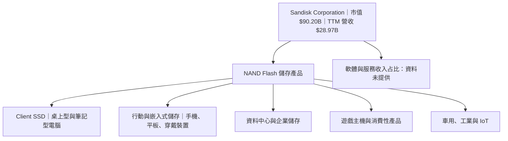
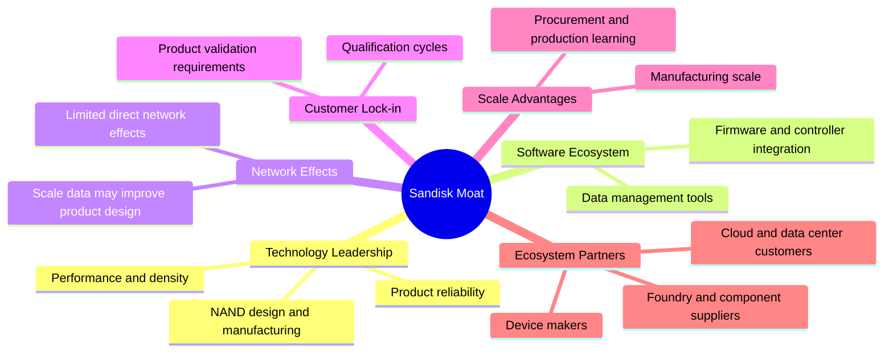
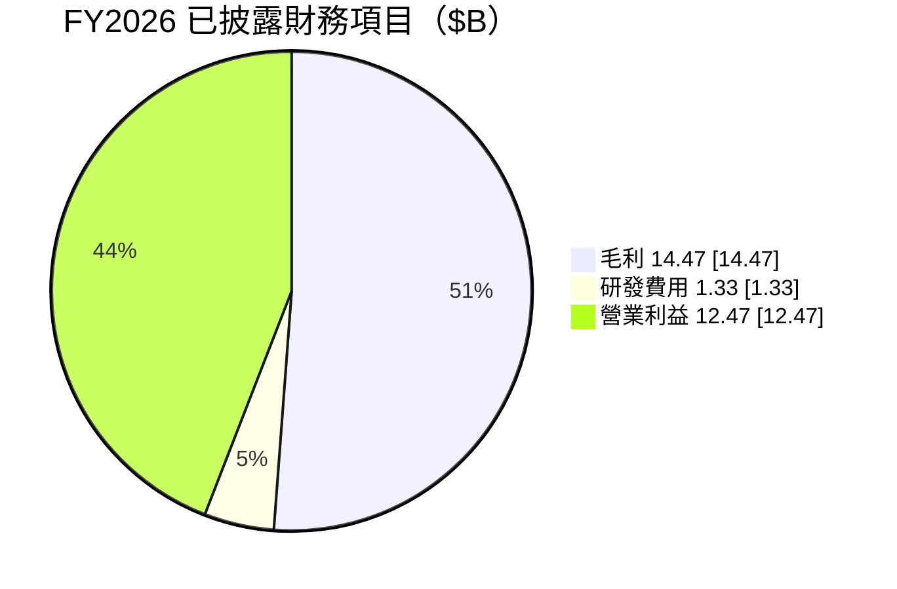
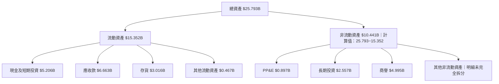
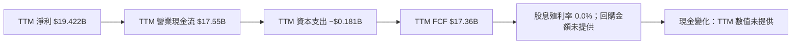
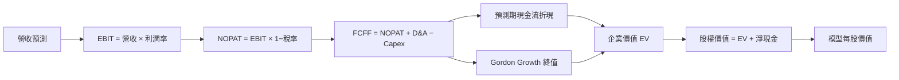
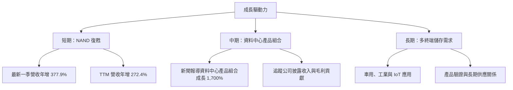
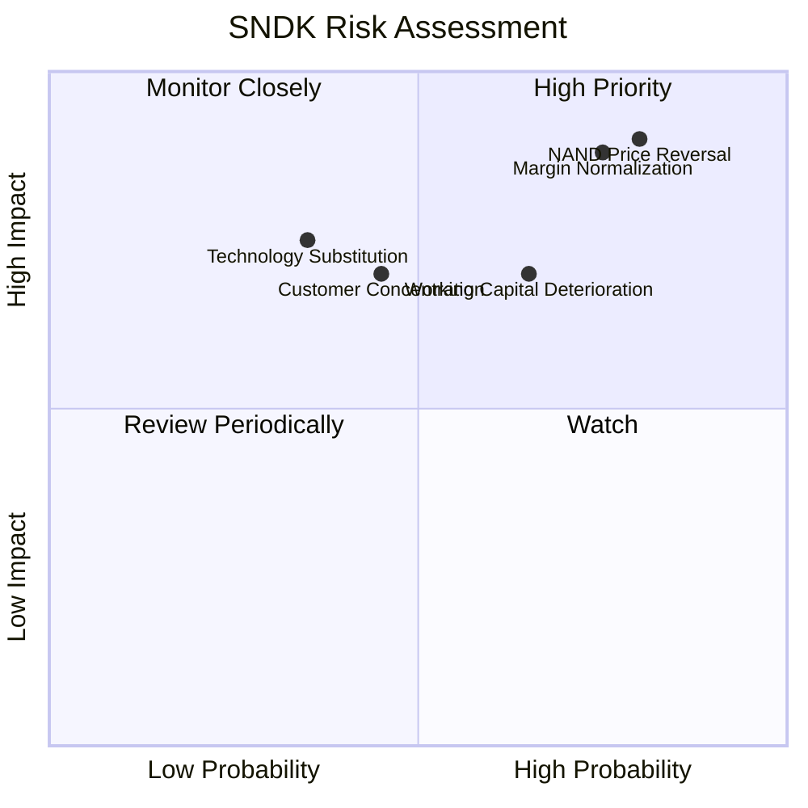
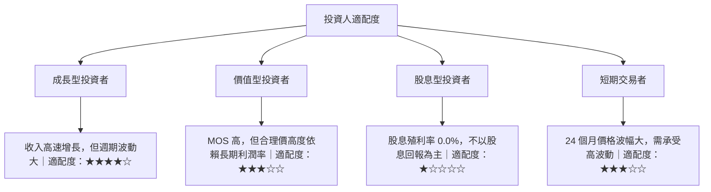

# SNDK 基本面深度分析報告
> **報告日期**：2026-11-21 ｜ **語言**：繁體中文 ｜ **數據來源**：SEC 申報資料 (XBRL)、Yahoo Finance、Finviz、StockAnalysis、Roic.ai ｜ **分析師**：CFA 級機構研究

## 目錄

| # | 章節 | 核心結論 |
|---|------|----------|
| 1 | 執行摘要 | 強烈買入；加權合理價值 $357.92；MOS +77.9% |
| 2 | 公司概覽與商業模式 | NAND 儲存需求受惠，但價格循環使護城河持續性受考驗 |
| 3 | 損益表深度分析 | TTM 營收 $28.97B、TTM 成長 272.4%；利潤率處於異常高位 |
| 4 | 資產負債表分析 | 淨現金 $5.14B；現金轉換週期延長至 226 天 |
| 5 | 現金流量深度分析 | TTM FCF $17.36B、FCF Yield 19.25%；歷史現金流高度週期性 |
| 6 | 獲利能力與資本效率 | ROIC 141.2% 對 WACC 9.96%，但須警惕景氣高峰值不可持續 |
| 7 | 相對估值分析 | 同業估值提供較低參照；公司自身歷史 P/S 位於第 43 百分位 |
| 8 | DCF 內在價值評估 | 基準 DCF $606.24；估值高度依賴長期利潤率及終值 |
| 9 | 成長催化劑 | AI 資料中心儲存需求是已知催化因素，TAM 數字未提供 |
| 10 | 風險矩陣 | NAND 價格反轉、利潤率回落及營運資金惡化為主要風險 |
| 11 | 投資建議 | 依 MOS 評級為強烈買入；以分批布局及季度監控管理週期風險 |

---

## 1. 執行摘要

### 1.0 一頁式投資儀表板（Portfolio Manager 30 秒速讀）

| 項目 | 內容 |
|------|------|
| **投資論點（3 句）** | ① TTM 營收 $28.97B、TTM 年增 272.4%，反映 NAND 需求與價格復甦，但增速位於高基期轉折段。② TTM FCF $17.36B、FCF Yield 19.25%，提供現金流支撐；惟 FCF/淨利約 89.4%，且現金轉換週期升至 226 天。③ ROIC 141.2% 高於 WACC 9.96%，目前創造價值；但 DCF 假設長期營業利潤率仍高達 61.2%，屬主要估值風險。 |
| **綜合評分** | **7.5/10**（引用 1.1 評分卡） |
| **財務健康** | 🟢 現金及短期投資 $5.14B、淨現金 $5.14B；但存貨天數 190 天及 CCC 226 天需監控。 |
| **ROIC vs WACC** | 141.2% vs 9.96%；按目前 TTM 數字創造股東價值，但 ROIC 可能受周期高峰利潤放大。 |
| **FCF 趨勢** | FY2023–FY2026 由負轉正，TTM FCF $17.36B；TTM FCF Yield **19.25%**。 |
| **估值** | Forward P/E 2.2072418x；EV/EBITDA 4.016x；FCF Yield 19.25%。市場資料倍數與拆股前後 EPS／股數口徑存在可比性疑慮。 |
| **DCF 內在價值（基準）** | **$606.24**；現價相對 DCF 折價 **86.9%**（折溢價基準為 DCF）。 |
| **安全邊際（MOS）** | **+77.9%**＝($357.92 − $79.24) ÷ $357.92；🟢 充足。基準為 8.8 加權合理價值。 |
| **預期報酬（基準情境 12M）** | N/A（情境估值未提供明確 12 個月期限；基準 DCF 情境相對現價 +665.1% 不等於 12 個月預測）。 |
| **關鍵風險（前二）** | NAND 供需反轉導致售價與毛利率快速收縮；高庫存、應收帳款及現金轉換週期延長。 |
| **評級 + 信心度** | 🟢 **強烈買入**（依 MOS +77.9%、ROIC 141.2% > WACC 9.96%；信心：中，DCF 對長期利潤率假設敏感）。 |

### 1.1 綜合評分卡（全報告唯一）

| 維度 | 評分（1–10） | 主要依據（引用數字與其來源章節） |
|------|--------------|----------------------------------|
| 成長性 | 9.0 | TTM 營收年增 272.4%、最新一季年增 377.9%；成長基期低且 NAND 周期性高（第 3 章）。 |
| 獲利能力 | 9.0 | TTM 營業利益率 72.5%、ROIC 141.2%，但 F-Score 為 5/8（第 3、6 章）。 |
| 財務健康 | 7.0 | 淨現金 $5.14B、流動比率 2.58；CCC 由 154 天增至 226 天（第 4 章）。 |
| 估值 | 8.0 | MOS +77.9%，但 DCF 終值現值佔 EV 58.2%，利潤率假設偏高（第 7、8 章）。 |
| 護城河 | 6.5 | NAND 產品與客戶供應關係具技術及規模優勢，但市場份額數據未提供且產品具商品化週期風險（第 2 章）。 |
| 管理層與資本配置 | 5.5 | 股權薪酬 FY2026 $232M、稀釋股數測試未通過；無股息，資本配置成效仍需跨週期驗證（第 3、5 章）。 |
| **綜合評分** | **7.5** | 六項算術平均：(9.0 + 9.0 + 7.0 + 8.0 + 6.5 + 5.5) ÷ 6 = **7.5**。 |

### 1.2 五大投資論點 + 三大核心風險

| 類型 | 項目 | 具體依據 | 信心度 |
|------|------|----------|--------|
| 🟢 **投資論點①** | NAND 復甦帶動收入及利潤回升 | TTM 營收 $28.97B、年增 272.4%；FY2026 營業利益 $12.47B，前一年為 $507M。 | 🟢 高 |
| 🟢 **投資論點②** | 現金流與現金部位提供緩衝 | TTM FCF $17.36B、現金及短期投資 $5.14B；相較 FY2025 FCF 為 -$120M，週期反彈已反映在現金流。 | 🟢 高 |
| 🟢 **投資論點③** | 資本回報高於資本成本 | ROIC 141.2%，WACC 9.96%；差距 131.24 個百分點。 | 🟡 中 |
| 🟢 **投資論點④** | AI 資料中心需求帶來產品組合機會 | 新聞報導 Sandisk 資料中心產品組合成長 1,700%；此為新聞所述業務訊息，非 SEC 分部營收占比，仍需公司披露驗證。 | 🟡 中 |
| 🟢 **投資論點⑤** | 加權估值相對現價有折價 | 加權合理價值 $357.92，較 2026-11-20 收盤價 $79.24 的上行空間 +351.7%。 | 🟡 中 |
| 🟡 **風險①** | NAND 價格與供需反轉 | FY2026 毛利率約 71.5%，而 FY2024 約 16.1%；歷史波幅顯示利潤率可急速回落。 | 🔴 高衝擊 |
| 🔴 **風險②** | 營運資金吸收現金 | DIO 190 天、DSO 83 天，CCC 226 天；一年內 CCC 增加 72 天。 | 🟡 中 |
| 🔴 **風險③** | DCF 假設過度外推高峰利潤 | 基準 DCF 預測期末營業利益率仍為 61.2%；若 NAND 價格回落，合理價值可能顯著下降。 | 🔴 高衝擊 |

### 1.3 快速統計卡片

| 指標 | 公司實際值（期間） | 同業中位數 | 狀態 |
|------|--------------------|------------|------|
| 營收成長（TTM） | **272.4%** | — | 🟢 |
| 營收成長（最新一季年增） | **377.9%** | 327.9%（WDC、MU、SKHY 中位數） | 🟢 |
| 毛利率（TTM） | **80.0%** | 77.4%（WDC、MU、SKHY 中位數） | 🟢 |
| 營業利益率（TTM） | **72.5%** | — | 🟢 |
| ROIC（TTM） | **141.2%** | — | 🟢 |
| Forward P/E | **2.2072418x** | 2.65x（WDC、MU 中位數） | 🟢* |
| FCF Yield（TTM） | **19.25%** | — | 🟢 |
| Piotroski F-Score | **5 / 8** | — | 🟡 |

\* 公司與同業 Forward P/E 受週期峰值盈利、拆股及資料口徑影響，低倍數不宜直接視為低風險便宜。

### 1.4 投資結論

```
╔══════════════════════════════════════════════════════════════════╗
║                    📊 投資結論摘要                               ║
╠══════════════════════════════════════════════════════════════════╣
║  評級：強烈買入（依規則 20，MOS +77.9%，ROIC > WACC）            ║
║  價格（2026-11-20 收盤）：$79.24                                 ║
║  DCF 內在價值（基準）：$606.24（現價折價 86.9%）                ║
║  安全邊際 MOS：+77.9%（＝(加權合理價值−現價)÷加權合理價值）     ║
║  加權合理價值（8.8）：$357.92                                    ║
║  DCF 情境價值：                                                  ║
║    悲觀情境：$257.06（+224.4%）                                 ║
║    基準情境：$606.24（+665.1%）                                 ║
║    樂觀情境：$1,355.27（+1610.3%）                              ║
║  綜合評分：7.5/10（引用 1.1）                                    ║
║  適合投資人：可承受記憶體週期波動、能分批布局的成長與價值型投資人║
╚══════════════════════════════════════════════════════════════════╝
```

---

## 2. 公司概覽與商業模式

### 2.1 業務結構與收入來源

公司概覽資料顯示 Sandisk 開發、製造及銷售 NAND flash 儲存裝置與解決方案，產品應用涵蓋個人電腦、遊戲主機、行動裝置、車用、工業及 IoT。最新 TTM 營收為 $28.97B，但財務資料未提供各產品線營收及占比，因此不虛構分部拆分。



### 2.2 市場份額

市場份額數據未提供，故不繪製市占圖或填入比例。相對規模方面，Sandisk TTM 營收 $28.97B，最新一季營收年增 377.9%；同業 MU 最新一季年增 379.3%、WDC 為 55.5%、SKHY 為 327.9%。產品組合與財務口徑未必完全一致，成長率只能作為相對景氣指標，不能直接推論市占變化。

### 2.3 競爭護城河分析



### 2.4 護城河強度

| 護城河項目 | 強度（強／中／弱） | 證據（引用數字或事實） | 會削弱它的情況 |
|------------|--------------------|------------------------|----------------|
| 技術與產品整合 | 中 | 公司提供 SSD、嵌入式及 NAND 儲存產品，TTM 營收 $28.97B；未提供專利、良率或產品性能比較。 | 競爭者技術追平、產品差異縮小。 |
| 軟體生態系統 | 弱至中 | 有韌體與產品整合的產業特性，但軟體與服務收入占比未提供。 | 軟體無法形成額外定價或客戶留存。 |
| 網路效應 | 弱 | 儲存產品不具典型雙邊網路效應；資料與客戶回饋可能改善產品，但程度未量化。 | 客戶能低成本轉換供應商。 |
| 客戶鎖定 | 中 | 車用、工業與企業產品可能涉及驗證周期；客戶集中度與續約率未提供。 | 規格標準化、競品通過驗證。 |
| 規模效應 | 中 | FY2026 營收 $20.25B，產業具製造與採購規模效益；但產能供需週期亦會造成過剩。 | 供給增加導致價格跌幅超過成本下降。 |
| 生態夥伴 | 中 | 客戶涵蓋 PC、行動、車用、工業與資料中心等應用；各渠道營收比重未提供。 | 主要客戶轉向替代供應商或自研方案。 |

1.1「護城河」評分為 **6.5/10**，反映產品、技術與供應規模有一定優勢，但缺少市占、分部毛利與客戶留存數據，且 NAND 商品化與周期性限制護城河評價。

---

## 3. 損益表深度分析

### 3.1 年度收入成長趨勢（近 4 年）

年度收入資料：FY2023 $6.09B、FY2024 $6.66B、FY2025 $7.36B、FY2026 $20.25B。FY2026 相較 FY2025 成長 175.3%，主要反映需求與價格週期反彈；三年 CAGR 約 49.3%，但此值由 FY2026 的急升主導，不宜直接當作未來常態。

```
╔══════════════════════════════════════════════════════════════════╗
║              Sandisk 年度收入趨勢（FY2023-FY2026）               ║
╠══════════════════════════════════════════════════════════════════╣
║  FY2023  $6.09B   ██████░░░░░░░░░░░░░░░░░░░  YoY：—            ║
║  FY2024  $6.66B   ███████░░░░░░░░░░░░░░░░░░  YoY：+9.5%         ║
║  FY2025  $7.36B   ████████░░░░░░░░░░░░░░░░░  YoY：+10.4%        ║
║  FY2026  $20.25B  █████████████████████████  YoY：+175.3%       ║
║                                                                  ║
║  FY2023–FY2026 收入 CAGR：約 +49.3%                              ║
╚══════════════════════════════════════════════════════════════════╝
```

### 3.2 季度收入趨勢分析

QoQ 依財務數據逐季計算；YoY 採已列示單季年增率。QoQ 反映短期連續加速，YoY 則受前一年低基期影響。

| 季度 | 營收（$B） | QoQ | YoY | 備註 |
|------|-----------:|----:|----:|------|
| 2025-12-31 | 3.025 | — | 61.25% | 單季營收年增，資料庫口徑。 |
| 2026-03-31 | 5.950 | +96.7% | 251.03% | 與前季相比近乎翻倍；反映週期上行及低基期。 |
| 2026-06-30 | 8.965 | +50.7% | 371.59% | 營收持續擴張；需觀察是否伴隨庫存累積。 |
| 2026-10-02 | 11.031 | +23.0% | 377.9% | 最新一季年增 377.9%，QoQ 仍增但增速低於前兩季。 |

### 3.3 利潤率演變分析

年度利潤率由各年度毛利、營業利益及淨利除以營收計算；TTM 欄位則採已核實的 TTM 指標。單季最新營業利益率以核實數字 79.6% 為準，不與其他資料來源的 72.7% 混用。

| 利潤率指標 | FY2023 | FY2024 | FY2025 | FY2026 | TTM／趨勢 | 評估 |
|------------|-------:|-------:|-------:|-------:|------------|------|
| **毛利率** | 7.1% | 16.1% | 30.1% | 71.5% | TTM 80.0%；大幅擴張 | 🟢 但高度周期化 |
| **營業利益率** | -21.3% | -6.7% | 6.9% | 61.6% | 核實 TTM 72.5%；最新季 79.6% | 🟢 高峰值風險 |
| **淨利率** | -35.2% | -10.1% | -22.3% | 56.4% | TTM 67.0% | 🟡 仍須檢視稅項及周期延續性 |

FY2026 毛利率及營業利益率躍升，與 NAND 供需改善、產品價格回升及產能利用率提高相符；固定成本在收入回升時形成營業槓桿。FY2023–FY2025 曾錄得營業虧損或低利潤，說明當前利潤率不應被視為結構性長期常態。DCF 基準模型將營業利益率由第一年 72.5% 緩降至第十年 61.2%，仍隱含長期高利潤，投資人應對此保持審慎。

### 3.4 費用結構分析

財務資料提供 FY2026 營收 $20.25B、毛利 $14.47B、營業利益 $12.47B、研發費用 $1.33B。由於未提供完整銷售、管理及其他費用明細，不能將所有費用項目以圓餅圖拆分，也不以差額反推費用。



以上項目並非互斥的費用分類：營業利益已包含毛利扣除營業費用的結果，故不應把此圖解讀為完整費用占比；它僅展示已披露的數值，不代表可加總的損益結構。

### 3.5 季度 EPS 趨勢與盈餘品質（Quality of Earnings）

| 季度 | EPS 實際值 | 預估／超預期 | EPS YoY | 說明 |
|------|-----------:|--------------|--------:|------|
| 2025-12-31 | $0.64 | N/A | N/A | EPS 預估值缺失，不能判定超預期或不及預期。 |
| 2026-03-31 | $2.88 | N/A | N/A | EPS 預估值缺失。 |
| 2026-06-30 | $5.50 | N/A | N/A | EPS 預估值缺失。 |
| 2026-10-02 | $6.58 | N/A | +6,909.6% | YoY 增幅受上一年低基期影響；估值驚喜幅度無法判定。 |

| 盈餘品質項目 | 數值／佔比 | 評估 |
|--------------|-----------|------|
| 股權薪酬 SBC / 營收 | 約 0.93%（四季 SBC 合計 $270M ÷ TTM 營收 $28.97B） | 🟢 占營收比例不高；但 SBC 仍代表股東稀釋成本。 |
| SBC / 營業現金流 | 約 1.54%（$270M ÷ $17.55B） | 🟢 比例有限。四季 SBC 為季度表列值加總。 |
| FCF / 淨利（現金轉換率） | 約 89.4%（$17.36B ÷ TTM 淨利 $19.422B） | 🟡 現金流接近但低於會計淨利，且 F-Score 的營業現金流低於淨利測試未通過。 |
| 一次性／非經常性損益 | N/A（未提供足以分拆的資料） | 無法判斷本期是否受到重大一次性項目影響。 |
| 有效稅率異常 | 12.2%（最新年有效稅率） | 🟡 稅率偏低會提高稅後盈利；缺少稅務調節明細，不能判定是否一次性。 |
| 資本化支出 vs 費用化 | TTM 資本支出 $181M；資本化政策明細 N/A | 支出金額較 TTM 營收低，但不能僅憑 Capex 推論費用是否被資本化或延後。 |

**盈餘品質結論**：TTM FCF $17.36B 支持盈利具有實際現金流，但 FCF/淨利約 89.4%、應計品質測試未通過，且營運資金占用擴大。SBC 比例目前有限，惟稀釋股數測試未通過。獲利含金量評為中等偏高，但不宜將周期高峰利潤直接資本化為永續盈利。

---

## 4. 資產負債表分析

### 4.1 資產結構分解

截至 2026-10-02，總資產 $25.793B，流動資產 $15.352B；下列未流動資產為總資產減流動資產的算術差額，未對其組成再作推算。



資產細項四捨五入後與總額可能有尾差；其他流動資產、PP&E、長期投資、商譽等明細來自截至 2026-10-02 的資產負債表資料。

### 4.2 流動性與營運資金分析

| 指標 | 最新 TTM | 一年前 TTM | 變化 | 解讀 |
|------|----------|------------|------|------|
| DSO 應收帳款天數 | 83 天 | 56 天 | +27 天 | 收款時間延長；可能與收入高速成長及期末應收款擴大有關，需觀察逾期及回款。 |
| DIO 存貨天數 | 190 天 | 124 天 | +66 天 | 庫存占用加重；若需求持續，可能是備貨，若價格反轉則有跌價與減產風險。 |
| DPO 應付帳款天數 | 46 天 | 26 天 | +20 天 | 付款期限延長可部分對沖營運資金壓力，但不能單獨證明議價力改善。 |
| CCC 現金轉換週期 | 226 天 | 154 天 | +72 天 | 營運資金週期顯著拉長；成長正在吸收更多資金，後續需以存貨與收款改善驗證。 |

流動比率為 2.58、速動比率為 1.994；反映短期流動性緩衝尚可，但比率未能消除庫存週期與應收帳款回收風險。

### 4.3 債務結構分析

核實數據顯示總債務 N/A、淨現金 $5.14B；其他財務資料則列示總債務 $201M、總現金 $5.21B、淨現金 $5.01B。為避免混用不一致口徑，以下以核實數據的淨現金及可確認項目為主；債務比率不自行反推。

```
╔══════════════════════════════════════════════════════════════════╗
║                   Sandisk 債務健康診斷                           ║
╠══════════════════════════════════════════════════════════════════╣
║  總債務：        N/A（核實欄位未提供；其他來源列 $201M）          ║
║  現金+短期投資： $5.14B（核實 TTM）                              ║
║  淨現金：        $5.14B（核實 TTM）                              ║
║  流動比率：      2.58（財務資料列示）                            ║
║  速動比率：      1.994（財務資料列示）                           ║
║  Debt/EBITDA：   N/A（債務口徑不一致，不以缺漏值計算）            ║
║  利息保障倍數： N/A（未提供可一致核對的利息費用及債務數據）      ║
╚══════════════════════════════════════════════════════════════════╝
```

### 4.4 股東權益趨勢

| 財政年度 | 股東權益（$B） | YoY | 解讀 |
|----------|---------------:|----:|------|
| FY2024 | 11.08 | — | 財務資料列示。 |
| FY2025 | 9.22 | -16.8% | 淨虧損 $1.64B 對權益造成壓力。 |
| FY2026 | 15.74 | +70.7% | 淨利 $11.43B 帶動權益回升。 |

```
╔══════════════════════════════════════════════════════════════════╗
║                 股東權益變化（年度）                             ║
╠══════════════════════════════════════════════════════════════════╣
║  FY2024  $11.08B  ██████████████░░░░░░░░░░                      ║
║  FY2025   $9.22B  ████████████░░░░░░░░░░░░                      ║
║  FY2026  $15.74B  ████████████████████░░░░                      ║
╚══════════════════════════════════════════════════════════════════╝
```

---

## 5. 現金流量深度分析

### 5.1 現金流量瀑布圖

TTM 營業現金流 $17.55B 減資本支出 $181M 得 TTM FCF $17.36B（依核實口徑）。股息殖利率 0%，資本回購及其他資本配置金額未提供，因此不畫出未披露金額。



### 5.2 FCF 轉換率趨勢

| 財政年度 | FCF（$B） | 淨利（$B） | FCF / 淨利 | 評估 |
|----------|----------:|-----------:|-----------:|------|
| FY2023 | -0.932 | -2.143 | 43.5%* | 虧損年度兩者皆負，單純比率不具直觀經濟意義。 |
| FY2024 | -0.475 | -0.672 | 70.7%* | 虧損收窄但現金流仍為負。 |
| FY2025 | -0.120 | -1.641 | 7.3%* | FCF 接近損益兩平，淨虧損較大。 |
| FY2026 | 11.49 | 11.43 | 100.5% | 年度 FCF 約等於淨利，現金轉換良好。 |
| TTM | 17.36 | 19.422 | 89.4% | 高景氣期盈利大部分轉為現金，但低於 100%。 |

\* 淨利與 FCF 同為負數時，正比率不代表盈利轉換品質良好。

### 5.3 自由現金流趨勢

| 期間 | FCF（$B） | FCF Yield | 趨勢 |
|------|----------:|----------:|------|
| FY2023 | -0.932 | N/A | 現金流為負。 |
| FY2024 | -0.475 | N/A | 虧損幅度收斂。 |
| FY2025 | -0.120 | N/A | 接近損益兩平。 |
| FY2026 | 11.49 | N/A | 需求與價格復甦帶動反彈。 |
| TTM | 17.36 | 19.25% | 最近四季現金流進一步上升。 |

```
╔══════════════════════════════════════════════════════════════════╗
║                 自由現金流趨勢（$B）                             ║
╠══════════════════════════════════════════════════════════════════╣
║  FY2023  -$0.932  ░░░░░░░░░░░░░░░░░░░░  負值                    ║
║  FY2024  -$0.475  ░░░░░░░░░░░░░░░░░░░░  負值                    ║
║  FY2025  -$0.120  ░░░░░░░░░░░░░░░░░░░░  接近損益兩平            ║
║  FY2026  $11.49   █████████████░░░░░░░  轉正                    ║
║  TTM     $17.36   ████████████████████  FCF Yield 19.25%         ║
╚══════════════════════════════════════════════════════════════════╝
```

### 5.4 資本配置評估

| 項目 | 已知資料 | 評估 |
|------|----------|------|
| 資本支出 | TTM $181M；FY2026 $177M | 相對高收入規模不高，但 NAND 產能投資及資產維護需求須結合產能外包／合作模式判斷。 |
| 股息 | 殖利率 0.0%；派息率 0.0% | 未以股息回饋股東。 |
| 回購 | 金額未提供 | 不判定是否有實質回購。 |
| 留存／現金 | TTM 現金及短期投資 $5.14B | 現金緩衝增加，但現金用途及資本配置目標未提供。 |
| 研發 | FY2026 $1.33B | 對產品與技術更新具有必要性；未提供研發資本回報資料。 |

---

## 6. 獲利能力與資本效率

### 6.1 ROE / ROA / ROIC 趨勢

| 指標 | FY2024 | FY2025 | FY2026／TTM | 評估 |
|------|-------:|-------:|-------------:|------|
| ROE | 歷史年度值 N/A | 歷史年度值 N/A | TTM 杜邦口徑 107.1% | 高回報主要出現在當前高盈利階段；不應忽略週期性。 |
| ROA | 歷史年度值 N/A | 歷史年度值 N/A | TTM 68.3%（財務資料列示）；品質測試 ROA 為正 | 資產利用效率高，但口徑來源存在差異。 |
| ROIC | N/A | N/A | TTM 141.2% | 遠高於 WACC 9.96%，當期創造價值。 |

行業平均值未提供，不作比較。ROE 的 107.1% 採品質指標區塊的杜邦口徑；其他財務欄位另列 ROE 141.2%，兩者口徑不一致，故不混為同一數字。

### 6.2 ROIC vs WACC 分析（核心價值創造判斷）

```
╔══════════════════════════════════════════════════════════════════╗
║                ROIC vs WACC 深度分析                            ║
╠══════════════════════════════════════════════════════════════════╣
║  WACC（採用核實資本成本數據）：9.96%                            ║
║  ├── 無風險利率（10Y 美債）：4.91%                              ║
║  ├── 市場風險溢酬 ERP：5.00%                                    ║
║  ├── 原始 Beta：N/A；採用調整後 Beta：1.00（假設值）            ║
║  ├── 股權成本 Ke：4.91% + 1.00 × 5.00% = 9.91%                ║
║  ├── 稅前債務成本：36.32%；有效稅率：12.2%                     ║
║  ├── 權重：股權 99.8%；債務 0.2%                                ║
║  └── WACC：9.96%（採用核實值）                                  ║
║                                                                  ║
║  ROIC（TTM）：141.2%                                            ║
║  ROIC − WACC = 141.2% − 9.96% = +131.24 個百分點               ║
║  ROIC / WACC 約 14.18 倍                                         ║
║                                                                  ║
║  ROIC 141.2%  ▓▓▓▓▓▓▓▓▓▓▓▓▓▓▓▓▓▓▓▓▓▓▓▓  🟢                    ║
║  WACC   9.96%  ▓▓░░░░░░░░░░░░░░░░░░░░░░  ──                    ║
║                                                                  ║
║  結論：按 TTM 數字公司創造經濟價值；但 NAND 週期高峰盈利可能使   ║
║  ROIC 暫時偏高，必須用跨週期 ROIC 驗證其持續性。                ║
╚══════════════════════════════════════════════════════════════════╝
```

WACC 在第 6.2 節及 DCF 第 8 章均採 **9.96%**。該值為資本成本資料列示的核實值；由於未提供完整計息債務、利息費用明細與原始 Beta，不能以外部假設自行重建後替換。

### 6.3 杜邦三因素分解

| 因素 | 數值（TTM） | 解讀 |
|------|-------------|------|
| 淨利率 | 67.0% | 高盈利是 ROE 的主要來源，與 NAND 週期上行相符。 |
| 資產週轉率 | 1.12 | 資產每年周轉約 1.12 次。 |
| 權益乘數 | 1.42 | 槓桿並非 ROE 高企的主要原因。 |
| **ROE** | **107.1%** | 67.0% × 1.12 × 1.42 = 約 107.1%；採核實杜邦列示值。 |

### 6.4 財務體質：Piotroski F-Score

Piotroski F-Score 為 **5 / 8**。一項測試因缺少輸入而未判定，所以可判定測試數為 8，不以九項全數作分母。

| 測試 | 結果 | 解讀 |
|------|------|------|
| ROA > 0 | ✅ 通過 | TTM 盈利為正。 |
| 營業現金流 > 0 | ✅ 通過 | TTM 營業現金流 $17.55B。 |
| ROA 高於一年前 | ✅ 通過 | 反映週期反彈後資產盈利改善。 |
| 營業現金流 > 淨利（應計品質） | ❌ 未通過 | TTM OCF $17.55B 低於 TTM 淨利 $19.422B，現金轉換未完全跟上盈利。 |
| 長期負債 ÷ 總資產低於一年前 | — 無法判定 | 缺少一致的長期債務輸入。 |
| 流動比率高於一年前 | ❌ 未通過 | 流動性指標同比未改善。 |
| 稀釋股數未增加 | ❌ 未通過 | 稀釋股數測試未通過，股東持分可能受稀釋。 |
| 毛利率高於一年前 | ✅ 通過 | 週期復甦帶動毛利率提高。 |
| 資產週轉率高於一年前 | ✅ 通過 | 營收提升提高資產利用效率。 |

---

## 7. 相對估值分析

### 7.1 同業估值比較表格

同業倍數使用 Yahoo Finance 提供的 Peer multiples；公司倍數採市場資料列示值。Sandisk 的 P/E 數據與拆股後 EPS／流通股數口徑可能存在不一致，故僅作參考，不以單一 P/E 判斷價值。

| 估值指標 | **SNDK** | **WDC** | **MU** | **SKHY** | SNDK 評估 |
|----------|---------:|-------:|------:|-------:|-----------|
| **Trailing P/E** | 0.085785426x | 9.2x | 8.0x | 5.7x | 🟡 公司倍數與盈利及拆股資料存在明顯口徑疑慮，不宜機械解讀。 |
| **Forward P/E** | 2.2072418x | 6.5x | 2.8x | 2.5x | 🟢 低於同業中位數 2.65x，但周期峰值盈利可能壓低倍數。 |
| **P/S Ratio** | 3.1134608x | 6.7x | 5.1x | N/A | 🟢 低於 WDC、MU 中位數 5.9x；SKHY 因混合幣別不納入。 |
| **EV/EBITDA** | 4.016x | 15.4x | 5.8x | N/A | 🟢 低於 WDC、MU 中位數 10.6x；高峰 EBITDA 可能造成倍數失真。 |
| **最新一季營收年增** | 377.9% | 55.5% | 379.3% | 327.9% | 🟢 成長處於同業高位，但與 MU 接近。 |
| **毛利率（TTM）** | 80.0% | 52.6% | 80.7% | 77.4% | 🟢 近 MU，顯著高於 WDC。 |

### 7.2 歷史估值區間分析

歷史估值數據僅提供 P/S，不提供 P/E 歷史區間；因此以 P/S 呈現，不將其改稱為 P/E。

```
╔══════════════════════════════════════════════════════════════════╗
║              SNDK 歷史 P/S 區間（TTM）                           ║
╠══════════════════════════════════════════════════════════════════╣
║  5 年低位 0.1x ───── 歷史中位數 0.6x ───── 高位 1.7x             ║
║                    ↑                                             ║
║              現值 0.4x；歷史百分位 43%                            ║
║  解讀：目前低於歷史中位數，但估值區間受週期盈利與價格變動影響。  ║
╚══════════════════════════════════════════════════════════════════╝
```

### 7.3 情境價值（Bear / Base / Bull，照抄 DCF MODEL 的 Scenarios）

| 情境 | 第 1 年營收成長 | 期末營業利潤率 | WACC | 每股價值 | 相對現價 | 機率 | 會發生的條件 |
|------|----------------|----------------|------|----------|----------|------|--------------|
| 🔴 悲觀 | 15.0% | 52.0% | 10.96% | $257.06 | +224.4% | 25% | NAND 需求增速下降、價格競爭加劇，利潤率向較低水平回歸。 |
| 🟡 基準 | 30.0% | 61.2% | 9.96% | $606.24 | +665.1% | 50% | 需求維持高成長，但十年期營業利潤率逐步下滑至 61.2%。 |
| 🟢 樂觀 | 45.0% | 67.3% | 8.96% | $1,355.27 | +1610.3% | 25% | AI 儲存需求與產品組合持續改善，成長、利潤及折現率均優於基準。 |

情境表的價值是 DCF 模型輸出；情境模型所需逐年營收及現金流中間值未提供，故不自行重建或虛構每一情境的 FY+10 現金流。

### 7.4 相對估值隱含價格區間

```
╔══════════════════════════════════════════════════════════════════╗
║             相對估值隱含價格與現價位置                           ║
╠══════════════════════════════════════════════════════════════════╣
║  $79.24 現價 ── $150.15 同業 P/S ── $201.93 同業 EV/EBITDA       ║
║       │               +89.5%                 +154.8%             ║
║                                                                  ║
║  同業 EV/EBITDA：$201.93；WDC、MU 中位數 10.6x × TTM EBITDA，    ║
║  再加淨現金。                                                     ║
║  同業 P/S：$150.15；WDC、MU 中位數 5.9x × TTM 營收。            ║
║  分析師共識：$248.16；24 位分析師平均目標價。                    ║
╚══════════════════════════════════════════════════════════════════╝
```

---

## 8. DCF 內在價值評估（Discounted Cash Flow）

### 8.0 估值推理鏈（Thinking Logic）

**Step 1 — 價值由哪些變數決定？**  
模型以 NAND 儲存主業為核心；資料未提供企業級、消費級及嵌入式營收占比，因此不能可靠地拆成不同業務的估值。價值主要取決於未來營收成長及營業利益率能否在 NAND 周期中維持。當前 TTM 營收 $28.97B、TTM 營業利益率 72.5%；第二成長曲線可能來自 AI 資料中心產品，但可量化營收占比未提供，故不額外加入選擇權價值。此模型中，長期營業利益率及終值假設是主要估值驅動因子。

**Step 2 — 模型選擇**

| 決策點 | 本報告採用 | 理由（含數字） | 曾考慮但否決 | 否決理由 |
|--------|-----------|----------------|--------------|----------|
| 現金流定義 | FCFF | 以 WACC 9.96% 折現，先得 EV，再加淨現金。 | FCFE | 資本結構資料及債務口徑不完整。 |
| 預測期 N | 10 年 | DCF 模型固定為 10 年，營收成長由 30.0% 線性降至 3.0%。 | 5 年 | NAND 週期與產品投資具跨年特性；但十年能見度仍有限。 |
| 終值方法 | Gordon Growth | 模型列示永續成長率 3.0%。 | 退出倍數主估值 | 模型未提供退出倍數終值計算，不能自行補算。 |
| EBIT 基礎 | GAAP EBIT | 模型使用 GAAP 營業利益率。 | 非 GAAP EBIT | 未提供足以一致調整的非 GAAP EBIT。 |

**Step 3 — 關鍵假設推導鏈**

- **營收成長**：錨點為 TTM 成長 272.4%、最新一季年增 377.9%；此增速受週期反彈與低基期放大，因此不直接外推。模型將 FY+1 成長限制在 0%–30% 範圍上緣，之後每年減少 3 個百分點至 FY+10 的 3.0%。**採用 FY+1 30.0%、FY+10 3.0%**。曾考慮把 TTM 272.4% 直接外推，因極可能高估正常化需求而否決。
- **營業利益率**：錨點為核實 TTM 72.5%；FY2026 年營業利益率約 61.6%，顯示報表口徑下歷史及當前數字差異顯著。模型以 72.5% 為 FY+1，逐步降至 FY+10 的 61.2%，並稱該終點參照近三個財政年度中位數。**採用 72.5% → 61.2%**。曾考慮回到 FY2025 約 6.9%，但單一年低谷未能代表週期正常化；另一方面，持續 61.2% 亦可能偏樂觀。
- **永續成長率 g**：錨點為長期名目經濟增長假設；模型採用 **3.0%**，低於 WACC 9.96%，令 Gordon Growth 公式有效。曾考慮更高成長率，因成熟 NAND 業務長期難以持續高於經濟成長而否決。
- **預測期 N**：模型提供 **10 年**。採用理由是以較長期間讓成長率逐步下降至 3.0%；曾考慮更短期間，但模型已固定，不另建模型，且 10 年預測的不確定性高。
- **Capex／營收**：TTM Capex $181M、營收 $28.97B；模型採 FY+1 至 FY+10 約 **0.6%**，與 TTM 水準相近。曾考慮更高資本支出率，因資料未提供可支持的資本計畫而不另改模型；此低比率可能低估週期高峰時擴產需要。
- **D&A／營收**：模型採 **0.5%**，錨點為 TTM D&A／營收；資料未提供分項折舊表，採模型值，不另調整。
- **ΔWC／營收增額**：模型不建模營運資金變動，不能視為營運資金需求在經濟上等於零。最新 CCC 226 天、較一年前增加 72 天，代表不建模 ΔWC 可能高估未來 FCF。
- **EBIT 與 SBC**：採 GAAP EBIT。股權薪酬 FY2026 為 $232M；模型採 **組合 (A)**：GAAP EBIT 已含 SBC 費用，FCFF 不再扣 SBC，年稀釋率設為 0%，避免重複扣除。
- **終值方法**：採模型提供的 Gordon Growth，因模型直接輸出終值及現值；未提供可複算的退出倍數終值，故不補造。
- **WACC**：依資本成本資料採 **9.96%**，不另自建替代折現率。其組成與假設在 8.2 列示。

**Step 4 — 最脆弱的一環**  
最脆弱的是長期營業利益率仍維持在 61.2%；若 NAND 供給回升導致利潤率向歷史低谷收斂，基準 DCF 可能大幅高估，敏感度矩陣顯示在相同 g 下 WACC 上升 1 個百分點，價值可由 $606.24 降至 $523.16。

**Step 5 — 計算路徑圖**



### 8.1 模型假設總表（Model Inputs）

| 假設項目 | 採用值 | 依據／來源 | 敏感度 |
|----------|--------|-------------|--------|
| 預測期長度 N | 10 年 | DCF 模型；成長率由 30.0% 逐步淡化至 3.0%。 | 🟡 中 |
| 營收成長 | FY+1 30.0% → FY+10 3.0% | TTM 成長 272.4%，但模型限制至 30.0% 並線性淡化。 | 🔴 高 |
| 營業利益率 | FY+1 72.5% → FY+10 61.2% | 以 TTM 72.5% 為起點，終點據稱為近三年中位數。 | 🔴 高 |
| 有效稅率 | 12.2% | 最新年有效稅率。 | 🟢 低 |
| Capex／營收 | 約 0.6% | 模型值；TTM Capex $181M／營收 $28.97B。 | 🟡 中 |
| D&A／營收 | 0.5% | DCF 模型採用的 TTM 比率。 | 🟢 低 |
| 營運資金變動 | 未建模 | 模型明確未納入；CCC 由 154 天增至 226 天，可能造成偏高估值。 | 🟡 中 |
| EBIT 基礎 | GAAP EBIT | DCF 模型列明使用 GAAP EBIT。 | 🟡 中 |
| SBC 處理 | 組合 (A)：不再扣 SBC | GAAP EBIT 已含 SBC；股數不再稀釋。 | 🟡 中 |
| 年稀釋率 | 0% | 組合 (A) 固定股數處理；為模型假設，不代表未來沒有稀釋。 | 🟡 中 |
| 永續成長率 g | 3.0% | DCF 模型值；低於 WACC 9.96%。 | 🔴 高 |
| 終值方法 | Gordon Growth | DCF 模型列示 Gordon Growth；退出倍數終值資料未提供。 | 🔴 高 |
| WACC | 9.96% | 資本成本區塊列示值。 | 🔴 高 |

**FCFF 定義**：本章採 FCFF = NOPAT + D&A − Capex；模型不含 ΔWC 列。SBC 處理採組合 (A)：GAAP EBIT 已含 SBC，FCFF 不再扣 SBC，且股數不另加稀釋，故 SBC 影響在模型中計入一次。

**四捨五入**：模型金額以 $B 表示並保留兩位小數；折現因子保留三位小數；比例保留一位小數。模型原始值因四捨五入可能有 $0.01B 尾差。

### 8.2 折現率推導（WACC）

```
╔══════════════════════════════════════════════════════════════════╗
║                    WACC 推導（折現率）                           ║
╠══════════════════════════════════════════════════════════════════╣
║  股權成本 Ke（CAPM）：                                           ║
║  ├── 無風險利率 Rf（10Y 美債）：4.91%                           ║
║  ├── 市場風險溢酬 ERP：5.00%（假設值，資本成本模型輸入）        ║
║  ├── 原始 Beta（Yahoo）：N/A                                    ║
║  ├── 採用調整後 Beta：1.00（假設值；原始 Beta 缺漏）            ║
║  └── Ke = 4.91% + 1.00 × 5.00% = 9.91%                         ║
║                                                                  ║
║  債務成本：                                                      ║
║  ├── 稅前債務成本：36.32%（資本成本模型輸入）                   ║
║  ├── 有效稅率：12.2%                                            ║
║  └── 稅後 Kd = 36.32% × (1−12.2%) = 約 31.89%                 ║
║                                                                  ║
║  資本結構權重（模型輸入）：股權 99.8%；債務 0.2%                ║
║  WACC 採用值：9.96%（資本成本資料列示，不另行替換）             ║
╚══════════════════════════════════════════════════════════════════╝
```

**逐步演算與資料限制**：

1. **Ke（CAPM）** = Rf + β × ERP = 4.91% + 1.00 × 5.00% = **9.91%**。
2. **稅前 Kd**：資本成本資料列示 **36.32%**；計息負債的平均餘額與利息費用明細未提供，不能由債務總額 N/A 反推。
3. **稅後 Kd** = 36.32% × (1 − 12.2%) = **約 31.89%**。
4. **資本權重**：股權 **99.8%**、債務 **0.2%**，合計 **100.0%**；市值／債務的底層明細未完整提供，採用核實權重。
5. **WACC**：以上述輸入為基礎，採用資本成本資料列示的 **9.96%**。未提供精確權重未四捨五入前數值，因此無法逐位精確重現 9.96%；本報告遵守模型指定值，不另算替代 WACC。

### 8.3 逐年自由現金流預測（基準情境）

單位：$B；表內數字照 DCF 模型列示。FCFF 不含營運資金變動；由於 ΔWC 未建模，讀者不應把表中 FCFF 理解為已反映營運資金需求的完整現金流預測。

| 年度 | FY+1 | FY+2 | FY+3 | FY+4 | FY+5 | FY+6 | FY+7 | FY+8 | FY+9 | FY+10 |
|------|------:|------:|------:|------:|------:|------:|------:|------:|------:|-------:|
| 營收 | 37.66 | 47.83 | 59.31 | 71.77 | 84.68 | 97.39 | 109.07 | 118.89 | 126.02 | 129.80 |
| 營收 YoY | 30.0% | 27.0% | 24.0% | 21.0% | 18.0% | 15.0% | 12.0% | 9.0% | 6.0% | 3.0% |
| 營業利潤率 | 72.5% | 71.2% | 70.0% | 68.7% | 67.5% | 66.2% | 64.9% | 63.7% | 62.4% | 61.2% |
| EBIT（GAAP） | 27.29 | 34.06 | 41.49 | 49.31 | 57.12 | 64.47 | 70.84 | 75.72 | 78.69 | 79.42 |
| − 稅 | (3.32) | (4.14) | (5.05) | (6.00) | (6.95) | (7.84) | (8.62) | (9.21) | (9.58) | (9.66) |
| = NOPAT | 23.97 | 29.92 | 36.44 | 43.31 | 50.17 | 56.62 | 62.22 | 66.51 | 69.11 | 69.76 |
| + D&A | 0.20 | 0.26 | 0.32 | 0.39 | 0.46 | 0.52 | 0.59 | 0.64 | 0.68 | 0.70 |
| − Capex | (0.24) | (0.30) | (0.37) | (0.44) | (0.52) | (0.59) | (0.66) | (0.71) | (0.75) | (0.77) |
| **= FCFF** | **23.94** | **29.88** | **36.40** | **43.25** | **50.11** | **56.56** | **62.15** | **66.44** | **69.04** | **69.69** |
| 折現因子 @9.96% | 0.909 | 0.827 | 0.752 | 0.684 | 0.622 | 0.566 | 0.514 | 0.468 | 0.425 | 0.387 |
| **FCFF 現值 PV** | **21.77** | **24.71** | **27.37** | **29.58** | **31.17** | **31.99** | **31.97** | **31.08** | **29.37** | **26.96** |

**預測期 FCF 現值合計**：  
$21.77 + $24.71 + $27.37 + $29.58 + $31.17 + $31.99 + $31.97 + $31.08 + $29.37 + $26.96 = **$285.97B**；DCF 模型列示合計 **$285.98B**，差額 $0.01B 為表格四捨五入尾差。

**逐步演算（FY+1）**：

1. **營收** = TTM 營收 $28.97B × (1 + 30.0%) = **$37.66B**。
2. **EBIT** = $37.66B × 72.5% = **$27.29B**。
3. **稅** = $27.29B × 12.2% = **$3.32B**。
4. **NOPAT** = $27.29B − $3.32B = **$23.97B**。
5. **D&A** = $37.66B × 約 0.5% = **$0.20B**。
6. **Capex** = $37.66B × 約 0.6% = **$0.24B**。
7. **ΔWC**：模型未建模，故無此現金流項；並非判斷營運資金需求為零。
8. **FCFF** = $23.97B + $0.20B − $0.24B = **$23.94B**（模型列示，受未四捨五入底層數字影響）。
9. **折現因子及 PV** = 1 ÷ (1 + 9.96%)¹ = **0.909**；$23.94B × 0.909 = **$21.77B**。

**合理性自檢**：
- 歷史 FCF 由 FY2025 -$0.12B 升至 FY2026 $11.49B，TTM $17.36B；歷史 CAGR 因跨越負值而不具經濟解釋性，模型未提供可比的 FCF CAGR。
- FY+10 FCFF 利潤率 = $69.69B ÷ $129.80B = 約 **53.7%**；目前 TTM FCF 利潤率 = $17.36B ÷ $28.97B = 約 **59.9%**。同業最佳 FCFF 利潤率未提供，不能作同業優劣判斷。
- 預測期間各年 FCFF 均為正；但排除 ΔWC 可能高估現金流，尤其 CCC 已升至 226 天。

```
╔══════════════════════════════════════════════════════════════════╗
║            自由現金流：歷史實際 vs 模型預測                      ║
╠══════════════════════════════════════════════════════════════════╣
║  FY2024(實)  -$0.475B  ░░░░░░░░░░░░░░░░░░░░  負值              ║
║  FY2025(實)  -$0.120B  ░░░░░░░░░░░░░░░░░░░░  負值              ║
║  FY2026(實)  $11.49B   ██████████░░░░░░░░░░  轉正              ║
║  FY+1 (預)   $23.94B   █████████████████░░░  模型值            ║
║  FY+10(預)   $69.69B   ████████████████████  模型值            ║
╠══════════════════════════════════════════════════════════════════╣
║  模型由高成長與高利潤率推導；與 FY2025 前的負 FCF 歷史差距大，  ║
║  預測合理性依賴高景氣利潤率能維持。                              ║
╚══════════════════════════════════════════════════════════════════╝
```

### 8.4 終值計算（Terminal Value）

**適用性檢查**：WACC **9.96%** vs g **3.0%** → WACC > g？✅

| 方法 | 計算式 | 終值 TV | TV 現值 | 佔總 EV 比重 |
|------|--------|---------|---------|--------------|
| Gordon Growth | $69.69B × (1 + 3.0%) ÷ (9.96% − 3.0%) | $1,031.16B | $398.97B | 58.2% |
| 退出倍數法 | N/A（DCF 模型未提供終值倍數或退出倍數終值） | N/A | N/A | N/A |

**逐步演算**：

1. **FY+N FCFF** = FY+10 FCFF **$69.69B**。
2. **分子** = $69.69B × (1 + 3.0%) = **約 $71.78B**（模型底層未四捨五入數字得出終值）。
3. **分母** = 9.96% − 3.0% = **6.96%**；DCF 模型列示 TV = $69.69B × (1 + 3.0%) ÷ (9.96% − 3.0%) = **$1,031.16B**。
4. **PV(TV)** = $1,031.16B × 折現因子 0.387 = **$398.97B**（以模型未四捨五入折現因子計算）。
5. **終值佔比** = $398.97B ÷ $684.96B = **58.2%**。

終值現值未超過 EV 的 75% 警示門檻，但仍占 58.2%；因此估值仍高度依賴第十年以後的現金流與永續假設。

### 8.5 企業價值 → 每股內在價值（Bridge）

```
╔══════════════════════════════════════════════════════════════════╗
║              企業價值 → 每股內在價值 橋接表                      ║
╠══════════════════════════════════════════════════════════════════╣
║  預測期 FCF 現值合計              +$285.98B                       ║
║  終值現值 PV(TV)                  +$398.97B                       ║
║  = 企業價值 EV                     $684.96B                       ║
║  + 淨現金                         +$5.14B                         ║
║  = 股權價值                         $690.09B                       ║
║  每股內在價值（模型換算）            $606.24                       ║
║  當前股價（2026-11-20 收盤）         $79.24                        ║
║  折溢價（現價÷DCF價值−1）           -86.9%（折價）                ║
╚══════════════════════════════════════════════════════════════════╝
```

**逐步演算（橋接）**：

1. **EV** = 預測期 PV $285.98B + PV(TV) $398.97B = **$684.95B**；模型列示 EV **$684.96B**，差 $0.01B 為四捨五入尾差。
2. **股權價值** = EV $684.96B + 淨現金 $5.14B = **$690.10B**；模型列示 **$690.09B**，差 $0.01B 為底層未四捨五入數值造成的尾差。
3. **每股內在價值**：模型指定公式為 equity value × 價格 ÷ 市值；$690.09B × $79.24 ÷ $90.20B = **$606.24**（按模型指定數值及四捨五入）。
4. **折溢價** = $79.24 ÷ $606.24 − 1 = **-86.9%**，即現價較 DCF 基準價折價 86.9%。
5. **本節不計算 MOS**：MOS 僅以 8.8 加權合理價值作分母，全報告只計算一次。

**股數及資產負債表口徑**：DCF 模型以「股權價值 × 股價 ÷ 市值」換算每股價值，並未直接採用獨立的稀釋股數除法。模型加回淨現金 $5.14B；總債務核實欄位為 N/A。此處不以其他來源的 $201M 債務數據替換模型。

### 8.6 敏感性分析（WACC × 永續成長率）

下表逐格照 DCF 敏感度矩陣列示，括號為依現價 $79.24 計算的上行空間；基準格使用粗體。

| g／WACC | 7.96% | 8.96% | **9.96%（基準）** | 10.96% | 11.96% |
|-----------|------:|------:|------------------:|-------:|-------:|
| **2.0%** | $770.72（+872.9%） | $649.52（+719.8%） | $559.24（+605.9%） | $489.50（+517.7%） | $434.10（+447.9%） |
| **2.5%** | $817.91（+932.5%） | $680.96（+759.5%） | $581.16（+633.4%） | $505.34（+537.8%） | $445.85（+462.9%） |
| **3.0%** | $874.62（+1003.8%） | $717.67（+805.7%） | **$606.24（+665.1%）** | $523.16（+560.3%） | $458.91（+479.4%） |
| **3.5%** | $944.04（+1091.7%） | $761.11（+860.3%） | $635.20（+701.7%） | $543.37（+585.8%） | $473.52（+497.6%） |
| **4.0%** | $1,030.99（+1201.6%） | $813.30（+926.6%） | $669.01（+744.4%） | $566.48（+614.9%） | $489.96（+518.3%） |

**逐步演算限制**：DCF 模型只提供敏感度矩陣結果，未提供各 WACC 假設下的逐年折現現值與終值未四捨五入中間值；依規則不另建模型，故不以外部重算覆蓋矩陣。基準格依模型为 **$606.24**。

**三情境 DCF**：情境價值及假設見第 7.3 節，完整逐年情境現金流未提供，不自行補造中間推導。模型列示機率加權值 **$706.20**，僅作參考，8.8 評價仍依基準 DCF $606.24。

**敏感度結論**：
- **g 變動**：在 WACC 9.96% 下，g 由 2.0% 升至 3.0%，每股價值由 $559.24 升至 $606.24，即 **+$47.00、約 +8.4%**。
- **WACC 變動**：在 g 3.0% 下，WACC 由 9.96% 升至 10.96%，價值由 $606.24 降至 $523.16，即 **-$83.08、約 -13.7%**。
- **期末營業利益率每 +1pp**：模型未提供該單一變數敏感度，N/A；不能由多變數情境反推單一彈性。
- 在已提供的矩陣中，WACC 每 1pp 變動對價值的影響大於 g 由 2% 至 3% 的影響；長期營業利益率仍是 8.0 Step 1 指出的核心營運假設，但缺少單變數矩陣，無法量化比較。

### 8.7 反推 DCF（Reverse DCF：市場在預期什麼）

| 求解的變數（一次一個） | 其餘變數設定 | 市場隱含值（令 DCF = 現價） | 公司歷史實際 | 判斷 |
|------------------------|--------------|------------------------------|--------------|------|
| 年 1 營收成長率 | 其餘固定基準值 | 在 -10% 至 100% 範圍內無解 | TTM 成長 272.4%；最新一季年增 377.9% | 🟡 依指定範圍無法由單一成長率解釋現價。 |
| 固定營業利潤率 | 其餘固定基準值 | 7.9% | TTM 營業利益率 72.5% | 市場價格隱含的持續盈利能力遠低於模型基準。 |
| 永續成長率 g | 未提供求解結果 | 未計算 | — | N/A |
| 預測期 N | 未提供求解結果 | 未計算 | — | N/A |

逐年營收成長率的反推在 -10% 至 100% 內無解，表示在模型其餘假設固定時，不能用該單一變數把基準 DCF 拉至現價；不能據此斷言市場一定錯，因模型其他變數也可能失效。可核對的反推結果是固定營業利潤率 7.9%，遠低於模型基準由 72.5% 降至 61.2%，顯示現價並未要求公司永久維持高景氣營業利益率。

### 8.8 估值三角驗證與安全邊際

| 估值方法 | 隱含每股價值 | 上行空間（÷現價） | 權重 | 說明 |
|----------|--------------:|-------------------:|------:|------|
| DCF（基準） | $606.24 | +665.1% | 40% | 十年 FCFF、WACC 9.96%、g 3.0%。 |
| 同業 EV/EBITDA | $201.93 | +154.8% | 30% | WDC、MU 中位數 10.6x × TTM EBITDA，再加淨現金。 |
| 同業 P/S | $150.15 | +89.5% | 20% | WDC、MU 中位數 5.9x × TTM 營收。 |
| 分析師共識目標價 | $248.16 | +213.2% | 10% | 24 位分析師平均目標價。 |
| **加權合理價值** | **$357.92** | **+351.7%** | **100%** | 公司類型為週期性公司；固定權重由模型指定。 |

**逐步演算（權重外顯）**：

$606.24 × 40% + $201.93 × 30% + $150.15 × 20% + $248.16 × 10%  
= $242.496 + $60.579 + $30.030 + $24.816  
= **$357.921，四捨五入為 $357.92**。

以上權重對應週期性公司。四個方法均已計算，未有方法因缺值而剔除；相對估值使用同業中位數倍數，不使用 SNDK 自身目前倍數。

```
╔══════════════════════════════════════════════════════════════════╗
║                  估值區間與安全邊際                              ║
╠══════════════════════════════════════════════════════════════════╣
║  $79.24 ───── $257.06 ───── [$357.92] ───── $606.24 ─── $1,355.27║
║  現價          悲觀DCF       加權合理值       基準DCF      樂觀DCF║
║                                                                  ║
║  安全邊際 MOS = ($357.92 − $79.24) ÷ $357.92 = +77.9%           ║
║  MOS 評估：🟢 充足                                               ║
║  上行空間 = ($357.92 − $79.24) ÷ $79.24 = +351.7%               ║
║                                                                  ║
║  買入區間（MOS ≥ 10%）：$79.24 – $322.13                        ║
║  合理持有區間（MOS -10% 至 +10%）：$322.13 – $393.71             ║
║  減碼考慮區間：高於 $393.71；高於樂觀 DCF $1,355.27 屬極端高估區 ║
╚══════════════════════════════════════════════════════════════════╝
```

買入區間上限計算：$357.92 × (1 − 10%) = **$322.13**；持有區間上限：$357.92 × (1 + 10%) = **$393.71**。此為依 MOS 門檻換算的價格區間，不是保證可達的目標價。

> 🔎 **程式複算（Python，依本節各項自動重算）**
>
> 加權合理價值 = $606.24 × 40% + $201.93 × 30% + $150.15 × 20% + $248.16 × 10% = **$357.92**（權重合計 100%）
>
> 以價格 $79.24 計：MOS = **+77.9%**，上行空間 = **+351.7%**
>
> ✅ 與本節所寫數值一致。

### 8.9 DCF 模型的局限與失效條件

- **終值依賴度**：終值現值占 EV **58.2%**，代表價值有過半來自 FY+10 以後的現金流假設。
- **最脆弱假設**：其一，FY+10 營業利益率 61.2%；其二，未建模營運資金變動，而 CCC 已由 154 天升至 226 天。若 NAND 價格與利潤率下跌，或營運資金持續吸收現金，DCF 將高估價值；單變數利潤率敏感度未提供，不能指定跌至某個未計算的價格。
- **週期性限制**：FY2023–FY2025 FCF 為負或接近損益兩平，FY2026 才大幅轉正；用單一高景氣 TTM 當起點容易造成外推偏誤。相對估值、跨週期盈利及 EV/Sales 可作補充，但未提供足以另建 SOTP 的分部資料。
- **模型未納入項目**：營運資金變動、明確股數稀釋、退出倍數交叉驗證均未建模。使用固定股數及 GAAP EBIT 的組合 (A) 有避免 SBC 重複計算的優點，但稀釋股數測試未通過，固定股數假設須審慎。
- **與第 10 章連結**：NAND 供給增加衝擊成長率與利潤率；庫存減值衝擊毛利率與營運現金流；回款放慢及庫存累積會使未建模 ΔWC 更顯著。

### 8.10 複算檢核表（Audit Trail）

| # | 檢核項目 | 檢查方式 | 結果 |
|---|----------|----------|------|
| 1 | 高／中敏感度輸入均有推導 | 對照 8.0 與 8.1 | ✅ |
| 2 | 假設有資料依據或明確標示模型假設 | 對照 8.1 依據欄 | ✅ |
| 3 | WACC 推導與資本權重 | Ke 算式可複算；精確權重未提供，採核實 WACC 9.96% | ✅（採用指定值，底層不可完全重建） |
| 4 | Kd 分母與債務權重範圍一致 | 計息債務平均額與明細未提供 | ⚠️ 缺資料，未自行補算 |
| 5 | WACC 與第 6.2 節一致 | 均為 9.96% | ✅ |
| 6 | 逐年預測年度數為 N=10 | FY+1 至 FY+10 全列 | ✅ |
| 7 | FY+1 FCFF 與 PV | 依列示數字計算，受四捨五入影響 | ✅（尾差已標示） |
| 8 | 預測期 PV 加總 | 表列數相加 $285.97B；模型列示 $285.98B | ✅（差 $0.01B，低於 1%） |
| 9 | WACC > g | 9.96% > 3.0% | ✅ |
| 10 | 終值以 FY+10 現金流並折現 10 期 | 模型列示 FY+10 FCFF 與折現因子 | ✅ |
| 11 | EV、股權價值與每股價值橋接 | 兩項加總各有約 $0.01B 尾差，已披露 | ✅（四捨五入差異） |
| 12 | SBC 組合合法 | GAAP EBIT、無 −SBC 列、年稀釋率 0% | ✅ |
| 13 | 矩陣基準格等於 DCF 基準價 | $606.24 = $606.24 | ✅ |
| 14 | 敏感度矩陣有效性 | 模型矩陣格皆為 WACC 大於 g | ✅ |
| 15 | 情境機率合計 | 25% + 50% + 25% = 100% | ✅ |
| 16 | Reverse DCF 一次只解一變數 | 已列模型提供的單變數結果；未提供疊代軌跡 | ⚠️ 不增造求解過程 |
| 17 | MOS 與折溢價基準一致 | MOS 以 $357.92；折溢價以 DCF $606.24 | ✅ |
| 18 | 報告完整至第 11 章 | 已輸出第 1 至第 11 章 | ✅ |
| 19 | 加權合理價值加總 | 算式得 $357.921，四捨五入 $357.92 | ✅ |
| 20 | 評級符合 MOS 門檻 | MOS +77.9%、ROIC 141.2% > WACC 9.96% | ✅ 強烈買入 |

---

## 9. 成長催化劑

### 9.1 催化劑時間軸

財務資料及新聞未提供具體產品量產日期或管理層財測，故以下僅列出觀察框架，不虛構日曆時間。

| 時間框架 | 催化劑 | 可驗證指標 |
|----------|--------|-----------|
| 短期（未來數季） | NAND 需求及價格延續；最新一季營收年增 377.9% | 單季營收 QoQ、毛利率、庫存與公司指引。 |
| 中期（未來 1–3 年） | 資料中心產品組合擴大；新聞報導該組合成長 1,700% | 公司正式披露的資料中心收入、出貨及毛利貢獻。 |
| 長期（3 年以上） | 車用、工業、IoT 與嵌入式需求 | 分部收入、客戶驗證進度及跨週期毛利。 |

### 9.2 TAM 市場規模分析

**N/A（TAM 數據未提供）**。Sandisk TTM 營收 $28.97B，TTM 年增 272.4%，說明現有收入規模正處於快速擴張階段；但缺少可引用的市場總額、年份與公司滲透率數字，不能估算 TAM 或市場滲透率。

### 9.3 成長驅動力結構圖



---

## 10. 風險矩陣

### 10.1 風險評分矩陣

下圖的機率與衝擊位置為研究分析的定性風險排序，不是財務報表計算結果。



### 10.2 風險清單詳細分析

| # | 風險項目 | 發生機率 | 財務衝擊 | 風險評分 | 緩解措施 |
|---|----------|----------|----------|----------|----------|
| 1 | 🔴 **NAND 供需及價格反轉** | 高（定性） | 高；FY2024 毛利率約 16.1%，FY2026 約 71.5%，歷史波幅大 | 🔴 高 | 觀察 ASP、庫存、產能與供應商資本支出；分批投資，避免按高峰盈利估值。 |
| 2 | 🔴 **高峰利潤率正常化** | 高（定性） | 高；DCF 假設 FY+10 營業利益率 61.2%，TTM 為 72.5% | 🔴 高 | 將季度營業利益率及毛利率列為核心減碼指標；與跨週期歷史比較。 |
| 3 | 🟡 **營運資金持續惡化** | 中高（定性） | 中高；CCC 226 天，較一年前增加 72 天 | 🟡 中高 | 追蹤 DSO、DIO、現金流與存貨跌價；若連續季度惡化，降低估值倍數。 |
| 4 | 🟡 **客戶及產品集中度** | 中（定性） | 中高；客戶集中度與產品分部占比未提供 | 🟡 中 | 追蹤主要客戶收入、資料中心產品占比及主要產品供應資格。 |
| 5 | 🟡 **技術替代與競爭** | 中（定性） | 中高；SSD、嵌入式儲存及 NAND 市場競爭可侵蝕價格與毛利 | 🟡 中 | 監控研發支出（FY2026 $1.33B）、產品性能、客戶認證及成本曲線。 |

---

## 11. 投資建議

### 11.1 最終評級與評分

按加權合理價值 $357.92、現價 $79.24 計算，MOS 為 +77.9%；ROIC 141.2% 高於 WACC 9.96%，依規則 20 評級為 **強烈買入**，未作質化降級。綜合評分 **7.5/10**，六項分數依序為成長性 9.0、獲利能力 9.0、財務健康 7.0、估值 8.0、護城河 6.5、管理層與資本配置 5.5；評分反映公司品質與估值印象，不取代 MOS 評級。

### 11.2 合理價值與隱含報酬率

| 價值參考 | 每股價值 | 相對現價（$79.24） | 機率 | 備註 |
|----------|---------:|-------------------:|------:|------|
| 加權合理價值 | $357.92 | +351.7% | — | MOS +77.9%；週期性公司固定權重估值。 |
| 悲觀 DCF | $257.06 | +224.4% | 25% | FY+1 成長 15.0%、期末營業利益率 52.0%、WACC 10.96%。 |
| 基準 DCF | $606.24 | +665.1% | 50% | FY+1 成長 30.0%、期末營業利益率 61.2%、WACC 9.96%。 |
| 樂觀 DCF | $1,355.27 | +1610.3% | 25% | FY+1 成長 45.0%、期末營業利益率 67.3%、WACC 8.96%。 |

以上情境報酬為相對現價的模型值，不代表 12 個月報酬預測；估值幅度很大，主要反映 DCF 長期假設。

### 11.3 買入時機與觸發因素

```
╔══════════════════════════════════════════════════════════════════╗
║                  ✅ 買入觸發因素 Checklist                      ║
╠══════════════════════════════════════════════════════════════════╣
║  立即布局前的條件檢查：                                          ║
║  ✅ 現價 $79.24 低於加權合理價值 $357.92，MOS +77.9%             ║
║  ✅ TTM FCF $17.36B 為正，FCF Yield 19.25%                       ║
║  ✅ 淨現金 $5.14B，流動比率 2.58                                 ║
║                                                                  ║
║  加碼觸發條件（任一項需配合其他指標確認）：                      ║
║  ☐ 營業利益率維持在高位，且營收與現金流同步成長                 ║
║  ☐ CCC 由 226 天回落，DSO 或 DIO 連續改善                        ║
║  ☐ 公司披露資料中心產品收入增加，並能確認其毛利貢獻             ║
║                                                                  ║
║  減碼／重新評估觸發條件：                                        ║
║  ☐ NAND 價格轉弱且季度毛利率連續下滑                             ║
║  ☐ FCF 轉負，或 OCF 持續低於淨利                                 ║
║  ☐ CCC 再度拉長，且庫存增加未轉化為收入                          ║
║  ☐ 股價進入加權合理價值附近（約 $357.92）而基本面未上修          ║
╚══════════════════════════════════════════════════════════════════╝
```

### 11.4 投資人適配度分析



### 11.5 每季財報監控清單（Quarterly Watch List）

| 指標 | 當前基準 | 加碼觀察訊號 | 減碼／重新評估訊號 |
|------|----------|--------------|---------------------|
| 單季營收成長 | 最新一季 YoY 377.9% | 成長維持正值且不以大幅降價換量 | 連續兩季 YoY 低於 0% 或 QoQ 明顯轉負 |
| 營業利益率 | TTM 72.5%；最新季核實 79.6% | 高位穩定，收入及現金流同步 | 較最近高位收縮超過 10 個百分點，並伴隨存貨上升 |
| 毛利率 | TTM 80.0% | 毛利保持穩定且產品組合改善 | 連續兩季下滑，反映價格或產品組合壓力 |
| 營業現金流／FCF | TTM OCF $17.55B、FCF $17.36B | FCF 保持為正且轉換率改善 | FCF 轉負，或營業現金流連續低於淨利 |
| Capex | TTM $181M | 投資增加能對應新增產能或產品回報 | Capex 上升但營收與毛利未跟上 |
| 存貨與 DIO | DIO 190 天 | DIO 停止上升並逐季下降 | DIO 再增加、同時價格或毛利轉弱 |
| DSO／CCC | DSO 83 天、CCC 226 天 | DSO、CCC 連續改善 | CCC 高於 226 天且應收款回款惡化 |
| SBC／稀釋 | FY2026 SBC $232M；稀釋股數測試未通過 | SBC 占比下降、股數穩定 | 稀釋持續增加且回購不足以抵銷 |
| 資料中心／AI 產品 | 新聞報導成長 1,700%，公司分部數據未提供 | 財報披露收入與毛利貢獻，並持續擴大 | 僅有出貨或新聞增長，未轉為收入與現金流 |
| 公司財測 | 未提供明確財測數字 | 成長、毛利與現金流指引同時改善 | 調低指引或價格／需求預期轉弱 |

### 11.6 反面論證：什麼會證明論點錯誤（What Would Change My Mind）

```
╔══════════════════════════════════════════════════════════════════╗
║              ⚠️ 論點失效條件（Disconfirming Evidence）           ║
╠══════════════════════════════════════════════════════════════════╣
║  本投資論點在下列情況成立時，應重新檢視或退出：                  ║
║  ☐ 最新季度營收年增連續兩季低於 0%                               ║
║  ☐ 營業利益率較目前核實 TTM 72.5% 收縮超過 10 個百分點          ║
║  ☐ TTM FCF 轉負，或營業現金流連續兩季低於淨利                   ║
║  ☐ CCC 高於 226 天且 DIO 持續上升，顯示庫存難以消化              ║
║  ☐ ROIC 跌至 WACC 9.96% 以下，代表資本回報不再覆蓋資本成本      ║
║  ☐ 資料中心產品增長未能在公司披露收入與毛利中得到驗證            ║
║  ☐ 股權稀釋持續增加，且現金流改善不足以補償每股價值稀釋          ║
╚══════════════════════════════════════════════════════════════════╝
```

---

> **免責聲明**：本報告為 AI 自動生成，僅供研究參考，不構成投資建議。投資有風險，入市需謹慎。

---

## 資料與來源

| 項目 | 內容 |
|------|------|
| 價格 | 79.24 USD，2026-11-20 收盤（Yahoo Finance 即時報價（該交易日已收盤）） |
| 財務報表 | SEC 10-Q filed 2026-10-30，最新季度 2026-10-02（FY2027 Q1） |
| 有回應的資料來源 | SEC 申報資料 (XBRL)、Yahoo Finance、Finviz、StockAnalysis、Roic.ai |
| 由程式計算 | TTM 數字、WACC、DCF 模型、估值方法與權重、加權合理價值、MOS、評級門檻、F-Score、杜邦分解、營運資金天數、綜合評分 |
| 撰寫模型 | openai / gpt-6-luna |

> 本區塊由產生報告的程式依實際取得的資料填寫，非模型撰寫。「由程式計算」的數字不是模型的估計；其餘判斷（評分、情境、策略）是模型的分析。
