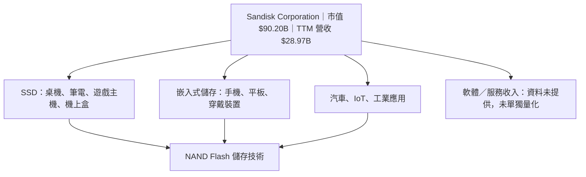
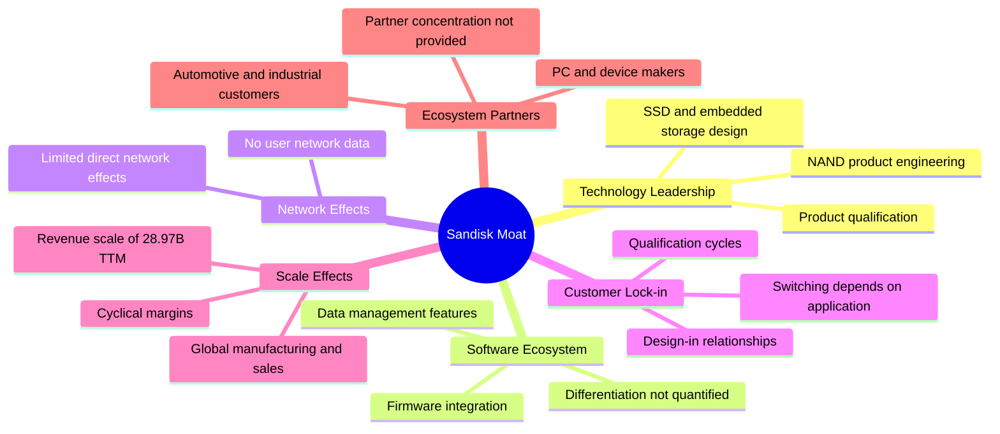
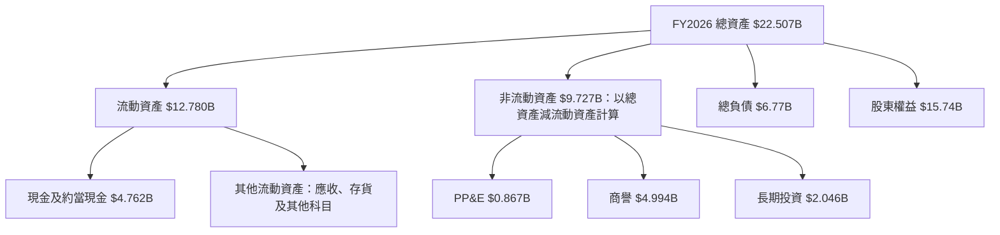
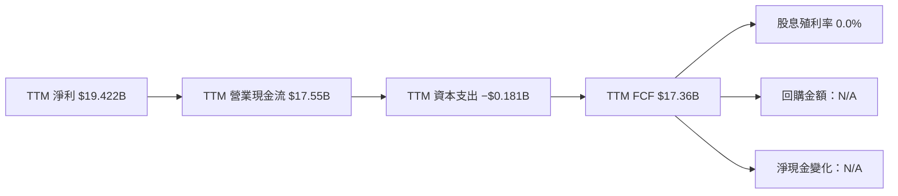
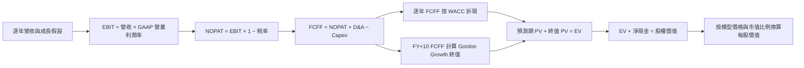
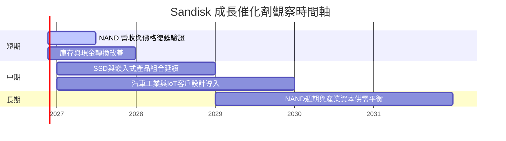
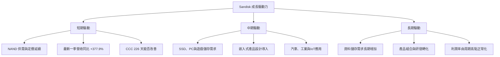
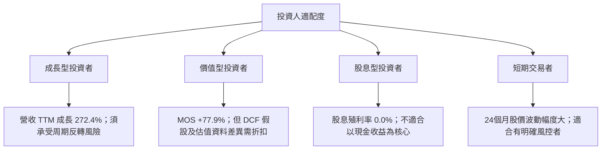

# SNDK 基本面深度分析報告
> **報告日期**：2026-11-22 ｜ **語言**：繁體中文 ｜ **數據來源**：SEC 申報資料 (XBRL)、Yahoo Finance、Finviz、StockAnalysis、Roic.ai ｜ **分析師**：CFA 級機構研究

## 目錄

| # | 章節 | 核心結論 |
|---|------|----------|
| 1 | 執行摘要 | 強烈買入；加權合理價值 $357.92；MOS +77.9% |
| 2 | 公司概覽與商業模式 | NAND 儲存產品受惠於需求回升，但周期性與商品化限制護城河 |
| 3 | 損益表深度分析 | TTM 營收 $28.97B、TTM 成長 272.4%；近期利潤率處於異常高位 |
| 4 | 資產負債表分析 | 淨現金 $5.14B；現金轉換週期升至 226 天 |
| 5 | 現金流量深度分析 | TTM FCF $17.36B、FCF Yield 19.25%；應收與存貨占用上升 |
| 6 | 獲利能力與資本效率 | ROIC 141.2% 高於 WACC 9.96%，但周期高峰數據不宜線性外推 |
| 7 | 相對估值分析 | 同業倍數顯示估值區間分歧；自身歷史 P/S 指標與現行 P/S 資料有差異 |
| 8 | DCF 內在價值評估 | DCF 基準價值 $606.24；終值占 EV 58.2%，假設敏感度高 |
| 9 | 成長催化劑 | NAND 復甦與資料儲存需求是主要驅動；TAM 數據未提供 |
| 10 | 風險矩陣 | NAND 價格反轉、營運資金惡化、估值模型失效為主要風險 |
| 11 | 投資建議 | 依 MOS 評級為強烈買入；買入上限依加權合理價值推導 |

---

## 1. 執行摘要

### 1.0 一頁式投資儀表板（Portfolio Manager 30 秒速讀）

| 項目 | 內容 |
|------|------|
| **投資論點（3 句）** | ① TTM 營收 $28.97B、同比成長 272.4%，最近一季單季同比成長 377.9%，反映 NAND 需求、出貨或價格的週期回升。② TTM FCF 為 $17.36B、FCF Yield 19.25%，提供現金流支持；但 FCF 高度受周期與售價影響。③ 加權合理價值 $357.92，相對 2026-11-20 收盤價 $79.24 的 MOS 為 +77.9%，估值折價是評級主要支撐。 |
| **綜合評分** | **7.7/10**（引用 1.1 評分卡） |
| **財務健康** | 🟢 淨現金 $5.14B；但 CCC 由 154 天升至 226 天，營運資金壓力增加。 |
| **ROIC vs WACC** | **141.2% vs 9.96%**；目前數據顯示創造價值，但 ROIC 位於極高周期獲利環境，不能直接視為長期常態。 |
| **FCF 趨勢** | 近年由負轉正；TTM FCF Yield **19.25%**。 |
| **估值** | Forward P/E 2.207x ｜ EV/EBITDA 4.016x ｜ FCF Yield 19.25%。資料來源間存在倍數差異，見第 7 章。 |
| **DCF 內在價值（基準）** | **$606.24** ｜現價相對 DCF 折價 **−86.9%**（折溢價固定以 DCF 基準價值為基準）。 |
| **安全邊際（MOS）** | **+77.9%**＝($357.92 − $79.24) ÷ $357.92；🟢 >25% 充足。基準為第 8.8 節加權合理價值。 |
| **預期報酬（基準情境 12M）** | DCF 基準情境相對現價 **+665.1%**；此為模型價值差，不代表 12 個月內必然達成。 |
| **關鍵風險（前二）** | NAND 供需反轉導致售價／利潤率快速下滑；存貨與應收週轉惡化，拖累現金轉換。 |
| **評級 + 信心度** | 🟢 **強烈買入** ｜信心：中低（週期性、數據來源差異與 DCF 假設風險較大）。 |

### 1.1 綜合評分卡（全報告唯一）

| 維度 | 評分（1–10） | 主要依據（引用數字與其來源章節） |
|------|--------------|----------------------------------|
| 成長性 | 9 | TTM 營收同比 +272.4%、最新一季單季同比 +377.9%（第 3 章）；基期與周期因素使成長延續性不確定。 |
| 獲利能力 | 9 | TTM 營業利益率 72.5%、ROIC 141.2%，均顯著高於 WACC 9.96%；Piotroski F-Score 為 5/8（第 6 章）。 |
| 財務健康 | 7 | 淨現金 $5.14B、流動比率 2.58；但 CCC 由 154 天升至 226 天（第 4 章）。 |
| 估值 | 9 | MOS +77.9%；DCF 基準 $606.24、同業倍數法每股價值 $150.15–$201.93，估值方法分歧較大（第 7–8 章）。 |
| 護城河 | 6 | NAND 產品技術、客戶認證與規模提供一定優勢，但市場份額數據未提供，且產品有明顯商品化與周期性（第 2 章）。 |
| 管理層與資本配置 | 6 | FY2026 Capex $177M、SBC $232M；股數未減少的 F-Score 測試未通過，回購與資本回報數據不足（第 3、5、6 章）。 |
| **綜合評分** | **7.7** | 六項算術平均：(9+9+7+9+6+6) ÷ 6 = 7.666…，四捨五入至小數一位。 |

### 1.2 五大投資論點 + 三大核心風險

| 類型 | 項目 | 具體依據 | 信心度 |
|------|------|----------|--------|
| 🟢 **投資論點①** | NAND 上行周期帶動營收急升 | TTM 營收 $28.97B、同比 +272.4%；最新一季單季同比 +377.9%。若由需求量與產品組合而非僅短期漲價推動，營收槓桿可維持較久。 | 🟢 高 |
| 🟢 **投資論點②** | 現金流與資產負債表提供緩衝 | TTM OCF $17.55B、FCF $17.36B、淨現金 $5.14B。周期轉弱時，公司有一定能力吸收營運衝擊。 | 🟢 中高 |
| 🟢 **投資論點③** | 現價低於多數估值方法推算值 | 加權合理價值 $357.92；現價 $79.24，MOS +77.9%。相對估值法亦給出 $150.15 與 $201.93。 | 🟢 中 |
| 🟢 **投資論點④** | 營業槓桿明顯 | FY2025 營業利益 $0.507B，FY2026 為 $12.468B；成本結構在需求與定價上升時放大獲利。 | 🟢 中 |
| 🟢 **投資論點⑤** | 技術與客戶驗證支援產品黏著度 | 公司提供 SSD、嵌入式快閃儲存及汽車、工業、IoT 等產品；不同用途通常需客戶驗證，但財務資料未提供各業務占比。 | 🟡 中 |
| 🟡 **風險①** | NAND 價格與供需反轉 | 若需求增速回落或供給擴張，72.5% TTM 營業利益率可能快速收縮；獲利對售價具有周期敏感度。 | 🟡 中高 |
| 🔴 **風險②** | 營運資金佔用加重 | CCC 由 154 天增至 226 天，DIO 增 66 天、DSO 增 27 天；若存貨滯銷或收款變慢，FCF 可能先於淨利惡化。 | 🔴 高 |
| 🔴 **風險③** | DCF 結果對長期獲利假設敏感 | DCF 基準價值 $606.24，其中終值現值占 EV 58.2%；若利潤率回歸周期常態，DCF 將大幅下修。 | 🔴 高 |

### 1.3 快速統計卡片

| 指標 | 公司實際值（期間） | 同業中位數 | 狀態 |
|------|--------------------|------------|------|
| 營收成長（TTM） | **272.4%** | — | 🟢 |
| 營收成長（最新一季年增） | **377.9%** | 327.9%（WDC、MU、SKHY） | 🟢 |
| 毛利率（TTM） | **80.0%** | 77.4%（WDC、MU、SKHY） | 🟢 |
| 營業利益率（TTM） | **72.5%** | — | 🟢 |
| ROIC（TTM） | **141.2%** | — | 🟢 |
| Forward P/E | **2.207x** | 2.65x（WDC、MU、SKHY） | 🟢 |
| FCF Yield（TTM） | **19.25%** | — | 🟢 |
| Piotroski F-Score | **5 / 8** | — | 🟡 |

> 同業中位數按可得數字計算：單季營收成長 (55.5%+379.3%+327.9%) ÷ 3 = 254.2%；毛利率中位數為 77.4%；Forward P/E 中位數為 2.8x、2.5x、6.5x 中的 2.8x。上表依同業可比資料與中位數口徑列示；Peer 倍數章節依原始同業數據表分析。

### 1.4 投資結論

```text
╔══════════════════════════════════════════════════════════════════╗
║                    📊 投資結論摘要                               ║
╠══════════════════════════════════════════════════════════════════╣
║  評級：強烈買入（依 8.8 MOS 評級規則）                            ║
║  價格（2026-11-20 收盤）：$79.24                                ║
║  DCF 內在價值（基準）：$606.24（現價折價 86.9%）                 ║
║  安全邊際 MOS：+77.9%（＝(加權合理價值−現價)÷加權合理價值）     ║
║  加權合理價值（8.8）：$357.92                                    ║
║  DCF 情境價值：                                                  ║
║    悲觀情境：$257.06（+224.4%）                                 ║
║    基準情境：$606.24（+665.1%）                                 ║
║    樂觀情境：$1,355.27（+1,610.3%）                             ║
║  綜合評分：7.7/10（引用 1.1）                                   ║
║  適合投資人：能承受高度周期波動、以估值與財報驗證為主的成長型投資人║
╚══════════════════════════════════════════════════════════════════╝
```

---

## 2. 公司概覽與商業模式

### 2.1 業務結構與收入來源

Sandisk Corporation 開發、製造及銷售以 NAND Flash 為核心的儲存裝置與解決方案。財務資料未提供產品別營收或占比，因此下圖不推估產品分部金額。



主要收入來源為 NAND Flash 儲存產品的設計、製造與銷售；產品用途橫跨消費電子與企業／工業應用。營收成長可能同時受出貨量、產品組合與 NAND 售價影響，現有資料無法將三者分拆。

### 2.2 市場份額

市場份額數據未提供，沒有足夠資料建立可靠市占率圖表。SNDK TTM 營收 $28.97B、最新一季單季同比成長 377.9%，高於 WDC 同季同比 55.5%，但接近 MU 的 379.3%；這反映公司營收正處於周期復甦，不等同於市占率提升。

### 2.3 競爭護城河分析



### 2.4 護城河強度

| 護城河項目 | 強度（強／中／弱） | 證據（引用數字或事實） | 會削弱它的情況 |
|------------|--------------------|------------------------|----------------|
| 技術與產品工程 | 中 | NAND Flash、SSD、嵌入式產品覆蓋多類終端；研發費用 FY2026 為 $1.33B。 | 技術迭代落後、良率或性能差距擴大。 |
| 軟體生態系統 | 弱至中 | 產品可能依賴韌體與系統整合，但軟體收入及使用者數據未提供。 | 產品差異化不足，客戶只依價格採購。 |
| 網路效應 | 弱 | 儲存產品本身沒有明顯直接網路效應，財務資料未顯示網路效應指標。 | 同質化競爭加劇。 |
| 客戶鎖定 | 中 | 汽車、工業及嵌入式應用通常需產品驗證；客戶集中度與替換週期未提供。 | 客戶多來源採購或重新設計平台。 |
| 規模效應 | 中 | TTM 營收 $28.97B、TTM 營業利益率 72.5%；但高獲利也可能源自周期高點。 | 供給增加、價格競爭侵蝕毛利。 |
| 生態夥伴 | 中 | 服務 PC、手機、遊戲、汽車及工業等應用；合作夥伴營收占比未提供。 | 關鍵客戶內製或轉向其他供應商。 |

**1.1 護城河評分為 6/10**：研發投入、產品種類與客戶驗證提供一定壁壘，但市場份額、客戶黏著與軟體收入數據不足，且 NAND 周期性使高利潤未必代表持久定價權。

---

## 3. 損益表深度分析

### 3.1 年度收入成長趨勢（近 4 年）

年度營收取自年度損益表；成長率按年度收入計算，四捨五入至小數一位。

```text
╔══════════════════════════════════════════════════════════════════╗
║              Sandisk 年度收入趨勢（FY2023-FY2026）               ║
╠══════════════════════════════════════════════════════════════════╣
║  FY2023  $6.09B   ██████░░░░░░░░░░░░░░░░░░  YoY：—              ║
║  FY2024  $6.66B   ███████░░░░░░░░░░░░░░░░░  YoY：+9.5%  🟡     ║
║  FY2025  $7.36B   ████████░░░░░░░░░░░░░░░░  YoY：+10.4% 🟡     ║
║  FY2026  $20.25B  ████████████████████░░░░  YoY：+175.3% 🟢    ║
║                                                                  ║
║  FY2023-FY2026 三年 CAGR：約 +49.3%                               ║
╚══════════════════════════════════════════════════════════════════╝
```

FY2026 營收較 FY2025 增長 175.3%，是多年低基期後 NAND 需求及價格回升的結果之一。三年 CAGR 約 49.3% 的期間端點包含 FY2026 的周期跳升，不宜直接當作長期穩態成長率。

### 3.2 季度收入趨勢分析

| 季度 | 營收（$B） | QoQ | YoY | 備註 |
|------|-----------:|----:|----:|------|
| 2025-12-31 | 3.025 | 31.1% | 61.25% | 與 2025-10-03 季營收 $2.308B 比較；YoY 採 StockAnalysis 公布值。 |
| 2026-03-31 | 5.950 | 96.7% | 251.03% | 與前季 $3.025B 比較；YoY 採同來源季度成長率。 |
| 2026-06-30 | 8.965 | 50.7% | 371.59% | 與前季 $5.950B 比較；YoY 為單季成長率。 |
| 2026-10-02 | 11.031 | 23.0% | 377.9% | SEC 10-Q 最新季；QoQ = (11.031 ÷ 8.965) − 1；YoY 為 VERIFIED FIGURES 單季數值。 |

季度營收仍連續增加，但 QoQ 增幅由 96.7% 降至 23.0%，顯示基數快速變大後，環比成長自然放慢。最新一季 YoY 仍高，部分來自前一年較低的比較基期。

### 3.3 利潤率演變分析

年度毛利率、營業利益率與淨利率按年度財務數據計算；TTM 指標則採 SEC／程式計算數值。

| 利潤率指標 | FY2023 | FY2024 | FY2025 | FY2026 | 趨勢 | 評估 |
|------------|-------:|-------:|-------:|-------:|------|------|
| **毛利率** | 7.1% | 16.1% | 30.1% | 71.5% | ↗️ FY2026 大幅擴張 | 🟢 |
| **營業利益率** | −21.3% | −6.7% | 6.9% | 61.6% | ↗️ 由虧損轉高獲利 | 🟢 |
| **淨利率** | −35.2% | −10.1% | −22.3% | 56.4% | ↗️ FY2026 轉正；周期性明顯 | 🟡 |
| **營業利益率（TTM）** | — | — | — | **72.5%** | 高於 FY2026 全年 | 🟡 |

FY2023–FY2025 的利潤率逐步改善，但 FY2026 出現遠高於前期的跳升。主要解釋是 NAND 供需、售價與產品組合恢復，加上既有成本結構帶來營業槓桿；目前資料未提供產品別毛利，無法將價格、出貨量和組合的貢獻分開。因而，72.5% TTM 營業利益率不應被視為不受周期影響的常態。

### 3.4 費用結構分析

費用科目完整拆分資料不足，不能用營收以外的項目反推費用占比，也不製作費用圓餅圖。可確認 FY2026 研發費用為 $1.33B，FY2025 為 $1.13B，增加 $0.20B，約 +17.7%；相對 FY2026 營收 $20.25B，研發費用約占 6.6%。產品銷售、研發與製造成本的完整費用結構未提供。

### 3.5 季度 EPS 趨勢與盈餘品質（Quality of Earnings）

最近四季 EPS 預期值與 surprise 欄位缺失，故無法可靠判定超預期或不及預期。季度 EPS 的不同來源亦有差異：StockAnalysis 顯示 FY2027 Q1 EPS $6.58，Roic.ai 序列顯示 $6.94；本報告不選擇其中一個當作已核驗值。可確認最新一季單季 EPS 同比成長率為 6909.6%，但如此高的百分比受前期基數極低影響。

| 盈餘品質項目 | 數值／佔比 | 評估 |
|--------------|------------|------|
| 股權薪酬 SBC / 營收 | TTM SBC 約 $270M；$270M ÷ $28.971B = **0.93%** | 🟢 占比不高，但 SBC 仍會稀釋股東；F-Score 顯示稀釋股數未增加測試未通過。 |
| SBC / 營業現金流 | $270M ÷ $17.55B = **1.54%** | 🟢 相對 OCF 較低。TTM SBC 以最近四季 $91M+$67M+$54M+$58M 加總。 |
| FCF / 淨利（現金轉換率） | $17.36B ÷ $19.422B = **89.4%** | 🟡 現金轉換良好但未達 100%；TTM 營運資金天數上升是需監控因素。 |
| 一次性／非經常性損益 | N/A（明細未提供） | 無法判斷是否存在一次性損益對當期淨利的重大影響。 |
| 有效稅率異常 | 12.2%（最新年度有效稅率） | 🟡 低於部分常見稅率，但未提供稅務調節表，不能判斷是否含一次性稅務利益。 |
| 資本化支出 vs 費用化 | FY2026 Capex $177M；研發費用 $1.33B | Capex 數據可得；研發費用化與資本化明細未提供，無法完整評估成本遞延。 |

**盈餘品質結論**：TTM FCF 達淨利的 89.4%，SBC 占營收不到 1%，顯示現金獲利有一定支撐；不過 Piotroski 應計品質測試未通過，且存貨、應收天數同步上升。當前 GAAP 獲利的含金量尚可，但周期高點的利潤率與稅率可持續性仍未被證明。

---

## 4. 資產負債表分析

### 4.1 資產結構分解

以下使用 FY2026 年度資產負債表數字。非流動資產為總資產減流動資產的計算值，不代表逐項科目均已列全。



FY2026 資產負債表的資產總額、負債與權益金額取自年度資料；最新 TTM 資產負債表細項日期更新至 2026-10-02，但權益等細項不完整，故不混用不同日期做平衡表拆分。

### 4.2 流動性與營運資金分析

| 指標 | 最新 TTM | 一年前 TTM | 變化 | 解讀 |
|------|----------|------------|------|------|
| DSO 應收帳款天數 | 83 天 | 56 天 | +27 天 | 收款週期拉長，可能與營收快速擴張或付款條件變化有關；若延續會占用現金。 |
| DIO 存貨天數 | 190 天 | 124 天 | +66 天 | 存貨持有天數明顯上升，可能反映備貨與需求擴張，也增加滯銷及價格下跌風險。 |
| DPO 應付帳款天數 | 46 天 | 26 天 | +20 天 | 付款天數增加，短期可支撐營運資金，但不能直接證明供應商議價能力提高。 |
| CCC 現金轉換週期 | 226 天 | 154 天 | +72 天 | CCC 延長代表現金回收週期惡化，抵銷部分帳面獲利帶來的現金效果。 |

最新資料同時顯示流動比率 2.58、速動比率 1.994，短期償債能力尚可；然而，存貨及應收款的增幅要求投資人追蹤，而不能只看流動比率。

### 4.3 債務結構分析

資料來源的債務數字略有差異：VERIFIED FIGURES 的總債務為 N/A、淨現金為 $5.14B；市場資料列示總債務 $201M、淨現金 $5.01B；FY2026 年報列示債務 $177M。DCF 按指定模型採用淨現金 $5.14B，不自行以不同日期債務數字替換。

```text
╔══════════════════════════════════════════════════════════════════╗
║                   Sandisk 債務健康診斷                           ║
╠══════════════════════════════════════════════════════════════════╣
║  總債務：        N/A（VERIFIED FIGURES 未提供）                   ║
║  市場資料債務：  $0.201B（另一來源；日期口徑可能不同）            ║
║  現金及短期投資：$5.14B（TTM 指標）                              ║
║  淨現金：        $5.14B（DCF 橋接採用值） 🟢                     ║
║  Debt/EBITDA：   N/A（總債務口徑與 EBITDA 日期不一致）            ║
║  利息保障倍數：  N/A（利息費用資料未提供）                        ║
╚══════════════════════════════════════════════════════════════════╝
```

### 4.4 股東權益趨勢

```text
╔══════════════════════════════════════════════════════════════════╗
║                 FY2024-FY2026 股東權益變化                       ║
╠══════════════════════════════════════════════════════════════════╣
║  FY2024  $11.08B  ███████████░░░░░░░░░░░░░░░░                    ║
║  FY2025   $9.22B  █████████░░░░░░░░░░░░░░░░░░░                    ║
║  FY2026  $15.74B  ████████████████░░░░░░░░░░░░                    ║
╚══════════════════════════════════════════════════════════════════╝
```

FY2025 權益由 $11.08B 降至 $9.22B，FY2026 回升至 $15.74B，與 FY2026 淨利轉正及資產累積相符；股東權益變化仍需與股數稀釋、回購及其他綜合損益一併追蹤。

---

## 5. 現金流量深度分析

### 5.1 現金流量瀑布圖

下圖呈現可核對的 TTM 數值；股息收益率為 0.0%，回購及淨現金變化的 TTM 明細未提供，因此不推估用途。



### 5.2 FCF 轉換率趨勢

| 年度 | FCF | 淨利 | FCF／淨利 | 解讀 |
|------|----:|-----:|----------:|------|
| FY2023 | −$0.932B | −$2.143B | 約 43.5% | 淨利為負，比例只供參考，兩者均反映虧損期。 |
| FY2024 | −$0.475B | −$0.672B | 約 70.7% | 現金流仍為負，轉換率不可當作正向獲利品質。 |
| FY2025 | −$0.120B | −$1.641B | 約 7.3% | FCF 接近損益兩平，但淨利虧損較大。 |
| FY2026 | $11.49B | $11.43B | 約 100.5% | 現金流大致與淨利匹配，顯示周期回升後獲利轉化良好。 |
| TTM | $17.36B | $19.422B | **89.4%** | 現金轉換仍高，但營運資金週期惡化值得留意。 |

### 5.3 自由現金流趨勢

```text
╔══════════════════════════════════════════════════════════════════╗
║               歷年自由現金流（FCF）趨勢                          ║
╠══════════════════════════════════════════════════════════════════╣
║  FY2023  −$0.932B  ◀██░░░░░░░░░░░░░░░░░░░░░░░░░                ║
║  FY2024  −$0.475B  ◀████░░░░░░░░░░░░░░░░░░░░░░░                ║
║  FY2025  −$0.120B  ◀█░░░░░░░░░░░░░░░░░░░░░░░░░                ║
║  FY2026  $11.49B    ███████████████░░░░░░░░░░░░                ║
║  TTM     $17.36B    ███████████████████████░░░░                ║
║                                                                  ║
║  TTM FCF Yield：19.25%（依 VERIFIED FIGURES）                    ║
╚══════════════════════════════════════════════════════════════════╝
```

### 5.4 資本配置評估

股息殖利率為 0.0%；FY2026 Capex 為 $177M，年度 SBC 為 $232M。回購金額、併購、投資與留存現金的完整資金配置資料未提供，因此不繪製比例圓餅圖。

| 資本配置項目 | 已知數據 | 評估 |
|--------------|----------|------|
| 資本支出 | FY2026 $177M；TTM $181M | 相對 $28.97B TTM 營收偏低，但 NAND 產能與供應鏈資本需求未必都反映於公司自身 Capex。 |
| 股息 | 殖利率 0.0%；派息率 0.0% | 無直接股息回報。 |
| 回購 | N/A | 缺少回購金額及股數變化拆分。 |
| SBC | FY2026 $232M；TTM 估算約 $270M | 現金流表中加回的非現金費用，實際經濟成本體現在股權稀釋。 |
| 留存／其他投資 | N/A | 資金用途明細不足，不以餘額反推。 |

---

## 6. 獲利能力與資本效率

### 6.1 ROE / ROA / ROIC 趨勢

| 指標 | 歷史／TTM 數據 | 評估 |
|------|----------------|------|
| ROE | TTM **107.1%**（品質指標計算）；市場資料另列 141.2% | 來源口徑不一致，採品質指標提供的 DuPont ROE；不混用其他來源。 |
| ROA | TTM **68.3%**（市場整併資料） | 高獲利周期下的指標，不代表周期底部回報。 |
| ROIC | TTM **141.2%**（VERIFIED FIGURES） | 顯著高於 WACC，但投入資本基數、現金水位及周期獲利均影響比率。 |
| 行業均值 | N/A | 未提供可核驗同口徑數據，不列同業平均。 |

### 6.2 ROIC vs WACC 分析（核心價值創造判斷）

```text
╔══════════════════════════════════════════════════════════════════╗
║                ROIC vs WACC 深度分析                            ║
╠══════════════════════════════════════════════════════════════════╣
║  WACC（採用 VERIFIED FIGURES）：9.96%                            ║
║  ├── 無風險利率（10Y 美債）：4.91%                               ║
║  ├── 市場風險溢酬（假設）：5.00%                                 ║
║  ├── 原始 Beta：N/A；採用調整後 Beta：1.00                      ║
║  ├── 股權成本：4.91% + 1.00 × 5.00% = 9.91%                    ║
║  ├── 稅前債務成本：36.32%；有效稅率：12.2%                      ║
║  ├── 股權／債務權重：99.8%／0.2%                                ║
║  └── 採用 WACC：9.96%（依成本資本區塊原值）                     ║
║                                                                  ║
║  ROIC（TTM）：141.2%                                             ║
║  EVA 利差 = 141.2% − 9.96% = +131.24 個百分點                    ║
║  ROIC／WACC = 141.2% ÷ 9.96% ≈ 14.18 倍                         ║
║                                                                  ║
║  結論：目前 TTM 數字顯示公司創造股東價值；但該 ROIC 位於周期高點，║
║  應以後續數季維持獲利與現金流能力驗證其可持續性。                ║
╚══════════════════════════════════════════════════════════════════╝
```

WACC 模組列示的債務成本為稅前 36.32%、債務權重 0.2%、採用 WACC 9.96%。若對債務成本先扣稅再代入，結果會與區塊公布的 9.96% 不同；本報告依明確要求採用 9.96%，並在第 8.10 節標示此計算口徑不一致。此處未以替代計算值取代 WACC。

### 6.3 杜邦三因素分解

| 因素 | 數值（TTM） | 解讀 |
|------|-------------|------|
| 淨利率 | 67.0% | 淨利率是高 ROE 的主要來源，反映目前極高周期獲利。 |
| 資產週轉率 | 1.12 | 每單位資產帶來較高營收，成長擴大資產使用效率。 |
| 權益乘數 | 1.42 | 槓桿並非 ROE 的主要驅動因素。 |
| **ROE** | **107.1%** | 67.0% × 1.12 × 1.42 = 106.5%，與區塊列示 107.1% 的差異來自原始未四捨五入數字。 |

### 6.4 財務體質：Piotroski F-Score

Piotroski F-Score 為 **5/8**；因長期負債測試缺少輸入，測試分母低於完整九項。

| 測試 | 結果 | 解讀 |
|------|------|------|
| ROA > 0 | ✅ 通過 | TTM 獲利轉正。 |
| 營業現金流 > 0 | ✅ 通過 | TTM OCF $17.55B。 |
| ROA 高於一年前 | ✅ 通過 | 盈利能力較周期低點改善。 |
| 營業現金流 > 淨利（應計品質） | ❌ 未通過 | TTM OCF 低於淨利，須留意應計項目與營運資金。 |
| 長期負債 ÷ 總資產低於一年前 | — 無法判定 | 缺少可比長期負債輸入。 |
| 流動比率高於一年前 | ❌ 未通過 | 流動比率較前一年未改善。 |
| 稀釋股數未增加 | ❌ 未通過 | 股數稀釋可能削弱每股價值增長。 |
| 毛利率高於一年前 | ✅ 通過 | 受周期復甦與售價／組合改善帶動。 |
| 資產週轉率高於一年前 | ✅ 通過 | 營收快速增加使資產周轉改善。 |

---

## 7. 相對估值分析

### 7.1 同業估值比較表格

SNDK 現行估值倍數取市場資料區；同業倍數嚴格採 Peer multiples。市場資料整併值與 VERIFIED FIGURES 中 P/S 歷史估值值存在口徑差異，見 7.2。

| 估值指標 | **SNDK** | **WDC** | **MU** | **SKHY** | SNDK 評估 |
|----------|---------:|-------:|------:|-------:|-----------|
| **Trailing P/E** | 0.086x | 9.2x | 8.0x | 5.7x | 🔴 公司數值異常偏低，與 EPS、股價資料可能存在拆股或口徑不一致；不宜直接解讀為便宜程度。 |
| **Forward P/E** | 2.207x | 6.5x | 2.8x | 2.5x | 🟢 低於 WDC、略低於 MU 與 SKHY；周期盈利預測可能使 Forward P/E 偏低。 |
| **P/S Ratio** | 3.113x | 6.7x | 5.1x | N/A | 🟢 低於可比公司，但 SKHY 因混合幣別不納入比較。 |
| **EV/EBITDA（TTM）** | 4.016x | 15.4x | 5.8x | N/A | 🟢 低於 WDC、MU；須注意 EBITDA 反映周期高點。 |
| **最新一季營收 YoY** | 377.9% | 55.5% | 379.3% | 327.9% | 🟢 高增長，但低基期與 NAND 周期均有影響。 |
| **毛利率（TTM）** | 80.0% | 52.6% | 80.7% | 77.4% | 🟢 接近 MU，高於 WDC、SKHY。 |

同業倍數中，WDC 與 MU 的 P/S 中位數為 (6.7x+5.1x)÷2=5.9x；EV/EBITDA 中位數為 (15.4x+5.8x)÷2=10.6x，與指定估值方法區塊一致。公司自身低倍數可能反映周期與股價／股數資料的口徑問題，應與現金流和盈利可持續性合併判斷。

### 7.2 歷史估值區間分析

提供的自身歷史資料是 **P/S**，不是 P/E；因此不將其轉寫為 P/E 區間。

```text
╔══════════════════════════════════════════════════════════════════╗
║               SNDK 自身五年歷史 P/S 區間                         ║
╠══════════════════════════════════════════════════════════════════╣
║  歷史範圍：0.1x ├──────── 中位數 0.6x ────────┤ 1.7x             ║
║  現值：0.4x（歷史百分位 43%）                                    ║
╚══════════════════════════════════════════════════════════════════╝
```

此處歷史估值區塊列示現值 P/S 0.4x，而市場整併資料列示 P/S 3.113x；兩者差距顯著，可能源於市場資料或價格／股數口徑差異。依規則，歷史區間照原值引用，不以另一來源替換；因此歷史百分位只作該區塊內部比較，不和 3.113x 直接拼接。

### 7.3 情境價值（Bear / Base / Bull）

以下價值及機率照 DCF 情境模型原值引用。營業利潤率是第 10 年值；模型未提供各情境逐年現金流明細，故不自行推算中間路徑。

| 情境 | 第 1 年營收成長 | 期末營業利潤率 | WACC | 每股價值 | 相對現價 | 機率 | 會發生的條件 |
|------|----------------|----------------|------|----------:|---------:|-----:|--------------|
| 🔴 悲觀 | 15.0% | 52.0% | 10.96% | $257.06 | +224.4% | 25% | NAND 價格回落、需求增速低於基準，利潤率逐步回歸較低水平。 |
| 🟡 基準 | 30.0% | 61.2% | 9.96% | $606.24 | +665.1% | 50% | 需求維持擴張、利潤率由 TTM 72.5% 緩降至長期模型值。 |
| 🟢 樂觀 | 45.0% | 67.3% | 8.96% | $1,355.27 | +1,610.3% | 25% | 需求與定價強於基準、規模效應延續，資本成本下降。 |

### 7.4 相對估值隱含價格區間

```text
╔══════════════════════════════════════════════════════════════════╗
║                每股估值方法價值與現價位置                       ║
╠══════════════════════════════════════════════════════════════════╣
║  $79.24 現價 ── $150.15 同業 P/S ── $201.93 同業 EV/EBITDA      ║
║        ── $248.18 分析師共識 ───────── $606.24 DCF 基準          ║
╚══════════════════════════════════════════════════════════════════╝
```

| 方法 | 每股價值 | 依據 |
|------|---------:|------|
| 同業 EV/EBITDA | $201.93 | WDC、MU 同業中位數 10.6x × SNDK TTM EBITDA，再加淨現金。 |
| 同業 P/S | $150.15 | WDC、MU 同業中位數 P/S 5.9x × SNDK TTM 營收。 |

---

## 8. DCF 內在價值評估（Discounted Cash Flow）

> 金額單位為美元十億，除每股價值外皆同。逐年數值、終值、橋接、敏感度及情境直接採用程式計算的 DCF 模型；由於 DCF 模型明列營運資金不建模，以下 FCFF 不另扣 ΔWC。

### 8.0 估值推理鏈（Thinking Logic）

**Step 1 — 價值來源與主導變數**

本模型的價值主要來自 NAND 儲存主業的營收規模與周期利潤率：公司 TTM 營收 $28.97B，但產品細分與各應用營收占比未提供，不能把營收任意分配到消費、企業或汽車等類別。最重要變數是長期營業利潤率與 WACC、永續成長率共同決定的終值；基準 DCF 終值現值占 EV 58.2%，因此估值對長期而非單一季度盈利最敏感。

**Step 2 — 模型選擇**

| 決策點 | 本報告採用 | 理由（含數字） | 曾考慮但否決 | 否決理由 |
|--------|-----------|----------------|--------------|----------|
| 現金流定義 | FCFF | 與 WACC 折現後得 EV；模型明定 FCFF = NOPAT + D&A − Capex。 | FCFE | DCF 區塊提供的是 FCFF 與 EV 橋接。 |
| 預測期 N | 10 年 | 模型採 10 年，營收增速由 30.0% 緩降至 3.0%。 | 縮短預測期 | 未採用其他預測期模型數值，不能替換程式模型。 |
| 終值方法 | Gordon Growth | 模型採永續成長率 3.0%，WACC 9.96%。 | 退出倍數 | DCF 模型未提供退出倍數終值，不能另建模型。 |
| EBIT 基礎 | GAAP EBIT | 模型採 GAAP EBIT，SBC 已作費用處理。 | 非 GAAP EBIT | 避免加回 SBC 後漏計股東成本。 |

**Step 3 — 關鍵假設推導鏈**

- **營收成長**：錨點為 TTM 同比 +272.4%、最新一季單季同比 +377.9%；兩者極高且包含周期反彈與低基期，因此模型把第 1 年成長限制在 30.0%，之後逐年線性降至第 10 年 3.0%；採用值為模型指定路徑。更低的 15.0% 對應悲觀情境；更高的 45.0% 對應樂觀情境，不取代基準。
- **期末營業利益率**：錨點為 TTM 72.5%，模型以最近三個財年中位數為長期收斂依據，採第 10 年 61.2%；周期價格下行是下修理由。52.0% 為悲觀情境、67.3% 為樂觀情境，基準不採其中任一值。
- **永續成長率 g**：錨點是終端成熟企業須低於 WACC；模型採 3.0%，低於 9.96%，亦可在敏感度矩陣比較 2.0%–4.0%。未採用更高的長期增長假設，以避免把周期高增長永久化。
- **預測期 N**：採用 10 年，依據是模型提供逐年成長遞減及利潤率正常化的 10 年路徑；短於 10 年會改變現金流年數與終值起點，但本報告不自行重建另一模型。
- **Capex／營收**：TTM Capex $181M、TTM 營收 $28.97B；模型將 Capex／營收維持約 0.6%，並依指定模型設定採用。模型未給資本支出的替代路徑，不另估算較高數值。
- **EBIT、SBC 與股數**：採 GAAP EBIT，SBC 已包含於費用，不再扣一次；固定股數，不逐年放大股數，即組合 (A)。年稀釋率 0% 是模型處理選擇，不表示公司沒有實際稀釋風險。
- **WACC**：採用 9.96%，完全依成本資本區塊原值；Beta 原始值缺失，以調整後 Beta 1.00 建模。替代 WACC 只用於敏感度矩陣，不改基準值。

**Step 4 — 最脆弱的一環**

最脆弱的是 72.5% 的 TTM 營業利益率可否逐步回落後仍維持第 10 年 61.2%；若 NAND 價格回落令成熟期利潤率更接近悲觀情境 52.0%，價值應下修，悲觀情境價值為 $257.06。

**Step 5 — 計算路徑圖**



### 8.1 模型假設總表（Model Inputs）

| 假設項目 | 採用值 | 依據／來源 | 敏感度 |
|----------|--------|-------------|--------|
| 預測期長度 N | 10 年 | DCF 模型固定預測期；完整列示 FY+1 至 FY+10。 | 🟡 中 |
| 營收成長路徑 | FY+1 30.0% 線性降至 FY+10 3.0% | TTM 同比 272.4%；模型將極高周期成長限制在 30.0%。 | 🔴 高 |
| 營業利潤率 | FY+1 72.5% 至 FY+10 61.2% | FY+1 以 TTM 72.5% 為錨，長期收斂至最近三個財年中位數。 | 🔴 高 |
| 有效稅率 | 12.2% | 最新年度有效稅率。 | 🟢 低 |
| Capex／營收 | FY+1 至 FY+10 約 0.6% | TTM Capex $181M／營收 $28.97B；模型指定值。 | 🟡 中 |
| D&A／營收 | 0.5% | TTM 模型錨點，固定採用。 | 🟢 低 |
| 營運資金變動 | 不建模 | DCF 模型明示 working capital is not modelled。 | 🟢 低 |
| EBIT 基礎 | GAAP EBIT | 模型逐年 GAAP EBIT。 | 🟡 中 |
| SBC 處理 | SBC 已計入 GAAP EBIT，不重複扣除 | DCF 模型指定組合 (A)。 | 🟡 中 |
| 年稀釋率 | 0%（固定股數處理） | 與組合 (A) 一致；真實股數稀釋風險由 F-Score 另行揭露。 | 🟡 中 |
| 永續成長率 g | 3.0% | 模型指定，低於 WACC；敏感度測試範圍 2.0%–4.0%。 | 🔴 高 |
| 終值方法 | Gordon Growth | DCF 模型唯一提供的終值方法。 | 🔴 高 |
| WACC | 9.96% | 成本資本區塊原值；詳見 8.2。 | 🔴 高 |

本模型採用 **(A) GAAP EBIT + 固定股數**：EBIT 已含 SBC 費用，FCFF 不再減 SBC；股數不另逐年稀釋，故模型對未來股權稀釋的處理較簡化。FCFF 定義為 **NOPAT + D&A − Capex**，不含營運資金變動列。

### 8.2 折現率推導（WACC）

```text
╔══════════════════════════════════════════════════════════════════╗
║                    WACC 推導（折現率）                           ║
╠══════════════════════════════════════════════════════════════════╣
║  股權成本 Ke（CAPM）：                                           ║
║  ├── 無風險利率 Rf（10Y 美債）：4.91%                            ║
║  ├── 市場風險溢酬 ERP（假設）：5.00%                             ║
║  ├── 原始 Beta：N/A；調整後 Beta：1.00（Beta 缺失時採用）        ║
║  ├── 規模／國別溢酬：0.00%（成本資本資料未列額外溢酬）           ║
║  └── Ke = 4.91% + 1.00 × 5.00% = 9.91%                         ║
║                                                                  ║
║  債務成本：稅前 Kd = 36.32%；有效稅率 = 12.2%                    ║
║  稅後 Kd 算術值 = 36.32% × (1−12.2%) = 31.89%                   ║
║  資本權重（成本資本資料）：股權 99.8%；債務 0.2%                 ║
║  採用 WACC：9.96%（照成本資本資料，不另改模型折現率）            ║
╚══════════════════════════════════════════════════════════════════╝
```

**逐步演算與資料限制**

1. **Ke** = 4.91% + 1.00 × 5.00% = **9.91%**。Beta 原始值 N/A；1.00 是成本資本資料採用的調整後假設，不是可觀察原始 Beta。
2. **稅前 Kd** = **36.32%**（成本資本資料原值）。利息費用與同口徑平均計息負債沒有提供，故不能自行回推稅前 Kd。
3. **稅後 Kd 算術值** = 36.32% × (1−12.2%) = 36.32% × 0.878 = **31.89%**。
4. **權重** = 股權 **99.8%**、債務 **0.2%**，兩者相加為 **100.0%**。市值與債務在成本資本資料中沒有完整可複核的同期權重計算細項。
5. 成本資本資料的 WACC 原值為 **9.96%**。若用稅前 Kd 代入則 99.8%×9.91%+0.2%×36.32%=9.96%；若用稅後 Kd，則結果約為 10.01%。因此公布的 9.96% 與標準稅後債務成本口徑存在約 0.05 個百分點差異。依 VERIFIED FIGURES 規則，DCF 與 ROIC 比較均採 **9.96%**，不自行改寫。

### 8.3 逐年自由現金流預測（基準情境）

金額單位：$B；金額取兩位小數，折現因子取三位小數。表格照模型逐年列示，ΔWC 未建模。

| 年度 | FY+1 | FY+2 | FY+3 | FY+4 | FY+5 | FY+6 | FY+7 | FY+8 | FY+9 | FY+10 |
|------|------:|------:|------:|------:|------:|------:|------:|------:|------:|-------:|
| 營收 | 37.66 | 47.83 | 59.31 | 71.77 | 84.68 | 97.39 | 109.07 | 118.89 | 126.02 | 129.80 |
| 營收 YoY | 30.0% | 27.0% | 24.0% | 21.0% | 18.0% | 15.0% | 12.0% | 9.0% | 6.0% | 3.0% |
| 營業利潤率 | 72.5% | 71.2% | 70.0% | 68.7% | 67.5% | 66.2% | 64.9% | 63.7% | 62.4% | 61.2% |
| EBIT（GAAP） | 27.29 | 34.06 | 41.49 | 49.31 | 57.12 | 64.47 | 70.84 | 75.72 | 78.69 | 79.42 |
| − 稅 | (3.32) | (4.14) | (5.05) | (6.00) | (6.95) | (7.84) | (8.62) | (9.21) | (9.58) | (9.66) |
| = NOPAT | 23.97 | 29.92 | 36.44 | 43.31 | 50.17 | 56.62 | 62.22 | 66.51 | 69.11 | 69.76 |
| + D&A | 0.20 | 0.26 | 0.32 | 0.39 | 0.46 | 0.52 | 0.59 | 0.64 | 0.68 | 0.70 |
| − Capex | (0.24) | (0.30) | (0.37) | (0.44) | (0.52) | (0.59) | (0.66) | (0.71) | (0.75) | (0.77) |
| **= FCFF** | **23.94** | **29.88** | **36.40** | **43.25** | **50.11** | **56.56** | **62.15** | **66.44** | **69.04** | **69.69** |
| 折現因子 | 0.909 | 0.827 | 0.752 | 0.684 | 0.622 | 0.566 | 0.514 | 0.468 | 0.425 | 0.387 |
| **FCFF 現值 PV** | **21.77** | **24.71** | **27.37** | **29.58** | **31.17** | **31.99** | **31.97** | **31.08** | **29.37** | **26.96** |

預測期現值加總：$21.77+$24.71+$27.37+$29.58+$31.17+$31.99+$31.97+$31.08+$29.37+$26.96 = **$285.97B**；模型列示合計 **$285.98B**，差異 $0.01B，屬年度數字四捨五入尾差。

**FY+1 逐步演算**

1. **營收** = 上年 TTM $28.97B × (1+30.0%) = $28.97B × 1.30 = **$37.66B**。
2. **EBIT** = $37.66B × 72.5% = **$27.29B**。
3. **稅** = $27.29B × 12.2% = **$3.32B**。
4. **NOPAT** = $27.29B − $3.32B = **$23.97B**。
5. **D&A** = $37.66B × 0.5% ≈ **$0.20B**。
6. **Capex** = $37.66B × 約 0.6% ≈ **$0.24B**（模型列示值）。
7. **ΔWC** = 不建模；模型未包含營運資金變動項。
8. **FCFF** = $23.97B+$0.20B−$0.24B = **$23.93B**；模型逐項未四捨五入的數值列示為 **$23.94B**。
9. **折現因子** = 1÷(1+9.96%)¹ = **0.909**；PV = $23.94B×0.909 ≈ **$21.77B**。

**合理性自檢**

- 預測 FCFF 由 $23.94B 增至 $69.69B，十年 CAGR 約 11.3%；歷史實際年度 FCF 曾由負值轉為 FY2026 $11.49B，因跨越虧損至復甦，歷史 FCF CAGR 不具可比性。
- FY+10 FCFF 利潤率 = $69.69B÷$129.80B ≈ **53.7%**；目前 TTM FCF 利潤率 = $17.36B÷$28.97B ≈ **59.9%**。沒有同業最佳 FCFF 利潤率數據可比。
- 基準預測各年 FCFF 均為正；但模型不含營運資金變化，可能高估現金轉換，尤其 CCC 已升至 226 天。

```text
╔══════════════════════════════════════════════════════════════════╗
║            自由現金流：歷史實際 vs 模型預測                      ║
╠══════════════════════════════════════════════════════════════════╣
║  FY2024(實) −$0.475B  ◀██░░░░░░░░░░░░░░░░░░░░░░                ║
║  FY2025(實) −$0.120B  ◀█░░░░░░░░░░░░░░░░░░░░░░░                ║
║  FY2026(實) $11.49B    ███████░░░░░░░░░░░░░░░░                  ║
║  FY+1 (預)  $23.94B    ██████████████░░░░░░░░                   ║
║  FY+10(預)  $69.69B    ██████████████████████████████           ║
╠══════════════════════════════════════════════════════════════════╣
║  模型長期增長遠低於從低基期反彈的短期歷史增速；但未建模 ΔWC，     ║
║  對自由現金流仍可能偏樂觀。                                      ║
╚══════════════════════════════════════════════════════════════════╝
```

### 8.4 終值計算（Terminal Value）

適用性檢查：**WACC 9.96% vs g 3.0% → WACC > g？✅**

| 方法 | 計算式 | 終值 TV | TV 現值 | 佔總 EV 比重 |
|------|--------|---------:|--------:|-------------:|
| Gordon Growth | $69.69×(1+3.0%)÷(9.96%−3.0%) | $1,031.16B | $398.97B | 58.2% |
| 退出倍數法 | N/A（DCF 模型未提供退出倍數終值） | N/A | N/A | N/A |

1. **FY+N FCFF** = FY+10 FCFF **$69.69B**。
2. **分子** = $69.69B×(1+3.0%) = $69.69B×1.03 ≈ **$71.78B**。
3. **分母** = 9.96%−3.0% = **6.96%**；TV = $71.78B÷6.96% ≈ **$1,031.16B**。
4. **PV(TV)** = $1,031.16B×0.387 = **$398.97B**。
5. **終值占比** = $398.97B÷$684.96B ≈ **58.2%**。

### 8.5 企業價值 → 每股內在價值（Bridge）

```text
╔══════════════════════════════════════════════════════════════════╗
║              企業價值 → 每股內在價值 橋接表                      ║
╠══════════════════════════════════════════════════════════════════╣
║  預測期 FCF 現值合計            +$285.98B                         ║
║  終值現值 PV(TV)                +$398.97B                         ║
║  = 企業價值 EV                    $684.96B（模型列示）             ║
║  + 淨現金                         +$5.14B                         ║
║  = 股權價值                       $690.09B（模型列示）             ║
║  每股內在價值                      $606.24                         ║
║  當前股價（2026-11-20 收盤）        $79.24                          ║
║  折溢價（現價÷DCF價值−1）          −86.9%（折價）                  ║
╚══════════════════════════════════════════════════════════════════╝
```

1. EV = 預測期 PV $285.98B + PV(TV) $398.97B = **$684.95B**；模型因未四捨五入底數列示 **$684.96B**。
2. 股權價值 = EV $684.96B + 淨現金 $5.14B = **$690.10B**；模型列示 **$690.09B**，差 $0.01B 為模型未四捨五入底數造成的尾差。
3. 每股價值依模型公式 = 股權價值 × 現價 ÷ 市值 = $690.09B × $79.24 ÷ $90.20B = **$606.24**。
4. 折溢價 = $79.24÷$606.24−1 = **−86.9%**。
5. **本節不計算 MOS**；MOS 僅在 8.8 以加權合理價值為分母計算一次。

股數橋接採模型指定的「股權價值 × 價格 ÷ 市值」換算，而不是另行假設稀釋股數。淨現金 $5.14B 取模型指定值；總債務獨立數字在 VERIFIED FIGURES 中為 N/A，因此模型直接以淨現金橋接。

### 8.6 敏感性分析（WACC × 永續成長率）

括號內為相對現價 $79.24 的上行空間，按矩陣每股價值計算。

| g（列）／WACC（欄） | 7.96% | 8.96% | **9.96%（基準）** | 10.96% | 11.96% |
|-----------|------:|------:|------------------:|-------:|-------:|
| 2.0% | $770.72（+872.8%） | $649.52（+719.7%） | $559.24（+605.7%） | $489.50（+517.7%） | $434.10（+447.8%） |
| 2.5% | $817.91（+932.2%） | $680.96（+759.5%） | $581.16（+633.2%） | $505.34（+537.8%） | $445.85（+462.9%） |
| **3.0%（基準）** | $874.62（+1,003.8%） | $717.67（+805.9%） | **$606.24（+665.1%）** | $523.16（+560.5%） | $458.91（+479.4%） |
| 3.5% | $944.04（+1,091.7%） | $761.11（+860.5%） | $635.20（+701.6%） | $543.37（+585.7%） | $473.52（+497.6%） |
| 4.0% | $1,030.99（+1,201.6%） | $813.30（+926.4%） | $669.01（+744.4%） | $566.48（+614.9%） | $489.96（+518.3%） |

**矩陣示範格：WACC 10.96% > g 3.0% ✅**  
該格的逐年 FCFF 不變；新 WACC 下的 PV、TV 與每股值依模型敏感度表為 **$523.16**。DCF 模型沒有輸出該格每一項中間 PV 與股權橋接明細，依規則不另建模型補算。

**三情境 DCF（原模型值）**

| 情境 | 營收成長假設 | 期末營業利潤率 | 永續成長 g | WACC | 每股內在價值 | 相對現價 | 主觀機率 |
|------|-------------|----------------|------------|------|--------------:|---------:|---------:|
| 🔴 悲觀 | 第 1 年 15.0% | 52.0% | N/A（情境模型未另列） | 10.96% | $257.06 | +224.4% | 25% |
| 🟡 基準 | 第 1 年 30.0% | 61.2% | 3.0% | 9.96% | $606.24 | +665.1% | 50% |
| 🟢 樂觀 | 第 1 年 45.0% | 67.3% | N/A（情境模型未另列） | 8.96% | $1,355.27 | +1,610.3% | 25% |
| **機率加權** | — | — | — | — | **$706.20** | **+791.2%** | **100%** |

機率加權 = $257.06×25%+$606.24×50%+$1,355.27×25% = $64.265+$303.12+$338.8175 = **$706.2025 ≈ $706.20**。

**敏感度結論**

- g 由 3.0% 上升至 4.0%（WACC 9.96%）：$606.24 變 $669.01，增加 **$62.77／約 +10.4%**。
- WACC 由 9.96% 上升至 10.96%（g 3.0%）：$606.24 變 $523.16，減少 **$83.08／約 −13.7%**。
- 期末營業利潤率每增加 1 個百分點的單獨估值影響：**N/A（敏感度資料未提供）**。
- 在已列數據中，WACC 每變動 1 個百分點的影響大於 g 上調 1 個百分點的影響；這與 8.0 指出估值受長期終值主導一致，但模型沒有營業利潤率單變數矩陣，故無法完整排序所有變數。

### 8.7 反推 DCF（Reverse DCF：市場在預期什麼）

固定基準值包括 WACC 9.96%、稅率 12.2%、Capex／營收約 0.6%、預測期 10 年、基準 g 3.0%，其餘按基準模型。ΔWC 在基準模型中不建模。市場價格為 $79.24。

| 求解的變數（一次一個） | 其餘變數設定 | 市場隱含值 | 公司歷史實際 | 判斷 |
|------------------------|--------------|--------------|--------------|------|
| 第 1 年營收成長 | 利潤率與其他假設固定為基準 | **−10% 至 100% 範圍內無解** | TTM 成長 272.4%；最新一季單季同比 377.9% | 市場價低於模型在所測成長範圍可解釋的價值；可能是其他模型假設與現價不相容，不能解讀為市場只預期某個成長率。 |
| 固定營業利潤率 | 其餘基準假設固定 | **7.9%** | TTM 營業利益率 72.5% | 依此反推，現價所隱含的固定營業利潤率遠低於當前周期值。 |
| 永續成長率 | 其餘基準假設固定 | 未提供／未計算 | — | 模型區塊未列出此變數反解結果。 |
| 預測期長度 N | 其餘基準假設固定 | 未提供／未計算 | — | 模型區塊未列出 N 的反解結果。 |

營收成長率反推在指定範圍內無解，因此不提供虛構的逐點試算軌跡。已提供的固定營業利潤率解為 7.9%；但該解不能單獨證明市場對營業利潤率的確切預期，因為股價可能同時反映風險溢酬、周期波動和模型未涵蓋的風險。

### 8.8 估值三角驗證與安全邊際

| 估值方法 | 隱含每股價值 | 上行空間（÷現價） | 權重 | 說明 |
|----------|--------------:|-------------------:|------:|------|
| DCF（基準） | $606.24 | +665.1% | 40% | 10 年 FCFF、WACC 9.96%、永續成長率 3.0%。 |
| 同業 EV/EBITDA | $201.93 | +154.8% | 30% | WDC、MU 同業中位數 10.6x × TTM EBITDA，加回淨現金。 |
| 同業 P/S | $150.15 | +89.5% | 20% | WDC、MU 同業中位數 P/S 5.9x × TTM 營收。 |
| 分析師共識目標價 | $248.18 | +213.2% | 10% | 24 位分析師平均目標價，作參考。 |
| **加權合理價值** | **$357.92** | **+351.7%** | **100%** | 周期型公司固定估值權重。 |

加權合理價值 = $606.24×40%+$201.93×30%+$150.15×20%+$248.18×10%  
= $242.496+$60.579+$30.030+$24.818  
= **$357.923 ≈ $357.92**。

權重依公司類型「cyclical」固定，沒有方法被剔除。**MOS = ($357.92−$79.24)÷$357.92 = $278.68÷$357.92 = +77.9%**；**上行空間 = $278.68÷$79.24 = +351.7%**。依 MOS 門檻，評級為 **強烈買入**，且 ROIC 141.2% 高於 WACC 9.96%。

```text
╔══════════════════════════════════════════════════════════════════╗
║                  估值區間與安全邊際                              ║
╠══════════════════════════════════════════════════════════════════╣
║  $79.24 ── $257.06 ── [$357.92] ── $606.24 ── $1,355.27        ║
║  現價       悲觀DCF    加權合理值      基準DCF        樂觀DCF     ║
║                                                                  ║
║  MOS = (加權合理價值−現價)÷加權合理價值 = +77.9%                ║
║  MOS 評估：🟢 >25% 充足                                          ║
║  上行空間 = (合理價值−現價)÷現價 = +351.7%                      ║
║                                                                  ║
║  建議買入區間：$79.24 – $322.13                                  ║
║  合理持有區間：$322.13 – $397.69                                 ║
║  減碼考慮區間：高於 $1,355.27（超過模型樂觀情境價值）            ║
╚══════════════════════════════════════════════════════════════════╝
```

買入區間上限按「MOS ≥10%」推導：$357.92×(1−10%) = **$322.13**。持有區間上界按 MOS = −10% 對應價格計算：$357.92÷0.90 = **$397.69**。減碼參考採模型樂觀情境 $1,355.27，非獨立設定的目標價。

> 🔎 **程式複算（Python，依本節各項自動重算）**
>
> 加權合理價值 = $606.24 × 40% + $201.93 × 30% + $150.15 × 20% + $248.18 × 10% = **$357.92**（權重合計 100%）
>
> 以價格 $79.24 計：MOS = **+77.9%**，上行空間 = **+351.7%**
>
> ✅ 與本節所寫數值一致。

### 8.9 DCF 模型的局限與失效條件

- **終值依賴度**：終值 PV 占 EV **58.2%**，代表超過一半企業價值由 FY+10 後的現金流與永續假設決定。
- **最脆弱假設**：FY+10 營業利益率 61.2% 仍高於多數歷史年份；悲觀情境的期末利潤率為 52.0%，每股價值為 $257.06。第二項限制是模型未建模 ΔWC，而最新 CCC 已達 226 天。
- **周期獲利失效情境**：若 NAND 供給擴張造成價格回落，當前 72.5% TTM 營業利益率可能迅速下降。公司仍有正 FCF，但 DCF 的終值可靠度會降低。
- **應交叉使用的方法**：本報告已以 EV/EBITDA、P/S 及分析師共識交叉驗證；若周期中 FCF 再度轉負，應提高相對估值和資產／產能指標權重，而不是依賴單一 DCF。
- **與第 10 章風險的連結**：NAND 價格下跌會同時壓低營收成長與 EBIT 利潤率；庫存增加與收款放慢會使未建模的 ΔWC 轉為實質現金流扣減；資本成本上升則直接壓低終值。

### 8.10 複算檢核表（Audit Trail）

| # | 檢核項目 | 檢查方式 | 結果 |
|---|----------|----------|------|
| 1 | 所有 🔴高／🟡中敏感度輸入都有推導說明 | 對照 8.0、8.1 | ✅ |
| 2 | 每個假設都有來歷 | 8.1 依據欄逐項列明；缺失輸入標示未提供 | ✅ |
| 3 | WACC 五步算式與相乘相加 | 成本資本區塊 WACC 9.96%；稅後 Kd 口徑會得到約 10.01% | ⚠️ 原值照用；債務稅盾口徑有約 0.05pp 差異 |
| 4 | Kd 分母與債務權重 D 同一計息負債範圍 | 利息、平均計息負債及權重明細不足 | ⚠️ 依原 WACC 區塊採用，不自行重建 |
| 5 | WACC 與第 6.2 節同值 | 均為 9.96% | ✅ |
| 6 | 逐年表格年度數 = N，無省略符號 | FY+1 至 FY+10 共 10 年 | ✅ |
| 7 | FY+1 代表年度演算 | 以模型未四捨五入底數為準；顯示值存在 0.01B 內尾差 | ✅ |
| 8 | 預測期 PV 逐項加總 | 顯示值合計 $285.97B；模型合計 $285.98B | ✅（尾差低於 1%） |
| 9 | WACC > g | 9.96% > 3.0% | ✅ |
| 10 | 終值以 FY+10 FCFF 為基礎並折現 10 期 | $69.69B；折現因子 0.387 | ✅ |
| 11 | EV → 每股價值橋接 | 模型橋接與逐項四捨五入存在 $0.01B 尾差；每股價值按模型公式引用 | ✅（尾差低於 1%） |
| 12 | SBC 組合經濟相容 | GAAP EBIT、不另扣 SBC、固定股數 | ✅ |
| 13 | 矩陣基準格 = DCF 基準值 | 9.96%／3.0% 為 $606.24 | ✅ |
| 14 | 敏感度格有效性 | 矩陣 WACC 均高於 g | ✅ |
| 15 | 情境機率合計與加權 | 25%+50%+25%=100%；加權值約 $706.20 | ✅ |
| 16 | 反推每列只放開一個變數 | 成長率無解、固定利潤率 7.9%；其他未提供 | ✅（不補造未提供解） |
| 17 | MOS／折溢價分母正確 | MOS 用 $357.92；折溢價用 DCF $606.24 | ✅ |
| 18 | 報告至第 11 章完整 | 章節完整列示 | ✅ |
| 19 | 加權合理價值等於加權和 | 未四捨五入為 $357.923，列示 $357.92 | ✅ |
| 20 | 評級符合 MOS 門檻 | MOS +77.9%、ROIC > WACC；強烈買入 | ✅ |

---

## 9. 成長催化劑

### 9.1 催化劑時間軸



時間段為研究追蹤視窗，不是公司正式財測日期。

### 9.2 TAM 市場規模分析

**N/A（TAM 數據未提供）**。公司 TTM 營收 $28.97B、TTM 同比成長 272.4%，最新一季單季同比成長 377.9%，顯示近期需求擴張，但缺少可引用的市場總量、滲透率與來源年份，不能量化 TAM。

### 9.3 成長驅動力結構圖



短期關鍵是觀察增長能否從售價恢復擴展至持續出貨與產品組合；中長期則需用分部營收、客戶設計導入及研發回報驗證。這些分項數據目前未提供。

---

## 10. 風險矩陣

### 10.1 風險評分矩陣

可核驗財務資料未提供各風險的發生機率或財務衝擊概率，因此不以主觀數值填入 quadrantChart。以下改以定性排序呈現，避免將分析判斷冒充量化數據。

| 風險 | 機率判斷 | 衝擊判斷 | 優先級 |
|------|----------|----------|--------|
| NAND 供需反轉、售價下降 | 中高 | 高 | 🔴 高 |
| 存貨與應收持續上升 | 中高 | 中高 | 🔴 高 |
| DCF 長期利潤率假設失效 | 中 | 高 | 🔴 高 |
| 競爭與產品商品化 | 中 | 中高 | 🟡 中高 |
| 資料口徑差異及拆股後倍數失真 | 中 | 中 | 🟡 中 |

### 10.2 風險清單詳細分析

| # | 風險項目 | 發生機率 | 財務衝擊 | 風險程度 | 緩解措施 |
|---|----------|----------|----------|----------|----------|
| 1 | 🔴 **NAND 供需與價格反轉** | 中高；屬周期產業常見風險 | 可能令 72.5% TTM 營業利益率迅速收縮；具體營收衝擊百分比未提供 | 🔴 高 | 按季追蹤營收、毛利率、庫存、產業供給與公司指引；若連續兩季利潤率大幅收縮，重估盈利正常化。 |
| 2 | 🔴 **存貨、應收及 CCC 惡化** | 中高；DSO、DIO 已上升 | CCC 增加 72 天至 226 天，可能擠壓營運現金流及 FCF | 🔴 高 | 監控 DSO、DIO、DPO 與 FCF；優先檢驗存貨是否轉化為出貨與現金。 |
| 3 | 🔴 **DCF 長期利潤率及終值風險** | 中；基準終值占 EV 58.2% | 基準 DCF $606.24；悲觀情境 $257.06，估值對長期假設高度敏感 | 🔴 高 | 估值同時參考同業 EV/EBITDA $201.93、P/S $150.15 與分析師共識 $248.18。 |
| 4 | 🟡 **商品化與同業競爭** | 中 | 同業毛利率 52.6%–80.7%；若產品同質化，定價溢價會下降 | 🟡 中高 | 追蹤毛利率、研發投入與汽車／工業等應用的產品組合。 |
| 5 | 🟡 **財務資料口徑與股數變化** | 中 | P/S、P/E、EPS 與不同來源數據存在差異；F-Score 稀釋股數測試未通過 | 🟡 中 | 每季以 SEC 財報及拆股調整後股數核對 EPS、估值倍數與股數。 |

---

## 11. 投資建議

### 11.1 最終評級與評分

以加權合理價值 $357.92 與 2026-11-20 收盤價 $79.24 計算，MOS 為 +77.9%；ROIC 141.2% 高於採用 WACC 9.96%，故依規則 20 評級為 **強烈買入**，未作一級質化調整。1.1 評分卡綜合評分為 **7.7/10**，六項分數依序為成長性 9、獲利能力 9、財務健康 7、估值 9、護城河 6、管理層與資本配置 6。

### 11.2 合理價值與隱含報酬率

| 估值項目 | 每股價值 | 相對現價 | 機率／權重 |
|----------|---------:|---------:|-----------:|
| 加權合理價值 | $357.92 | +351.7% | 固定估值權重合計 100% |
| 🔴 悲觀 DCF 情境 | $257.06 | +224.4% | 25% |
| 🟡 基準 DCF 情境 | $606.24 | +665.1% | 50% |
| 🟢 樂觀 DCF 情境 | $1,355.27 | +1,610.3% | 25% |
| DCF 情境機率加權值（參考） | $706.20 | +791.2% | 100% |

### 11.3 買入時機與觸發因素

```text
╔══════════════════════════════════════════════════════════════════╗
║                  ✅ 買入觸發因素 Checklist                       ║
╠══════════════════════════════════════════════════════════════════╣
║  立即買入觸發條件（多數符合）：                                  ║
║  ✅ 現價 $79.24 低於加權合理價值 $357.92                         ║
║  ✅ TTM FCF $17.36B，FCF Yield 19.25%                            ║
║  ✅ 淨現金 $5.14B，提供周期低谷緩衝                              ║
║                                                                  ║
║  加碼觸發條件（出現以下任一並經財報確認）：                       ║
║  ☐ CCC 由 226 天開始連續下降，且 FCF 維持正值                   ║
║  ☐ 營收成長不只靠價格回升，毛利率及出貨同時保持                  ║
║  ☐ 單季營業利益率沒有快速偏離目前 79.6% 的最新季水準             ║
║                                                                  ║
║  減碼／停損觸發條件（出現以下任一）：                             ║
║  ☐ NAND 價格回落並帶動營收與毛利率連續兩季收縮                  ║
║  ☐ FCF 轉負，或存貨持續上升而銷售未能吸收                       ║
║  ☐ 股數稀釋加速、每股盈利增速明顯低於淨利增速                   ║
╚══════════════════════════════════════════════════════════════════╝
```

### 11.4 投資人適配度分析



### 11.5 每季財報監控清單（Quarterly Watch List）

| 指標 | 目前基準 | 加碼觀察條件 | 減碼／重估條件 |
|------|----------|--------------|----------------|
| 營收成長 | TTM +272.4%；最新一季單季 YoY +377.9% | 成長由出貨與產品組合支持，而非只靠短期價格 | 單季 YoY 明顯減速且 QoQ 營收下滑 |
| 營業利益率 | TTM 72.5%；最新一季 79.6% | 高位逐步正常化但現金流仍健康 | 連續兩季快速收縮，低於 DCF 基準路徑 |
| 毛利率 | TTM 80.0% | 維持在接近當前水準並有產品組合支撐 | 大幅下滑且同期庫存增加 |
| FCF | TTM $17.36B；Yield 19.25% | FCF 持續為正、現金轉換率不再惡化 | FCF 轉負或連續低於淨利的 50%（分析師監控門檻） |
| 存貨與現金週期 | DIO 190 天、CCC 226 天 | CCC 逐季下降 | DIO 再增加、CCC 延長且存貨周轉放慢 |
| 應收帳款天數 | DSO 83 天 | DSO 穩定或下降 | DSO 持續高於目前水準且現金回收變慢 |
| SBC／股數 | TTM SBC 約 $270M；股數稀釋測試未通過 | SBC／營收維持低於目前約 0.93% | 股數持續增加且每股盈利增長落後淨利 |
| Capex | TTM $181M | 投資增加能伴隨產能利用、收入與現金流提高 | Capex 上升但產能利用與 FCF 未改善 |
| 財測與訂單 | 公司財測明細未提供 | 管理層指引與實際營收、利潤率一致 | 指引連續下修或訂單／需求轉弱 |

### 11.6 反面論證：什麼會證明論點錯誤（What Would Change My Mind）

```text
╔══════════════════════════════════════════════════════════════════╗
║              ⚠️ 論點失效條件（Disconfirming Evidence）            ║
╠══════════════════════════════════════════════════════════════════╣
║  本投資論點在下列情況成立時應重新檢視或退出：                    ║
║  ☐ 單季營收 YoY 連續兩季低於 0%，且公司未能提出需求回升證據       ║
║  ☐ TTM 營業利益率由 72.5% 快速跌破 52.0% 悲觀情境長期利潤率      ║
║  ☐ TTM FCF 轉負，或 FCF／淨利低於 50% 並持續兩季                ║
║  ☐ CCC 高於 226 天並持續惡化，DIO 或 DSO 再度顯著增加            ║
║  ☐ ROIC 跌破採用 WACC 9.96%，代表經濟利潤轉負                   ║
║  ☐ 股數稀釋加快，使每股盈利與股東回報持續落後公司淨利增長       ║
║  ☐ 公司實際結果長期偏離基準 DCF 的營收及利潤率路徑              ║
╚══════════════════════════════════════════════════════════════════╝
```

> **免責聲明**：本報告為 AI 自動生成，僅供研究參考，不構成投資建議。投資有風險，入市需謹慎。

---

## 資料與來源

| 項目 | 內容 |
|------|------|
| 價格 | 79.24 USD，2026-11-20 收盤（Yahoo Finance 即時報價（該交易日已收盤）） |
| 財務報表 | SEC 10-Q filed 2026-10-30，最新季度 2026-10-02（FY2027 Q1） |
| 有回應的資料來源 | SEC 申報資料 (XBRL)、Yahoo Finance、Finviz、StockAnalysis、Roic.ai |
| 由程式計算 | TTM 數字、WACC、DCF 模型、估值方法與權重、加權合理價值、MOS、評級門檻、F-Score、杜邦分解、營運資金天數、綜合評分 |
| 撰寫模型 | openai / gpt-6-luna |

> 本區塊由產生報告的程式依實際取得的資料填寫，非模型撰寫。「由程式計算」的數字不是模型的估計；其餘判斷（評分、情境、策略）是模型的分析。
