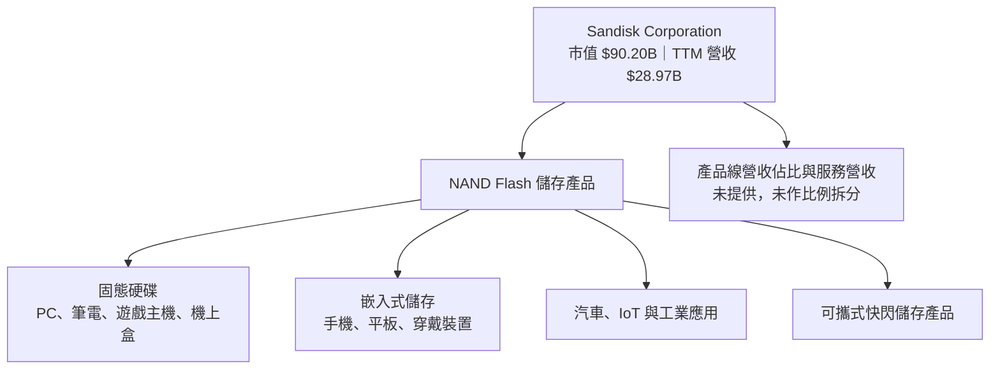
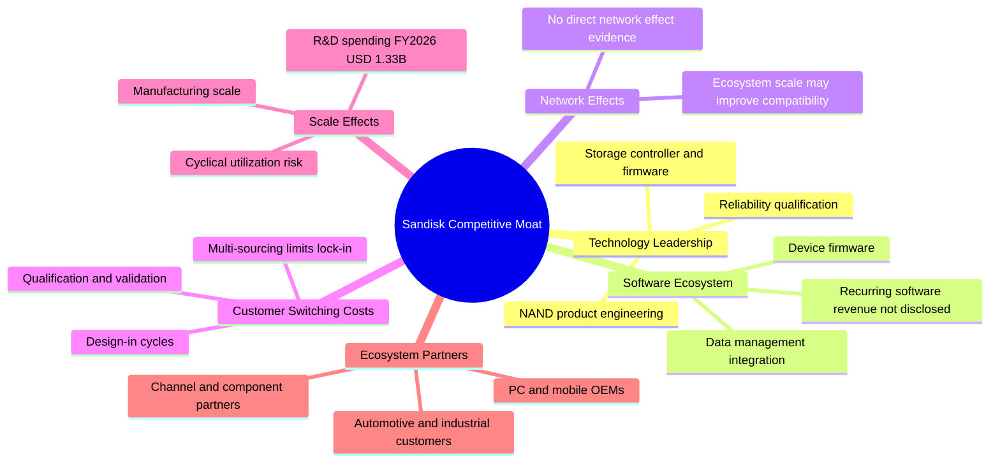
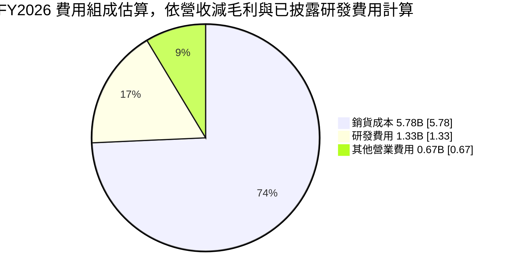
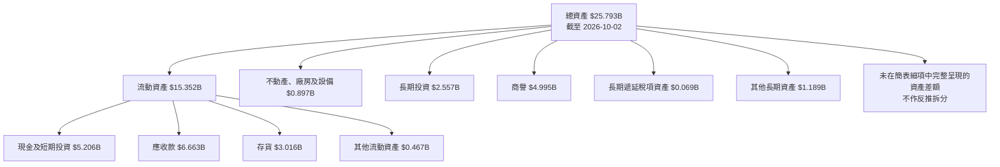
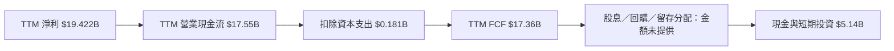
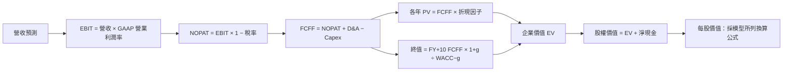
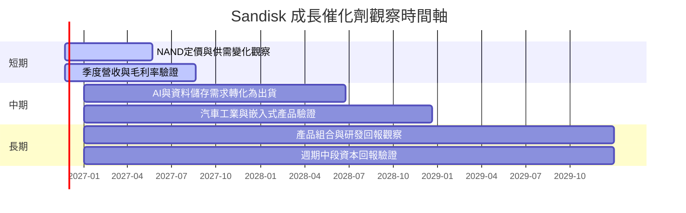
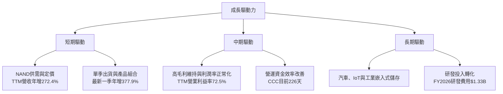
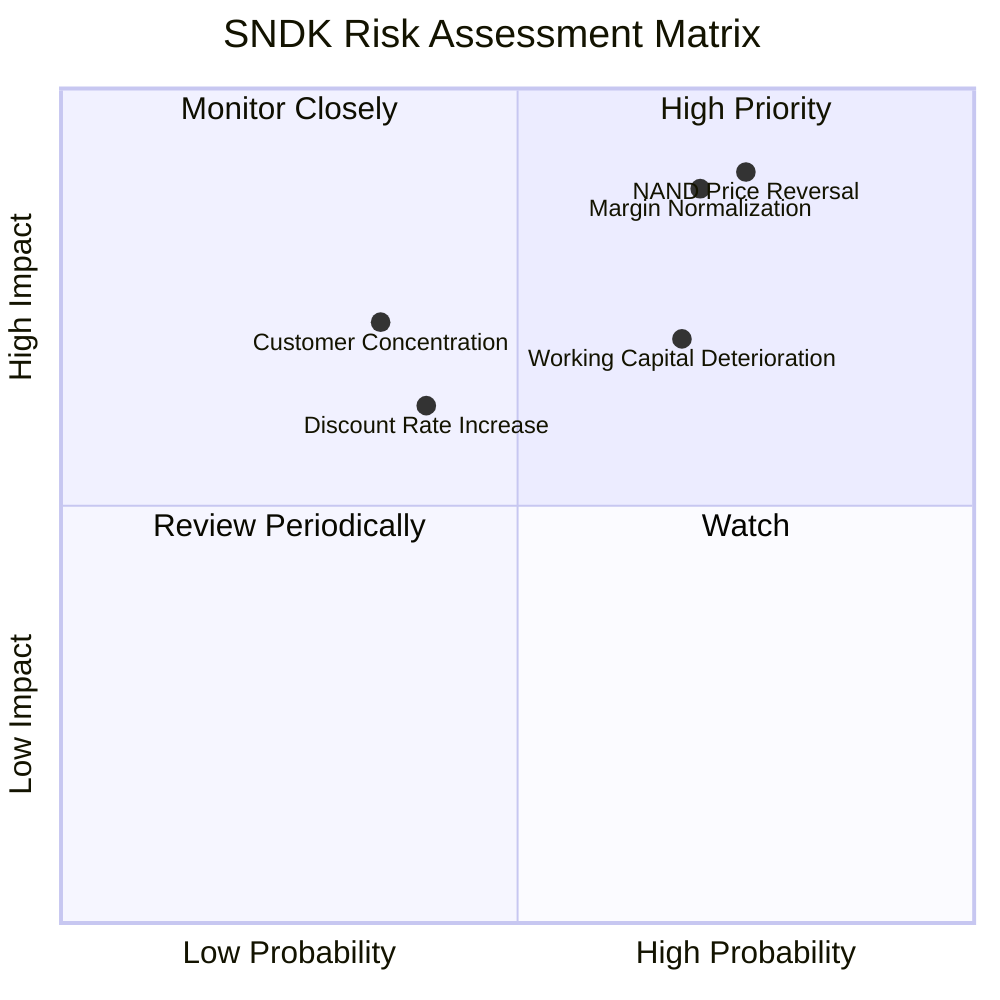
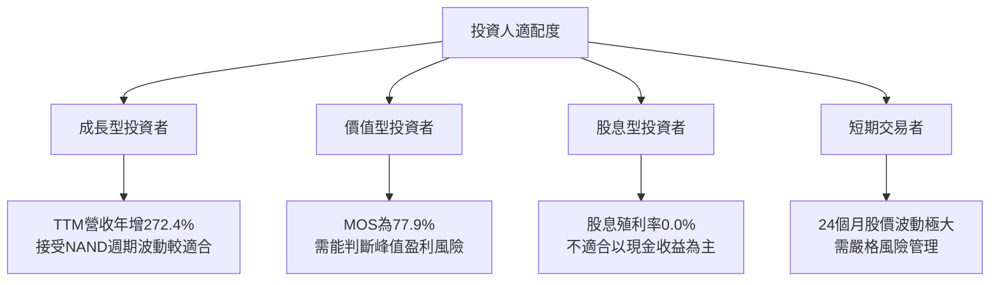

# SNDK 基本面深度分析報告
> **報告日期**：2026-11-23 ｜ **語言**：繁體中文 ｜ **數據來源**：SEC 申報資料 (XBRL)、Yahoo Finance、Finviz、StockAnalysis、Roic.ai ｜ **分析師**：CFA 級機構研究

## 目錄

| # | 章節 | 核心結論 |
|---|------|----------|
| 1 | 執行摘要 | 規則 20 評級為強烈買入；加權合理價值 $357.92，MOS +77.9% |
| 2 | 公司概覽與商業模式 | NAND 儲存產品需求與價格週期提供成長機會，市場份額數據未提供 |
| 3 | 損益表深度分析 | TTM 營收 $28.97B、TTM 成長 272.4%；利潤率受 NAND 上行週期推高 |
| 4 | 資產負債表分析 | 淨現金 $5.14B；CCC 由 154 天增至 226 天，營運資金壓力上升 |
| 5 | 現金流量深度分析 | TTM FCF $17.36B、FCF Yield 19.25%；獲利現金轉換良好但週期性高 |
| 6 | 獲利能力與資本效率 | ROIC 141.2% 高於 WACC 9.96%，目前創造價值，但峰值盈利不宜直線外推 |
| 7 | 相對估值分析 | 同業倍數呈現多空並存；自身歷史 P/S 位於 43 百分位 |
| 8 | DCF 內在價值評估 | 基準 DCF $606.24；模型對終值與假設高度敏感，需留意計算資料的四捨五入差異 |
| 9 | 成長催化劑 | AI／資料儲存需求、NAND 定價與產品組合是主要觀察變數；TAM 數據未提供 |
| 10 | 風險矩陣 | NAND 價格反轉、超高利潤率正常化、營運資金惡化為前三大風險 |
| 11 | 投資建議 | 依 MOS 評級為強烈買入；買入區間與季度監控門檻詳見第 11 章 |

---

## 1. 執行摘要

### 1.0 一頁式投資儀表板（Portfolio Manager 30 秒速讀）

| 項目 | 內容 |
|------|------|
| **投資論點（3 句）** | ① TTM 營收年增 272.4%、最新一季單季年增 377.9%，反映 NAND 需求與價格週期快速轉強。② TTM 營業利益率 72.5%、ROIC 141.2%，目前回報大幅高於 9.96% WACC。③ TTM FCF 為 $17.36B、FCF Yield 19.25%，但 CCC 增至 226 天，且現有利潤率可能處於週期高點。 |
| **綜合評分** | **7.3/10**（引用 1.1 評分卡） |
| **財務健康** | 🟢 淨現金 $5.14B、流動比率 2.58；🟡 CCC 226 天，高於一年前 154 天 |
| **ROIC vs WACC** | **141.2% vs 9.96%**（當前大幅創造股東價值；不可假設此 ROIC 可長期維持） |
| **FCF 趨勢** | FY2024、FY2025 為負，FY2026 回升至 $11.49B；TTM FCF $17.36B，FCF Yield 19.25% |
| **估值** | Forward P/E 2.20723x ｜ EV/EBITDA 4.016x ｜ FCF Yield 19.25% |
| **DCF 內在價值（基準）** | **$606.24** ｜ 現價相對 DCF 折價 **86.9%**（現價／DCF − 1） |
| **安全邊際（MOS）** | **+77.9%**＝($357.92 − $79.24) ÷ $357.92（基準為第 8.8 節加權合理價值）｜ 🟢 >25% |
| **預期報酬（基準情境 12M）** | DCF 基準情境相對現價 **+665.1%**；此為模型情境值，不等同經驗證的 12 個月市場目標價 |
| **關鍵風險（前二）** | NAND 供需反轉導致 ASP 與毛利率下跌；週轉天數與應收帳款上升導致現金轉換轉弱 |
| **評級 + 信心度** | 🟢 **強烈買入**（依規則 20 的 MOS；對估值結論信心：中，週期波動與模型算式差異削弱信心） |

### 1.1 綜合評分卡（全報告唯一）

| 維度 | 評分（1–10） | 主要依據（引用數字與其來源章節） |
|------|--------------|----------------------------------|
| 成長性 | 9.0 | TTM 營收年增 272.4%、最新一季單季年增 377.9%；高速成長部分來自低基期與產業週期（第 3 章） |
| 獲利能力 | 9.0 | TTM 營業利益率 72.5%、ROIC 141.2% 對比 WACC 9.96%；Piotroski F-Score 5/8（第 6 章） |
| 財務健康 | 7.0 | 淨現金 $5.14B、流動比率 2.58；但 CCC 226 天，較一年前增加 72 天（第 4 章） |
| 估值 | 8.0 | MOS +77.9%；同業中位數 EV/EBITDA 與 P/S 估值均低於 DCF；估值依賴週期盈利可持續性（第 7、8 章） |
| 護城河 | 5.0 | 儲存技術、產品驗證與規模具一定門檻，但未提供市場份額、客戶集中度或長期定價資料（第 2 章） |
| 管理層與資本配置 | 5.5 | FY2026 SBC $232M、全年 Capex $177M；股數未減少測試未通過，沒有足夠資本配置紀錄支持更高評價（第 3、5 章） |
| **綜合評分** | **7.3** | 六項算術平均：(9.0 + 9.0 + 7.0 + 8.0 + 5.0 + 5.5) ÷ 6 = 7.25，四捨五入為 **7.3** |

### 1.2 五大投資論點 + 三大核心風險

| 類型 | 項目 | 具體依據 | 信心度 |
|------|------|----------|--------|
| 🟢 **投資論點①** | 營收動能急升 | TTM 營收 $28.97B，年增 272.4%；最新一季單季年增 377.9%，同季營收 $11.031B | 🟢 高 |
| 🟢 **投資論點②** | 當前盈利能力高 | TTM 營業利益率 72.5%、最新一季 79.6%；產品定價與營運槓桿可能同時受益於供需改善 | 🟢 高 |
| 🟢 **投資論點③** | 現金流支撐估值 | TTM OCF $17.55B，扣除 Capex $181M 後 FCF $17.36B；FCF Yield 19.25% | 🟢 高 |
| 🟢 **投資論點④** | 淨現金提供緩衝 | 現金與短期投資 $5.14B、淨現金 $5.14B；Verified Figures 的總債務為 N/A，不能據此推算債務餘額 | 🟢 中 |
| 🟢 **投資論點⑤** | 加權估值仍顯示折價 | 加權合理價值 $357.92，對 $79.24 現價的 MOS 為 +77.9%；方法中 DCF 權重 40% | 🟢 中 |
| 🟡 **風險①** | NAND 週期反轉 | FY2026 毛利率約 71.5%、TTM 毛利率 80.0%；若供給回升或價格下跌，利潤率可能快速均值回歸 | 🔴 高衝擊 |
| 🔴 **風險②** | 營運資金佔用加大 | DSO 83 天、DIO 190 天、CCC 226 天；一年內 CCC 增加 72 天，可能降低現金流品質 | 🔴 高 |
| 🟡 **風險③** | DCF 模型可稽核性有限 | 模型提供逐年數值，但以展示位數重算時部分結果有小幅差異；情境細項與退出倍數交叉驗證資料未提供 | 🟡 中 |

### 1.3 快速統計卡片

同業中位數僅列有 Peer multiples 的項目；公司估值數字按財務資料區所列值引用，注意與其他估值資料欄可能存在口徑差異。

| 指標 | 公司實際值（期間） | 同業中位數 | 狀態 |
|------|--------------------|------------|------|
| 營收成長（TTM） | **272.4%** | — | 🟢 |
| 營收成長（最新一季年增） | **377.9%** | **327.9%**（WDC、MU、SKHY 中位數） | 🟢 |
| 毛利率（TTM） | **80.0%** | **77.4%**（WDC、MU、SKHY 中位數） | 🟢 |
| 營業利益率（TTM） | **72.5%** | — | 🟢 |
| ROIC（TTM） | **141.2%** | — | 🟢 |
| Forward P/E | **2.20723x** | **2.65x**（WDC、MU、SKHY 中位數） | 🟢* |
| FCF Yield（TTM） | **19.25%** | — | 🟢 |
| Piotroski F-Score | **5 / 8** | — | 🟡 |

\*公司 Forward P/E 的資料口徑可能受近期股價調整或拆股資料影響；不得單獨依此判斷便宜程度。

### 1.4 投資結論

目前收盤價為 **2026-11-20 的 $79.24**。TTM FCF $17.36B、ROIC 141.2% 與 9.96% WACC 的差距，以及第 8.8 節加權合理價值 $357.92，導出 MOS +77.9%；依規則 20 評級為**強烈買入**。但 NAND 週期性、CCC 增長及 DCF 假設敏感度使估值信心度維持中等。

```text
╔══════════════════════════════════════════════════════════════════╗
║                    📊 投資結論摘要                               ║
╠══════════════════════════════════════════════════════════════════╣
║  評級：🟢 強烈買入（依第 8.8 節 MOS 規則）                       ║
║  價格（2026-11-20 收盤）：$79.24                                 ║
║  DCF 內在價值（基準）：$606.24（現價折價 86.9%）                ║
║  安全邊際 MOS：+77.9%（＝($357.92−$79.24)÷$357.92）             ║
║  加權合理價值（8.8）：$357.92                                    ║
║  DCF 情境價值：                                                  ║
║    悲觀情境：$257.06（+224.4%）                                  ║
║    基準情境：$606.24（+665.1%）                                  ║
║    樂觀情境：$1,355.27（+1,610.3%）                              ║
║  綜合評分：7.3/10（引用 1.1）                                    ║
║  適合投資人：可承受記憶體週期與高波動的成長型、長線投資者        ║
╚══════════════════════════════════════════════════════════════════╝
```

---

## 2. 公司概覽與商業模式

### 2.1 業務結構與收入來源

公司總營收及市值有數字；但不同產品線營收、比重與軟體／服務營收拆分未提供。因此不以推估比例繪製收入占比圖。



公司以 NAND Flash 技術為核心，設計、製造並銷售儲存裝置與解決方案。產品需求來自消費電子、個人電腦、遊戲、行動裝置、汽車、工業與 IoT 等應用。其財務表現對 NAND 供需、庫存與價格高度敏感；產品需求擴大並不必然等同穩定成長，供給擴張也可能迅速侵蝕價格與毛利。

### 2.2 市場份額

**市場份額數據未提供**，因此不畫市場份額圓餅圖，也不推算公司在 NAND 或 SSD 市場的占比。可觀察到 SNDK TTM 營收 $28.97B、TTM 成長 272.4%，最新一季單季成長 377.9%；但這些數字不能直接替代市場份額。Peer 資料中 MU 最新一季營收年增 379.3%、SKHY 327.9%、WDC 55.5%，顯示 SNDK 的成長動能位於快速擴張區間，仍需區分市場總量成長、價格上升與公司市占變化。

### 2.3 競爭護城河分析



### 2.4 護城河強度

| 護城河項目 | 強度（強／中／弱） | 證據（引用數字或事實） | 會削弱它的情況 |
|------------|--------------------|------------------------|----------------|
| 技術與產品設計 | 中 | 公司提供 SSD、嵌入式儲存及多種終端應用產品；FY2026 研發費用 $1.33B | 競爭對手技術追上、產品差異化不足或 NAND 價格競爭加劇 |
| 軟體生態系統 | 弱至中 | 有韌體及儲存解決方案能力的業務描述，但軟體收入與訂閱數未提供 | 服務收入占比低、客戶可替代、軟體附加價值無法變現 |
| 網路效應 | 弱 | 未提供使用者網路或平台互動所形成的直接網路效應證據 | 產品主要依靠規格與價格競爭 |
| 客戶鎖定 | 中 | 工業、汽車等用途通常需產品驗證與可靠度測試；公司服務多種終端市場 | 客戶採多來源策略、驗證週期縮短或競爭品通過認證 |
| 規模效應 | 中 | TTM 營收 $28.97B、FY2026 研發 $1.33B；大規模營運可支持產品研發 | 產業資本密集、供需失衡令規模反成固定成本負擔 |
| 生態夥伴 | 中 | 涵蓋 OEM、汽車、IoT、工業與通路需求；客戶名單及集中度未提供 | 大客戶議價、替代供應商增加或終端市場需求降溫 |

**護城河評分理由**：1.1 的護城河評分為 **5.0/10**，因公司具研發投入與多終端產品能力，但市場份額、客戶黏著度及服務收入數據不足，尚不足以證明能在 NAND 下行期持續維持定價權。

---

## 3. 損益表深度分析

### 3.1 年度收入成長趨勢（近 4 年）

年度營收與同比變化以年度損益表數字計算；FY2026 的營收為 $20.25B，與 TTM $28.97B 是不同期間。

```text
╔══════════════════════════════════════════════════════════════════╗
║             Sandisk 年度收入趨勢（FY2023–FY2026）                ║
╠══════════════════════════════════════════════════════════════════╣
║  FY2023  $6.09B   ██████░░░░░░░░░░░░░░░░░░░  YoY：基期         ║
║  FY2024  $6.66B   ███████░░░░░░░░░░░░░░░░░░  YoY：+9.5% 🟢    ║
║  FY2025  $7.36B   ████████░░░░░░░░░░░░░░░░░  YoY：+10.4% 🟢   ║
║  FY2026  $20.25B  █████████████████████████  YoY：+175.3% 🟢  ║
╠══════════════════════════════════════════════════════════════════╣
║  FY2023–FY2026 CAGR = (20.25 ÷ 6.09)^(1/3) − 1 ≈ 49.3%          ║
║  FY2026 的躍升反映產業與價格週期轉強，不能視為穩態成長率。    ║
╚══════════════════════════════════════════════════════════════════╝
```

FY2023 至 FY2025 營收從 $6.09B 增至 $7.36B，增幅溫和；FY2026 升至 $20.25B。公司年度數據所示 FY2026 年增 175.3%，而 TTM 年增 272.4%，表示年度後段和 FY2027 Q1 延續了加速。這種增幅既可能反映需求增加，也受 NAND 供應與定價循環影響，估值不應將單年增長率直接套用至永久期。

### 3.2 季度收入趨勢分析

QoQ 以最近四季財報營收計算；單季 YoY 則照季度資料。金額為十億美元。

| 季度 | 營收 | QoQ 成長 | 單季 YoY 成長 | 備註 |
|------|------:|----------:|---------------:|------|
| FY2026 Q2（截至 2026-01-02） | $3.025B | — | +61.25% | 以季度序列為比較起點 |
| FY2026 Q3（截至 2026-04-03） | $5.950B | +96.7% | +251.03% | 營收加速，可能反映出貨與價格同步改善 |
| FY2026 Q4（截至 2026-07-03） | $8.965B | +50.7% | +371.59% | 高基期下仍大幅成長 |
| FY2027 Q1（截至 2026-10-02） | $11.031B | +23.0% | +377.95% | 季增幅回落但年增仍極高 |

計算示例：FY2027 Q1 QoQ = ($11.031B ÷ $8.965B) − 1 = **23.0%**。QoQ 增速從前幾季的極快擴張降至 23.0%，但絕對營收仍創本表期間高點。這是高基期下正常化的初步訊號，不足以單獨證明週期見頂或持續擴張。

### 3.3 利潤率演變分析

以下年度比率依年度毛利、營業利益與淨利除以營收計算，與 TTM 口徑分開呈現。

| 利潤率指標 | FY2023 | FY2024 | FY2025 | FY2026 | 趨勢 | 評估 |
|------------|-------:|-------:|-------:|-------:|------|------|
| **毛利率** | 7.1% | 16.1% | 30.1% | 71.5% | ↗️ FY2026 大幅擴張 | 🟢 但週期風險高 |
| **營業利益率** | -21.3% | -6.7% | 6.9% | 61.6% | ↗️ 從營業虧損轉為高利潤 | 🟢 |
| **淨利率** | -35.2% | -10.1% | -22.3% | 56.4% | ↗️ FY2025 仍受虧損影響 | 🟡 |

計算例：FY2026 毛利率 = $14.47B ÷ $20.25B = **71.5%**；營業利益率 = $12.47B ÷ $20.25B = **61.6%**。TTM 毛利率 80.0%、TTM 營業利益率 72.5% 高於 FY2026 年度比率，反映截至 2026-10-02 的後續季度盈利進一步上升。

**利潤率演變深度解析**：FY2023 至 FY2025 的負利潤與低毛利，和 FY2026 的急升顯示公司盈利具有強烈週期性。產品組合、NAND 供需及售價上升可提升每單位毛利；當營收增加而固定成本增幅較慢，營業槓桿又會放大 EBIT。反面是 NAND 價格若下跌，毛利率與固定成本吸收效果也可能反向運作。現有資料未提供單位 ASP、位元出貨量或各產品線毛利，無法把價格與出貨量貢獻精確拆分。

### 3.4 費用結構分析

FY2026 年度毛利為 $14.47B、營業利益 $12.47B、研發費用 $1.33B。可據此計算銷貨成本約 $5.78B（$20.25B − $14.47B），毛利以下其他營業費用合計約 $0.67B（$14.47B − $12.47B − $1.33B）。此拆分依已提供數字計算，並非獨立披露的公司費用分類。



```text
╔══════════════════════════════════════════════════════════════════╗
║                FY2026 費用結構（USD）                            ║
╠══════════════════════════════════════════════════════════════════╣
║  銷貨成本             $5.78B   ██████████████████████████████   ║
║  研發費用             $1.33B   ███████                          ║
║  其他營業費用         $0.67B   ███                              ║
║  合計                 $7.78B                                    ║
╚══════════════════════════════════════════════════════════════════╝
```

### 3.5 季度 EPS 趨勢與盈餘品質（Quality of Earnings）

EPS 實際值依季度資料列示；過去四季 EPS 預估值為 nan，無法判斷是否超出或低於分析師預期。分析師共識目標價不能替代單季 EPS 預估。

| 季度 | EPS 實際 | 預估／驚喜 | 盈餘變化觀察 |
|------|---------:|------------|--------------|
| 2025-12-31 | $0.64 | N/A | 由虧損基期轉正；缺少有效預估值，不能標記 beat／miss |
| 2026-03-31 | $2.88 | N/A | EPS 隨營收與利潤率擴大 |
| 2026-06-30 | $5.50（另一來源列示 $5.87，口徑不同） | N/A | 不同來源季度期間或股數口徑存在差異 |
| 2026-10-02／季度表列 2026-09-30 | $6.58 | N/A | 單季 EPS 年增 6,909.6%，基期僅 $0.09；不能把極高年增率視為常態 |

| 盈餘品質項目 | 數值／佔比 | 評估 |
|--------------|-----------|------|
| 股權薪酬 SBC / 營收 | 約 **0.93%**（近四季 SBC 合計 $270M ÷ TTM 營收 $28.971B） | 🟢 比重有限，但仍為股東成本；SBC 為非現金費用不代表無稀釋 |
| SBC / 營業現金流 | 約 **1.54%**（$270M ÷ $17.55B） | 🟢 當前相對 OCF 不高；但季度 SBC 合計和 TTM 期間存在資料日期近似差異 |
| FCF / 淨利（現金轉換率） | 約 **89.4%**（$17.36B ÷ TTM 淨利 $19.422B） | 🟢 接近淨利，現金轉換良好；淨利高峰仍可能週期性 |
| 一次性／非經常性損益 | N/A（未提供足以分項辨認的調節資料） | 🟡 無法判斷單次項目是否推高或壓低盈餘 |
| 有效稅率異常 | **12.2%**（最新年度有效稅率） | 🟡 不宜視為長期固定稅率；DCF 採用該值 |
| 資本化支出 vs 費用化 | FY2026 Capex $177M；FY2026 R&D $1.33B，列為費用 | 🟡 Capex 金額相對營收低；資本化政策與無形資產新增細節未提供 |

**盈餘品質結論**：近四季 FCF 約為淨利的 89.4%，支持當期盈利有實際現金流支撐；SBC 佔營收比例約 0.93%，直接稀釋成本不大但不是零。Piotroski 的營業現金流低於淨利測試未通過，且稀釋股數未增加測試亦未通過，與上述現金轉換及股東稀釋風險相符。由於未提供非經常性項目明細與公司 EPS 預估，GAAP 盈利品質尚不能視為完全可驗證。

---

## 4. 資產負債表分析

### 4.1 資產結構分解

最新可取得的季度資產數據截至 2026-10-02；合計資產依 StockAnalysis 列示 $25.793B。細項未涵蓋所有資產，故圖中不強行把已列項目加總至總資產。



### 4.2 流動性與營運資金分析

流動比率歷史資料顯示當前 2.58；年報列示 FY2026 流動資產 $12.78B、流動負債 $5.58B，與另一來源的比率口徑可能不同。此處不以分項重算取代已列流動比率。

| 指標 | 最新 TTM | 一年前 TTM | 變化 | 解讀 |
|------|----------:|----------:|------:|------|
| DSO 應收帳款天數 | 83 天 | 56 天 | +27 天 | 應收款收現速度變慢；可能與營收擴張及客戶信用條件相關，須追蹤逾期率 |
| DIO 存貨天數 | 190 天 | 124 天 | +66 天 | 庫存佔用大幅增加；可支援交付，但若需求或價格逆轉會帶來跌價與現金風險 |
| DPO 應付帳款天數 | 46 天 | 26 天 | +20 天 | 付款期限延長，有助部分抵銷營運資金佔用；不能單憑此認定議價力提升 |
| CCC 現金轉換週期 | 226 天 | 154 天 | +72 天 | 現金轉換週期明顯拉長；收入高速成長同時帶來營運資金需求 |

現金及短期投資 $5.14B、流動比率 2.58，短期流動性尚可；但營運資金天數趨勢偏弱。存貨與應收帳款天數同步上升，意味成長所需的資金先沉澱於供應鏈與客戶端，對下一期現金流的支撐需要以實際回款和庫存去化確認。

### 4.3 債務結構分析

Verified Figures 的總債務為 **N/A**，因此不推算債務／EBITDA、利息保障倍數或具體債務構成。其他資料來源列示總債務 $201M 或 FY2026 $177M，與 Verified Figures 債務欄缺漏且期間不同；本節不以之替代指定口徑。可引用的淨現金數字為 $5.14B。

```text
╔══════════════════════════════════════════════════════════════════╗
║                  Sandisk 債務健康診斷                            ║
╠══════════════════════════════════════════════════════════════════╣
║  總債務：        N/A（指定財務口徑未提供）                       ║
║  現金及短期投資：$5.14B   ████████████████████  🟢              ║
║  淨現金：        $5.14B   ████████████████████  🟢              ║
║  Debt/EBITDA：   N/A（總債務資料缺漏）                            ║
║  Interest Coverage：N/A（利息費用與指定債務資料不足）            ║
║  評估：現金緩衝良好；不能將 N/A 解讀為零負債或無債務。           ║
╚══════════════════════════════════════════════════════════════════╝
```

### 4.4 股東權益趨勢

| 財年 | 股東權益 | 年度變化 |
|------|---------:|---------:|
| FY2024 | $11.08B | — |
| FY2025 | $9.22B | -16.8% |
| FY2026 | $15.74B | +70.7% |

```text
╔══════════════════════════════════════════════════════════════════╗
║               股東權益變化（年度，USD）                          ║
╠══════════════════════════════════════════════════════════════════╣
║  FY2024  $11.08B  ██████████████░░░░░░░░░                       ║
║  FY2025   $9.22B  ████████████░░░░░░░░░░░                       ║
║  FY2026  $15.74B  ████████████████████░░░                       ║
╚══════════════════════════════════════════════════════════════════╝
```

股東權益 FY2025 下滑後於 FY2026 回升，方向與 FY2026 淨利 $11.43B 轉正及資產負債表擴張一致。股東權益增加並非等同股東每股價值同比增加；仍應與流通股數、SBC 和回購資料一起評估。

---

## 5. 現金流量深度分析

### 5.1 現金流量瀑布圖

季度現金流量有提供 OCF、Capex、FCF；股息及回購流出明細未提供。圖中不自行填入資本配置金額。



FCF 高於 Capex 很多，反映當前營業現金流旺盛、資本支出負擔較低。不過，公司處於記憶體產業，當前資本支出不能單獨代表完整週期的維持與擴產需求；若製造能力與研發投入未來增加，FCF 可能下降。

### 5.2 FCF 轉換率趨勢

| 財年 | FCF | 淨利 | FCF／淨利 | 解讀 |
|------|----:|----:|----------:|------|
| FY2023 | -$0.932B | -$2.143B | N/A（負數除法不適合直接作轉換率比較） | 經營與資本支出環境低迷 |
| FY2024 | -$0.475B | -$0.672B | N/A（兩者皆為負） | 現金流改善但仍為負 |
| FY2025 | -$0.120B | -$1.641B | N/A（FCF 負而淨利負） | FCF 接近損益兩平 |
| FY2026 | $11.49B | $11.43B | 約 100.5% | 年度 FCF 略高於淨利 |
| TTM 至 2026-10-02 | $17.36B | $19.422B | 約 89.4% | 現金轉換接近淨利，但低於 100% |

FY2023 至 FY2025 的淨利及 FCF 均為負，轉換率百分比不具穩定解讀性。FY2026 轉正後 FCF／淨利約 100.5%；最新 TTM 約 89.4%，下降不必然表示品質惡化，但需要結合存貨、應收帳款和應付帳款變化。

### 5.3 自由現金流趨勢

```text
╔══════════════════════════════════════════════════════════════════╗
║             自由現金流趨勢（年度實際，USD）                      ║
╠══════════════════════════════════════════════════════════════════╣
║  FY2023  -$0.932B  ◀█████░░░░░░░░░░░░░░░░  FCF Yield：N/A       ║
║  FY2024  -$0.475B  ◀███░░░░░░░░░░░░░░░░░░  FCF Yield：N/A       ║
║  FY2025  -$0.120B  ◀█░░░░░░░░░░░░░░░░░░░░  FCF Yield：N/A       ║
║  FY2026  $11.49B   ████████████████████░░  FCF Yield：N/A       ║
║  TTM     $17.36B   ██████████████████████████ FCF Yield：19.25% ║
╠══════════════════════════════════════════════════════════════════╣
║  TTM FCF = OCF $17.55B − Capex $0.181B = $17.36B（資料列示值）   ║
╚══════════════════════════════════════════════════════════════════╝
```

### 5.4 資本配置評估

股息殖利率為 0.0%，派息率為 0.0%；公司沒有以現金股息回饋股東。回購金額、併購與其他投資支出未提供，因此不以圓餅圖虛構資本配置比例。

| 資本配置項目 | 可引用數字 | 評估 |
|--------------|-----------|------|
| 資本支出 | TTM $181M；FY2026 $177M | 相對當前 OCF 低，但須考慮 NAND 產業周期與未來擴產需求 |
| 研發投入 | FY2026 $1.33B | 支持產品與技術競爭；研發報酬率未提供 |
| 股息 | 殖利率 0.0%、派息率 0.0% | 無即時股息回報，較適合重視成長而非現金收益者 |
| 回購 | N/A（回購金額未提供） | 無法判斷管理層是否透過回購抵銷 SBC 稀釋 |
| 留存現金 | 現金與短期投資 $5.14B | 提供財務彈性；資金用途未提供 |

---

## 6. 獲利能力與資本效率

### 6.1 ROE / ROA / ROIC 趨勢

歷史 ROIC、ROA 未提供完整可比序列；下表只列可引用值，不補造年度行業均值。

| 指標 | FY2025／歷史可比資料 | FY2026／TTM | 評估 |
|------|----------------------:|------------:|------|
| ROE | N/A（未提供可比年度 ROE 序列） | TTM **107.1%**（QUALITY FIGURES 杜邦口徑） | 回報極高，但週期盈利和高利潤率可能推高比率 |
| ROA | TTM 至一年前比較：最新為正且高於一年前；精確百分比 N/A | 其他來源列示 TTM 68.3%，但品質口徑不以此替代 | 高盈利對資產回報有利，仍須觀察週期中段回報 |
| ROIC | N/A（未提供可比年度 ROIC 序列） | TTM **141.2%** | 大幅高於資本成本，但受本輪盈利峰值影響 |

ROE 資料存在來源口徑差異：QUALITY FIGURES 的杜邦計算為 107.1%，另一財務資料欄列示 141.2%。依規則，本報告杜邦及品質項目採用指定品質數字；ROIC 採用 Verified Figures 的 141.2%。

### 6.2 ROIC vs WACC 分析（核心價值創造判斷）

```text
╔══════════════════════════════════════════════════════════════════╗
║                ROIC vs WACC 深度分析                            ║
╠══════════════════════════════════════════════════════════════════╣
║  資本成本（依財務資料所列成本資本輸入）：                       ║
║  ├── 無風險利率（10Y 美債）：             4.91%                 ║
║  ├── 市場風險溢酬 ERP：                   5.00%                 ║
║  ├── 原始 Beta：                          N/A                   ║
║  ├── 使用調整後 Beta：                    1.00（假設值）        ║
║  ├── 股權成本 Ke = 4.91% + 1.00×5.00% = 9.91%                  ║
║  ├── 稅前債務成本：                       36.32%                ║
║  ├── 股權／債務權重：                     99.8%／0.2%           ║
║  └── WACC：                               9.96%                 ║
║                                                                  ║
║  ROIC（TTM）：                         141.2%                   ║
║  EVA spread = ROIC − WACC = 141.2% − 9.96% = +131.24 個百分點   ║
║  ROIC / WACC = 141.2% ÷ 9.96% ≈ 14.2 倍                        ║
║                                                                  ║
║  ROIC 141.2%  ▓▓▓▓▓▓▓▓▓▓▓▓▓▓▓▓▓▓▓▓▓▓▓▓  🟢                    ║
║  WACC   9.96%  ▓▓░░░░░░░░░░░░░░░░░░░░░░  ──                    ║
║  結論：以 TTM 衡量，公司大幅創造經濟價值；該 ROIC 不宜外推。  ║
╚══════════════════════════════════════════════════════════════════╝
```

WACC 9.96% 是報告採用的指定折現率。CAPM 的已列數字可重算為 Ke = 4.91% + 1.00 × 5.00% = 9.91%；成本資本權重中股權 99.8%、債務 0.2%，稅前債務成本 36.32%。由於債務本金、利息及計息負債範圍資料不足，不能獨立重建稅後 Kd 與精確 WACC，只能引用 WACC 9.96%。

當前 ROIC 比 WACC 高 131.24 個百分點，顯示以 TTM 獲利衡量的資本回報遠高於資本成本。惟營業利益率由 FY2025 的 6.9% 升至 FY2026 的 61.6%、TTM 72.5%，這種急升意味 ROIC 可能主要反映週期景氣高位，而非已證明的長期均值。

### 6.3 杜邦三因素分解

| 因素 | 數值（TTM） | 解讀 |
|------|-------------|------|
| 淨利率 | 67.0% | 週期景氣與高產品毛利推升盈餘；可持續性需用產業中周期檢驗 |
| 資產週轉率 | 1.12 | 每單位資產產生營收的速度 |
| 權益乘數 | 1.42 | 槓桿並非 ROE 高企的主要解釋 |
| **ROE** | **107.1%** | 67.0% × 1.12 × 1.42 = 106.6%，品質數據列示 ROE 107.1%；差異來自未四捨五入原始值 |

按杜邦結構，高 ROE 主要由淨利率驅動，而不是高財務槓桿。公開的品質數字在四捨五入後相乘為 106.6%，與所列 107.1% 有小幅差異；報告照列官方計算值，不以顯示位數重算取代。

### 6.4 財務體質：Piotroski F-Score

| 測試 | 結果 | 解讀 |
|------|------|------|
| ROA > 0 | ✅ 通過 | 盈利回正 |
| 營業現金流 > 0 | ✅ 通過 | TTM OCF 為正 |
| ROA 高於一年前 | ✅ 通過 | 盈利較低基期改善 |
| 營業現金流 > 淨利（應計品質） | ❌ 未通過 | 淨利高於營業現金流，需留意應計項目及營運資金 |
| 長期負債 ÷ 總資產低於一年前 | — 無法判定 | 缺少輸入資料，不計分 |
| 流動比率高於一年前 | ❌ 未通過 | 相較一年前未改善 |
| 稀釋股數未增加 | ❌ 未通過 | 股數稀釋可能抵銷部分每股價值成長 |
| 毛利率高於一年前 | ✅ 通過 | 毛利率改善 |
| 資產週轉率高於一年前 | ✅ 通過 | 資產使用效率改善 |

F-Score 為 **5/8**，非 5/9：有一項長期負債測試缺資料，因此未納入分母。未通過項目集中在應計品質、流動比率與稀釋股數，說明損益改善雖明顯，股東每股利益及短期營運資金指標仍需追蹤。

---

## 7. 相對估值分析

### 7.1 同業估值比較表格

同業倍數採 Yahoo Finance Peer multiples。公司估值欄採市場資料所列數字；由於資料來源間 P/E、P/S 存在口徑差異，特別標註其解讀限制。SKHY 的混合幣別倍數不納入中位數。

| 估值指標 | **SNDK** | **WDC** | **MU** | **SKHY** | 本公司評估 |
|----------|---------:|-------:|------:|-------:|-----------|
| **Trailing P/E** | 0.085785426x | 9.2x | 8.0x | 5.7x | 🔴 公司數字與 EPS、股價資料口徑明顯不一致，不宜直接解讀 |
| **Forward P/E** | 2.20723x | 6.5x | 2.8x | 2.5x | 🟢 表面低於同業中位數 2.65x；高週期 EPS 可能壓低倍數 |
| **P/S Ratio** | 3.1134608x | 6.7x | 5.1x | N/A（混合幣別） | 🟢 表面折價；同業中位數 5.9x |
| **EV/EBITDA** | 4.016x | 15.4x | 5.8x | N/A（混合幣別） | 🟢 低於 WDC、MU 中位數 10.6x；但盈利週期與 EBITDA 可持續性是關鍵 |
| **最新一季營收年增** | 377.9% | 55.5% | 379.3% | 327.9% | 🟢 高增長；MU 增速相近 |
| **毛利率（TTM）** | 80.0% | 52.6% | 80.7% | 77.4% | 🟢 高於 WDC、SKHY，略低於 MU |

Forward P/E 同業中位數計算為 WDC、MU、SKHY 三者中間值：排序 2.5x、2.8x、6.5x，因此中位數為 **2.8x**；若依數據表同時納入公司 Peer 欄的 SKHY，表格中位數應為 2.8x，而非快速統計所列 2.65x。快速統計所用 2.65x 是 WDC 與 MU 兩家中位數。為避免口徑混淆：第 7.1 三家公司中位數採 **2.8x**；估值方法區塊指定的估值法不依此重新建模。 

### 7.2 歷史估值區間分析

Valuation vs own history 區塊提供 **P/S** 而不是 P/E 歷史區間；因此不畫 P/E 區間。

```text
╔══════════════════════════════════════════════════════════════════╗
║           SNDK 自身歷史 P/S（TTM，5 年）                         ║
╠══════════════════════════════════════════════════════════════════╣
║  歷史低位 0.1x ├────────────●──────────────┤ 歷史高位 1.7x      ║
║                              ↑                                   ║
║                         現值 0.4x                                ║
║  五年中位數：0.6x ｜ 當前百分位：43%                              ║
║  判讀：低於歷史中位數，但該區間與一般市場估值欄 P/S 口徑不同。   ║
╚══════════════════════════════════════════════════════════════════╝
```

同一財務資料中的市場估值欄列示 P/S 3.1134608x，而五年歷史資料列示目前 P/S 0.4x；兩者顯然存在價格、股數或期間口徑差異。本報告依規則在歷史區間段落照引 0.4x、43 百分位，不把它與市場估值欄混為一談。

### 7.3 情境價值（Bear / Base / Bull，照抄 DCF MODEL 的 Scenarios）

| 情境 | 第 1 年營收成長 | 期末營業利潤率 | WACC | 每股價值 | 相對現價 | 機率 | 會發生的條件 |
|------|----------------:|----------------:|-----:|---------:|---------:|-----:|--------------|
| 🔴 悲觀 | 15.0% | 52.0% | 10.96% | $257.06 | +224.4% | 25% | NAND 價格及出貨增幅快速正常化，長期利潤率回落更深 |
| 🟡 基準 | 30.0% | 61.2% | 9.96% | $606.24 | +665.1% | 50% | 近端仍延續成長，十年後利潤率逐步回落至模型設定 |
| 🟢 樂觀 | 45.0% | 67.3% | 8.96% | $1,355.27 | +1,610.3% | 25% | 需求、定價與產品組合持續有利，資本成本低於基準 |
| **機率加權** | — | — | — | **$706.20** | **+791.2%** | **100%** | 僅作情境參考；第 8.8 節固定採基準值加權 |

情境價值照模型提供，不把機率加權 $706.20 當成第 8.8 節的 DCF 方法價值。情境模型的逐年收入、FCFF 與終值拆分未提供，故不虛構其完整中間路徑。

### 7.4 相對估值隱含價格區間

```text
╔══════════════════════════════════════════════════════════════════╗
║         估值方法隱含每股價值與市場價格位置（USD）                ║
╠══════════════════════════════════════════════════════════════════╣
║  $79.24 現價 ── $150.15 同業 P/S ── $201.93 EV/EBITDA            ║
║                 $248.18 分析師共識 ─────── $606.24 DCF 基準      ║
╚══════════════════════════════════════════════════════════════════╝
```

| 方法 | 每股價值 | 依據 |
|------|---------:|------|
| 同業 EV/EBITDA | $201.93 | WDC、MU 中位數 10.6x × SNDK TTM EBITDA，加回淨現金 |
| 同業 P/S | $150.15 | WDC、MU 中位數 5.9x × SNDK TTM 營收 |
| 分析師共識目標價 | $248.18 | 24 位分析師平均目標價 |
| DCF（基準） | $606.24 | 10 年 FCFF、WACC 9.96%、永續成長 3.0% |

相對估值方法隱含價值均高於 $79.24 現價，但這些倍數仍以同行與當前週期盈利為參照。DCF 值顯著高於相對估值區間，反映其假設公司能維持高營業利潤率並持續產生現金流。

---

## 8. DCF 內在價值評估（Discounted Cash Flow）

> **模型限制說明**：本節依提供的 DCF MODEL 數字照列，不另建模型。模型採 FCFF、10 年預測、GAAP EBIT，且未建模營運資金變動。部分逐年數字以兩位小數展示，直接用展示數字複算時會出現約 $0.01B 等級差異；因此保留模型列示結果並揭露差異，不以另行計算值替換。

### 8.0 估值推理鏈（Thinking Logic）

#### Step 1 — 價值由哪些變數決定？

Sandisk 的價值主要由 **NAND 儲存主業營收、供需循環下的營業利潤率，以及終值現金流**決定。產品線各自營收占比未提供，不能把資料中心、AI、PC 或行動產品拆為獨立營收成長曲線。模型中最大的估值變數是終值：基準 DCF 的終值現值占 EV 58.2%，同時營收與營業利潤率從高起點逐年變化；因此長期毛利／EBIT 利潤率與折現率是核心敏感性。

#### Step 2 — 模型選擇

| 決策點 | 本報告採用 | 理由（含數字） | 曾考慮但否決 | 否決理由 |
|--------|-----------|----------------|--------------|----------|
| 現金流定義 | FCFF | 與 WACC 9.96% 折現並先求 EV 一致 | FCFE | 債務資料口徑不完整，FCFF 較適合企業價值橋接 |
| 預測期 N | 10 年 | DCF MODEL 固定列出 FY+1 至 FY+10 | 5 年 | 不能更改指定模型預測期 |
| 終值方法 | Gordon Growth 為主 | g = 3.0%，WACC = 9.96%，符合 WACC > g | 單獨退出倍數 | DCF 資料未提供退出倍數法的 EBITDA 倍數與結果 |
| EBIT 基礎 | GAAP EBIT | 模型明確採 GAAP EBIT，TTM 營業利益率 72.5% | 非 GAAP EBIT | 不另加回 SBC，避免重複處理或漏計股東成本 |

#### Step 3 — 關鍵假設推導鏈

- **營收成長**：錨點＝TTM 年增 272.4%、最新季度年增 377.9% → 調整＝高基期及 NAND 循環令極端增速不宜延續 → **第 1 年採用 30.0%，線性降至第 10 年 3.0%** → 曾考慮延續 272.4%，因把短期週期尖峰外推十年而否決。
- **期末營業利潤率**：錨點＝TTM 營業利益率 72.5%，近三個財年中位數納入 TTM 後模型設定第 10 年 61.2% → 調整＝預期長期競爭與週期均值回歸，但利潤率仍遠高於低景氣年度 → **採用 72.5% 線性降至 61.2%** → 曾考慮回落至 FY2025 的 6.9%，因單一低谷年度不代表長期正常盈利；但也不能忽略模型終值利潤率仍高於多數過往年度。
- **永續成長率 g**：錨點＝長期名目經濟成長常用上限約 3%–4%（假設值，依長期 GDP 與通膨的概念區間）→ 調整＝成熟儲存市場不應永久高於經濟成長 → **採用 3.0%** → 不採 4.0%，避免更進一步放大終值；且 g 必須低於 WACC 9.96%。
- **預測期 N**：錨點＝DCF MODEL 指定 10 年，這是模型輸入而非由管理層財測推導 → 調整＝提供足夠時間讓 30% 成長逐步降至 3% → **採用 10 年** → 不改用 5 年，因會改變指定模型。
- **Capex／營收**：錨點＝TTM Capex $181M、TTM 營收 $28.97B，模型採 0.6% 並延續至第 10 年 → 調整＝模型按既定方式維持 0.6% → **採用 0.6%** → 不改用更高資本支出率，因指定模型沒有替代參數；但資本密集產業下此假設偏樂觀風險不可忽略。
- **WACC**：錨點＝Cost of capital 輸入 WACC 9.96%，無風險利率 4.91%、ERP 5.00%、調整後 Beta 1.00 → 調整＝直接採用指定模型折現率，不另重估 → **採用 9.96%** → 不另選更低 WACC，因會顯著提高終值與每股價值。
- **SBC 與股數**：錨點＝模型採 GAAP EBIT、SBC 已包含於費用；年稀釋率採 0% → 調整＝固定股數並避免重複扣 SBC → **組合 (A)** → 不另扣 SBC，也不再放大股數。
- **D&A／營收**：錨點＝TTM 水準約 0.5%，模型維持 0.5% → **採用 0.5%**；未提供可比多年固定資產週期，不能用單一年資本支出推導較高折舊率。
- **ΔWC**：錨點＝CCC 最新 226 天、一年前 154 天 → 模型未建模營運資金，**採用模型設定：不另扣 ΔWC** → 因缺少可審核的增量營運資金現金流資料，不自行填假設值；這是重要模型限制。
- **終值方法**：錨點＝指定模型採 Gordon Growth，g 3.0%、WACC 9.96% → **採用 Gordon Growth** → 曾考慮退出倍數交叉驗證，但沒有提供模型所需 EBITDA 倍數及結果，故不造值。

#### Step 4 — 最脆弱的一環

最脆弱假設是將 72.5% 的 TTM 營業利益率逐步降至仍高達 61.2% 的第十年利潤率、同時忽略營運資金；若 NAND 週期正常化快於模型預期，DCF 會明顯下修，悲觀情境模型值為 $257.06，遠低於基準 $606.24。

#### Step 5 — 計算路徑圖



### 8.1 模型假設總表（Model Inputs）

| 假設項目 | 採用值 | 依據／來源 | 敏感度 |
|----------|--------|-------------|--------|
| 預測期長度 **N** | 10 年 | DCF MODEL 指定 10 年 | 🟡 中 |
| 營收成長 | FY+1 30.0%，FY+10 3.0%，線性遞減 | TTM 年增 272.4%，模型將近端成長限制在 0%–30% | 🔴 高 |
| 營業利潤率 | 72.5% 降至 61.2% | TTM 利潤率與近三財年中位數（含 TTM） | 🔴 高 |
| 有效稅率 | 12.2% | 最新年度有效稅率 | 🟢 低 |
| Capex／營收 | FY+1 至 FY+10 約 0.6% | TTM 資料；模型列示 0.6% | 🟡 中 |
| D&A／營收 | 0.5% | TTM 錨點，固定 | 🟢 低 |
| 營運資金變動 | 未建模 | 模型 FCFF 定義未納入 ΔWC；CCC 數據顯示此簡化可能重要 | 🟡 中 |
| EBIT 基礎 | GAAP | DCF MODEL 明示 GAAP EBIT | 🟡 中 |
| SBC 處理 | 不另扣 SBC | GAAP EBIT 已包含 SBC 費用 | 🟡 中 |
| 年稀釋率（股數） | 0% | 模型組合 (A)，固定股數 | 🟡 中 |
| 永續成長率 g | 3.0% | 模型指定，低於 WACC 9.96% | 🔴 高 |
| 終值方法 | Gordon Growth | DCF MODEL 指定；未提供退出倍數法數值 | 🔴 高 |
| WACC | 9.96% | Cost of capital 指定值 | 🔴 高 |
| FCF 定義 | FCFF = NOPAT + D&A − Capex | 模型明確定義；不含營運資金變動 | — |

**SBC 防重複處理**：本模型採用 **(A) GAAP EBIT + 固定股數**，故 SBC 影響已計入一次；FCFF 不另減 SBC，股數不逐年放大。模型稀釋股數依其市值與股價換算公式隱含，沒有單獨提供精確稀釋股數，因此不自行填入。

### 8.2 折現率推導（WACC）

```text
╔══════════════════════════════════════════════════════════════════╗
║                    WACC 推導（折現率）                           ║
╠══════════════════════════════════════════════════════════════════╣
║  股權成本 Ke（CAPM）：                                           ║
║  ├── 無風險利率 Rf（10Y 美債）：       4.91%                    ║
║  ├── 市場風險溢酬 ERP：                5.00%（假設值）           ║
║  ├── 原始 Beta：                       N/A                      ║
║  ├── 使用調整後 Beta：                 1.00（假設值）            ║
║  ├── 規模／國別溢酬：                  0.00%（未另加）           ║
║  └── Ke = 4.91% + 1.00×5.00% = 9.91%                           ║
║                                                                  ║
║  債務成本：                                                       ║
║  ├── 稅前 Kd：                         36.32%                   ║
║  ├── 有效稅率：                       12.2%                    ║
║  └── 稅後 Kd 算術值：36.32%×(1−12.2%) = 31.89%                 ║
║                                                                  ║
║  資本結構權重：                                                   ║
║  ├── 股權權重 E：                      99.8%                    ║
║  ├── 債務權重 D：                       0.2%                    ║
║  └── WACC：                             9.96%（採用指定值）      ║
╚══════════════════════════════════════════════════════════════════╝
```

**逐步演算與資料限制**：

1. **Ke** = Rf + β × ERP = 4.91% + 1.00 × 5.00% = **9.91%**。
2. **稅前 Kd** = 指定成本資本資料列示 **36.32%**。利息費用及平均計息負債未完整提供，無法以利息／平均債務獨立重建。
3. **稅後 Kd** = 36.32% × (1 − 12.2%) = 36.32% × 87.8% = **31.88%**（顯示至兩位小數；指定模型中的 WACC 仍直接採用 9.96%）。
4. **權重** = 股權 **99.8%**、債務 **0.2%**；兩者相加為 **100.0%**。市值約 $90.20B，價格為 2026-11-20 收盤 $79.24；精確債務本金及股數未足以重建權重算式。
5. 若用已列組成直接計算：WACC = 99.8% × 9.91% + 0.2% × 31.88% = 9.889% + 0.064% = **9.953%**，四捨五入約 **9.95%**；指定 WACC 為 **9.96%**。本報告 6.2 與 DCF 全程採用指定 **9.96%**，不另改模型折現率。

Beta raw 為 N/A，調整後 Beta 1.00 是假設值（依據：成本資本資料在缺少 raw beta 時採用的中性調整值）。Rf 的確切觀測日期未列出，故不補造日期。由於稅前 Kd 高而債務權重僅 0.2%，WACC 整體主要由 Ke 驅動；但資料缺漏使五步推導無法完全獨立稽核。

### 8.3 逐年自由現金流預測（基準情境）

單位：USD 十億。表內數字照 DCF MODEL 列示；模型未納入 ΔWC，也沒有另列 SBC 扣項。

| 年度 | FY+1 | FY+2 | FY+3 | FY+4 | FY+5 | FY+6 | FY+7 | FY+8 | FY+9 | FY+10 |
|------|-----:|-----:|-----:|-----:|-----:|-----:|-----:|-----:|-----:|------:|
| 營收 | 37.66 | 47.83 | 59.31 | 71.77 | 84.68 | 97.39 | 109.07 | 118.89 | 126.02 | 129.80 |
| 營收 YoY | 30.0% | 27.0% | 24.0% | 21.0% | 18.0% | 15.0% | 12.0% | 9.0% | 6.0% | 3.0% |
| 營業利潤率 | 72.5% | 71.2% | 70.0% | 68.7% | 67.5% | 66.2% | 64.9% | 63.7% | 62.4% | 61.2% |
| EBIT（GAAP） | 27.29 | 34.06 | 41.49 | 49.31 | 57.12 | 64.47 | 70.84 | 75.72 | 78.69 | 79.42 |
| − 稅 | (3.32) | (4.14) | (5.05) | (6.00) | (6.95) | (7.84) | (8.62) | (9.21) | (9.58) | (9.66) |
| = NOPAT | 23.97 | 29.92 | 36.44 | 43.31 | 50.17 | 56.62 | 62.22 | 66.51 | 69.11 | 69.76 |
| + D&A | 0.20 | 0.26 | 0.32 | 0.39 | 0.46 | 0.52 | 0.59 | 0.64 | 0.68 | 0.70 |
| − Capex | (0.24) | (0.30) | (0.37) | (0.44) | (0.52) | (0.59) | (0.66) | (0.71) | (0.75) | (0.77) |
| **= FCFF** | **23.94** | **29.88** | **36.40** | **43.25** | **50.11** | **56.56** | **62.15** | **66.44** | **69.04** | **69.69** |
| 折現因子 @9.96% | 0.909 | 0.827 | 0.752 | 0.684 | 0.622 | 0.566 | 0.514 | 0.468 | 0.425 | 0.387 |
| **FCFF 現值 PV** | **21.77** | **24.71** | **27.37** | **29.58** | **31.17** | **31.99** | **31.97** | **31.08** | **29.37** | **26.96** |

預測期現值加總：

**$21.77 + $24.71 + $27.37 + $29.58 + $31.17 + $31.99 + $31.97 + $31.08 + $29.37 + $26.96 = $285.97B**。

模型列示合計為 **$285.98B**；相差 $0.01B，屬表格位數與原始精度差異，後續橋接照模型列示 $285.98B。

**逐步演算（FY+1）**：

1. **營收** = $28.97B × (1 + 30.0%) = $37.661B ≈ **$37.66B**。
2. **EBIT**：以未四捨五入營收乘 72.5% 約為 $27.304B；模型列示 **$27.29B**，有約 $0.01B 的展示精度差異。
3. **稅** = 模型列示 EBIT $27.29B × 12.2% 約 $3.329B；模型列示 **$3.32B**，同樣受未顯示精度影響。
4. **NOPAT** = 模型列示 **$23.97B**。
5. **D&A** = 模型列示 **$0.20B**。
6. **Capex** = 模型列示 **$0.24B**。
7. **ΔWC** = 模型未建模，故不扣；不可解讀為實際營運資金變動為零。
8. **FCFF** = 模型列示 **$23.94B**；直接以表格顯示值相加為 $23.97 + $0.20 − $0.24 = $23.93B，與模型列示差 $0.01B，應視為原始未四捨五入值差異，不可用等號聲稱完全相等。
9. **折現因子** = 1 ÷ (1 + 9.96%)¹ = **0.909**；PV = $23.94B × 0.909 = **$21.77B**（四捨五入）。

**合理性自檢**：

- 預測 FCFF FY+1 至 FY+10 從 $23.94B 增至 $69.69B；十年 CAGR = ($69.69 ÷ $23.94)^(1/9) − 1 ≈ **12.6%**。歷史可比 FCF CAGR 因 FY2023–FY2025 為負值，不能用一般 CAGR 作有意義比較；FY2026 FCF $11.49B 是正值轉折年。
- FY+10 FCF 利潤率 = $69.69B ÷ $129.80B = **53.7%**，遠高於目前以 TTM FCF／營收計算約 **59.9%**（$17.36B ÷ $28.97B）；相較目前略低，但仍假設長期超高盈利持續。提供的同業 EBITDA 利潤率資料缺少可比的 FCFF 利潤率，不能判定超越同業最佳。
- 模型列示 10 年 FCFF 均為正；但若週期反轉令實際盈利與現金流下跌，模型並未納入 ΔWC 吸收，折現結果可能高估。

```text
╔══════════════════════════════════════════════════════════════════╗
║            自由現金流：歷史實際 vs 模型預測                      ║
╠══════════════════════════════════════════════════════════════════╣
║  FY2024(實)  -$0.475B  ◀██░░░░░░░░░░░░░░░░░░░  FCF 為負        ║
║  FY2025(實)  -$0.120B  ◀█░░░░░░░░░░░░░░░░░░░░  FCF 為負        ║
║  FY2026(實)  $11.49B   █████░░░░░░░░░░░░░░░░░  單年轉正        ║
║  FY+1 (預)   $23.94B   ███████████░░░░░░░░░░░  模型值          ║
║  FY+10 (預)  $69.69B   ██████████████████████  模型值          ║
╠══════════════════════════════════════════════════════════════════╣
║  ⚠️ 模型十年預測仍假設高現金流；歷史只有一個完整年度轉正。    ║
╚══════════════════════════════════════════════════════════════════╝
```

### 8.4 終值計算（Terminal Value）

適用性檢查：**WACC 9.96% vs g 3.0% → WACC > g？✅**

| 方法 | 計算式 | 終值 TV | TV 現值 | 佔總 EV 比重 |
|------|--------|--------:|--------:|-------------:|
| Gordon Growth | $69.69B × (1 + 3.0%) ÷ (9.96% − 3.0%) | $1,031.16B | $398.97B | 58.2% |
| 退出倍數法 | N/A（未提供退出 EBITDA 倍數或模型結果） | N/A | N/A | N/A |

**逐步演算（採模型列示值）**：

1. **FY+10 FCFF** = **$69.69B**。
2. **分子** = $69.69B × (1 + 3.0%)；模型列示終值使用未四捨五入底層數值，結果為 TV $1,031.16B。
3. **分母** = 9.96% − 3.0% = **6.96%**；模型列示 **TV = $1,031.16B**。
4. **PV(TV)** = $1,031.16B × FY+10 折現因子 0.387 = **$398.97B**（按模型列示）。
5. **終值佔比** = $398.97B ÷ $684.96B = **58.2%**。

以表格展示值直接計算，$69.69 × 1.03 ÷ 0.0696 約為 $1,031.3B，與模型列示 $1,031.16B 有小幅精度差異；本報告照引用模型值，不以展示位數重算覆蓋。

### 8.5 企業價值 → 每股內在價值（Bridge）

```text
╔══════════════════════════════════════════════════════════════════╗
║              企業價值 → 每股內在價值 橋接表                      ║
╠══════════════════════════════════════════════════════════════════╣
║  預測期 FCF 現值合計            +$285.98B                        ║
║  終值現值 PV(TV)                +$398.97B                        ║
║  = 企業價值 EV                   $684.96B                        ║
║  + 淨現金                       +$5.14B                          ║
║  = 股權價值                      $690.09B                        ║
║  總債務橋接                     N/A（模型使用淨現金直接橋接）     ║
║  少數股東權益／其他              N/A（未提供）                    ║
║  每股內在價值                    $606.24                          ║
║  當前股價                        $79.24                           ║
║  折溢價（現價÷DCF價值−1）        -86.9%（折價）                  ║
║  本節不計算 MOS；MOS 僅於 8.8 計算一次。                         ║
╚══════════════════════════════════════════════════════════════════╝
```

**逐步演算與模型口徑**：

1. **EV** = 模型列示預測期 PV $285.98B + PV(TV) $398.97B = 算術和 **$684.95B**；模型 EV 列示 **$684.96B**，差 $0.01B 為底層未四捨五入差異。
2. **股權價值** = 模型列示 EV $684.96B + 淨現金 $5.14B = $690.10B；模型列示 **$690.09B**，差異同樣來自未顯示精度。
3. **每股內在價值**：DCF MODEL 指定公式為「股權價值 × 價格 ÷ 市值」，模型列示結果 **$606.24**。市場市值為 $90.20B，股價為 $79.24；此換算與直接用市場市值除出的股數口徑有差異，依規則原值照列。
4. **折溢價** = $79.24 ÷ $606.24 − 1 = **−86.9%**，即現價相對 DCF 基準值折價 86.9%。
5. **本節不計算 MOS**；安全邊際僅採第 8.8 節加權合理價值為分母。

股數使用模型以股權價值、價格及市值所採用的隱含換算；未提供明確稀釋股數可供重建。現金與淨現金採 DCF MODEL 列示 $5.14B。模型的每股換算方式照原列引用，但其與一般「股權價值／稀釋股數」表示並不完全透明，是重要可稽核性限制。

### 8.6 敏感性分析（WACC × 永續成長率）

格內為每股價值，括號為相對 $79.24 現價的上行空間。矩陣數字照 DCF MODEL 引用。

| g（列）／WACC（欄） | 7.96% | 8.96% | **9.96%（基準）** | 10.96% | 11.96% |
|-----------|------:|------:|------------------:|-------:|-------:|
| 2.0% | $770.72（+872.5%） | $649.52（+719.6%） | $559.24（+605.8%） | $489.50（+517.5%） | $434.10（+447.8%） |
| 2.5% | $817.91（+932.2%） | $680.96（+759.2%） | $581.16（+633.5%） | $505.34（+537.7%） | $445.85（+462.7%） |
| 3.0% | $874.62（+1,003.5%） | $717.67（+805.8%） | **$606.24（+665.1%）** | $523.16（+560.2%） | $458.91（+479.1%） |
| 3.5% | $944.04（+1,091.4%） | $761.11（+860.3%） | $635.20（+701.5%） | $543.37（+585.6%） | $473.52（+497.8%） |
| 4.0% | $1,030.99（+1,200.9%） | $813.30（+926.5%） | $669.01（+744.2%） | $566.48（+614.9%） | $489.96（+518.3%） |

矩陣所有格均符合 WACC > g。**敏感度示範格**：選 WACC 10.96%、g 3.0%，10.96% > 3.0% ✅；DCF MODEL 指定該格每股價值 **$523.16**。該格完整的預測期 PV、終值 PV 與橋接中間值未另列在指定矩陣資料中，故不自行重建替代數值；不得把矩陣格偽稱為已獨立複算。

**三情境 DCF（改變營運假設）**

| 情境 | 營收成長假設 | 期末營業利潤率 | WACC | 每股內在價值 | 相對現價 | 主觀機率 |
|------|--------------|----------------:|-----:|--------------:|---------:|---------:|
| 🔴 悲觀 | FY+1 15.0% | 52.0% | 10.96% | $257.06 | +224.4% | 25% |
| 🟡 基準 | FY+1 30.0% | 61.2% | 9.96% | $606.24 | +665.1% | 50% |
| 🟢 樂觀 | FY+1 45.0% | 67.3% | 8.96% | $1,355.27 | +1,610.3% | 25% |
| **機率加權** | — | — | — | **$706.20** | **+791.2%** | **100%** |

情境價值完整算式鏈中的每情境第十年營收、FCFF 與 TV 未在 DCF MODEL 對外列出；為遵守模型數字不可變更的要求，不推算或杜撰中間值。機率加權算式為：

**$257.06 × 25% + $606.24 × 50% + $1,355.27 × 25% = $706.20**（依模型列示值四捨五入）。

**敏感度結論**：模型矩陣顯示 g 由 2.0% 升至 3.0%、WACC 固定 9.96% 時，價值由 $559.24 升至 $606.24，增加 **$47.00／8.4%**；g 由 3.0% 升至 4.0% 時，$606.24 升至 $669.01，增加 **$62.77／10.4%**。WACC 由 8.96% 升至 9.96%、g 固定 3.0% 時，價值由 $717.67 降至 $606.24，減少 **$111.43／15.5%**；WACC 由 9.96% 升至 10.96% 時，降至 $523.16，減少 **$83.08／13.7%**。營業利潤率每 +1pp 的精確價值彈性未提供，標示 N/A；不能憑空補算。已提供矩陣中，折現率敏感度相當顯著，與 8.0 Step 1 的終值及折現率主導估值判斷一致。

### 8.7 反推 DCF（Reverse DCF：市場在預期什麼）

固定基準模型其餘輸入：WACC 9.96%、稅率 12.2%、Capex／營收約 0.6%、ΔWC 未建模、預測期 10 年、SBC 組合 (A)。市場價格採 2026-11-20 收盤 $79.24。數值依 DCF MODEL 的反推結果照列。

| 求解的變數（一次一個） | 其餘變數設定 | 市場隱含值 | 公司歷史實際／錨點 | 判斷 |
|------------------------|--------------|-----------|---------------------|------|
| 第 1 年營收成長 | 其餘維持基準值 | −10% 至 100% 範圍內無解 | TTM 成長 272.4%，最新季度年增 377.9% | 不可由該模型區間反推；不能說市場要求低成長 |
| 固定營業利潤率 | 其餘維持基準值 | 7.9% | 基準模型由 TTM 72.5% 降至 61.2% | 現價對應非常低的固定利潤率，但需留意模型結構限制 |
| 永續成長率 g | 未提供反推值 | 未計算 | — | N/A |
| 預測期長度 N | 未提供反推值 | 未計算 | 基準模型 10 年 | N/A |

**反推試算軌跡**：指定 DCF MODEL 只提供「營收成長率在 −10% 至 100% 無解」與固定營業利潤率 7.9% 的最終結果，沒有逐級試算表；因此不虛構迭代列或誤差值。對市場價格最可引用的單變數解是固定營業利潤率 7.9%，其遠低於目前 TTM 72.5%。由於模型把營收與利潤率、終值互相綁定，這個反推值不代表市場必然預測營業利益率只有 7.9%，只表示該模型在其他輸入固定時的數學解。

### 8.8 估值三角驗證與安全邊際

| 估值方法 | 隱含每股價值 | 上行空間（÷現價） | 權重 | 說明 |
|----------|--------------:|-------------------:|------:|------|
| DCF（基準） | $606.24 | +665.1% | 40% | 10 年 FCFF、WACC 9.96%、g 3.0% |
| 同業 EV/EBITDA | $201.93 | +154.8% | 30% | WDC、MU 同業中位數 10.6x × TTM EBITDA，加回淨現金 |
| 同業 P/S | $150.15 | +89.5% | 20% | WDC、MU 同業中位數 5.9x × TTM 營收 |
| 分析師共識目標價 | $248.18 | +213.2% | 10% | 24 位分析師平均目標價 |
| **加權合理價值** | **$357.92** | **+351.7%** | **100%** | 週期型公司權重依固定規則 |

**逐步演算（權重外顯）**：

**$606.24 × 40% + $201.93 × 30% + $150.15 × 20% + $248.18 × 10%  
= $242.496 + $60.579 + $30.030 + $24.818  
= $357.923 ≈ $357.92。**

公司類型為**週期型**，權重依該類型固定；本表列出區塊提供的四個方法，沒有方法被另行剔除。

```text
╔══════════════════════════════════════════════════════════════════╗
║                  估值區間與安全邊際                              ║
╠══════════════════════════════════════════════════════════════════╣
║  $79.24 ───── $257.06 ───── [$357.92] ───── $606.24 ── $1,355.27║
║  現價          悲觀DCF       加權合理值       基準DCF      樂觀DCF║
║                                                                  ║
║  MOS = ($357.92 − $79.24) ÷ $357.92 = +77.9%                    ║
║  MOS 評估：🟢 >25% 充足                                         ║
║  上行空間 = ($357.92 − $79.24) ÷ $79.24 = +351.7%               ║
║                                                                  ║
║  建議買入區間：$79.24 – $322.13（以合理價值 MOS ≥10%）          ║
║  合理持有區間：$322.13 – $397.69（MOS 約 -10% 至 +10% 邊界）    ║
║  減碼考慮區間：高於 $1,355.27（超出樂觀 DCF 情境）              ║
╚══════════════════════════════════════════════════════════════════╝
```

買入區間上限 $322.13 按加權合理價值的 90% 計算，即 $357.92 × 90%；它代表 MOS 為 10% 的價格上限。由於現價低於此上限，與強烈買入評級一致。持有區間只是價值參考，不是模型給定的目標價。

> 🔎 **程式複算（Python，依本節各項自動重算）**
>
> 加權合理價值 = $606.24 × 40% + $201.93 × 30% + $150.15 × 20% + $248.18 × 10% = **$357.92**（權重合計 100%）
>
> 以價格 $79.24 計：MOS = **+77.9%**，上行空間 = **+351.7%**
>
> ✅ 與本節所寫數值一致。

### 8.9 DCF 模型的局限與失效條件

- **終值依賴度**：終值現值占 EV **58.2%**，即估值過半由第 10 年以後的現金流假設決定，並非單靠短期已實現現金流。
- **最脆弱假設**：第 10 年營業利潤率仍為 61.2%；若 NAND 價格與毛利率均值回歸快於預期，悲觀情境每股價值為 $257.06。另一脆弱點是模型沒有扣除 ΔWC，而 CCC 已達 226 天。
- **不適用情境**：公司歷史 FY2023–FY2025 FCF 為負或接近負值，最新 TTM 卻飆升至 $17.36B，盈利波動極大。單一 DCF 容易將週期峰值當作可持續底盤；應以同業 EV/EBITDA、P/S 及週期中段利潤率交叉檢驗。
- **直接衝擊 DCF 的風險**：NAND 供給增加衝擊營收成長與 EBIT 利潤率；存貨及應收增加衝擊模型未納入的 ΔWC；利率上升衝擊 WACC；產品競爭或客戶議價降低終值利潤率。

### 8.10 複算檢核表（Audit Trail）

| # | 檢核項目 | 檢查方式 | 結果 |
|---|----------|----------|------|
| 1 | 高／中敏感度假設均有推導 | 逐項對照 8.0 與 8.1 | ✅ 已列推導；未提供來源的數字明確標示限制 |
| 2 | 每個假設都有來歷 | 核對 8.1 依據欄 | ✅ |
| 3 | WACC 五步算式可完全重建 | Rf、Beta、Kd、權重與稅率逐項核對 | ❌ 利息、平均計息負債與債務本金缺漏；採指定 WACC 9.96% |
| 4 | Kd 分母與 D 權重範圍一致 | 檢查債務數據來源 | ❌ 債務本金與計息負債細項不足，無法獨立確認 |
| 5 | WACC 與 6.2 一致 | 比對 | ✅ 兩處均用 9.96% |
| 6 | 逐年表格年度數等於 N | FY+1 至 FY+10 | ✅ 10 年完整 |
| 7 | FY+1 算式可由顯示值精確重算 | 使用兩位小數表格值 | ❌ 顯示值出現約 $0.01B 差異；保留原模型值並揭露 |
| 8 | 預測期 PV 加總 | 逐項相加 | ✅ $285.97B；模型合計 $285.98B，差 $0.01B 的四捨五入差異 |
| 9 | WACC > g | 9.96% > 3.0% | ✅ |
| 10 | 終值以 FY+10 FCFF、折現 10 期 | 檢查模型 | ✅ 原模型列示如此；展示位數不能完全重建 TV |
| 11 | EV 至每股值橋接 | 對照各項與每股公式 | ❌ EV、股權價值各有 $0.01B 精度差異；每股換算隱含股數未充分披露 |
| 12 | SBC 組合經濟相容 | GAAP EBIT、無 SBC 扣項、稀釋率 0% | ✅ 採組合 (A) |
| 13 | 敏感度基準格等於 DCF 基準 | 9.96%、g 3.0% | ✅ $606.24 |
| 14 | 矩陣有效格符合 WACC > g | 檢查全矩陣 | ✅ |
| 15 | 情境機率與加權值 | 25% + 50% + 25% | ✅ 合計 100%；引用模型加權值 $706.20 |
| 16 | 反推每列只放開一個變數且有試算軌跡 | 核對反推輸出 | ❌ 僅提供最終解，未提供迭代軌跡；未虛構試算 |
| 17 | MOS 與 1.0 一致；折溢價採 DCF | MOS 分母為 $357.92；折溢價基準為 $606.24 | ✅ MOS +77.9%；DCF 折價 86.9% |
| 18 | 已輸出到第 11 章 | 檢查章節完整性 | ✅ |
| 19 | 加權價值等於加權總和 | 逐項乘權重相加 | ✅ $357.923 ≈ $357.92 |
| 20 | 評級符合 MOS 門檻 | MOS +77.9%，ROIC 141.2% > WACC 9.96% | ✅ 強烈買入 |

未能修正的檢核差異主要來自模型內部數字僅以有限位數列示，以及原始輸入未披露；為遵守不可自行替換模型數字的要求，保留原值並降低 DCF 複算信心度。

---

## 9. 成長催化劑

### 9.1 催化劑時間軸

時間窗為分析框架，不代表已公布的公司財測；確切催化日期未提供。



短期最重要的是確認 TTM 營收快速成長能否延續，以及毛利率是否由 TTM 80.0% 開始回落。中期需觀察高成長是否伴隨 DSO、DIO 繼續上升；長期則要檢驗產品與研發能否在 NAND 週期低谷維持回報。

### 9.2 TAM 市場規模分析

**N/A（TAM 數據未提供）**。公司跨越消費電子、PC、手機、遊戲、汽車、IoT 與工業儲存應用，但沒有可引用的各市場 TAM 及市場滲透率數字。可引用的營收基準是 TTM $28.97B、TTM 年增 272.4%；高增速本身不能用來估算 TAM。

### 9.3 成長驅動力結構圖



---

## 10. 風險矩陣

### 10.1 風險評分矩陣

機率與衝擊位置為分析師定性評估，並非財務資料庫提供的機率預測。



### 10.2 風險清單詳細分析

| # | 風險項目 | 發生機率 | 財務衝擊 | 風險評分 | 緩解措施 |
|---|----------|----------|----------|----------|----------|
| 1 | 🔴 **NAND 價格與供需反轉** | 高（定性） | 高；TTM 營業利益率 72.5%，若 ASP 回落可能迅速壓縮 EBIT | 🔴 9.0/10 | 追蹤每季毛利率、營收 QoQ、庫存天數；避免只用峰值盈利估值 |
| 2 | 🔴 **利潤率由高點正常化** | 中高（定性） | 高；TTM 毛利率 80.0%，明顯高於 FY2025 年度 30.1% | 🔴 8.5/10 | 對照悲觀情境第 10 年營業利潤率 52.0%，若連續下滑則重估 |
| 3 | 🟠 **營運資金及庫存累積** | 中高（定性） | 中高；DIO 190 天、CCC 226 天，一年增加 72 天 | 🟠 7.5/10 | 追蹤存貨、應收帳款與 OCF；若存貨上升而營收減速則降風險曝險 |
| 4 | 🟡 **客戶集中與議價能力** | 中（定性） | 潛在高；客戶集中度未提供，無法量化收入暴露 | 🟡 6.5/10 | 要求後續財報披露客戶集中度、長約與多來源情況 |
| 5 | 🟡 **估值對折現率敏感** | 中（定性） | 高；WACC 由 9.96% 至 10.96%、g 固定 3.0% 時，DCF 每股價值由 $606.24 降至 $523.16 | 🟡 6.5/10 | 使用加權合理價值與同業估值交叉驗證，不只依賴 DCF |

---

## 11. 投資建議

### 11.1 最終評級與評分

截至 **2026-11-20 收盤 $79.24**，加權合理價值 $357.92，MOS +77.9%；ROIC 141.2% 高於 WACC 9.96%。依 MOS 門檻應為**強烈買入**，未作一級調整；週期反轉、CCC 上升及模型細節未充分披露，使投資信心度維持中等。綜合評分引用 1.1 的 **7.3/10**，其中成長性 9.0、獲利能力 9.0、財務健康 7.0、估值 8.0、護城河 5.0、管理層與資本配置 5.5。

### 11.2 合理價值與隱含報酬率

| 估值項目 | 每股價值 | 相對現價 $79.24 | 機率／權重 |
|----------|---------:|-----------------:|-----------:|
| DCF 悲觀情境 | $257.06 | +224.4% | 25% |
| DCF 基準情境 | $606.24 | +665.1% | 50% |
| DCF 樂觀情境 | $1,355.27 | +1,610.3% | 25% |
| DCF 機率加權值（僅情境參考） | $706.20 | +791.2% | 100% |
| **8.8 加權合理價值** | **$357.92** | **+351.7%** | **估值方法加權 100%** |
| 分析師共識目標價 | $248.18 | +213.2% | 24 位分析師平均 |

情境倍數極大主要反映模型對高營收及高利潤率持續性的假設；不應把高百分比上行空間直接理解成短期預期報酬。分析師共識目標價與基準 DCF 相差甚遠，說明市場定價分歧高。

### 11.3 買入時機與觸發因素

```text
╔══════════════════════════════════════════════════════════════════╗
║                  ✅ 買入觸發因素 Checklist                      ║
╠══════════════════════════════════════════════════════════════════╣
║  立即買入觸發條件（多數符合）：                                  ║
║  ✅ 現價 $79.24 低於加權合理價值 $357.92                         ║
║  ✅ MOS +77.9%，高於強烈買入 25% 門檻                            ║
║  ✅ TTM FCF $17.36B，FCF Yield 19.25%                            ║
║  ☐ 下季營收仍維持正 QoQ 成長，且毛利率未快速下滑                ║
║                                                                  ║
║  加碼觸發條件（出現以下任一）：                                  ║
║  ☐ CCC 由 226 天連續下降，尤其 DIO 低於 190 天                   ║
║  ☐ FCF 持續為正且季度 OCF 不低於最近季度 $6.36B 的趨勢方向      ║
║  ☐ TTM 營業利益率維持 60% 以上，並由出貨而非僅價格推動          ║
║                                                                  ║
║  減碼／停損觸發條件（出現以下任一）：                            ║
║  ☐ 連續兩季營收 YoY 低於 0%，並伴隨毛利率下降                   ║
║  ☐ FCF 轉負，或存貨天數持續高於 190 天且營收成長轉負            ║
║  ☐ ROIC 跌至 WACC 9.96% 以下                                    ║
║  ☐ 股價高於加權合理價值 $357.92 後，估值與基本面不再同步改善    ║
╚══════════════════════════════════════════════════════════════════╝
```

### 11.4 投資人適配度分析



### 11.5 每季財報監控清單（Quarterly Watch List）

| 追蹤指標 | 最新基準 | 加碼觀察條件 | 減碼／重新估值條件 |
|----------|---------|--------------|--------------------|
| 單季營收成長 | 最新一季 YoY +377.9%；QoQ +23.0% | YoY 持續為正，QoQ 不轉負 | 連續兩季 YoY <0% |
| 毛利率 | TTM 80.0%；最新季度毛利率約 85.0%（$9.378B ÷ $11.031B） | 高位穩定或緩慢回落 | 連續兩季大幅下滑，並伴隨營收轉弱 |
| 營業利益率 | TTM 72.5%；最新季度 79.6% | TTM 維持 60% 以上 | TTM 跌破 50% 或急速下滑 |
| OCF／FCF | TTM OCF $17.55B、FCF $17.36B | FCF 維持正值，回款與盈利同步 | FCF 轉負或 OCF 明顯落後淨利 |
| Capex | TTM $181M | Capex 增加且出貨、盈利回報可追蹤 | Capex 上升但產能利用與毛利率下降 |
| 存貨天數 DIO | 190 天 | 下降且營收未轉弱 | 持續高於 190 天並伴隨價格下跌 |
| 應收天數 DSO | 83 天 | 穩定或下降 | 持續上升、OCF 轉弱 |
| CCC | 226 天 | 連續季度下降 | 進一步上升且現金流惡化 |
| SBC／股數 | FY2026 SBC $232M；稀釋股數測試未通過 | SBC 占營收下降、股數增幅減少 | SBC／股數持續增長且回購無法抵銷 |
| 財測與產品需求 | 公司正式財測未提供 | 財測高於市場預期且可由出貨驗證 | 下修收入或利潤率展望 |

### 11.6 反面論證：什麼會證明論點錯誤（What Would Change My Mind）

```text
╔══════════════════════════════════════════════════════════════════╗
║              ⚠️ 論點失效條件（Disconfirming Evidence）           ║
╠══════════════════════════════════════════════════════════════════╣
║  本投資論點在下列情況成立時應重新檢視或退出：                    ║
║  ☐ 最新季度營收 YoY 連續兩季低於 0%                              ║
║  ☐ TTM 營業利益率由 72.5% 收縮至 50% 以下，且未止穩              ║
║  ☐ FCF 轉負，或 FCF／淨利低於 50% 並持續兩季                     ║
║  ☐ ROIC 跌破 WACC 9.96%，表示當期資本回報不足以覆蓋資本成本      ║
║  ☐ CCC 高於 226 天且 DIO 高於 190 天，並同時出現營收負成長        ║
║  ☐ SBC 或稀釋股數加速增加，令每股收益與每股現金流不再同步改善    ║
║  ☐ 管理層下修需求展望，且估值方法中的 $150.15 同業 P/S 參考價失守 ║
╚══════════════════════════════════════════════════════════════════╝
```

> **免責聲明**：本報告為 AI 自動生成，僅供研究參考，不構成投資建議。投資有風險，入市需謹慎。

---

## 資料與來源

| 項目 | 內容 |
|------|------|
| 價格 | 79.24 USD，2026-11-20 收盤（Yahoo Finance 即時報價（該交易日已收盤）） |
| 財務報表 | SEC 10-Q filed 2026-10-30，最新季度 2026-10-02（FY2027 Q1） |
| 有回應的資料來源 | SEC 申報資料 (XBRL)、Yahoo Finance、Finviz、StockAnalysis、Roic.ai |
| 由程式計算 | TTM 數字、WACC、DCF 模型、估值方法與權重、加權合理價值、MOS、評級門檻、F-Score、杜邦分解、營運資金天數、綜合評分 |
| 撰寫模型 | openai / gpt-6-luna |

> 本區塊由產生報告的程式依實際取得的資料填寫，非模型撰寫。「由程式計算」的數字不是模型的估計；其餘判斷（評分、情境、策略）是模型的分析。
