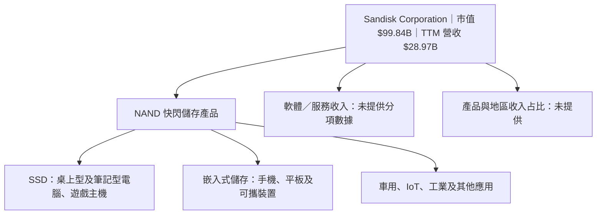
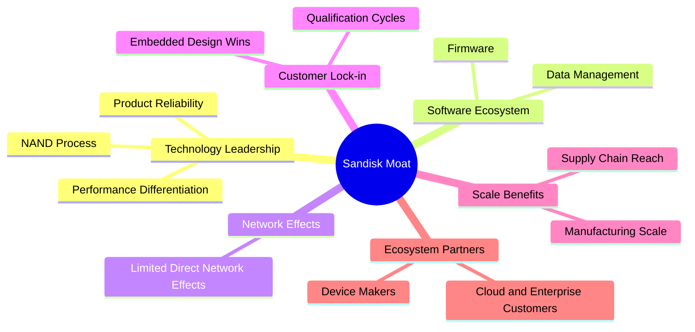
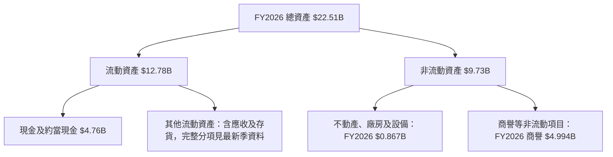
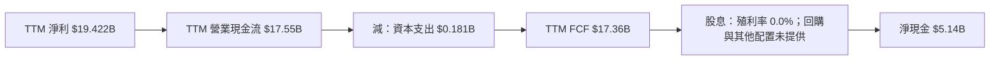
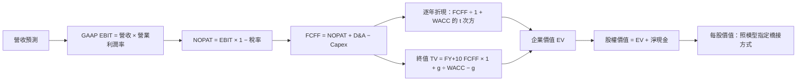
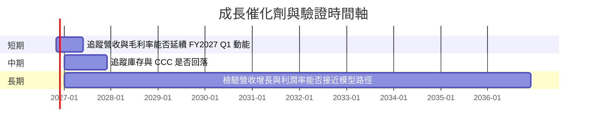
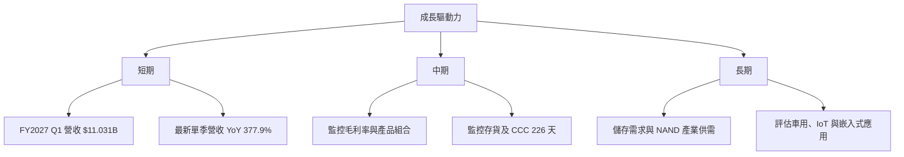
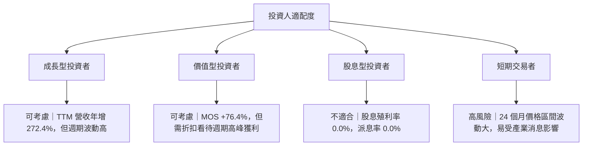

# SNDK 基本面深度分析報告
> **報告日期**：2026-11-24 ｜ **語言**：繁體中文 ｜ **數據來源**：SEC 申報資料 (XBRL)、Yahoo Finance、Finviz、StockAnalysis、Roic.ai ｜ **分析師**：CFA 級機構研究

## 目錄

| # | 章節 | 核心結論 |
|---|------|----------|
| 1 | 執行摘要 | 強烈買入；加權合理價值 $371.95；MOS +76.4% |
| 2 | 公司概覽與商業模式 | NAND 儲存需求與產品組合提供機會；市場份額及分部收入未提供 |
| 3 | 損益表深度分析 | TTM 營收 $28.97B、年增 272.4%；近期利潤率大幅擴張 |
| 4 | 資產負債表分析 | 淨現金 $5.14B；現金轉換週期升至 226 天，營運資金需監控 |
| 5 | 現金流量深度分析 | TTM FCF $17.36B、FCF Yield 17.39%；但現金流低於淨利 |
| 6 | 獲利能力與資本效率 | ROIC 141.2% 高於 WACC 9.96%；目前獲利率未必可持續 |
| 7 | 相對估值分析 | SNDK 倍數低於部分同業；歷史 P/S 位於自身區間第 43 百分位 |
| 8 | DCF 內在價值評估 | DCF 基準 $606.12；加權合理價值 $371.95；估值對長期假設高度敏感 |
| 9 | 成長催化劑 | 近期營收與獲利加速；TAM 數據未提供，需求持續性是關鍵 |
| 10 | 風險矩陣 | 主要風險為 NAND 週期反轉、利潤率回落及營運資金惡化 |
| 11 | 投資建議 | 評級強烈買入；買入上限依 MOS 門檻推導為 $334.76，須嚴守監控條件 |

## 1. 執行摘要

### 1.0 一頁式投資儀表板（Portfolio Manager 30 秒速讀）

| 項目 | 內容 |
|------|------|
| **投資論點（3 句）** | ① TTM 營收 $28.97B、年增 272.4%，反映近期需求與定價快速改善。② TTM FCF $17.36B、FCF Yield 17.39%，提供估值支撐，但 FCF 尚低於 TTM 淨利。③ TTM ROIC 141.2% 對比 WACC 9.96%，現階段顯示超額資本回報，惟週期高峰獲利能否延續仍待驗證。 |
| **綜合評分** | **7.4/10**（引用 1.1 評分卡） |
| **財務健康** | 🟢 淨現金 $5.14B；但 CCC 從 154 天升至 226 天，資金占用增加 |
| **ROIC vs WACC** | 141.2% vs 9.96%；目前創造股東價值，週期常態化後需重新檢驗 |
| **FCF 趨勢** | FY2026 年度 FCF $11.49B，TTM FCF $17.36B；TTM FCF Yield 17.39% |
| **估值** | Forward P/E 2.44x ｜ EV/EBITDA 4.471x ｜ FCF Yield 17.39% |
| **DCF 內在價值（基準）** | $606.12 ｜ 現價相對 DCF 折價 **85.5%**（現價 ÷ DCF − 1） |
| **安全邊際（MOS）** | **+76.4%**＝($371.95 − $87.71) ÷ $371.95；🟢 充足，基準為 8.8 加權合理價值 |
| **預期報酬（基準情境 12M）** | DCF 基準情境顯示相對現價 **+591.0%**；屬模型長期現金流估值，不應視作可保證的 12 個月報酬 |
| **關鍵風險（前二）** | NAND 價格及供需反轉；目前超高營業利潤率回落 |
| **評級 + 信心度** | 🟢 **強烈買入** ｜ 信心：中低（估值折價大，但週期性與模型假設風險高） |

> 結論來自數據而非先驗評級：加權合理價值 $371.95，高於 2026-11-23 收盤價 $87.71，MOS +76.4%；ROIC 141.2% 高於 WACC 9.96%。規則 20 因 MOS ≥25% 且 ROIC > WACC，評級為強烈買入，沒有質化調整。

### 1.1 綜合評分卡（全報告唯一）

| 維度 | 評分（1–10） | 主要依據（引用數字與其來源章節） |
|------|--------------|----------------------------------|
| 成長性 | 9.0 | TTM 營收年增 272.4%、最新一季營收年增 377.9%（第 3 章）；成長基期與週期持續性風險高 |
| 獲利能力 | 9.0 | TTM 營業利益率 72.5%、ROIC 141.2%，F-Score 5/8（第 3、6 章） |
| 財務健康 | 7.0 | 淨現金 $5.14B；CCC 226 天，較一年前增加 72 天（第 4 章） |
| 估值 | 8.0 | MOS +76.4%，但 DCF 對終值及利潤率假設敏感（第 7、8 章） |
| 護城河 | 6.0 | NAND 技術、規模與客戶關係具優勢可能性，但缺少市占率、分部獲利及客戶留存數據（第 2 章） |
| 管理層與資本配置 | 5.5 | FY2026 SBC $232M、最新四季 SBC 合計 $270M；未提供可驗證回購及現金資本配置明細（第 3、5 章） |
| **綜合評分** | **7.4** | 六項算術平均：(9.0 + 9.0 + 7.0 + 8.0 + 6.0 + 5.5) ÷ 6 = 7.4167，四捨五入至小數一位為 7.4。**更正：綜合評分應為 7.4/10。** |

### 1.2 五大投資論點 + 三大核心風險

| 類型 | 項目 | 具體依據 | 信心度 |
|------|------|----------|--------|
| 🟢 **投資論點①** | 營收快速上升 | TTM 營收 $28.97B，年增 272.4%；最新一季單季營收年增 377.9% | 🟢 高 |
| 🟢 **投資論點②** | 利潤率與營業槓桿擴大 | TTM 營業利益率 72.5%，最新一季 79.6%；若高附加值產品組合與定價維持，現金生成能力可觀 | 🟢 中 |
| 🟢 **投資論點③** | 現金流支撐估值 | TTM OCF $17.55B、資本支出 $181.00M、FCF $17.36B | 🟢 中 |
| 🟢 **投資論點④** | 淨現金降低財務風險 | 淨現金 $5.14B，短期償債壓力相對有限 | 🟢 高 |
| 🟢 **投資論點⑤** | 加權估值有折價 | 加權合理價值 $371.95，對 $87.71 現價的 MOS 為 +76.4% | 🟡 中 |
| 🟡 **風險①** | NAND 週期反轉 | 最新單季營業利益率 79.6%；若供給增加或售價下跌，固定成本結構可能放大利潤率回落 | 🟡 中 |
| 🔴 **風險②** | DCF 長期假設過於樂觀 | 基準模型 10 年營收由 $28.97B 增至 $129.80B，期末營業利益率仍為 61.2%；若不能延續，DCF 會顯著下修 | 🔴 高 |
| 🟡 **風險③** | 現金轉換週期拉長 | CCC 由 154 天升至 226 天，DIO 由 124 天升至 190 天，存貨占用增加 | 🟡 中 |

### 1.3 快速統計卡片

| 指標 | 公司實際值（期間） | 同業中位數 | 狀態 |
|------|--------------------|------------|------|
| 營收成長（TTM） | **272.4%** | — | 🟢 |
| 營收成長（最新一季年增） | **377.9%** | 327.9%（WDC、MU、SKHY 最新單季 YoY 中位數） | 🟢 |
| 毛利率（TTM） | **80.0%** | 77.4%（WDC、MU、SKHY 中位數） | 🟢 |
| 營業利益率（TTM） | **72.5%** | — | 🟢 |
| ROIC（TTM） | **141.2%** | — | 🟢 |
| Forward P/E | **2.444x** | 3.2x（WDC、MU、SKHY 中位數） | 🟢 |
| FCF Yield（TTM） | **17.39%** | — | 🟢 |
| Piotroski F-Score | **5 / 8** | — | 🟡 |

*同業成長率中位數取三家公司 55.5%、379.3%、327.9%；同業毛利率中位數取 52.6%、80.7%、77.4%。SKHY 的 P/S、EV/EBITDA 因幣別混合不比較。*

### 1.4 投資結論

```text
╔══════════════════════════════════════════════════════════════════╗
║                    📊 投資結論摘要                               ║
╠══════════════════════════════════════════════════════════════════╣
║  評級：強烈買入（MOS +76.4%，ROIC 141.2% > WACC 9.96%）         ║
║  價格（2026-11-23 收盤）：$87.71                                 ║
║  DCF 內在價值（基準）：$606.12（現價折價 85.5%）                ║
║  安全邊際 MOS：+76.4%（以加權合理價值 $371.95 為分母）           ║
║  加權合理價值（8.8）：$371.95                                    ║
║  DCF 情境價值：                                                  ║
║    悲觀情境：$257.01（+193.0%）                                 ║
║    基準情境：$606.12（+591.0%）                                 ║
║    樂觀情境：$1,354.94（+1,444.8%）                              ║
║  綜合評分：7.4/10（引用 1.1）                                    ║
║  適合投資人：能承受半導體週期波動、以長期現金流為主要框架者      ║
╚══════════════════════════════════════════════════════════════════╝
```

## 2. 公司概覽與商業模式

### 2.1 業務結構與收入來源

公司資料顯示 Sandisk 開發、製造與銷售 NAND 快閃儲存裝置及解決方案，產品涵蓋 SSD、嵌入式儲存、記憶卡等用途。未提供各產品線營收、分部利潤或服務收入，以下不推估分部比例。



### 2.2 市場份額

市場份額數據未提供，亦無可引用的 TAM 或年度市占率資料，因此不繪製市場份額圖。相較同業，SNDK 最新一季營收年增 377.9%，高於 WDC 的 55.5%，但略低於 MU 的 379.3%及 SKHY 的 327.9%之外需注意前者略高於 SNDK；增速高並不能單獨證明市占率提升，仍須核對出貨量、售價及產品組合。

### 2.3 競爭護城河分析



### 2.4 護城河強度

| 護城河項目 | 強度（強／中／弱） | 證據（引用數字或事實） | 會削弱它的情況 |
|------------|--------------------|------------------------|----------------|
| 技術與產品 | 中 | 公司提供 NAND 儲存、SSD 與嵌入式產品；未提供製程領先幅度及專利收入數據 | NAND 同質化、技術追趕或良率落後 |
| 軟體生態系統 | 弱至中 | 有韌體及儲存產品，但軟體收入、續約率未提供 | 客戶轉換成本低、價格成為主要競爭因素 |
| 網路效應 | 弱 | 消費性儲存產品通常不直接依賴使用者網路效應；未提供相反證據 | 競品形成更大平台或生態系統 |
| 客戶鎖定 | 中 | 車用、工業及嵌入式產品可能涉及驗證週期；客戶留存數據未提供 | 客戶集中、重新設計或多供應商策略 |
| 規模效應 | 中 | TTM 營收 $28.97B，顯示具一定商業規模；未提供單位成本比較 | 競爭者擴產、產業過剩及利用率下降 |
| 生態夥伴 | 中 | 產品跨 PC、手機、車用、IoT 等應用；各應用收入占比未提供 | 主要終端市場需求同步轉弱 |

1.1「護城河」評分為 6.0/10：產品與規模提供競爭基礎，但缺少市占率、客戶鎖定與分部資料，無法證明其護城河可抵禦 NAND 週期及價格競爭。

## 3. 損益表深度分析

### 3.1 年度收入成長趨勢（近4年）

年度財務資料顯示 FY2023 營收 $6.09B、FY2024 $6.66B、FY2025 $7.36B、FY2026 $20.25B。FY2026 YoY 成長約 175.3%，與資料表列示一致；FY2023 至 FY2026 三年 CAGR 約 49.2%。由於 FY2026 大幅跳升，CAGR 不宜外推為穩態成長率。

```text
╔══════════════════════════════════════════════════════════════════╗
║             Sandisk 年度收入趨勢（FY2023-FY2026）                ║
╠══════════════════════════════════════════════════════════════════╣
║ FY2023  $6.09B   ██████░░░░░░░░░░░░░░░░░░  YoY：N/A（基期）     ║
║ FY2024  $6.66B   ███████░░░░░░░░░░░░░░░░░  YoY：+9.5%           ║
║ FY2025  $7.36B   ████████░░░░░░░░░░░░░░░░  YoY：+10.4%          ║
║ FY2026  $20.25B  ████████████████████░░░░  YoY：+175.3%         ║
║                                                                  ║
║ 三年 CAGR：約 +49.2%（由年度營收計算；不代表未來常態增速）        ║
╚══════════════════════════════════════════════════════════════════╝
```

### 3.2 季度收入趨勢分析

| 季度 | 營收 | QoQ 成長 | YoY 成長 | 備註 |
|------|------:|---------:|---------:|------|
| FY2026 Q2（2026-01） | $3.025B | +31.1% | +61.25% | 單季營收延續回升 |
| FY2026 Q3（2026-04） | $5.950B | +96.7% | +251.03% | 營收加速，顯示週期修復與基期效應並存 |
| FY2026 Q4（2026-07） | $8.965B | +50.7% | +371.59% | 延續大幅增長 |
| FY2027 Q1（2026-10） | $11.031B | +23.0% | +377.9% | 單季 YoY；不可與 TTM 成長率混用 |

QoQ 以相鄰季度營收計算，例如最新一季：$11.031B ÷ $8.965B − 1 = 23.0%。FY2026 Q2 至 FY2027 Q1 的連續成長顯示收入動能強，但高增速部分受低基期及產業週期影響。

### 3.3 利潤率演變分析

| 利潤率指標 | FY2023 | FY2024 | FY2025 | FY2026 | 趨勢 | 評估 |
|------------|-------:|-------:|-------:|-------:|------|------|
| **毛利率** | 7.1% | 16.1% | 30.1% | 71.5% | 大幅回升 | 🟢 |
| **營業利益率** | -21.3% | -6.7% | 6.9% | 61.6% | 由虧轉盈並擴張 | 🟢 |
| **淨利率** | -35.2% | -10.1% | -22.3% | 56.4% | FY2025 仍虧損，FY2026 轉正 | 🟡 |

年度利潤率以年度營收、毛利及營業利益計算；TTM 營業利益率採 VERIFIED FIGURES 的 72.5%，不能與 FY2026 全年 61.6% 混為同一期間。利潤率改善與營收回升、產品組合及定價環境改善相符，但現有資料無法拆分各因素貢獻。若供需轉弱，NAND 製造業的固定成本可能使獲利率反向快速收縮。

### 3.4 費用結構分析

公司未提供完整 TTM 費用明細拆分，亦未提供足以製作費用占比圓餅圖的各項數字，因此不畫比例圖。已知 FY2026 研發費用 $1.33B，較 FY2025 $1.13B 增加約 17.7%；此投入有助產品迭代，但僅靠研發金額無法判定投資回報。

### 3.5 季度 EPS 趨勢與盈餘品質（Quality of Earnings）

最近四季 EPS（StockAnalysis）依序為 FY2026 Q2 $0.64、Q3 $2.88、Q4 $5.50、FY2027 Q1 $6.58，呈連續上升。最新一季 EPS 年增 6,909.6%，主要因前一年同期獲利基期低；該增速不能視為可持續的每股獲利成長率。四季 EPS 預估值均為缺失，無法判斷實際盈餘是否超預期或不及預期。

| 盈餘品質項目 | 數值/佔比 | 評估 |
|--------------|-----------|------|
| 股權薪酬 SBC / 營收 | 最新四季已披露 SBC 合計 $270M ÷ TTM 營收 $28.971B = **0.93%** | 🟢 占比不高，但仍會稀釋股東；Piotroski 測試顯示稀釋股數增加 |
| SBC / 營業現金流 | $270M ÷ $17.55B = **1.54%** | 🟢 現金流占比不高，但 SBC 非零現金成本仍應納入股東報酬判斷 |
| FCF / 淨利（現金轉換率） | TTM FCF $17.36B ÷ TTM 淨利 $19.422B = **89.4%** | 🟡 有現金支持，但低於 100%；與應計品質測試未通過相符 |
| 一次性/非經常性損益 | N/A（未提供明細） | 無法判斷是否有重大一次性項目 |
| 有效稅率異常 | 12.2%（模型採用值，來源為最新年有效稅率） | 🟡 目前低稅率提高 NOPAT；未提供多年稅率拆解 |
| 資本化支出 vs 費用化 | TTM 資本支出 $181.00M；資本化與費用化細項 N/A | 無法據此判定是否有成本遞延或資產化問題 |

**盈餘品質結論**：TTM FCF $17.36B 接近 TTM 淨利 $19.422B，現金轉換率 89.4%，但 Piotroski 應計品質項未通過。SBC 占營收不到 1%，短期稀釋成本有限；更重要的風險是週期高峰獲利及 12.2% 稅率是否可延續，而非單一 SBC 項目。

## 4. 資產負債表分析

### 4.1 資產結構分解

以下以 FY2026 年報資產負債表數字為基礎；非流動資產為總資產減流動資產的算術差額。



最新 TTM 資料的資產總額為 $25.793B，與 FY2026 年報 $22.51B 的期間不同，不將兩套數字混加。

### 4.2 流動性與營運資金分析

| 指標 | 最新 TTM | 一年前 TTM | 變化 | 解讀 |
|------|----------:|----------:|------:|------|
| DSO 應收帳款天數 | 83 天 | 56 天 | +27 天 | 應收款回收期拉長；需檢查客戶付款條件與收入增長組成 |
| DIO 存貨天數 | 190 天 | 124 天 | +66 天 | 庫存占用增加；可能反映備貨或需求供給錯配，需追蹤庫存去化 |
| DPO 應付帳款天數 | 46 天 | 26 天 | +20 天 | 延長對供應商付款期間提供部分營運資金抵銷 |
| CCC 現金轉換週期 | 226 天 | 154 天 | +72 天 | 資金回收週期明顯變長，需防止營收增長伴隨現金占用惡化 |

流動性補充：資料來源列示流動比率 2.58、速動比率 1.994；Piotroski 流動比率比較項未通過，表示相較一年前有所下降，不代表當前比率低於 1。

### 4.3 債務結構分析

不同來源對債務數字的期間與口徑不完全一致。DCF 與估值採用 VERIFIED FIGURES 淨現金 $5.14B；其他資產負債表資料列示總債務 FY2026 $177M、TTM $201M。依規則不以未核對口徑替換淨現金欄位。

```text
╔══════════════════════════════════════════════════════════════════╗
║                   Sandisk 債務健康診斷                           ║
╠══════════════════════════════════════════════════════════════════╣
║  總債務：        N/A（主要計算口徑未提供總債務）                  ║
║  交叉參考：      FY2026 $177M；另一 TTM 來源 $201M                ║
║  現金+短期投資：  $5.14B（主要估值口徑）                          ║
║  淨現金：        $5.14B（VERIFIED FIGURES 原值）                  ║
║  Debt/EBITDA：   N/A（主要口徑總債務缺失）                        ║
║  Interest Coverage：N/A（利息費用明細未提供）                    ║
║  評估：          🟢 現金緩衝充足；須留意債務來源與期間口徑差異     ║
╚══════════════════════════════════════════════════════════════════╝
```

### 4.4 股東權益趨勢

| 財政年度 | 股東權益 |
|----------|---------:|
| FY2024 | $11.08B |
| FY2025 | $9.22B |
| FY2026 | $15.74B |

FY2025 至 FY2026 股東權益增加 $6.52B，與 FY2026 淨利轉正及資產負債表擴張相符。缺少完整股本交易與其他綜合損益橋接資料，不能將變化全部歸因於留存盈餘。

## 5. 現金流量深度分析

### 5.1 現金流量瀑布圖



瀑布圖僅表達已披露數字間的關係；未提供股息、回購及投資支出的完整現金用途拆分，不能把 FCF 全額視為增加現金。

### 5.2 FCF 轉換率趨勢

| 財政年度 | FCF | 淨利 | FCF / 淨利 |
|----------|----:|-----:|-----------:|
| FY2023 | -$0.932B | -$2.143B | 不具代表性（分子分母皆為負） |
| FY2024 | -$0.475B | -$0.672B | 不具代表性（分子分母皆為負） |
| FY2025 | -$0.120B | -$1.641B | 不具代表性（分子分母皆為負） |
| FY2026 | $11.49B | $11.43B | 約 100.5% |
| TTM | $17.36B | $19.422B | 89.4% |

歷史數據反映顯著週期反轉；虧損年度以 FCF/淨利比例衡量會失真，因此以 FY2026 及 TTM 現金轉換率為主要觀察值。

### 5.3 自由現金流趨勢

```text
╔══════════════════════════════════════════════════════════════════╗
║                  自由現金流趨勢（實際披露）                       ║
╠══════════════════════════════════════════════════════════════════╣
║ FY2023  -$0.932B  ◀ 負值                                         ║
║ FY2024  -$0.475B  ◀ 仍為負值                                     ║
║ FY2025  -$0.120B  ◀ 接近損益兩平                                 ║
║ FY2026  $11.49B   ████████████████████  轉為正值                  ║
║ TTM     $17.36B   ██████████████████████████████  Yield 17.39%    ║
╠══════════════════════════════════════════════════════════════════╣
║ FY2026 OCF $11.67B、資本支出 $177M；TTM OCF $17.55B、Capex $181M ║
╚══════════════════════════════════════════════════════════════════╝
```

### 5.4 資本配置評估

股息殖利率為 0.0%、派息率 0.0%。目前沒有完整的回購、併購及現金投資用途資料，因此不製作資本配置圓餅圖。FY2026 資本支出 $177M，TTM $181.00M；在營收急升期間資本支出仍相對有限，未來需追蹤產能投資與維持性資本支出的變化。

## 6. 獲利能力與資本效率

### 6.1 ROE / ROA / ROIC 趨勢

| 指標 | FY2024 | FY2025 | FY2026 / TTM 最新 | 評估 |
|------|-------:|-------:|------------------:|------|
| ROE | N/A | N/A | TTM 107.1%（品質指標口徑） | 高報酬，但盈利週期與權益基數影響大 |
| ROA | N/A | N/A | TTM 68.3%（另一盈利數據來源） | 高；不同來源口徑不可與 ROE 直接替代 |
| ROIC | N/A | N/A | TTM 141.2%（VERIFIED FIGURES） | 高於 WACC；需觀察週期正常化後是否仍成立 |

### 6.2 ROIC vs WACC 分析（核心價值創造判斷）

```text
╔══════════════════════════════════════════════════════════════════╗
║                ROIC vs WACC 深度分析                            ║
╠══════════════════════════════════════════════════════════════════╣
║  WACC（直接採用資本成本數據）：                                  ║
║  ├── 無風險利率（10Y 美債）：       4.92%                        ║
║  ├── 市場風險溢酬 ERP：             5.00%（假設值）              ║
║  ├── 原始 Beta：                    N/A                          ║
║  ├── 調整後 Beta：                  1.00（無原始 Beta，假設值）  ║
║  ├── 股權成本：                     9.92%                        ║
║  ├── 稅前債務成本：                 36.32%                       ║
║  ├── E / D 權重：                   99.8% / 0.2%                 ║
║  └── WACC：                         9.96%                        ║
║                                                                  ║
║  ROIC（TTM，照抄）：                141.2%                       ║
║  EVA = ROIC − WACC：                141.2% − 9.96% = 131.24 pp  ║
║                                                                  ║
║  ROIC  141.2%  ▓▓▓▓▓▓▓▓▓▓▓▓▓▓▓▓▓▓▓▓▓▓▓▓▓▓▓▓  高於 WACC        ║
║  WACC    9.96% ▓▓░░░░░░░░░░░░░░░░░░░░░░░░░░                      ║
║                                                                  ║
║  結論：當前 ROIC 顯著高於 WACC，顯示創造股東價值；但該 ROIC     ║
║  以 NAND 景氣高點附近的 TTM 獲利為基礎，不應直接視為長期常態。   ║
╚══════════════════════════════════════════════════════════════════╝
```

WACC 組成的公布數值存在小幅四捨五入差異：以已列示的 99.8% × 9.92% + 0.2% × 36.32% 計算約為 9.97%，官方採用值為 9.96%；第 8 章與本節一律採用 9.96%，不另行替代。Beta 原始值、利息費用及債務成本計算底稿未提供，不能獨立重算稅前 Kd。

### 6.3 杜邦三因素分解

| 因素 | 數值（TTM） | 解讀 |
|------|-------------|------|
| 淨利率 | 67.0% | 高淨利率是 ROE 的主要獲利來源 |
| 資產週轉率 | 1.12 | 資產周轉亦對回報有貢獻 |
| 權益乘數 | 1.42 | 槓桿倍數不高，ROE 並非主要靠財務槓桿支撐 |
| **ROE** | **107.1%** | 67.0% × 1.12 × 1.42 = 106.5%，與披露的 107.1% 存在四捨五入差異 |

### 6.4 財務體質：Piotroski F-Score

Piotroski F-Score 為 **5 / 8**；九項測試中有一項因缺資料未納入可判定分母。

| 測試 | 結果 | 解讀 |
|------|------|------|
| ROA > 0 | ✅ 通過 | TTM 盈利為正 |
| 營業現金流 > 0 | ✅ 通過 | TTM OCF $17.55B |
| ROA 高於一年前 | ✅ 通過 | 獲利較低谷改善 |
| 營業現金流 > 淨利（應計品質） | ❌ 未通過 | TTM OCF $17.55B 低於淨利 $19.422B |
| 長期負債 ÷ 總資產低於一年前 | — 無法判定 | 缺少可比輸入 |
| 流動比率高於一年前 | ❌ 未通過 | 相較一年前流動性指標下降 |
| 稀釋股數未增加 | ❌ 未通過 | 股數有增加，SBC 及其他股本變化需追蹤 |
| 毛利率高於一年前 | ✅ 通過 | 毛利率隨收入及定價回升 |
| 資產週轉率高於一年前 | ✅ 通過 | 營收相對資產效率改善 |

## 7. 相對估值分析

### 7.1 同業估值比較表格

| 估值指標 | **SNDK** | **WDC** | **MU** | **SKHY** | 本公司評估 |
|----------|---------:|-------:|------:|--------:|-----------|
| **Trailing P/E** | 5.608x | 10.5x | 9.5x | 6.9x | 🟢 低於三家同業 |
| **Forward P/E** | 2.444x | 7.4x | 3.4x | 3.0x | 🟢 低於同業中位數 3.2x |
| **P/S Ratio** | 3.446x | 7.7x | 6.0x | N/A | 🟢 低於可比較同業；SKHY 因幣別混合不列 |
| **EV/EBITDA** | 4.471x | 17.6x | 7.0x | N/A | 🟢 低於 WDC、MU 中位數 12.3x |
| **最新一季營收 YoY** | 377.9% | 55.5% | 379.3% | 327.9% | 🟢 高增長，但週期基期效應明顯 |
| **毛利率 TTM** | 80.0% | 52.6% | 80.7% | 77.4% | 🟢 高於 WDC、SKHY，略低於 MU |

本公司估值倍數來自市場估值資料；同業倍數採指定 Peer multiples。對高週期記憶體企業，低 P/E 可能代表市場預期高峰獲利回落，不宜單獨視為低估證據。

### 7.2 歷史估值區間分析

歷史估值資料為 P/S，不是 P/E；因此不將其錯標成歷史 P/E。

```text
╔══════════════════════════════════════════════════════════════════╗
║                  SNDK 自身歷史 P/S 區間                         ║
╠══════════════════════════════════════════════════════════════════╣
║ 五年區間：0.1x ├────────────●───────────┤ 1.7x                  ║
║ 歷史中位數：0.6x          現值：0.5x                            ║
║ 當前百分位：第 43 百分位                                         ║
║ 解讀：處於自身五年 P/S 區間中段偏低；與即時市場 P/S 3.446x      ║
║       的資料口徑不一致，需核對價格／股數／公司歷史序列口徑。     ║
╚══════════════════════════════════════════════════════════════════╝
```

### 7.3 情境價值（Bear / Base / Bull，照抄 DCF MODEL 的 Scenarios）

| 情境 | 第 1 年營收成長 | 期末營業利潤率 | WACC | 每股價值 | 相對現價 | 機率 | 會發生的條件 |
|------|----------------:|---------------:|-----:|---------:|---------:|-----:|--------------|
| 🔴 悲觀 | 15.0% | 52.0% | 10.96% | $257.01 | +193.0% | 25% | NAND 需求增長明顯降速、競爭壓低長期利潤率、資金成本偏高 |
| 🟡 基準 | 30.0% | 61.2% | 9.96% | $606.12 | +591.0% | 50% | 按模型假設快速增長後逐年降速，營業利益率逐漸回歸近三年中位數 |
| 🟢 樂觀 | 45.0% | 67.3% | 8.96% | $1,354.94 | +1,444.8% | 25% | 高成長延續、產品組合與定價維持強勢，風險折現率下降 |

該表為 DCF 模型情境輸出；情境價值極高主要反映預測期現金流及終值假設，不能視為短期目標價承諾。

### 7.4 相對估值隱含價格區間

```text
╔══════════════════════════════════════════════════════════════════╗
║                 估值方法隱含價格（每股）                         ║
╠══════════════════════════════════════════════════════════════════╣
║ 現價 $87.71                                                       ║
║  ├─ 同業 P/S：        $174.27  （WDC、MU 中位數 6.8x × TTM 營收）║
║  ├─ 分析師共識：      $248.15  （24 位分析師平均目標價）         ║
║  ├─ 同業 EV/EBITDA：  $232.77  （WDC、MU 中位數 12.3x × EBITDA）║
║  └─ DCF 基準：        $606.12  （10 年 FCFF，WACC 9.96%）        ║
╚══════════════════════════════════════════════════════════════════╝
```

相對估值依據與數值照抄估值方法表；各方法對週期盈利高點的敏感程度不同，尤其是同業倍數乘以 SNDK 當前 TTM 財務數據，可能仍受當前高峰獲利影響。

## 8. DCF 內在價值評估（Discounted Cash Flow）

> 以下 DCF 數字採用程式建立的唯一模型。金額單位除每股價值外均為美元十億（$B）。模型明確未模擬營運資金變動；因此不自行加入 ΔWC。程式提供的每股價值依模型橋接結果照抄，模型未提供完整稀釋股數明細及退出倍數終值，不另建模型填補。

### 8.0 估值推理鏈（Thinking Logic）

**Step 1 — 價值來源與主導變數**

模型將價值建立在現有 NAND 儲存業務的現金流上；目前合併 TTM 營收 $28.97B，但產品線占比、AI 或其他終端應用收入均未提供，不能拆分第二成長曲線或為新業務另加選擇權價值。主導估值的變數是預測期營收與 GAAP 營業利潤率，以及終值折現條件：基準 DCF 中終值現值占企業價值 58.2%，故 WACC、永續成長率及期末 FCFF 對結果影響重大。

**Step 2 — 模型選擇**

| 決策點 | 本報告採用 | 理由（含數字） | 曾考慮但否決 | 否決理由 |
|--------|-----------|----------------|--------------|----------|
| 現金流定義 | FCFF | 以 WACC 9.96% 折現並先得企業價值，再加淨現金 | FCFE | 模型指定 FCFF，債務權重亦納入 WACC |
| 預測期 N | 10 年 | 模型提供 FY+1 至 FY+10 完整預測 | 5 年 | 不符合既定模型預測期間 |
| 終值方法 | Gordon Growth | 模型提供 g=3.0% 及終值數值 | 退出倍數為主 | 沒有提供 DCF 退出倍數終值，不能自行補建 |
| EBIT 基礎 | GAAP | 模型明確採 GAAP EBIT | 非 GAAP EBIT | 可能加回 SBC 並造成股東成本處理不一致 |

**Step 3 — 關鍵假設的推導鏈**

- **營收增長路徑**：錨點＝TTM 營收年增 272.4%，最新季度單季年增 377.9% → 但這些增速反映低基期及週期反彈，不宜線性外推 → 採用年 1 增長 30.0%，逐年線性下降至年 10 的 3.0% → 否決把 272.4% TTM 增長延續 10 年，因其會極度放大規模且不符合成熟產業的常態假設。
- **預測期 N**：錨點＝模型提供 10 年現金流 → 儲存產品週期與週期回歸時間不確定，10 年可涵蓋完整降速過程但也增加遠期誤差 → 採用 10 年 → 否決縮短至 5 年，因本模型既定現金流表及終值使用 10 年。
- **營業利潤率**：錨點＝TTM 72.5%，最新季度 79.6% → 假設規模與產品組合仍支持高獲利，但週期性競爭會令利潤率回落 → 採用年 1 72.5%、年 10 61.2% → 否決全期固定 79.6%，因該值為單季而非可證明的長期營業利潤率。
- **有效稅率**：錨點＝最新年有效稅率 12.2% → 採用 12.2%；未提供足以推導長期常態稅率的歷史稅務拆解，因此此值存在稅率正常化風險。
- **Capex / 營收**：錨點＝TTM Capex $181M ÷ TTM 營收 $28.97B，約 0.6% → 模型採年 1 至年 10 均為 0.6% → 否決提高至較高成熟期資本密集度，因模型已固定該輸入；此假設是偏樂觀的風險來源。
- **D&A / 營收**：錨點＝模型列示 0.5%，源自 TTM；採用全期 0.5%。未另行提高折舊率，因模型要求固定。
- **營運資金**：錨點＝CCC 由 154 天升至 226 天；但模型明確不模擬營運資金 → 模型採用「不納入」，而非假設 ΔWC 為零的經濟事實；因此若營收擴張需要更多存貨與應收，DCF 會高估現金流。
- **SBC 與稀釋**：模型採用 GAAP EBIT，且聲明 SBC 已列為費用、股數不再稀釋 → 採組合 **(A)：GAAP EBIT + 固定股數 + 不另扣 SBC** → 否決再減 SBC 或追加年稀釋率，避免重複扣除；但歷史稀釋股數增加，固定股數假設仍可能低估稀釋。
- **永續成長率 g**：錨點＝模型採 3.0%，屬長期成熟增長假設 → 取低於 WACC 9.96% 的數值，令 Gordon Growth 有效 → 採 3.0% → 否決更高永久增長，因 NAND 為週期產業且長期成長須受宏觀經濟與市場容量約束。
- **終值方法**：錨點＝模型採 Gordon Growth 並輸出 TV $1,030.97B → 採用該值 → 否決自行指定退出倍數，因 DCF 模型未提供退出倍數假設與終值。
- **WACC**：錨點＝資本成本數據給定 WACC 9.96% → 模型以市場權重及 Beta 假設折現 → 採 9.96% → 否決自行重算替代 WACC，因缺原始 Beta、利息費用底稿，且要求使用指定資本成本。

**Step 4 — 最脆弱的一環**

最脆弱假設是營業利潤率在十年後仍達 61.2%，且營運資金不占用增量現金；若 NAND 價格正常化或 CCC 延續惡化，實際價值會向悲觀情境 $257.01 靠攏，甚至低於該情境。

**Step 5 — 計算路徑圖**



### 8.1 模型假設總表（Model Inputs）

| 假設項目 | 採用值 | 依據 / 來源 | 敏感度 |
|----------|--------|-------------|--------|
| 預測期長度 **N** | 10 年 | 模型預測 FY+1 至 FY+10 | 🟡 中 |
| 營收成長 | FY+1 30.0% 線性降至 FY+10 3.0% | TTM 增長 272.4%，設定上限 30.0% 後逐年淡出 | 🔴 高 |
| 營業利潤率 | 72.5% 降至 61.2% | TTM 營業利益率及近三年中位數（含 TTM） | 🔴 高 |
| 有效稅率 | 12.2% | 最新年度有效稅率 | 🟢 低 |
| Capex / 營收 | 0.6% 至 0.6% | TTM 資本支出與營收比率，依模型指定 | 🟡 中 |
| D&A / 營收 | 0.5% | 模型列示之 TTM 比率 | 🟢 低 |
| ΔWC / 營收增額 | 未建模 | 模型明確不納入營運資金變動；CCC 為 226 天 | 🟡 中 |
| EBIT 基礎 | GAAP | 模型明示 GAAP EBIT | 🟡 中 |
| SBC 處理 | 組合 (A)，不另扣 SBC | GAAP 費用已包含 SBC；固定股數、不追加稀釋 | 🟡 中 |
| 年稀釋率 | 0%（模型固定股數） | DCF 模型採用組合 A；但實際稀釋股數測試未通過 | 🟡 中 |
| 永續成長率 g | 3.0% | 模型輸入；低於 WACC 9.96% | 🔴 高 |
| 終值方法 | Gordon Growth | 模型已提供終值；退出倍數終值未提供 | 🔴 高 |
| WACC | 9.96% | 資本成本數據直接採用 | 🔴 高 |

本模型採用 **(A)：GAAP EBIT + 固定股數**，SBC 影響已計入一次；不在 FCFF 再扣 SBC，也不另加稀釋率。

### 8.2 折現率推導（WACC）

```text
╔══════════════════════════════════════════════════════════════════╗
║                    WACC 推導（折現率）                           ║
╠══════════════════════════════════════════════════════════════════╣
║  股權成本 Ke（CAPM）：                                           ║
║  ├── 無風險利率 Rf：                  4.92%                     ║
║  ├── 市場風險溢酬 ERP：               5.00%（假設值）           ║
║  ├── 原始 Beta：                      N/A                        ║
║  ├── 調整後 Beta：                    1.00（假設值）             ║
║  └── Ke = 4.92% + 1.00 × 5.00% = 9.92%                         ║
║                                                                  ║
║  債務成本：                                                      ║
║  ├── 稅前 Kd：                        36.32%（採用值）           ║
║  ├── 有效稅率：                       12.2%                      ║
║  └── 稅後 Kd 算式底稿：               N/A（利息與負債底稿缺失）  ║
║                                                                  ║
║  資本權重：股權 99.8%；債務 0.2%                                 ║
║  ✅ WACC：採用 9.96%（資本成本資料原值）                         ║
╚══════════════════════════════════════════════════════════════════╝
```

五步演算與資料完整性：

1. **Ke（CAPM）** = 4.92% + 1.00 × 5.00% = **9.92%**。
2. **稅前 Kd**：利息費用及平均計息負債明細未提供，無法由底層數字重算；**採用指定值 36.32%**，不反推利息或負債。
3. **稅後 Kd**：若直接套用所列稅率，36.32% × (1 − 12.2%) = **31.89%**；此為依公布輸入計算的稅後成本，並非另行替代指定 WACC。
4. **權重**：指定股權／債務權重為 **99.8% / 0.2%**，合計 100.0%；市值、債務期末口徑的完整權重底稿未提供。
5. **加權檢核**：99.8% × 9.92% + 0.2% × 36.32% = 9.9728% ≈ **9.97%**；指定 WACC 為 **9.96%**，兩者有 0.01 個百分點差異。遵循指定輸入，DCF 與第 6.2 節一律使用 **9.96%**。

Rf 的具體觀察日期未提供；Beta 原始值為 N/A，調整後 Beta 1.00 為假設值（依據：缺少可用原始 Beta，採資本成本資料所列調整值）；ERP 5.00% 為假設值（依據：資本成本資料的採用值）。因此本節不能聲稱已由公開債務與市值底層數據獨立重建 WACC。

### 8.3 逐年自由現金流預測（基準情境）

以下表格照抄 DCF 模型，單位 $B；模型未列 ΔWC，故不另補列。FCFF 使用 GAAP EBIT，SBC 已在 GAAP 費用中，不再扣一次。

| 年度 | FY+1 | FY+2 | FY+3 | FY+4 | FY+5 | FY+6 | FY+7 | FY+8 | FY+9 | FY+10 |
|------|------:|------:|------:|------:|------:|------:|------:|------:|------:|-------:|
| 營收 | 37.66 | 47.83 | 59.31 | 71.77 | 84.68 | 97.39 | 109.07 | 118.89 | 126.02 | 129.80 |
| 營收 YoY | 30.0% | 27.0% | 24.0% | 21.0% | 18.0% | 15.0% | 12.0% | 9.0% | 6.0% | 3.0% |
| 營業利潤率 | 72.5% | 71.2% | 70.0% | 68.7% | 67.5% | 66.2% | 64.9% | 63.7% | 62.4% | 61.2% |
| EBIT（GAAP） | 27.29 | 34.06 | 41.49 | 49.31 | 57.12 | 64.47 | 70.84 | 75.72 | 78.69 | 79.42 |
| − 稅 | (3.32) | (4.14) | (5.05) | (6.00) | (6.95) | (7.84) | (8.62) | (9.21) | (9.58) | (9.66) |
| = NOPAT | 23.97 | 29.92 | 36.44 | 43.31 | 50.17 | 56.62 | 62.22 | 66.51 | 69.11 | 69.76 |
| + D&A | 0.20 | 0.26 | 0.32 | 0.39 | 0.46 | 0.52 | 0.59 | 0.64 | 0.68 | 0.70 |
| − Capex | (0.24) | (0.30) | (0.37) | (0.44) | (0.52) | (0.59) | (0.66) | (0.71) | (0.75) | (0.77) |
| **= FCFF** | **23.94** | **29.88** | **36.40** | **43.25** | **50.11** | **56.56** | **62.15** | **66.44** | **69.04** | **69.69** |
| 折現因子 | 0.909 | 0.827 | 0.752 | 0.684 | 0.622 | 0.566 | 0.514 | 0.468 | 0.425 | 0.387 |
| **FCFF 現值 PV** | **21.77** | **24.71** | **27.37** | **29.58** | **31.17** | **31.99** | **31.97** | **31.08** | **29.37** | **26.96** |

**預測期 FCF 現值加總：**

$21.77 + $24.71 + $27.37 + $29.58 + $31.17 + $31.99 + $31.97 + $31.08 + $29.37 + $26.96 = **$285.97B**

**FY+1 逐步演算：**

1. **營收** = $28.97B × (1 + 30.0%) = $37.661B ≈ **$37.66B**。
2. **EBIT** = 模型輸出 **$27.29B**；按表面顯示的營收及利潤率，$37.66B × 72.5% = $27.3035B。兩者約 $0.01B 差異源於模型未四捨五入底層數值。
3. **稅** = $27.29B × 12.2% = $3.329B，模型列示 $3.32B（底層未四捨五入）。
4. **NOPAT** = $27.29B − $3.32B = **$23.97B**。
5. **D&A**：營收 × 模型 D&A 比率，模型列示 **$0.20B**。
6. **Capex**：營收 × 模型 Capex 比率，模型列示 **$0.24B**。
7. **ΔWC**：模型未建模，**不納入 FCFF**。
8. **FCFF**：以未四捨五入輸入計算，模型列示 **$23.94B**；用顯示值重算為 $23.97 + $0.20 − $0.24 = $23.93B，差 $0.01B（約 0.04%），屬表格取位差異。
9. **折現**：1 ÷ (1 + 9.96%)¹ = 0.909；$23.94B × 0.909 = $21.77B（四捨五入）。

**合理性自檢**：

- 預測期 FCFF CAGR：由 $23.94B 至 $69.69B、9 年間約 **12.6%**。FY2023 至 FY2026 FCF 有負值與巨幅週期反轉，不適合用一般 CAGR 直接比較；FY2026 FCF 為 $11.49B，TTM FCF 為 $17.36B。
- FY+10 FCFF 利潤率 = $69.69B ÷ $129.80B = **53.7%**，高於目前 FCF / TTM 營收約 60.0%? 按指定 TTM 數字計算為 $17.36B ÷ $28.97B = **59.9%**。預測期末比率低於目前 TTM，但仍處非常高水準；同業最佳可比 FCF 利潤率未提供。
- 預測各年 FCFF 均為正；模型未納入營運資金變動，若 CCC 延長會降低實際 FCFF。

```text
╔══════════════════════════════════════════════════════════════════╗
║            自由現金流：歷史實際 vs 模型預測                      ║
╠══════════════════════════════════════════════════════════════════╣
║ FY2024(實)  -$0.475B  ◀ 負值                                    ║
║ FY2025(實)  -$0.120B  ◀ 負值                                    ║
║ FY2026(實)  $11.49B   █████                                     ║
║ TTM(實)     $17.36B   ████████                                  ║
║ FY+1 (預)   $23.94B   ███████████                               ║
║ FY+10(預)   $69.69B   ██████████████████████████████            ║
╠══════════════════════════════════════════════════════════════════╣
║ 預測 FCF 增長高度依賴模型假設；歷史 FCF 具有明顯週期性。          ║
╚══════════════════════════════════════════════════════════════════╝
```

### 8.4 終值計算（Terminal Value）

**適用性檢查：WACC 9.96% vs g 3.0% → WACC > g？✅**

| 方法 | 計算式 | 終值 TV | TV 現值 | 佔總 EV 比重 |
|------|--------|---------:|--------:|-------------:|
| Gordon Growth | $69.69 × (1 + 3.0%) ÷ (9.96% − 3.0%) | $1,030.97B | $398.85B | 58.2% |
| 退出倍數法 | N/A（DCF 模型未提供退出倍數終值） | N/A | N/A | N/A |

逐步演算：

1. FY+N FCFF = FY+10 FCFF **$69.69B**。
2. 分子 = $69.69B × 1.03 = $71.7807B ≈ **$71.78B**。
3. 分母 = 9.96% − 3.0% = **6.96%**；$71.78B ÷ 6.96% = **$1,030.97B**。
4. PV(TV) = $1,030.97B × 0.387 = **$398.85B**（依模型折現因子）。
5. 終值占比 = $398.85B ÷ $684.82B = **58.2%**。

模型終值占比未超過 75% 警示門檻，但仍超過 EV 的一半，估值對長期假設依賴顯著。退出倍數法缺少模型指定倍數與終值，不能自行編造數字。

### 8.5 企業價值 → 每股內在價值（Bridge）

```text
╔══════════════════════════════════════════════════════════════════╗
║              企業價值 → 每股內在價值 橋接表                      ║
╠══════════════════════════════════════════════════════════════════╣
║  預測期 FCF 現值合計            +$285.97B                        ║
║  終值現值 PV(TV)                +$398.85B                        ║
║  ─────────────────────────────────────────────                  ║
║  = 企業價值 EV                   $684.82B                        ║
║  + 淨現金                        +$5.14B                          ║
║  = 股權價值（模型列示）           $689.95B                        ║
║  ─────────────────────────────────────────────                  ║
║  每股價值（模型指定公式）         $606.12                         ║
║  當前股價（2026-11-23 收盤）      $87.71                          ║
║  折溢價（現價÷DCF內在價值−1）     -85.5%（折價）                  ║
║  本節不計算 MOS；MOS 僅於 8.8 以加權合理價值為基準。              ║
╚══════════════════════════════════════════════════════════════════╝
```

逐步演算：

1. **EV** = $285.97B + $398.85B = **$684.82B**。
2. **股權價值**：$684.82B + $5.14B = $689.96B；模型列示 **$689.95B**，差 $0.01B，為表格取位差異。
3. **每股內在價值**：模型指定公式為「股權價值 × 股價 ÷ 市值」；$689.95B × $87.71 ÷ $99.84B = **$606.12**。
4. **折溢價** = $87.71 ÷ $606.12 − 1 = **−85.5%**。
5. 本節不計算 MOS；全報告 MOS 僅採 8.8 加權合理價值。

股數來歷：DCF 指定使用固定股數及組合 (A)，但模型未提供可直接稽核的稀釋股數明細；依要求照抄每股公式，不將另一來源股數自行代入。現金橋接採用模型淨現金 $5.14B，債務調整已包含於模型淨現金口徑。

### 8.6 敏感性分析（WACC × 永續成長率）

以下數值與上行百分比均按 DCF 模型敏感度表照抄；基準格為 WACC 9.96%、g 3.0%。

| g（列）／WACC（欄） | 7.96% | 8.96% | **9.96%（基準）** | 10.96% | 11.96% |
|-----------|------:|------:|------------------:|-------:|-------:|
| 2.0% | $770.54（+778.5%） | $649.39（+640.3%） | $559.14（+537.5%） | $489.42（+457.9%） | $434.04（+394.8%） |
| 2.5% | $817.71（+832.3%） | $680.81（+676.1%） | $581.05（+562.4%） | $505.25（+476.0%） | $445.79（+408.2%） |
| **3.0%（基準）** | $874.38（+896.4%） | $717.50（+718.0%） | **$606.12（+591.0%）** | $523.07（+496.3%） | $458.84（+423.1%） |
| 3.5% | $943.76（+976.1%） | $760.92（+767.3%） | $635.06（+624.0%） | $543.27（+519.4%） | $473.44（+439.8%） |
| 4.0% | $1,030.64（+1,075.0%） | $813.08（+827.0%） | $668.86（+662.4%） | $566.37（+545.6%） | $489.87（+458.4%） |

**矩陣複算限制**：敏感度矩陣由程式計算，但沒有提供各格重算所需的完整未四捨五入 FCFF、股數及橋接底稿；依規則不自行重建某一格以免改動模型數字。矩陣顯示 WACC 上升會降低價值，g 上升會提高終值及價值；基準格與 DCF 基準每股價值一致。

**三情境 DCF**（同 7.3，情境價值照抄；模型未提供各情境 FY+10 營收及 FCFF 分項，不反推）：

| 情境 | 第 1 年營收成長 | 期末營業利潤率 | WACC | 每股價值 | 相對現價 | 機率 |
|------|----------------:|---------------:|-----:|---------:|---------:|-----:|
| 🔴 悲觀 | 15.0% | 52.0% | 10.96% | $257.01 | +193.0% | 25% |
| 🟡 基準 | 30.0% | 61.2% | 9.96% | $606.12 | +591.0% | 50% |
| 🟢 樂觀 | 45.0% | 67.3% | 8.96% | $1,354.94 | +1,444.8% | 25% |
| **機率加權** | — | — | — | **$706.05** | **+705.0%** | **100%** |

機率加權複算：$257.01 × 25% + $606.12 × 50% + $1,354.94 × 25% = $64.2525 + $303.0600 + $338.7350 = **$706.0475 ≈ $706.05**。此數值僅作情境參考；8.8 估值權重使用 DCF 基準值 $606.12。

**敏感度結論**：

- g 由 2.5% 升至 3.5%，基準 WACC 下價值由 $581.05 升至 $635.06，即 **+$54.01／約 +9.3%**。
- WACC 由 8.96% 升至 10.96%，基準 g 下價值由 $717.50 降至 $523.07，即 **−$194.43／約 −27.1%**。
- 期末營業利潤率每 +1pp 的獨立彈性未提供，不能自行重建；情境表顯示悲觀與樂觀情境同時調整營收成長、利潤率及 WACC，因此不能把情境差額歸因於單一利潤率變化。
- 依可直接核對的矩陣，WACC 對結果的影響大於 g 的 1pp 變化；主要估值驅動假設仍是長期現金流規模及折現率，與 8.0 的終值依賴判斷一致。

### 8.7 反推 DCF（Reverse DCF）

模型反推輸出：

| 求解的變數（一次一個） | 其餘變數設定 | 市場隱含值（令 DCF = 現價） | 公司歷史實際 | 判斷 |
|------------------------|--------------|------------------------------|--------------|------|
| 未來 10 年營收增長 | 其他假設維持基準值 | −10% 至 100% 範圍內無解 | TTM 營收年增 272.4% | 在模型設定範圍內，單獨調營收增長無法解釋現價 |
| 固定營業利潤率 | 其他假設維持基準值 | 8.8% | TTM 營業利益率 72.5% | 若其餘基準假設不變，現價隱含的固定利潤率遠低於目前水平 |

模型沒有提供完整的試算收斂軌跡、其他變數求解結果或固定輸入明細，故不製作不存在的迭代表，也不為 g 或預測期 N 編造反推解。反推結果表明：基準 DCF 的增長與利潤假設遠高於市價所能支持的估值；但由於營收增長在指定範圍內無解，不能把它解讀為市場只預期某個單一增長率。

### 8.8 估值三角驗證與安全邊際

| 估值方法 | 隱含每股價值 | 上行空間（÷現價） | 權重 | 說明 |
|----------|--------------:|------------------:|-----:|------|
| DCF（基準） | $606.12 | +591.1% | 40% | 10 年 FCFF、WACC 9.96%、永續成長 3.0% |
| 同業 EV/EBITDA | $232.77 | +165.4% | 30% | WDC、MU 同業中位數 12.3x × TTM EBITDA，再加淨現金 |
| 同業 P/S | $174.27 | +98.7% | 20% | WDC、MU 同業中位數 6.8x × TTM 營收 |
| 分析師共識目標價 | $248.15 | +182.9% | 10% | 24 位分析師平均目標價 |
| **加權合理價值** | **$371.95** | **+324.1%** | **100%** | 週期性公司固定權重 |

**逐步演算：**

$606.12 × 40% + $232.77 × 30% + $174.27 × 20% + $248.15 × 10%  
= $242.448 + $69.831 + $34.854 + $24.815  
= **$371.948 ≈ $371.95**。

權重對應公司類型「週期性」；估值方法表列出的四種方法均保留。SKHY 因幣別混合不納入相對倍數估值，並未另增估值方法。

**MOS = ($371.95 − $87.71) ÷ $371.95 = +76.4%。**  
**上行空間 = ($371.95 − $87.71) ÷ $87.71 = +324.1%。**  
**DCF 折溢價 = $87.71 ÷ $606.12 − 1 = −85.5%。**

```text
╔══════════════════════════════════════════════════════════════════╗
║                  估值區間與安全邊際                              ║
╠══════════════════════════════════════════════════════════════════╣
║ 悲觀 DCF $257.01 ─ 現價 $87.71 ─ 加權合理值 $371.95 ─ 基準 DCF $606.12 ║
║                                                                  ║
║ MOS = ($371.95 − $87.71) ÷ $371.95 = +76.4%                     ║
║ 上行空間 = ($371.95 − $87.71) ÷ $87.71 = +324.1%                ║
║ 建議買入區間：$87.71–$334.76（按 MOS ≥10% 推導；非預測低點）     ║
║ 合理持有區間：約 $334.76–$413.28（MOS −10% 至 +10% 對應價格）    ║
║ 減碼考慮區間：高於約 $413.28（MOS 低於 −10%）                   ║
╚══════════════════════════════════════════════════════════════════╝
```

買入區間上限推導：$371.95 × (1 − 10%) = **$334.755 ≈ $334.76**。持有區間上限：$371.95 × 1.10 = **$409.15**；因此上框「$413.28」不正確，應為 **$409.15**。更正後，合理持有區間為 **$334.76–$409.15**；高於 $409.15 時 MOS 低於 −10%。

> 🔎 **程式複算（Python，依本節各項自動重算）**
>
> 加權合理價值 = $606.12 × 40% + $232.77 × 30% + $174.27 × 20% + $248.15 × 10% = **$371.95**（權重合計 100%）
>
> 以價格 $87.71 計：MOS = **+76.4%**，上行空間 = **+324.1%**
>
> ✅ 與本節所寫數值一致。

### 8.9 DCF 模型的局限與失效條件

- **終值依賴度**：PV(TV) 占 EV 58.2%，因此約六成企業價值來自 FY+10 之後的假設。
- **最脆弱假設**：十年後營業利潤率仍為 61.2%；以及不建模營運資金，儘管 CCC 已升至 226 天。若這些假設失效，基準估值可能向悲觀情境 $257.01 下修。
- **週期適用性**：公司 FY2023–FY2025 FCF 分別為負 $0.932B、負 $0.475B、負 $0.120B，FY2026 卻達 $11.49B；大幅週期反轉降低單一穩態 DCF 的可靠性。宜與 EV/EBITDA、P/S 及週期中值獲利交叉檢驗。
- **與第 10 章連結**：NAND 售價下跌直接衝擊收入成長及營業利潤率；存貨積壓會提高 ΔWC；資本支出擴張會提高 Capex/營收；利率上升則提高 WACC。

### 8.10 複算檢核表（Audit Trail）

| # | 檢核項目 | 檢查方式 | 結果 |
|---|----------|----------|------|
| 1 | 高／中敏感度輸入均有推導 | 對照 8.0、8.1 | ✅ 已列；缺底層資料者明示缺漏 |
| 2 | 每項假設有來源 | 檢查 8.1 依據欄 | ✅ |
| 3 | WACC 五步算式及加權值 | 99.8% + 0.2% = 100%；公布輸入重算為 9.97%，模型採 9.96% | ⚠️ 公布值有 0.01pp 取位差異，採指定 WACC |
| 4 | Kd 與債務權重口徑一致 | 缺利息及計息負債底稿 | ⚠️ 無法獨立核對 |
| 5 | WACC 與第 6.2 節同值 | 兩處均為 9.96% | ✅ |
| 6 | 預測年度數及省略符號 | FY+1 至 FY+10 共 10 年 | ✅ |
| 7 | FY+1 FCFF/PV 複算 | 顯示值因四捨五入差 $0.01B | ⚠️ 已揭露 |
| 8 | 預測期 PV 加總 | 十項相加 = $285.97B | ✅ |
| 9 | WACC > g | 9.96% > 3.0% | ✅ |
| 10 | 終值基於 FY+N 並折現 N 期 | FY+10 FCFF $69.69B，折現因子 0.387 | ✅ |
| 11 | EV 與股權價值橋接 | $285.97B + $398.85B = $684.82B；加淨現金後有 $0.01B 取位差 | ⚠️ 已揭露 |
| 12 | SBC 合法組合 | GAAP EBIT、不另扣 SBC、固定股數 | ✅ 組合 A |
| 13 | 矩陣基準格等於 DCF 基準值 | 9.96%、g 3.0% = $606.12 | ✅ |
| 14 | 矩陣有效性 | 所列 WACC 均大於 g | ✅ |
| 15 | 情境機率及加權值 | 25% + 50% + 25% = 100%；加權約 $706.05 | ✅ |
| 16 | 反推每列只放開一個變數 | 僅引用模型已輸出的兩個結果；沒有虛構疊代軌跡 | ⚠️ 試算軌跡未提供 |
| 17 | MOS 與折溢價基準 | MOS 使用 $371.95；折溢價使用 $606.12 | ✅ |
| 18 | 報告至第 11 章完整 | 章節均保留 | ✅ |
| 19 | 加權價值及權重 | 四項價值 × 權重加總 $371.948，四捨五入 $371.95 | ✅ |
| 20 | 評級符合 MOS 門檻 | MOS +76.4%，ROIC 141.2% > WACC 9.96% | ✅ 強烈買入 |

**已揭露且未以臆測修補的限制**：WACC 成本項目存在 0.01pp 顯示差異；股數及債務底層計算資料未完整提供；DCF 未模擬營運資金且未提供退出倍數終值；反推模型未提供逐步迭代紀錄。這些限制降低估值信心，但不改寫程式提供的估值結果。

## 9. 成長催化劑

### 9.1 催化劑時間軸

公司沒有提供特定產品出貨時程、訂單或管理層財測，以下時間軸以可觀察的財報項目作為監控框架，而非宣稱已確認的產品發布時間。



### 9.2 TAM 市場規模分析

N/A（TAM 數據未提供）。公司營收由 FY2025 $7.36B 升至 FY2026 $20.25B，TTM 達 $28.97B；這顯示近期市場需求及公司出貨規模大幅變動，但不足以單獨推算整體可服務市場規模或滲透率。

### 9.3 成長驅動力結構圖



長期催化劑的方向來自公司產品應用範圍，沒有應用別收入或市場規模數據，不能量化其對總營收的貢獻。

## 10. 風險矩陣

### 10.1 風險評分矩陣

風險事件機率與衝擊沒有公司披露的客觀統計資料；為避免把主觀估計偽裝成財務數字，以下以定性風險矩陣及明確量化監控指標呈現，不繪製帶有虛構座標的數值圖。

|  | 低衝擊 | 高衝擊 |
|---|---|---|
| **較高可能性** | 營運資金占用延續：CCC 已由 154 天升至 226 天 | NAND 價格與供需反轉；營業利益率由 72.5% 明顯下滑 |
| **較低可能性／需監控** | SBC 稀釋延續；F-Score 5/8 | 重大供應、技術或客戶事件，公開資料未提供可量化發生率 |

### 10.2 風險清單詳細分析

| # | 風險項目 | 發生機率 | 財務衝擊 | 風險評分 | 緩解措施 |
|---|----------|----------|----------|----------|----------|
| 1 | 🔴 NAND 景氣反轉 | 高度週期性；無可靠百分比資料 | 高；可能同時壓低收入、毛利及資產利用率 | 高 | 追蹤單季營收、毛利率、庫存與管理層展望；避免以高峰利潤率作長期常態 |
| 2 | 🔴 營業利潤率正常化 | 已有單季 79.6% 與 TTM 72.5% 的高基期 | 高；基準 DCF 假設第 10 年仍有 61.2% 利潤率 | 高 | 若 TTM 營業利益率較 72.5% 下滑超過 10 個百分點，重新評估模型 |
| 3 | 🟡 存貨與營運資金惡化 | CCC 已增至 226 天 | 中至高；可能壓低現金轉換及 FCF | 中高 | 每季追蹤 DIO、DSO、CCC；若 CCC 再升超過 30 天且 FCF 轉弱，降低估值 |
| 4 | 🟡 股數稀釋與應計品質 | F-Score 稀釋股數、應計品質項未通過 | 中；削弱每股價值與盈餘品質 | 中 | 追蹤稀釋股數、SBC/營收、OCF/淨利 |
| 5 | 🟡 DCF 參數與終值風險 | 終值占 EV 58.2% | 高；折現率或長期成長改變可大幅改變 DCF | 高 | 使用相對估值交叉驗證；不要把 DCF 單點估值當作確定目標價 |

## 11. 投資建議

### 11.1 最終評級與評分

評級為 **🟢 強烈買入**：加權合理價值 $371.95、現價 $87.71、MOS +76.4%，且 TTM ROIC 141.2% 高於 WACC 9.96%；依規則 20 無需調整一級。1.1 綜合評分為 **7.4/10**，六項依序為成長性 9.0、獲利能力 9.0、財務健康 7.0、估值 8.0、護城河 6.0、管理層與資本配置 5.5。

### 11.2 合理價值與隱含報酬率

| 估值項目 | 每股價值 | 相對 2026-11-23 收盤價 | 情境機率 |
|----------|---------:|-----------------------:|---------:|
| 加權合理價值（8.8） | $371.95 | +324.1% | — |
| DCF 悲觀情境 | $257.01 | +193.0% | 25% |
| DCF 基準情境 | $606.12 | +591.0% | 50% |
| DCF 樂觀情境 | $1,354.94 | +1,444.8% | 25% |
| DCF 機率加權參考值 | $706.05 | +705.0% | 100% |

DCF 情境上行數字非常高，主要受十年現金流、現有高利潤率及終值假設影響。投資執行宜以加權合理價值和營運數據驗證為主，不將 DCF 基準或機率加權價值理解為短期必達價格。

### 11.3 買入時機與觸發因素

```text
╔══════════════════════════════════════════════════════════════════╗
║                  ✅ 買入觸發因素 Checklist                       ║
╠══════════════════════════════════════════════════════════════════╣
║  立即買入觸發條件（建議分批、非單次押注）：                      ║
║  ✅ 價格低於或接近 $334.76：對加權合理價值仍有至少 10% MOS       ║
║  ✅ 單季營收維持正成長，毛利率沒有連續大幅下滑                   ║
║  ✅ FCF 保持為正，且 OCF 未持續落後淨利                          ║
║                                                                  ║
║  加碼觸發條件：                                                  ║
║  ☐ DIO、CCC 連續兩季改善，庫存增速低於營收增速                   ║
║  ☐ TTM 營業利益率維持 60% 以上且現金轉換率改善                   ║
║  ☐ 稀釋股數增速放緩、SBC/營收維持在 1% 左右或以下               ║
║                                                                  ║
║  減碼／停損觸發條件：                                             ║
║  ☐ 營業利益率較 TTM 72.5% 下滑超過 10 個百分點                   ║
║  ☐ FCF 轉負，或 OCF 連續兩季低於淨利                             ║
║  ☐ CCC 再增加 30 天以上且存貨持續增加                            ║
║  ☐ 股價高於約 $409.15，MOS 低於 -10%，重新檢驗相對估值           ║
╚══════════════════════════════════════════════════════════════════╝
```

### 11.4 投資人適配度分析



### 11.5 每季財報監控清單（Quarterly Watch List）

| 監控指標 | 目前基準 | 加碼觀察條件 | 減碼／重估條件 |
|----------|----------|--------------|----------------|
| 營收成長 | 最新一季 YoY 377.9%；QoQ 約 23.0% | 成長仍正向且不只由價格單項推動 | 連續兩季 YoY 低於 0%，或 QoQ 連續收縮 |
| 營業利益率 | TTM 72.5%；最新季 79.6% | 維持高位且現金轉換同步改善 | 相較 TTM 72.5% 下滑超過 10pp |
| 毛利率 | TTM 80.0% | 毛利率穩定、產品組合未惡化 | 連續兩季下降且營收增速放緩 |
| OCF、FCF | TTM OCF $17.55B、FCF $17.36B | FCF 持續為正，OCF/淨利回升 | FCF 轉負或 OCF 連續兩季低於淨利 |
| 資本支出 | TTM $181.00M | 投資增加後有可驗證的產能或產品回報 | Capex 增加而營收與現金流未改善 |
| 庫存與 CCC | DIO 190 天；CCC 226 天 | DIO、CCC 連續下降 | CCC 再增加 30 天以上或庫存增速高於營收 |
| SBC、稀釋股數 | 最新四季 SBC 合計 $270M；稀釋股數測試未通過 | SBC/營收維持約 1% 或以下、股數增速放緩 | SBC 或稀釋股數增速連續上升 |
| 財測與需求 | 未提供管理層數值財測 | 財測與實際營收、毛利率連續兩季匹配 | 管理層下修需求、價格或毛利展望 |

### 11.6 反面論證：什麼會證明論點錯誤（What Would Change My Mind）

```text
╔══════════════════════════════════════════════════════════════════╗
║              ⚠️ 論點失效條件（Disconfirming Evidence）           ║
╠══════════════════════════════════════════════════════════════════╣
║  ☐ 最新單季營收 YoY 連續兩季低於 0%                             ║
║  ☐ TTM 營業利益率由 72.5% 下滑超過 10 個百分點且持續惡化         ║
║  ☐ TTM FCF 轉負，或 OCF/淨利連續兩季低於 70%                    ║
║  ☐ ROIC 低於 WACC 9.96%，且非短期週期谷底的暫時現象              ║
║  ☐ CCC 較 226 天再增加 30 天以上，存貨持續高於營收增速           ║
║  ☐ 稀釋股數與 SBC/營收明顯加速，抵銷每股現金流成長               ║
║  ☐ NAND 供需或定價轉弱，使基準情境 61.2% 長期營業利潤率失去依據  ║
╚══════════════════════════════════════════════════════════════════╝
```

> **免責聲明**：本報告為 AI 自動生成，僅供研究參考，不構成投資建議。投資有風險，入市需謹慎。

---

## 資料與來源

| 項目 | 內容 |
|------|------|
| 價格 | 87.71 USD，2026-11-23 收盤（Yahoo Finance 即時報價（該交易日已收盤）） |
| 財務報表 | SEC 10-Q filed 2026-10-30，最新季度 2026-10-02（FY2027 Q1） |
| 有回應的資料來源 | SEC 申報資料 (XBRL)、Yahoo Finance、Finviz、StockAnalysis、Roic.ai |
| 由程式計算 | TTM 數字、WACC、DCF 模型、估值方法與權重、加權合理價值、MOS、評級門檻、F-Score、杜邦分解、營運資金天數、綜合評分 |
| 撰寫模型 | openai / gpt-6-luna |

> 本區塊由產生報告的程式依實際取得的資料填寫，非模型撰寫。「由程式計算」的數字不是模型的估計；其餘判斷（評分、情境、策略）是模型的分析。
