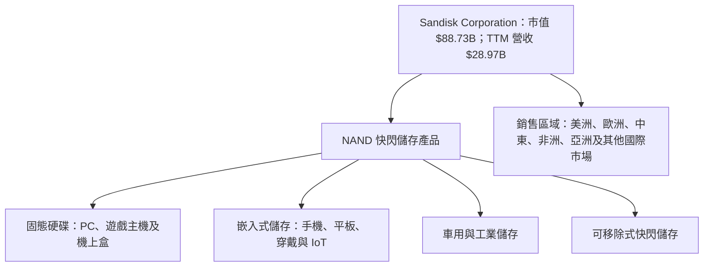
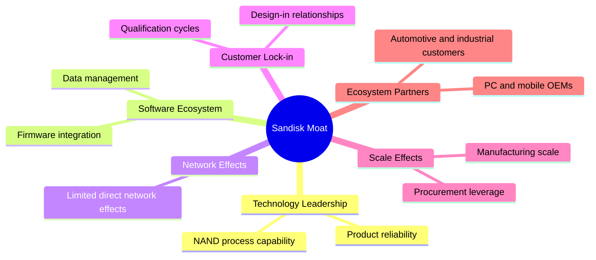
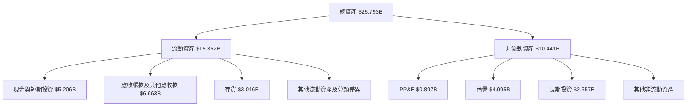
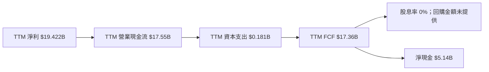
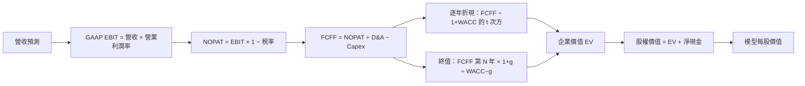
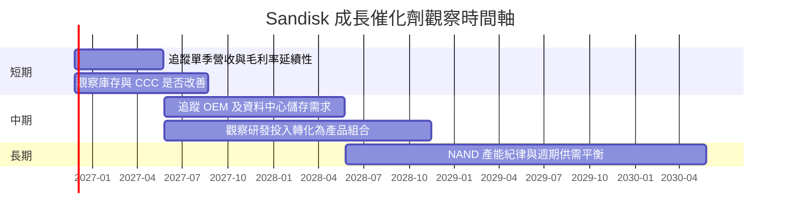
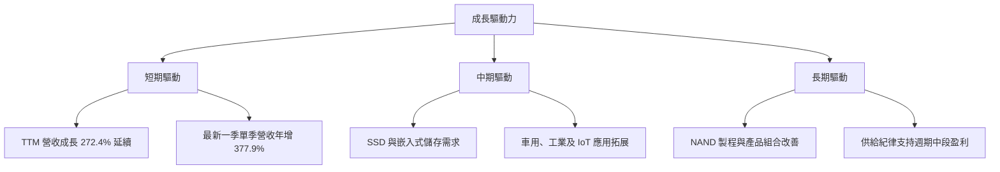
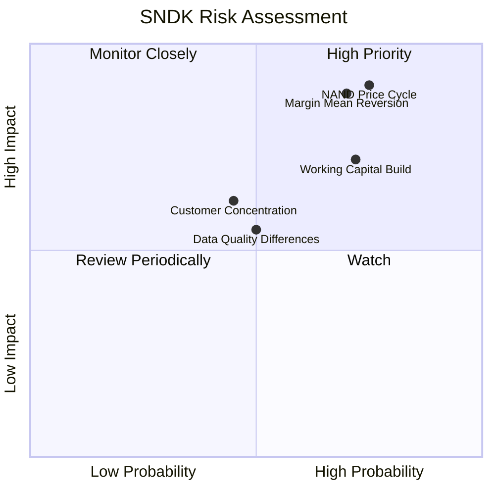
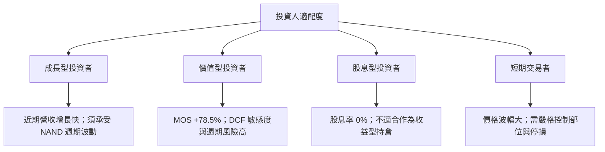

# SNDK 基本面深度分析報告
> **報告日期**：2026-11-25 ｜ **語言**：繁體中文 ｜ **數據來源**：SEC 申報資料 (XBRL)、Yahoo Finance、Finviz、StockAnalysis、Roic.ai ｜ **分析師**：CFA 級機構研究

## 目錄

| # | 章節 | 核心結論 |
|---|------|----------|
| 1 | 執行摘要 | 強烈買入；加權合理價值 $362.84；MOS +78.5% |
| 2 | 公司概覽與商業模式 | NAND 儲存產品收入組成未披露；產品與製造規模可能形成中度護城河 |
| 3 | 損益表深度分析 | TTM 營收 $28.97B、TTM 成長 272.4%；獲利率處於週期高位 |
| 4 | 資產負債表分析 | TTM 淨現金 $5.14B；現金轉換週期拉長至 226 天 |
| 5 | 現金流量深度分析 | TTM FCF $17.36B、FCF Yield 19.57%；歷史現金流波動大 |
| 6 | 獲利能力與資本效率 | ROIC 141.2%，WACC 9.95%；價值創造利差極大但高度週期敏感 |
| 7 | 相對估值分析 | 自身 P/S 0.4x，低於自身五年中位數 0.6x；相對同業估值數據差異大 |
| 8 | DCF 內在價值評估 | DCF 基準 $606.92；加權合理價值 $362.84；估值高度依賴終值假設 |
| 9 | 成長催化劑 | AI／資料中心與 NAND 需求可能支持成長；市場規模數字未提供 |
| 10 | 風險矩陣 | NAND 價格循環、毛利率回落與營運資金惡化為主要風險 |
| 11 | 投資建議 | 強烈買入；以 $326.56 作為 MOS 10% 的買入區間上限 |

---

## 1. 執行摘要

SNDK 的 TTM 營收為 **$28.97B**，TTM 年增 **272.4%**，最新一季單季年增 **377.9%**；TTM FCF 為 **$17.36B**、FCF Yield **19.57%**，ROIC **141.2%** 高於 WACC **9.95%**。但季度營業利益率達 **79.6%**，須視為高景氣週期數據而非穩態保證。加權合理價值 **$362.84** 相對 2026-11-24 收盤價 **$77.95**，MOS 為 **+78.5%**；依 MOS 與 ROIC/WACC 門檻，評級為 **強烈買入**。主要保留意見是 DCF 終值占 EV 58.3%、營運資金週期拉長，以及 NAND 價格循環可能令目前利潤率快速收縮。

### 1.0 一頁式投資儀表板

| 項目 | 內容 |
|------|------|
| **投資論點（3 句）** | ① TTM 營收 $28.97B、TTM 成長 272.4%，反映 NAND 復甦與需求放量。② TTM FCF $17.36B、FCF Yield 19.57%，提供內部資金與估值支撐。③ ROIC 141.2% 對比 WACC 9.95%，目前回報顯著高於資本成本，但不代表週期高點可永久延續。 |
| **綜合評分** | **7.0/10**（引用 1.1 評分卡） |
| **財務健康** | 🟡 淨現金 $5.14B、流動性尚可；但 CCC 由 154 天增至 226 天，營運資金佔用上升。 |
| **ROIC vs WACC** | **141.2% vs 9.95%**；目前創造股東價值，需留意週期回落。 |
| **FCF 趨勢** | FY2026 FCF $11.49B，TTM FCF $17.36B；最新 FCF Yield **19.57%**。 |
| **估值** | Forward P/E **2.17x**｜EV/EBITDA **3.947x**｜FCF Yield **19.57%** |
| **DCF 內在價值（基準）** | **$606.92**；現價相對 DCF 折價 **87.2%**（折溢價基準為 DCF）。 |
| **安全邊際（MOS）** | **+78.5%＝($362.84 − $77.95) ÷ $362.84**｜🟢 充足；基準為 8.8 加權合理價值。 |
| **預期報酬（基準情境 12M）** | **N/A**；DCF 基準情境為十年模型，不應直接當作 12 個月報酬預測。 |
| **關鍵風險（前二）** | NAND 報價／毛利率回落；庫存與應收帳款增長令 CCC 延長。 |
| **評級 + 信心度** | 🟢 **強烈買入**｜信心：中；估值吸引，但週期性與模型敏感度較高。 |

### 1.1 綜合評分卡

| 維度 | 評分（1–10） | 主要依據（引用數字與其來源章節） |
|------|--------------|----------------------------------|
| 成長性 | 8.5 | TTM 營收成長 272.4%、最新一季單季年增 377.9%（第 3 章）；高增速可能包含低基期與週期回升。 |
| 獲利能力 | 8.5 | TTM 營業利益率 72.5%、ROIC 141.2%；Piotroski 5/8（第 6 章），顯示盈利高但財務訊號並非全數改善。 |
| 財務健康 | 7.0 | 淨現金 $5.14B，但 CCC 226 天，較一年前增加 72 天（第 4 章）。 |
| 估值 | 9.0 | MOS +78.5%；自身 P/S 0.4x，低於五年中位數 0.6x（第 7、8 章）。 |
| 護城河 | 6.0 | NAND 製程、產品驗證與規模具有一定門檻，但未提供市占與分部營收數據；商品化與週期性仍強（第 2 章）。 |
| 管理層與資本配置 | 6.0 | FY2026 SBC $232M，TTM 股數稀釋測試未通過；股息率 0%，資本回報細節有限。 |
| **綜合評分** | **7.5** | 六項算術平均：$(8.5+8.5+7.0+9.0+6.0+6.0)÷6=7.5$。 |

### 1.2 五大投資論點 + 三大核心風險

| 類型 | 項目 | 具體依據 | 信心度 |
|------|------|----------|--------|
| 🟢 **投資論點①** | 營收快速放量 | TTM 營收 $28.97B，TTM 成長 272.4%；最新一季單季年增 377.9%。 | 🟢 高 |
| 🟢 **投資論點②** | 現金流與資產負債表改善 | TTM OCF $17.55B、FCF $17.36B、淨現金 $5.14B。 | 🟢 高 |
| 🟢 **投資論點③** | 高景氣下資本回報突出 | ROIC 141.2% 對比 WACC 9.95%，利差 131.25 個百分點。 | 🟡 中 |
| 🟢 **投資論點④** | 估值低於模型與同業倍數參考 | 加權合理價值 $362.84；現價 $77.95；自身 P/S 0.4x。 | 🟡 中 |
| 🟢 **投資論點⑤** | 現金流擴張支持投資彈性 | FY2026 FCF $11.49B，TTM FCF $17.36B；公司可用現金支援研發與產能。 | 🟡 中 |
| 🟡 **風險①** | NAND 價格與供需反轉 | 毛利率與營業利益率處於極高水準；若供給擴張快於需求，獲利可能顯著下滑。 | 🟡 中 |
| 🔴 **風險②** | 營運資金效率惡化 | CCC 由 154 天升至 226 天；DSO 83 天、DIO 190 天，資金占用上升。 | 🔴 高衝擊 |
| 🔴 **風險③** | DCF 長期假設與資料一致性 | 終值占 EV 58.3%；資料中債務、ROE、季度營業利益率等來源存在口徑差異。 | 🟡 中 |

### 1.3 快速統計卡片

| 指標 | 公司實際值（期間） | 同業中位數 | 狀態 |
|------|--------------------|------------|------|
| 營收成長（TTM） | **272.4%** | — | 🟢 |
| 營收成長（最新一季年增） | **377.9%** | **217.4%** | 🟢 |
| 毛利率（TTM） | **80.0%** | **66.7%** | 🟢 |
| 營業利益率（TTM） | **72.5%** | — | 🟢 |
| ROIC（TTM） | **141.2%** | — | 🟢 |
| Forward P/E | **2.17x** | **4.0x** | 🟢 |
| FCF Yield（TTM） | **19.57%** | — | 🟢 |
| Piotroski F-Score | **5 / 8** | — | 🟡 |

同業中位數依 WDC、MU 兩家公司計算；SKHY 因 P/S、EV/EBITDA 混合幣別而不納入估值中位數。

### 1.4 投資結論

```text
╔══════════════════════════════════════════════════════════════════╗
║                    📊 投資結論摘要                               ║
╠══════════════════════════════════════════════════════════════════╣
║  評級：強烈買入（MOS +78.5%，ROIC 141.2% > WACC 9.95%）          ║
║  價格（2026-11-24 收盤）：$77.95                                 ║
║  DCF 內在價值（基準）：$606.92（相對現價折價 87.2%）             ║
║  安全邊際 MOS：+78.5%＝($362.84−$77.95)÷$362.84                 ║
║  加權合理價值（8.8）：$362.84                                    ║
║  DCF 情境價值：                                                  ║
║    悲觀情境：$257.29（+230.1%）                                  ║
║    基準情境：$606.92（+678.6%）                                  ║
║    樂觀情境：$1,357.12（+1,641.0%）                              ║
║  綜合評分：7.5/10（引用 1.1）                                    ║
║  適合投資人：能承受 NAND 週期波動、採分批布局的成長／價值型投資人 ║
╚══════════════════════════════════════════════════════════════════╝
```

---

## 2. 公司概覽與商業模式

### 2.1 業務結構與收入來源

公司開發、製造及銷售 NAND 快閃記憶體儲存產品，包括固態硬碟、嵌入式儲存及可移除式快閃儲存相關產品。提供的財務資料未列各產品線收入、占比或服務收入，以下只呈現公司層級數字，不臆測部門占比。



### 2.2 市場份額

市場份額數據未提供，故不繪製市占圖或推算占比。SNDK TTM 營收為 $28.97B，最新一季單季營收年增 377.9%；同期間 MU 單季營收年增 379.3%、WDC 為 55.5%。這代表 SNDK 與 MU 同處高成長週期環境，但不能據此推定市占變化。

### 2.3 競爭護城河分析



### 2.4 護城河強度

| 護城河項目 | 強度（強／中／弱） | 證據（引用數字或事實） | 會削弱它的情況 |
|------------|--------------------|------------------------|----------------|
| 技術與產品可靠性 | 中 | 公司涵蓋 SSD、嵌入式、車用及工業儲存；但未提供製程領先幅度或專利資料。 | NAND 技術追趕、產品差異化下降。 |
| 軟體與韌體 | 弱至中 | 產品包含韌體與控制器整合屬性，但無軟體收入或續約數據。 | 硬體規格標準化、控制器與韌體可替代。 |
| 客戶鎖定 | 中 | 車用、工業及 OEM 產品通常需產品驗證；未提供客戶留存或合約期限。 | 客戶多源採購、價格競標增加。 |
| 規模效應 | 中 | TTM 營收 $28.97B，顯示具一定營運規模；但未提供產能、成本曲線或市占。 | 同業擴產、利用率下降與價格競爭。 |
| 網路效應 | 弱 | 儲存產品本身網路效應有限，資料未提供平台型收入。 | 產品商品化使網路效應難形成。 |
| 生態夥伴 | 中 | 覆蓋 PC、手機、車用、IoT 等應用；未提供合作收入占比。 | OEM 更換供應商或改採其他儲存方案。 |

1.1 的護城河評分 **6.0/10**，反映產品驗證、技術與規模具有一定門檻，但缺少可核實的市占、客戶鎖定及軟體經常性收入證據。

---

## 3. 損益表深度分析

### 3.1 年度收入成長趨勢（近 4 年）

年度收入取年度損益表列示值。FY2023 至 FY2026 的收入由 $6.09B 增至 $20.25B；FY2026 成長主要由儲存週期復甦及需求回升帶動，但週期高點營收不宜線性外推。

```text
╔══════════════════════════════════════════════════════════════════╗
║              Sandisk 年度收入趨勢（FY2023-FY2026）               ║
╠══════════════════════════════════════════════════════════════════╣
║  FY2023  $6.09B   ██████░░░░░░░░░░░░░░░░░░░  YoY: N/A           ║
║  FY2024  $6.66B   ███████░░░░░░░░░░░░░░░░░░  YoY: +9.5%         ║
║  FY2025  $7.36B   ████████░░░░░░░░░░░░░░░░░  YoY: +10.4%        ║
║  FY2026  $20.25B  █████████████████████████  YoY: +175.3%       ║
║                                                                  ║
║  FY2023-FY2026 累計 CAGR：約 49.3%                               ║
╚══════════════════════════════════════════════════════════════════╝
```

CAGR 算式：$(20.248÷6.086)^{1/3}-1≈49.3\%$。此期間包含 FY2023 低基期，TTM 成長率 272.4% 更顯示復甦與週期反彈，不能當作長期正常成長率。

### 3.2 季度收入趨勢分析

| 季度 | 營收 | QoQ | YoY | 備註 |
|------|------|-----|-----|------|
| FY2026 Q2（截至 2026-01-02） | $3.025B | +31.1% | +61.3% | 與 FY2026 Q1 $2.308B 比較。 |
| FY2026 Q3（截至 2026-04-03） | $5.950B | +96.7% | +251.0% | 出貨與定價復甦加速；比較基期較低。 |
| FY2026 Q4（截至 2026-07-03） | $8.965B | +50.7% | +371.6% | 營收擴張延續，反映需求及價格改善。 |
| FY2027 Q1（截至 2026-10-02） | $11.031B | +23.0% | +377.9% | 單季年增率，並非 TTM 成長率。 |

QoQ 按相鄰季度營收計算；YoY 使用 StockAnalysis 季度資料。FY2027 Q1 營收較 FY2026 Q1 的 $2.308B 增加 $8.723B，成長率為 $(11.031÷2.308)-1≈377.9\%$。

### 3.3 利潤率演變分析

| 利潤率指標 | FY2023 | FY2024 | FY2025 | FY2026 | 趨勢 | 評估 |
|------------|--------|--------|--------|--------|------|------|
| **毛利率** | 7.1% | 16.1% | 30.1% | 71.5% | FY2026 急升 | 🟡 |
| **營業利益率** | -21.3% | -6.7% | 6.9% | 61.6% | 由虧轉盈並大幅擴張 | 🟡 |
| **淨利率** | -35.2% | -10.1% | -22.3% | 56.5% | FY2025 曾受虧損拖累 | 🟡 |

依年度收入與毛利／營業利益／淨利數據計算；TTM 利潤率另依 VERIFIED 指標：毛利率 **80.0%**、營業利益率 **72.5%**、淨利率 **67.0%**。年度 FY2026 口徑與 TTM 期間不同，數值不應混用。

**利潤率演變深度解析：**FY2026 毛利率由 FY2025 的 30.1% 上升至 71.5%，營業利益率由 6.9% 升至 61.6%，說明營收回升帶來顯著營業槓桿；週期性 NAND 產業中，供給約束、產品組合及價格回升可迅速改善毛利。但現有資料未拆分價格、產品組合與成本各自貢獻，不能將全部提升歸因於單一因素。TTM 營業利益率 72.5% 高於 FY2026 年度 61.6%，進一步提高了未來均值回歸風險。

### 3.4 費用結構分析

提供資料沒有完整的銷售、管理、研發、折舊與其他營業費用明細，因此不繪製費用占比圓餅圖。可核實的研發費用為 FY2026 **$1.33B**，FY2025 **$1.13B**，年增約 **17.7%**；與 FY2026 營收增幅相比，研發投入增速較慢，但仍須觀察是否持續投入製程、控制器與產品開發。

### 3.5 季度 EPS 趨勢與盈餘品質（Quality of Earnings）

| 季度 | EPS 實際值 | EPS 年增 | 超預期／不及預期 |
|------|------------:|---------:|------------------|
| FY2026 Q2 | $0.64 | +618.1% | 預期值 N/A，無法判定 |
| FY2026 Q3 | $2.88 | N/A | 預期值 N/A，無法判定 |
| FY2026 Q4 | $5.50 | N/A | 預期值 N/A，無法判定 |
| FY2027 Q1 | $6.58 | +6,909.6% | 預期值 N/A，無法判定 |

最近四季 EPS 估計值在資料中均為 nan，故不得將其標為「超預期」或「不及預期」。EPS 依季度實際值呈逐季上升，但同比增幅受低基期影響明顯。

| 盈餘品質項目 | 數值/佔比 | 評估 |
|--------------|-----------|------|
| 股權薪酬 SBC / 營收 | TTM SBC $270M ÷ TTM 營收 $28.97B＝約 **0.93%** | 🟢 占比不高，但股數稀釋測試未通過，仍會稀釋每股回報。 |
| SBC / 營業現金流 | $270M ÷ $17.55B＝約 **1.54%** | 🟢 現金流相對 SBC 規模大；SBC 仍是股東經濟成本。 |
| FCF / 淨利（現金轉換率） | TTM FCF $17.36B ÷ TTM 淨利 $19.422B＝約 **89.4%** | 🟡 現金轉換尚可，但未達 100%。 |
| 一次性／非經常性損益 | 未提供拆分 | 🟡 N/A；無法判定是否有重大一次性項目。 |
| 有效稅率異常 | **12.2%**（最近年度有效稅率） | 🟡 目前模型採用此稅率；未提供多年稅務明細，需防範正常化稅率上升。 |
| 資本化支出 vs 費用化 | TTM Capex $181M，約為 TTM 營收 0.6% | 🟡 資本支出強度偏低；資料不足以判斷研發、設備或其他成本是否存在較大資本化。 |

SBC TTM 以近四季 $91M、$67M、$54M、$58M 加總為 $270M。盈餘品質整體有現金流支撐，但 F-Score 的應計品質測試未通過，且 FCF 低於淨利；估值時不應只依 GAAP 淨利推算永久獲利能力。

---

## 4. 資產負債表分析

### 4.1 資產結構分解

TTM 資產負債表總資產為 $25.793B；其中流動資產 $15.352B。以下採 StockAnalysis TTM 資產數據呈現，細項未列完整者不作比例補足。



### 4.2 流動性與營運資金分析

| 指標 | 最新 TTM | 一年前 TTM | 變化 | 解讀 |
|------|----------|------------|------|------|
| 流動比率 | 2.58x | N/A | N/A | 目前流動資產高於流動負債；資料未提供一致口徑的一年前比率。 |
| 速動比率 | 1.994x | N/A | N/A | 排除存貨後仍有短期償債緩衝。 |
| DSO 應收帳款天數 | 83 天 | 56 天 | +27 天 | 收款週期延長，可能與營收擴張及應收款增長有關；需核對逾期與客戶條款。 |
| DIO 存貨天數 | 190 天 | 124 天 | +66 天 | 存貨資金占用明顯增加；可能是擴產備貨，也增加價格下跌時的存貨減值風險。 |
| DPO 應付帳款天數 | 46 天 | 26 天 | +20 天 | 付款週期延長，部分抵銷應收及庫存占用；不能單獨據此推定議價力改善。 |
| CCC 現金轉換週期 | 226 天 | 154 天 | +72 天 | 營運週轉效率惡化，後續若 CCC 持續上行，FCF 可能低於盈利增幅。 |

營運資金天數依 QUALITY FIGURES 原值照列，不重算。

### 4.3 債務結構分析

債務資料存在來源口徑差異：VERIFIED 指標中總債務為 N/A、淨現金為 $5.14B；其他資產負債表列示 FY2026 總債務 $177M，另有市場資料列示 $201M。以下以 VERIFIED 指標作為主口徑，債務金額標示不可得，不以其他口徑替代。

```text
╔══════════════════════════════════════════════════════════════════╗
║                   Sandisk 債務健康診斷                           ║
╠══════════════════════════════════════════════════════════════════╣
║  VERIFIED 總債務：N/A（可用其他來源核對值不一致）                ║
║  總現金 + 短期投資：$5.14B                                       ║
║  淨現金：$5.14B  🟢                                              ║
║  Debt/EBITDA：N/A（總債務 VERIFIED 數值缺漏）                    ║
║  利息保障倍數：N/A（利息費用與債務口徑不足以穩健核算）           ║
║  結論：現金緩衝充足；不宜把缺漏債務直接解讀為零債務              ║
╚══════════════════════════════════════════════════════════════════╝
```

### 4.4 股東權益趨勢

| 財年 | 股東權益 | YoY 變化 |
|------|---------:|---------:|
| FY2024 | $11.08B | N/A |
| FY2025 | $9.22B | -16.8% |
| FY2026 | $15.74B | +70.7% |

FY2026 權益上升與當年 $11.43B 淨利相符，但權益變化亦受其他綜合損益、發股與回購等項目影響；資料未提供完整權益變動表，不能把全部增加歸因於淨利。

```text
╔══════════════════════════════════════════════════════════════════╗
║                   股東權益趨勢（年度）                           ║
╠══════════════════════════════════════════════════════════════════╣
║  FY2024  $11.08B  ██████████████░░░░░░░░                        ║
║  FY2025   $9.22B  ████████████░░░░░░░░                          ║
║  FY2026  $15.74B  ████████████████████                          ║
╚══════════════════════════════════════════════════════════════════╝
```

---

## 5. 現金流量深度分析

### 5.1 現金流量瀑布圖

季度現金流未提供股息或回購支付金額，因此不臆測其金額。



### 5.2 FCF 轉換率趨勢

| 財年 | FCF | 淨利 | FCF／淨利 | 解讀 |
|------|-----:|-----:|----------:|------|
| FY2023 | -$0.932B | -$2.143B | 約 43.5%* | 兩者均為負，比例不適合用作正常轉換率解讀。 |
| FY2024 | -$0.475B | -$0.672B | 約 70.7%* | 同為負值，仍屬虧損期參考。 |
| FY2025 | -$0.120B | -$1.641B | 約 7.3%* | FCF 接近損益兩平，淨利仍為負。 |
| FY2026 | $11.49B | $11.43B | 約 100.5% | 盈利轉為現金能力強。 |
| TTM | $17.36B | $19.422B | 約 89.4% | FCF 略低於淨利，需留意應計與營運資金。 |

\*虧損年度的比值為算術比值，經濟意義有限。TTM FCF 依 VERIFIED 定義：營業現金流減資本支出。

### 5.3 自由現金流趨勢

| 期間 | FCF | FCF Yield |
|------|----:|----------:|
| FY2023 | -$0.932B | N/A |
| FY2024 | -$0.475B | N/A |
| FY2025 | -$0.120B | N/A |
| FY2026 | $11.49B | N/A |
| TTM | $17.36B | 19.57% |

年度 FCF Yield 未提供一致期間市場市值，故不補算。

```text
╔══════════════════════════════════════════════════════════════════╗
║                   自由現金流趨勢                                 ║
╠══════════════════════════════════════════════════════════════════╣
║  FY2023  -$0.932B  ◀ 虧損期                                      ║
║  FY2024  -$0.475B  ◀ 虧損期                                      ║
║  FY2025  -$0.120B  ◀ 接近損益兩平                                ║
║  FY2026  +$11.49B  █████████████                                 ║
║  TTM     +$17.36B  ████████████████████  FCF Yield 19.57%        ║
╚══════════════════════════════════════════════════════════════════╝
```

### 5.4 資本配置評估

FY2026 資本支出 $177M、SBC $232M；公司股息率為 0%。未提供回購、併購與其他投資的完整金額，故不繪製資本配置比例圖。

| 項目 | 已知數據 | 評估 |
|------|---------|------|
| 資本支出 | FY2026 $177M；TTM $181M | 相對 TTM 營收強度低，但需注意 NAND 製造投資可能在未來週期增加。 |
| 股息 | 股息率 0.0% | 目前未以現金股息回饋股東。 |
| 回購 | N/A | 未提供金額。 |
| SBC | FY2026 $232M | 造成稀釋；不應將其視為沒有成本的非現金項目。 |
| 留存現金 | 淨現金 $5.14B | 提供資本配置彈性。 |

---

## 6. 獲利能力與資本效率

### 6.1 ROE / ROA / ROIC 趨勢

| 指標 | FY2024 | FY2025 | FY2026／TTM | 評估 |
|------|-------:|-------:|------------:|------|
| ROE | N/A | N/A | VERIFIED TTM **107.1%** | 高回報，但受到週期高盈利及權益基數影響。 |
| ROA | N/A | N/A | **68.3%**（市場資料） | 非 VERIFIED ROIC 模組欄位；僅作交叉參考。 |
| ROIC | N/A | N/A | VERIFIED TTM **141.2%** | 顯著高於 WACC；週期峰值正常化後可能下降。 |

不同資料源的 ROE 指標出現差異；本報告杜邦分析依 QUALITY FIGURES 的 ROE **107.1%**，而非其他資料表列示的 141.2%。

### 6.2 ROIC vs WACC 分析（核心價值創造判斷）

```text
╔══════════════════════════════════════════════════════════════════╗
║                ROIC vs WACC 深度分析                             ║
╠══════════════════════════════════════════════════════════════════╣
║  WACC（VERIFIED 輸入，8.2 展開）：9.95%                          ║
║  ├── 無風險利率（10Y 美債）：4.90%                               ║
║  ├── 市場風險溢酬：5.00%                                         ║
║  ├── Beta used（adjusted）：1.00；原始 Beta：N/A                 ║
║  ├── 股權成本：9.90%                                             ║
║  ├── 債務成本（稅前）：36.32%；稅率：12.2%                       ║
║  ├── 股權／債務權重：99.8%／0.2%                                 ║
║  └── ✅ WACC：9.95%                                              ║
║                                                                  ║
║  ROIC（TTM，VERIFIED）：141.2%                                   ║
║  ROIC − WACC = 141.2% − 9.95% = +131.25 個百分點                 ║
║  ROIC / WACC = 141.2% ÷ 9.95% ≈ 14.19 倍                        ║
║                                                                  ║
║  ROIC 141.2%  ▓▓▓▓▓▓▓▓▓▓▓▓▓▓▓▓▓▓▓▓▓▓▓▓▓▓▓▓▓▓                   ║
║  WACC   9.95%  ▓▓                                                  ║
║                                                                  ║
║  📊 結論：按 TTM 指標，現階段創造經濟價值；但 NAND 週期反轉時，  ║
║     ROIC 可快速收斂，不能將當期利差視為永久競爭優勢。           ║
╚══════════════════════════════════════════════════════════════════╝
```

WACC 直接採用 VERIFIED 值 **9.95%**，ROIC 直接採用 **141.2%**。Beta 原始值 N/A，採用調整後 Beta 1.00；資本成本中債務權重僅 0.2%，因此稅前債務成本偏高對總 WACC 影響有限。債務細節與利息費用原始基礎未完整提供，不能另行重算 WACC。

### 6.3 杜邦三因素分解

| 因素 | 數值（TTM） | 解讀 |
|------|-------------|------|
| 淨利率 | 67.0% | 淨利率高，反映目前價格與毛利率週期。 |
| 資產週轉率 | 1.12x | 每單位資產創造約 1.12 倍營收。 |
| 權益乘數 | 1.42x | 財務槓桿相對有限，ROE 不主要依靠高槓桿。 |
| **ROE** | **107.1%** | QUALITY FIGURES 原值：67.0% × 1.12 × 1.42 約為 106.6%，與 107.1% 的小差異來自原始值精度及四捨五入。 |

ROE 的主要驅動因素是高淨利率，並非權益乘數；若 NAND 價格或出貨組合逆轉，淨利率下滑會直接壓低 ROE。

### 6.4 財務體質：Piotroski F-Score

Piotroski F-Score：**5 / 8**。一項測試因缺資料而不納入分母，以下逐項照列品質指標原值。

| 測試 | 結果 | 解讀 |
|------|------|------|
| ROA > 0 | ✅ 通過 | 盈利為正。 |
| 營業現金流 > 0 | ✅ 通過 | TTM OCF $17.55B。 |
| ROA 高於一年前 | ✅ 通過 | 盈利能力較前期改善。 |
| 營業現金流 > 淨利（應計品質） | ❌ 未通過 | TTM OCF 低於淨利，需關注應收帳款與存貨變化。 |
| 長期負債／總資產低於一年前 | — 無法判定 | 缺資料。 |
| 流動比率高於一年前 | ❌ 未通過 | 流動性指標未改善。 |
| 稀釋股數未增加 | ❌ 未通過 | 股數增加，稀釋會降低每股價值增長。 |
| 毛利率高於一年前 | ✅ 通過 | 毛利率改善，但帶有週期因素。 |
| 資產週轉率高於一年前 | ✅ 通過 | 資產利用效率改善。 |

---

## 7. 相對估值分析

### 7.1 同業估值比較表格

SNDK 倍數採市場資料；同業倍數嚴格採 Peer multiples。相對倍數受週期盈利、股價與公司類型影響，不能單獨等同低估。

| 估值指標 | **SNDK** | **WDC** | **MU** | **SKHY** | SNDK 評估 |
|----------|---------:|-------:|-------:|--------:|-----------|
| **Trailing P/E** | 4.984x | 9.6x | 8.5x | 6.2x | 🟢 低於所列同業；週期高峰 EPS 可能壓低倍數。 |
| **Forward P/E** | 2.172x | 6.9x | 3.1x | 2.8x | 🟢 低於同業，但依賴盈利預測可實現。 |
| **P/S Ratio** | 3.063x | 7.1x | 5.4x | N/A | 🟢 低於 WDC、MU；SKHY 混合幣別，不比較。 |
| **EV/EBITDA** | 3.947x | 16.2x | 6.2x | N/A | 🟢 低於 WDC、MU；盈利周期性使 TTM 倍數可能偏低。 |
| **最新一季營收年增** | 377.9% | 55.5% | 379.3% | 327.9% | 🟢 成長速度接近 MU，明顯高於 WDC。 |
| **毛利率（TTM）** | 80.0% | 52.6% | 80.7% | 77.4% | 🟢 接近 MU，高於 WDC 與 SKHY。 |

peer 中位數（WDC、MU）：Trailing P/E **9.05x**、Forward P/E **5.0x**、P/S **6.25x**、EV/EBITDA **11.2x**、最新一季營收年增 **217.4%**、毛利率 **66.65%**。

### 7.2 歷史估值區間分析

可用的自身歷史估值資料只有 P/S，沒有 P/E 歷史區間，因此不推估 P/E 百分位。

```text
╔══════════════════════════════════════════════════════════════════╗
║          SNDK 自身歷史估值區間（TTM P/S）                        ║
╠══════════════════════════════════════════════════════════════════╣
║  五年低點 0.1x ├──────── 現值 0.4x ──┬ 中位數 0.6x ───── 1.7x  ║
║                              百分位：43%                          ║
║  解讀：目前低於五年中位數，位於歷史區間中段偏低位置。             ║
╚══════════════════════════════════════════════════════════════════╝
```

### 7.3 情境價值（Bear / Base / Bull，照抄 DCF MODEL 的 Scenarios）

| 情境 | 第 1 年營收成長 | 期末營業利潤率 | WACC | 每股價值 | 相對現價 | 機率 | 會發生的條件 |
|------|----------------|----------------|------|----------|----------|------|--------------|
| 🔴 悲觀 | 15.0% | 52.0% | 10.95% | $257.29 | +230.1% | 25% | NAND 定價正常化較快、成長低於基準，且資本成本上升。 |
| 🟡 基準 | 30.0% | 61.2% | 9.95% | $606.92 | +678.6% | 50% | 需求維持增長，利潤率由高點逐步回落。 |
| 🟢 樂觀 | 45.0% | 67.3% | 8.95% | $1,357.12 | +1,641.0% | 25% | 高成長延續、毛利率和營業槓桿維持較高，且資本成本降低。 |

情境價值與假設直接取 DCF MODEL；資料未提供情境逐年營收與現金流明細，故不自行補造中間推導數字。

### 7.4 相對估值隱含價格區間

```text
╔══════════════════════════════════════════════════════════════════╗
║              估值方法隱含每股價值（美元）                       ║
╠══════════════════════════════════════════════════════════════════╣
║  $77.95 現價 ── $158.19 P/S ── $212.40 EV/EBITDA                ║
║                    $247.11 分析師共識 ───── $606.92 DCF          ║
╚══════════════════════════════════════════════════════════════════╝
```

| 方法 | 每股價值 | 依據 |
|------|---------:|------|
| 同業 EV/EBITDA | $212.40 | WDC、MU 同業中位數 11.2x × SNDK TTM EBITDA，再加淨現金。 |
| 同業 P/S | $158.19 | WDC、MU 同業中位數 6.2x × SNDK TTM 營收。 |

---

## 8. DCF 內在價值評估（Discounted Cash Flow）

### 8.0 估值推理鏈（Thinking Logic）

**Step 1 — 價值由哪些變數決定？**  
公司價值由現有 NAND 儲存業務的現金流及未來需求增長決定；資料未提供分部營收，無法將主業、AI／資料中心或其他用途拆成獨立營收比重。基準模型的主導變數是長期營收成長與營業利潤率；終值占 EV 58.3%，意味長期現金流假設亦對價值有重大影響。

**Step 2 — 模型選擇**

| 決策點 | 本報告採用 | 理由（含數字） | 曾考慮但否決 | 否決理由 |
|--------|-----------|----------------|--------------|----------|
| 現金流定義 | FCFF | 對應 WACC 折現並估算 EV；TTM FCF $17.36B。 | FCFE | 債務口徑存在缺漏，FCFF 較合適。 |
| 預測期 N | 10 年 | DCF MODEL 固定輸入；營收週期與成熟期轉換需逐步反映。 | 5 年 | 未採用，因程式模型已固定 10 年。 |
| 終值方法 | Gordon Growth | 採終值永續成長率 3.0%，低於 WACC 9.95%。 | 僅退出倍數 | 模型未提供退出倍數終值計算。 |
| EBIT 基礎 | GAAP EBIT | 模型採 GAAP EBIT，已包含 SBC 費用。 | 非 GAAP EBIT | 避免將 SBC 加回後漏計股東成本。 |

**Step 3 — 假設推導鏈**

- **營收成長**：錨點為 TTM 營收成長 272.4%，最新一季單季年增 377.9%；兩者顯示週期急速反彈，但低基期及高峰不可永久延續。模型把第 1 年成長限制在 0%–30%，採 **30.0%**，第 10 年線性降至 **3.0%**。曾考慮把高峰增速延續更久，但因週期性與基期效應否決。
- **期末營業利益率**：錨點為 TTM 72.5%；模型第 1 年採 72.5%，第 10 年降至近三個財年的中位值 **61.2%**。此設定承認週期回落，但仍假設長期利潤率維持高位；未採用大幅跌至低雙位數，因模型以近三年歷史中位數為錨。
- **永續成長率 g**：模型採 **3.0%**；低於 WACC 9.95%，可使用 Gordon Growth。GDP、通膨的外部長期估計未提供，不將其冒充已核實數據；較高永續成長率會進一步放大終值，故不採用高於 3.0% 的基準。
- **預測期 N**：採 **10 年**，完全照模型；DCF 已逐年淡化成長率。未改用更短期限，避免自行另建模型。
- **Capex／營收**：採第 1 年至第 10 年約 **0.6%**，以 TTM Capex $181M／TTM 營收 $28.97B 約 0.6% 為錨；維持比例是模型設定。不能只依當前低 Capex 推論未來製造投資永遠不增加。
- **D&A／營收**：採 **0.5%**，模型依據 TTM 比率並固定；未另行估算。
- **營運資金變動**：模型不納入 ΔWC。TTM CCC 226 天且較一年前增加 72 天，代表省略營運資金可能高估 FCFF；沒有可靠逐年 ΔWC 假設，故照模型處理並列作重大限制。
- **EBIT 與 SBC**：採 GAAP EBIT，模型不另扣 SBC；以固定股數處理，年稀釋率 0%。**本模型採用 (A)，故 SBC 影響已透過 GAAP 費用計入一次**；不再另減 SBC 或額外計稀釋。
- **WACC**：採 VERIFIED 的 **9.95%**。不能自行替換為另一個 WACC；原始 Beta 缺值以調整後 Beta 1.00，詳見 8.2。
- **終值方法**：採 Gordon Growth，g 3.0%；模型未提供退出倍數終值，因此不補造交叉驗證值。

**Step 4 — 最脆弱假設**  
最脆弱的是高營業利潤率能否在週期正常化後維持；若營收與毛利率回落，價值可能快速向悲觀情境 **$257.29** 靠攏，且營運資金未納入可能額外高估價值。

**Step 5 — 計算路徑圖**



### 8.1 模型假設總表（Model Inputs）

| 假設項目 | 採用值 | 依據／來源 | 敏感度 |
|----------|--------|------------|--------|
| 預測期長度 N | 10 年 | DCF MODEL 固定預測期。 | 🟡 中 |
| 營收成長 | 第 1 年 30.0%，第 10 年 3.0%，逐年線性淡化 | TTM 成長 272.4%，模型將第 1 年限制在 30.0%。 | 🔴 高 |
| 營業利潤率 | 第 1 年 72.5% → 第 10 年 61.2% | TTM 起點，淡化至近三個財年中位數。 | 🔴 高 |
| 有效稅率 | 12.2% | VERIFIED 最近年度有效稅率。 | 🟢 低 |
| Capex／營收 | 第 1 年至第 10 年 0.6% | TTM Capex $181M／TTM 營收 $28.97B 約 0.6%。 | 🟡 中 |
| D&A／營收 | 0.5% | DCF MODEL 的 TTM 比率。 | 🟢 低 |
| 營運資金變動／營收增額 | 未建模 | DCF MODEL 明確不納入營運資金。 | 🟢 低* |
| EBIT 基礎 | GAAP EBIT | DCF MODEL 指明 GAAP。 | 🟡 中 |
| SBC 處理 | GAAP EBIT 已計費用，不另扣 | 組合 A；固定股數，不加年稀釋。 | 🟡 中 |
| 年稀釋率 | 0%（模型假設） | 組合 A 的固定股數處理，不代表實際股數不會增加。 | 🟡 中 |
| 永續成長率 g | 3.0% | DCF MODEL 固定輸入，且低於 WACC。 | 🔴 高 |
| 終值方法 | Gordon Growth | 模型終值公式。 | 🔴 高 |
| WACC | 9.95% | VERIFIED Cost of capital。 | 🔴 高 |

\*營運資金在模型中沒有數值輸入，並非代表實際 ΔWC 為零。

FCFF 定義：**FCFF = NOPAT + D&A − Capex**；模型未列 ΔWC。每股價值按 DCF MODEL 原式，採用 equity value × price ÷ market cap，不另行改用未提供的稀釋股數。

### 8.2 折現率推導（WACC）

```text
╔══════════════════════════════════════════════════════════════════╗
║                    WACC 推導（折現率）                           ║
╠══════════════════════════════════════════════════════════════════╣
║  股權成本 Ke（CAPM）：                                           ║
║  ├── 無風險利率 Rf（10Y 美債）：4.90%                            ║
║  ├── 市場風險溢酬 ERP：5.00%（假設值，VERIFIED 採用值）          ║
║  ├── 原始 Beta：N/A；調整後 Beta：1.00（假設值）                ║
║  ├── 規模／國別溢酬：0.00%（模型未列額外溢酬）                  ║
║  └── Ke = 4.90% + 1.00 × 5.00% = 9.90%                          ║
║                                                                  ║
║  債務成本 Kd：                                                   ║
║  ├── 稅前 Kd：36.32%（VERIFIED 原值）                            ║
║  ├── 有效稅率：12.2%                                             ║
║  └── 稅後 Kd = 36.32% × (1 − 12.2%) = 31.89%                    ║
║                                                                  ║
║  資本結構權重：股權 99.8%；債務 0.2%（VERIFIED 原值）            ║
║  ✅ WACC 採用 VERIFIED 值：9.95%                                 ║
╚══════════════════════════════════════════════════════════════════╝
```

**逐步演算（WACC）：**

1. **Ke** = Rf + β × ERP = 4.90% + 1.00 × 5.00% = **9.90%**。
2. **稅前 Kd** = VERIFIED 原值 **36.32%**；原始利息費用及一致口徑平均計息負債未提供，故不重建分子、分母。
3. **稅後 Kd** = 36.32% × (1 − 12.2%) = **31.89%**。
4. **權重** = 股權 **99.8%**、債務 **0.2%**；合計 99.8% + 0.2% = **100.0%**。
5. 依提供組成試算：99.8% × 9.90% + 0.2% × 31.89% = 9.8802% + 0.0638% = **9.9440%**，按兩位小數約 **9.94%**；模型 VERIFIED WACC 為 **9.95%**。本報告依規則採用 VERIFIED **9.95%**，不以重算值替換。差異約 0.006 個百分點，與組成輸入的四捨五入相容。

Rf 的數據未另列具體觀測日期，故只照錄 4.90%，不補寫日期。Raw Beta 為 N/A，模型使用 adjusted Beta 1.00。稅前 Kd 的高比率及平均債務細節不可獨立核實，WACC 信心度因此降低；但第 6.2 節與本節一致採用 9.95%。

### 8.3 逐年自由現金流預測（基準情境）

金額單位：$B；金額取兩位小數，折現因子三位小數。表內數字照 DCF MODEL 列示；營運資金變動未建模。

| 年度 | FY+1 | FY+2 | FY+3 | FY+4 | FY+5 | FY+6 | FY+7 | FY+8 | FY+9 | FY+10 |
|------|------:|------:|------:|------:|------:|------:|------:|------:|------:|-------:|
| 營收 | 37.66 | 47.83 | 59.31 | 71.77 | 84.68 | 97.39 | 109.07 | 118.89 | 126.02 | 129.80 |
| 營收 YoY | 30.0% | 27.0% | 24.0% | 21.0% | 18.0% | 15.0% | 12.0% | 9.0% | 6.0% | 3.0% |
| 營業利潤率 | 72.5% | 71.2% | 70.0% | 68.7% | 67.5% | 66.2% | 64.9% | 63.7% | 62.4% | 61.2% |
| EBIT（GAAP） | 27.29 | 34.06 | 41.49 | 49.31 | 57.12 | 64.47 | 70.84 | 75.72 | 78.69 | 79.42 |
| − 稅（12.2%） | (3.32) | (4.14) | (5.05) | (6.00) | (6.95) | (7.84) | (8.62) | (9.21) | (9.58) | (9.66) |
| = NOPAT | 23.97 | 29.92 | 36.44 | 43.31 | 50.17 | 56.62 | 62.22 | 66.51 | 69.11 | 69.76 |
| + D&A | 0.20 | 0.26 | 0.32 | 0.39 | 0.46 | 0.52 | 0.59 | 0.64 | 0.68 | 0.70 |
| − Capex | (0.24) | (0.30) | (0.37) | (0.44) | (0.52) | (0.59) | (0.66) | (0.71) | (0.75) | (0.77) |
| **= FCFF** | **23.94** | **29.88** | **36.40** | **43.25** | **50.11** | **56.56** | **62.15** | **66.44** | **69.04** | **69.69** |
| 折現因子 @9.95% | 0.909 | 0.827 | 0.752 | 0.684 | 0.622 | 0.566 | 0.515 | 0.468 | 0.426 | 0.387 |
| **FCFF 現值 PV** | **21.77** | **24.71** | **27.38** | **29.59** | **31.18** | **32.01** | **31.99** | **31.10** | **29.39** | **26.98** |

預測期 PV 合計完整算式：  
**$21.77 + $24.71 + $27.38 + $29.59 + $31.18 + $32.01 + $31.99 + $31.10 + $29.39 + $26.98 = $286.10B**。  
模型列示合計為 **$286.09B**；兩者差異約 0.01B，來自各年度顯示值四捨五入，採模型原值 **$286.09B**。

**逐步演算（FY+1 代表年度）：**

1. 營收 = $28.97B × (1 + 30.0%) = **$37.66B**。
2. EBIT = $37.66B × 72.5% = **$27.29B**。
3. 稅 = $27.29B × 12.2% = **$3.32B**。
4. NOPAT = $27.29B − $3.32B = **$23.97B**。
5. D&A = $37.66B × 0.5% ≈ **$0.20B**。
6. Capex = $37.66B × 約 0.6% ≈ **$0.24B**。
7. ΔWC = **未建模**，不納入模型現金流。
8. FCFF = $23.97B + $0.20B − $0.24B = 約 **$23.93B**；DCF MODEL 列示 **$23.94B**，小差異來自表格中間項目四捨五入。
9. 折現因子 = 1 ÷ (1 + 9.95%)¹ = 約 **0.909**；PV = $23.94B × 0.909 ≈ **$21.77B**。

**合理性自檢：**
- 模型預測期 FCFF 由 $23.94B 增至 $69.69B，十年間 CAGR 約 11.3%；歷史 FCF 從負值轉正，歷史 CAGR 不具可比性。增長主要來自營收擴張，非歷史穩態外推。
- FY+10 FCFF 利潤率 = $69.69B ÷ $129.80B ≈ **53.7%**；目前 TTM FCF 利潤率 = $17.36B ÷ $28.97B ≈ **59.9%**。Peer 資料未提供同業 FCF 利潤率，不能宣稱超越同業最佳。
- 模型預測期間每年 FCFF 為正；模型未反映營運資金可能吸收現金。

```text
╔══════════════════════════════════════════════════════════════════╗
║            自由現金流：歷史實際 vs 模型預測                      ║
╠══════════════════════════════════════════════════════════════════╣
║  FY2024(實)  -$0.475B  負值                                      ║
║  FY2025(實)  -$0.120B  負值                                      ║
║  FY2026(實) +$11.49B  ███                                        ║
║  FY+1 (預)   +$23.94B  ██████                                    ║
║  FY+10(預)   +$69.69B  ██████████████████                        ║
╠══════════════════════════════════════════════════════════════════╣
║  模型假設營收成長逐年由 30.0% 降至 3.0%；營運資金未建模。         ║
╚══════════════════════════════════════════════════════════════════╝
```

### 8.4 終值計算（Terminal Value）

適用性檢查：**WACC 9.95% vs g 3.0% → WACC > g？✅**

| 方法 | 計算式 | 終值 TV | TV 現值 | 佔總 EV 比重 |
|------|--------|---------|---------|--------------|
| Gordon Growth | $69.69B × (1 + 3.0%) ÷ (9.95% − 3.0%) | $1,032.22B | $399.65B | 58.3% |
| 退出倍數法 | N/A | N/A | N/A | N/A |

退出倍數終值未由 DCF MODEL 提供，不另造一組倍數。終值現值占 EV **58.3%**，低於 75% 警示線，但估值仍高度依賴第 10 年後的現金流假設。

**逐步演算：**

1. FY+N FCFF = **$69.69B**。
2. 分子 = $69.69B × (1 + 3.0%) = 約 **$71.78B**。
3. 分母 = 9.95% − 3.0% = **6.95%**；TV = **$1,032.22B**（照 DCF MODEL 原值）。
4. PV(TV) = $1,032.22B × 第 10 年折現因子，模型列示 **$399.65B**。
5. 終值占比 = $399.65B ÷ $685.74B = **58.3%**。

### 8.5 企業價值 → 每股內在價值（Bridge）

```text
╔══════════════════════════════════════════════════════════════════╗
║              企業價值 → 每股內在價值 橋接表                      ║
╠══════════════════════════════════════════════════════════════════╣
║  預測期 FCF 現值合計             +$286.09B                        ║
║  終值現值 PV(TV)                 +$399.65B                        ║
║  = 企業價值 EV                    $685.74B                        ║
║  + 淨現金                        +$5.14B                         ║
║  = 股權價值                       $690.87B                        ║
║  每股內在價值（模型原值）          $606.92                         ║
║  當前股價（2026-11-24）            $77.95                          ║
║  折溢價（現價÷DCF價值−1）          -87.2%（折價）                 ║
╚══════════════════════════════════════════════════════════════════╝
```

1. EV = $286.09B + $399.65B = **$685.74B**。
2. 股權價值 = $685.74B + $5.14B 淨現金 = **$690.87B**（採模型原值，細項四捨五入有約 $0.01B 尾差）。
3. 每股內在價值：DCF MODEL 原式為 equity value × price ÷ market cap，模型結果 **$606.92**；資料未提供模型使用的精確股數與市值中間值，不另行反推或替換。
4. 折溢價 = $77.95 ÷ $606.92 − 1 = **-87.2%**。
5. 本節不計算 MOS；MOS 僅於 8.8 以加權合理價值為分母計算。

淨現金取 VERIFIED TTM 值 $5.14B；總債務在 VERIFIED 主欄為 N/A，模型橋接以淨現金直接加入。模型股數採組合 A 固定股數設定，未另計年稀釋；市場資料顯示流通股數約 1.14B，但模型的 per-share 算式不是直接以該數作除數，故不自行改寫。

### 8.6 敏感性分析（WACC × 永續成長率）

基準格為 **WACC 9.95%、g 3.0%**，每格括號為相對 $77.95 現價的上行空間。

| g（列）／WACC（欄） | 7.95% | 8.95% | **9.95%（基準）** | 10.95% | 11.95% |
|-----------|------:|------:|------------------:|-------:|-------:|
| **2.0%** | $771.74（+890.0%） | $650.26（+734.0%） | $559.80（+618.0%） | $489.95（+528.5%） | $434.46（+457.4%） |
| **2.5%** | $819.08（+950.1%） | $681.79（+774.5%） | $581.78（+646.3%） | $505.82（+548.9%） | $446.23（+472.5%） |
| **3.0%** | $875.98（+1,023.8%） | $718.61（+821.7%） | **$606.92（+678.6%）** | $523.68（+571.8%） | $459.32（+489.1%） |
| **3.5%** | $945.65（+1,113.1%） | $762.18（+877.1%） | $635.96（+715.8%） | $543.94（+598.0%） | $473.96（+507.9%） |
| **4.0%** | $1,032.95（+1,224.5%） | $814.55（+944.9%） | $669.88（+759.0%） | $567.11（+627.4%） | $490.44（+529.2%） |

**逐步演算（選擇 WACC 10.95%、g 3.0%）：**  
所選格 **WACC 10.95% > g 3.0% ✅**。模型矩陣該格每股價值為 **$523.68**；矩陣所需的新折現期 PV、TV 與 EV 中間值未提供，依規則不自行重建或臆造。

**三情境 DCF（依模型原值）：**

| 情境 | 第 1 年成長 | 期末營業利潤率 | WACC | 每股價值 | 相對現價 | 機率 |
|------|-------------:|---------------:|-----:|---------:|---------:|-----:|
| 🔴 悲觀 | 15.0% | 52.0% | 10.95% | $257.29 | +230.1% | 25% |
| 🟡 基準 | 30.0% | 61.2% | 9.95% | $606.92 | +678.6% | 50% |
| 🟢 樂觀 | 45.0% | 67.3% | 8.95% | $1,357.12 | +1,641.0% | 25% |
| **機率加權** | — | — | — | **$707.06** | **+807.1%** | **100%** |

機率加權：$257.29 × 25% + $606.92 × 50% + $1,357.12 × 25% = **$707.06**（採模型原值）。8.8 估值權重使用基準 DCF $606.92，不使用機率加權值。

**敏感度結論：**g 上升通常推高終值，WACC 上升則壓低折現價值。模型敏感度矩陣顯示，在 WACC 9.95% 下，g 由 2.0% 升至 4.0%，每股價值由 $559.80 升至 $669.88，變化 **+$110.08**；WACC 由 8.95% 升至 10.95%、g 固定 3.0%，價值由 $718.61 降至 $523.68，變化 **-$194.93**。在提供數據可直接量化的變數中，WACC 變動影響更大，與 8.0 指出估值由長期現金流與終值假設主導一致。營業利潤率每 +1pp 的獨立敏感度未提供，故不推算。

### 8.7 反推 DCF（Reverse DCF：市場在預期什麼）

固定基準輸入依 DCF MODEL：WACC 9.95%、有效稅率 12.2%、Capex／營收約 0.6%、預測期 10 年；營運資金未建模；股數按模型固定股數處理。

| 求解的變數（一次一個） | 其餘變數設定 | 市場隱含值 | 公司歷史實際 | 判斷 |
|------------------------|--------------|-------------|--------------|------|
| 第 1 年營收成長 | 其他輸入固定基準 | 在 -10% 至 100% 範圍內無解 | TTM 成長 272.4% | 基準模型在此區間不能單靠此變數解釋現價。 |
| 固定營業利潤率 | 其他輸入固定基準 | **7.8%** | TTM 72.5% | 市場價格隱含極大幅度利潤率均值回歸，需留意模型其他假設。 |
| 永續成長率 g | 未提供可解結果 | 未計算 | N/A | 不自行求解。 |
| 預測期 N | 未提供可解結果 | 未計算 | N/A | 不自行求解。 |

DCF MODEL 已提供「營收成長在 -10% 至 100% 無解」及「固定營業利潤率 7.8%」；但未提供每次試算的原始軌跡、各次 FY+N 營收與每股價值，故不創造試算列。反推結果表明：若其他基準輸入固定，單靠改變年 1 成長無法在指定區間匹配現價，而固定營業利潤率需降至 7.8% 才能達到價格；這也反映現價與長期高利潤基準 DCF 差距甚大。

### 8.8 估值三角驗證與安全邊際

| 估值方法 | 隱含每股價值 | 上行空間（÷現價） | 權重 | 說明 |
|----------|--------------:|------------------:|------|------|
| DCF（基準） | $606.92 | +678.6% | 40% | 十年 FCFF、WACC 9.95%、終值成長 3.0%。 |
| 同業 EV/EBITDA | $212.40 | +172.5% | 30% | WDC、MU 中位數 11.2x × TTM EBITDA，加淨現金。 |
| 同業 P/S | $158.19 | +102.9% | 20% | WDC、MU 中位數 6.2x × TTM 營收。 |
| 分析師共識目標價 | $247.11 | +217.0% | 10% | 24 位分析師平均目標價。 |
| **加權合理價值** | **$362.84** | **+365.5%** | **100%** | 公司類型為週期股；依固定方法及權重計算。 |

逐步演算：  
**$606.92 × 40% + $212.40 × 30% + $158.19 × 20% + $247.11 × 10%**  
= $242.768 + $63.720 + $31.638 + $24.711  
= **$362.837 ≈ $362.84**。  
權重合計 40% + 30% + 20% + 10% = **100%**。列示方法均有數值，沒有剔除方法。

```text
╔══════════════════════════════════════════════════════════════════╗
║                  估值區間與安全邊際                              ║
╠══════════════════════════════════════════════════════════════════╣
║  $77.95 ───────── $257.29 ───── [$362.84] ───── $606.92         ║
║  現價             悲觀DCF       加權合理值       基準DCF          ║
║                                                                  ║
║  MOS = ($362.84−$77.95) ÷ $362.84 = +78.5%                       ║
║  MOS 評估：🟢 充足                                                ║
║  上行空間 = ($362.84−$77.95) ÷ $77.95 = +365.5%                 ║
║  建議買入區間：$77.95 – $326.56                                  ║
║  合理持有區間：$326.56 – $399.12                                 ║
║  減碼考慮區間：> $399.12                                         ║
╚══════════════════════════════════════════════════════════════════╝
```

買入上限以 MOS 10% 邊界計算：$362.84 × (1 − 10%) = **$326.56**。合理持有區間上界依 MOS -10% 邊界：$362.84 × 1.10 = **$399.12**。此為估值框架價格界線，非短線走勢保證。

> 🔎 **程式複算（Python，依本節各項自動重算）**
>
> 加權合理價值 = $606.92 × 40% + $212.40 × 30% + $158.19 × 20% + $247.11 × 10% = **$362.84**（權重合計 100%）
>
> 以價格 $77.95 計：MOS = **+78.5%**，上行空間 = **+365.5%**
>
> ✅ 與本節所寫數值一致。

### 8.9 DCF 模型的局限與失效條件

- **終值依賴度：**終值現值占 EV **58.3%**，因此估值高度依賴第 10 年後現金流、WACC 與永續成長率。
- **最脆弱假設：**基準營業利潤率由 72.5% 漸降至 61.2%；若 NAND 報價回落使長期利潤率落至悲觀情境 52.0%，模型每股價值為 $257.29。
- **營運資金缺項：**CCC 已達 226 天，DCF 卻未納入 ΔWC；若應收帳款與存貨增長持續快於營收，DCF FCFF 可能高估。
- **週期性限制：**FY2023–FY2025 FCF 為負，FY2026 才轉為 $11.49B；以一個高景氣 TTM 作起點，DCF 可靠度低於平穩現金流公司。可用 EV/Sales、週期中段獲利與存貨／出貨數據交叉檢驗。
- **風險連結：**NAND 供給增加會壓低營業利潤率；客戶延遲拉貨會提高庫存與 CCC；資本成本升高則直接壓低現值。

### 8.10 複算檢核表（Audit Trail）

| # | 檢核項目 | 檢查方式 | 結果 |
|---|----------|----------|------|
| 1 | 🔴高／🟡中敏感度輸入均有推導 | 對照 8.0 Step 3 與 8.1 | ✅ |
| 2 | 每個假設都有來歷 | 8.1 依據欄逐項列明 | ✅ |
| 3 | WACC 算式與權重 | 99.8% + 0.2% = 100%；模型 WACC 原值 9.95% | ✅，組成重算有四捨五入差異，採模型原值 |
| 4 | Kd 分母與債務權重範圍一致 | 利息及平均計息負債細節未提供 | ⚠️ 缺原始明細，未自行重算 |
| 5 | WACC 與 6.2 相同 | 均採 9.95% | ✅ |
| 6 | 逐年表格年度數 | FY+1 至 FY+10，共 10 年 | ✅ |
| 7 | FY+1 代表年度算式 | 依表格中間數字重算，呈現四捨五入尾差 | ⚠️ 模型原值照列 |
| 8 | 預測期 PV 加總 | 列示值相加 $286.10B；模型原值 $286.09B | ✅，差異約 $0.01B |
| 9 | WACC > g | 9.95% > 3.0% | ✅ |
| 10 | 終值基於 FY+N 並折現 10 期 | 使用 FY+10 FCFF $69.69B | ✅ |
| 11 | 橋接 EV 至每股價值 | EV、淨現金與模型每股值照列 | ⚠️ 中間股數／市值算式不完整，未反推 |
| 12 | SBC 三要素組合相容 | GAAP EBIT、無 SBC 再扣、固定股數 | ✅ 組合 A |
| 13 | 矩陣基準格等於 DCF 基準值 | 9.95%、g 3.0% 為 $606.92 | ✅ |
| 14 | 矩陣示範格有效 | 10.95% > 3.0%；模型矩陣格 $523.68 | ✅ |
| 15 | 三情境機率加總 | 25% + 50% + 25% = 100% | ✅ |
| 16 | 反推 DCF 一次一變數 | 引用模型已給結果，無原始迭代軌跡 | ⚠️ 軌跡資料未提供 |
| 17 | MOS 分母及折溢價基準 | MOS 用 $362.84；折溢價用 DCF $606.92 | ✅ |
| 18 | 報告完整至第 11 章 | 11 章均列示 | ✅ |
| 19 | 加權合理價值未微調 | 逐項加權得 $362.837，四捨五入 $362.84 | ✅ |
| 20 | 評級符合 MOS 門檻 | MOS +78.5%，且 ROIC > WACC | ✅ 強烈買入 |

---

## 9. 成長催化劑

### 9.1 催化劑時間軸



時間軸為監控區間，不代表公司公布的確切產品發布或業績承諾日期。

### 9.2 TAM 市場規模分析

**N/A（TAM 數據未提供）**。SNDK TTM 營收 $28.97B，TTM 成長 272.4%，最新一季單季年增 377.9%，說明近期收入增長快速；但未提供 NAND、SSD、車用或資料中心市場的 TAM、滲透率與來源年份，故不估算市場規模。

### 9.3 成長驅動力結構圖



中長期驅動力屬產業與公司業務判斷；資料未提供各市場收入占比或具體新增產能規劃，應以季報營收、毛利率與庫存變化持續驗證。

---

## 10. 風險矩陣

### 10.1 風險評分矩陣

風險位置為定性排序，不表示已知統計機率；quadrantChart 軸與數據點採英文標籤。



### 10.2 風險清單詳細分析

| # | 風險項目 | 發生機率 | 財務衝擊 | 風險評分 | 緩解措施 |
|---|----------|----------|----------|----------|----------|
| 1 | 🔴 **NAND 價格與供需反轉** | 中高（質化評估） | 高；毛利率可能由 TTM 80.0% 顯著回落，幅度無法由資料精確量化 | 🔴 高 | 追蹤產業報價、庫存、出貨與管理層供需評論；避免把高點利潤率外推。 |
| 2 | 🔴 **利潤率均值回歸** | 中高 | 高；DCF 期末利潤率基準 61.2%，悲觀情境 52.0% | 🔴 高 | 每季追蹤毛利率與營業利益率；若營業利益率連續兩季低於 50%，重新評估估值。 |
| 3 | 🟠 **營運資金占用惡化** | 高 | 中高；CCC 226 天，較一年前多 72 天 | 🟠 高 | 監控 DSO、DIO、存貨減值與應收款；CCC 再增 30 天以上應下修現金流預期。 |
| 4 | 🟡 **客戶集中與議價風險** | 中 | 中高；客戶集中度資料未提供，無法量化收入衝擊 | 🟡 中 | 檢視前五大客戶占比、客戶付款期限及年度採購承諾。 |
| 5 | 🟡 **模型及財務資料口徑差異** | 中 | 中；總債務與 ROE 等欄位出現來源差異 | 🟡 中 | 以 SEC 10-Q／10-K 對照現金、債務、股數及季度利潤率；季度資料更新後重跑估值。 |

---

## 11. 投資建議

### 11.1 最終評級與評分

依 8.8 加權合理價值 $362.84、現價 $77.95，MOS 為 **+78.5%**；ROIC **141.2%** 高於 WACC **9.95%**，按規則 20 評級為 **強烈買入**，未作質化調整。綜合評分引用 1.1 的 **7.5/10**；分數反映高成長與低估值，同時扣除週期性、營運資金惡化及資料透明度風險。

### 11.2 合理價值與隱含報酬率

| 估值項目 | 每股價值 | 相對現價報酬 | 機率 |
|----------|---------:|--------------:|-----:|
| 加權合理價值 | $362.84 | +365.5% | — |
| 🔴 悲觀 DCF 情境 | $257.29 | +230.1% | 25% |
| 🟡 基準 DCF 情境 | $606.92 | +678.6% | 50% |
| 🟢 樂觀 DCF 情境 | $1,357.12 | +1,641.0% | 25% |
| DCF 機率加權值（參考） | $707.06 | +807.1% | 100% |

情境數值為模型的長期內在價值估算，不代表一年內股價目標；市場價格可能因週期與風險偏好大幅偏離內在價值。

### 11.3 買入時機與觸發因素

```text
╔══════════════════════════════════════════════════════════════════╗
║                  ✅ 買入觸發因素 Checklist                       ║
╠══════════════════════════════════════════════════════════════════╣
║  分批布局前的確認條件：                                          ║
║  ✅ 現價 $77.95 低於加權合理價值 $362.84                         ║
║  ✅ TTM FCF $17.36B 為正，FCF Yield 19.57%                       ║
║  ☐ 下一季營業利益率維持 50% 以上                                 ║
║  ☐ DIO 不再大幅增加，CCC 開始回落                                ║
║                                                                  ║
║  加碼觸發條件：                                                  ║
║  ☐ 收入增長延續且庫存增長低於營收增長                           ║
║  ☐ 毛利率穩定，且現金流轉換率改善至 100% 以上                    ║
║                                                                  ║
║  減碼／重新評估條件：                                            ║
║  ☐ 營業利益率連續兩季低於 50%                                   ║
║  ☐ CCC 再增加 30 天以上，或 FCF 轉負                             ║
║  ☐ 股價超過 $399.12，對應 MOS 低於 -10%                          ║
╚══════════════════════════════════════════════════════════════════╝
```

### 11.4 投資人適配度分析



### 11.5 每季財報監控清單（Quarterly Watch List）

| 指標 | 目前基準 | 觸發加碼 | 觸發減碼／重新估值 |
|------|----------|----------|--------------------|
| 營收年增 | 最新一季單季 +377.9% | 成長延續且非僅靠價格上漲 | 連續兩季低於 30% |
| 毛利率 | TTM 80.0% | 維持高位且庫存未同步失控 | 連續兩季低於 65% |
| 營業利益率 | TTM 72.5%；最新季 79.6% | 高於 50% 且趨勢穩定 | 連續兩季低於 50% |
| TTM FCF | $17.36B | 持續為正並接近或高於淨利 | FCF 轉負 |
| CCC | 226 天；一年前 154 天 | CCC 開始下降 | 再增加 30 天以上 |
| DIO | 190 天；一年前 124 天 | 庫存天數轉降 | 庫存持續上升且營收減速 |
| Capex | TTM $181M | 資本支出提高但伴隨可驗證需求 | 大幅擴張但利用率或定價走弱 |
| SBC／稀釋 | TTM SBC 約 $270M；稀釋股數測試未通過 | 股數增長受控 | 稀釋加速且回購未抵銷 |
| 管理層財測 | 未提供可比較財測序列 | 財測維持或上修 | 財測下修並伴隨庫存累積 |

### 11.6 反面論證：什麼會證明論點錯誤（What Would Change My Mind）

```text
╔══════════════════════════════════════════════════════════════════╗
║              ⚠️ 論點失效條件（Disconfirming Evidence）           ║
╠══════════════════════════════════════════════════════════════════╣
║  本投資論點在下列情況成立時應重新檢視或退出：                    ║
║  ☐ 核心營收單季年增連續兩季低於 30%                              ║
║  ☐ 營業利益率連續兩季低於 50%，且無可驗證的產品組合改善          ║
║  ☐ TTM FCF 轉負，或 FCF／淨利轉換率低於 50%                      ║
║  ☐ ROIC 跌破 WACC 9.95%                                          ║
║  ☐ CCC 再增加 30 天以上，且應收帳款或存貨增幅持續高於營收         ║
║  ☐ 股數稀釋加速，或 SBC 佔營收比例明顯高於目前約 0.93%            ║
║  ☐ 財報確認 NAND 供需逆轉，導致毛利與現金流同步下滑              ║
╚══════════════════════════════════════════════════════════════════╝
```

> **免責聲明**：本報告為 AI 自動生成，僅供研究參考，不構成投資建議。投資有風險，入市需謹慎。

---

## 資料與來源

| 項目 | 內容 |
|------|------|
| 價格 | 77.95 USD，2026-11-24 收盤（Yahoo Finance 即時報價（該交易日已收盤）） |
| 財務報表 | SEC 10-Q filed 2026-10-30，最新季度 2026-10-02（FY2027 Q1） |
| 有回應的資料來源 | SEC 申報資料 (XBRL)、Yahoo Finance、Finviz、StockAnalysis、Roic.ai |
| 由程式計算 | TTM 數字、WACC、DCF 模型、估值方法與權重、加權合理價值、MOS、評級門檻、F-Score、杜邦分解、營運資金天數、綜合評分 |
| 撰寫模型 | openai / gpt-6-luna |

> 本區塊由產生報告的程式依實際取得的資料填寫，非模型撰寫。「由程式計算」的數字不是模型的估計；其餘判斷（評分、情境、策略）是模型的分析。
