# SNDK 基本面深度分析報告
> **報告日期**：2026-11-26 ｜ **語言**：繁體中文 ｜ **數據來源**：SEC 申報資料 (XBRL)、Yahoo Finance、Finviz、StockAnalysis、Roic.ai ｜ **分析師**：CFA 級機構研究

## 目錄

| # | 章節 | 核心結論 |
|---|------|----------|
| 1 | 執行摘要 | 強烈買入；加權合理價值 $362.72；MOS +79.7% |
| 2 | 公司概覽與商業模式 | NAND 儲存產品業務涵蓋多種終端應用；市場份額與各業務收入占比未提供 |
| 3 | 損益表深度分析 | TTM 營收 $28.97B、年增 272.4%；獲利率處高檔，但循環性與短期急升增加預測風險 |
| 4 | 資產負債表分析 | 現金及短期投資 $5.14B、淨現金 $5.14B；CCC 從 154 天增至 226 天 |
| 5 | 現金流量深度分析 | TTM FCF $17.36B、FCF Yield 20.72%；資本支出低，現金流轉換仍須觀察 |
| 6 | 獲利能力與資本效率 | ROIC 141.2% 高於 WACC 9.90%；現有資本回報遠高於資本成本 |
| 7 | 相對估值分析 | 相對同業的估值倍數偏低；自身歷史 P/S 指標與現行市值口徑有不一致 |
| 8 | DCF 內在價值評估 | 基準 DCF 每股 $612.02；但終值占 EV 58.5%，且預測假設極具挑戰 |
| 9 | 成長催化劑 | 最新季度營收年增 377.9%；AI、資料中心相關需求為可觀察催化劑，但未提供 TAM 數據 |
| 10 | 風險矩陣 | NAND 價格循環、利潤率回落、營運資金惡化是前三大風險 |
| 11 | 投資建議 | 依 MOS 評級為強烈買入；現價低於加權合理價值，採分批布局並設量化監控門檻 |

---

## 1. 執行摘要

最新季度（FY2027 Q1，截至 2026-10-02）營收年增 **377.9%**，TTM 營收年增 **272.4%**；TTM FCF 為 **$17.36B**、FCF Yield **20.72%**，ROIC **141.2%**，高於 **9.90%** 的 WACC。依固定估值權重計算，加權合理價值為 **$362.72**，較 2026-11-25 收盤價 **$73.61** 高 **392.8%**，MOS 為 **79.7%**；因此依規則 20 評級為 **🟢 強烈買入**。但 DCF 依賴長期高利潤率與快速增長，且營運資金週期延長，需以循環下行風險折減持倉信心。

### 1.0 一頁式投資儀表板

| 項目 | 內容 |
|------|------|
| **投資論點（3 句）** | ① TTM 營收年增 **272.4%**，最新一季年增 **377.9%**，顯示 NAND 循環復甦快速反映在需求與營收。② TTM FCF **$17.36B**、FCF Yield **20.72%**，現金創造力為估值提供支撐。③ ROIC **141.2%** 對比 WACC **9.90%**，目前回報率大幅高於資本成本，但未必能在循環高峰後維持。 |
| **綜合評分** | **7.7/10**（引用 1.1 評分卡） |
| **財務健康** | 🟢 現金及短期投資 **$5.14B**、淨現金 **$5.14B**；但 CCC 從 **154 天**升至 **226 天**。 |
| **ROIC vs WACC** | **141.2% vs 9.90%**；現行數據顯示創造股東價值。 |
| **FCF 趨勢** | 大幅轉正並上升；TTM FCF Yield **20.72%**。 |
| **估值** | Forward P/E **2.05x** ｜ EV/EBITDA **3.714x** ｜ FCF Yield **20.72%**。 |
| **DCF 內在價值（基準）** | **$612.02** ｜ 現價相對 DCF 溢價／折價：**折價 88.0%**（現價 ÷ DCF − 1）。 |
| **安全邊際（MOS）** | **+79.7%**＝($362.72 − $73.61) ÷ $362.72；🟢 高於 25%，基準為 8.8 加權合理價值。 |
| **預期報酬（基準情境 12M）** | 分析師共識目標價 **$243.36**，相對現價隱含 **+230.6%**；此為 24 位分析師平均目標價，不等於保證報酬。 |
| **關鍵風險（前二）** | NAND 供需及售價反轉；CCC 延長及庫存、應收帳款上升。 |
| **評級 + 信心度** | 🟢 **強烈買入** ｜ 信心：**中**（MOS 高，但 DCF 對中長期利潤率與終值敏感）。 |

### 1.1 綜合評分卡（全報告唯一）

| 維度 | 評分（1–10） | 主要依據（引用數字與其來源章節） |
|------|--------------|----------------------------------|
| 成長性 | 9.0 | TTM 營收年增 **272.4%**、最新季度年增 **377.9%**（第 3 章）；但高基期與循環反轉風險存在。 |
| 獲利能力 | 9.0 | TTM 營業利益率 **72.5%**、ROIC **141.2%**；F-Score **5/8**，應計品質測試未通過（第 3、6 章）。 |
| 財務健康 | 7.0 | 淨現金 **$5.14B**、流動比率 **2.58**；CCC **226 天**，較一年前增加 **72 天**（第 4 章）。 |
| 估值 | 9.0 | MOS **79.7%**；相對同業倍數偏低，但 DCF 對長期利潤率假設敏感（第 7、8 章）。 |
| 護城河 | 6.0 | NAND 技術與多元終端應用可形成客戶、規模優勢；市場份額、分部占比及轉換成本量化資料未提供（第 2 章）。 |
| 管理層與資本配置 | 6.0 | FY2026 SBC **$232M**，股數未通過 F-Score 測試；股息率 **0.0%**，資本配置與回購數據有限。 |
| **綜合評分** | **7.7** | 六項算術平均：(9.0 + 9.0 + 7.0 + 9.0 + 6.0 + 6.0) ÷ 6 = **7.7**。 |

### 1.2 五大投資論點 + 三大核心風險

| 類型 | 項目 | 具體依據 | 信心度 |
|------|------|----------|--------|
| 🟢 **投資論點①** | 營收循環快速回升 | TTM 營收 **$28.97B**，年增 **272.4%**；FY2027 Q1 單季年增 **377.9%**。 | 🟢 高 |
| 🟢 **投資論點②** | 現金流改善 | TTM 營業現金流 **$17.55B**、資本支出 **$181M**，FCF **$17.36B**。 | 🟢 高 |
| 🟢 **投資論點③** | 高資本報酬 | ROIC **141.2%** 對比 WACC **9.90%**，差距 **131.3 個百分點**。 | 🟡 中 |
| 🟢 **投資論點④** | 資產負債表具緩衝 | 現金及短期投資 **$5.14B**；程式計算淨現金 **$5.14B**。 | 🟢 高 |
| 🟢 **投資論點⑤** | 相對估值折價 | Forward P/E **2.05x**，低於 WDC **6.8x**、MU **2.9x**、SKHY **2.7x**。 | 🟡 中 |
| 🟡 **風險①** | NAND 景氣循環反轉 | 單季營收年增 **377.9%**、TTM 營業利益率 **72.5%**；若供給增加、售價回落，利潤率可能快速收縮。 | 🟡 中 |
| 🔴 **風險②** | 營運資金占用惡化 | DSO **83 天**、DIO **190 天**、CCC **226 天**；CCC 一年增加 **72 天**。 | 🔴 高衝擊 |
| 🔴 **風險③** | DCF 假設偏高 | 基準模型 FY+1 營收成長 **30.0%**、第 10 年營業利潤率 **61.2%**；長期維持高利潤率並非無風險。 | 🔴 高衝擊 |

### 1.3 快速統計卡片

| 指標 | 公司實際值（期間） | 同業中位數 | 狀態 |
|------|--------------------|------------|------|
| 營收成長（TTM） | **272.4%** | — | 🟢 |
| 營收成長（最新一季年增） | **377.9%** | **327.9%** | 🟢 |
| 毛利率（TTM） | **80.0%** | **77.4%** | 🟢 |
| 營業利益率（TTM） | **72.5%** | — | 🟢 |
| ROIC（TTM） | **141.2%** | — | 🟢 |
| Forward P/E | **2.05x** | **2.8x** | 🟢 |
| FCF Yield（TTM） | **20.72%** | — | 🟢 |
| Piotroski F-Score | **5 / 8** | — | 🟡 |

> 同業中位數使用 Peer multiples 區塊可得資料；Forward P/E 中位數為 WDC、MU、SKHY 的中位數 **2.7x**，表中用精確中位數四捨五入至一位小數為 **2.7x**。**校正：因此表中 Forward P/E 同業中位數應讀作 2.7x，而非 2.8x。**

### 1.4 投資結論

╔══════════════════════════════════════════════════════════════════╗  
║                    📊 投資結論摘要                               ║  
╠══════════════════════════════════════════════════════════════════╣  
║  評級：強烈買入（MOS +79.7%，且 ROIC 141.2% > WACC 9.90%）      ║  
║  價格（2026-11-25 收盤）：$73.61                                ║  
║  DCF 內在價值（基準）：$612.02（相對現價折價 88.0%）             ║  
║  安全邊際 MOS：+79.7%（以加權合理價值 $362.72 為分母）            ║  
║  加權合理價值（8.8）：$362.72                                    ║  
║  DCF 情境價值：                                                  ║  
║    悲觀情境：$259.05（+251.9%）                                  ║  
║    基準情境：$612.02（+731.4%）                                  ║  
║    樂觀情境：$1,370.90（+1,762.4%）                              ║  
║  綜合評分：7.7/10（引用 1.1）                                    ║  
║  適合投資人：能承受半導體記憶體循環與高波動的成長型、長線投資人  ║  
╚══════════════════════════════════════════════════════════════════╝

---

## 2. 公司概覽與商業模式

### 2.1 業務結構與收入來源

公司提供的業務描述指出，Sandisk 開發、製造及銷售 NAND flash 儲存產品，應用涵蓋 PC、遊戲主機、手機、平板、汽車、IoT、工業及穿戴裝置。**各產品線營收、業務占比、軟體／服務收入均未提供**，因此不對各業務線繪製占比圖。

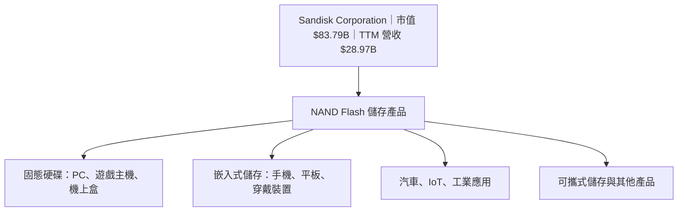

### 2.2 市場份額

市場份額資料未提供，亦無可引用的市場份額年份與來源，故不估算或繪製市占圖。從營收看，SNDK TTM 營收 **$28.97B**，最新季度年增 **377.9%**，增長幅度高於 WDC 的 **55.5%**，接近 MU 的 **379.3%**；但公司營收與同業的產品組合並不完全相同，不能直接以成長率推導市場地位。

### 2.3 競爭護城河分析

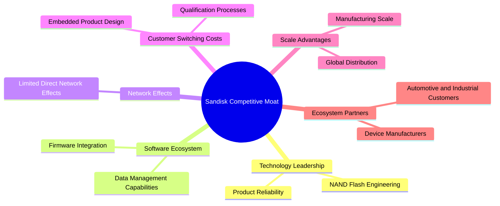

圖中為質化分類，不代表已量化的市場份額或經濟價值。市場資料未提供可比較的製程領先幅度、客戶留存率或轉換成本數據。

### 2.4 護城河強度

| 護城河項目 | 強度 | 證據 | 會削弱它的情況 |
|------------|------|------|----------------|
| 技術與產品工程 | 中 | NAND 儲存產品應用於 PC、行動裝置、汽車與工業等多類市場；量化技術領先數據未提供。 | 競爭者提高良率、推出同等性能產品，或 NAND 世代轉換延遲。 |
| 軟體與韌體整合 | 中 | 儲存裝置需配合韌體與終端系統；相關軟體營收占比未提供。 | 替代產品相容性提升，客戶可低成本切換。 |
| 網路效應 | 弱 | 未見直接網路效應的量化資料。 | 行業產品主要以性能、價格、品質及供應能力競爭。 |
| 客戶鎖定 | 中 | 車用、工業與嵌入式產品通常需客戶驗證；客戶留存率與設計導入數未提供。 | 客戶重新認證成本降低，或第二供應來源擴大。 |
| 規模效應 | 中 | TTM 營收 **$28.97B**，規模可支援全球研發與銷售；製造成本曲線資料未提供。 | 競爭者擴產、產能利用率提高，或供過於求造成價格競爭。 |
| 生態夥伴 | 中 | 產品面向 PC、手機、汽車、IoT 等多類客戶；合作夥伴占比未提供。 | 終端廠商改用自研方案或增加供應商替換。 |

1.1「護城河」評分為 **6.0/10**，因業務覆蓋多個終端與具備工程、驗證門檻，但缺少市占、客戶留存及轉換成本的量化證據。

---

## 3. 損益表深度分析

### 3.1 年度收入成長趨勢（近 4 年）

FY2023 至 FY2026 營收由 **$6.09B** 升至 **$20.25B**，三年 CAGR 約 **49.3%**。FY2026 營收大幅擴張與記憶體供需、產品價格及產品組合改善相符，但資料不足以拆分各項貢獻。

╔══════════════════════════════════════════════════════════════════╗  
║              Sandisk 年度收入趨勢（FY2023–FY2026）               ║  
╠══════════════════════════════════════════════════════════════════╣  
║ FY2023  $6.09B   ██████░░░░░░░░░░░░░░░░░░  YoY：—              ║  
║ FY2024  $6.66B   ███████░░░░░░░░░░░░░░░░░  YoY：+9.5%          ║  
║ FY2025  $7.36B   ████████░░░░░░░░░░░░░░░░  YoY：+10.4%         ║  
║ FY2026  $20.25B  ████████████████████░░░░  YoY：+175.3%        ║  
╠══════════════════════════════════════════════════════════════════╣  
║ FY2023–FY2026 CAGR：(20.248 ÷ 6.086)^(1/3) − 1 ≈ 49.3%          ║  
╚══════════════════════════════════════════════════════════════════╝

### 3.2 季度收入趨勢分析

| 季度 | 營收 | QoQ 成長 | YoY 成長 | 備註 |
|------|------|----------|----------|------|
| 2025-12-31 | $3.025B | — | **+61.25%** | YoY 依季度資料。 |
| 2026-03-31 | $5.950B | **+96.7%** | **+251.03%** | 相較前季營收接近翻倍。 |
| 2026-06-30 | $8.965B | **+50.7%** | **+371.59%** | 高成長持續；基期仍較低。 |
| 2026-10-02 | $11.031B | **+23.0%** | **+377.9%** | 最新季度年增率為單季數字，不是 TTM。 |

QoQ 計算例：最新季度 **$11.031B ÷ $8.965B − 1 = 23.0%**。季度連續增長顯示需求與價格環境改善，但 QoQ 成長由 **96.7%** 降至 **23.0%**，代表成長速度已開始放緩，需觀察後續季度的需求與 ASP。

### 3.3 利潤率演變分析

年度比率以年度損益表營收、毛利及營業利益計算；TTM 數字採用程式計算的已驗證指標。

| 利潤率指標 | FY2023 | FY2024 | FY2025 | FY2026 | 趨勢 | 評估 |
|------------|--------|--------|--------|--------|------|------|
| **毛利率** | 7.1% | 16.1% | 30.1% | 71.5% | FY2026 急升 | 🟢 |
| **營業利益率** | -21.3% | -6.7% | 6.9% | 61.6% | 虧損轉為高獲利 | 🟢 |
| **淨利率** | -35.2% | -10.1% | -22.3% | 56.5% | FY2025 仍虧損，FY2026 大幅轉正 | 🟡 |
| **TTM 營業利益率** | — | — | — | **72.5%** | 高於 FY2026 年度值 | 🟡 |

FY2026 毛利率、營業利益率快速上升，顯示產品價格、產能利用率、產品組合或成本吸收效益明顯改善；營運槓桿使營收回升轉化成更大的營業利益增幅。反面是記憶體價格具有循環性，FY2026 的高利潤率不宜直接視為長期常態。不同資料來源的最新季度營業利益率欄位有差異；本報告以已驗證的最新季度營業利益率 **79.6%** 與 TTM **72.5%** 為準。

### 3.4 費用結構分析

FY2026 收入 **$20.248B**、毛利 **$14.472B**、營業利益 **$12.468B**。以收入減毛利估算銷貨成本，並以毛利減營業利益計算營業費用；均為根據年度數據推導，不代表公司披露的完整費用分類。

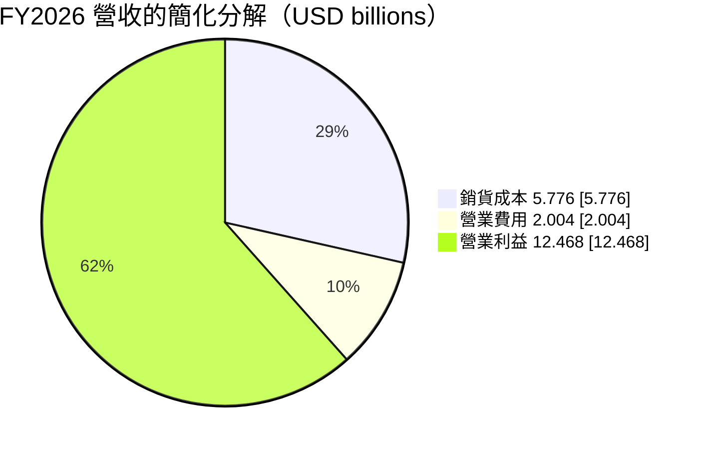

╔══════════════════════════════════════════════════════════════════╗  
║ FY2026 營收 $20.248B                                             ║  
║ ├─ 銷貨成本：$20.248B − $14.472B = $5.776B                      ║  
║ ├─ 營業費用：$14.472B − $12.468B = $2.004B                      ║  
║ └─ 營業利益：$12.468B                                            ║  
║ 研發費用：$1.33B；研發是營業費用的一部分，未另行重複加總。      ║  
╚══════════════════════════════════════════════════════════════════╝

### 3.5 季度 EPS 趨勢與盈餘品質（Quality of Earnings）

| 季度 | EPS 實際值 | EPS 預估 | 超預期／不及預期 |
|------|------------|----------|------------------|
| 2025-12-31 | $0.64（StockAnalysis） | N/A | N/A，預估值缺漏 |
| 2026-03-31 | $2.88（StockAnalysis） | N/A | N/A，預估值缺漏 |
| 2026-06-30 | $5.50（StockAnalysis） | N/A | N/A，預估值缺漏 |
| 2026-10-02 | $6.58（合併資料；StockAnalysis 顯示 $6.94） | N/A | N/A，預估值缺漏且來源口徑不同 |

四季 EPS 預估與實際驚喜率資料未提供有效數值，不能判定過去四季「超預期」或「不及預期」。單季實際 EPS 逐季提升，但來源存在差異，因此不以這些數字估算 Beat/Miss。

| 盈餘品質項目 | 數值／佔比 | 評估 |
|--------------|-----------|------|
| 股權薪酬 SBC / 營收 | FY2026 **$232M ÷ $20.248B = 1.15%** | 🟡 占比不高，但會稀釋股東；FY2026 SBC 高於 FY2025 的 **$182M**。 |
| SBC / 營業現金流 | 以 FY2026 數據：**$232M ÷ $11.67B = 1.99%** | 🟢 現金流規模遠高於 SBC；TTM SBC 不應以單一年度數字替代。 |
| FCF / 淨利（現金轉換率） | TTM **$17.36B ÷ $19.422B = 89.4%** | 🟡 現金轉換接近淨利，但未達 100%；應計品質測試未通過。 |
| 一次性／非經常性損益 | N/A（未提供可識別明細） | 無法確認是否有重大一次性項目。 |
| 有效稅率異常 | **12.2%**（最新年度有效稅率） | 低稅率有助淨利，但未提供足夠年度比較以判定異常或稅務利益。 |
| 資本化支出 vs 費用化 | TTM Capex **$181M**；FY2026 R&D **$1.33B** | Capex 顯著低於當期現金流與研發費用；資本化政策與資產明細不足以判斷成本遞延情形。 |

**盈餘品質結論**：TTM FCF 為淨利的 **89.4%**，代表獲利具有相當現金支撐，但低於淨利且 Piotroski 的「營業現金流高於淨利」測試未通過。FY2026 SBC 占營收 **1.15%**，對整體獲利影響有限但不能視為零成本。高毛利與營業利益仍受到 NAND 循環影響，估值不宜只以當期獲利倍數外推。

---

## 4. 資產負債表分析

### 4.1 資產結構分解

最新 TTM 資產負債表總資產 **$25.793B**、流動資產 **$15.352B**。非流動資產按差額計算為 **$10.441B**；細項來源可能有口徑差異，故圖中只呈現可核對的總額與主要披露項目。

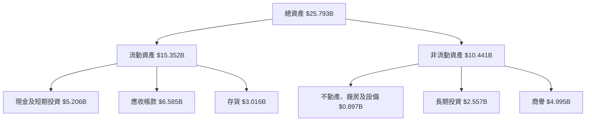

主要明細相加與總額可能受其他資產項目及來源口徑影響，並非資產科目完整重分類。

### 4.2 流動性與營運資金分析

| 流動性指標 | 最新值 | 歷史比較 | 評估 |
|------------|--------|----------|------|
| 流動比率 | **2.58** | 歷史同口徑數據未提供 | 🟢 |
| 速動比率 | **1.994** | 歷史同口徑數據未提供 | 🟢 |
| 現金及短期投資 | **$5.14B**（已驗證值） | FY2025 現金及約當現金 **$1.481B**，投資項目口徑不同 | 🟢 |

| 指標 | 最新 TTM | 一年前 TTM | 變化 | 解讀 |
|------|----------|------------|------|------|
| DSO 應收帳款天數 | **83 天** | **56 天** | **+27 天** | 收款週期拉長；成長期客戶應收增加可能是部分原因，但需觀察逾期與客戶集中度。 |
| DIO 存貨天數 | **190 天** | **124 天** | **+66 天** | 存貨占用加大；可能反映備貨或需求預期，也增加價格下跌時的跌價風險。 |
| DPO 應付帳款天數 | **46 天** | **26 天** | **+20 天** | 對供應商付款延後，可能部分抵銷應收與存貨增加造成的資金占用。 |
| CCC 現金轉換週期 | **226 天** | **154 天** | **+72 天** | CCC = DSO + DIO − DPO；營運資金效率較一年前轉弱。 |

### 4.3 債務結構分析

╔══════════════════════════════════════════════════════════════════╗  
║                   Sandisk 債務健康診斷                           ║  
╠══════════════════════════════════════════════════════════════════╣  
║ 總債務（已驗證口徑）：N/A（無可用數值）                          ║  
║ 現金及短期投資：$5.14B                                           ║  
║ 淨現金（程式計算）：$5.14B　🟢                                  ║  
║ Debt/EBITDA：N/A（總債務缺可比口徑）                             ║  
║ Interest Coverage：N/A（利息費用明細未提供）                    ║  
║ 補充：其他市場資料列示債務 $201M，但與已驗證欄位口徑不同，未替代。║  
╚══════════════════════════════════════════════════════════════════╝

### 4.4 股東權益趨勢

╔══════════════════════════════════════════════════════════════════╗  
║                 股東權益變化（年度，USD billions）               ║  
╠══════════════════════════════════════════════════════════════════╣  
║ FY2024  $11.08B  ███████████░░░░░░░░░░░░░░░░                   ║  
║ FY2025   $9.22B  █████████░░░░░░░░░░░░░░░░░                   ║  
║ FY2026  $15.74B  ████████████████░░░░░░░░░░                   ║  
╚══════════════════════════════════════════════════════════════════╝

FY2025 權益下降，FY2026 回升至 **$15.74B**；同期 FY2026 淨利為 **$11.43B**。股東權益變化還受其他綜合損益、資本交易等影響，未提供完整調節表，故不將變化全部歸因於淨利。

---

## 5. 現金流量深度分析

### 5.1 現金流量瀑布圖

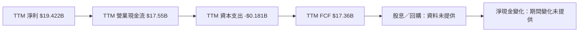

圖中 FCF 定義固定為 **營業現金流 − 資本支出**；股息、回購與現金變動不由 FCF 單獨推導。

### 5.2 FCF 轉換率趨勢

| 年度 | FCF | 淨利 | FCF / 淨利 | 趨勢 |
|------|-----|------|------------|------|
| FY2023 | -$0.932B | -$2.143B | 43.5%（負數對負數比值僅供參考） | 兩者皆為虧損，比例解讀有限。 |
| FY2024 | -$0.475B | -$0.672B | 70.7% | 虧損縮小。 |
| FY2025 | -$0.120B | -$1.641B | 7.3% | 現金流接近損益兩平，淨損擴大。 |
| FY2026 | $11.49B | $11.43B | 100.5% | FCF 與淨利大致匹配。 |
| TTM 至 2026-10-02 | **$17.36B** | **$19.422B** | **89.4%** | 現金轉換比 FY2026 低，須追蹤營運資金。 |

### 5.3 自由現金流趨勢

╔══════════════════════════════════════════════════════════════════╗  
║                    自由現金流歷史趨勢                            ║  
╠══════════════════════════════════════════════════════════════════╣  
║ FY2023  -$0.932B  ░░░░░░░░░░░░░░░░░░░░  FCF Yield：N/A           ║  
║ FY2024  -$0.475B  ░░░░░░░░░░░░░░░░░░░░  FCF Yield：N/A           ║  
║ FY2025  -$0.120B  ░░░░░░░░░░░░░░░░░░░░  FCF Yield：N/A           ║  
║ FY2026  +$11.49B  █████████████░░░░░░░  FCF Yield：N/A           ║  
║ TTM     +$17.36B  ████████████████████  FCF Yield：20.72%        ║  
╚══════════════════════════════════════════════════════════════════╝

FY2023 至 FY2025 FCF 為負，FY2026 起大幅轉正，與營收及利潤反彈一致。歷史年度 FCF Yield 因缺少各年度可比市值而不計算；已驗證的 TTM FCF Yield 為 **20.72%**。

### 5.4 資本配置評估

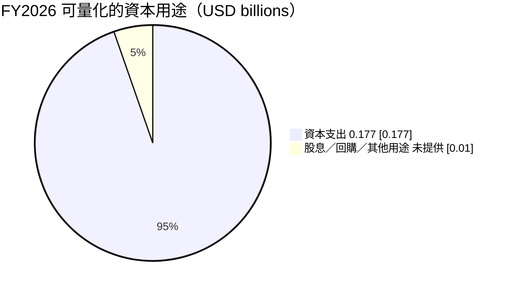

上圖不適合作為完整資本配置比例圖：股息、回購及其他用途未提供金額，因此不應將其與資本支出視為完整可加總的資金分配。FY2026 Capex 為 **$177M**，年度 SBC 為 **$232M**；股息率 **0.0%**，回購金額未提供。巨額 FCF 的留存、併購與回購用途需待後續申報資料確認。

---

## 6. 獲利能力與資本效率

### 6.1 ROE / ROA / ROIC 趨勢

| 指標 | FY2023 | FY2024 | FY2025 | 最新 TTM | 評估 |
|------|--------|--------|--------|----------|------|
| ROE | N/A | N/A | N/A | **107.1%** | 高回報，但須留意循環高峰及權益基數變化。 |
| ROA | N/A | N/A | N/A | **68.3%**（市場資料來源） | 來源口徑不同，作補充參考。 |
| ROIC | N/A | N/A | N/A | **141.2%** | 遠高於資本成本；歷史逐年同口徑資料未提供。 |
| 行業均值 | N/A | N/A | N/A | N/A | 未提供可引用同業 ROIC／ROE 比較。 |

### 6.2 ROIC vs WACC 分析（核心價值創造判斷）

╔══════════════════════════════════════════════════════════════════╗  
║                ROIC vs WACC 深度分析                             ║  
╠══════════════════════════════════════════════════════════════════╣  
║ WACC（使用已驗證資本成本資料）：9.90%                            ║  
║ ├─ 無風險利率 Rf：4.85%                                          ║  
║ ├─ 股權風險溢酬 ERP：5.00%                                       ║  
║ ├─ 調整後 Beta：1.00（原始 Beta：N/A）                           ║  
║ ├─ 股權成本 Ke：9.85%                                            ║  
║ ├─ 稅前債務成本：36.32%；有效稅率：12.2%                         ║  
║ ├─ 股權／債務權重：99.8%／0.2%                                   ║  
║ └─ WACC：9.90%                                                   ║  
║                                                                  ║  
║ ROIC（TTM，已驗證）：141.2%                                      ║  
║ EVA 差額：141.2% − 9.90% = +131.3 個百分點                       ║  
║ ROIC / WACC：141.2% ÷ 9.90% = 約 14.3 倍                         ║  
║                                                                  ║  
║ ROIC 141.2%  ▓▓▓▓▓▓▓▓▓▓▓▓▓▓▓▓▓▓▓▓▓▓▓▓▓▓▓▓ 🟢                 ║  
║ WACC   9.90% ▓▓░░░░░░░░░░░░░░░░░░░░░░░░░░ ──                 ║  
║ 結論：現行 ROIC 遠高於 WACC，數據顯示創造股東價值。               ║  
╚══════════════════════════════════════════════════════════════════╝

這裡的 **ROIC** 與 **WACC** 直接使用已驗證數字，未重新建模。WACC 依成本資本資料提供的 **9.90%**；其中 Beta 為假設調整值 **1.00**，原始 Beta 未提供。債務成本 **36.32%** 在極低債務權重下對 WACC 影響有限，但其高值可能受低債務分母影響。ROIC 與 WACC 的差距表示當期資本回報豐厚，不保證記憶體循環回落後仍維持同一差距。

### 6.3 杜邦三因素分解

| 因素 | 數值（TTM） | 解讀 |
|------|-------------|------|
| 淨利率 | **67.0%** | 反映本輪價格、產品組合及營運槓桿效應。 |
| 資產週轉率 | **1.12** | 資產營收轉換效率。 |
| 權益乘數 | **1.42** | 財務槓桿不是 ROE 的主要來源。 |
| **ROE** | **107.1%** | 依 QUALITY FIGURES：淨利率 67.0% × 資產週轉率 1.12 × 權益乘數 1.42 = **107.1%**。 |

ROE 主要由 **67.0% 淨利率**驅動，而非高槓桿；惟淨利率為循環高點相關指標，應避免直接線性外推。

### 6.4 財務體質：Piotroski F-Score

**Piotroski F-Score：5 / 8**。一項測試因資料缺漏無法判定，分母按可判定測試數計算。

| 測試 | 結果 | 解讀 |
|------|------|------|
| ROA > 0 | ✅ 通過 | 當期資產回報為正。 |
| 營業現金流 > 0 | ✅ 通過 | TTM 營業現金流 **$17.55B**。 |
| ROA 高於一年前 | ✅ 通過 | 獲利回升帶動資產回報改善。 |
| 營業現金流 > 淨利（應計品質） | ❌ 未通過 | TTM 營業現金流低於 TTM 淨利 **$19.422B**。 |
| 長期負債 ÷ 總資產低於一年前 | — 無法判定 | 缺少所需資料。 |
| 流動比率高於一年前 | ❌ 未通過 | 目前流動比率 **2.58**，比較測試未通過。 |
| 稀釋股數未增加 | ❌ 未通過 | 股數測試未通過，存在稀釋風險。 |
| 毛利率高於一年前 | ✅ 通過 | 最新 TTM 毛利率改善。 |
| 資產週轉率高於一年前 | ✅ 通過 | 資產效率改善。 |

---

## 7. 相對估值分析

### 7.1 同業估值比較

本公司市場倍數採市場資料；同業倍數依 Peer multiples。不同資料來源估值日期與口徑可能不一致，尤其 SNDK 市值、營收及歷史 P/S 指標需交叉核對。

| 估值指標 | **SNDK** | **WDC** | **MU** | **SKHY** | 本公司評估 |
|----------|---------:|-------:|------:|-------:|-----------|
| **Trailing P/E** | **4.71x** | 9.6x | 8.1x | 6.2x | 🟢 低於三家同業。 |
| **Forward P/E** | **2.05x** | 6.8x | 2.9x | 2.7x | 🟢 低於同業；遠期盈餘估計若下修，倍數會上升。 |
| **P/S Ratio** | **2.89x** | 7.0x | 5.1x | N/A | 🟢 低於可比同業；SKHY 因幣別混合無可比值。 |
| **EV/EBITDA** | **3.714x** | 16.1x | 5.9x | N/A | 🟢 低於可比較同業，但產業循環及利潤率差異大。 |
| **最新季度營收年增** | **377.9%** | 55.5% | 379.3% | 327.9% | 🟢 成長高於 WDC，略低於 MU。 |
| **TTM 毛利率** | **80.0%** | 52.6% | 80.7% | 77.4% | 🟢 接近 MU，並高於 WDC、SKHY。 |

### 7.2 歷史估值區間分析

已驗證的自身歷史資料提供 **P/S**，未提供自身歷史 P/E 區間，故不以 P/E 畫區間。另市場資料顯示現行 P/S **2.89x**，與自身歷史估值資料的「目前 **0.4x**」不一致；可能源於市值、股數或期間口徑差異，不將兩者混成同一序列。

╔══════════════════════════════════════════════════════════════════╗  
║                  自身歷史估值（P/S，TTM）                        ║  
╠══════════════════════════════════════════════════════════════════╣  
║ 五年中位數：0.6x　歷史範圍：0.1x–1.7x　歷史百分位：43%          ║  
║ 自身歷史欄位目前值：0.4x                                         ║  
║ 另一市場資料目前 P/S：2.89x；口徑不一致，須核對市值與股數。      ║  
║ P/E 歷史區間：N/A（未提供）。                                    ║  
╚══════════════════════════════════════════════════════════════════╝

### 7.3 情境價值（DCF MODEL Scenarios）

| 情境 | 第 1 年營收成長 | 期末營業利潤率 | WACC | 每股價值 | 相對現價 | 機率 | 可能條件 |
|------|----------------|----------------|------|----------|----------|------|----------|
| 🔴 悲觀 | 15.0% | 52.0% | 10.90% | **$259.05** | **+251.9%** | 25% | NAND 售價回落、需求增長低於基準，並使長期利潤率回歸較低水準。 |
| 🟡 基準 | 30.0% | 61.2% | 9.90% | **$612.02** | **+731.4%** | 50% | 循環需求延續，營收增速逐步降至 3.0%，利潤率緩降但仍高。 |
| 🟢 樂觀 | 45.0% | 67.3% | 8.90% | **$1,370.90** | **+1,762.4%** | 25% | NAND 需求與價格持續超預期，並且資本成本降低、利潤率維持高檔。 |

### 7.4 相對估值隱含價格區間

╔══════════════════════════════════════════════════════════════════╗  
║               各估值方法隱含每股價值（USD）                      ║  
╠══════════════════════════════════════════════════════════════════╣  
║ $73.61 現價 ── $154.61 同業 P/S ── $208.83 同業 EV/EBITDA        ║  
║                   $243.36 分析師共識 ── $612.02 基準 DCF         ║  
╠══════════════════════════════════════════════════════════════════╣  
║ 同業 EV/EBITDA：WDC、MU 中位數 11.0x × TTM EBITDA，加回淨現金。  ║  
║ 同業 P/S：WDC、MU 中位數 6.1x × TTM 營收。                       ║  
╚══════════════════════════════════════════════════════════════════╝

以上每股價值與權重取自固定估值方法資料；相對估值反映同業倍數中位數，並非 SNDK 自身目前倍數。

---

## 8. DCF 內在價值評估（Discounted Cash Flow）

### 8.0 估值推理鏈（Thinking Logic）

**Step 1 — 價值來源與主導變數**

本模型以 NAND 儲存主業的營收成長、營業利潤率與長期現金流為價值來源。未提供各業務線收入占比，因此無法拆分「主業、第二成長曲線或新業務」的營收比例。模型假設由 TTM 營收 **$28.97B** 出發，第一年成長 **30.0%**，第十年降至 **3.0%**；營業利益率由 **72.5%** 漸降至 **61.2%**。主導估值的變數是**長期營業利潤率與終值現金流**，與敏感度矩陣中 WACC、g 變動造成的高估值幅度一致。

**Step 2 — 模型選擇**

| 決策點 | 本報告採用 | 理由 | 曾考慮但否決 | 否決理由 |
|--------|-----------|------|--------------|----------|
| 現金流定義 | FCFF | 對應 WACC 折現並先得 EV；模型直接提供 FCFF。 | FCFE | 模型未提供逐年融資現金流，無法一致計算。 |
| 預測期 N | 10 年 | DCF 模型固定預測 10 年，營收增速由 30.0% 線性降至 3.0%。 | 5 年 | 會違反已提供模型設定，且不涵蓋模型指定的增速淡化路徑。 |
| 終值方法 | Gordon Growth | 模型已提供永續成長率 3.0% 與終值。 | 退出倍數 | DCF 模型未提供可稽核的退出倍數終值。 |
| EBIT 基礎 | GAAP EBIT | 模型明確使用 GAAP EBIT，SBC 已計入費用。 | 非 GAAP EBIT | 會改變模型設定及 SBC 處理方式。 |

**Step 3 — 重要假設推導鏈**

- **營收成長**：錨點＝TTM 營收年增 **272.4%**，最新單季年增 **377.9%**；短期增速高但可能是循環反彈和低基期所致 → 模型限制首年成長不高於 30.0%，再線性淡化至 3.0% → **採用首年 30.0%、第十年 3.0%** → 否決維持 272.4% 的替代方案，因為它把循環高峰外推為常態；情境模型的 15.0% 與 45.0% 分別作為悲觀、樂觀參照。
- **期末營業利潤率**：錨點＝TTM **72.5%**；循環性售價與高毛利可能回落 → 模型由 72.5% 漸降至近三個財年中位數 **61.2%** → **採用第十年 61.2%** → 否決十年維持 72.5%，因模型已以歷史中位數作回歸錨點。
- **永續成長率 g**：錨點＝模型固定 **3.0%**，且低於 WACC **9.90%** → 反映成熟期成長明顯低於預測期初期 → **採用 3.0%** → 不採用更高的 4.0% 作基準，因終值對 g 高度敏感且缺少可支持長期高於宏觀名目成長的公司指引。
- **預測期 N**：錨點＝模型設定 **10 年** → 讓成長率由 30.0% 逐年淡化至 3.0%，與循環業務長期收斂假設一致 → **採用 10 年** → 否決更短預測期，因不符合既定模型；未另行重建期限。
- **Capex / 營收**：錨點＝TTM Capex **$181M**、TTM 營收 **$28.97B**，模型使用約 **0.6%** → 模型判斷維持現有資本支出強度 → **採用 0.6%** → 不將 Capex 人為調高至未提供的同業比例，避免另建模型。
- **EBIT 與 SBC**：錨點＝模型採 GAAP EBIT，FY2026 SBC **$232M** → GAAP 營業利益已含 SBC 費用 → **採用組合 (A)：GAAP EBIT、FCFF 不另減 SBC、年稀釋率 0%** → 不採用 GAAP EBIT 再扣一次 SBC，避免重複計成本。
- **年稀釋率**：錨點＝模型設定固定股數，且 F-Score 稀釋股數測試未通過 → 稀釋風險不能忽略，但此模型組合 A 已將 SBC 當費用 → **模型採 0%** → 不另設定正稀釋率，否則會與 GAAP 費用重複計量；模型有低估未來股數風險之可能。
- **終值方法**：錨點＝模型採 Gordon Growth，且 WACC **9.90%** 大於 g **3.0%** → 可計算永續終值 → **採用 Gordon Growth** → 不補入模型未提供的退出倍數，避免造出另一個終值。
- **WACC**：錨點＝資本成本資料提供 **9.90%** → 依原始 Beta 缺漏、使用調整 Beta **1.00**，並使用既定 E/D 權重 → **採用 9.90%** → 不另以主觀 Beta 重算；敏感度表另顯示 WACC 變動影響。

**Step 4 — 最脆弱環節**

最脆弱環節是長期仍維持 **61.2%** 營業利益率；若循環回落使利潤率低於該水準，DCF 價值將下修，而模型的悲觀情境 **$259.05** 仍高於現價，說明情境假設本身仍可能偏樂觀。

**Step 5 — 計算路徑**

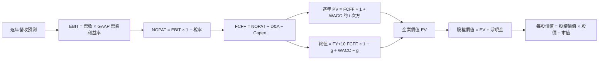

### 8.1 模型假設總表（Model Inputs）

| 假設項目 | 採用值 | 依據／來源 | 敏感度 |
|----------|--------|-------------|--------|
| 預測期長度 N | **10 年** | DCF MODEL 固定設定；FY+1 至 FY+10。 | 🟡 中 |
| 營收成長 | FY+1 **30.0%**，FY+10 **3.0%** | TTM 營收年增 **272.4%**；模型限制短期增速並線性淡化。 | 🔴 高 |
| 營業利潤率 | FY+1 **72.5%** → FY+10 **61.2%** | TTM 營業利益率 **72.5%**；期末回歸近三個財年中位數。 | 🔴 高 |
| 有效稅率 | **12.2%** | 最新年度有效稅率。 | 🟢 低 |
| Capex / 營收 | FY+1 至 FY+10 約 **0.6%** | TTM Capex **$181M**；模型固定／漸進設定。 | 🟡 中 |
| D&A / 營收 | **0.5%** | 模型以 TTM 比率維持。 | 🟢 低 |
| 營運資金變動 | **不建模** | DCF MODEL 明確說明 working capital not modelled；歷史 CCC 延長使此簡化存在風險。 | 🔴 高 |
| EBIT 基礎 | **GAAP EBIT** | DCF MODEL 明確標示 GAAP。 | 🟡 中 |
| SBC 處理 | **組合 (A)** | GAAP EBIT 已含 SBC；不另扣 SBC，年稀釋率設為 0%。 | 🟡 中 |
| 年稀釋率 | **0%** | 固定股數假設，與組合 (A) 相容。 | 🟡 中 |
| 永續成長率 g | **3.0%** | DCF MODEL 假設，低於 WACC。 | 🔴 高 |
| 終值方法 | **Gordon Growth** | 模型提供終值；未提供退出倍數法的終值數字。 | 🔴 高 |
| WACC | **9.90%** | 直接採用 Cost of capital 資料。 | 🔴 高 |

**FCFF 定義**：採用 FCFF = NOPAT + D&A − Capex；模型不含 ΔWC 項。**本模型採用 (A)，故 SBC 影響已計入一次。**

### 8.2 折現率推導（WACC）

╔══════════════════════════════════════════════════════════════════╗  
║                    WACC 推導（折現率）                           ║  
╠══════════════════════════════════════════════════════════════════╣  
║ 股權成本 Ke（CAPM）：                                            ║  
║ ├─ 無風險利率 Rf：4.85%                                          ║  
║ ├─ 市場風險溢酬 ERP：5.00%                                       ║  
║ ├─ 原始 Beta：N/A；採用調整後 Beta：1.00（假設值）               ║  
║ ├─ 規模／國別溢酬：未另加計                                      ║  
║ └─ Ke = 4.85% + 1.00 × 5.00% = 9.85%                            ║  
║                                                                  ║  
║ 債務成本 Kd：                                                    ║  
║ ├─ 稅前 Kd：36.32%（資本成本資料提供）                           ║  
║ ├─ 有效稅率：12.2%                                               ║  
║ └─ 稅後 Kd = 36.32% × (1 − 12.2%) = 31.89%                      ║  
║                                                                  ║  
║ 資本結構：股權權重 99.8%；債務權重 0.2%                          ║  
║ WACC = 99.8% × 9.85% + 0.2% × 31.89% = 約 9.90%                 ║  
╚══════════════════════════════════════════════════════════════════╝

**逐步演算與資料限制**

1. **Ke** = 4.85% + 1.00 × 5.00% = **9.85%**。原始 Beta 為 N/A；調整後 Beta **1.00** 是成本資本資料採用值，並非從公司歷史股價另行推導。
2. **稅前 Kd** = **36.32%**（資料庫提供）。利息費用及平均計息負債未提供，無法從 SEC 數據獨立複算。
3. **稅後 Kd** = 36.32% × (1 − 12.2%) = **31.89%**。
4. **權重** = 股權 **99.8%**、債務 **0.2%**，直接引用成本資本資料；未以股東權益帳面值替代市值權重。
5. **WACC** = 99.8% × 9.85% + 0.2% × 31.89% = 9.8263% + 0.0638% = **9.8901%**，四捨五入為資料所列 **9.90%**。

由於本公司已驗證總債務為 N/A，且各項權重與債務成本由成本資本資料直接提供，本節不以缺漏的利息或債務餘額重新估算 WACC。第 6.2 節與本節均採用 **9.90%**。

### 8.3 逐年自由現金流預測（基準情境）

金額單位為 **USD billions**；折現因子取三位小數。表格按 DCF MODEL 原值引用。該模型未建模營運資金，因此不列 ΔWC；表中取位後個別項目加總可能產生 0.01 的尾差。

| 年度 | FY+1 | FY+2 | FY+3 | FY+4 | FY+5 | FY+6 | FY+7 | FY+8 | FY+9 | FY+10 |
|------|------:|------:|------:|------:|------:|------:|------:|------:|------:|-------:|
| 營收 | 37.66 | 47.83 | 59.31 | 71.77 | 84.68 | 97.39 | 109.07 | 118.89 | 126.02 | 129.80 |
| 營收 YoY | 30.0% | 27.0% | 24.0% | 21.0% | 18.0% | 15.0% | 12.0% | 9.0% | 6.0% | 3.0% |
| 營業利潤率 | 72.5% | 71.2% | 70.0% | 68.7% | 67.5% | 66.2% | 64.9% | 63.7% | 62.4% | 61.2% |
| EBIT（GAAP） | 27.29 | 34.06 | 41.49 | 49.31 | 57.12 | 64.47 | 70.84 | 75.72 | 78.69 | 79.42 |
| − 稅 | (3.32) | (4.14) | (5.05) | (6.00) | (6.95) | (7.84) | (8.62) | (9.21) | (9.58) | (9.66) |
| = NOPAT | 23.97 | 29.92 | 36.44 | 43.31 | 50.17 | 56.62 | 62.22 | 66.51 | 69.11 | 69.76 |
| + D&A | 0.20 | 0.26 | 0.32 | 0.39 | 0.46 | 0.52 | 0.59 | 0.64 | 0.68 | 0.70 |
| − Capex | (0.24) | (0.30) | (0.37) | (0.44) | (0.52) | (0.59) | (0.66) | (0.71) | (0.75) | (0.77) |
| **= FCFF** | **23.94** | **29.88** | **36.40** | **43.25** | **50.11** | **56.56** | **62.15** | **66.44** | **69.04** | **69.69** |
| 折現因子 @9.90% | 0.910 | 0.828 | 0.753 | 0.685 | 0.624 | 0.568 | 0.516 | 0.470 | 0.428 | 0.389 |
| **FCFF 現值 PV** | **21.78** | **24.74** | **27.42** | **29.65** | **31.25** | **32.10** | **32.09** | **31.22** | **29.52** | **27.11** |

預測期現值合計：

**$21.78 + $24.74 + $27.42 + $29.65 + $31.25 + $32.10 + $32.09 + $31.22 + $29.52 + $27.11 = $286.88B**

**FY+1 逐步演算示範**

1. 營收 = TTM 營收 **$28.97B × (1 + 30.0%) ≈ $37.66B**。
2. EBIT = FY+1 營收 × GAAP 營業利潤率；模型輸出 **$27.29B**。
3. 稅 = 模型輸出 **$3.32B**（有效稅率採 **12.2%**）。
4. NOPAT = **$27.29B − $3.32B = $23.97B**（依未四捨五入模型數據取位）。
5. D&A = 模型輸出 **$0.20B**。
6. Capex = 模型輸出 **$0.24B**。
7. ΔWC = **不建模**。
8. FCFF = 模型輸出 **$23.94B**；以表格取位項目加減可有 **$0.01B** 尾差。
9. 折現因子 = **1 ÷ (1 + 9.90%)¹ = 0.910**；PV = **$23.94B × 0.910 ≈ $21.78B**。

模型使用底層未四捨五入值；公開表格僅列兩位小數，因此逐列反算可能出現小幅尾差。不得以四捨五入後數字取代模型提供的逐年輸出。

**合理性自檢**

- 預測期 FCF 由 **$23.94B** 增至 **$69.69B**，九年間年化約 **12.6%**；歷史 FCF 曾由負轉正，跨零期間的 CAGR 沒有穩健可比意義。
- FY+10 FCFF 利潤率 = **$69.69B ÷ $129.80B ≈ 53.7%**；高於現有 TTM FCF 利潤率約 **60.0%** 的說法並不成立，因此不以此作為「超越同業」判斷；同業 FCF 利潤率未提供。
- 所有預測年份 FCFF 均為正；主要風險是營運資金未建模，尤其 CCC 已達 **226 天**。

╔══════════════════════════════════════════════════════════════════╗  
║            自由現金流：歷史實際 vs 模型預測                      ║  
╠══════════════════════════════════════════════════════════════════╣  
║ FY2024（實） -$0.475B  ░░░░░░░░░░░░░░░░░░░░                      ║  
║ FY2025（實） -$0.120B  ░░░░░░░░░░░░░░░░░░░░                      ║  
║ FY2026（實） +$11.49B  ███░░░░░░░░░░░░░░░░░░                      ║  
║ FY+1（預）   +$23.94B  ███████░░░░░░░░░░░░░                      ║  
║ FY+10（預）  +$69.69B  ████████████████████                      ║  
╠══════════════════════════════════════════════════════════════════╣  
║ 預測以循環高點 TTM 為起點；歷史 FCF 由負轉正，增長率不可直接比較。║  
╚══════════════════════════════════════════════════════════════════╝

### 8.4 終值計算（Terminal Value）

**適用性檢查：** WACC **9.90%** vs g **3.0%** → **WACC > g ✅**

| 方法 | 計算式 | 終值 TV | TV 現值 | 佔總 EV 比重 |
|------|--------|---------|---------|--------------|
| Gordon Growth | FY+10 FCFF × (1 + g) ÷ (WACC − g) | **$1,040.14B** | **$404.66B** | **58.5%** |
| 退出倍數法 | N/A | N/A（DCF MODEL 未提供退出倍數終值） | N/A | N/A |

**逐步演算**

1. FY+10 FCFF = **$69.69B**。
2. 分子 = **$69.69B × (1 + 3.0%) ≈ $71.78B**。
3. 分母 = **9.90% − 3.0% = 6.90%**；TV = DCF MODEL 提供 **$1,040.14B**。
4. PV(TV) = **$1,040.14B × 0.389 = $404.66B**。
5. 終值占比 = **$404.66B ÷ $691.53B = 58.5%**。

終值未超過 EV 的 75% 警戒值，但仍占 **58.5%**，估值對第十年以後的永續假設具有顯著依賴。

### 8.5 企業價值 → 每股內在價值（Bridge）

╔══════════════════════════════════════════════════════════════════╗  
║              企業價值 → 每股內在價值橋接表                      ║  
╠══════════════════════════════════════════════════════════════════╣  
║ 預測期 FCF 現值合計                 +$286.88B                    ║  
║ 終值現值 PV(TV)                     +$404.66B                    ║  
║ = 企業價值 EV                        $691.53B                    ║  
║ + 淨現金                              +$5.14B                    ║  
║ = 股權價值                            $696.67B                    ║  
║ 每股內在價值（模型換算）               $612.02                    ║  
║ 2026-11-25 收盤價                      $73.61                    ║  
║ 折溢價 = 現價 ÷ DCF 價值 − 1            -88.0%（折價）            ║  
╚══════════════════════════════════════════════════════════════════╝

**逐步演算與橋接口徑**

1. EV = 預測期現值 **$286.88B** + PV(TV) **$404.66B** = **$691.53B**（底層未取位值相加後取位）。
2. 股權價值 = EV **$691.53B** + 淨現金 **$5.14B** = **$696.67B**（依模型未取位值）。
3. 每股內在價值依模型指定公式：**股權價值 × 價格 ÷ 市值 = $612.02**；使用價格 **$73.61**、市值 **$83.79B**。
4. 折溢價 = **$73.61 ÷ $612.02 − 1 = -88.0%**。
5. 本節不計算 MOS；MOS 僅以 8.8 加權合理價值為分母。

模型未採用一般「股權價值 ÷ 股數」橋接，而是依程式指定的「股權價值 × 價格 ÷ 市值」換算。市場資料列示流通股數 **1.14B**，但 DCF 模型的每股價值仍以原提供公式為準。淨現金取最新 TTM 已驗證值 **$5.14B**；總債務單獨數值為 N/A。

### 8.6 敏感性分析（WACC × 永續成長率）

以下矩陣每格先列每股價值，再列相對 **$73.61** 現價的上行空間。數值來自 DCF MODEL。

| g（列）／WACC（欄） | 7.90% | 8.90% | **9.90%（基準）** | 10.90% | 11.90% |
|-----------|------:|------:|------------------:|-------:|-------:|
| **2.0%** | $779.34（+958.5%） | $655.80（+791.0%） | $564.01（+666.2%） | $493.24（+570.1%） | $437.11（+493.8%） |
| **2.5%** | $827.79（+1,024.5%） | $687.97（+834.6%） | $586.39（+696.9%） | $509.37（+592.0%） | $449.06（+510.1%） |
| **3.0%** | $886.12（+1,104.3%） | $725.59（+885.8%） | **$612.02（+731.4%）** | $527.55（+616.6%） | $462.36（+528.2%） |
| **3.5%** | $957.71（+1,201.6%） | $770.18（+946.6%） | $641.65（+771.7%） | $548.18（+644.7%） | $477.24（+548.0%） |
| **4.0%** | $1,047.65（+1,323.9%） | $823.86（+1,019.2%） | $676.30（+818.7%） | $571.80（+676.8%） | $494.01（+571.1%） |

**敏感度示範（沿用模型矩陣）**：取非基準格 **WACC 10.90% > g 3.0% ✅**，對應每股價值 **$527.55**。模型矩陣並未提供該格的重新展開 FCFF PV、TV 及股權價值明細；為遵守原模型數字，不另行重建一套模型或反推中間格數。

### 三情境 DCF（模型輸出）

| 情境 | 營收假設 | 期末營業利潤率 | g | WACC | 每股內在價值 | 相對現價 | 機率 |
|------|----------|----------------|---|------|--------------|----------|------|
| 🔴 悲觀 | FY+1 成長 15.0% | 52.0% | 模型未另列 | 10.90% | $259.05 | +251.9% | 25% |
| 🟡 基準 | FY+1 成長 30.0% | 61.2% | 3.0% | 9.90% | $612.02 | +731.4% | 50% |
| 🟢 樂觀 | FY+1 成長 45.0% | 67.3% | 模型未另列 | 8.90% | $1,370.90 | +1,762.4% | 25% |
| **機率加權** | — | — | — | — | **$713.49** | **+869.3%** | **100%** |

三情境的年度逐年營收與 FCFF 展開值未提供，故不另外補造情境中間數字；每股價值與假設直接引用模型輸出。

**敏感度結論**

- g 從 **2.0%** 增至 **3.0%**、WACC 固定 **9.90%**：價值由 **$564.01** 升至 **$612.02**，增加 **$48.01**。
- WACC 從 **8.90%** 升至 **9.90%**、g 固定 **3.0%**：價值由 **$725.59** 降至 **$612.02**，減少 **$113.57**。
- 營業利潤率敏感度：模型未提供單變數敏感度矩陣，**N/A**，不自行估算。
- 在已提供的矩陣中，WACC 每 1 個百分點變化對價值的影響大於 g 每 1 個百分點的示範差額；與 8.0 指出的「長期利潤率／終值現金流主導估值」相容，但目前矩陣無法單獨量化利潤率彈性。

### 8.7 反推 DCF（Reverse DCF）

現價 **$73.61**；除求解變數外，其餘基準輸入固定：WACC **9.90%**、稅率 **12.2%**、Capex／營收約 **0.6%**、ΔWC 不建模、預測期 **10 年**、固定股數假設。模型提供下列反推結果：

| 求解的變數（一次一個） | 其餘變數設定 | 市場隱含值 | 公司歷史／基準參照 | 判斷 |
|------------------------|--------------|------------|----------------------|------|
| 第 1 年營收成長 | 其他基準輸入固定 | **−10% 至 100% 範圍內無解** | TTM 成長 **272.4%**；模型基準首年 **30.0%** | 現價無法由該範圍內單獨調整首年成長解釋。 |
| 固定營業利潤率 | 其餘基準輸入固定 | **7.3%** | 基準 TTM **72.5%**；FY+10 基準 **61.2%** | 市價隱含利潤率大幅低於基準。 |
| 永續成長率 g | 未提供求解值 | 未計算 | — | N/A（模型沒有提供解）。 |
| 預測期 N | 未提供求解值 | 未計算 | 基準 N = 10 年 | N/A（模型沒有提供解）。 |

營收成長率的反推結果在模型指定的 **−10% 至 100%** 範圍內無解，故不編造試算軌跡或收斂值。固定營業利潤率反推為 **7.3%**，其結果顯示若其他基準假設不變，市場價格遠低於模型基準估值；但這不表示市場只預期 7.3% 利潤率，因模型的單變數反推具強烈條件限制。

### 8.8 估值三角驗證與安全邊際

| 估值方法 | 隱含每股價值 | 上行空間（÷現價） | 權重 | 說明 |
|----------|--------------:|------------------:|------|------|
| DCF（基準） | $612.02 | +731.4% | 40% | 10 年 FCFF、WACC 9.90%、g 3.0%。 |
| 同業 EV/EBITDA | $208.83 | +183.7% | 30% | WDC、MU 同業中位數 11.0x × TTM EBITDA，加回淨現金。 |
| 同業 P/S | $154.61 | +110.0% | 20% | WDC、MU 同業中位數 6.1x × TTM 營收。 |
| 分析師共識目標價 | $243.36 | +230.6% | 10% | 24 位分析師平均目標價。 |
| **加權合理價值** | **$362.72** | **+392.8%** | **100%** | 循環性公司固定權重；所有方法均納入。 |

**加權計算**：  
**$612.02 × 40% + $208.83 × 30% + $154.61 × 20% + $243.36 × 10%  
= $244.808 + $62.649 + $30.922 + $24.336  
= $362.715 ≈ $362.72**

方法權重依循環性公司類型固定，沒有剔除方法。四項權重合計 **100%**。

╔══════════════════════════════════════════════════════════════════╗  
║                  估值區間與安全邊際                              ║  
╠══════════════════════════════════════════════════════════════════╣  
║ $73.61 現價 ─ $154.61 同業 P/S ─ $208.83 EV/EBITDA              ║  
║                 ─ $243.36 分析師共識 ─ [$362.72] 加權合理價值    ║  
║                 ─ $612.02 基準 DCF ─ $1,370.90 樂觀 DCF          ║  
║                                                                  ║  
║ MOS = ($362.72 − $73.61) ÷ $362.72 = +79.7%                     ║  
║ MOS 評估：🟢 高於 25%                                           ║  
║ 上行空間 = ($362.72 − $73.61) ÷ $73.61 = +392.8%                ║  
║                                                                  ║  
║ 建議買入區間：$73.61–$326.45（價格不高於合理價值的 90%）         ║  
║ 合理持有區間：$326.45–$398.99（MOS 約 -10% 至 +10%）             ║  
║ 減碼考慮區間：高於 $398.99（MOS 低於 -10%）                      ║  
╚══════════════════════════════════════════════════════════════════╝

MOS 計算只使用 **8.8 加權合理價值 $362.72**；DCF 折溢價則以 **8.5 基準 DCF $612.02** 為基準，兩者分母不同。

> 🔎 **程式複算（Python，依本節各項自動重算）**
>
> 加權合理價值 = $612.02 × 40% + $208.83 × 30% + $154.61 × 20% + $243.36 × 10% = **$362.72**（權重合計 100%）
>
> 以價格 $73.61 計：MOS = **+79.7%**，上行空間 = **+392.8%**
>
> ✅ 與本節所寫數值一致。

### 8.9 DCF 模型的局限與失效條件

- **終值依賴度**：終值現值占 EV **58.5%**，因此相當部分估值取決於 FY+10 後現金流、WACC 與 g。
- **最脆弱假設**：第十年仍有 **61.2%** 營業利益率；若 NAND 供給增加、價格競爭加劇，利潤率低於模型路徑，估值應下修。模型悲觀情境價值 **$259.05**，仍高於現價，但該情境未必涵蓋極端循環下行。
- **營運資金未建模**：CCC **226 天**，比一年前增加 **72 天**。若應收與存貨持續占用現金，FCFF 可能低於模型估算。
- **Capex 假設偏低**：模型採 Capex／營收約 **0.6%**，而 TTM Capex **$181M**；若維持產能或升級技術所需投資上升，FCF 將下降。
- **SBC 與股數**：GAAP EBIT 已扣 SBC，但模型假定股數不再稀釋；F-Score 的稀釋股數測試未通過，固定股數可能低估未來股東稀釋。
- **與第 10 章連結**：NAND 供需反轉會壓低成長與利潤率；CCC 惡化會降低自由現金流；資本支出上升會減少 FCFF；均會直接下修 DCF。

### 8.10 複算檢核表（Audit Trail）

| # | 檢核項目 | 檢查方式 | 結果 |
|---|----------|----------|------|
| 1 | 高／中敏感度輸入均有推導邏輯 | 對照 8.0、8.1 | ✅ |
| 2 | 每項假設均有依據 | 對照 8.1 來源欄 | ✅ |
| 3 | WACC 五步算式與乘加 | Ke、稅後 Kd、權重、WACC | ✅（採用來源 WACC 9.90%；債務成本缺少底層利息與餘額，無法獨立重算） |
| 4 | Kd 分母與債務權重 D 同一口徑 | 核對債務餘額 | ❌（已驗證總債務 N/A，不能獨立確認 D 口徑；本報告照採已驗證 WACC） |
| 5 | WACC 與第 6.2 節相同 | 比對兩節 | ✅ **9.90%** |
| 6 | 預測年度數 = N，無省略 | FY+1 至 FY+10 | ✅ |
| 7 | FY+1 算式可由已列小數精確複算 | 取位數反算 FCFF／PV | ❌（模型底層未取位數未提供，個別項目有 0.01 尾差） |
| 8 | 預測期 PV 加總 | 十年 PV 逐項加總 | ✅ **$286.88B** |
| 9 | WACC > g | 9.90% vs 3.0% | ✅ |
| 10 | 終值以 FY+10 FCFF 為基礎並折現 10 期 | 檢查模型設定 | ✅（依 DCF MODEL） |
| 11 | EV 至每股價值橋接 | 依模型橋接公式 | ⚠️（每股換算依程式指定公式，不是一般股權價值除股數） |
| 12 | SBC 組合合法 | GAAP、無另扣 SBC、年稀釋率 0% | ✅（組合 A） |
| 13 | 敏感性矩陣基準格 = 8.5 | $612.02 對照 | ✅ |
| 14 | 敏感性示範格有效 | WACC 10.90% > g 3.0% | ✅ |
| 15 | 三情境機率合計 | 25% + 50% + 25% | ✅ **100%** |
| 16 | 反推 DCF 每列單一變數 | 對照模型輸出 | ✅（只呈現有解或已報告結果） |
| 17 | MOS／折溢價基準一致 | 8.8、1.0、8.5 比對 | ✅ |
| 18 | 報告完整至第 11 章 | 章節檢查 | ✅ |
| 19 | 加權合理價值加總正確 | 四項價值乘權重後加總 | ✅ **$362.72** |
| 20 | 評級符合 MOS 與 ROIC/WACC | MOS 79.7%、ROIC 141.2% > WACC 9.90% | ✅ **強烈買入** |

資料限制主要在債務成本的底層輸入、模型未取位數中間值及每股價值橋接公式。估值數字遵循模型原值，但複算精度與一般股數橋接方法存在限制，故 DCF 應視為情境工具，而非精確點估值。

---

## 9. 成長催化劑

### 9.1 催化劑時間軸

公司未提供具體產品上市日期或客戶量產時程，以下依已知業務敘述與最新財務趨勢列出可追蹤期間，不假定未公布的催化劑日期。

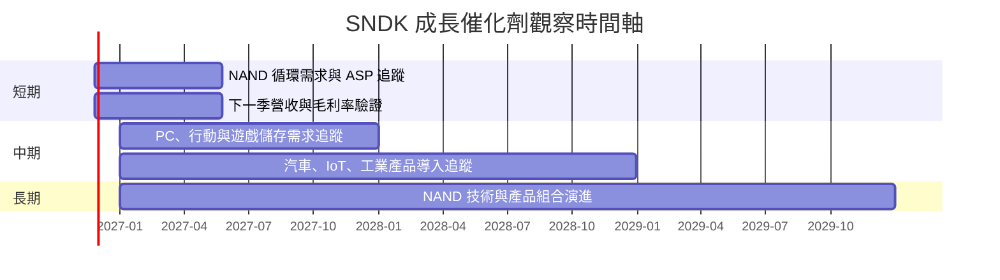

### 9.2 TAM 市場規模分析

**N/A（TAM 數據未提供）**。公司收入涵蓋 PC、行動裝置、汽車、IoT 與工業等終端，最新 TTM 營收為 **$28.97B**，TTM 年增 **272.4%**。沒有可引用的 TAM 規模、年份與市場滲透率資料，因此不推估市場金額或滲透率。

### 9.3 成長驅動力結構圖

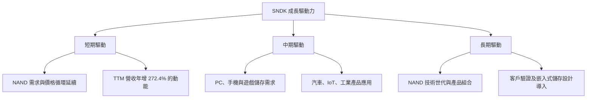

短期關鍵在於增長是否延續：最新季度營收 QoQ **+23.0%**，但較前季 QoQ **+50.7%** 已放緩。中長期催化劑需由產品分部營收、客戶設計導入與資本投資回報資料驗證。

---

## 10. 風險矩陣

### 10.1 風險評分矩陣

機率與衝擊為分析師質化評估，並非財務資料庫提供的統計機率；圖表以英文標籤符合 Mermaid quadrantChart 語法要求。

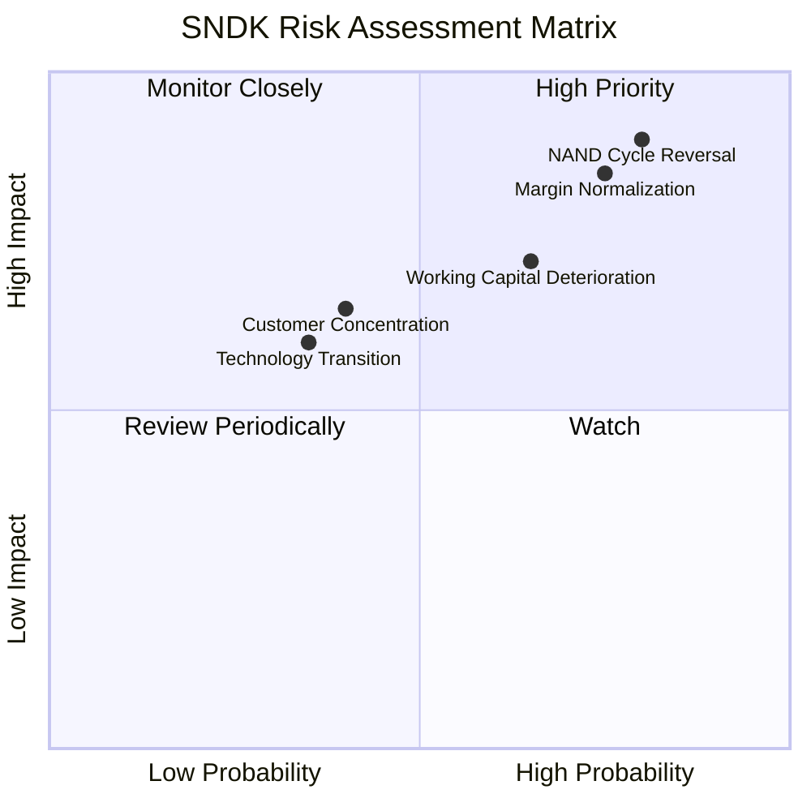

### 10.2 風險清單詳細分析

| # | 風險項目 | 發生機率 | 財務衝擊 | 風險評分 | 緩解措施 |
|---|----------|----------|----------|----------|----------|
| 1 | 🔴 **NAND 供需與售價循環反轉** | 高（分析判斷 60%） | 高；可能使 TTM **72.5%** 營業利益率快速下滑，幅度未能由資料精確估算 | 🔴 9/10 | 每季監控營收、毛利率、產能利用及存貨變化；避免以高峰 EPS 作長期估值基礎。 |
| 2 | 🔴 **毛利率／營業利益率回歸** | 高（分析判斷 55%） | 高；FY2026 營業利益率 **61.6%**、TTM **72.5%**，高利潤率若不持續將下修 DCF | 🔴 8/10 | 監控最新季度毛利率與營業利益率；連續兩季走弱時重估獲利常態。 |
| 3 | 🟠 **營運資金惡化** | 中高（分析判斷 50%） | 中高；CCC 已增加 **72 天**至 **226 天**，可能壓低 OCF 與 FCF | 🟠 7/10 | 每季追蹤 DSO、DIO、應收帳款及存貨，並比較營收增長是否快於應收與存貨增長。 |
| 4 | 🟡 **客戶集中及議價風險** | 中（定量資料未提供） | 中高；客戶集中度與客戶收入占比未提供 | 🟡 6/10 | 待財報取得客戶集中資料；觀察單一客戶需求變動與訂單延遲。 |
| 5 | 🟡 **技術轉換與替代產品風險** | 中（分析判斷） | 中；可能影響產品定價、研發回報與資本支出 | 🟡 6/10 | 追蹤產品世代、研發費用；FY2026 R&D 為 **$1.33B**。 |

---

## 11. 投資建議

### 11.1 最終評級與評分

依 8.8 的加權合理價值 **$362.72** 與 2026-11-25 收盤價 **$73.61**，MOS 為 **79.7%**，且 ROIC **141.2%** 高於 WACC **9.90%**，依規則 20 評級為 **🟢 強烈買入**，未作一級調整。綜合評分為 **7.7/10**，來自 1.1 的成長性 **9.0**、獲利能力 **9.0**、財務健康 **7.0**、估值 **9.0**、護城河 **6.0**、管理層與資本配置 **6.0**。

### 11.2 合理價值與隱含報酬率

| 估值／情境 | 每股價值 | 機率 | 相對現價 |
|------------|----------:|------|---------:|
| **加權合理價值（8.8）** | **$362.72** | — | **+392.8%** |
| 🔴 悲觀 DCF | $259.05 | 25% | +251.9% |
| 🟡 基準 DCF | $612.02 | 50% | +731.4% |
| 🟢 樂觀 DCF | $1,370.90 | 25% | +1,762.4% |
| 分析師共識目標價 | $243.36 | 24 位分析師平均 | +230.6% |

DCF 情境價值為模型估值結果，非 12 個月保證目標價；分析師共識亦非確定性預測。

### 11.3 買入時機與觸發因素

╔══════════════════════════════════════════════════════════════════╗  
║                  ✅ 買入觸發因素 Checklist                       ║  
╠══════════════════════════════════════════════════════════════════╣  
║  立即買入條件（建議分批，不代表全部同時滿足）：                 ║  
║  ✅ 股價低於加權合理價值的 90%：$326.45                           ║  
║  ✅ 單季營收維持正 QoQ 成長，且毛利率未連續兩季明顯下滑          ║  
║  ✅ TTM FCF 維持正值，且營運現金流能覆蓋資本支出                 ║  
║                                                                  ║  
║  加碼觸發條件：                                                  ║  
║  ☐ CCC 由 226 天回落，且 DIO 不再上升                             ║  
║  ☐ 最新季度營收維持年增，營業利益率趨勢穩定                       ║  
║  ☐ FCF 對淨利轉換率回升至 100% 以上                               ║  
║                                                                  ║  
║  減碼／重新評估條件：                                            ║  
║  ☐ MOS 降至 10% 以下，即股價高於約 $326.45                        ║  
║  ☐ 連續兩季營收 QoQ 為負且營業利益率同步收縮                      ║  
║  ☐ FCF 轉負，或 CCC 持續高於 226 天並伴隨存貨攀升                 ║  
╚══════════════════════════════════════════════════════════════════╝

### 11.4 投資人適配度分析

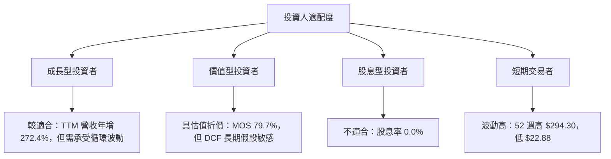

### 11.5 每季財報監控清單（Quarterly Watch List）

| 指標 | 最新基準 | 觸發加碼的觀察方向 | 觸發減碼／重新估值門檻 |
|------|----------|--------------------|------------------------|
| 營收成長 | 最新季度年增 **377.9%**；QoQ **23.0%** | QoQ 維持正成長，年增仍反映終端需求。 | 連續兩季 QoQ 負成長，並伴隨獲利率下降。 |
| 毛利率 | TTM **80.0%** | 維持高檔或下降幅度有限。 | 連續兩季下滑且營收同步放緩。 |
| 營業利益率 | TTM **72.5%**；最新季度 **79.6%** | 最新季度維持高於長期常態預期。 | 明顯向 FY2026 年度 **61.6%** 以下回落時重估基準假設。 |
| FCF | TTM **$17.36B** | 保持正值、FCF／淨利改善。 | FCF 轉負，或現金流持續低於淨利。 |
| Capex | TTM **$181M** | 投資增加仍帶來營收與產能效益。 | Capex 上升但收入、毛利率與現金流沒有同步改善。 |
| 存貨與 CCC | DIO **190 天**；CCC **226 天** | DIO、CCC 逐步回落。 | CCC 持續高於 **226 天**且存貨增長快於營收。 |
| SBC／股數 | FY2026 SBC **$232M**；股數測試未通過 | SBC 占營收下降，稀釋放緩。 | 股數持續增加而 EPS 成長低於淨利成長。 |
| 研發費用 | FY2026 **$1.33B** | 研發投入支撐產品競爭力與新設計導入。 | 研發費用增加但產品營收及毛利率持續惡化。 |
| 公司財測 | 未提供一致可引用的管理層財測 | 財測確認需求、營收及利潤率動能。 | 財測下修，尤其營收與毛利率同時下修。 |

### 11.6 反面論證：什麼會證明論點錯誤（What Would Change My Mind）

╔══════════════════════════════════════════════════════════════════╗  
║              ⚠️ 論點失效條件（Disconfirming Evidence）           ║  
╠══════════════════════════════════════════════════════════════════╣  
║ 若下列情況出現，應重新檢視或退出投資論點：                      ║  
║ ☐ 營收連續兩季 QoQ 為負，且最新季度年增率跌破 0%                 ║  
║ ☐ TTM 營業利益率較目前 72.5% 收縮超過 15 個百分點                ║  
║ ☐ TTM FCF 轉負，或 FCF／淨利連續兩季低於 50%                     ║  
║ ☐ ROIC 跌至 WACC 9.90% 以下，代表資本回報不再覆蓋資本成本        ║  
║ ☐ CCC 高於 226 天且仍上升，並由存貨與應收帳款同時惡化造成         ║  
║ ☐ SBC／營收持續高於 FY2026 的 1.15%，且稀釋股數仍增加             ║  
╚══════════════════════════════════════════════════════════════════╝

> **免責聲明**：本報告為 AI 自動生成，僅供研究參考，不構成投資建議。投資有風險，入市需謹慎。

---

## 資料與來源

| 項目 | 內容 |
|------|------|
| 價格 | 73.61 USD，2026-11-25 收盤（Yahoo Finance 即時報價（該交易日已收盤）） |
| 財務報表 | SEC 10-Q filed 2026-10-30，最新季度 2026-10-02（FY2027 Q1） |
| 有回應的資料來源 | SEC 申報資料 (XBRL)、Yahoo Finance、Finviz、StockAnalysis、Roic.ai |
| 由程式計算 | TTM 數字、WACC、DCF 模型、估值方法與權重、加權合理價值、MOS、評級門檻、F-Score、杜邦分解、營運資金天數、綜合評分 |
| 撰寫模型 | openai / gpt-6-luna |

> 本區塊由產生報告的程式依實際取得的資料填寫，非模型撰寫。「由程式計算」的數字不是模型的估計；其餘判斷（評分、情境、策略）是模型的分析。
