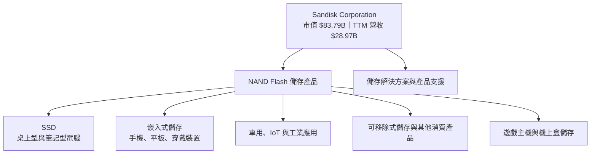
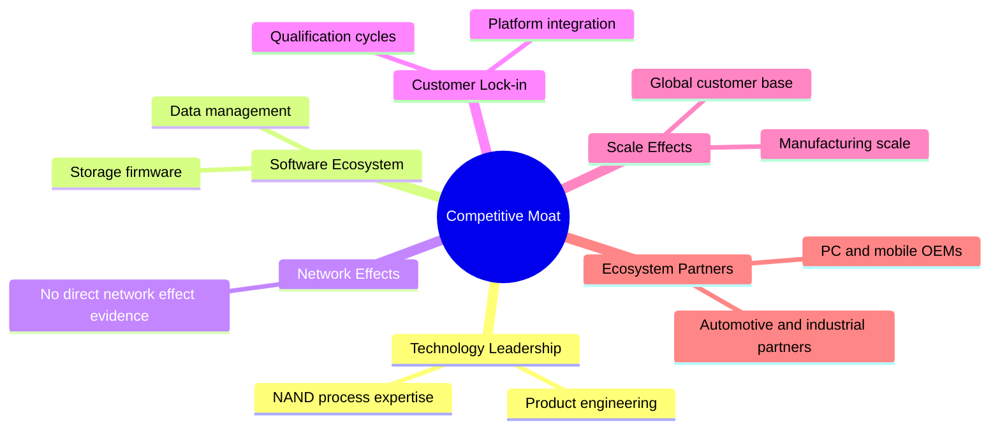
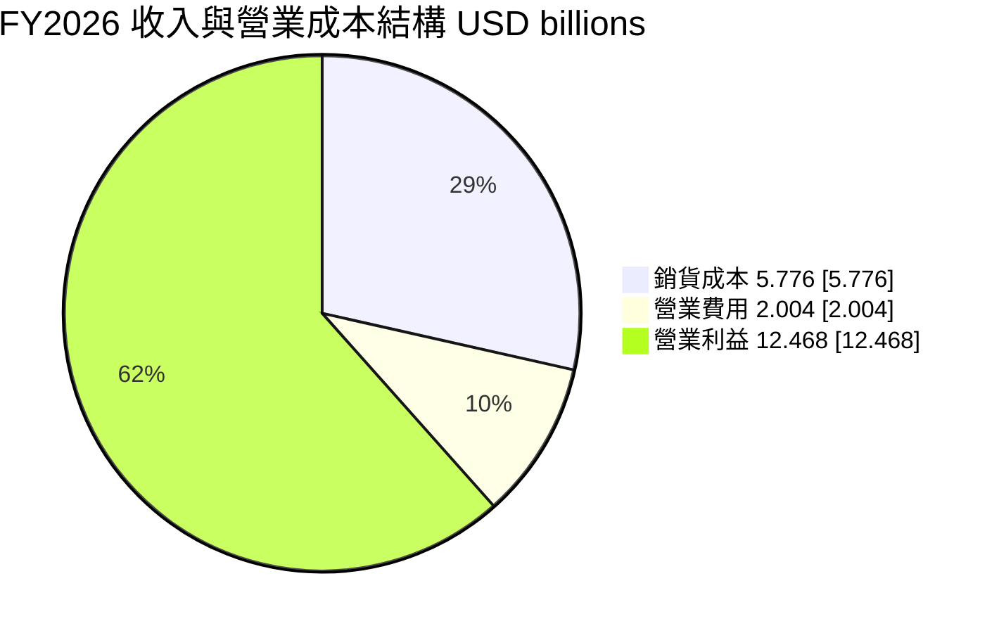
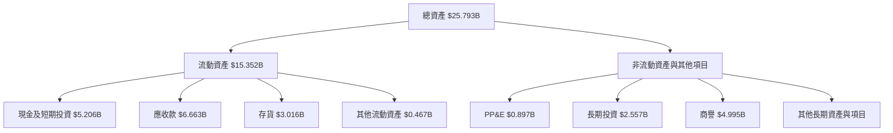
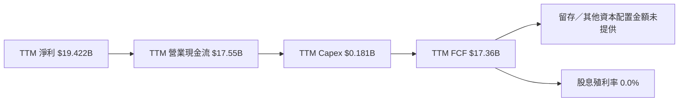
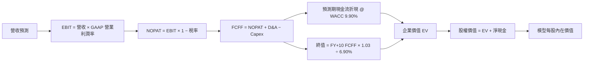
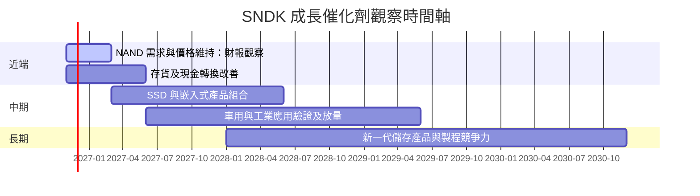
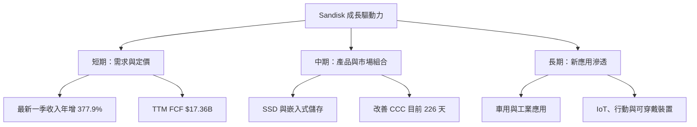
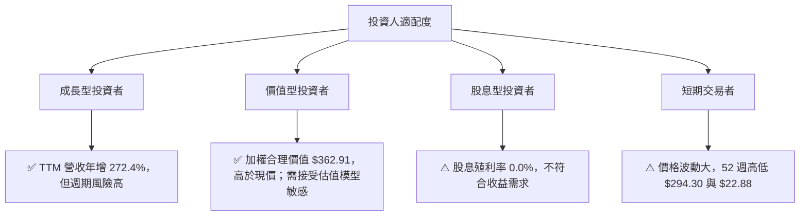

# SNDK 基本面深度分析報告
> **報告日期**：2026-11-27 ｜ **語言**：繁體中文 ｜ **數據來源**：SEC 申報資料 (XBRL)、Yahoo Finance、Finviz、StockAnalysis、Roic.ai ｜ **分析師**：CFA 級機構研究

## 目錄

| # | 章節 | 核心結論 |
|---|------|----------|
| 1 | 執行摘要 | 強烈買入；加權合理價值 $362.91；MOS +79.7% |
| 2 | 公司概覽與商業模式 | NAND 儲存產品涵蓋消費、行動、車用及工業；市場份額未提供，護城河主要來自技術、規模與客戶驗證 |
| 3 | 損益表深度分析 | TTM 營收 $28.97B、年增 272.4%；最新一季年增 377.9%，利潤率處於高峰區間 |
| 4 | 資產負債表分析 | 淨現金 $5.14B；但 CCC 由 154 天升至 226 天，營運資金占用增加 |
| 5 | 現金流量深度分析 | TTM FCF $17.36B、FCF Yield 20.72%；需留意週期高峰與現金轉換品質 |
| 6 | 獲利能力與資本效率 | ROIC 141.2% 對 WACC 9.90%，目前顯示大幅創造價值，但高峰獲利未必可持續 |
| 7 | 相對估值分析 | 同業倍數及分析師共識均高於現價；自身歷史 P/S 現值與其他估值資料有明顯口徑差異 |
| 8 | DCF 內在價值評估 | DCF 基準 $612.02；加權合理價值 $362.91；MOS +79.7% |
| 9 | 成長催化劑 | NAND 需求、產品組合與資料儲存需求是主要方向；TAM 數據未提供 |
| 10 | 風險矩陣 | NAND 價格循環、極高利潤率回落、營運資金惡化為主要風險 |
| 11 | 投資建議 | 強烈買入；分批買入區間以現價至 MOS 10% 對應價為參考，須嚴格監控循環反轉 |

---

## 1. 執行摘要

截至 2026-11-25 收盤價 **$73.61**，SNDK 的 TTM 營收為 **$28.97B**、TTM FCF 為 **$17.36B**，TTM ROIC **141.2%**，高於 **9.90% WACC**。估值方面，DCF 基準值為 **$612.02**，但相對估值與分析師共識拉低後的加權合理價值為 **$362.91**；以加權合理價值計算 MOS 為 **+79.7%**。依評級門檻，MOS ≥25% 且 ROIC > WACC，評級為 **強烈買入**。不過，營收與利潤率正處於高度週期性上行階段，DCF 的超高價值對長期利潤率與終值假設十分敏感，因此評級不代表低風險。

### 1.0 一頁式投資儀表板（Portfolio Manager 30 秒速讀）

| 項目 | 內容 |
|------|------|
| **投資論點（3 句）** | ① TTM 營收年增 **272.4%**，最新一季單季年增 **377.9%**，反映需求及價格週期快速擴張。② TTM FCF **$17.36B**、FCF Yield **20.72%**，但現金轉換率與營運資金仍需追蹤。③ 加權合理價值 **$362.91**，對 **2026-11-25 收盤價 $73.61** 的 MOS 為 **+79.7%**。 |
| **綜合評分** | **6.8/10**（引用 1.1） |
| **財務健康** | 🟢 現金及短期投資 **$5.14B**、淨現金 **$5.14B**；但 CCC 升至 **226 天**，營運資金效率走弱 |
| **ROIC vs WACC** | **141.2% vs 9.90%**；按當前 TTM 指標顯示創造股東價值 |
| **FCF 趨勢** | TTM FCF **$17.36B**；FCF Yield **20.72%**。近年由負轉正，受產業循環與利潤率擴張帶動 |
| **估值** | Forward P/E **2.06x** ｜ EV/EBITDA **3.714x** ｜ FCF Yield **20.72%** |
| **DCF 內在價值（基準）** | **$612.02** ｜ 現價相對 DCF 折價 **88.0%**（折溢價定義：現價 ÷ DCF 內在價值 − 1） |
| **安全邊際（MOS）** | **+79.7%＝($362.91 − $73.61) ÷ $362.91**；🟢 >25% 充足 |
| **預期報酬（基準情境 12M）** | DCF 基準情境 **+731.4%**（模型情境值，不應視為保證或一般化 12 個月預測） |
| **關鍵風險（前二）** | NAND 供需轉弱造成價格與毛利率回落；營收高增長伴隨 CCC 上升與應收、存貨占用增加 |
| **評級 + 信心度** | 🟢 **強烈買入** ｜ 信心：中（估值折價顯著，但高度依賴週期與模型長期假設） |

### 1.1 綜合評分卡（全報告唯一）

| 維度 | 評分（1–10） | 主要依據（引用數字與其來源章節） |
|------|--------------|----------------------------------|
| 成長性 | 9.0 | TTM 營收年增 **272.4%**、最新一季單季年增 **377.9%**（第 3 章）；成長有強烈循環成分 |
| 獲利能力 | 9.0 | TTM 營業利益率 **72.5%**、ROIC **141.2%** 高於 WACC **9.90%**；Piotroski **5/8**（第 6 章） |
| 財務健康 | 7.5 | 淨現金 **$5.14B**、流動比率 **2.58**；CCC **226 天**，較一年前增加 **72 天**（第 4 章） |
| 估值 | 8.5 | MOS **+79.7%**；同業估值與加權估值低於 DCF 基準，反映週期不確定性（第 7–8 章） |
| 護城河 | 5.5 | 產品與客戶應用廣泛，但市場份額、分部收入與客戶鎖定量化資料未提供（第 2 章） |
| 管理層與資本配置 | 5.5 | FY2026 SBC **$232M**、稀釋股數測試未通過；回購金額與資本配置政策未提供（第 3、5 章） |
| **綜合評分** | **7.5** | 六項算術平均：\((9.0+9.0+7.5+8.5+5.5+5.5)÷6=7.5\)。 |

### 1.2 五大投資論點 + 三大核心風險

| 類型 | 項目 | 具體依據 | 信心度 |
|------|------|----------|--------|
| 🟢 **投資論點①** | 收入加速與規模放大 | TTM 營收 **$28.97B**、年增 **272.4%**；最新一季收入 **$11.03B**、單季年增 **377.9%** | 🟢 高 |
| 🟢 **投資論點②** | 當前現金流能力強 | TTM OCF **$17.55B**、Capex **$181M**、FCF **$17.36B** | 🟢 高 |
| 🟢 **投資論點③** | 淨現金資產負債表 | 現金及短期投資 **$5.14B**，Verified Figures 的淨現金為 **$5.14B**；總債務欄為 N/A，不推算缺漏值 | 🟢 中高 |
| 🟢 **投資論點④** | 估值相對加權價值有折價 | 加權合理價值 **$362.91**，現價 **$73.61**，MOS **+79.7%** | 🟢 中 |
| 🟢 **投資論點⑤** | 資本回報高於資本成本 | TTM ROIC **141.2%** 對 WACC **9.90%**；但 ROIC 可能處於景氣高峰 | 🟡 中 |
| 🟡 **風險①** | NAND 週期反轉 | NAND 供需、價格與庫存週期可能快速改變；TTM 營業利益率 **72.5%** 的維持性未獲跨周期證明 | 🟡 中 |
| 🔴 **風險②** | 現金轉換週期拉長 | CCC 從 **154 天**升至 **226 天**，DIO **190 天**、DSO **83 天**，可能加重資金占用 | 🔴 高衝擊 |
| 🔴 **風險③** | DCF 終值與利潤率假設敏感 | DCF 終值現值占 EV **58.5%**；估值對長期利潤率、折現率與永續成長率敏感 | 🔴 高衝擊 |

### 1.3 快速統計卡片

| 指標 | 公司實際值（期間） | 同業中位數 | 狀態 |
|------|--------------------|------------|------|
| 營收成長（TTM） | **272.4%** | — | 🟢 |
| 營收成長（最新一季年增） | **377.9%** | **327.9%**（WDC、MU、SKHY） | 🟢 |
| 毛利率（TTM） | **80.0%** | **77.4%**（WDC、MU、SKHY） | 🟢 |
| 營業利益率（TTM） | **72.5%** | — | 🟢 |
| ROIC（TTM） | **141.2%** | — | 🟢 |
| Forward P/E | **2.0565789x** | **2.8x**（WDC、MU、SKHY中位數） | 🟢 |
| FCF Yield（TTM） | **20.72%** | — | 🟢 |
| Piotroski F-Score | **5 / 8** | — | 🟡 |

> Forward P/E 中位數為 WDC **6.8x**、MU **2.9x**、SKHY **2.7x** 的中位數。SKHY 的 P/S、EV/EBITDA 因幣別口徑混合而不納入相應中位數比較。

### 1.4 投資結論

╔══════════════════════════════════════════════════════════════════╗  
║　　　　　　　　　📊 投資結論摘要　　　　　　　　　　　　　　　║  
╠══════════════════════════════════════════════════════════════════╣  
║ 評級：強烈買入（MOS +79.7%，且 ROIC 141.2% > WACC 9.90%）　　　║  
║ 價格（2026-11-25 收盤）：$73.61　　　　　　　　　　　　　　　　║  
║ DCF 內在價值（基準）：$612.02（折價 88.0%）　　　　　　　　　　║  
║ 安全邊際 MOS：+79.7%（以加權合理價值 $362.91 為分母）　　　　　║  
║ 加權合理價值（8.8）：$362.91　　　　　　　　　　　　　　　　　║  
║ DCF 情境價值：悲觀 $259.05（+251.9%）　　　　　　　　　　　　　║  
║　　　　　　　基準 $612.02（+731.4%）　　　　　　　　　　　　　║  
║　　　　　　　樂觀 $1,370.90（+1,762.4%）　　　　　　　　　　　║  
║ 綜合評分：7.5/10（引用 1.1）　　　　　　　　　　　　　　　　　║  
║ 適合投資人：能承受半導體記憶體週期與高波動的成長／價值型投資人║  
╚══════════════════════════════════════════════════════════════════╝

---

## 2. 公司概覽與商業模式

### 2.1 業務結構與收入來源

Sandisk 開發、製造並銷售 NAND Flash 儲存裝置與解決方案，涵蓋 SSD、嵌入式儲存與可移除式儲存應用。公司總市值 **$83.79B**，TTM 營收 **$28.97B**。分部營收及占比未提供，因此不推算各產品線比重。

軟體與服務收入、各業務的營收占比、分部毛利率均未提供。公司財務表現目前主要由 NAND 儲存產品與供需循環驅動，尚無法從資料判斷是否有具規模的經常性服務收入。

### 2.2 市場份額

市場份額及可比較的市場規模資料未提供，故不繪製市占率圖表或填入推估比例。SNDK TTM 營收 **$28.97B**、年增 **272.4%**，規模與成長均顯著；但其成長率與 MU 最新一季單季年增率 **379.3%** 接近，不能單憑營收增速推論市占率提升。

### 2.3 競爭護城河分析

上述結構為質化分析。資料未提供技術節點、專利價值、客戶留存率、轉換成本、市占率或軟體收入等量化證據，因此護城河判斷需保留。

### 2.4 護城河強度

| 護城河項目 | 強度（強／中／弱） | 證據（引用數字或事實） | 會削弱它的情況 |
|------------|--------------------|------------------------|----------------|
| 技術與產品工程 | 中 | NAND Flash 應用覆蓋 SSD、行動、車用、IoT 與工業 | 競爭者產品性能提升、技術轉換或成本差距縮小 |
| 軟體與韌體生態 | 弱至中 | 有儲存解決方案業務描述，但軟體收入與留存數據未提供 | 產品差異化不足、韌體替代容易 |
| 網路效應 | 弱 | 未見直接網路效應證據 | 同類產品同質化、客戶可多來源採購 |
| 客戶鎖定 | 中 | 嵌入式、車用與工業產品可能涉及驗證週期，但資料未提供實際週期 | OEM 更換供應商、價格競爭或產品驗證標準降低 |
| 規模效應 | 中 | TTM 營收 **$28.97B**，具相當營運規模 | NAND 供給擴張、產能利用率下降、價格崩落 |
| 生態夥伴 | 中 | 覆蓋多種終端市場與全球區域 | 客戶集中或關鍵平台轉向競爭者 |

1.1「護城河」評分為 **5.5/10**，主要因產品覆蓋面廣、營運規模大，但市占率、客戶鎖定與軟體收入等護城河證據不足。

---

## 3. 損益表深度分析

### 3.1 年度收入成長趨勢（近4年）

年度營收資料來自年度損益表；2026 財年營收由 **$7.36B** 跳升至 **$20.25B**，主要反映產業景氣與價格／產品組合改善。按 FY2023 至 FY2026 計算，三年 CAGR 約 **49.3%**，但此數值受 2023 低基期與最近年度反彈影響，不宜直接外推。

╔══════════════════════════════════════════════════════════════════╗  
║　　　　　Sandisk 年度收入趨勢（FY2023–FY2026）　　　　　　　　　║  
╠══════════════════════════════════════════════════════════════════╣  
║ FY2023　$6.09B　　██████░░░░░░░░░░░░░░░░　YoY：-8.7%　🔴　　 ║  
║ FY2024　$6.66B　　███████░░░░░░░░░░░░░░　YoY：+9.5%　🟡　　 ║  
║ FY2025　$7.36B　　████████░░░░░░░░░░░░░　YoY：+10.4% 🟡　　 ║  
║ FY2026　$20.25B　 ████████████████████　YoY：+175.3% 🟢　　 ║  
╠══════════════════════════════════════════════════════════════════╣  
║ FY2023–FY2026 營收 CAGR：約 +49.3%；其中 FY2026 是主要跳升年　║  
╚══════════════════════════════════════════════════════════════════╝

### 3.2 季度收入趨勢分析

| 季度 | 營收 | QoQ 成長 | YoY 成長 | 備註 |
|------|------:|---------:|---------:|------|
| 2025-12-31 | $3.02B | 約 **+30.9%** | **+61.25%** | QoQ 以 2025-09-30 季營收 $2.308B 為比較基準 |
| 2026-03-31 | $5.95B | 約 **+96.7%** | **+251.03%** | 需求與價格環境進一步擴張 |
| 2026-06-30 | $8.96B | 約 **+50.7%** | **+371.59%** | 季營收與獲利繼續放大 |
| 2026-10-02 | $11.03B | 約 **+23.0%** | **+377.9%** | 最新季度；單季年增率，不是 TTM 成長率 |

QoQ 以列示季度營收計算，四捨五入至一位小數；YoY 使用季度資料來源提供的單季年增率。季度增幅持續為正，但相較前季的增速放緩，可能表示低基期效應開始減弱，後續應關注出貨量、售價與產品組合，而非只看高 YoY 數字。

### 3.3 利潤率演變分析

| 利潤率指標 | FY2023 | FY2024 | FY2025 | FY2026 | 趨勢 | 評估 |
|------------|-------:|-------:|-------:|-------:|------|------|
| **毛利率** | 約 **7.1%** | 約 **16.1%** | 約 **30.1%** | 約 **71.5%** | ↗️ 大幅上升 | 🟢 受價格與產品組合改善推升 |
| **營業利益率** | 約 **-21.3%** | 約 **-6.7%** | 約 **6.9%** | 約 **61.6%** | ↗️ 由虧轉盈、急升 | 🟢 但高度循環 |
| **淨利率** | 約 **-35.2%** | 約 **-10.1%** | 約 **-22.3%** | 約 **56.5%** | ↗️ FY2026 轉正擴大 | 🟡 年度數值受稅務與非營業項目影響 |

FY2026 年度收入 **$20.25B**、毛利 **$14.47B**、營業利益 **$12.47B**。營業利益率急升，與 NAND 供需改善、價格與產品組合上行、固定成本吸收增加相符；但資料未提供各項價格、產能利用率及分部獲利，不能把全部改善歸因於單一因素。Verified Figures 的 TTM 營業利益率為 **72.5%**，最新季度為 **79.6%**；另一合併資料源出現不同口徑的季度利潤率數字，本報告對 TTM 與最新季度統一採用 Verified Figures 數值。

### 3.4 費用結構分析

FY2026 年營收 **$20.248B**、毛利 **$14.472B**、營業利益 **$12.468B**。以此計算，銷貨成本約 **$5.776B**，毛利以下營業費用合計約 **$2.004B**；R&D **$1.33B** 已包含於營業費用中，故不另作獨立加總項目。

╔══════════════════════════════════════════════════════════════════╗  
║　　　　　FY2026 損益結構（以營收 $20.248B 為基準）　　　　　　　　║  
╠══════════════════════════════════════════════════════════════════╣  
║ 營收　　　　　　 $20.248B　████████████████████　　　　　　　║  
║ 毛利　　　　　　 $14.472B　██████████████░░░░░░　　　　　　　║  
║ 營業利益　　　　 $12.468B　████████████░░░░░░░░　　　　　　　║  
║ 銷貨成本　　　　　$5.776B　██████░░░░░░░░░░░░░░　　　　　　　║  
║ 毛利以下營業費用　$2.004B　██░░░░░░░░░░░░░░░░░░　　　　　　　║  
╚══════════════════════════════════════════════════════════════════╝

### 3.5 季度 EPS 趨勢與盈餘品質（Quality of Earnings）

| 盈餘品質項目 | 數值/佔比 | 評估 |
|--------------|-----------|------|
| 股權薪酬 SBC / 營收 | FY2026：$232M ÷ $20.248B ≈ **1.15%** | 🟡 占比不高，但仍造成股東稀釋 |
| SBC / 營業現金流 | FY2026：$232M ÷ $11.67B ≈ **1.99%** | 🟢 相對 OCF 占比有限 |
| FCF / 淨利（現金轉換率） | TTM：$17.36B ÷ $19.422B ≈ **89.4%** | 🟡 現金轉換接近九成，但低於淨利；Piotroski 應計品質測試未通過 |
| 一次性/非經常性損益 | 未提供可量化明細 | 🟡 無法判定是否有一次性項目顯著抬高盈餘 |
| 有效稅率異常 | **12.2%**（最新年度有效稅率） | 🟡 稅率偏低可能提高淨利，持續性需核實 |
| 資本化支出 vs 費用化 | Capex TTM **$181M**；資本化政策細節未提供 | 🟡 資本支出不高，但不能僅以 Capex 判定費用化是否充分 |
| EPS 超預期／不及預期 | 最近四季 EPS Est/Act 為 **N/A** | 🟡 無法可靠判定四季是否超預期；EPS 數據有實際值但缺一致可用的分析師預估 |

季度實際 EPS（StockAnalysis 口徑）依序約為 **$0.64、$2.88、$5.50、$6.58**，季度淨利由 **$0.803B** 上升至 **$8.101B**；但季度估計值缺失，不能把增長誤稱為「超預期」。FY2026 OCF **$11.67B** 明顯高於 FY2025 的 **$84M**，但 TTM OCF **$17.55B** 仍低於 TTM 淨利 **$19.422B**。此外，稀釋股數未增加測試未通過。整體來看，當期盈餘有現金流支撐，但週期性利潤高峰、稅率與股權稀釋均需納入估值折讓。

---

## 4. 資產負債表分析

### 4.1 資產結構分解

以下採用 StockAnalysis 的最新 TTM 資產明細，總資產 **$25.793B**。明細可能因四捨五入與其他資產項目而不完全等於總資產。

### 4.2 流動性與營運資金分析

| 指標 | 最新 TTM | 一年前 TTM | 變化 | 解讀 |
|------|----------:|----------:|------:|------|
| 流動比率 | **2.58** | N/A | N/A | 短期資產覆蓋流動負債能力尚可；歷史同比口徑未提供 |
| Quick Ratio | **1.994** | N/A | N/A | 排除存貨後仍接近 2 倍 |
| DSO 應收帳款天數 | **83 天** | **56 天** | **+27 天** | 收款週期延長，應檢視客戶付款條件與收入增長造成的應收增加 |
| DIO 存貨天數 | **190 天** | **124 天** | **+66 天** | 存貨占用增加，可能反映備貨或供應鏈週期；若需求轉弱，存在跌價與去庫存風險 |
| DPO 應付帳款天數 | **46 天** | **26 天** | **+20 天** | 付款週期延長部分抵銷應收及存貨占用，但不能單獨視為議價力改善 |
| CCC 現金轉換週期 | **226 天** | **154 天** | **+72 天** | 現金被營運資金占用時間拉長，是近期需重點監控的負面變化 |

應收款、存貨上升與收入高速擴張同時發生，可能是規模變大下的正常現象，但 DSO、DIO 均惡化，且惡化幅度高於 DPO 改善幅度；若成長放緩，營運資金回收可能成為現金流壓力來源。

### 4.3 債務結構分析

Verified Figures 對總債務列為 **N/A**，而其他年度資產負債表數據另有總債務資料；依優先規則不以旁列數字反推或替代 Verified Figures 缺漏欄位。淨現金照列 Verified Figures 的 **$5.14B**。

╔══════════════════════════════════════════════════════════════════╗  
║　　　　　　　　Sandisk 債務健康診斷　　　　　　　　　　　　　　║  
╠══════════════════════════════════════════════════════════════════╣  
║ 總債務：　　　　 N/A　　　Verified Figures 未提供　　　　　　　　║  
║ 現金及短期投資： $5.14B　████████████████████　🟢　　　　　　　║  
║ 淨現金：　　　　 $5.14B　████████████████████　🟢　　　　　　　║  
║ Debt/EBITDA：　　N/A　　　總債務及一致口徑 EBITDA 資料不足　　　║  
║ Interest Coverage：N/A　　利息費用及債務口徑不足以獨立複核　　　║  
╚══════════════════════════════════════════════════════════════════╝

### 4.4 股東權益趨勢

| 財年 | 股東權益 | 年變化 | 解讀 |
|------|---------:|-------:|------|
| FY2024 | $11.08B | — | 虧損年度，權益仍受資產與資本結構影響 |
| FY2025 | $9.22B | 約 **-16.8%** | 淨虧損 **$1.64B**，權益收縮 |
| FY2026 | $15.74B | 約 **+70.7%** | 淨利 **$11.43B**，獲利回升推升權益 |

╔══════════════════════════════════════════════════════════════════╗  
║　　　　　　股東權益變化（年度財報，美元）　　　　　　　　　　　║  
╠══════════════════════════════════════════════════════════════════╣  
║ FY2024　$11.08B　██████████████　　　　　　　　　　　　　　║  
║ FY2025　 $9.22B　███████████　　　　　　　　　　　　　　　║  
║ FY2026　$15.74B　████████████████████　　　　　　　　　　　║  
╚══════════════════════════════════════════════════════════════════╝

---

## 5. 現金流量深度分析

### 5.1 現金流量瀑布圖

淨利與 TTM OCF 採用各自資料來源列示；股息殖利率與派息率均為 **0.0%**。回購與其他資本配置金額未提供，因此不對現金去向作金額分配。

### 5.2 FCF 轉換率趨勢

| 財年 | FCF | 淨利 | FCF / 淨利 | 評估 |
|------|----:|----:|-----------:|------|
| FY2023 | -$0.932B | -$2.143B | 約 **43.5%** | 虧損期間比率受負分母影響，不宜作常態品質判斷 |
| FY2024 | -$0.475B | -$0.672B | 約 **70.7%** | 仍為負值，營運尚未穩定 |
| FY2025 | -$0.120B | -$1.641B | 約 **7.3%** | FCF 接近損益兩平，但淨損較大 |
| FY2026 | $11.49B | $11.43B | 約 **100.5%** | 年度現金流大致轉換為現金 |
| TTM 至 2026-10-02 | $17.36B | $19.422B | 約 **89.4%** | 正向但低於 100%，與應計品質測試未通過一致 |

### 5.3 自由現金流趨勢

╔══════════════════════════════════════════════════════════════════╗  
║　　　　　　Sandisk 自由現金流：年度實際與 TTM　　　　　　　　　　║  
╠══════════════════════════════════════════════════════════════════╣  
║ FY2023　-$0.932B　負值　　　　　　　　　　　　　　　　　　　║  
║ FY2024　-$0.475B　負值　　　　　　　　　　　　　　　　　　　║  
║ FY2025　-$0.120B　接近損益兩平　　　　　　　　　　　　　　　║  
║ FY2026　$11.49B　 █████████████████████　　　　　　　　　　║  
║ TTM　　 $17.36B　 ███████████████████████████████　　　　　　║  
╠══════════════════════════════════════════════════════════════════╣  
║ TTM FCF Yield：20.72%；FCF = OCF $17.55B − Capex $0.181B　　　║  
╚══════════════════════════════════════════════════════════════════╝

年度 FCF 從連續負值轉為大幅正值，核心驅動是獲利回升與 OCF 增加，而不是資本支出大幅縮減後即可永久維持的結構性結果。TTM Capex 僅 **$181M**，相對營收規模偏低，後續需觀察投資支出是否增加。

### 5.4 資本配置評估

| 資本配置項目 | 可用數據 | 評估 |
|--------------|----------|------|
| 資本支出 | TTM **$181M**；FY2026 **$177M** | 相對 TTM 營收 **$28.97B** 約 **0.6%**，未來擴產與維護需求可能提高 |
| 股息 | 殖利率 **0.0%**、派息率 **0.0%** | 未以現金股息回饋股東 |
| 股權薪酬 | FY2026 **$232M** | 對員工激勵有用，但伴隨股數稀釋 |
| 股票回購 | 金額未提供 | 不推定有回購或量化回購成效 |
| 留存／投資 | 詳細用途未提供 | 應追蹤資本配置是否在循環高峰保持財務紀律 |

沒有足夠資料支援精確資本配置圓餅圖，故不將未提供的回購、研發或留存金額填入比例。

---

## 6. 獲利能力與資本效率

### 6.1 ROE / ROA / ROIC 趨勢

| 指標 | 歷史資料 | 最新值 | 評估 |
|------|----------|-------:|------|
| ROE | TTM **107.1%**（DuPont 口徑） | **107.1%** | 主要由高淨利率驅動，而非極高槓桿 |
| ROA | TTM **68.3%**（合併財務資料） | **68.3%** | 高獲利期間資產回報強 |
| ROIC | TTM **141.2%**（Verified Figures） | **141.2%** | 遠高於 WACC，但營運資本分母較低及循環高峰可能放大比率 |
| 行業均值比較 | N/A（未提供可核對行業均值） | — | 不以未經來源支持的數字比較 |

不同資料區塊中的 ROE 數值有口徑差異；DuPont 分解依 QUALITY FIGURES 固定使用 **107.1%**，ROIC 則依 Verified Figures 使用 **141.2%**。

### 6.2 ROIC vs WACC 分析（核心價值創造判斷）

WACC 依成本資本資料區塊採用 **9.90%**，不另行替換。其構成為：無風險利率 **4.85%**、ERP **5.00%**、調整後 Beta **1.00**、股權成本 **9.85%**、稅前債務成本 **36.32%**、有效稅率 **12.2%**，股權／債務權重 **99.8%／0.2%**。

╔══════════════════════════════════════════════════════════════════╗  
║　　　　　　　　ROIC vs WACC 深度分析　　　　　　　　　　　　　　║  
╠══════════════════════════════════════════════════════════════════╣  
║ WACC 組成：　　　　　　　　　　　　　　　　　　　　　　　　　║  
║ ├── 無風險利率（10Y 美債）：4.85%　　　　　　　　　　　　　　║  
║ ├── 市場風險溢酬 ERP：5.00%　　　　　　　　　　　　　　　　　║  
║ ├── 原始 Beta：N/A；採用調整後 Beta：1.00（資料假設）　　　　　║  
║ ├── Ke = 4.85% + 1.00 × 5.00% = 9.85%　　　　　　　　　　　　║  
║ ├── 稅前債務成本：36.32%；稅後約 36.32% × (1−12.2%) = 31.89% ║  
║ ├── 權重：股權 99.8%，債務 0.2%　　　　　　　　　　　　　　　║  
║ └── 採用 WACC：9.90%（依成本資本資料，不另行重算替換）　　　　║  
║　　　　　　　　　　　　　　　　　　　　　　　　　　　　　　　║  
║ TTM ROIC：141.2%　　　　　　　　　　　　　　　　　　　　　　　║  
║ ROIC − WACC = 141.2% − 9.90% = 131.3 個百分點　　　　　　　　║  
║ ROIC / WACC 約 14.3 倍　　　　　　　　　　　　　　　　　　　　║  
║　　　　　　　　　　　　　　　　　　　　　　　　　　　　　　　║  
║ ROIC 141.2%　▓▓▓▓▓▓▓▓▓▓▓▓▓▓▓▓▓▓▓▓　🟢　　　　　　　　　　　　║  
║ WACC　 9.90%　▓░░░░░░░░░░░░░░░░░░░　──　　　　　　　　　　　　║  
║ 結論：按目前 TTM 計算，公司大幅高於資本成本並創造價值；　　　║  
║ 但 TTM 週期峰值可能使 ROIC 與 EVA 被高估。　　　　　　　　　　║  
╚══════════════════════════════════════════════════════════════════╝

成本資本資料沒有提供可用於獨立重建債務成本分母的利息與平均計息負債明細；因此保留程式計算的 WACC **9.90%**，不以其他資料自行替換。上述稅後債務成本為依所列數字計算的說明值，不代表重新估算或改寫 WACC。

### 6.3 杜邦三因素分解

| 因素 | 數值（TTM） | 解讀 |
|------|-------------|------|
| 淨利率 | **67.0%** | 高淨利潤率是 ROE 的主要來源 |
| 資產週轉率 | **1.12** | 每單位資產產生的收入增加 |
| 權益乘數 | **1.42** | 槓桿並非 ROE 高企的主因 |
| **ROE** | **107.1%** | \(67.0\% × 1.12 × 1.42 = 107.1\%\)（來源提供值；各項四捨五入後乘積可能略有尾差） |

ROE 主要由淨利率與資產週轉率帶動，權益乘數 **1.42** 顯示財務槓桿不是核心驅動因素。不過，淨利率高度受 NAND 價格週期影響。

### 6.4 財務體質：Piotroski F-Score

Piotroski F-Score 為 **5 / 8**。因有一項測試缺少輸入而不計分，分母為 8；不能將分數誤讀為 5 / 9。

| 測試 | 結果 | 解讀 |
|------|------|------|
| ROA > 0 | ✅ 通過 | TTM 獲利為正 |
| 營業現金流 > 0 | ✅ 通過 | TTM OCF 為 **$17.55B** |
| ROA 高於一年前 | ✅ 通過 | 從虧損／低獲利週期回升 |
| 營業現金流 > 淨利（應計品質） | ❌ 未通過 | TTM OCF **$17.55B** 低於 TTM 淨利 **$19.422B** |
| 長期負債 ÷ 總資產低於一年前 | — 無法判定 | 負債資料不足 |
| 流動比率高於一年前 | ❌ 未通過 | 流動比率同比未改善 |
| 稀釋股數未增加 | ❌ 未通過 | SBC 與股數變化顯示存在稀釋 |
| 毛利率高於一年前 | ✅ 通過 | 毛利率隨景氣與產品組合改善 |
| 資產週轉率高於一年前 | ✅ 通過 | 週轉效率測試通過 |

整體財務體質由盈利復甦與正向現金流支撐，但應計品質、流動比率變化與股數稀釋是三項負面訊號。

---

## 7. 相對估值分析

### 7.1 同業估值比較表格

| 估值指標 | **SNDK** | **WDC** | **MU** | **SKHY** | 本公司評估 |
|----------|---------:|--------:|-------:|--------:|-----------|
| **Trailing P/E** | **4.7065x** | 9.6x | 8.1x | 6.2x | 🟢 低於三家同業 |
| **Forward P/E** | **2.0566x** | 6.8x | 2.9x | 2.7x | 🟢 低於同業中位數 **2.8x** |
| **P/S Ratio** | **2.8922x** | 7.0x | 5.1x | N/A（混合幣別） | 🟢 低於可用同業中位數 **6.05x** |
| **EV/EBITDA** | **3.714x** | 16.1x | 5.9x | N/A（混合幣別） | 🟢 低於可用同業中位數 **11.0x** |
| **最新一季營收年增** | **377.9%** | 55.5% | 379.3% | 327.9% | 🟢 成長率高，但可能受基期與循環影響 |
| **TTM 毛利率** | **80.0%** | 52.6% | 80.7% | 77.4% | 🟢 接近 MU，較其他可比公司高 |

同業倍數全部取自 Peer multiples 資料。SNDK 的低倍數可能反映低估，也可能反映市場對記憶體景氣循環、峰值盈利不可持續及財務數據口徑的折價；不能只憑 P/E 低便判定便宜。

### 7.2 歷史估值區間分析

自身歷史估值資料提供的是 **P/S**，不是 P/E；因此以下按 P/S 呈現，不將其改寫為 P/E 區間。

╔══════════════════════════════════════════════════════════════════╗  
║　　　　　　SNDK 自身五年歷史 P/S 區間　　　　　　　　　　　　　║  
╠══════════════════════════════════════════════════════════════════╣  
║ 歷史低點　0.1x　█　　　　　　　　　　　　　　　　　　　　　║  
║ 五年中位　0.6x　██████　　　　　　　　　　　　　　　　　　║  
║ 現值　　　0.4x　████　　　　　　　　　　　　　　　　　　　║  
║ 歷史高點　1.7x　█████████████████　　　　　　　　　　　　║  
║ 現值百分位：43%　　　　　　　　　　　　　　　　　　　　　　║  
╚══════════════════════════════════════════════════════════════════╝

> 歷史資料庫列出的當前 P/S **0.4x** 與市場資料表列示的 P/S **2.8922x** 有顯著口徑或時點不一致。依規則，本節歷史位置照抄自身歷史估值區塊；不以其中一個數值反推或覆蓋另一個數值。此差異降低歷史估值比較的可靠度。

### 7.3 情境價值（Bear / Base / Bull，照抄 DCF MODEL）

| 情境 | 第 1 年營收成長 | 期末營業利潤率 | WACC | 每股價值 | 相對現價 | 機率 | 會發生的條件 |
|------|----------------:|----------------:|-----:|---------:|---------:|-----:|--------------|
| 🔴 悲觀 | 15.0% | 52.0% | 10.90% | **$259.05** | **+251.9%** | 25% | 需求與價格上行放緩，長期利潤率向較低水平收斂，風險溢酬提高 |
| 🟡 基準 | 30.0% | 61.2% | 9.90% | **$612.02** | **+731.4%** | 50% | 短期延續高成長，之後增速逐年回落，長期利潤率逐步正常化 |
| 🟢 樂觀 | 45.0% | 67.3% | 8.90% | **$1,370.90** | **+1,762.4%** | 25% | 需求、產品組合與定價維持強勢，長期利潤率高於基準且折現率下降 |

模型提供的機率加權 DCF 為 **$713.49**，但方法權重表及第 8.8 節採用 DCF 基準價值 **$612.02**，不得將機率加權值替代基準值。

### 7.4 相對估值隱含價格區間

╔══════════════════════════════════════════════════════════════════╗  
║　　　　　　估值方法隱含每股價值與現價位置　　　　　　　　　　　║  
╠══════════════════════════════════════════════════════════════════╣  
║ $73.61 現價　　　　　　　　　　　　　　　　　　　　　　　　　║  
║ ├─ 同業 P/S：$154.81　（中位數 6.1x × TTM 營收）　　　　　　　║  
║ ├─ 同業 EV/EBITDA：$208.83（中位數 11.0x × TTM EBITDA，加淨現金）║  
║ ├─ 分析師共識：$244.96（24 位分析師平均目標價）　　　　　　　　║  
║ └─ DCF 基準：$612.02（10 年 FCFF、WACC 9.90%、g 3.0%）　　　　║  
╚══════════════════════════════════════════════════════════════════╝

依據均為估值方法區塊原列數值。相對估值採 WDC、MU 可用同業倍數中位數；SKHY 的部分倍數因混合幣別而排除。

---

## 8. DCF 內在價值評估（Discounted Cash Flow）

### 8.0 估值推理鏈（Thinking Logic：在算之前先想清楚）

**Step 1 — 價值由哪些變數決定？**  
SNDK 的估值核心是 NAND 儲存產品的營收、利潤率與終值現金流。現有產品組合占營收比重未提供，不能把 SSD、嵌入式或車用業務分別量化；模型以公司總 TTM 營收 **$28.97B** 作唯一起點。主導估值的變數是**長期營業利潤率與終值假設**：終值現值占 EV **58.5%**，其變化會直接放大企業價值變動。

**Step 2 — 模型選擇**

| 決策點 | 本報告採用 | 理由（含數字） | 曾考慮但否決 | 否決理由 |
|--------|-----------|----------------|--------------|----------|
| 現金流定義 | FCFF | 使用 WACC 折現並計算 EV；模型指定 FCFF = NOPAT + D&A − Capex | FCFE | 模型已提供 FCFF，且更適合企業價值橋接 |
| 預測期 N | 10 年 | DCF 模型固定預測期 10 年，營收增長由 30.0% 線性降至 3.0% | 5 年 | 會改變既定模型及終值起算年份 |
| 終值方法 | Gordon Growth | 模型提供 g = 3.0% 的 Gordon Growth 終值 | 退出倍數終值 | 模型未提供退出倍數終值計算，不自行建立替代模型 |
| EBIT 基礎 | GAAP EBIT | 模型已明定 GAAP EBIT，並以此計算 NOPAT | 非 GAAP EBIT | 缺乏可一致核對的調整項目 |

**Step 3 — 主要假設推導鏈**

- **營收成長**：錨點＝TTM 營收年增 **272.4%**、最新季度單季年增 **377.9%**；調整＝近端增速遠高於可持續長期水準，且基期反彈不應永久延續；**採用第 1 年 30.0%，第 10 年 3.0%，逐年線性遞減**；否決採用 100% 以上的多年增長，因單季／TTM 高增長含週期與低基期效應。
- **期末營業利潤率**：錨點＝TTM GAAP 營業利益率 **72.5%**；調整＝採用逐年收斂至最近三個財年中位數所對應的 **61.2%**；**採用第 10 年 61.2%**；否決永久維持 72.5%，因該利潤率可能處於景氣高峰。
- **永續成長率 g**：錨點＝模型指定 **3.0%**；調整＝採用長期成熟企業可持續成長假設，且低於 WACC **9.90%**；**採用 3.0%**；否決接近 WACC 的永續增長率，因會使 Gordon Growth 終值失真放大。
- **預測期 N**：錨點＝DCF MODEL 指定 **10 年**；調整＝接受模型的 10 年線性收斂路徑；**採用 10 年**；否決縮短或延長，因會偏離預先計算的 DCF 輸出。
- **Capex／營收**：錨點＝TTM Capex **$181M**、TTM 營收 **$28.97B**，比率約 **0.6%**；調整＝模型在預測期採用 **0.6%**；**採用 0.6%**；否決較高資本支出假設，是模型既定值，但此項可能偏樂觀，需觀察擴產需求。
- **EBIT 基礎與 SBC**：錨點＝模型使用 GAAP EBIT，SBC 已作為費用反映；**採用組合 (A)**，股數不再稀釋，FCFF 不額外扣 SBC；否決再扣 SBC 或再加年稀釋率，避免重複計算成本。
- **WACC**：錨點＝成本資本資料採用 **9.90%**；調整＝不另行估值或覆蓋程式指定輸入；**採用 9.90%**；否決自行重算另一個 WACC，因原始 Beta 為 N/A、債務成本資料底層明細不足。
- **年稀釋率**：模型使用固定股數；**採用 0% 額外稀釋**，與 GAAP EBIT 已含 SBC 相容；否決再將股權薪酬作年增股數，避免雙重反映。

**Step 4 — 最脆弱的一環**  
最脆弱假設是長期營業利潤率仍可維持在 **61.2%**；若 NAND 供需反轉使利潤率快速向低週期水平收斂，DCF 會顯著下降，悲觀情境已將期末利潤率降至 **52.0%**，每股價值降為 **$259.05**。

**Step 5 — 計算路徑圖**

### 8.1 模型假設總表（Model Inputs）

| 假設項目 | 採用值 | 依據 / 來源 | 敏感度 |
|----------|--------|-------------|--------|
| 預測期長度 **N** | **10 年** | DCF MODEL 固定預測期 | 🟡 中 |
| 營收成長 | FY+1 **30.0%**，FY+10 **3.0%**，線性遞減 | TTM 成長 **272.4%**，模型將第 1 年增速限制在 0%–30% | 🔴 高 |
| 營業利潤率 | **72.5%** 降至 **61.2%** | TTM 營業利益率起點，終值採最近三財年中位數 | 🔴 高 |
| 有效稅率 | **12.2%** | 最新年度有效稅率 | 🟢 低 |
| Capex / 營收 | FY+1 至 FY+10 為模型所列 **0.6%** | TTM Capex 與營收比率約 0.6%；模型指定值 | 🟡 中 |
| D&A / 營收 | **0.5%** | TTM 模型輸入，固定不變 | 🟢 低 |
| ΔWC / 營收增額 | 未建模 | DCF MODEL 明定 Working capital is not modelled | 🟢 低（但方向性影響不可忽略） |
| EBIT 基礎 | GAAP EBIT | 模型指定，已含 SBC 費用 | 🟡 中 |
| SBC 處理 | 組合 **(A)**：不再扣 SBC | GAAP EBIT 已含 SBC；固定股數，不額外稀釋 | 🟡 中 |
| 年稀釋率 | **0%** 額外稀釋 | 與組合 (A) 相容；模型股數依價格／市值換算 | 🟡 中 |
| 永續成長率 g | **3.0%** | DCF MODEL 指定；小於 WACC 9.90% | 🔴 高 |
| 終值方法 | Gordon Growth | 模型已給定終值計算 | 🔴 高 |
| WACC | **9.90%** | 成本資本區塊 | 🔴 高 |

本模型採用 **(A) GAAP EBIT + 固定股數**，故 SBC 影響已計入一次；8.3 不再列 −SBC，也不逐年放大股數。FCFF 採模型既定公式 **NOPAT + D&A − Capex**，沒有營運資金變動列。

### 8.2 折現率推導（WACC）

╔══════════════════════════════════════════════════════════════════╗  
║　　　　　　　　　WACC 推導（折現率）　　　　　　　　　　　　　　║  
╠══════════════════════════════════════════════════════════════════╣  
║ 股權成本 Ke（CAPM）：　　　　　　　　　　　　　　　　　　　　║  
║ ├── 無風險利率 Rf：4.85%（成本資本資料列示；日期未提供）　　　║  
║ ├── ERP：5.00%（資料列示假設值）　　　　　　　　　　　　　　　║  
║ ├── 原始 Beta：N/A；採用調整後 Beta：1.00（假設）　　　　　　　║  
║ └── Ke = 4.85% + 1.00 × 5.00% = 9.85%　　　　　　　　　　　　║  
║ 債務成本：　　　　　　　　　　　　　　　　　　　　　　　　　║  
║ ├── 稅前 Kd：36.32%（資料列示）　　　　　　　　　　　　　　　║  
║ ├── 有效稅率：12.2%　　　　　　　　　　　　　　　　　　　　　║  
║ └── 稅後 Kd = 36.32% × (1−12.2%) = 31.89%　　　　　　　　　　║  
║ 權重：股權 99.8%；債務 0.2%　　　　　　　　　　　　　　　　　║  
║ 採用 WACC：9.90%（直接採用成本資本區塊，不另行替換）　　　　　║  
╚══════════════════════════════════════════════════════════════════╝

**逐步演算與資料限制：**

1. **Ke（CAPM）**：\(4.85\%+1.00×5.00\%=9.85\%\)。原始 Beta 為 N/A；1.00 是調整後假設值。  
2. **稅前 Kd**：採用資料列示的 **36.32%**。利息費用與平均計息負債沒有足夠資料供本報告獨立重建，故不虛構分子／分母。  
3. **稅後 Kd**：\(36.32\%×(1−12.2\%)=31.89\%\)。  
4. **權重**：資料列示股權 **99.8%**、債務 **0.2%**，相加 **100.0%**。市場市值與期末計息債務的底層配對輸入未在成本資本資料中完整列出。  
5. **WACC**：依輸入值，\(99.8\%×9.85\%+0.2\%×31.89\%=9.8941\%\)，四捨五入約 **9.89%**；本報告仍依規則採用成本資本區塊的 **9.90%**。兩者差異為四捨五入尾差，模型折現率一律使用 **9.90%**。

### 8.3 逐年自由現金流預測（基準情境）

金額為 USD billions；折現因子採三位小數。模型沒有列示 ΔWC，故不加入自建數值。四捨五入可能造成表格列間尾差。

| 年度 | FY+1 | FY+2 | FY+3 | FY+4 | FY+5 | FY+6 | FY+7 | FY+8 | FY+9 | FY+10 |
|------|-----:|-----:|-----:|-----:|-----:|-----:|-----:|-----:|-----:|------:|
| 營收 | 37.66 | 47.83 | 59.31 | 71.77 | 84.68 | 97.39 | 109.07 | 118.89 | 126.02 | 129.80 |
| 營收 YoY | 30.0% | 27.0% | 24.0% | 21.0% | 18.0% | 15.0% | 12.0% | 9.0% | 6.0% | 3.0% |
| 營業利潤率 | 72.5% | 71.2% | 70.0% | 68.7% | 67.5% | 66.2% | 64.9% | 63.7% | 62.4% | 61.2% |
| EBIT（GAAP） | 27.29 | 34.06 | 41.49 | 49.31 | 57.12 | 64.47 | 70.84 | 75.72 | 78.69 | 79.42 |
| − 稅 | (3.32) | (4.14) | (5.05) | (6.00) | (6.95) | (7.84) | (8.62) | (9.21) | (9.58) | (9.66) |
| = NOPAT | 23.97 | 29.92 | 36.44 | 43.31 | 50.17 | 56.62 | 62.22 | 66.51 | 69.11 | 69.76 |
| + D&A | 0.20 | 0.26 | 0.32 | 0.39 | 0.46 | 0.52 | 0.59 | 0.64 | 0.68 | 0.70 |
| − Capex | (0.24) | (0.30) | (0.37) | (0.44) | (0.52) | (0.59) | (0.66) | (0.71) | (0.75) | (0.77) |
| **= FCFF** | **23.94** | **29.88** | **36.40** | **43.25** | **50.11** | **56.56** | **62.15** | **66.44** | **69.04** | **69.69** |
| 折現因子 @9.90% | 0.910 | 0.828 | 0.753 | 0.685 | 0.624 | 0.568 | 0.516 | 0.470 | 0.428 | 0.389 |
| **FCFF 現值 PV** | **21.78** | **24.74** | **27.42** | **29.65** | **31.25** | **32.10** | **32.09** | **31.22** | **29.52** | **27.11** |

**預測期現值合計**：  
\(21.78+24.74+27.42+29.65+31.25+32.10+32.09+31.22+29.52+27.11=\mathbf{286.88B}\)。

**FY+1 逐步演算：**

1. 營收：\(28.97×(1+30.0\%)=37.661\approx\mathbf{37.66B}\)  
2. EBIT：\(37.66×72.5\%=27.3035\approx\mathbf{27.29B}\)（模型原列值；未四捨五入底數未提供）  
3. 稅：模型列 **$3.32B**，按有效稅率 **12.2%** 計  
4. NOPAT：模型列 **$23.97B**  
5. D&A：模型列 **$0.20B**  
6. Capex：模型列 **$0.24B**  
7. ΔWC：**未建模**  
8. FCFF：模型列 **$23.94B**  
9. 折現與 PV：模型折現因子 **0.910**；\(23.94×0.910=21.7854\)，模型列 PV **$21.78B**（差異為模型採用未四捨五入底數所致）

模型各列採程式未四捨五入底數產生，顯示到小數點後兩位；因此僅憑展示值重算 EBIT、稅額、FCFF 可能出現小幅尾差，不以重算結果覆蓋模型原值。

**合理性自檢：**

- FY+1 至 FY+10 FCFF CAGR 約 \((69.69÷23.94)^{1/9}−1≈12.6\%\)；歷史 FCF 從負值轉正，無法計算有意義的正值基期 CAGR。
- FY+10 FCF 利潤率約 **69.69÷129.80=53.7%**，目前 TTM FCF 利潤率約 **17.36÷28.97=59.9%**；FY+10 低於目前，未假設長期利潤率高於當前水平。可比同業最佳 FCF 利潤率未提供。
- 模型預測 FCFF 均為正；未提供營運資金變動，可能低估成長所需資金。

╔══════════════════════════════════════════════════════════════════╗  
║　　　　　　自由現金流：歷史實際 vs 模型預測　　　　　　　　　　║  
╠══════════════════════════════════════════════════════════════════╣  
║ FY2024（實） -$0.475B　負值　　　　　　　　　　　　　　　　　║  
║ FY2025（實） -$0.120B　負值　　　　　　　　　　　　　　　　　║  
║ FY2026（實） $11.49B　 ████████░░░░░░░░░░░░　　　　　　　　　║  
║ TTM（實）　　$17.36B　 ████████████░░░░░░░░　　　　　　　　　║  
║ FY+1（預）　 $23.94B　 ████████████████░░░░　　　　　　　　　║  
║ FY+10（預）　$69.69B　 ████████████████████　FCFF CAGR 約12.6%║  
╠══════════════════════════════════════════════════════════════════╣  
║ 預測起點高於近期實際；估值依賴模型把高盈利延續並逐步收斂　　　║  
╚══════════════════════════════════════════════════════════════════╝

### 8.4 終值計算（Terminal Value）

**適用性檢查：** WACC **9.90%** vs g **3.0%** → **WACC > g？✅**

DCF MODEL 僅提供 Gordon Growth 終值；退出倍數終值未提供，依規則不另建退出倍數模型。

| 方法 | 計算式 | 終值 TV | TV 現值 | 佔總 EV 比重 |
|------|--------|---------:|--------:|--------------:|
| Gordon Growth | FY+10 FCFF × (1+g) ÷ (WACC−g) | **$1,040.14B** | **$404.66B** | **58.5%** |
| 退出倍數法 | DCF MODEL 未提供 | N/A | N/A | N/A |

**逐步演算：**

1. FY+N FCFF：**$69.69B**，取 FY+10。  
2. 分子：\(69.69×(1+3.0\%)=71.7807B\)。  
3. 分母：\(9.90\%−3.0\%=6.90\%\)；依模型原值，\(71.7807÷6.90\%\) 對應終值約 **$1,040.14B**。  
4. PV(TV)：模型列示 \(1,040.14×0.389=\mathbf{404.66B}\)（採未四捨五入折現因子）。  
5. 終值占比：\(404.66÷691.53=\mathbf{58.5\%}\)。

終值占 EV **58.5%**，未超過 75% 警戒線，但仍代表超過半數企業價值來自第 10 年後的現金流假設。

### 8.5 企業價值 → 每股內在價值（Bridge）

╔══════════════════════════════════════════════════════════════════╗  
║　　　　　　企業價值 → 每股內在價值 橋接表　　　　　　　　　　　║  
╠══════════════════════════════════════════════════════════════════╣  
║ 預測期 FCF 現值合計　　　　　 +$286.88B　　　　　　　　　　　　║  
║ 終值現值 PV(TV)　　　　　　　 +$404.66B　　　　　　　　　　　　║  
║ = 企業價值 EV　　　　　　　　 $691.53B　　　　　　　　　　　　║  
║ + 淨現金　　　　　　　　　　　+$5.14B　　　　　　　　　　　　　║  
║ = 股權價值　　　　　　　　　 $696.67B　　　　　　　　　　　　║  
║ 每股內在價值（模型）　　　　 $612.02　　　　　　　　　　　　　║  
║ 當前股價（2026-11-25）　　　 $73.61　　　　　　　　　　　　　 ║  
║ 折溢價＝現價÷DCF價值−1　　　 -88.0%（折價）　　　　　　　　　 ║  
╚══════════════════════════════════════════════════════════════════╝

**逐步演算：**

1. \(EV=286.88+404.66=691.54B\)；DCF MODEL 原列 EV **$691.53B**，差額 **$0.01B** 為展示數字四捨五入尾差，橋接採用模型原值。  
2. 股權價值：模型原列 \(691.53+5.14=\mathbf{696.67B}\)。  
3. 每股價值：模型指定公式為「股權價值 × 價格 ÷ 市值」：  
   \(696.67×73.61÷83.79=\mathbf{612.02}\)。  
4. 折溢價：\(73.61÷612.02−1=\mathbf{-88.0\%}\)，即現價相對 DCF 基準價值折價。  
5. 本節不計算 MOS；MOS 僅在 8.8 以加權合理價值為分母計算。

模型沒有直接列示用於橋接的稀釋股數，而以價格及市值換算每股價值；股權價值採模型 **$696.67B**、淨現金採模型 **$5.14B**。此處遵照 DCF 模型既定每股公式，不另以外部股數覆蓋。

### 8.6 敏感性分析（WACC × 永續成長率）

下表直接列示 DCF MODEL 的每股價值；括號為相對 **$73.61** 現價的上行空間。基準格 **$612.02** 與 8.5 DCF 基準值一致。

| g（列）／WACC（欄） | 7.90% | 8.90% | **9.90%（基準）** | 10.90% | 11.90% |
|-----------|------:|------:|------------------:|-------:|-------:|
| **2.0%** | $779.34（+958.2%） | $655.80（+790.9%） | $564.01（+666.2%） | $493.24（+570.1%） | $437.11（+493.8%） |
| **2.5%** | $827.79（+1,024.6%） | $687.97（+834.6%） | $586.39（+696.3%） | $509.37（+591.7%） | $449.06（+510.0%） |
| **3.0%** | $886.12（+1,104.3%） | $725.59（+885.7%） | **$612.02（+731.4%）** | $527.55（+616.6%） | $462.36（+528.1%） |
| **3.5%** | $957.71（+1,201.1%） | $770.18（+946.3%） | $641.65（+771.7%） | $548.18（+644.7%） | $477.24（+548.3%） |
| **4.0%** | $1,047.65（+1,322.9%） | $823.86（+1,019.2%） | $676.30（+818.7%） | $571.80（+676.2%） | $494.01（+571.1%） |

上行空間按 \((格內價值−73.61)÷73.61\) 計算，四捨五入至一位小數。

**有效非基準格示範：WACC 10.90% > g 3.0% ✅**  
DCF MODEL 給出的該格每股價值為 **$527.55**。模型未提供此格的預測期 PV、TV 及 EV 中間計算明細，故不自行重建或填入未提供的中間值；該格可與模型矩陣核對。

**三情境 DCF（模型原值）**

| 情境 | 年 1 營收成長 | 期末營業利潤率 | g | WACC | 每股內在價值 | 相對現價 | 主觀機率 |
|------|--------------:|----------------:|---:|-----:|--------------:|---------:|---------:|
| 🔴 悲觀 | 15.0% | 52.0% | 基準 3.0% | 10.90% | **$259.05** | **+251.9%** | 25% |
| 🟡 基準 | 30.0% | 61.2% | 3.0% | 9.90% | **$612.02** | **+731.4%** | 50% |
| 🟢 樂觀 | 45.0% | 67.3% | 基準 3.0% | 8.90% | **$1,370.90** | **+1,762.4%** | 25% |
| **機率加權** | — | — | — | — | **$713.49** | **+869.3%** | 100% |

**逐情境推導資料可得性：** DCF MODEL 提供各情境的年 1 成長率、期末利潤率、WACC、最終每股價值與機率，但未提供各情境逐年營收、FCFF、TV 的完整中間表。依規則不自行另建情境模型；前提分別是悲觀情境需求與定價快速正常化、基準情境依模型線性收斂、樂觀情境需求與盈利維持更強。  
機率加權：\(259.05×25\%+612.02×50\%+1,370.90×25\%=\mathbf{713.4975}\)，模型公布值 **$713.49**，顯示值存在小於一美分的四捨五入尾差。

**敏感度結論：**矩陣顯示在基準 WACC 9.90% 下，g 從 2.0% 升至 4.0%，價值由 **$564.01** 升至 **$676.30**，差 **+$112.29／+19.9%**；在 g=3.0% 下，WACC 從 8.90% 升至 10.90%，價值由 **$725.59** 降至 **$527.55**，差 **−$198.04／−27.3%**。兩者區間不同，不能視為相同的 1pp 彈性。模型沒有單獨輸出期末營業利潤率每 +1pp 的敏感度，故不另行量化。這與 8.0 對長期利潤率及終值依賴的判斷一致，折現率亦有顯著影響。

### 8.7 反推 DCF（Reverse DCF：市場在預期什麼）

被固定的模型輸入包括 WACC **9.90%**、稅率 **12.2%**、預測期 **10 年**、營收成長由第 1 年 **30.0%** 線性降至第 10 年 **3.0%**、終值 g **3.0%**；ΔWC 未建模。股數由模型價格／市值公式隱含，不另行替代。

| 求解的變數（一次一個） | 其餘變數設定 | 市場隱含值（令 DCF = 現價） | 公司歷史實際 | 判斷 |
|------------------------|--------------|------------------------------|--------------|------|
| 第 1 年營收成長 | 其餘採基準值 | **−10% 至 100% 無解** | TTM 營收年增 **272.4%** | 現價無法由這段範圍內單獨調整年 1 成長率解釋 |
| 固定營業利潤率 | 營收路徑與其他輸入固定 | **7.3%** | TTM 營業利潤率 **72.5%** | 市場價格隱含盈利極大幅度正常化 |
| 永續成長率 g | 未計算 | 未計算 | — | 模型未提供解 |
| 預測期長度 N | 未計算 | 未計算 | — | 模型未提供解 |

DCF 模型提供的反推結果是「營收年 1 成長率在 −10% 至 100% 無解」及「固定營業利潤率 7.3%」。由於來源沒有逐步迭代軌跡，不能捏造試算表或聲稱已完成模型外重複求解。市場定價相當於大幅折價看待當前盈利高峰；若要讓現價合理，模型所需的固定營業利潤率僅 **7.3%**，遠低於當前 TTM **72.5%**。

### 8.8 估值三角驗證與安全邊際

| 估值方法 | 隱含每股價值 | 上行空間（÷現價） | 權重 | 說明 |
|----------|--------------:|-------------------:|-----:|------|
| DCF（基準） | **$612.02** | **+731.4%** | 40% | 10 年 FCFF、WACC 9.90%、g 3.0% |
| 同業 EV/EBITDA | **$208.83** | **+183.7%** | 30% | WDC、MU 同業中位數 11.0x × TTM EBITDA，加淨現金 |
| 同業 P/S | **$154.81** | **+110.3%** | 20% | WDC、MU 同業中位數 6.1x × TTM 營收 |
| 分析師共識目標價 | **$244.96** | **+232.8%** | 10% | 24 位分析師平均目標價 |
| **加權合理價值** | **$362.91** | **+393.0%** | 100% | 按公司循環性類型的固定權重 |

加權算式：  
\(612.02×40\%+208.83×30\%+154.81×20\%+244.96×10\%=244.808+62.649+30.962+24.496=362.915\)。  
估值方法區塊公布加權合理價值 **$362.91**；顯示至小數點後兩位時，四個已四捨五入輸入相加為 **$362.915**，與公布值相差 **$0.005**。本報告所有 MOS 與相關引用依 Verified Figures 原值固定採 **$362.91**，不作事後微調。公司類型為循環性企業，權重照估值方法區塊；未提供的其他方法不增刪。

╔══════════════════════════════════════════════════════════════════╗  
║　　　　　　　　　估值區間與安全邊際　　　　　　　　　　　　　　║  
╠══════════════════════════════════════════════════════════════════╣  
║ $73.61 現價 ── $259.05 悲觀DCF ── [$362.91 加權合理值] ── $612.02 基準DCF ── $1,370.90 樂觀DCF ║  
║　　　　　　　　　　　　　　　　　　　　　　　　　　　　　　　║  
║ 安全邊際 MOS = (加權合理價值 − 現價) ÷ 加權合理價值　　　　　　║  
║ = ($362.91 − $73.61) ÷ $362.91 = **+79.7%**　　　　　　　　　 ║  
║ MOS 評估：🟢 >25% 充足　　　　　　　　　　　　　　　　　　　　║  
║ 上行空間 = ($362.91 − $73.61) ÷ $73.61 = **+393.0%**　　　　　║  
║　　　　　　　　　　　　　　　　　　　　　　　　　　　　　　　║  
║ 建議買入參考區間：$73.61 – $326.62（MOS 至少 10%）　　　　　　║  
║ 合理持有區間：$326.62 – $362.91　　　　　　　　　　　　　　　║  
║ 減碼考慮區間：高於 $362.91；須同時檢視盈利是否仍在高峰　　　　║  
╚══════════════════════════════════════════════════════════════════╝

MOS 與上行空間分母不同，儀表板及本節統一採 MOS **+79.7%**，價值基準為第 8.8 節加權合理價值。

> 🔎 **程式複算（Python，依本節各項自動重算）**
>
> 加權合理價值 = $612.02 × 40% + $208.83 × 30% + $154.81 × 20% + $244.96 × 10% = **$362.91**（權重合計 100%）
>
> 以價格 $73.61 計：MOS = **+79.7%**，上行空間 = **+393.0%**
>
> ✅ 與本節所寫數值一致。

### 8.9 DCF 模型的局限與失效條件

- **終值依賴度**：終值現值占 EV **58.5%**，價值對 FY+10 後的利潤率與永續成長假設仍有顯著依賴。
- **最脆弱的假設**：基準期末營業利潤率 **61.2%** 仍高；若下滑至悲觀情境 **52.0%**，模型每股價值為 **$259.05**。第二個脆弱輸入是 WACC：基準 g=3.0% 時，WACC 由 9.90% 升至 10.90%，敏感度矩陣價值降至 **$527.55**。
- **不適用情境**：公司目前 FCF 為正，但歷史 FCF 曾連續為負，獲利波動明顯。若新一輪下行造成 FCF 轉負或資本支出增加，DCF 可靠度會下降，應提高對同業 EV/EBITDA、P/S 及週期中位盈利的權重判斷；本報告不自行更改程式權重。
- **模型限制**：營運資金未建模；Capex／營收只有 **0.6%**；固定股數假設不會反映未來新增稀釋。這些假設可能高估自由現金流。
- **與第 10 章連結**：NAND 價格下跌會衝擊營收成長與營業利潤率；庫存去化會影響 DIO、現金流及短期利潤；利率上升會直接提高折現率並降低終值。

### 8.10 複算檢核表（Audit Trail：輸出前自我驗算）

| # | 檢核項目 | 檢查方式 | 結果 |
|---|----------|----------|------|
| 1 | 所有高／中敏感度輸入都有推導 | 逐項列出錨點、調整、採用值與否決值；模型原始細項未提供處標示 | ✅ |
| 2 | 每個假設都有來歷 | 8.1 逐項列資料來源或說明模型指定 | ✅ |
| 3 | WACC 五步及算術 | Ke、稅後 Kd、權重與採用值列明；底層債務資料不足 | ⚠️ 無法獨立完整重建，仍採用原值 9.90% |
| 4 | Kd 分母與權重 D 範圍一致 | 利息費用及平均計息債務明細未提供 | ⚠️ 不足以驗證 |
| 5 | WACC 與第 6.2 節同值 | 兩處均採 **9.90%** | ✅ |
| 6 | 年度數等於 N、無省略 | FY+1 至 FY+10 共 10 年 | ✅ |
| 7 | FY+1 算式可複算 | 展示值有四捨五入尾差；模型原始未圓整底數未提供 | ⚠️ 以模型原值為準 |
| 8 | 預測期 PV 相加 | 逐項加總 **$286.88B** | ✅ |
| 9 | WACC > g | 9.90% > 3.0% | ✅ |
| 10 | 終值基於 FY+N、折現 N 期 | FY+10 FCFF、折現因子 0.389 | ✅ |
| 11 | EV、股權價值與每股橋接 | 模型 EV **$691.53B**、股權價值 **$696.67B**、每股 **$612.02**；展示值 EV 加總有 $0.01B 尾差 | ⚠️ 保留模型原值 |
| 12 | SBC 三要素相容 | GAAP EBIT、無 −SBC 列、0% 額外稀釋 | ✅ |
| 13 | 矩陣基準格等於 8.5 | 9.90%／3.0% 為 **$612.02** | ✅ |
| 14 | 矩陣格為有效 WACC > g | 所有列示 WACC 均高於 g | ✅ |
| 15 | 情境機率相加 | 25% + 50% + 25% = 100% | ✅ |
| 16 | 反推每列只解一個變數 | 已列模型可得解；迭代軌跡未提供 | ⚠️ 不編造試算步驟 |
| 17 | MOS 與折溢價分母一致 | MOS 以 $362.91；折溢價以 DCF $612.02 | ✅ |
| 18 | 完整輸出至第 11 章 | 報告章節 1–11 齊全 | ✅ |
| 19 | 加權價值等於方法加權和 | 精確顯示加總 $362.915；原公布值 $362.91，差 $0.005 | ⚠️ 保留 Verified Figures 原值並揭露尾差 |
| 20 | 評級符合 MOS 門檻 | MOS +79.7% ≥25%，ROIC 141.2% > WACC 9.90% | ✅ |

未能完全獨立複核的項目包括底層 Kd 分母、未四捨五入 DCF 中間值、反推迭代軌跡及加權價值尾差。以上均保留程式已提供的模型數字並明示限制，沒有用推估值替換。

---

## 9. 成長催化劑

### 9.1 催化劑時間軸

具體季度日期未提供，因此下列以近端、中期與長期階段表示，不虛構精確催化時間。

### 9.2 TAM 市場規模分析

**N/A（TAM 數據未提供）**。目前可量化的是 SNDK TTM 營收 **$28.97B**、年增 **272.4%**，以及產品覆蓋 PC、行動、遊戲、車用、IoT、工業等多種應用。由於沒有可引用的 TAM 與公司分部收入，不能計算市場滲透率。

### 9.3 成長驅動力結構圖

短期成長主要由收入加速與現金流擴大反映；中長期催化劑則需透過分部收入、客戶驗證、產品出貨與市占資料證實。目前相關分部數字未提供，應將其視為觀察方向而非已驗證的收入貢獻。

---

## 10. 風險矩陣

### 10.1 風險評分矩陣

財務資料沒有提供風險事件的統計機率與損失分布。為避免把主觀機率偽裝成財務數字，不繪製以數值座標呈現的 quadrantChart；以下以高／中／低定性分類。

| 風險 | 發生機率 | 衝擊 | 優先度 |
|------|----------|------|--------|
| NAND 供需反轉、價格回落 | 高 | 高 | 🔴 高 |
| 現金轉換週期繼續拉長 | 中高 | 中高 | 🔴 高 |
| 終值／長期利潤率假設落空 | 中 | 高 | 🔴 高 |
| 股權稀釋高於模型假設 | 中 | 中 | 🟡 中 |
| 利率上升、WACC 擴大 | 中 | 中高 | 🟡 中 |

### 10.2 風險清單詳細分析

| # | 風險項目 | 發生機率 | 財務衝擊 | 風險評分 | 緩解措施 |
|---|----------|----------|----------|----------|----------|
| 1 | 🔴 **NAND 價格與供需週期反轉** | 高；屬產業結構性風險，無精確機率資料 | 高；現行 TTM 營業利益率 **72.5%**，若回落將壓低 EBIT 與 FCF | 🔴 高 | 追蹤每季營收、毛利率、存貨與產能利用率；避免用高峰盈利外推 |
| 2 | 🔴 **營運資金占用惡化** | 中高 | DIO **190 天**、DSO **83 天**，CCC **226 天**，較一年前增加 **72 天** | 🔴 高 | 追蹤 DSO、DIO、CCC 與 OCF/淨利；若存貨上升快於營收，降低風險部位 |
| 3 | 🔴 **長期利潤率和終值風險** | 中 | DCF 終值占 EV **58.5%**；悲觀情境每股價值 **$259.05** | 🔴 高 | 以相對估值與週期中位數交叉檢驗，持續更新長期利潤率假設 |
| 4 | 🟡 **股權薪酬稀釋** | 中 | FY2026 SBC **$232M**；Piotroski 稀釋股數測試未通過 | 🟡 中 | 追蹤稀釋股數及 SBC/營收比例，評估每股 FCF 是否同步增長 |
| 5 | 🟡 **利率或風險溢酬上升** | 中 | WACC 基準 **9.90%**；g=3.0% 時 WACC 10.90% 對應 DCF **$527.55** | 🟡 中高 | 關注美債利率、ERP 與 Beta；避免只依賴遠期終值估值 |

---

## 11. 投資建議

### 11.1 最終評級與評分

SNDK 評級為 **強烈買入**：加權合理價值 **$362.91**、MOS **+79.7%**，且 ROIC **141.2%** 高於 WACC **9.90%**；依 MOS 規則無需調整一級。綜合評分 **7.5/10**，六項分數為成長性 **9.0**、獲利能力 **9.0**、財務健康 **7.5**、估值 **8.5**、護城河 **5.5**、管理層與資本配置 **5.5**；評分反映公司數據強勁，但週期性與護城河證據有限。

### 11.2 合理價值與隱含報酬率

| 估值依據 | 每股價值 | 相對現價 $73.61 | 機率／權重 |
|----------|---------:|----------------:|------------:|
| 加權合理價值 | **$362.91** | **+393.0%** | 估值方法加權 100% |
| 🔴 悲觀 DCF 情境 | **$259.05** | **+251.9%** | 25% |
| 🟡 基準 DCF 情境 | **$612.02** | **+731.4%** | 50% |
| 🟢 樂觀 DCF 情境 | **$1,370.90** | **+1,762.4%** | 25% |
| DCF 情境機率加權參考 | **$713.49** | **+869.3%** | 100% |

DCF 情境均為程式提供的長期模型結果，與一般 12 個月目標價不是同一概念；尤其樂觀情境價值高度依賴高成長、高利潤率與較低 WACC 同時成立。

### 11.3 買入時機與觸發因素

╔══════════════════════════════════════════════════════════════════╗  
║　　　　　　　　✅ 買入觸發因素 Checklist　　　　　　　　　　　　║  
╠══════════════════════════════════════════════════════════════════╣  
║ 目前參考價：$73.61（2026-11-25 收盤）　　　　　　　　　　　　　║  
║　　　　　　　　　　　　　　　　　　　　　　　　　　　　　　　║  
║ 立即買入觸發條件（需綜合評估）：　　　　　　　　　　　　　　　║  
║ ✅ 價格低於加權合理價值 $362.91，現行 MOS 為 +79.7%　　　　　　║  
║ ✅ ROIC 仍高於 WACC 9.90%，並有正向營業現金流　　　　　　　　║  
║ ✅ 最新財報收入與毛利率未出現連續下滑　　　　　　　　　　　　║  
║　　　　　　　　　　　　　　　　　　　　　　　　　　　　　　　║  
║ 加碼觸發條件：　　　　　　　　　　　　　　　　　　　　　　　║  
║ ☐ CCC 由 226 天回落，且 DIO 190 天不再上升　　　　　　　　　　║  
║ ☐ TTM FCF 保持正值，FCF Yield 維持具吸引力　　　　　　　　　　║  
║ ☐ 利潤率下滑幅度可控，營收仍維持正成長　　　　　　　　　　　║  
║　　　　　　　　　　　　　　　　　　　　　　　　　　　　　　　║  
║ 減碼／停損觸發條件：　　　　　　　　　　　　　　　　　　　　║  
║ ☐ NAND 需求轉弱，營收連續兩季年減　　　　　　　　　　　　　　║  
║ ☐ 營業利益率較 TTM 72.5% 顯著收縮且現金流同步惡化　　　　　　║  
║ ☐ FCF 轉負、庫存持續增加或 CCC 持續延長　　　　　　　　　　　║  
╚══════════════════════════════════════════════════════════════════╝

買入區間參考以 **$73.61–$326.62** 表示，區間上端約對應加權合理價值下至少 10% MOS 的價格上限；此範圍不是保證支撐位，須結合財報與產業價格週期調整。

### 11.4 投資人適配度分析

### 11.5 每季財報監控清單（Quarterly Watch List）

| 監控指標 | 目前基準 | 觸發加碼 | 觸發減碼／重新評估 |
|----------|---------:|----------|-------------------|
| 營收年增率 | 最新一季 **377.9%** | 維持正增長，且收入未連續兩季 QoQ 下滑 | 連續兩季單季 YoY 轉負 |
| 營業利益率 | TTM **72.5%**；最新季度 Verified Figures **79.6%** | 回落幅度有限，且 OCF 保持正值 | 連續兩季顯著下滑並伴隨 FCF 惡化 |
| 毛利率 | TTM **80.0%** | 穩定或提升，且產品組合改善 | 持續下降並低於同業參考水平 |
| OCF／FCF | TTM OCF **$17.55B**、FCF **$17.36B** | FCF 維持正值，OCF/淨利改善 | FCF 轉負或現金轉換率持續下降 |
| Capex | TTM **$181M** | 投資提升並能支持需求與回報 | Capex 快速上升而營收、產能利用未跟上 |
| 存貨與 DIO | 存貨 **$3.016B**、DIO **190 天** | DIO 回落且庫存增速低於營收 | DIO 持續高於 190 天並伴隨需求走弱 |
| DSO／CCC | DSO **83 天**、CCC **226 天** | CCC 下降、應收款回收改善 | CCC 再度延長且 OCF 落後淨利 |
| SBC／稀釋股數 | FY2026 SBC **$232M**；稀釋股數測試未通過 | SBC/營收不升、每股 FCF 增長 | 稀釋股數增速持續高於每股盈利增速 |
| 財測與分析師預期 | 共識均值 **$244.96**；最近四季 EPS 預估值 N/A | 財測上修且基本面支持 | 財測下修，並伴隨訂單或售價轉弱 |

### 11.6 反面論證：什麼會證明論點錯誤（What Would Change My Mind）

╔══════════════════════════════════════════════════════════════════╗  
║　　　　　　　⚠️ 論點失效條件（Disconfirming Evidence）　　　　　║  
╠══════════════════════════════════════════════════════════════════╣  
║ 本投資論點在下列情況成立時應重新檢視或退出：　　　　　　　　　║  
║ ☐ 營收單季 YoY 連續兩季低於 0%，顯示週期需求轉弱　　　　　　　║  
║ ☐ TTM 營業利益率由 72.5% 快速收縮，且無法以產品組合解釋　　　║  
║ ☐ TTM FCF 轉負，或 OCF/淨利持續低於目前約 89.4%　　　　　　　 ║  
║ ☐ DIO 高於目前 190 天、CCC 高於目前 226 天且持續惡化　　　　　║  
║ ☐ ROIC 跌至 WACC 9.90% 以下，代表資本回報優勢消失　　　　　　║  
║ ☐ 稀釋股數持續上升，SBC 增速超過營收增速　　　　　　　　　　　║  
║ ☐ DCF 長期利潤率無法接近模型第 10 年 61.2% 的基準假設　　　　　║  
╚══════════════════════════════════════════════════════════════════╝

> **免責聲明**：本報告為 AI 自動生成，僅供研究參考，不構成投資建議。投資有風險，入市需謹慎。

---

## 資料與來源

| 項目 | 內容 |
|------|------|
| 價格 | 73.61 USD，2026-11-25 收盤（Yahoo Finance 即時報價（該交易日已收盤）） |
| 財務報表 | SEC 10-Q filed 2026-10-30，最新季度 2026-10-02（FY2027 Q1） |
| 有回應的資料來源 | SEC 申報資料 (XBRL)、Yahoo Finance、Finviz、StockAnalysis、Roic.ai |
| 由程式計算 | TTM 數字、WACC、DCF 模型、估值方法與權重、加權合理價值、MOS、評級門檻、F-Score、杜邦分解、營運資金天數、綜合評分 |
| 撰寫模型 | openai / gpt-6-luna |

> 本區塊由產生報告的程式依實際取得的資料填寫，非模型撰寫。「由程式計算」的數字不是模型的估計；其餘判斷（評分、情境、策略）是模型的分析。
