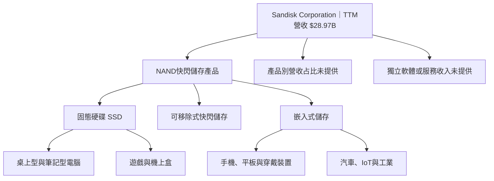
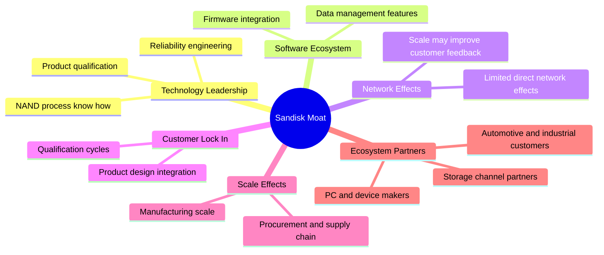
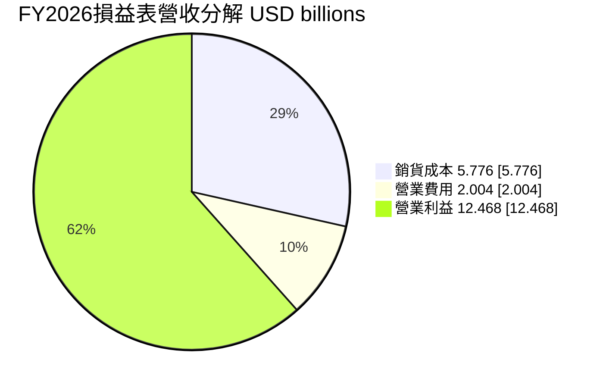
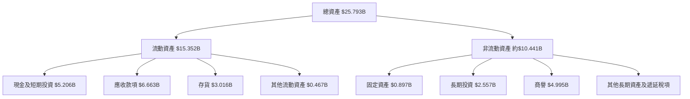
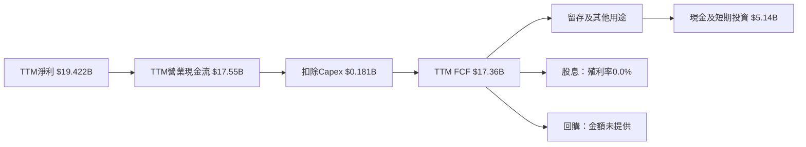
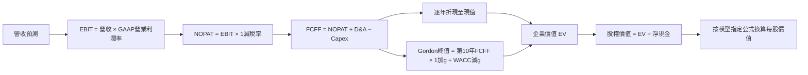
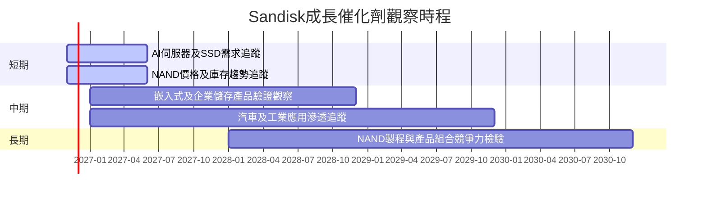
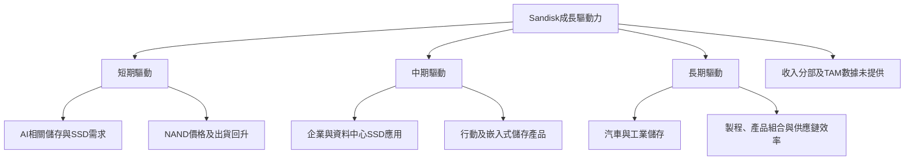
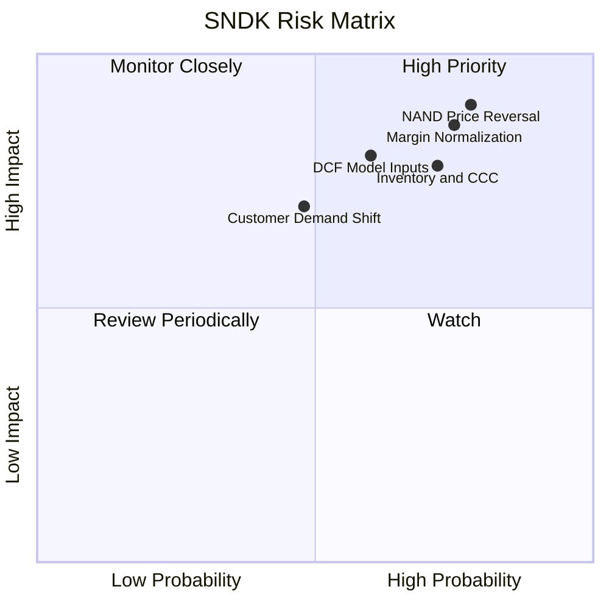
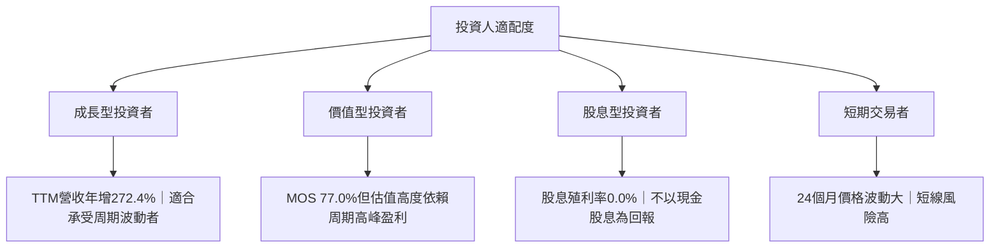

# SNDK 基本面深度分析報告
> **報告日期**：2026-11-28 ｜ **語言**：繁體中文 ｜ **數據來源**：SEC 申報資料 (XBRL)、Yahoo Finance、Finviz、StockAnalysis、Roic.ai ｜ **分析師**：CFA 級機構研究

> **資料口徑提醒**：本報告以最新完整交易日 **2026-11-25 收盤價 $73.61** 作為全篇現價。財務來源之間有若干不一致，例如營業利益率、股數、市值與部分估值倍數；對要求原值引用的欄位採用程式計算數字，其他指標則標示來源或差異，不將不同口徑混算。

## 目錄

| # | 章節 | 核心結論 |
|---|------|----------|
| 1 | 執行摘要 | 強烈買入；加權合理價值 $319.58；MOS +77.0% |
| 2 | 公司概覽與商業模式 | NAND 儲存產品受益於 AI 儲存需求，但市場份額與收入分部數據未提供 |
| 3 | 損益表深度分析 | TTM 營收 $28.97B、TTM 成長 272.4%；最新一季年增 377.9% |
| 4 | 資產負債表分析 | 淨現金 $5.14B；CCC 由 154 天升至 226 天，營運資金壓力增加 |
| 5 | 現金流量深度分析 | TTM FCF $17.36B、FCF Yield 17.87%；但周期高峰現金流未必可持續 |
| 6 | 獲利能力與資本效率 | ROIC 141.2% 高於 WACC 9.98%，惟峰值獲利及投入資本口徑須審慎解讀 |
| 7 | 相對估值分析 | 同業倍數與公司自身歷史資料顯示估值口徑分歧，周期性風險高 |
| 8 | DCF 內在價值評估 | DCF 基準 $521.12；加權合理價值 $319.58；模型對終值與假設高度敏感 |
| 9 | 成長催化劑 | AI 相關儲存需求是近期催化劑；TAM 與市場份額數據未提供 |
| 10 | 風險矩陣 | NAND 供需周期、利潤率回落與營運資金占用為前三大風險 |
| 11 | 投資建議 | 按 MOS 規則為強烈買入；以季度利潤率、庫存、現金轉換作主要監控 |

## 1. 執行摘要

TTM 營收為 **$28.97B**，較前一 TTM 成長 **272.4%**，最新一季營收年增 **377.9%**；TTM 營業利益率 **72.5%**、FCF **$17.36B**，顯示獲利與現金流處於高峰水準。ROIC **141.2%** 高於 WACC **9.98%**，但 Piotroski F-Score 為 **5/8**、現金轉換週期由 **154 天延長至 226 天**，反映周期性擴張同時伴隨營運資金風險。估值方面，DCF 基準每股價值為 **$521.12**，而按估值方法固定權重得出的加權合理價值為 **$319.58**；以現價 **$73.61** 計算，MOS 為 **+77.0%**。規則 20 依此為 **強烈買入**，未作質化調整；但上述估值需以模型假設及周期性獲利可持續性為前提。

### 1.0 一頁式投資儀表板

| 項目 | 內容 |
|------|------|
| **投資論點（3 句）** | ① TTM 營收 $28.97B、年增 272.4%，顯示儲存需求與價格／產品組合處於急速上行階段。② TTM FCF $17.36B、FCF Yield 17.87%，已形成顯著現金流。③ 加權合理價值 $319.58 高於 2026-11-25 收盤價 $73.61，但 DCF 對周期回落與終值假設敏感。 |
| **綜合評分** | **6.8/10**（引用 1.1；六項算術平均） |
| **財務健康** | 🟡 淨現金 $5.14B、流動比率 2.58；但 CCC 226 天，較一年前增加 72 天。 |
| **ROIC vs WACC** | **141.2% vs 9.98%**；表面上創造價值，惟 ROIC 可能受周期高峰及投入資本分母偏低影響。 |
| **FCF 趨勢** | FY2023 至 FY2026 由負轉正；TTM FCF $17.36B，FCF Yield **17.87%**。 |
| **估值** | Forward P/E **2.38x** ｜ EV/EBITDA **4.345x** ｜ FCF Yield **17.87%**。 |
| **DCF 內在價值（基準）** | **$521.12** ｜相對 DCF 折價 **85.9%**（現價 ÷ DCF 基準值 − 1）。 |
| **安全邊際（MOS）** | **+77.0%**＝($319.58 − $73.61) ÷ $319.58；🟢 按定義高於 25%。 |
| **預期報酬（基準情境 12M）** | DCF 基準情境相對現價 **+607.9%**；此為模型情境結果，不是保證或一般 12 個月預測。 |
| **關鍵風險（前二）** | NAND 價格周期逆轉；營運資金天數與庫存增加。 |
| **評級 + 信心度** | 🟢 **強烈買入** ｜信心：中低；評級由 MOS 門檻決定，模型與周期不確定性限制信心。 |

### 1.1 綜合評分卡（全報告唯一）

| 維度 | 評分（1–10） | 主要依據（引用數字與其來源章節） |
|------|--------------|----------------------------------|
| 成長性 | 9.0 | TTM 營收年增 272.4%、最新一季年增 377.9%（第 3 章）；但高基期可能令增速回落。 |
| 獲利能力 | 9.0 | TTM 營業利益率 72.5%、ROIC 141.2% 對比 WACC 9.98%（第 6 章）；需考慮周期高點。 |
| 財務健康 | 7.0 | 淨現金 $5.14B、流動比率 2.58（第 4 章）；CCC 226 天，且 F-Score 5/8。 |
| 估值 | 7.5 | MOS +77.0%；不過估值取決於高利潤率能否延續，且同業倍數與公司來源數據有口徑差異。 |
| 護城河 | 5.0 | NAND 技術、產品驗證及供應鏈規模有利，但市場份額、定價持久性及分部數據未提供（第 2 章）。 |
| 管理層與資本配置 | 3.5 | FY2026 SBC $232M；流通股數未減少測試未通過，股利殖利率為 0%，回購資料未提供。 |
| **綜合評分** | **6.8** | 六項算術平均：(9.0 + 9.0 + 7.0 + 7.5 + 5.0 + 3.5) ÷ 6 = 6.83，四捨五入為 6.8。 |

### 1.2 五大投資論點 + 三大核心風險

| 類型 | 項目 | 具體依據 | 信心度 |
|------|------|----------|--------|
| 🟢 **投資論點①** | 收入及需求快速擴張 | TTM 營收 $28.97B、年增 272.4%；最新一季年增 377.9%。反映收入基礎迅速擴大，但不可直接外推為長期增速。 | 🟢 高 |
| 🟢 **投資論點②** | 現金流轉強 | TTM OCF $17.55B、Capex $181M，依規定口徑 FCF $17.36B；可支持投資與資產負債表修復。 | 🟢 高 |
| 🟢 **投資論點③** | 淨現金提供緩衝 | 現金及短期投資 $5.14B，程式計算淨現金 $5.14B；總債務在該計算區塊為 N/A，不得反推。 | 🟢 中 |
| 🟢 **投資論點④** | 高峰期營業槓桿 | TTM 營業利益率 72.5%，最新一季 79.6%；收入提升能快速轉為營業利益，但有周期反轉風險。 | 🟡 中 |
| 🟢 **投資論點⑤** | 相對估值框架顯示折價 | 加權合理價值 $319.58 對比現價 $73.61，MOS +77.0%；估值方法包含 DCF、同業倍數與分析師共識。 | 🟡 中 |
| 🟡 **風險①** | NAND 供需與價格周期 | FY2024、FY2025 分別錄得淨損失 $672M、$1.64B；盈利曾大幅擺動，現期利潤率不能視為穩態。 | 🔴 高衝擊 |
| 🔴 **風險②** | 營運資金占用加速 | CCC 由 154 天升至 226 天；DIO 由 124 天升至 190 天，可能反映庫存增加或周轉放慢。 | 🔴 高衝擊 |
| 🟡 **風險③** | DCF 模型與來源數據不一致 | 模型 DCF $521.12，股數、現價與市值的計算口徑並非一般股份數除法；終值占 EV 58.2%。 | 🔴 高衝擊 |

### 1.3 快速統計卡片

| 指標 | 公司實際值（期間） | 同業中位數 | 狀態 |
|------|--------------------|------------|------|
| 營收成長（TTM） | **272.4%** | — | 🟢 |
| 營收成長（最新一季年增） | **377.9%** | **327.9%** | 🟢 |
| 毛利率（TTM） | **80.0%** | **77.4%** | 🟢 |
| 營業利益率（TTM） | **72.5%** | — | 🟢 |
| ROIC（TTM） | **141.2%** | — | 🟢 |
| Forward P/E | **2.3786x** | **3.2x** | 🟢 |
| FCF Yield（TTM） | **17.87%** | — | 🟢 |
| Piotroski F-Score | **5 / 8** | — | 🟡 |

> 同業中位數依 WDC、MU、SKHY 的 Peer multiples 計算；Forward P/E 中位數為 3.2x。SKHY 的 P/S、EV/EBITDA 因混合幣別未提供，未納入相關比較。

### 1.4 投資結論

```text
╔══════════════════════════════════════════════════════════════════╗
║                    📊 投資結論摘要                               ║
╠══════════════════════════════════════════════════════════════════╣
║  評級：強烈買入（MOS +77.0%，ROIC 141.2% > WACC 9.98%）          ║
║  價格（2026-11-25 收盤）：$73.61                                 ║
║  DCF 內在價值（基準）：$521.12（現價折價 85.9%）                ║
║  安全邊際 MOS：+77.0%（以加權合理價值 $319.58 為分母）          ║
║  加權合理價值（8.8）：$319.58                                    ║
║  DCF 情境價值：                                                   ║
║    悲觀情境：$221.09（+200.4%）                                  ║
║    基準情境：$521.12（+607.9%）                                  ║
║    樂觀情境：$1,164.19（+1,481.6%）                              ║
║  綜合評分：6.8/10（引用 1.1）                                    ║
║  適合投資人：可承受半導體周期波動、願意分批建倉的成長型投資人    ║
╚══════════════════════════════════════════════════════════════════╝
```

## 2. 公司概覽與商業模式

### 2.1 業務結構與收入來源

Sandisk Corporation 開發、製造及銷售以 NAND 快閃記憶體為核心的儲存裝置及解決方案，涵蓋 SSD、可移除式快閃儲存，以及嵌入式儲存產品，應用於個人電腦、遊戲、行動裝置、汽車、IoT 與工業市場。財務資料列示 TTM 營收 **$28.97B**，但未提供各產品線營收與占比，因此不將產品線比例臆測為收入分部。



### 2.2 市場份額

市場份額數據未提供，無法可靠繪製份額圖或計算滲透率。可觀察的相對規模是 Sandisk TTM 營收 **$28.97B**、最新一季年增 **377.9%**；同業最新一季年增率分別為 WDC **55.5%**、MU **379.3%**、SKHY **327.9%**。不同公司產品組合不同，營收增長比較不等同於 NAND 市場份額變化。

### 2.3 競爭護城河分析



護城河不宜只從當期毛利率推論。NAND 儲存產品具有製程、品質驗證、韌體整合及客戶認證門檻，但商品化與周期定價仍強，且提供的資料未量化研發份額、專利優勢、客戶留存率或市占率。

### 2.4 護城河強度

| 護城河項目 | 強度（強／中／弱） | 證據（引用數字或事實） | 會削弱它的情況 |
|------------|--------------------|------------------------|----------------|
| 技術與產品工程 | 中 | 公司以 NAND 技術開發 SSD、嵌入式儲存；FY2026 研發費用 $1.33B。 | 製程落後、良率下降或競品性能／成本更佳。 |
| 軟體生態系統 | 弱至中 | 產品含韌體與裝置整合，但軟體／服務營收未提供。 | 標準化產品令韌體差異難以轉化為定價。 |
| 網路效應 | 弱 | 儲存產品的直接網路效應有限，未提供相關指標。 | 客戶多供應商策略及規格標準化。 |
| 客戶鎖定 | 中 | 汽車、工業與嵌入式產品需客戶驗證，但客戶留存率未提供。 | 客戶重新設計產品或轉換供應商。 |
| 規模效應 | 中 | TTM 營收 $28.97B，FY2026 營收 $20.25B；規模可能有助供應鏈與製造效率。 | NAND 價格下行抵消規模成本優勢。 |
| 生態夥伴 | 中 | 涵蓋 PC、行動、汽車、IoT、工業等應用；各類收入占比未提供。 | 終端需求轉弱或客戶集中風險上升。 |

1.1「護城河」評分為 **5.0/10**：工程與驗證能力提供一定進入障礙，但市場份額、客戶鎖定與服務收入等可驗證的長期差異化數據不足。

## 3. 損益表深度分析

### 3.1 年度收入成長趨勢（近4年）

年度收入以 StockAnalysis／年度財務資料為準：FY2023 $6.086B、FY2024 $6.663B、FY2025 $7.355B、FY2026 $20.248B。FY2023 相較 FY2022 的 $9.754B 下跌 37.6%，FY2026 則出現急速反彈。

```text
╔══════════════════════════════════════════════════════════════════╗
║               Sandisk 年度收入趨勢（FY2023-FY2026）              ║
╠══════════════════════════════════════════════════════════════════╣
║  FY2023  $6.086B  ██████░░░░░░░░░░░░░░░░░░░  YoY: -37.6% 🔴   ║
║  FY2024  $6.663B  ███████░░░░░░░░░░░░░░░░░░  YoY: +9.5%  🟡   ║
║  FY2025  $7.355B  ████████░░░░░░░░░░░░░░░░░  YoY: +10.4% 🟡   ║
║  FY2026  $20.248B █████████████████████████  YoY: +175.3% 🟢  ║
║                                                                  ║
║  FY2023-FY2026 收入 CAGR：(20.248 ÷ 6.086)^(1/3) − 1 = 49.3%   ║
╚══════════════════════════════════════════════════════════════════╝
```

FY2026 營收年增 **175.3%**，遠高於前兩年的約 10% 增長，呈現 NAND 市場從低谷反彈、價格及出貨／產品組合快速改善的周期特徵。三年 CAGR **49.3%** 是包含低基期反彈的歷史結果，不適合直接當作長期成長預測。

### 3.2 季度收入趨勢分析

以 StockAnalysis 季度資料列出最新四季；最新一季年增率按規定使用單季數字。

| 財季 | 營收 | QoQ | YoY | 備註 |
|------|------|-----|-----|------|
| FY2026 Q2（2026-01-02） | $3.025B | — | +61.25% | 單季年增率。 |
| FY2026 Q3（2026-04-03） | $5.950B | +96.7% | +251.03% | 相較前季營收大幅增加，顯示周期復甦加速。 |
| FY2026 Q4（2026-07-03） | $8.965B | +50.7% | +371.59% | 增長延續，但季增速度已較前季放緩。 |
| FY2027 Q1（2026-10-02） | $11.031B | +23.0% | +377.95% | QoQ 仍增長，最新一季 YoY 依 VERIFIED FIGURES 為 377.9%。 |

QoQ 計算例：FY2027 Q1 QoQ = ($11.031B ÷ $8.965B) − 1 = **23.0%**。年增率大於季增率，部分來自前一年低基期；若供給擴張或價格下跌，YoY 高增長未必能持續。

### 3.3 利潤率演變分析

| 利潤率指標 | FY2023 | FY2024 | FY2025 | FY2026 | 趨勢 | 評估 |
|------------|--------|--------|--------|--------|------|------|
| **毛利率** | 7.1% | 16.1% | 30.1% | 71.5% | ↑ FY2026 急升 | 🟢 |
| **營業利益率** | -21.3% | -6.7% | 6.9% | 61.6% | ↑ 由虧轉盈 | 🟢 |
| **淨利率** | -35.2% | -10.1% | -22.3% | 56.4% | ↑ FY2025 仍受虧損影響 | 🟡 |

表中 FY2023–FY2026 以年度損益表金額計算；最新 TTM 營業利益率採用指定值 **72.5%**，最新一季營業利益率採用指定值 **79.6%**。其他市場資料欄位列示過 72.7%，口徑存在差異，因此不取代指定值。

**利潤率演變深度解析：** FY2026 毛利率約 71.5%，明顯高於 FY2025 的約 30.1%。營收由 $7.355B 升至 $20.248B，營業利益由 $507M 升至 $12.468B，表示收入增量在高景氣期具有顯著營業槓桿。主要可能來自 NAND 價格、出貨與產品組合改善；然而資料未提供平均售價、位元出貨量或單位成本，不能將利潤率擴張精確拆分。當周期轉弱，固定成本與價格下降可能反向放大利潤率收縮。

### 3.4 費用結構分析

以下使用 FY2026 年度數據：營收 $20.248B、銷貨成本 $5.776B（營收 − 毛利）、營業費用 $2.004B（毛利 − 營業利益）、營業利益 $12.468B。這是損益表口徑的拆分，不等同現金費用結構。



```text
╔══════════════════════════════════════════════════════════════════╗
║                   FY2026 營收分解（美元）                        ║
╠══════════════════════════════════════════════════════════════════╣
║  營收 $20.248B     █████████████████████████                    ║
║  ├─ 銷貨成本 $5.776B       ███████                              ║
║  ├─ 營業費用 $2.004B       ██                                   ║
║  └─ 營業利益 $12.468B      ███████████████                      ║
╚══════════════════════════════════════════════════════════════════╝
```

### 3.5 季度 EPS 趨勢與盈餘品質（Quality of Earnings）

| 盈餘品質項目 | 數值／佔比 | 評估 |
|--------------|-----------|------|
| 股權薪酬 SBC / 營收 | 近四個列示季度 SBC 合計 $270M ÷ TTM 營收 $28.97B = **0.93%** | 🟡 比重不高，但仍稀釋股東；Piotroski 的稀釋股數測試未通過。 |
| SBC / 營業現金流 | $270M ÷ $17.55B = **1.54%** | 🟢 對現金流量不大；SBC 是非現金薪酬，不代表無股東成本。 |
| FCF / 淨利（現金轉換率） | $17.36B ÷ TTM 淨利 $19.422B = **89.4%** | 🟡 現金轉換尚可，但未達淨利，且季度營運資金可能影響現金流。 |
| 一次性／非經常性損益 | N/A（未提供可分辨的一次性損益明細） | 無法判斷本期盈餘受一次性收益或費用影響程度。 |
| 有效稅率異常 | **12.2%**（最新年度有效稅率） | 🟡 低於許多成熟企業常用稅率假設；DCF 使用此數值，但未提供稅務調節表。 |
| 資本化支出 vs 費用化 | TTM Capex $181M；資本化開發成本明細 N/A | Capex/營收約 0.6%，但無法據此判斷所有研發或成本是否恰當費用化。 |

EPS 歷史資料列示 FY2027 Q1 EPS **$6.58**、FY2026 Q4 **$5.50**、Q3 **$2.88**、Q2 **$0.64**。近四季 EPS 估值／實際值欄均為 NaN，因此**無法核實超預期或不及預期**，不能以空缺數據下結論。最新季同比 EPS 成長率資料列示 **6909.6%**，主要應理解為低基期反彈，而非可持續的每股盈餘增速。

**盈餘品質結論：** TTM 獲利有現金流支持，但 FCF/淨利 89.4%、應計品質測試未通過、CCC 拉長，故 GAAP 盈餘不能完全等同可持續自由現金流。FY2026 SBC 為 $232M，約占 FY2026 營收 $20.248B 的 **1.15%**；金額不至於主導估值，但股數稀釋須持續監察。對估值最重要的不是單季 EPS，而是高毛利率能否跨周期維持。

## 4. 資產負債表分析

### 4.1 資產結構分解

最新季度 TTM 資產負債表列示總資產 **$25.793B**、流動資產 **$15.352B**；非流動資產按差額為 **$10.441B**。細項依 StockAnalysis 列示，因四捨五入可能有尾差。



### 4.2 流動性與營運資金分析

| 指標 | 最新 TTM | 一年前 TTM | 變化 | 解讀 |
|------|----------|------------|------|------|
| 流動比率 | 2.58（市場資料） | N/A | N/A | 流動資產高於流動負債；年度資產負債表口徑顯示流動資產 $12.78B、流動負債 $5.58B。 |
| DSO 應收帳款天數 | 83 天 | 56 天 | +27 天 | 收款週期延長；收入快速擴張可能推高應收款，但需核實帳齡與客戶付款條件。 |
| DIO 存貨天數 | 190 天 | 124 天 | +66 天 | 庫存持有時間增加，可能是供應準備，也可能是需求或出貨轉慢。 |
| DPO 應付帳款天數 | 46 天 | 26 天 | +20 天 | 對供應商付款延後，部分緩衝現金需求；無法單獨證明議價能力上升。 |
| CCC 現金轉換週期 | 226 天 | 154 天 | +72 天 | 應收與存貨增加超過應付帳款延長的抵銷效果，需注意資金占用與存貨減值風險。 |

營運資金天數照錄 QUALITY FIGURES。收入高速增長時，應收與存貨的絕對金額上升並不必然代表惡化，但 DIO 上升 66 天、CCC 增加 72 天已構成需追蹤的警訊。

### 4.3 債務結構分析

```text
╔══════════════════════════════════════════════════════════════════╗
║                   Sandisk 債務健康診斷                           ║
╠══════════════════════════════════════════════════════════════════╣
║  總債務（程式計算口徑）：N/A                                      ║
║  現金及短期投資：$5.14B                                            ║
║  淨現金（指定口徑）：$5.14B  🟢                                  ║
║  流動比率：2.58x                🟢                                ║
║  Quick Ratio：1.994x（市場資料）🟢                                ║
║  Debt/EBITDA：N/A（缺少同一口徑債務輸入）                         ║
║  利息保障倍數：N/A（缺少可核實利息費用與債務口徑）                ║
╚══════════════════════════════════════════════════════════════════╝
```

年度資產負債表另列 FY2026 總債務 **$177M**，市場資料另列 $201M；與程式計算區塊的總債務 N/A 口徑不同。按規則不以其他來源補算或替換淨現金欄位。整體方向是低帳面債務、現金餘裕較大，但應先確認租賃負債、短期投資及債務口徑，再解讀精確槓桿倍數。

### 4.4 股東權益趨勢

```text
╔══════════════════════════════════════════════════════════════════╗
║                  Sandisk 股東權益年度變化                        ║
╠══════════════════════════════════════════════════════════════════╣
║  FY2024  $11.08B  ██████████████░░░░░░░░░░░░░                    ║
║  FY2025   $9.22B  ████████████░░░░░░░░░░░░░░░                    ║
║  FY2026  $15.74B  ████████████████████░░░░░░                     ║
╚══════════════════════════════════════════════════════════════════╝
```

FY2025 權益由 $11.08B 降至 $9.22B，FY2026 回升至 $15.74B；獲利轉正與現金累積可能是回升來源。另有股數資料顯示稀釋股數測試未通過，故每股價值仍需關注股權薪酬與股份變動。

## 5. 現金流量深度分析

### 5.1 現金流量瀑布圖

近四季度資料的股息、回購與期間淨現金變化明細未完整提供，因此圖中不填造數字；資本配置項目僅顯示已知項目。



### 5.2 FCF 轉換率趨勢

| 財年 | 淨利 | FCF | FCF／淨利 | 解讀 |
|------|------|-----|-----------|------|
| FY2023 | -$2.143B | -$0.932B | 比率不具解讀性 | 虧損期間分子分母均為負，百分比不代表正常轉換效率。 |
| FY2024 | -$0.672B | -$0.475B | 比率不具解讀性 | 仍在虧損，現金消耗低於淨損失。 |
| FY2025 | -$1.641B | -$0.120B | 比率不具解讀性 | FCF 接近損益兩平，可能受營運資金或非現金項目影響。 |
| FY2026 | $11.43B | $11.49B | 約 100.5% | 年度 FCF 略高於淨利；Capex 低，但需確認周期高峰下的可持續性。 |
| TTM 至 2026-10-02 | $19.422B | $17.36B | 89.4% | 現金流支持獲利，但仍低於淨利。 |

FY2026 FCF/淨利 = $11.49B ÷ $11.43B = **100.5%**。TTM 比率採用 TTM 淨利與指定 FCF 數字，兩者期間一致。

### 5.3 自由現金流趨勢

```text
╔══════════════════════════════════════════════════════════════════╗
║                 自由現金流：歷史實際與最新 TTM                   ║
╠══════════════════════════════════════════════════════════════════╣
║  FY2023  -$0.932B  ◀░░░░░░░░░░░░░░░░░░░░░░  FCF為負             ║
║  FY2024  -$0.475B  ◀░░░░░░░░░░░░░░░░░░░░░░  FCF為負             ║
║  FY2025  -$0.120B  ◀░░░░░░░░░░░░░░░░░░░░░  接近損益兩平       ║
║  FY2026  $11.49B   ████████████████████░░░░  FCF轉正             ║
║  TTM     $17.36B   █████████████████████████ FCF Yield 17.87%   ║
╚══════════════════════════════════════════════════════════════════╝
```

TTM FCF 必須採用營業現金流減資本支出的指定口徑：**$17.55B − $0.181B = $17.36B**（依已提供數值四捨五入）。極低的 TTM Capex 佔營收比例約 **0.6%**，使目前 FCF 受益，但若產能、設備或維護投資回升，現金流可能下降。

### 5.4 資本配置評估

資本配置的股息、回購與投資分項金額資料不完整，不能畫比例圓餅圖。可核實的是 FY2026 Capex **$177M**、SBC **$232M**，TTM Capex **$181M**、股息殖利率 **0.0%**；回購金額未提供。

| 項目 | 可核實數據 | 評估 |
|------|-----------|------|
| 資本支出 | FY2026 $177M；TTM $181M | 相對當期營收很低；需留意投資週期回升後的資本需求。 |
| 股息 | 殖利率 0.0%；派息率 0.0% | 未以股息回饋股東，符合高周期企業保留資金的做法。 |
| 回購 | N/A | 資料未提供，不能判斷回購是否抵銷 SBC 稀釋。 |
| SBC | FY2026 $232M | 金額約占該年營收 1.15%；須與股數變化一併評估。 |
| 現金累積 | 現金及短期投資 $5.14B | 提供周期下行緩衝，但資金實際用途未完整列示。 |

## 6. 獲利能力與資本效率

### 6.1 ROE／ROA／ROIC 趨勢

| 指標 | 最新 TTM | 歷史比較 | 評估 |
|------|----------|----------|------|
| ROE | **107.1%**（QUALITY FIGURES） | FY2026 淨利 $11.43B，FY2025 至 FY2023 為淨損 | 當前盈利高，但歷史波動顯示周期性強。 |
| ROA | **68.3%**（市場資料） | Piotroski 測試顯示 ROA 高於一年前 | 高峰獲利推升回報，不能視作穩定年化水準。 |
| ROIC | **141.2%**（程式計算） | 歷史可比較序列未提供 | 高於資本成本很多，但分母與高峰 EBIT 令此值可能失真。 |

行業平均數據未提供，不列同業均值欄。QUALITY FIGURES 的 ROE **107.1%** 與其他市場資料欄列示 ROE **141.2%** 不一致；本節採用指定杜邦數據 107.1%，ROIC 則採用指定值 141.2%。

### 6.2 ROIC vs WACC 分析（核心價值創造判斷）

```text
╔══════════════════════════════════════════════════════════════════╗
║                ROIC vs WACC 深度分析                            ║
╠══════════════════════════════════════════════════════════════════╣
║  WACC（指定成本資本數據）：9.98%                                 ║
║  ├── 無風險利率（10Y美債）：4.94%                                 ║
║  ├── ERP：5.00%                                                   ║
║  ├── 原始 Beta：N/A；採用調整後 Beta：1.00（缺原始值，假設）      ║
║  ├── Ke = 4.94% + 1.00 × 5.00% = 9.94%                            ║
║  ├── 稅前債務成本：36.32%；稅後約 31.89%                          ║
║  ├── 股權／債務權重：99.8%／0.2%                                  ║
║  └── WACC：9.98%                                                  ║
║                                                                  ║
║  ROIC（TTM）：141.2%                                              ║
║  ├── EVA 利差 = 141.2% − 9.98% = +131.22 個百分點                ║
║  ├── ROIC／WACC = 141.2% ÷ 9.98% = 14.15 倍                     ║
║  └── 按當期輸入，帳面上高於資本成本，創造經濟價值                ║
╚══════════════════════════════════════════════════════════════════╝
```

指定成本資本區塊中的 WACC **9.98%** 為本節及 DCF 折現率。原始 Beta 為 N/A，調整後 Beta **1.00** 是假設；無風險利率日期未提供。稅前債務成本 36.32% 與低債務權重同時存在，因此對 WACC 影響有限，但債務成本估算可能受低債務餘額或利息口徑影響。

ROIC 141.2% 減 WACC 9.98% 得 **+131.22 個百分點**，在當期數據上代表價值創造。然而該 ROIC 以高峰期稅後營業利益除以權益、債務及現金調整後投入資本，當現金抵減投入資本而營業利益處於高峰，分子／分母比例會顯著上升。故此結果應視為高景氣期截面，不應直接外推為長期 ROIC。

### 6.3 杜邦三因素分解

| 因素 | 數值（TTM） | 解讀 |
|------|-------------|------|
| 淨利率 | 67.0% | 高淨利率是 ROE 超過 100% 的主要來源，受周期高峰盈利影響。 |
| 資產週轉率 | 1.12 | 資產每年產生約 1.12 倍收入，規模擴張期間較有利。 |
| 權益乘數 | 1.42 | 財務槓桿約 1.42 倍，不是 ROE 高企的主要驅動。 |
| **ROE** | **107.1%** | 67.0% × 1.12 × 1.42 = 約 106.5%，與報表 107.1% 的差異來自四捨五入及輸入精度。 |

以上數字依品質指標原值照錄，不另重算或調整。結構上 ROE 主要由淨利率驅動，而非高槓桿。

### 6.4 財務體質：Piotroski F-Score

Piotroski F-Score：**5 / 8**。總測試列有 9 項，但一項因缺少輸入無法判定，因此可判定分母為 8。

| 測試 | 結果 | 解讀 |
|------|------|------|
| ROA > 0 | ✅ 通過 | 當期資產回報為正。 |
| 營業現金流 > 0 | ✅ 通過 | TTM OCF $17.55B，具正現金產生能力。 |
| ROA 高於一年前 | ✅ 通過 | 獲利由低谷反彈。 |
| 營業現金流 > 淨利（應計品質） | ❌ 未通過 | TTM OCF $17.55B 低於 TTM 淨利 $19.422B，應收與存貨占用可能是因素之一。 |
| 長期負債／總資產低於一年前 | — 無法判定 | 缺少測試所需資料，不補值。 |
| 流動比率高於一年前 | ❌ 未通過 | 流動性比率沒有同比改善。 |
| 稀釋股數未增加 | ❌ 未通過 | 股數稀釋未被抵銷，需追蹤 SBC 與回購。 |
| 毛利率高於一年前 | ✅ 通過 | 毛利率改善符合景氣回升。 |
| 資產週轉率高於一年前 | ✅ 通過 | 周轉效率提升。 |

5/8 不是「弱勢公司」的直接證明，但反映盈利改善未同步轉化為所有資產負債表質量指標的改善；尤其現金轉換、流動比率與稀釋股數值得留意。

## 7. 相對估值分析

### 7.1 同業估值比較表格

本公司倍數按市場資料欄；同業倍數按 Peer multiples 原值。估值口徑及資料來源不同，適合比較相對位置，不宜視為完全同質的可比公司估值。

| 估值指標 | **SNDK** | **WDC** | **MU** | **SKHY** | 本公司評估 |
|----------|----------|---------|---------|---------|-----------|
| **Trailing P/E** | 5.4578x | 9.6x | 8.1x | 6.2x | 🟢 低於所列同業；盈利周期位置可能不同。 |
| **Forward P/E** | 2.3786x | 7.3x | 3.2x | 3.0x | 🟢 最低；遠期盈利預估可能包含高峰假設。 |
| **P/S Ratio** | 3.3539x | 7.6x | 5.5x | N/A | 🟢 低於 WDC、MU；SKHY 混合幣別無法比較。 |
| **EV / EBITDA** | 4.345x | 17.3x | 6.4x | N/A | 🟢 低於所列 WDC、MU；周期高 EBITDA 會壓低倍數。 |
| **最新一季營收年增** | 377.9% | 55.5% | 379.3% | 327.9% | 🟡 高於 WDC，接近 MU、略高於 SKHY。 |
| **TTM 毛利率** | 80.0% | 52.6% | 80.7% | 77.4% | 🟢 高於 WDC、略低於 MU。 |

### 7.2 歷史估值區間分析

歷史估值區塊提供的是 **P/S**，不是 P/E；因此依實際可用指標呈現，不將其冒稱為 P/E。

```text
╔══════════════════════════════════════════════════════════════════╗
║                SNDK 五年歷史 P/S 位置                            ║
╠══════════════════════════════════════════════════════════════════╣
║  五年範圍：0.1x ├────────────●───────────┤ 1.7x                 ║
║  五年中位數：0.6x               現值：0.4x                      ║
║  現值百分位：43%（程式計算）                                     ║
║  解讀：低於歷史中位數，但非歷史最低區間                          ║
╚══════════════════════════════════════════════════════════════════╝
```

需要注意，市場估值資料另列 P/S **3.353925x**，與五年歷史區塊所列現值 **0.4x** 明顯不一致。兩者不應混用；按指定歷史比較欄位，本節照錄 0.4x 與 43% 百分位，並將這個來源／計算口徑差異視為估值風險。

### 7.3 情境價值（Bear / Base / Bull）

以下情境及每股價值照錄 DCF MODEL。百分比以 2026-11-25 收盤價 $73.61 為基準。

| 情境 | 第 1 年營收成長 | 期末營業利潤率 | WACC | 每股價值 | 相對現價 | 機率 | 會發生的條件 |
|------|----------------|----------------|------|----------|----------|------|--------------|
| 🔴 悲觀 | 15.0% | 52.0% | 10.98% | $221.09 | +200.4% | 25% | AI 儲存需求仍在，但 NAND 供給增加、價格回落，使增速和成熟期利潤率低於基準。 |
| 🟡 基準 | 30.0% | 61.2% | 9.98% | $521.12 | +607.9% | 50% | 第一年的高增長延續，往後逐年降至第十年 3%，利潤率逐步回歸較低水準。 |
| 🟢 樂觀 | 45.0% | 67.3% | 8.98% | $1,164.19 | +1,481.6% | 25% | AI 儲存與企業 SSD 需求高於預期，供給紀律支持高利潤率，資本成本也較低。 |

各情境內部逐年營收、FCFF 與終值拆解未提供，不能自行重建不同情境模型；情境價值及其假設以已列模型結果為準。

### 7.4 相對估值隱含價格區間

```text
╔══════════════════════════════════════════════════════════════════╗
║             估值方法隱含每股價值（USD）                         ║
╠══════════════════════════════════════════════════════════════════╣
║  現價 $73.61 ── P/S $143.35 ── EV/EBITDA $193.23                ║
║            ── 分析師共識 $244.96 ── DCF 基準 $521.12            ║
╚══════════════════════════════════════════════════════════════════╝
```

| 方法 | 每股價值 | 相對現價 | 依據 |
|------|----------|----------|------|
| 同業 EV/EBITDA | $193.23 | +162.5% | WDC、MU 同業中位數 11.8x × TTM EBITDA，再加淨現金。 |
| 同業 P/S | $143.35 | +94.7% | WDC、MU 同業中位數 6.5x × TTM 營收。 |
| DCF（基準） | $521.12 | +607.9% | 10 年 FCFF、WACC 9.98%、永續成長率 3.0%。 |
| 分析師共識 | $244.96 | +232.8% | 24 位分析師平均目標價。 |

相對估值法仍比現價高，但與 DCF 差距大；這反映模型基準下的長期高利潤率，遠高於單純同業倍數所能支持的估值。

## 8. DCF 內在價值評估（Discounted Cash Flow）

> 本章模型數字依 DCF MODEL 原值照錄。由於模型只提供已計算結果，而非所有原始底層輸入，部分重算所需的中間值或模型維度未提供；遇此情形明確標示，不自行搭建另一套 DCF。

### 8.0 估值推理鏈（Thinking Logic：在算之前先想清楚）

**Step 1 — 價值來源與主導變數**

本模型將價值拆為 NAND 儲存產品帶來的既有現金流、AI 與企業 SSD 等需求延伸，以及高峰利潤率能否延續所形成的遠期現金流。財務資料未提供業務別營收占比，不能將「AI」另列為某個具體營收份額。模型主導變數是**營業利潤率與終值假設**：終值現值占企業價值 58.2%，而敏感性矩陣顯示 WACC、永續成長率會造成大幅價值變化。

**Step 2 — 模型選擇**

| 決策點 | 本報告採用 | 理由（含數字） | 曾考慮但否決 | 否決理由 |
|--------|-----------|----------------|--------------|----------|
| 現金流定義 | FCFF | 配合 WACC 折現，計算 EV；模型公式為 NOPAT + D&A − Capex。 | FCFE | 負債權重僅 0.2%，但仍依指定模型保留企業價值橋接。 |
| 預測期 N | 10 年 | DCF MODEL 固定採 10 年，營收成長由 30% 線性降至 3%。 | 5 年 | 與指定模型不符，且會改變終值起點。 |
| 終值方法 | Gordon Growth | 區塊提供永續成長率 3.0%，WACC 9.98%。 | 退出倍數作主模型 | 指定模型未提供退出倍數終值，不能自建或替換。 |
| EBIT 基礎 | GAAP | 模型明示 GAAP EBIT。 | 非 GAAP | 避免加回 SBC 後產生另一套輸入。 |

**Step 3 — 關鍵假設推導鏈**

- **營收成長**：錨點＝TTM 成長 272.4%、FY2026 年度成長 175.3%、最新一季年增 377.9% → 高基期與周期反彈降低持續性 → 模型採用第 1 年 30.0%，線性降至第 10 年 3.0% → 否決把 272.4% TTM 成長直接外推，因為它混有低基期與周期價格回升。
- **期末營業利潤率**：錨點＝TTM 72.5%、最新一季 79.6%；最近三個財年年度營業利益率由負轉為 FY2026 61.6% → 成熟期供需競爭及利潤率正常化 → 模型採用 72.5% 起始、逐步降至 61.2% → 否決期末仍維持 72.5% 以上，因周期價格優勢未必永續。
- **永續成長率 g**：錨點＝模型 3.0%，且低於長期成熟企業常用的低個位數假設；資料未提供公司長期管理層財測 → 模型採用 3.0%，低於 WACC 9.98% → 否決高於 3.0% 的永久成長假設，以免將周期性市場增長永久化。
- **預測期 N**：錨點＝指定模型 10 年 → 10 年逐步淡出成長率與利潤率，假設周期上行能延續並回歸成熟 → 採用 10 年 → 否決自行縮短或延長，因模型已固定年數且無中間重算數據。
- **Capex／營收**：錨點＝TTM Capex $181M、收入 $28.97B，約 0.6% → 模型維持 0.6%，避免超出現有資本強度的外推 → 採用模型逐年 0.6% → 否決用更高行業比例替換，因不可改動模型輸入；但本項可能偏樂觀。
- **EBIT 基礎與 SBC**：錨點＝GAAP EBIT 已含 SBC 費用 → 模型採 GAAP EBIT，不另扣 SBC，也不再增加稀釋股數 → 採用合法組合 (A) 的處理概念 → 否決「再扣 SBC」或「再計稀釋」，避免同一成本重複計入。
- **年稀釋率**：錨點＝模型註明固定股數、股數不再稀釋 → 採用 0% 額外稀釋 → 否決另加稀釋率，因與 GAAP EBIT 已含 SBC 的指定組合不相容。
- **終值方法**：錨點＝模型明確採 Gordon Growth，FCFF 終值占 EV 58.2% → 採用 Gordon Growth → 否決另以退出倍數取代；模型未提供該終值輸入。
- **WACC**：錨點＝指定成本資本數據 9.98% → 模型直接採用該折現率 → 否決自行估計第二個 WACC，以維持第 6.2 節一致。

有效稅率 **12.2%** 及 D&A／營收 **0.5%** 依模型指定值；營運資金未建模，沒有以假設數字補入。**最脆弱一環**是高峰營業利潤率與未建模營運資金能否維持；該假設若錯，價值方向偏高，悲觀情境仍為 $221.09，顯著低於基準 $521.12。

**Step 5 — 計算路徑圖**



### 8.1 模型假設總表（Model Inputs）

| 假設項目 | 採用值 | 依據／來源 | 敏感度 |
|----------|--------|-------------|--------|
| 預測期長度 **N** | 10 年 | DCF MODEL 指定；模型逐年列至 FY+10。 | 🟡 中 |
| 營收成長 | FY+1 30.0%，FY+10 3.0%，線性遞減 | FY+1 上限採用模型規定；TTM 成長 272.4% 不直接外推。 | 🔴 高 |
| 營業利潤率 | 72.5% → 61.2% | TTM 起點 72.5%；逐步淡出至模型採用的近三年財年中位水準。 | 🔴 高 |
| 有效稅率 | 12.2% | 最新年度有效稅率。 | 🟢 低 |
| Capex／營收 | FY+1 至 FY+10 約 0.6% | TTM Capex $181M ÷ 營收 $28.97B 約 0.6%；模型逐年採用。 | 🟡 中 |
| D&A／營收 | 0.5% | DCF MODEL 指定，依 TTM 水準維持。 | 🟢 低 |
| 營運資金變動 | 未建模 | 模型明示 Working capital is not modelled；非 0 的觀測值。 | 🟡 中 |
| EBIT 基礎 | GAAP EBIT | DCF MODEL 明示採 GAAP EBIT。 | 🟡 中 |
| SBC 處理 | GAAP 費用已納入；FCFF 不再扣 SBC | 符合模型組合 (A)；股數不再額外稀釋。 | 🟡 中 |
| 年稀釋率 | 0% 額外稀釋 | 模型註明固定股數、不進一步稀釋。 | 🟡 中 |
| 永續成長率 g | 3.0% | DCF MODEL 指定，低於 WACC 9.98%。 | 🔴 高 |
| 終值方法 | Gordon Growth | DCF MODEL 指定終值公式。 | 🔴 高 |
| WACC | 9.98% | 指定成本資本數據，與第 6.2 節同值。 | 🔴 高 |

FCFF 採 **FCFF = NOPAT + D&A − Capex**，模型未扣 ΔWC。**本模型採用 (A)：GAAP EBIT 已含 SBC 費用，不再另扣 SBC，且不另外增加股數稀釋；故 SBC 影響在模型中計入一次。**

### 8.2 折現率推導（WACC）

```text
╔══════════════════════════════════════════════════════════════════╗
║                    WACC 推導（折現率）                           ║
╠══════════════════════════════════════════════════════════════════╣
║  股權成本 Ke（CAPM）：                                           ║
║  ├── 無風險利率 Rf（10Y 美債）：      4.94%                      ║
║  ├── 市場風險溢酬 ERP：               5.00%                      ║
║  ├── Beta 原始值：N/A；調整後：        1.00（假設）               ║
║  ├── 規模／國別溢酬：                  0.00%（模型未採用）         ║
║  └── Ke = 4.94% + 1.00 × 5.00% = 9.94%                          ║
║                                                                  ║
║  債務成本：                                                       ║
║  ├── 稅前 Kd：                         36.32%                     ║
║  ├── 有效稅率：                        12.2%                      ║
║  └── 稅後 Kd = 36.32% × (1−12.2%) = 31.89%                       ║
║                                                                  ║
║  資本結構權重（指定）：股權 99.8%／債務 0.2%                     ║
║  └── WACC = 99.8% × 9.94% + 0.2% × 31.89% = 9.98%               ║
╚══════════════════════════════════════════════════════════════════╝
```

**逐步演算（WACC）：**

1. **Ke（CAPM）** = 4.94% + 1.00 × 5.00% + 0.00% = **9.94%**。
2. **稅前 Kd** = **36.32%**（依指定成本資本數據直接引用）。利息費用與平均計息負債明細未提供，故無法依利息費用／平均負債自行複算。
3. **稅後 Kd** = 36.32% × (1 − 12.2%) = 36.32% × 0.878 = **31.89%**。
4. **權重** = 股權 99.8%、債務 0.2%；兩者合計 **100.0%**。市值基礎股權金額與計息負債的完整重建明細未提供，採指定權重而不另行反推。
5. **WACC** = 99.8% × 9.94% + 0.2% × 31.89% = 9.96012% + 0.06378% = **10.0239%**；指定模型所採用 WACC 為 **9.98%**。因指定輸入的加權結果與區塊列示值相差約 0.04 個百分點，為遵守不得另算 WACC 的要求，DCF 及第 6.2 節一律採用指定 **9.98%**。

Rf 採用日期未提供；ERP 5.00% 為假設輸入，Beta 原始值 N/A、調整 Beta 1.00，模型未加規模／國別溢酬。上述來源缺漏限制了 WACC 的獨立驗證。

### 8.3 逐年自由現金流預測（基準情境）

金額單位為美元十億；折現因子保留三位小數。以下逐年表格及數值照錄 DCF MODEL。

| 年度 | FY+1 | FY+2 | FY+3 | FY+4 | FY+5 | FY+6 | FY+7 | FY+8 | FY+9 | FY+10 |
|------|------|------|------|------|------|------|------|------|------|-------|
| 營收 | 37.66 | 47.83 | 59.31 | 71.77 | 84.68 | 97.39 | 109.07 | 118.89 | 126.02 | 129.80 |
| 營收 YoY | 30.0% | 27.0% | 24.0% | 21.0% | 18.0% | 15.0% | 12.0% | 9.0% | 6.0% | 3.0% |
| 營業利潤率 | 72.5% | 71.2% | 70.0% | 68.7% | 67.5% | 66.2% | 64.9% | 63.7% | 62.4% | 61.2% |
| EBIT（GAAP） | 27.29 | 34.06 | 41.49 | 49.31 | 57.12 | 64.47 | 70.84 | 75.72 | 78.69 | 79.42 |
| − 稅 | (3.32) | (4.14) | (5.05) | (6.00) | (6.95) | (7.84) | (8.62) | (9.21) | (9.58) | (9.66) |
| = NOPAT | 23.97 | 29.92 | 36.44 | 43.31 | 50.17 | 56.62 | 62.22 | 66.51 | 69.11 | 69.76 |
| + D&A | 0.20 | 0.26 | 0.32 | 0.39 | 0.46 | 0.52 | 0.59 | 0.64 | 0.68 | 0.70 |
| − Capex | (0.24) | (0.30) | (0.37) | (0.44) | (0.52) | (0.59) | (0.66) | (0.71) | (0.75) | (0.77) |
| = FCFF | **23.94** | **29.88** | **36.40** | **43.25** | **50.11** | **56.56** | **62.15** | **66.44** | **69.04** | **69.69** |
| 折現因子 @9.98% | 0.909 | 0.827 | 0.752 | 0.683 | 0.621 | 0.565 | 0.514 | 0.467 | 0.425 | 0.386 |
| FCFF 現值 PV | **21.77** | **24.70** | **27.36** | **29.56** | **31.14** | **31.96** | **31.93** | **31.03** | **29.32** | **26.91** |

**預測期現值加總：**  
$21.77 + $24.70 + $27.36 + $29.56 + $31.14 + $31.96 + $31.93 + $31.03 + $29.32 + $26.91 = **$285.68B**。

**逐步演算（FY+1，依模型列示值）：**

1. **營收** = $28.97B × (1 + 30.0%) = **$37.66B**。
2. **EBIT** = 模型列示 $37.66B × 72.5% = **$27.29B**（以模型列示精度為準）。
3. **稅** = $27.29B × 12.2% = **$3.33B**；模型列示為 **$3.32B**，屬輸入未四捨五入前精度差異。
4. **NOPAT** = 模型列示 EBIT $27.29B − 模型稅 $3.32B = **$23.97B**。
5. **+ D&A** = 模型列示 **$0.20B**（模型比率 0.5%，未四捨五入底數未提供）。
6. **− Capex** = 模型列示 **$0.24B**。
7. **− ΔWC** = 未建模；模型未列此項。
8. **FCFF** = 模型列示 NOPAT $23.97B + D&A $0.20B − Capex $0.24B = **$23.93B**；模型 FCFF 為 **$23.94B**，差異來自未四捨五入底數。
9. **折現因子與 PV** = 模型因子 **0.909**；$23.94B × 0.909 = **$21.76B**，模型 PV 列示 **$21.77B**，差異為底層精度與顯示精度造成。

逐項 PV 加總可依顯示值得到 $285.68B；FY+1 中間值只提供兩位小數，因此無法從展示值完全還原程式未四捨五入的計算。這是模型稽核限制，不將顯示值的尾差偽裝成完全吻合。

**合理性自檢：**

- 預測 FCFF CAGR（FY+1 至 FY+10）＝($69.69 ÷ $23.94)^(1/9) − 1 ≈ **12.6%**；可比 FY2023–FY2026 歷史 FCF CAGR 不具經濟意義，因 FY2023 FCF 為負、FY2026 為正，無法以常規 CAGR 比較。
- FY+10 FCFF 利潤率＝$69.69B ÷ $129.80B＝**53.7%**，高於目前 TTM FCF 利潤率約 $17.36B ÷ $28.97B＝**59.9%**？更正：$17.36B ÷ $28.97B = **59.9%**，故預測期末 FCF 利潤率低於目前 TTM。模型未提供同業最佳 FCFF 利潤率，不能比較。
- 模型所有年度 FCFF 均為正；但營運資金未建模，若應收、存貨吸收現金，實際 FCFF 可能低於表列值。

```text
╔══════════════════════════════════════════════════════════════════╗
║            自由現金流：歷史實際 vs 模型預測                      ║
╠══════════════════════════════════════════════════════════════════╣
║  FY2023（實） -$0.932B  ◀░░░░░░░░░░░░░░░░░░░░░░                 ║
║  FY2024（實） -$0.475B  ◀░░░░░░░░░░░░░░░░░░░░░░                 ║
║  FY2025（實） -$0.120B  ◀░░░░░░░░░░░░░░░░░░░░░░                 ║
║  FY2026（實） $11.49B   ████████████░░░░░░░░░░░░                 ║
║  FY+1（預）   $23.94B   ███████████████████████                  ║
║  FY+10（預）  $69.69B   █████████████████████████                ║
╠══════════════════════════════════════════════════════════════════╣
║  預測由正 FCF 急速擴大；歷史 FCF CAGR 不適用，避免用虧損基期誤導 ║
╚══════════════════════════════════════════════════════════════════╝
```

### 8.4 終值計算（Terminal Value）

**適用性檢查：** WACC **9.98%** vs g **3.0%** → WACC > g？✅

| 方法 | 計算式 | 終值 TV | TV 現值 | 佔總 EV 比重 |
|------|--------|---------|---------|--------------|
| Gordon Growth | $69.69B × (1 + 3.0%) ÷ (9.98% − 3.0%) | $1,028.14B | $397.06B | 58.2% |
| 退出倍數法 | N/A（模型未提供 EBITDA FY+10 及退出倍數終值） | N/A | N/A | N/A |

**逐步演算：**

1. FY+N 的 FCFF = FY+10 FCFF **$69.69B**。
2. 分子 = $69.69B × (1 + 3.0%) = **$71.7807B**。
3. 分母 = 9.98% − 3.0% = **6.98%**；TV = $71.7807B ÷ 0.0698 = **$1,028.14B**（模型列示）。
4. PV(TV) = $1,028.14B × 0.386 = **$397.06B**（模型列示）。
5. 終值佔比 = $397.06B ÷ $682.75B = **58.2%**。

退出倍數法所需 FY+10 EBITDA 與退出倍數未列於 DCF MODEL，故不自行填值或建立第二種終值。

### 8.5 企業價值 → 每股內在價值（Bridge）

```text
╔══════════════════════════════════════════════════════════════════╗
║              企業價值 → 每股內在價值 橋接表                      ║
╠══════════════════════════════════════════════════════════════════╣
║  預測期 FCF 現值合計              +$285.68B                       ║
║  終值現值 PV(TV)                  +$397.06B                       ║
║  ─────────────────────────────────────────────                  ║
║  = 企業價值 EV                     $682.75B                       ║
║  + 淨現金                          +$5.14B                         ║
║  = 股權價值                        $687.88B（模型列示）            ║
║  每股換算                          依模型指定公式                  ║
║  ★ DCF 基準每股內在價值            $521.12                         ║
║    當前股價                        $73.61                          ║
║    折溢價                          -85.9%（折價）                  ║
╚══════════════════════════════════════════════════════════════════╝
```

**逐步演算：**

1. **EV** = $285.68B + $397.06B = **$682.74B**；模型列示 **$682.75B**，屬底層未四捨五入造成的 $0.01B 尾差。
2. **股權價值** = 模型列示 EV $682.75B + 淨現金 $5.14B = **$687.89B**；模型列示 **$687.88B**，同樣有 $0.01B 顯示精度差異。
3. **每股內在價值** = 模型指定公式：股權價值 × 價格 ÷ 市值 = **$521.12**。DCF MODEL 未以一般「股權價值 ÷ 稀釋股數」公式列示；其換算隱含分母與價格／市值比例。市場資料的股數 1.14B、價格 $73.61 與市值 $97.17B 也不能直接吻合，故不以其重建模型股數。
4. **折溢價** = $73.61 ÷ $521.12 − 1 = **−85.9%**。
5. **本節不計算 MOS**；MOS 僅在 8.8 以加權合理價值為分母計算。

### 8.6 敏感性分析（WACC × 永續成長率）

矩陣數值逐格照錄模型；括號內為依現價 $73.61 計算的上行空間，四捨五入至一位小數。

| g（列）／WACC（欄） | 7.98% | 8.98% | **9.98%（基準）** | 10.98% | 11.98% |
|-----------|------|------|------------------|-------|-------|
| **2.0%** | $662.14（+799.5%） | $558.29（+658.4%） | $480.87（+553.2%） | $421.04（+472.0%） | $373.47（+407.4%） |
| **2.5%** | $702.47（+854.3%） | $585.19（+695.0%） | $499.65（+578.7%） | $434.60（+490.4%） | $383.55（+421.0%） |
| **3.0%（基準）** | $750.91（+920.2%） | $616.59（+737.6%） | **$521.12（+607.9%）** | $449.87（+511.1%） | $394.74（+436.2%） |
| **3.5%** | $810.16（+1,000.6%） | $653.72（+788.0%） | $545.89（+641.6%） | $467.18（+534.6%） | $407.26（+453.3%） |
| **4.0%** | $884.28（+1,101.3%） | $698.30（+848.7%） | $574.82（+680.9%） | $486.96（+561.5%） | $421.34（+472.4%） |

**逐步演算限制：** 可選非基準格 WACC 8.98% > g 3.0% ✅；模型只提供該格每股價值 **$616.59**，沒有提供該格下預測期現金流現值、TV 及 EV 的完整重算中間值。依「不得自行另建模型」原則，不能補造這些分項；故無法在不違反數據來源規則下完整重建該格。

**三情境 DCF（模型輸出）**

| 情境 | 營收假設 | 期末營業利潤率 | g | WACC | 每股內在價值 | 相對現價 | 主觀機率 |
|------|----------|----------------|---|------|--------------|----------|----------|
| 🔴 悲觀 | FY+1 成長 15.0% | 52.0% | 模型未另列 | 10.98% | $221.09 | +200.4% | 25% |
| 🟡 基準 | FY+1 成長 30.0% | 61.2% | 3.0% | 9.98% | $521.12 | +607.9% | 50% |
| 🟢 樂觀 | FY+1 成長 45.0% | 67.3% | 模型未另列 | 8.98% | $1,164.19 | +1,481.6% | 25% |
| **機率加權** | — | — | — | — | **$606.88** | **+724.5%** | **100%** |

模型未提供悲觀、樂觀情境的每年營收、FCFF、終值中間數字，也未在情境列明各自 g；故不自行補造「FY+N 營收 → FCFF → TV」推導鏈。機率加權算式可複算：$221.09 × 25% + $521.12 × 50% + $1,164.19 × 25% = $55.2725 + $260.56 + $291.0475 = **$606.88**。

**敏感度結論：**

- g 由 2.0% 升至 3.0%、WACC 固定 9.98%：$480.87 → $521.12，增加 **$40.25／8.4%**。
- WACC 由 8.98% 升至 9.98%、g 固定 3.0%：$616.59 → $521.12，下降 **$95.47／15.5%**。
- 期末營業利潤率每 +1 個百分點的獨立敏感度數據未提供，不能在不重跑模型下計算。
- 現有矩陣顯示 WACC 變動 1 個百分點的價格影響大於 g 變動 1 個百分點；但在長期模型裡利潤率也可能主導，與 8.0 所述「利潤率與終值」主導變數部分一致。

### 8.7 反推 DCF（Reverse DCF：市場在預期什麼）

固定輸入應包含模型基準 WACC 9.98%、稅率 12.2%、Capex／營收約 0.6%、預測期 10 年、GAAP EBIT 及固定股數處理。營運資金未建模；股數以模型每股換算公式處理，並非獨立可核驗股數。

| 求解的變數（一次一個） | 其餘變數設定 | 市場隱含值 | 公司歷史實際 | 判斷 |
|------------------------|--------------|--------------|--------------|------|
| 年 1 營收成長 | 利潤率、g 等固定為基準值 | 在 −10% 至 100% 範圍無解 | TTM 成長 272.4%；FY2026 成長 175.3% | 無解；模型區間內無法以單一成長率解釋現價。 |
| 固定營業利潤率 | 其餘按基準 | 8.6% | TTM 72.5% | 模型反推的利潤率遠低於當期，顯示市場可由極低獲利假設仍得到現價；但模型基準價值與現價差距極大。 |
| 永續成長率 g | 營收成長及利潤率基準固定 | 未計算 | — | DCF MODEL 未提供，不能自行求解。 |
| 預測期長度 N | 其餘按基準 | 未計算 | — | DCF MODEL 未提供，不能延長／縮短模型再求解。 |

### 8.8 估值三角驗證與安全邊際

| 估值方法 | 隱含每股價值 | 上行空間（÷現價） | 權重 | 說明 |
|----------|--------------|-------------------|------|------|
| DCF（基準） | $521.12 | +607.9% | 40% | 10 年 FCFF、WACC 9.98%、g 3.0%。 |
| 同業 EV/EBITDA | $193.23 | +162.5% | 30% | WDC、MU 同業中位數 11.8x × TTM EBITDA，加淨現金。 |
| 同業 P/S | $143.35 | +94.7% | 20% | WDC、MU 同業中位數 6.5x × TTM 營收。 |
| 分析師共識目標價 | $244.96 | +232.8% | 10% | 24 位分析師平均目標價。 |
| **加權合理價值** | **$319.58** | **+334.2%** | **100%** | 公司類型為周期性；依固定方法權重加權。 |

**逐步演算：**  
$521.12 × 40% + $193.23 × 30% + $143.35 × 20% + $244.96 × 10%  
= $208.448 + $57.969 + $28.670 + $24.496  
= $319.583 ≈ **$319.58**。權重合計 40% + 30% + 20% + 10% = **100%**。方法均有計算，沒有方法因缺值被剔除。權重依公司類型「周期性」固定，不是本報告自行調整。

```text
╔══════════════════════════════════════════════════════════════════╗
║                  估值區間與安全邊際                              ║
╠══════════════════════════════════════════════════════════════════╣
║  $73.61 ─────── $221.09 ─────── [$319.58] ─────── $521.12       ║
║  現價            悲觀DCF          加權合理值       基準DCF         ║
║                                                                  ║
║  安全邊際 MOS = ($319.58 − $73.61) ÷ $319.58 = +77.0%          ║
║  上行空間 = ($319.58 − $73.61) ÷ $73.61 = +334.2%              ║
║  DCF 折溢價 = $73.61 ÷ $521.12 − 1 = -85.9%                     ║
║                                                                  ║
║  建議買入區間：$73.61 – $287.62                                  ║
║  （MOS至少10%對應股價上限：$319.58 × 90% = $287.62）            ║
║  合理持有區間：$287.62 – $319.58                                 ║
║  減碼考慮區間：高於 $319.58，並重新核實周期盈利與估值假設        ║
╚══════════════════════════════════════════════════════════════════╝
```

MOS 僅以加權合理價值 $319.58 為分母。買入區間上限依 MOS 至少 10% 推導，且高於現價，與強烈買入評級一致。

> 🔎 **程式複算（Python，依本節各項自動重算）**
>
> 加權合理價值 = $521.12 × 40% + $193.23 × 30% + $143.35 × 20% + $244.96 × 10% = **$319.58**（權重合計 100%）
>
> 以價格 $73.61 計：MOS = **+77.0%**，上行空間 = **+334.2%**
>
> ✅ 與本節所寫數值一致。

### 8.9 DCF 模型的局限與失效條件

- **終值依賴度：** PV(TV) 占 EV **58.2%**；仍有超過半數 EV 來自第 10 年後假設。即使終值占比低於 75%，估值仍明顯依賴長期利潤率與折現率。
- **最脆弱假設：** 其一，營業利潤率由 72.5% 緩降至 61.2%，若更快回落，價值將低於基準；悲觀情境值為 **$221.09**。其二，營運資金未建模，若 CCC 維持 226 天或繼續惡化，FCFF 可能低於模型值。
- **周期性失效情境：** 公司 FY2024、FY2025 曾錄得淨損，說明高峰期以單一穩態 DCF 估值可靠度有限。應同時參考同業 EV/EBITDA、P/S、不同周期情境及實際庫存與售價趨勢。
- **模型股數／橋接：** 每股公式按「股權價值 × 價格 ÷ 市值」計算，不是一般的「股權價值 ÷ 股數」；而市場資料市值、股數與價格也存在口徑差異。此為重大審核限制。
- **與第 10 章連結：** NAND 價格下滑衝擊營收成長與營業利潤率；庫存上升衝擊未建模 ΔWC；供應競爭或客戶需求轉弱衝擊終值成長率與 WACC 風險溢酬。

### 8.10 複算檢核表（Audit Trail）

| # | 檢核項目 | 檢查方式 | 結果 |
|---|----------|----------|------|
| 1 | 所有高／中敏感度輸入有推導 | 對照 8.0、8.1；指定模型各項已列錨點、調整與採用值，部分替代數字因資料不足不補造。 | ⚠️ 部分缺少可驗證的替代假設 |
| 2 | 每個假設都有來歷 | 8.1 逐項列來源或明確列「未建模」。 | ✅ |
| 3 | WACC 五步算式與加權 | 權重合計 100%；依列示分項加權為 10.02%，與指定 WACC 9.98% 有約 0.04pp 差異；依要求採用指定值。 | ⚠️ 指定輸入存在小幅不一致 |
| 4 | Kd 分母與債務權重範圍一致 | Kd 分母與期末計息負債明細未提供，無法核對範圍。 | ⚠️ 無法獨立驗證 |
| 5 | WACC 與第 6.2 節同值 | 兩節均使用指定 9.98%。 | ✅ |
| 6 | 年度數等於 N 且無省略 | N=10；逐列呈現 FY+1 至 FY+10。 | ✅ |
| 7 | FY+1 算式可複算 | 顯示數字因四捨五入，部分中間值與模型原值有小尾差。 | ⚠️ 模型底層精度未提供 |
| 8 | 預測期 PV 加總 | 十年顯示 PV 相加 = $285.68B。 | ✅ |
| 9 | WACC > g | 9.98% > 3.0%。 | ✅ |
| 10 | 終值以 FY+10 現金流並折現 10 期 | 依模型 TV $1,028.14B、PV $397.06B。 | ✅ |
| 11 | EV 至每股價值橋接 | 模型列值存在 $0.01B 尾差；每股轉換公式照錄，但非一般股數除法。 | ⚠️ 需留意橋接／股數口徑 |
| 12 | SBC 組合相容 | 採 GAAP EBIT、無 −SBC 列、固定股數不再稀釋。 | ✅ |
| 13 | 敏感性基準格等於 DCF 基準 | 矩陣 9.98%、g 3.0% 格為 $521.12。 | ✅ |
| 14 | 矩陣有效格 | 所列 WACC 均高於 g 各行，無 WACC ≤ g 格。 | ✅ |
| 15 | 情境機率及加權 | 25% + 50% + 25% = 100%；加權價值 $606.88。 | ✅ |
| 16 | 反推每列只放開一個變數 | 年 1 成長率及固定利潤率有原模型解；g、N 未提供。 | ⚠️ 未提供的反推列不臆造 |
| 17 | MOS 與折溢價基準一致 | MOS 以 $319.58；折溢價以 DCF $521.12。 | ✅ |
| 18 | 完整輸出至第 11 章 | 章節 1–11 全部列示。 | ✅ |
| 19 | 加權合理價值無事後調整 | 四方法乘權重加總 $319.583，四捨五入 $319.58。 | ✅ |
| 20 | 評級符合 MOS 門檻 | MOS +77.0%、ROIC 141.2% > WACC 9.98%，採強烈買入，未調整。 | ✅ |

## 9. 成長催化劑

### 9.1 催化劑時間軸

具體產品推出日期與管理層財測未提供；以下時間軸呈現可追蹤的催化方向，而非公司已承諾的事件日期。



資料未列出已確認的未來產品時間表，因此 gantt 區間是監控期，不代表正式上市日期。

### 9.2 TAM 市場規模分析

**N/A（TAM 數據未提供）**。可量化的公司營收基礎為 TTM $28.97B，TTM 成長 272.4%，最新一季年增 377.9%；市場資料亦提及 Kioxia 與 Nvidia 測試 SSD 作為額外 AI 記憶體用途，但未提供 TAM 金額、商用規模或正式訂單數據。

### 9.3 成長驅動力結構圖



## 10. 風險矩陣

### 10.1 風險評分矩陣

下圖機率／衝擊位置為分析性質判斷，不是財務數據或歷史統計頻率。



### 10.2 風險清單詳細分析

| # | 風險項目 | 發生機率 | 財務衝擊 | 風險評分 | 緩解措施 |
|---|----------|----------|----------|----------|----------|
| 1 | 🔴 **NAND 價格周期逆轉** | 高（分析判斷） | 高；毛利率可能由 TTM 80.0% 大幅下降，FY2024、FY2025 曾分別淨損 $672M、$1.64B。 | 🔴 高 | 追蹤 ASP、位元出貨、供給擴張與季度毛利率；評估時使用周期中段盈利而非只用高峰 TTM。 |
| 2 | 🔴 **庫存與現金轉換週期惡化** | 中高（分析判斷） | 高；DIO 190 天、CCC 226 天，較一年前分別增加 66 天、72 天。 | 🔴 高 | 每季追蹤 DIO、應收帳齡、存貨撥備與 OCF／淨利；若 CCC 持續上升且 FCF 下滑，調降估值假設。 |
| 3 | 🔴 **高峰利潤率無法維持** | 高（分析判斷） | 高；最新一季營業利益率 79.6%，DCF 第十年假設仍為 61.2%。 | 🔴 高 | 追蹤毛利率、單位成本與產品組合；以悲觀情境 $221.09 作下行情境參照。 |
| 4 | 🟡 **DCF 估值輸入／股數橋接不透明** | 中（分析判斷） | 高；DCF $521.12 對比加權值 $319.58，且市值、股數、價格口徑有差異。 | 🟠 中高 | 核對 SEC 季報稀釋股數、資本化利息、淨現金、股數換算與 WACC 權重。 |
| 5 | 🟡 **AI 相關需求商業化不及預期** | 中（分析判斷） | 中高；新聞提及測試，但正式收入、訂單及 TAM 數據未提供。 | 🟡 中 | 將新聞催化與實際企業 SSD 營收、出貨及客戶訂單區分，避免以概念替代財務證據。 |

## 11. 投資建議

### 11.1 最終評級與評分

以加權合理價值 **$319.58** 與現價 **$73.61** 計算，MOS **+77.0%**；ROIC **141.2%** 高於 WACC **9.98%**，因此依規則 20 評級為 **強烈買入**，未作一級調整。1.1 綜合評分為 **6.8/10**，六項依序為成長性 **9.0**、獲利能力 **9.0**、財務健康 **7.0**、估值 **7.5**、護城河 **5.0**、管理層與資本配置 **3.5**；評分反映公司高峰期表現強、但護城河與資本配置證據不足。

### 11.2 合理價值與隱含報酬率

| 估值項目 | 每股價值 | 相對現價 | 機率／權重 | 備註 |
|----------|----------|----------|------------|------|
| 加權合理價值 | **$319.58** | **+334.2%** | 估值方法權重 100% | MOS +77.0%。 |
| 悲觀 DCF 情境 | $221.09 | +200.4% | 25% | 年 1 成長 15.0%、期末營業利潤率 52.0%、WACC 10.98%。 |
| 基準 DCF 情境 | $521.12 | +607.9% | 50% | 年 1 成長 30.0%、期末營業利潤率 61.2%、WACC 9.98%。 |
| 樂觀 DCF 情境 | $1,164.19 | +1,481.6% | 25% | 年 1 成長 45.0%、期末營業利潤率 67.3%、WACC 8.98%。 |
| 機率加權 DCF（參考） | $606.88 | +724.5% | 100% | 只作情境參考；正式加權合理價值仍採 8.8 固定估值方法權重。 |

### 11.3 買入時機與觸發因素

```text
╔══════════════════════════════════════════════════════════════════╗
║                  ✅ 買入觸發因素 Checklist                      ║
╠══════════════════════════════════════════════════════════════════╣
║  立即買入觸發條件（分批評估）：                                  ║
║  ✅ 現價 $73.61 低於加權合理價值 $319.58，MOS +77.0%             ║
║  ✅ 淨現金 $5.14B，TTM FCF $17.36B                               ║
║  ✅ 最新一季營收 QoQ +23.0%、YoY +377.9%                         ║
║                                                                  ║
║  加碼觸發條件（出現以下任一，並確認未伴隨庫存惡化）：            ║
║  ☐ CCC 由 226 天回落，且 DIO 不再上升                            ║
║  ☐ 季度營業利益率維持 70% 以上，並有持續收入支持                 ║
║  ☐ OCF 持續高於淨利或 FCF／淨利回升至 100% 以上                  ║
║                                                                  ║
║  減碼／重新評估條件（出現以下任一）：                             ║
║  ☐ 季度營業利益率連續兩季低於 60%                                ║
║  ☐ CCC 超過 250 天且 DIO 持續增加                                ║
║  ☐ TTM FCF 轉負或淨現金顯著下降                                  ║
║  ☐ 股價高於加權合理價值 $319.58，且基本面沒有同步上修            ║
╚══════════════════════════════════════════════════════════════════╝
```

### 11.4 投資人適配度分析



### 11.5 每季財報監控清單（Quarterly Watch List）

| 監控指標 | 最新基準 | 觸發加碼 | 觸發減碼／重新檢視 |
|----------|----------|----------|-------------------|
| 營收成長 | TTM +272.4%；最新季 YoY +377.9% | YoY 維持正增長，且 QoQ 不依賴單一價格急升 | 連續兩季營收 YoY 低於 20%，並伴隨毛利率回落 |
| 營業利益率 | TTM 72.5%；最新季 79.6% | 維持 70% 以上，收入及現金流同步支持 | 連續兩季低於 60% |
| 毛利率 | TTM 80.0% | 避免快速下滑，產品組合穩定 | 連續兩季低於 70% |
| FCF／OCF | TTM FCF $17.36B、OCF $17.55B | FCF 持續為正，OCF／淨利改善 | TTM FCF 轉負或 OCF 連續下降 |
| Capex | TTM $181M | 維持投資與新增產能回報相稱 | Capex 大增但營收、FCF 未同步改善 |
| 存貨／周轉 | DIO 190 天；CCC 226 天 | DIO、CCC 連續下降 | DIO > 210 天或 CCC > 250 天，並伴隨現金流轉弱 |
| SBC／股數 | FY2026 SBC $232M；股數未增加測試未通過 | SBC／營收維持約 1% 或下降、淨稀釋放緩 | SBC 占營收持續升高或稀釋股數加速增加 |
| 財測與 AI 需求 | 公司正式財測及相關收入拆分未提供 | 有正式財測、訂單或收入數據確認需求 | 只見新聞／測試消息，沒有實際收入轉化且估值仍依賴高增長 |

### 11.6 反面論證：什麼會證明論點錯誤（What Would Change My Mind）

```text
╔══════════════════════════════════════════════════════════════════╗
║              ⚠️ 論點失效條件（Disconfirming Evidence）           ║
╠══════════════════════════════════════════════════════════════════╣
║  本投資論點在下列情況成立時應重新檢視或退出：                    ║
║  ☐ 最新季度營收年增連續兩季低於 20%，且沒有明確新品補位          ║
║  ☐ 營業利益率連續兩季低於 60%，或較最新季 79.6% 收縮逾 15pp     ║
║  ☐ TTM FCF 轉負，或 FCF／淨利持續低於 70%                       ║
║  ☐ ROIC 跌破 WACC 9.98%，顯示高峰期資本回報不可持續             ║
║  ☐ CCC 超過 250 天、DIO 超過 210 天並持續惡化                    ║
║  ☐ SBC／營收連續上升，或稀釋股數增幅未被回購抵銷                ║
║  ☐ AI／企業儲存需求未轉化為實際出貨，估值卻仍依賴高成長假設      ║
╚══════════════════════════════════════════════════════════════════╝
```

> **免責聲明**：本報告為 AI 自動生成，僅供研究參考，不構成投資建議。投資有風險，入市需謹慎。

---

## 資料與來源

| 項目 | 內容 |
|------|------|
| 價格 | 73.61 USD，2026-11-25 收盤（Yahoo Finance 日線） |
| 財務報表 | SEC 10-Q filed 2026-10-30，最新季度 2026-10-02（FY2027 Q1） |
| 有回應的資料來源 | SEC 申報資料 (XBRL)、Yahoo Finance、Finviz、StockAnalysis、Roic.ai |
| 由程式計算 | TTM 數字、WACC、DCF 模型、估值方法與權重、加權合理價值、MOS、評級門檻、F-Score、杜邦分解、營運資金天數、綜合評分 |
| 撰寫模型 | openai / gpt-6-luna |

> 本區塊由產生報告的程式依實際取得的資料填寫，非模型撰寫。「由程式計算」的數字不是模型的估計；其餘判斷（評分、情境、策略）是模型的分析。
