# SOFI 基本面深度分析報告
> **報告日期**：2026-11-13 ｜ **語言**：繁體中文 ｜ **數據來源**：SEC 申報資料 (XBRL)、Yahoo Finance、Finviz、StockAnalysis、Roic.ai ｜ **分析師**：CFA 級機構研究

> **資料口徑提醒**：資料包內存在需謹慎處理的差異：TTM 營收在 VERIFIED FIGURES 為 **$4.73B**，其他資料表約為 **$4.686B–$4.69B**；最新季營收在 VERIFIED FIGURES 為年增 **44.0%**，StockAnalysis 為 **43.89%**；ROE 的 VERIFIED FIGURES 為 **6.5%**，另一彙整表為 **7.4%**。本報告對受 VERIFIED FIGURES 規則約束的項目優先引用該區塊原值；其他來源只作交叉參考並明確標示。資料包未提供某些必要欄位時，不以推算填補。

---

## 目錄

| # | 章節 | 核心結論 |
|---|------|----------|
| 1 | 執行摘要 | 依加權合理價值 $12.19、MOS -26.5%及高折現率，評級為賣出 |
| 2 | 公司概覽與商業模式 | 三大業務提供交叉銷售機會，但分部營收資料缺漏，護城河中等 |
| 3 | 損益表深度分析 | VERIFIED TTM 營收 $4.73B、成長 42.3%；盈利改善但營業利潤率口徑不完整 |
| 4 | 資產負債表分析 | VERIFIED 現金及短期投資 $2.81B；總債務 N/A，流動性須審慎看待 |
| 5 | 現金流量深度分析 | TTM OCF -$10.21B；VERIFIED TTM FCF 為 N/A，不能據其他數據反推替代 |
| 6 | 獲利能力與資本效率 | ROIC 無法可靠計算；參考 WACC 18.05%，尚無證據確認創造超額報酬 |
| 7 | 相對估值分析 | P/E 低於自身五年中位數，但估值仍受高波動與現金流負值制約 |
| 8 | DCF 內在價值評估 | 示意性 FCFF 模型基準約 $10.61；因金融機構現金流特性，可靠度偏低 |
| 9 | 成長催化劑 | 會員交叉銷售、金融服務與科技平台變現是主要催化劑，分部量化資料不足 |
| 10 | 風險矩陣 | 現金流、信用週期及高估值／高波動為前三大風險 |
| 11 | 投資建議 | 評級賣出；低於 $10.97 才符合本報告 MOS≥10% 的估值門檻 |

---

## 1. 執行摘要

### 1.0 一頁式投資儀表板

| 項目 | 內容 |
|------|------|
| **投資論點（3句）** | ① VERIFIED TTM 營收 **$4.73B**、年增 **42.3%**，營收擴張具吸引力。② TTM OCF **-$10.21B**、VERIFIED TTM FCF **N/A**，現金流品質與估值支撐不足。③ 2026-11-13 收盤價 **$15.42**，本報告加權合理價值 **$12.19**，價格高於估值約 **26.5%**。 |
| **護城河評分** | **5.0/10**：金融產品整合與會員交叉銷售有助降低獲客成本，但量化留存、會員獲利與平台客戶資料缺漏 |
| **管理層／資本配置評分** | **5.5/10**：收入擴張與盈利轉正是正面訊號；SBC、資金使用效率與高額負營業現金流需持續監控 |
| **財務健康** | 🔴 **偏弱**：VERIFIED 現金及短期投資 $2.81B，但總債務 N/A；TTM OCF -$10.21B |
| **ROIC vs WACC** | ROIC **N/A** vs WACC **18.05%**；無法確認 ROIC 高於資本成本，保守視為價值創造尚未證實 |
| **FCF 趨勢** | 年度資料顯示 FCF 仍為負；VERIFIED TTM FCF **N/A**、FCF Yield **N/A**，不可將其他來源估值替代為官方指定口徑 |
| **估值** | Forward P/E **17.14x** ｜ EV/EBITDA **N/A** ｜ FCF Yield **N/A** |
| **DCF 內在價值（基準）** | 約 **$10.61** ｜相對 DCF 基準折溢價：**$15.42 ÷ $10.61 − 1 = +45.3% 溢價** |
| **安全邊際（MOS）** | **-26.5%**＝($12.19 − $15.42) ÷ $12.19；以第 8.8 節加權合理價值為分母 |
| **預期報酬（基準情境 12M）** | 以同業 Forward P/E 參照目標約 **$12.47**：($12.47−$15.42)÷$15.42＝**-19.1%** |
| **關鍵風險（前二）** | 營業現金流持續大幅為負；借貸與金融科技業務受信用及利率週期影響 |
| **評級 + 信心度** | 🔴 **賣出** ｜信心：**中低**（估值結論明確，但金融機構 DCF 受資料缺漏及現金流分類影響） |

#### 評級推導

加權合理價值 $12.19 低於 2026-11-13 收盤價 $15.42，因此 MOS 為 -26.5%。依指定門檻，MOS < -25% 對應 **賣出**。雖然 TTM 營收成長 42.3%、最新一季年增 44.0%，但 TTM OCF 為 -$10.21B、FCF Yield N/A，且 ROIC 無法驗證高於 WACC 18.05%；營收成長尚未轉化為可確認的穩定現金收益。

### 1.1 核心評分儀表板

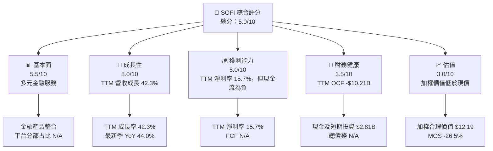

### 1.2 評分進度條視覺化

```
╔══════════════════════════════════════════════════════════════╗
║                 SOFI 多維度評分儀表板（1-10分）              ║
╠══════════════════════════════════════════════════════════════╣
║ 基本面強度  5.5 ▓▓▓▓▓▓▓▓▓▓▓░░░░░░░░░  ★★★☆☆              ║
║ 成長動能    8.0 ▓▓▓▓▓▓▓▓▓▓▓▓▓▓▓▓░░░░  ★★★★☆              ║
║ 獲利品質    4.5 ▓▓▓▓▓▓▓▓▓░░░░░░░░░░░  ★★☆☆☆              ║
║ 財務健康    3.5 ▓▓▓▓▓▓▓░░░░░░░░░░░░░  ★★☆☆☆              ║
║ 估值合理性  3.0 ▓▓▓▓▓▓░░░░░░░░░░░░░░  ★★☆☆☆              ║
║ 護城河深度  5.0 ▓▓▓▓▓▓▓▓▓▓░░░░░░░░░░  ★★★☆☆              ║
║ 管理層執行  5.5 ▓▓▓▓▓▓▓▓▓▓▓░░░░░░░░░░  ★★★☆☆              ║
║ 技術創新力  5.0 ▓▓▓▓▓▓▓▓▓▓░░░░░░░░░░  ★★★☆☆              ║
╠══════════════════════════════════════════════════════════════╣
║ 綜合總分    5.0 ▓▓▓▓▓▓▓▓▓▓░░░░░░░░░░  ⚠ 成長高、現金流弱   ║
╚══════════════════════════════════════════════════════════════╝
```

### 1.3 五大投資論點 + 三大核心風險

| 類型 | 項目 | 具體依據 | 信心度 |
|------|------|----------|--------|
| 🟢 投資論點① | 營收快速擴張 | VERIFIED TTM 營收 $4.73B，TTM YoY +42.3%；最新季 YoY +44.0% | 🟢 高 |
| 🟢 投資論點② | 多產品交叉銷售 | Lending、Financial Services、Technology Platform 三大分部可共享會員與分銷渠道；分部收入未提供，效益尚難量化 | 🟡 中 |
| 🟢 投資論點③ | 盈利改善 | 最新季淨利 $240.99M；相對上一年同期 $139.39M，增加約 72.9% | 🟢 中高 |
| 🟢 投資論點④ | 近期估值低於自身歷史中位數 | VERIFIED P/E 27.5x，低於自身五年中位數 36.6x | 🟡 中 |
| 🟢 投資論點⑤ | 非股息型成長資產 | 無股息，資本可留作擴大業務與貸款相關營運；投資回報依賴獲利與估值提升 | 🟡 中 |
| 🔴 風險① | 現金流與獲利背離 | TTM OCF -$10.21B，VERIFIED FCF N/A；負現金流可能反映金融業資產負債表變動，也代表需看清現金來源用途 | 🔴 高 |
| 🔴 風險② | 信用與利率週期 | Lending 業務受借款人信用、資金成本、貸款需求及資本市場流動性影響 | 🔴 高 |
| 🟡 風險③ | 高波動及估值敏感 | Beta 2.24、空頭占流通股 17.5%；股價 52 週區間 $13.86–$31.75 | 🟡 中高 |

### 1.4 快速統計卡片

| 指標 | 公司實際值 | 行業／同業參照 | S&P 500 均值 | 狀態 |
|------|-------------|-----------------|--------------|------|
| TTM 收入成長 | **42.3%** | 同業最新季 YoY：NU 34.4%、UPST 34.1%、HOOD 11.8% | N/A | 🟢 |
| 最新季收入 YoY | **44.0%** | 同業最新季 YoY 如左 | N/A | 🟢 |
| 毛利率 TTM | **84.2%** | 同業口徑差異大；NU 數據為 0.0%、HOOD 91.0%、UPST 83.3% | N/A | 🟡 |
| 淨利率 TTM | **15.7%** | 可比金融科技公司口徑不一 | N/A | 🟢 |
| ROE TTM | **6.5%** | 同業均值 N/A | N/A | 🟡 |
| Forward P/E | **17.14x** | 同業：NU 12.1x、HOOD 22.8x、UPST 6.7x | N/A | 🟡 |
| TTM OCF | **-$10.21B** | 可比值 N/A | N/A | 🔴 |

### 1.5 投資結論

```
╔══════════════════════════════════════════════════════════════════╗
║                    📊 投資結論摘要                               ║
╠══════════════════════════════════════════════════════════════════╣
║  評級：🔴 賣出（依 MOS -26.5%，低於 -25% 門檻）                  ║
║  價格（2026-11-13 收盤）：$15.42                                 ║
║  DCF 內在價值（基準）：約 $10.61（現價溢價約 45.3%）             ║
║  加權合理價值：$12.19                                            ║
║  安全邊際 MOS：-26.5%＝($12.19−$15.42)÷$12.19                   ║
║  目標價參考：悲觀 $6.03 ｜基準 $12.47 ｜樂觀 $20.51              ║
║  基準目標（12M）：約 $12.47，較現價 -19.1%                      ║
║  投資評分：5.0/10                                                ║
║  適合投資人：能承受高波動、願意承擔金融科技與信貸週期風險者      ║
╚══════════════════════════════════════════════════════════════════╝
```

---

## 2. 公司概覽與商業模式

### 2.1 業務結構與收入來源

SoFi 提供借貸、金融服務與科技平台服務。資料包未提供 FY2026 Q3 或 TTM 分部收入，因此不得虛構分部營收金額或占比。

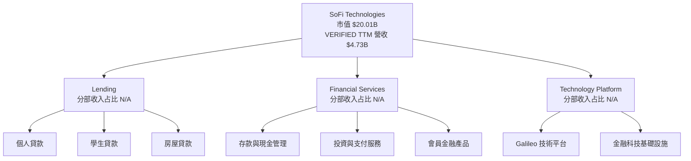

### 2.2 市場份額

公司在各細分市場的收入、客戶數與整體市場分母均未提供，無法可靠估算市場份額。以下圖表只表示「可用分部市場份額資料未披露」，不是實際市占率。

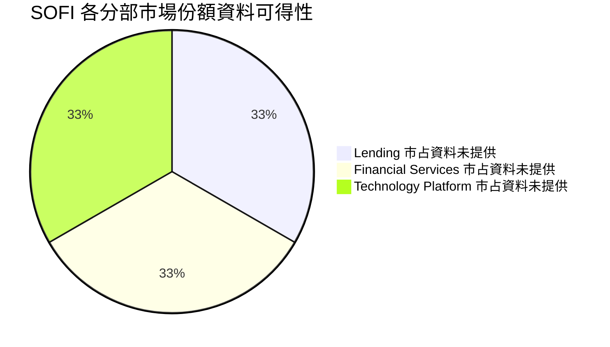

### 2.3 競爭護城河分析

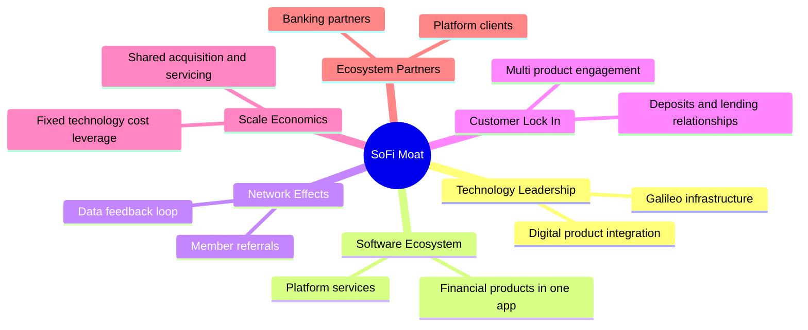

### 2.4 護城河強度評分

```
╔══════════════════════════════════════════════════════════════╗
║                 SOFI 護城河強度評分                           ║
╠══════════════════════════════════════════════════════════════╣
║ 技術與產品整合  6/10  ▓▓▓▓▓▓▓▓▓▓▓▓░░░░░░░░  🟡 有整合優勢   ║
║ 軟體生態系統    5/10  ▓▓▓▓▓▓▓▓▓▓░░░░░░░░░░  🟡 分部量化不足 ║
║ 網路效應        4/10  ▓▓▓▓▓▓▓▓░░░░░░░░░░░░  🟡 尚待證明     ║
║ 客戶鎖定        5/10  ▓▓▓▓▓▓▓▓▓▓░░░░░░░░░░  🟡 多產品可提升黏著║
║ 規模效應        5/10  ▓▓▓▓▓▓▓▓▓▓░░░░░░░░░░  🟡 盈利擴張待驗證║
║ 生態夥伴        5/10  ▓▓▓▓▓▓▓▓▓▓░░░░░░░░░░  🟡 競爭與客戶集中度 N/A║
╠══════════════════════════════════════════════════════════════╣
║ 綜合護城河      5.0/10                       🟡 中等、仍需財務驗證║
╚══════════════════════════════════════════════════════════════╝
```

---

## 3. 損益表深度分析

### 3.1 年度收入成長趨勢

年度數據採提供的年報彙整值；2022 至 2025 年收入由 $1.57B 增至 $3.61B，三年 CAGR 約 32.0%。這反映平台擴張與貸款／金融產品滲透，但單靠營收不能判定新增收入的風險調整後報酬。

```
╔══════════════════════════════════════════════════════════════════╗
║               SOFI 年度收入趨勢（FY2022-FY2025）                ║
╠══════════════════════════════════════════════════════════════════╣
║ FY2022  $1.57B  ████████░░░░░░░░░░░░░░░░  YoY：N/A（起始年）   ║
║ FY2023  $2.11B  ███████████░░░░░░░░░░░░░  YoY：約 +34.4% 🟢     ║
║ FY2024  $2.61B  ██████████████░░░░░░░░░░  YoY：約 +23.7% 🟢     ║
║ FY2025  $3.61B  ████████████████████░░░░  YoY：約 +38.3% 🟢     ║
╠══════════════════════════════════════════════════════════════════╣
║ FY2022-FY2025 CAGR：(3.61 ÷ 1.57)^(1/3) − 1 ≈ 32.0%             ║
║ 注意：VERIFIED TTM 營收為 $4.73B，TTM YoY +42.3%                ║
╚══════════════════════════════════════════════════════════════════╝
```

### 3.2 季度收入趨勢分析

採 StockAnalysis 季度資料計算 QoQ；最新季 YoY 優先採 VERIFIED FIGURES 的 **44.0%**。

| 季度 | 收入 | QoQ | YoY | 備註 |
|------|------:|----:|----:|------|
| 2025 Q4 | $1.020B | 約 +7.0% | 約 +40.2% | 相對 2025 Q3 $0.952B |
| 2026 Q1 | $1.091B | 約 +7.0% | 約 +42.5% | 2025 Q1 $0.766B |
| 2026 Q2 | $1.219B | 約 +11.7% | 約 +44.3% | 2025 Q2 $0.845B |
| 2026 Q3 | $1.385B | 約 +13.6% | **+44.0% VERIFIED** | StockAnalysis 單季 YoY 約 +43.9% |

QoQ 加速與收入規模擴大相符，可能提升固定成本吸收能力；但收入組成與貸款出售／持有策略資料不足，不能將全部增長視為高毛利、可重複的訂閱收入。

### 3.3 利潤率演變分析

| 利潤率指標 | FY2022 | FY2023 | FY2024 | FY2025／TTM | 趨勢 | 評估 |
|------------|--------|--------|--------|-------------|------|------|
| 毛利率 | N/A | N/A | N/A | TTM 84.2% | 歷年可比資料不足 | 🟡 |
| 營業利益率 | N/A | N/A | N/A | VERIFIED TTM N/A；最新季 19.4% | 最新季度為正，TTM 欄位不可替代 | 🟡 |
| 淨利率 | 約 -20.4%¹ | 約 -14.3%¹ | 約 19.1%¹ | TTM 15.7% | 損益扭轉後需觀察穩定性 | 🟡 |

¹以年度淨利除年度收入粗略計算；2024、2025 數據來源間存在小幅差異，不作為 VERIFIED TTM 指標替代。

最新季營業利益率 19.4%與獲利改善一致；但 TTM 營業利益率在 VERIFIED FIGURES 為 N/A。營業利潤率上升若能持續，將提高每一美元新增收入對利潤的貢獻；目前不宜把單季比率直接年化。

### 3.4 費用結構分析

費用明細與分部成本沒有提供，不能可靠分解人事、行銷、信用損失、技術投入等占營收比例。

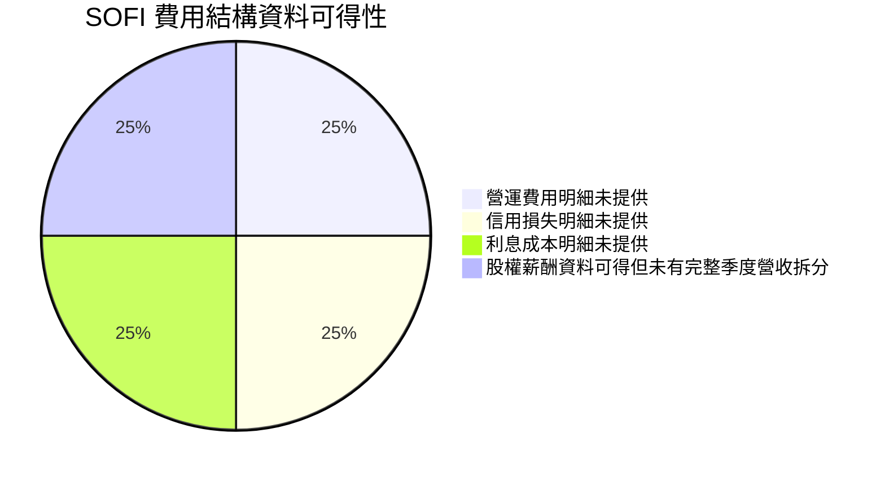

| 費用觀察項目 | 已知資料 | 解讀 |
|--------------|----------|------|
| SBC | FY2025 $262.06M；FY2024 $246.15M | SBC 是股東經濟成本；FY2025 SBC 約占年度營收 7.3% |
| 資本支出 | TTM VERIFIED N/A；另表 FY2025 $251.12M | TTM FCF 仍依 VERIFIED 規則列 N/A |
| 信用損失與行銷費 | N/A | 無法量化單位經濟或獲客回收期 |

### 3.5 季度 EPS 趨勢與盈餘品質

EPS surprise 表格中估值與實際值均為 `nan`，故無法判定過去四季是否超預期。季度 GAAP 淨利與 EPS 實際值如下：

| 季度 | 淨利 | EPS 實際 | YoY 淨利成長 | 超預期／不及預期 |
|------|------:|------:|-------------:|----------------|
| 2025 Q4 | $173.55M | $0.13 | EPS surprise 資料缺漏 | N/A |
| 2026 Q1 | $166.73M | $0.12 | 約 +134.4%¹ | N/A |
| 2026 Q2 | $156.59M | $0.12 | 約 +61.0%¹ | N/A |
| 2026 Q3 | $240.99M | $0.19 | **+72.9% VERIFIED** | N/A |

¹按所提供季度淨利表計算；非 VERIFIED 單季數字。2026 Q3 淨利較 Q2 增加，與收入增加一致，但 EPS beat/miss 無可用一致預期資料。

| 盈餘品質項目 | 數值／佔比 | 評估 |
|--------------|------------|------|
| SBC / FY2025 營收 | $262.06M ÷ $3.61B ≈ **7.3%** | 🟡 對股東有稀釋成本，不可忽略 |
| SBC / TTM OCF | **N/A** | OCF 為負，比例不適合用來衡量含金量 |
| FCF / 淨利 | **N/A** | VERIFIED TTM FCF 為 N/A；不以替代口徑計算 |
| 一次性損益 | N/A | 未提供足夠調節項目 |
| 有效稅率 | **8.5%**（最新年度） | 🟡 偏低；未有細項確認是否含一次性稅務利益 |
| 資本化支出 vs 費用化 | TTM Capex VERIFIED N/A；FY2025 Capex $251.12M | 無法評估完整資本化政策及開發支出 |
| EPS surprise | 四季估計值、實際值均 nan | 不可判定 beat/miss |

**盈餘品質結論**：淨利已轉正且季度淨利增長，但 TTM OCF -$10.21B、FCF 缺值，以及 SBC 約占 FY2025 營收 7.3%，使 GAAP 盈利的現金轉換與股東稀釋仍需驗證。估值不宜只依賴 P/E 或單季 EPS 成長。

---

## 4. 資產負債表分析

### 4.1 資產結構分解

最新季度總資產在 StockAnalysis 為 $67.767B；因該表主要項目並非完整流動／非流動分類，且金融機構貸款應收款是核心資產，以下僅列已提供項目。

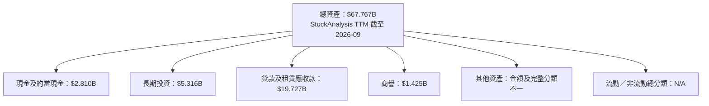

### 4.2 流動性指標分析

| 指標 | 最新資料 | 歷史／同業比較 | 評估 |
|------|----------|----------------|------|
| 現金及短期投資 | **$2.81B VERIFIED** | FY2025 年底現金 $4.93B（不同口徑） | 🟡 |
| 總債務 | **N/A VERIFIED** | 其他資料表提供不同口徑，不能取代 VERIFIED | 🟡 |
| VERIFIED 淨現金 | **$2.81B** | 市場資料另列淨負債 $1.14B，口徑矛盾 | 🟡 |
| Current ratio | 1.086 | 歷史趨勢及同業均值 N/A | 🟡 |
| Quick ratio | 0.428 | 同業均值 N/A | 🔴 |

資料源顯示現金及總債務口徑不一致，因此不能以某一張彙整表的債務數字推翻 VERIFIED 欄位。流動比率略高於 1，但速動比率 0.428；金融機構資產負債表的流動性評估不能僅套用一般工業公司標準。

### 4.3 債務結構分析

```
╔══════════════════════════════════════════════════════════════════╗
║                    SOFI 債務健康診斷                             ║
╠══════════════════════════════════════════════════════════════════╣
║  VERIFIED 現金及短期投資： $2.81B                                ║
║  VERIFIED 總債務：         N/A                                   ║
║  VERIFIED 淨現金欄位：     $2.81B（依原欄位引用）                ║
║  其他市場彙整淨負債：      $1.14B（與 VERIFIED 口徑不一致）      ║
║                                                                  ║
║  Debt/EBITDA：             N/A                                   ║
║  Interest coverage：       N/A                                   ║
║  信用風險判斷：            🟡 必須取得正式債務與資金成本明細     ║
╚══════════════════════════════════════════════════════════════════╝
```

### 4.4 股東權益趨勢

| 年度 | 股東權益 |
|------|---------:|
| 2022 | $5.53B |
| 2023 | $5.55B |
| 2024 | $6.53B |
| 2025 | $10.49B |

FY2024 至 FY2025 股東權益增加約 $3.96B，與資本基礎擴張一致；但現有資料不足以拆分淨利留存、發股、其他綜合損益等變動來源，不能把全部增幅直接視為內生獲利累積。

---

## 5. 現金流量深度分析

### 5.1 現金流量瀑布圖

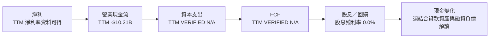

### 5.2 FCF 轉換率趨勢

| 期間 | OCF | Capex | FCF | FCF／淨利 |
|------|----:|------:|----:|----------:|
| FY2022 | -$7.26B | -$103.73M | -$7.36B | 約 2,297% 負值幅度，因淨利為負，不具傳統解讀性 |
| FY2023 | -$7.23B | -$121.19M | -$7.35B | 約 2,441% 負值幅度，因淨利為負，不具傳統解讀性 |
| FY2024 | -$1.12B | -$163.62M | -$1.28B | 約 -257% |
| FY2025 | -$3.74B | -$251.12M | -$3.99B | 約 -829% |
| TTM VERIFIED | **-$10.21B OCF** | **N/A** | **N/A** | **N/A** |

上述年度 FCF 為提供的年度現金流資料；TTM FCF 則依 VERIFIED FIGURES 為 N/A，不作自行替代。金融公司貸款發放、貸款出售、證券投資和存款變動可能令營業現金流大幅波動，但仍需要現金流明細證明負值主要來自資產配置而非營運耗損。

### 5.3 自由現金流趨勢

```
╔══════════════════════════════════════════════════════════════════╗
║                SOFI 自由現金流趨勢                               ║
╠══════════════════════════════════════════════════════════════════╣
║ FY2022  -$7.36B  ◀██████████████████░░  FCF Yield：N/A           ║
║ FY2023  -$7.35B  ◀██████████████████░░  FCF Yield：N/A           ║
║ FY2024  -$1.28B  ◀███░░░░░░░░░░░░░░░░░  FCF Yield：N/A           ║
║ FY2025  -$3.99B  ◀██████████░░░░░░░░░░  FCF Yield：N/A           ║
║ TTM     N/A      OCF -$10.21B；Capex、FCF VERIFIED N/A           ║
╚══════════════════════════════════════════════════════════════════╝
```

### 5.4 資本配置評估

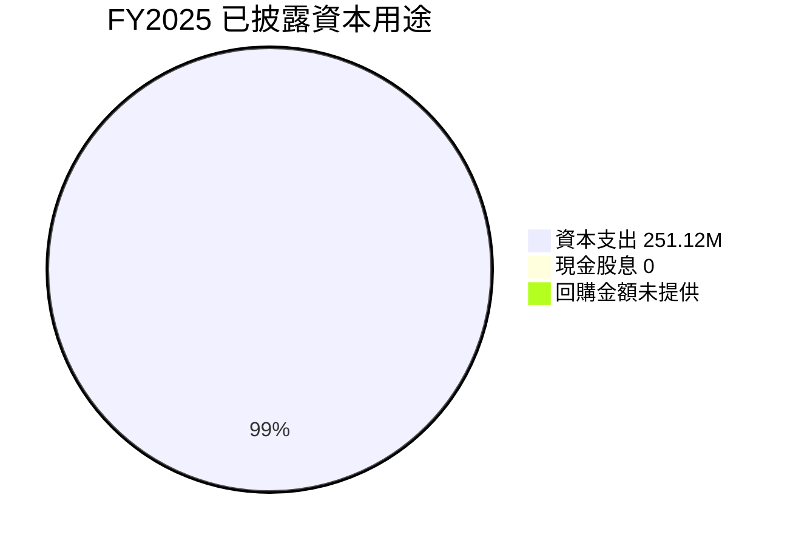

| 配置項目 | 已知資料 | 評估 |
|----------|----------|------|
| 資本支出 | FY2025 $251.12M | 相對年收入約 7.0%，但與 TTM Capex VERIFIED N/A 並存 |
| 股息 | 殖利率 0.0%；FY2025 現金股息 $0 | 🟡 成長公司常見，但不適合收益型投資人 |
| 股票回購 | N/A | 無法判定 |
| 再投資／貸款資產 | OCF 受金融資產負債變化影響，明細不足 | 需看資產負債表與現金流調節項 |
| SBC | FY2025 $262.06M | 🟡 對既有股東形成稀釋成本 |

---

## 6. 獲利能力與資本效率

### 6.1 ROE／ROA／ROIC 趨勢

| 指標 | 最新值 | 歷史／同業對照 | 評估 |
|------|-------:|----------------|------|
| ROE TTM | **6.5% VERIFIED** | 另一來源顯示 7.4%，口徑不同 | 🟡 |
| ROA TTM | 1.3% | 歷史序列 N/A | 🟡 |
| ROIC | **N/A** | 投入資本、營業稅後利潤與金融負債口徑不足 | 🟡 |
| WACC | **18.05% VERIFIED 參考值** | 高 Beta 與高債務成本提高資本成本 | 🔴 |

### 6.2 ROIC vs WACC 分析

```
╔══════════════════════════════════════════════════════════════════╗
║                  ROIC vs WACC 深度分析                          ║
╠══════════════════════════════════════════════════════════════════╣
║  VERIFIED 折現率參考值：WACC 18.05%                              ║
║  ├── 無風險利率：5.15%                                           ║
║  ├── ERP：5.00%                                                  ║
║  ├── Beta：2.24                                                  ║
║  ├── 股權成本：5.15% + 2.24 × 5.00% = 16.35%（來源值 16.36%）  ║
║  ├── 稅前債務成本：29.04%；有效稅率：8.5%                       ║
║  ├── 股權／債務權重：83.4%／16.6%                               ║
║  └── WACC：依 VERIFIED 參考值 18.05%                            ║
║                                                                  ║
║  ROIC：N/A（投入資本及金融業營運資本口徑不足）                   ║
║  EVA = ROIC − WACC：N/A                                          ║
║  結論：無法證明 ROIC > WACC；價值創造尚未驗證                   ║
╚══════════════════════════════════════════════════════════════════╝
```

CAPM 代入所提供輸入：5.15% + 2.24 × 5.00% = 16.35%，VERIFIED 欄位列示股權成本 16.36%，差異為四捨五入。因 VERIFIED 已提供 WACC 18.05% 與權重，本報告在估值中沿用該參考值；債務餘額細節不足，無法獨立重建全部 WACC 絕對值。

### 6.3 杜邦三因素分解

ROE 定義為淨利率 × 資產週轉率 × 財務槓桿。採用 TTM 淨利率 15.7%、ROE VERIFIED 6.5%，其餘以代數方式反映，不把口徑差異當成精確歷史值。

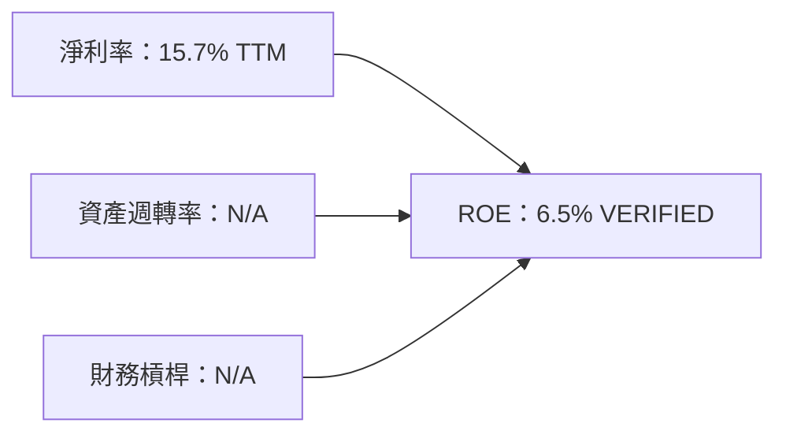

金融機構的資產周轉與槓桿解讀不同於一般工業公司；由於平均總資產及同期間淨利口徑不足，不在此反推杜邦因素。

### 6.4 獲利能力儀表板

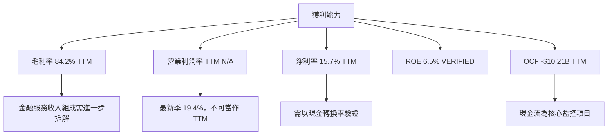

---

## 7. 相對估值分析

### 7.1 同業估值比較

同業倍數依 VERIFIED FIGURES 原值引用；SOFI 的 Forward P/E 採提供之估值資料。

| 估值指標 | **SOFI** | **NU** | **HOOD** | **UPST** | SOFI 評估 |
|----------|---------:|-------:|--------:|--------:|-----------|
| Trailing P/E | 27.5x¹ | 16.5x | 35.9x | 32.1x | 🟡 位於同業範圍內 |
| Forward P/E | **17.14x** | 12.1x | 22.8x | 6.7x | 🟡 高於 NU、UPST，低於 HOOD |
| P/S TTM | 4.27x² | 7.0x | 13.8x | 1.4x | 🟡 中間位置 |
| EV/EBITDA TTM | N/A | N/A | N/A | 27.0x | N/A，SOFI EBITDA 欄位不足 |
| 最新季收入 YoY | 44.0% | 34.4% | 11.8% | 34.1% | 🟢 成長較快 |
| 毛利率 TTM | 84.2% | 0.0% | 91.0% | 83.3% | 🟡 金融公司口徑不完全可比 |

¹依 VERIFIED 自身歷史估值 P/E 27.5x；市場彙整另列 28.04x。²市場彙整 P/S 4.270379x；VERIFIED 歷史估值區塊列 4.4x，兩者計算時點／口徑不同。本文同業比較用市場估值欄位；歷史分析用 VERIFIED 歷史區塊。

### 7.2 歷史估值區間分析

```
╔══════════════════════════════════════════════════════════════════╗
║            SOFI 五年歷史 P/E 估值位置（VERIFIED）                ║
╠══════════════════════════════════════════════════════════════════╣
║ 五年範圍：27.0x ├──●──────────────────────────────┤ 67.1x       ║
║ 五年中位數：36.6x                                                ║
║ 當前 P/E：27.5x；歷史百分位：11%                                 ║
║                                                                  ║
║ P/S：當前 4.4x｜中位數 4.5x｜範圍 2.6x–14.6x｜百分位 43%       ║
║ EV/EBITDA：63.6x｜中位數 65.1x｜範圍 19.0x–148.7x｜百分位 48%  ║
╚══════════════════════════════════════════════════════════════════╝
```

當前 P/E 接近五年低端，但歷史估值本身波動很大；低百分位不必然代表低估，若盈利品質、信用週期或未來增長低於歷史預期，估值中樞可能下移。

### 7.3 情境目標價（假設驅動）

以下使用提供的 Forward EPS **$0.89961** 及同業 Forward P/E 區間作簡化的 12 個月相對估值，不把假設倍數冒充公司財測。

| 情境 | 收入 CAGR 假設 | 營業利潤率假設 | 退出 Forward P/E | 隱含目標價 | 相對 $15.42 |
|------|----------------:|---------------:|-----------------:|------------:|------------:|
| 🔴 悲觀 | 15% | 15% | 6.7x（UPST 倍數參照） | **$6.03** | -60.9% |
| 🟡 基準 | 21% | 20%–23% 漸進 | 13.87x（同業 Forward P/E 簡單平均） | **$12.47** | -19.1% |
| 🟢 樂觀 | 30% | 25% | 22.8x（HOOD 倍數參照） | **$20.51** | +33.0% |

算式：悲觀 $0.89961×6.7=$6.03；基準 $0.89961×[(12.1+22.8+6.7)÷3]=$12.47；樂觀 $0.89961×22.8=$20.51。Forward EPS 與退出倍數的時間口徑未完全一致，因此僅作估值框架，不視為精確預測。

### 7.4 相對估值隱含價格區間

```
╔══════════════════════════════════════════════════════════════════╗
║             相對估值與資料可得性                                 ║
╠══════════════════════════════════════════════════════════════════╣
║ Forward P/E 同業均值：13.87x × SOFI Forward EPS $0.89961 = $12.47║
║ SOFI 當前股價（2026-11-13）：$15.42                               ║
║ EV/EBITDA：SOFI N/A，無法回推                                    ║
║ EV/Sales：無可靠同業分部與一致 EV 口徑，N/A                      ║
║ FCF Yield 回推：VERIFIED TTM FCF N/A，無法回推                   ║
║ 分析師共識目標：$20.84（23 位分析師；低 $12、高 $30）            ║
╚══════════════════════════════════════════════════════════════════╝
```

---

## 8. DCF 內在價值評估（Discounted Cash Flow）

> 本節為**假設性 FCFF 情境模型**，不是公司正式財測。SOFI 具放貸及金融資產負債表特徵，營業現金流受貸款資產與資金來源變動影響，傳統 FCFF 對金融機構的適用性較低。資料包中的 TTM 營業利潤率、Capex、總債務多項為 N/A，因此模型使用明確假設並降低信心度。

### 8.0 估值推理鏈

**Step 1 — 價值來源與主導變數**

SOFI 價值可拆為 Lending 現有業務、Financial Services 交叉銷售、Technology Platform 軟體服務三部分；三者收入占比均未提供，不能量化。模型主要依賴**營業利潤率與營收持續成長**，而非股息或已確認的正 FCF。利潤率與現金轉換是估值主導變數。

**Step 2 — 模型選擇**

| 決策點 | 採用 | 理由 | 曾考慮但否決 | 否決理由 |
|--------|------|------|--------------|----------|
| 現金流定義 | FCFF | 配合 VERIFIED WACC 18.05% | FCFE | 債務與資金結構資料缺漏 |
| 預測期 N | 5 年 | 用於示意中期營收擴張，不代表可見度保證 | 10 年 | 貸款業務周期與現金流口徑不支持長期精確預測 |
| 終值方法 | Gordon Growth 主、退出倍數交叉參考 | 長期現金流假設可明確揭露 | 只用退出倍數 | 避免單一倍數主導 |
| EBIT 基礎 | GAAP 代理值 | StockAnalysis TTM 營業利益 $907.03M | 非 GAAP | SBC 加回資料不完整 |

**Step 3 — 關鍵假設推導**

- **營收 CAGR**：錨點＝VERIFIED TTM 成長 42.3%、FY2022–FY2025 歷史 CAGR 約 32.0% → 考慮基期擴大及高成長回歸 → **採用 21%** → 曾考慮 32%，但不採用，因歷史高速成長未必能線性延續。
- **期末營業利潤率**：錨點＝StockAnalysis TTM 營業利益 $907.03M ÷ TTM 收入 $4.686B 約 19.35%（交叉來源推算；VERIFIED 營業利潤率 N/A）→ 規模效益正面、信貸與競爭風險抵銷 → **採用 FY+5 23%** → 否決 30%，因無歷史證據支持。
- **永續成長率 g**：錨點＝長期名目經濟成長常見假設約 3%–4%（假設值）→ 選較保守端 → **採用 3.0%** → 不採 4%，避免終值對增長率過度敏感。
- **預測期 N**：採用 **5 年**；超過 5 年的逐年營收預測可靠性有限；不採 10 年，因利率、信用週期和貸款組合變動難以長期預測。
- **Capex／營收**：採用 **6.5%（假設值）**；FY2025 Capex $251.12M ÷ FY2025 收入 $3.61B 約 7.0%，FY2024 約 6.3%，取其附近作模型值；不採更低的 3%，缺乏資本支出下降證據。
- **D&A／營收**：採用 **4.0%（假設值）**；近期可比 D&A/營收資料缺漏，採用低於歷史早期折舊比率的簡化模型值，可信度低；不將早期約 10%比率外推。
- **ΔWC／營收增額**：採用 **2.0%（假設值）**；金融機構營運資金定義受限，模型採小幅正向投入；缺乏歷史明細，不主張這是實際值。
- **稅率**：採用 VERIFIED 有效稅率 **8.5%**；不另改用常態稅率，惟低有效稅率可能令模型高估 NOPAT。
- **SBC 與股數**：採用組合 **(A) GAAP EBIT + 固定股數**。本模型採用 (A)，SBC 影響已在 GAAP EBIT 費用中計入一次，因此 FCFF 不另扣 SBC、年稀釋率設為 0%；以最新披露股數 1.297B 作模型股數。
- **WACC**：採 VERIFIED 參考值 **18.05%**；Beta 2.24 反映高市場風險，不自行調低折現率。
- **終值方法**：採 Gordon Growth 為主、成熟期 EBITDA 退出倍數作交叉驗證；EV/EBITDA 的公司當前值 N/A，因此退出倍數只能作假設參考，不納入主要價值。

**Step 4 — 最脆弱假設**

最脆弱假設是將金融機構營業利益轉為 FCFF 的折舊、資本支出及營運資金比例；若可分配現金流遠低於模型，基準 DCF 可能明顯高估，方向與第 8.9 節所述一致。

**Step 5 — 計算路徑**

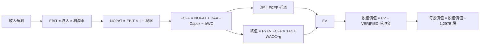

### 8.1 模型假設總表

| 假設項目 | 採用值 | 依據／來源 | 敏感度 |
|----------|--------|-------------|--------|
| 預測期 N | 5 年 | 假設值：中期預測與長期不確定性折衷 | 🟡 中 |
| 營收 CAGR | 21% | TTM +42.3%、歷史約 32.0%；採成長回歸 | 🔴 高 |
| 期末營業利潤率 | 23% | 交叉來源 TTM 約 19.35%；逐步擴張假設 | 🔴 高 |
| 有效稅率 | 8.5% | VERIFIED 最新年度 | 🟢 低 |
| Capex／營收 | 6.5% | FY2024 約 6.3%、FY2025 約 7.0%；假設值 | 🟡 中 |
| D&A／營收 | 4.0% | 近期比率 N/A；假設值 | 🟢 低 |
| ΔWC／收入增額 | 2.0% | 歷史可比口徑 N/A；假設值 | 🟢 低 |
| EBIT 基礎 | GAAP 代理值 | TTM 營業利益 $907.03M，非 VERIFIED 欄位 | 🟡 中 |
| SBC 處理 | 組合 A | GAAP EBIT 已含 SBC，不重複扣除 | 🟡 中 |
| 年稀釋率 | 0% | 組合 A；固定股數以避免重複計入 SBC | 🟡 中 |
| 永續成長率 g | 3.0% | 假設值，低於長期名目增長區間上端 | 🔴 高 |
| 終值方法 | Gordon Growth 主 | WACC 高於 g；退出倍數作交叉參考 | 🔴 高 |
| WACC | 18.05% | VERIFIED 參考值 | 🔴 高 |
| 預測股數 | 1.297B | Roic.ai 2026-09 shares outstanding | 🟡 中 |

**FCFF 定義**：`FCFF = NOPAT + D&A − Capex − ΔWC`。由於金融業現金流分類問題，本模型為示意性企業現金流模型，非正式銀行股估值標準。

### 8.2 折現率推導（WACC）

```
╔══════════════════════════════════════════════════════════════════╗
║                    WACC 推導（折現率）                           ║
╠══════════════════════════════════════════════════════════════════╣
║ 股權成本 Ke（CAPM）：                                            ║
║ ├── 無風險利率 Rf：5.15%（資料包未標出觀察日期）                ║
║ ├── ERP：5.00%（VERIFIED 假設值）                               ║
║ ├── Beta：2.24（VERIFIED；高於 1.5，代表高波動）                ║
║ ├── 額外規模／國別溢酬：0.00%（無資料支持，不另加）             ║
║ └── Ke = 5.15% + 2.24 × 5.00% + 0.00% = 16.35%                 ║
║    VERIFIED 股權成本列示 16.36%（取整差異）                     ║
║                                                                  ║
║ 債務成本：                                                       ║
║ ├── 稅前 Kd：29.04%（VERIFIED 參考輸入；債務明細 N/A）          ║
║ ├── 有效稅率：8.5%                                              ║
║ └── 稅後 Kd = 29.04% × (1 − 8.5%) = 26.57%                     ║
║                                                                  ║
║ 資本結構（VERIFIED 權重）：股權 83.4%，債務 16.6%               ║
║ WACC = 83.4% × 16.36% + 16.6% × 26.57% = 18.05%                 ║
╚══════════════════════════════════════════════════════════════════╝
```

**逐步演算：**

1. Ke = 5.15% + 2.24 × 5.00% = 16.35%，VERIFIED 列示 16.36%。
2. 稅前 Kd = **29.04% VERIFIED**；利息與同一期平均計息負債明細未提供，不能獨立重算。
3. 稅後 Kd = 29.04% × (1 − 8.5%) = 26.5716% ≈ **26.57%**。
4. 權重 = 股權 83.4%、債務 16.6%；83.4% + 16.6% = **100.0%**。絕對債務餘額 N/A，權重只引用 VERIFIED。
5. WACC = 83.4% × 16.36% + 16.6% × 26.5716% = 13.64424% + 4.41089% = **18.05513%**，VERIFIED 參考值為 **18.05%**，差異來自輸入四捨五入。

### 8.3 逐年自由現金流預測（基準情境）

金額單位 $B；營收基準採 VERIFIED TTM $4.73B。預測收入每年成長 21%；期末營業利潤率 23%，依序由 20.0% 緩升至 23.0%。金額取兩位小數，折現因子取三位小數。

| 年度 | FY+1 | FY+2 | FY+3 | FY+4 | FY+5＝FY+N |
|------|-----:|-----:|-----:|-----:|-----------:|
| 營收 | 5.72 | 6.92 | 8.38 | 10.14 | 12.27 |
| 營收 YoY | 21.0% | 21.0% | 21.0% | 21.0% | 21.0% |
| 營業利潤率 | 20.0% | 20.75% | 21.5% | 22.25% | 23.0% |
| EBIT | 1.14 | 1.44 | 1.80 | 2.26 | 2.82 |
| − 稅（8.5%） | (0.10) | (0.12) | (0.15) | (0.19) | (0.24) |
| = NOPAT | 1.05 | 1.31 | 1.65 | 2.06 | 2.58 |
| + D&A（營收 4%） | 0.23 | 0.28 | 0.34 | 0.41 | 0.49 |
| − Capex（營收 6.5%） | (0.37) | (0.45) | (0.54) | (0.66) | (0.80) |
| − ΔWC（新增收入 2%） | (0.02) | (0.02) | (0.03) | (0.04) | (0.04) |
| **= FCFF** | **0.89** | **1.12** | **1.41** | **1.78** | **2.23** |
| 折現因子 @18.05% | 0.847 | 0.718 | 0.607 | 0.514 | 0.435 |
| **FCFF 現值 PV** | **0.75** | **0.80** | **0.86** | **0.91** | **0.97** |

**預測期 FCF 現值合計**：
$0.75 + $0.80 + $0.86 + $0.91 + $0.97 = **$4.29B**。

**FY+1 逐步演算：**

1. 營收 = $4.73B × (1 + 21%) = $5.7233B ≈ **$5.72B**。
2. EBIT = $5.7233B × 20.0% = $1.14466B ≈ **$1.14B**。
3. 稅 = $1.14466B × 8.5% = $0.09730B ≈ **$0.10B**。
4. NOPAT = $1.14466B − $0.09730B = $1.04736B ≈ **$1.05B**。
5. D&A = $5.7233B × 4.0% = $0.22893B ≈ **$0.23B**。
6. Capex = $5.7233B × 6.5% = $0.37101B ≈ **$0.37B**。
7. ΔWC = ($5.7233B − $4.73B) × 2.0% = $0.01987B ≈ **$0.02B**。
8. FCFF = $1.04736B + $0.22893B − $0.37101B − $0.01987B = $0.88541B ≈ **$0.89B**。
9. 折現因子 = 1 ÷ (1 + 18.05%)¹ = 0.847；PV = $0.88541B × 0.847 = **約 $0.75B**。

**合理性自檢**

- 模型預測 FCFF FY+1 至 FY+5 由 $0.89B 增至 $2.23B；因 TTM FCF VERIFIED N/A、歷史年度 FCF 負值，無法計算可比歷史 FCF CAGR。
- FY+5 FCFF 利潤率 = $2.23B ÷ $12.27B ≈ **18.2%**；這高於可用年度現金流所能直接支持的程度，屬模型風險。
- 模型預測期 FCFF 全為正；這不是對實際近期 FCF 已轉正的陳述。

```
╔══════════════════════════════════════════════════════════════════╗
║             自由現金流：歷史實際 vs 模型預測                     ║
╠══════════════════════════════════════════════════════════════════╣
║ FY2024（實） -$1.28B  ◀████░░░░░░░░░░░░░░░░  資料表年度值      ║
║ FY2025（實） -$3.99B  ◀██████████░░░░░░░░░░  資料表年度值      ║
║ FY+1（預）    $0.89B  █████░░░░░░░░░░░░░░░  假設性 FCFF       ║
║ FY+5（預）    $2.23B  ████████████████████░  假設性 FCFF       ║
╠══════════════════════════════════════════════════════════════════╣
║ 歷史年度 FCF 與模型 FCFF 的分類、計算口徑不同，不可直接視為轉正 ║
╚══════════════════════════════════════════════════════════════════╝
```

### 8.4 終值計算（Terminal Value）

**適用性檢查**：WACC **18.05%** vs g **3.0%** → WACC > g？✅

| 方法 | 計算式 | 終值 TV | TV 現值 | 佔總 EV 比重 |
|------|--------|---------:|--------:|-------------:|
| Gordon Growth | $2.232B × 1.03 ÷ (18.05%−3.0%) | $15.28B | 約 $6.65B | 約 60.5% |
| 退出倍數法 | EBITDA FY+5 × 20x 假設 | 約 $56.43B | 約 $24.57B | 非主估值 |

退出倍數法以假設 EBITDA = EBIT + D&A，即 FY+5 $2.821B + $0.491B = $3.312B，並採 **20x 假設值**作交叉測試；SOFI EV/EBITDA TTM VERIFIED N/A，故 20x 不代表公司實際交易倍數。退出倍數與 Gordon Growth 結果差異很大，主要反映金融公司現金流與 EBITDA 倍數法的不適配，主要估值採 Gordon Growth。

**Gordon Growth 逐步演算**

1. FY+N FCFF = **$2.232B**（取自 8.3 未四捨五入預測值）。
2. 分子 = $2.232B × (1 + 3.0%) = $2.299B。
3. 分母 = 18.05% − 3.0% = 15.05%；TV = $2.299B ÷ 15.05% = **$15.28B**。
4. PV(TV) = $15.28B × 0.435 = **約 $6.65B**。
5. 終值占 EV = $6.65B ÷ ($4.29B + $6.65B) = **約 60.8%**。以未四捨五入金額計算約 60.8%，非高於 75%警示線。

### 8.5 企業價值 → 每股內在價值

```
╔══════════════════════════════════════════════════════════════════╗
║              企業價值 → 每股內在價值 橋接表                      ║
╠══════════════════════════════════════════════════════════════════╣
║  預測期 FCF 現值合計              +$4.29B                        ║
║  終值現值 PV(TV)                  +$6.65B                        ║
║  = 企業價值 EV                     $10.94B                        ║
║  + VERIFIED 淨現金欄位             +$2.81B                        ║
║  − 總債務                          N/A（不另重複扣除）            ║
║  = 股權價值                        $13.75B                        ║
║  ÷ 稀釋股數                        1.297B 股                      ║
║  ★ 每股內在價值                    約 $10.61                      ║
║    2026-11-13 收盤價               $15.42                         ║
║    折溢價                          約 +45.3% 溢價                 ║
╚══════════════════════════════════════════════════════════════════╝
```

**逐步演算**

1. EV = $4.29B + $6.65B = **$10.94B**。
2. 股權價值 = EV $10.94B + VERIFIED 淨現金欄位 $2.81B = **$13.75B**。資料包同時列有其他口徑淨負債，故橋接僅採 VERIFIED 淨現金原欄位，不另加總債務。
3. 每股價值 = $13.75B ÷ 1.297B 股 = **約 $10.60–$10.61**；模型未四捨五入值約 $10.61。
4. 折溢價 = $15.42 ÷ $10.61 − 1 = **約 +45.3%**。
5. **本節不計算 MOS**；MOS 僅以 8.8 加權合理價值為分母。

股數採 Roic.ai 截至 2026-09 的 1.297B 股，固定股數符合組合 (A)。現金／淨現金使用 VERIFIED $2.81B 欄位；由於負債口徑衝突，此橋接有額外不確定性。

### 8.6 敏感性分析（WACC × 永續成長率）

矩陣以基準預測期 FCFF 不變，改變折現率與永續成長率；每股價值為近似值，基準格以粗體標示。

| g（列）／WACC（欄） | 16.05% | 17.05% | **18.05%（基準）** | 19.05% | 20.05% |
|---|---:|---:|---:|---:|---:|
| 2.0% | $11.22（-27.2%） | $10.54（-31.6%） | $10.24（-33.6%） | $9.43（-38.8%） | $8.96（-41.9%） |
| 2.5% | $11.63（-24.6%） | $10.89（-29.4%） | $10.41（-32.5%） | $9.70（-37.1%） | $9.20（-40.3%） |
| **3.0%（基準）** | $12.10（-21.5%） | $11.29（-26.8%） | **$10.61（-31.2%）** | $10.01（-35.1%） | $9.48（-38.5%） |
| 3.5% | $12.62（-18.2%） | $11.74（-23.9%） | $10.81（-29.9%） | $10.35（-32.9%） | $9.77（-36.6%） |
| 4.0% | $13.21（-14.3%） | $12.24（-20.6%） | $11.03（-28.5%） | $10.72（-30.5%） | $10.15（-34.2%） |

**矩陣示範格：WACC = 17.05% > g = 2.5% ✅**

1. 新 WACC 預測期 PV 合計：約 **$4.41B**。
2. 新 TV = $2.232B × 1.025 ÷ (17.05%−2.5%) = 約 **$15.72B**；按五年折現因子約 0.455，PV(TV) 約 **$7.15B**。
3. EV 約 $4.41B + $7.15B = $11.56B；股權價值約 $11.56B + $2.81B = $14.37B；每股約 $14.37B ÷ 1.297B = **$11.08**。

> 矩陣格為四捨五入近似值；由於基準 DCF 本身依賴未披露的 Capex、D&A、ΔWC 假設，矩陣展示的是模型方向性，不代表精確報價。

**三情境 DCF**

| 情境 | 營收 CAGR | 期末營業利潤率 | g | WACC | 每股價值 | 相對現價 | 主觀機率 |
|------|----------:|---------------:|---:|-----:|---------:|---------:|---------:|
| 🔴 悲觀 | 15% | 18% | 2.0% | 20.05% | 約 $6.5 | 約 -57.8% | 30% |
| 🟡 基準 | 21% | 23% | 3.0% | 18.05% | 約 $10.61 | 約 -31.2% | 50% |
| 🟢 樂觀 | 27% | 27% | 3.5% | 16.05% | 約 $17.5 | 約 +13.5% | 20% |
| **機率加權** | — | — | — | — | **約 $10.3** | 約 -33% | 100% |

情境值為以同一 FCFF 架構改動營收、利潤率、g 與 WACC 的近似估值；假設收益在長期能轉為可分配 FCFF。機率加權值為約 $10.3，並不取代基準 DCF $10.61 或第 8.8 節加權合理價值。

- **悲觀**：收入成長回落至 15%、利潤率僅 18%，前提是信用環境惡化或競爭加劇。
- **基準**：21%收入 CAGR、FY+5 利潤率 23%，前提是現有產品交叉銷售延續。
- **樂觀**：27% CAGR、27%利潤率且 WACC 降至 16.05%，前提是服務收入擴大、獲客效率提升且市場風險溢酬下降。

**敏感度結論**

在基準附近，g 由 2.5%升至 3.5%，模型價值約由 $10.41 至 $10.81，增加約 $0.40／3.8%；WACC 由 17.05%升至 19.05%，基準 g 下模型約由 $11.29 降至 $10.01，下降約 $1.28／11.3%。利潤率每變動 1 個百分點對估值的影響為正向，但由於金融公司 FCFF 轉換率與分部成本資料缺漏，本報告不給出偽精確美元彈性。折現率與利潤率均為重要變數；這與 8.0 指出的「營業利潤率與現金轉換」主導估值一致。

### 8.7 反推 DCF（Reverse DCF）

以現價 $15.42 作為目標值，模型一次只解一個變數；固定基準模型其他輸入。由於基準模型對銀行／貸款資產現金流的分類適配性有限，以下屬條件式反推，非市場一致預期的精確估計。

| 求解變數 | 固定的其餘變數 | 市場隱含值 | 歷史／資料錨點 | 判斷 |
|----------|------------------|-------------|----------------|------|
| 未來 5 年營收 CAGR | 利潤率、g、WACC 固定於基準 | 約高於 21%；精確反解 N/A | 歷史 FY2022–FY2025 約 32.0%，TTM +42.3% | 🔴 需持續高增長 |
| 期末營業利潤率 | CAGR、g 固定於基準 | 約高於 23%；精確反解 N/A | StockAnalysis TTM 交叉推算約 19.35% | 🔴 需利潤率繼續擴張 |
| 永續成長率 g | CAGR、利潤率固定 | 需大幅高於 3%；精確反解 N/A | 模型採 3.0%；必須低於 WACC | 🟡 |
| 高成長年數 N | 成長率、利潤率、g 固定 | 3–15 年精確求解 N/A | 可見度不足 | 🟡 |

由於每股現價高於基準 DCF 價值，固定其餘基準輸入後必須提升成長率、利潤率或延長高增長期才可能解釋現價；現有資料不足以對每個變數做可重現的精確迭代，故不捏造收斂解。

### 8.8 估值三角驗證與安全邊際

| 估值方法 | 隱含每股價值 | 上行空間（÷現價） | 權重 | 說明 |
|----------|--------------:|------------------:|------:|------|
| DCF 基準 | $10.61 | -31.2% | 60% | 資料缺漏，仍作主要但降權估值 |
| 同業 Forward P/E | $12.47 | -19.1% | 30% | 同業均值倍數 × SOFI Forward EPS |
| EV/EBITDA | N/A | N/A | 0% | SOFI 值 N/A |
| FCF Yield 回推 | N/A | N/A | 0% | VERIFIED FCF N/A |
| 分析師共識目標價 | $20.84 | +35.2% | 10% | 23 位分析師，參考權重 |
| **加權合理價值** | **$12.19** | **-21.0%** | **100%** | 估值加權總和 |

**逐步演算**

加權合理價值  
= $10.61 × 60% + $12.47 × 30% + $20.84 × 10%  
= $6.366 + $3.741 + $2.084  
= **$12.191 ≈ $12.19**。

採 DCF 60%權重，因其具明確現金流推導；但金融業現金流口徑與關鍵輸入缺漏，故不給更高權重。分析師共識目標價依要求限制在 10%。

```
╔══════════════════════════════════════════════════════════════════╗
║                  估值區間與安全邊際                              ║
╠══════════════════════════════════════════════════════════════════╣
║ 悲觀參考 $6.03 ─ 現價 $15.42 ─ 加權合理值 $12.19 ─ 基準DCF $10.61║
║                                                                  ║
║ MOS = ($12.19 − $15.42) ÷ $12.19 = -26.5%                       ║
║ 上行空間 = ($12.19 − $15.42) ÷ $15.42 = -21.0%                  ║
║ 折溢價相對 DCF = $15.42 ÷ $10.61 − 1 = +45.3% 溢價             ║
║                                                                  ║
║ 建議買入區間：≤ $10.97（MOS 至少 10%：$12.19 × 90%）            ║
║ 合理持有觀察區：$10.97–$12.19                                    ║
║ 減碼／避免追價：高於 $12.19；現價 $15.42 已高於加權合理值        ║
╚══════════════════════════════════════════════════════════════════╝
```

> 🔎 **程式複算（Python，依本節各項自動重算）**
>
> 加權合理價值 = $10.61 × 60% + $12.47 × 30% + $20.84 × 10% = **$12.19**（權重合計 100%）
>
> 以價格 $15.42 計：MOS = **-26.5%**，上行空間 = **-20.9%**
>
> ✅ 與本節所寫數值一致。

### 8.9 DCF 模型的局限與失效條件

- **終值依賴度**：基準終值 PV 約占 EV 約 61%，估值仍受 FY+5 後長期假設影響。
- **最脆弱假設**：FCFF 的 Capex、D&A 與營運資金轉換；若實際可分配現金流低於模型，價值向下。
- **適用性**：SOFI 具有銀行及貸款資產特徵，OCF 受貸款組合、證券和存款變動影響；DCF 可靠度低於以穩定自由現金流為主的非金融公司。應搭配 P/B、可持續 ROE、信用損失率、分部獲利及單位經濟分析。
- **風險連結**：信用損失上升會壓低 EBIT 利潤率；融資成本上升會提高 WACC；貸款資產快速擴張若需更多資本，會降低可分配現金流。
- **模型可失效條件**：若實際收入成長低於 15%、營業利潤率跌至 15%以下，或現金流持續顯示無法把會計淨利轉成可分配資本，應停止使用本模型作核心估值。

### 8.10 複算檢核表（Audit Trail）

| # | 檢核項目 | 結果 |
|---|----------|------|
| 1 | 高／中敏感度輸入均有推導 | ✅ |
| 2 | 假設均標示依據或明示資料缺漏 | ✅ |
| 3 | WACC 權重合計 100%；數值使用 VERIFIED 參考值 | ✅，精確重算受四捨五入影響 |
| 4 | Kd 分母與債務權重使用同一範圍 | ⚠️ VERIFIED 債務明細 N/A；沿用資料包參考權重，不聲稱獨立重建 |
| 5 | WACC 與第 6.2 節一致 | ✅ 18.05% |
| 6 | 預測年度數量符合 N=5，無省略 | ✅ |
| 7 | FY+1 算式可複算 | ✅ |
| 8 | 預測 PV 加總 | ✅ $0.75+$0.80+$0.86+$0.91+$0.97=$4.29B |
| 9 | WACC > g | ✅ 18.05% > 3.0% |
| 10 | 終值以 FY+5 現金流並折現五期 | ✅ |
| 11 | 橋接採 VERIFIED 淨現金欄位；債務欄位缺漏已揭露 | ⚠️ 口徑不一致使估值信心下降 |
| 12 | SBC 組合 | ✅ 組合 A：GAAP EBIT、無 −SBC 列、固定股數 |
| 13 | 敏感度矩陣基準格與基準 DCF | ✅ 約 $10.61 |
| 14 | 矩陣有效格均滿足 WACC > g | ✅ |
| 15 | 三情境機率合計 | ✅ 30%+50%+20%=100% |
| 16 | Reverse DCF 每列僅解一變數 | ⚠️ 因模型與資料限制，未提供虛構精確收斂值 |
| 17 | MOS 採 8.8 加權值；折溢價採 8.5 DCF | ✅ |
| 18 | 報告已完整輸出至第 11 章 | ✅ |
| 19 | 加權價值 = 價值×權重總和 | ✅ $12.191≈$12.19 |
| 20 | 評級符合 MOS 門檻 | ✅ MOS -26.5%，賣出 |

---

## 9. 成長催化劑

### 9.1 催化劑時間軸

以下為依公司業務結構推導的觀察時間軸，不代表管理層正式財測。

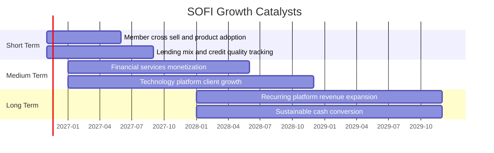

### 9.2 TAM 市場規模分析

市場 TAM 與 SoFi 於各市場的收入／滲透率未提供，不以產業總額猜測。對投資人而言，應追蹤公司可服務市場中實際轉化為收入與利潤的部分。

```
╔══════════════════════════════════════════════════════════════════╗
║                 SOFI TAM 與滲透率資料狀態                        ║
╠══════════════════════════════════════════════════════════════════╣
║ 個人貸款 TAM：公司可服務規模 N/A｜滲透率 N/A｜收入分部 N/A      ║
║ 學生貸款 TAM：公司可服務規模 N/A｜滲透率 N/A｜收入分部 N/A      ║
║ 房屋貸款 TAM：公司可服務規模 N/A｜滲透率 N/A｜收入分部 N/A      ║
║ 金融服務 TAM：市場規模 N/A｜會員產品收入 N/A                    ║
║ 科技平台 TAM：市場規模 N/A｜平台客戶／收入 N/A                  ║
╠══════════════════════════════════════════════════════════════════╣
║ 可驗證的公司規模錨點：VERIFIED TTM 營收 $4.73B，成長 42.3%      ║
╚══════════════════════════════════════════════════════════════════╝
```

### 9.3 成長驅動力結構圖

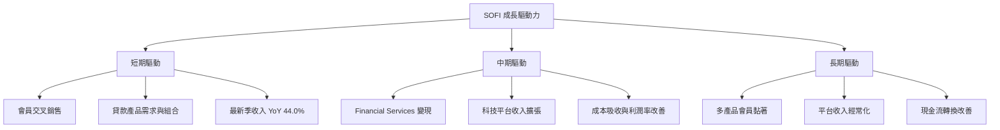

---

## 10. 風險矩陣

### 10.1 風險評分矩陣

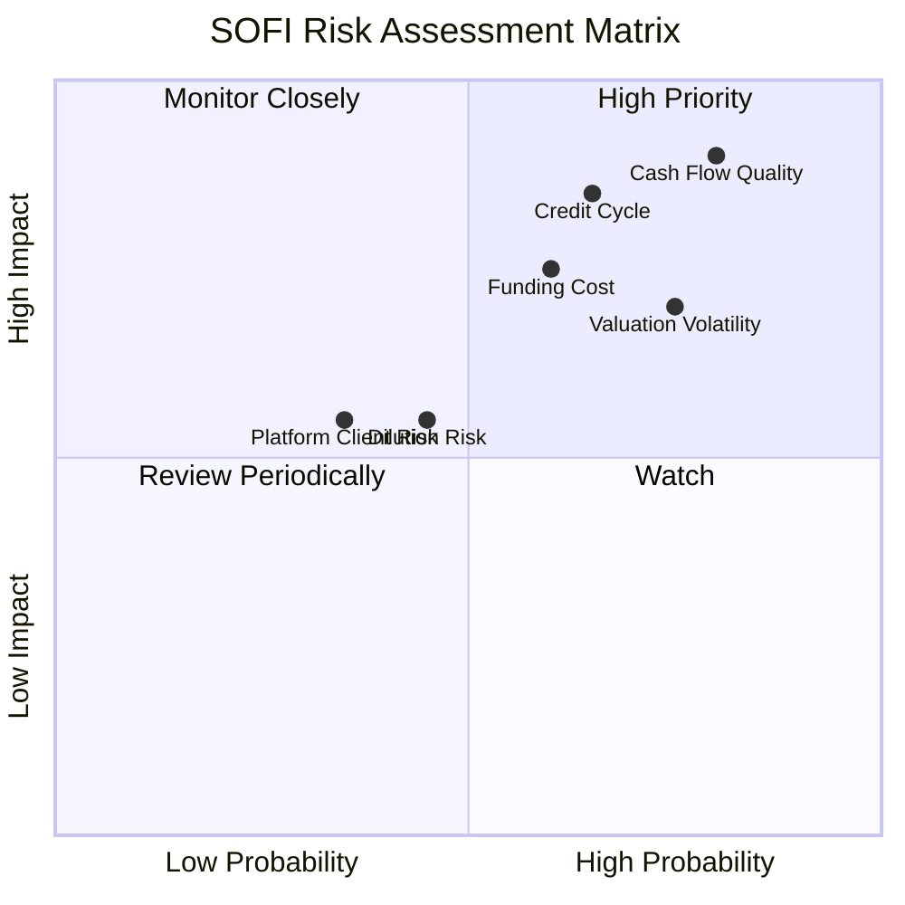

### 10.2 風險清單詳細分析

| # | 風險項目 | 發生機率 | 財務衝擊 | 風險評分 | 緩解措施 |
|---|----------|----------|----------|----------|----------|
| 1 | 🔴 現金流品質與資金需求 | 高 | OCF TTM -$10.21B；若負值持續，可能增加融資依賴 | 9.0/10 | 追蹤貸款發放、出售、存款與融資來源的現金流調節 |
| 2 | 🔴 信貸週期與貸款損失 | 中高 | 信用惡化可降低 Lending 利潤與估值倍數；損失率資料 N/A | 8.5/10 | 追蹤逾期率、核銷率、備抵與貸款組合 |
| 3 | 🟠 融資成本及利率敏感度 | 中高 | 稅前債務成本參考值 29.04%，利率上升可能壓縮淨利差 | 8.0/10 | 監控存款成本、貸款定價、到期結構及流動性 |
| 4 | 🟠 估值與股價波動 | 高 | Beta 2.24；空頭占流通股 17.5%；52 週高低 $31.75/$13.86 | 7.5/10 | 以分段買入與部位上限控制風險 |
| 5 | 🟡 SBC 稀釋 | 中 | FY2025 SBC $262.06M，約占收入 7.3% | 6.0/10 | 追蹤流通股年增率與 SBC／收入 |
| 6 | 🟡 科技平台客戶與競爭 | 中 | 平台收入、客戶集中度與續約率 N/A | 5.5/10 | 追蹤客戶數、交易量、留存及分部利潤 |

---

## 11. 投資建議

### 11.1 最終綜合評級雷達圖

```
╔══════════════════════════════════════════════════════════════╗
║                  SOFI 最終評分雷達                            ║
╠══════════════════════════════════════════════════════════════╣
║ 成長性       8.0/10  ▓▓▓▓▓▓▓▓▓▓▓▓▓▓▓▓░░░░  ★★★★☆          ║
║ 基本面       5.5/10  ▓▓▓▓▓▓▓▓▓▓▓░░░░░░░░░  ★★★☆☆          ║
║ 獲利品質     4.5/10  ▓▓▓▓▓▓▓▓▓░░░░░░░░░░░  ★★☆☆☆          ║
║ 財務健康     3.5/10  ▓▓▓▓▓▓▓░░░░░░░░░░░░░  ★★☆☆☆          ║
║ 護城河       5.0/10  ▓▓▓▓▓▓▓▓▓▓░░░░░░░░░░  ★★★☆☆          ║
║ 估值         3.0/10  ▓▓▓▓▓▓░░░░░░░░░░░░░░  ★★☆☆☆          ║
║ 資本效率     4.0/10  ▓▓▓▓▓▓▓▓░░░░░░░░░░░░  ★★☆☆☆          ║
╠══════════════════════════════════════════════════════════════╣
║ 綜合         5.0/10  成長可觀，但估值與現金流風險抵銷          ║
╚══════════════════════════════════════════════════════════════╝
```

### 11.2 目標價與隱含報酬率

| 情境 | 目標價 | 相對 2026-11-13 收盤 $15.42 | 估值依據 | 機率參考 |
|------|-------:|----------------------------:|----------|---------:|
| 🔴 悲觀 | $6.03 | -60.9% | Forward EPS $0.89961 × 6.7x | 30% |
| 🟡 基準 | $12.47 | -19.1% | Forward EPS $0.89961 × 同業均值 13.87x | 50% |
| 🟢 樂觀 | $20.51 | +33.0% | Forward EPS $0.89961 × 22.8x | 20% |
| 加權合理價值 | **$12.19** | **-21.0% 上行空間** | 第 8.8 節多方法加權 | — |

上述機率僅為情境分析參考；三情境目標價與第 8.8 節加權合理價值用途不同。依評級門檻，當前 MOS -26.5% 對應賣出；評級未作質化上調或下調。

### 11.3 買入時機與觸發因素

```
╔══════════════════════════════════════════════════════════════════╗
║                  ✅ 買入觸發因素 Checklist                      ║
╠══════════════════════════════════════════════════════════════════╣
║ 目前行動：不追價；現價 $15.42，高於加權合理值 $12.19            ║
║                                                                  ║
║ 重新評估買入的條件：                                             ║
║ ☐ 股價回落至 $10.97 以下，對 $12.19 合理價值具 MOS ≥10%         ║
║ ☐ TTM OCF 明顯改善，且現金流來源可由貸款／存款變動合理解釋       ║
║ ☐ 最新季營收年增維持 30%以上，且非只依賴高風險貸款擴張           ║
║ ☐ TTM ROIC 可計算並逐步向 WACC 18.05% 靠近或超越                ║
║                                                                  ║
║ 加碼觸發條件：                                                   ║
║ ☐ 連續兩季營業利潤率維持 19%以上，且信用損失沒有同步惡化         ║
║ ☐ SBC／收入下降且稀釋股數增幅趨緩                               ║
║                                                                  ║
║ 減碼／退出觸發條件：                                             ║
║ ☐ 連續兩季收入 YoY 低於 15%                                     ║
║ ☐ TTM OCF 持續為負且缺乏可驗證的貸款資產週轉改善                 ║
║ ☐ 信用損失上升導致營業利潤率低於 15%                            ║
║ ☐ 股價高於樂觀情境 $20.51、但盈利和現金流未同步上修             ║
╚══════════════════════════════════════════════════════════════════╝
```

### 11.4 投資人適配度分析

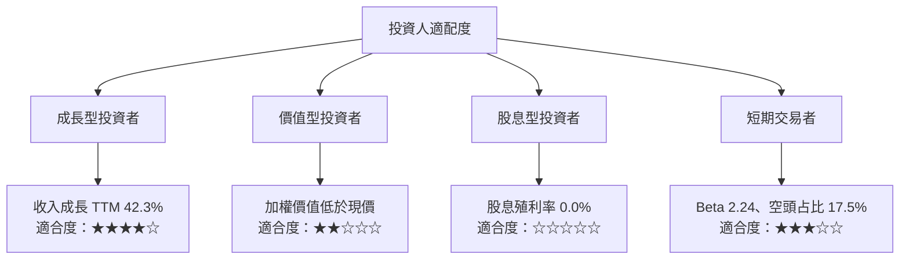

### 11.5 每季財報監控清單

| 監控指標 | 現有基準 | 加碼觸發 | 減碼／重新檢視 |
|----------|----------|----------|----------------|
| 收入成長 | TTM +42.3%；最新季 YoY +44.0% | YoY ≥30% 且延續兩季 | 連續兩季低於 15% |
| 營業利潤率 | 最新季 19.4%；TTM VERIFIED N/A | 連續兩季 ≥19% | 低於 15%或連續下滑 |
| 淨利 | 最新季 $240.99M | 成長並伴隨現金流改善 | 淨利增加但 OCF 更惡化 |
| TTM OCF | -$10.21B | 連續改善且可解釋資產變動 | 負值擴大且融資需求增加 |
| TTM FCF | VERIFIED N/A | 取得一致且轉正數據後重新估值 | 仍缺漏時降低估值信心 |
| Capex | TTM VERIFIED N/A；FY2025 $251.12M | Capex 轉化為可驗證平台收入 | 支出上升但收入／利潤無改善 |
| SBC／營收 | FY2025 約 7.3% | 比率逐年下降 | 比率上升且股數快速稀釋 |
| 信用指標 | 核銷、逾期、備抵 N/A | 信用品質穩定且貸款增長 | 逾期或核銷顯著增加 |
| 平台業務 | 分部收入與客戶數 N/A | 客戶／交易量增長且分部盈利改善 | 客戶集中或續約惡化 |
| 股數 | 2026-09 約 1.297B | 稀釋趨緩 | 股數加速增加 |
| 管理層財測 | 資料包未提供 | 財測上調並有實績支持 | 財測下修或連續未達標 |

### 11.6 反面論證：什麼會證明論點錯誤（What Would Change My Mind）

```
╔══════════════════════════════════════════════════════════════════╗
║              ⚠️ 論點失效條件（Disconfirming Evidence）           ║
╠══════════════════════════════════════════════════════════════════╣
║  多頭論點若遇下列情況，應重新檢視或退出：                       ║
║  ☐ TTM 收入成長跌破 15%，且連續兩季未恢復                       ║
║  ☐ 最新季營業利潤率低於 15%，或較 19.4%基準收縮超過 4.4 個百分點║
║  ☐ OCF 持續低於 -$10.21B TTM，且無法由貸款資產變化解釋          ║
║  ☐ FCF 持續無法確認轉正，或資料披露不足以檢驗現金轉換           ║
║  ☐ ROIC 可計算後低於 WACC 18.05%，並持續兩年以上               ║
║  ☐ FY2025 SBC／收入約 7.3%進一步上升且股數增速加快              ║
║  ☐ 信用損失增加使 Lending 獲利與公司淨利同步下滑                ║
╚══════════════════════════════════════════════════════════════════╝
```

> **免責聲明**：本報告為 AI 自動生成，僅供研究參考，不構成投資建議。資料來源口徑可能不一致；投資有風險，入市需謹慎。