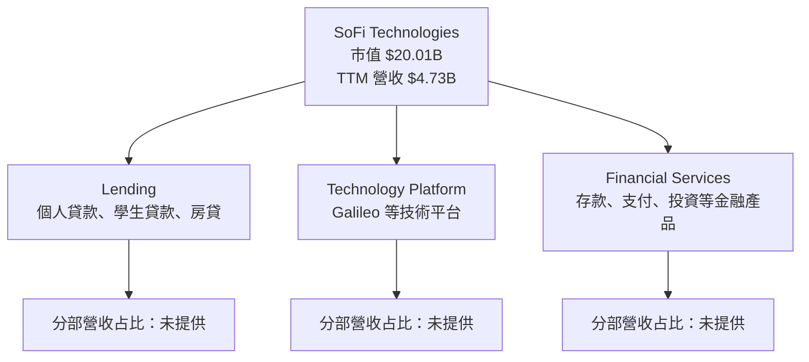
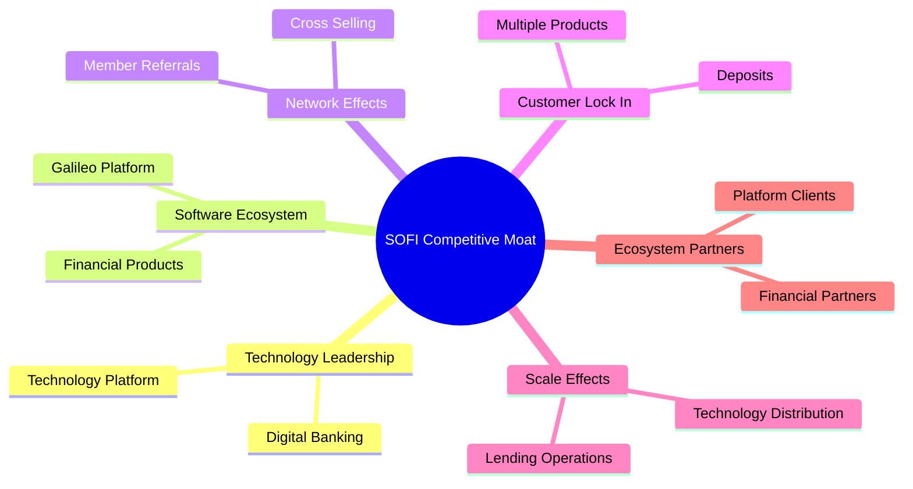
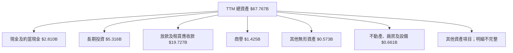
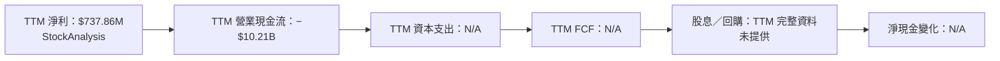
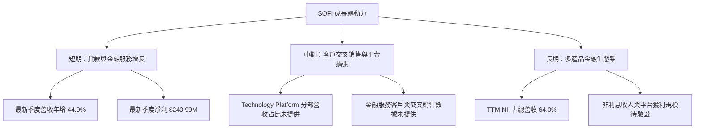
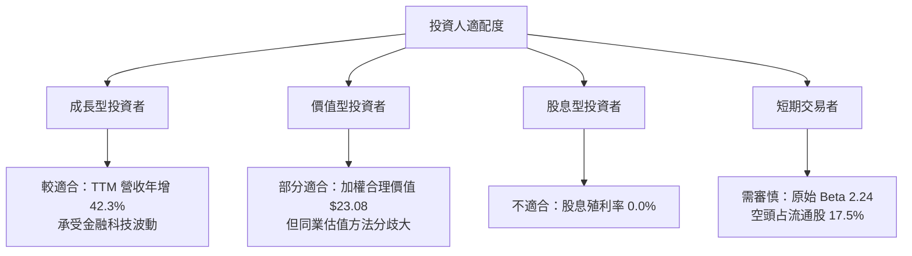

# SOFI 基本面深度分析報告
> **報告日期**：2026-11-14 ｜ **語言**：繁體中文 ｜ **數據來源**：SEC 申報資料 (XBRL)、Yahoo Finance、Finviz、StockAnalysis、Roic.ai ｜ **分析師**：CFA 級機構研究

---

## 目錄

| # | 章節 | 核心結論 |
|---|------|----------|
| 1 | 執行摘要 | 評級：買入；加權合理價值 $23.08；MOS +33.2% |
| 2 | 公司概覽與商業模式 | Lending、Technology Platform、Financial Services 三板塊形成產品生態，但各板塊營收占比未提供 |
| 3 | 損益表深度分析 | TTM 營收 $4.73B、TTM 年增 42.3%；最新季度年增 44.0% |
| 4 | 資產負債表分析 | 現金及短期投資 $2.81B；總債務為 N/A，槓桿狀況需以後續申報核實 |
| 5 | 現金流量深度分析 | TTM 營業現金流為 −$10.21B；TTM FCF 為 N/A，銀行放款現金流不可直接視為企業自由現金流 |
| 6 | 獲利能力與資本效率 | 貸款機構不適用一般 ROIC／營運資金框架；ROTCE 7.9%，WACC 14.00% |
| 7 | 相對估值分析 | Forward P/E 法隱含 $10.91，P/B 法隱含 $38.85；估值方法分歧大 |
| 8 | DCF 內在價值評估 | DCF 不適用；以金融業相對估值與分析師共識加權，合理價值 $23.08 |
| 9 | 成長催化劑 | 多產品交叉銷售、貸款與金融服務擴張、技術平台發展；TAM 數字未提供 |
| 10 | 風險矩陣 | 信用損失、融資成本與利率環境、估值波動為主要風險 |
| 11 | 投資建議 | 維持買入；重點追蹤信用品質、分部成長、資本與稀釋 |

---

## 1. 執行摘要

### 1.0 一頁式投資儀表板（Portfolio Manager 30 秒速讀）

| 項目 | 內容 |
|------|------|
| **投資論點（3 句）** | ① TTM 營收 $4.73B、年增 42.3%，最新季度營收年增 44.0%，顯示業務仍在擴張。② 最新季度淨利為 $240.99M，較上一季 $156.59M 增加，獲利規模改善，但銀行放款的現金流使傳統 FCF 解讀失真。③ 以金融業固定估值方法加權後，合理價值 $23.08，高於 2026-11-13 收盤價 $15.42。 |
| **綜合評分** | **6.3/10**（引用 1.1 評分卡） |
| **財務健康** | 🟡 現金及短期投資 $2.81B，但總債務為 N/A，且現金流數據不能直接按一般企業方式解讀 |
| **ROIC vs WACC** | ROIC：不適用於貸款機構；WACC：14.00%。ROTCE 7.9% 可作補充參考，但不可與 ROIC 等同 |
| **FCF 趨勢** | TTM FCF：N/A；TTM 營業現金流 −$10.21B。對放款機構而言，放款與存款活動會大幅影響營業現金流 |
| **估值** | Forward P/E 17.14x ｜ EV/EBITDA：N/A ｜ FCF Yield：N/A |
| **DCF 內在價值（基準）** | N/A；金融機構自由現金流具有融資性質，不適合本報告使用的一般企業 DCF |
| **安全邊際（MOS）** | **+33.2%＝($23.08 − $15.42) ÷ $23.08**；基準為 8.8 節加權合理價值 🟢 |
| **預期報酬（基準情境 12M）** | **+49.7%**，以加權合理價值 $23.08 相對現價 $15.42 計算；非 DCF 情境目標 |
| **關鍵風險（前二）** | 信用品質惡化可能侵蝕淨利；高利率與融資成本壓力可能削弱貸款需求及利差 |
| **評級 + 信心度** | 🟢 **買入** ｜ 信心：中低；估值上行來自規定的加權相對估值方法，且信貸風險資料不完整 |

### 1.1 綜合評分卡（全報告唯一）

| 維度 | 評分（1–10） | 主要依據（引用數字與其來源章節） |
|------|--------------|----------------------------------|
| 成長性 | 8.0 | TTM 營收年增 42.3%、最新季度年增 44.0%（第 3 章）；分部營收拆分未提供 |
| 獲利能力 | 6.0 | 最新季度營業利益率 19.4%，但 TTM 營業利益率 N/A；ROTCE 7.9%（第 6 章） |
| 財務健康 | 6.0 | 現金及短期投資 $2.81B、淨現金資料列示 $2.81B，但總債務 N/A，信貸指標亦缺漏（第 4、6 章） |
| 估值 | 7.0 | 加權合理價值 $23.08，MOS +33.2%；同業 Forward P/E 法估值僅 $10.91，方法間分歧顯著（第 7、8 章） |
| 護城河 | 6.0 | 三板塊涵蓋借貸、金融服務與技術平台，但收入占比、留存與客戶交叉銷售數據未提供（第 2 章） |
| 管理層與資本配置 | 5.0 | 2025 年 SBC $262.06M，約為年度營收的 7.3%；股息為零，回購資料未提供（第 3、5 章） |
| **綜合評分** | **6.3** | 六項算術平均： (8.0 + 6.0 + 6.0 + 7.0 + 6.0 + 5.0) ÷ 6 = **6.3** |

### 1.2 五大投資論點 + 三大核心風險

| 類型 | 項目 | 具體依據 | 信心度 |
|------|------|----------|--------|
| 🟢 **投資論點①** | 營收增長維持高位 | TTM 營收 $4.73B，年增 42.3%；最新季度年增 44.0% | 🟢 高 |
| 🟢 **投資論點②** | 多產品金融生態系 | 公司涵蓋 Lending、Technology Platform、Financial Services 三板塊，可支援跨產品導流；分部占比未提供，尚不能量化協同效益 | 🟡 中 |
| 🟢 **投資論點③** | 單季獲利擴大 | FY2026 Q3 淨利 $240.99M，較 Q2 的 $156.59M 增加約 53.9% | 🟡 中 |
| 🟢 **投資論點④** | 估值方法加權後具上行空間 | 8.8 節加權合理價值 $23.08，較現價 $15.42 高 49.7% | 🟡 中 |
| 🟢 **投資論點⑤** | 股價低於近 5 年 P/E 中位數 | P/E 27.5x，低於自身 5 年中位數 36.6x；目前位於歷史區間第 11 百分位 | 🟡 中 |
| 🟡 **風險①** | 信貸損失與逾放資料缺漏 | 淨沖銷率、逾放比與 CET1 均未提供，無法直接驗證貸款組合的風險趨勢 | 🔴 高衝擊 |
| 🔴 **風險②** | 融資與利率敏感度 | 10 年期美債利率 5.15%；原始 Beta 2.24，股價對市場變動敏感 | 🟡 中高 |
| 🟡 **風險③** | 估值方法分歧 | 同業 Forward P/E 隱含 $10.91，但同業 P/B 隱含 $38.85，估值結果高度依賴採用方法 | 🔴 高衝擊 |

### 1.3 快速統計卡片

| 指標 | 公司實際值（期間） | 同業中位數 | 狀態 |
|------|--------------------|------------|------|
| 營收成長（TTM） | **42.3%** | — | 🟢 |
| 營收成長（最新一季年增） | **44.0%** | 34.1% | 🟢 |
| 毛利率（TTM） | **84.2%** | 83.3% | 🟢；金融業毛利率可比性有限 |
| 營業利益率（TTM） | **N/A** | — | 🟡；最新一季為 19.4% |
| ROIC（TTM） | **N/A（貸款機構不適用）** | — | 🟡 |
| Forward P/E | **17.14x** | 12.1x | 🟡 |
| FCF Yield（TTM） | **N/A** | — | 🟡；金融機構 FCF 解讀不適用 |
| Piotroski F-Score | **N/A（未套用）** | — | 🟡；放款現金流會使測試失真 |

### 1.4 投資結論

```text
╔══════════════════════════════════════════════════════════════════╗
║                    📊 投資結論摘要                               ║
╠══════════════════════════════════════════════════════════════════╣
║  評級：買入（依加權合理價值 MOS 門檻；ROIC 對貸款機構不適用）    ║
║  價格（2026-11-13 收盤）：$15.42                                 ║
║  DCF 內在價值（基準）：N/A（金融業現金流不適用一般 DCF）        ║
║  安全邊際 MOS：+33.2%＝($23.08−$15.42)÷$23.08                  ║
║  加權合理價值（8.8）：$23.08                                    ║
║  綜合評分：6.3/10（引用 1.1）                                   ║
║  適合投資人：能承受金融科技與信貸週期波動的成長型投資人          ║
╚══════════════════════════════════════════════════════════════════╝
```

---

## 2. 公司概覽與商業模式

### 2.1 業務結構與收入來源

SoFi Technologies, Inc. 在美國及部分國際市場提供金融服務，業務由 Lending、Technology Platform 與 Financial Services 三個板塊構成。公司 TTM 營收為 $4.73B、市值為 $20.01B；各板塊營收與占比未提供，因此不以推估比例繪製收入結構。



貸款業務有助於利息收入與客戶獲取，但也承擔信用風險與資金成本。金融服務可以提升客戶關係與交叉銷售機會；技術平台則有機會提供非利息型服務收入。不過，收入分部、活躍客戶數、交叉銷售率與平台客戶留存數據未提供，現階段無法量化其收入多元化程度。

### 2.2 市場份額

市場份額數據未提供，因此不繪製市場份額圖或推估滲透率。已知 TTM 營收為 $4.73B，TTM 成長率 42.3%；以所列同業最新季度營收成長率比較，SoFi 最新季度年增 44.0%，高於 NU 的 34.4%、UPST 的 34.1% 與 HOOD 的 11.8%。但公司業務組合與收入確認方式不同，成長率並不代表相同的市場份額或盈利品質。

### 2.3 競爭護城河分析



以上為業務模型中的可能護城河來源，不等同於已被財務數字驗證的競爭優勢。客戶留存率、平台交易量、交叉銷售率與單位獲客成本均未提供，故評估應採審慎立場。

### 2.4 護城河強度

| 護城河項目 | 強度（強／中／弱） | 證據（引用數字或事實） | 會削弱它的情況 |
|------------|--------------------|------------------------|----------------|
| 技術與數位體驗 | 中 | 公司有金融服務與技術平台業務，營收 TTM 年增 42.3%；技術平台分部營收未提供 | 產品差異化不足、數位銀行獲客成本上升 |
| 軟體生態系統 | 中 | Galileo 被列為技術平台產品；平台客戶數與經常性收入未提供 | 客戶流失、平台服務商品化 |
| 網路效應 | 弱至中 | 多產品可形成交叉銷售可能，但活躍會員及推薦數據未提供 | 客戶只使用單一產品、獲客成本持續增加 |
| 客戶鎖定 | 中 | 存款、借貸與支付產品可能增加轉換成本；客戶多產品率未提供 | 利率優惠消失後客戶轉移、服務體驗惡化 |
| 規模效應 | 中 | TTM 營收 $4.73B，最新季度年增 44.0% | 增長伴隨更高行銷、信用成本或融資成本 |
| 生態夥伴 | 中 | 技術平台提供與合作夥伴連結的可能；合作數量與收入未提供 | 夥伴轉向競爭平台或自建系統 |

第 1.1 節「護城河」評分為 6.0，理由是產品與平台的結構有建立生態系統的可能，但缺乏客戶留存、交叉銷售及平台營收等可驗證數字。

---

## 3. 損益表深度分析

### 3.1 年度收入成長趨勢（近 4 年）

| 財年 | 營收 | YoY 成長 |
|------|------|----------|
| 2022 | $1.57B | — |
| 2023 | $2.11B | +34.4% |
| 2024 | $2.61B | +23.7% |
| 2025 | $3.61B | +38.3% |

```text
╔══════════════════════════════════════════════════════════════════╗
║               SoFi 年度營收趨勢（FY2022–FY2025）                 ║
╠══════════════════════════════════════════════════════════════════╣
║  FY2022  $1.57B  ████████░░░░░░░░░░░░░░░░  基期                ║
║  FY2023  $2.11B  ███████████░░░░░░░░░░░░░  YoY +34.4% 🟢       ║
║  FY2024  $2.61B  ██████████████░░░░░░░░░░  YoY +23.7% 🟢       ║
║  FY2025  $3.61B  ████████████████████░░░░  YoY +38.3% 🟢       ║
║                                                                  ║
║  FY2022–FY2025 營收 CAGR：約 32.0%                               ║
╚══════════════════════════════════════════════════════════════════╝
```

2022 至 2025 年營收約由 $1.57B 增至 $3.61B，三年 CAGR 約 32.0%。營收成長在 2024 年放緩至 23.7%，2025 年回升至 38.3%；成長回升可能來自貸款與金融服務規模擴張，但分部營收資料不足，不能將增長歸因於特定產品。

### 3.2 季度收入趨勢分析

| 季度 | 營收 | QoQ 成長 | YoY 成長 | 備註 |
|------|------|----------|----------|------|
| 2025 Q4 | $1.03B | — | +40.2% | YoY 採 StockAnalysis 季度資料 |
| 2026 Q1 | $1.10B | 約 +6.8% | +42.5% | QoQ 以呈現至 $0.01B 的金額計算 |
| 2026 Q2 | $1.22B | 約 +10.9% | +42.6% | QoQ 受報表數字四捨五入影響 |
| 2026 Q3 | $1.39B | 約 +13.9% | **+44.0%** | 最新季度年增率；不可標為 TTM 成長率 |

公司 TTM 營收成長率為 42.3%，是過去四季合計對前一個 TTM 的增長；最新一季年增率 44.0% 則是單季對去年同期的成長。兩者期間不同，不應混為一談。

### 3.3 利潤率演變分析

| 利潤率指標 | FY2022 | FY2023 | FY2024 | FY2025／最新 | 趨勢 | 評估 |
|------------|--------|--------|--------|--------------|------|------|
| 毛利率 | N/A | N/A | N/A | TTM 84.2% | 歷年序列未提供 | 🟡 金融業毛利率可比性有限 |
| 營業利益率 | N/A | N/A | N/A | TTM N/A；最新季度 19.4% | 最新季度有改善訊號，但不足以建立完整趨勢 | 🟡 |
| 淨利率 | 約 −20.4% | 約 −14.3% | 約 19.1% | FY2025 約 13.3%；TTM 15.6% | 從虧損轉為正獲利，FY2025 低於 FY2024 | 🟡 |
| EBITDA 利潤率 | N/A | N/A | N/A | TTM 0.0%（來源列示） | 與其他獲利指標不完全一致 | 🟡，不單獨作結論 |

年度淨利率以同年度淨利除以同年度營收計算。FY2024 淨利為 $498.67M，FY2025 為 $481.32M，雖然營收提高，淨利仍下降約 3.5%。這表示收入擴張尚未穩定轉化為同比淨利增長，需繼續觀察信用成本、資金成本與營運費用。FY2026 Q3 最新季度營業利益率為 19.4%，但 TTM 營業利益率被列為 N/A，故不把單季數字外推為全年趨勢。

### 3.4 費用結構分析

費用分類與各項金額未完整提供，無法計算可核實的費用占比，因此不繪製費用圓餅圖。可確認的年度股權薪酬為 FY2025 $262.06M；信貸損失準備、行銷費用、技術費用及人事費用的完整拆分未提供，無法判斷費用結構中哪一項是利潤率變化的主要來源。

### 3.5 季度 EPS 趨勢與盈餘品質（Quality of Earnings）

#### 過去四季 EPS

| 季度 | EPS 實際值 | EPS 預期值 | 超預期／不及預期 | 備註 |
|------|------------|------------|------------------|------|
| 2025 Q4 | $0.13 | N/A | N/A | EPS 預期值缺漏 |
| 2026 Q1 | $0.12 | N/A | N/A | EPS 預期值缺漏 |
| 2026 Q2 | $0.12 | N/A | N/A | EPS 預期值缺漏 |
| 2026 Q3 | $0.19 | N/A | N/A | EPS 預期值缺漏 |

EPS estimate 與實際值記錄均為缺漏，無法據此判斷最近四季是否超出市場預期。單季淨利從 2026 Q2 的 $156.59M 升至 Q3 的 $240.99M，QoQ 約增加 53.9%；此為實際獲利變化，不等同於「超預期」。

#### 盈餘品質檢查

| 盈餘品質項目 | 數值／佔比 | 評估 |
|--------------|-----------|------|
| 股權薪酬 SBC / 營收 | TTM SBC 約 $288.33M ÷ TTM 營收 $4.73B ≈ **6.1%** | 🟡 SBC 對股東報酬有可觀稀釋成本；計算使用四季 SBC 與 TTM 營收 |
| SBC / 營業現金流 | $288.33M ÷ −$10.21B ≈ **−2.8%** | 🔴 負營業現金流使比率不具一般解讀意義；負號不是 SBC 負擔較低的證據 |
| FCF / 淨利（現金轉換率） | **N/A** | TTM FCF 為 N/A，不反推資本支出或 FCF |
| 一次性／非經常性損益 | N/A | 未提供足夠明細，不能判定一次性損益是否影響淨利 |
| 有效稅率 | **8.5%** | 🟡 稅率偏低可能放大利潤，但缺少多年稅率序列，無法確認是否異常或可持續 |
| 資本化支出 vs 費用化 | N/A | 資本化政策與明細未提供，無法判斷是否遞延成本 |

**盈餘品質結論：** SoFi 已產生正淨利，TTM 淨利率約 15.6%，但 SBC 約占 TTM 營收 6.1%，且營業現金流為 −$10.21B。對銀行／放款機構而言，放款增加會占用現金，負營業現金流不必然代表經濟獲利為負；但目前缺乏放款成長、存款資金來源、信用損失與逾放資料，無法確認 GAAP 淨利的現金轉換品質。估值上不宜將一般企業 FCF 倍數作為主要依據。

---

## 4. 資產負債表分析

### 4.1 資產結構分解

以下採用 StockAnalysis 的 TTM 資產明細；資產總額與其他申報期間數字可能不同，且列出項目未必構成完整資產分類。



放款及租賃應收款在所列資產項目中規模較大，這符合貸款機構的資產特性；但資產明細沒有完整對應到總資產，不能將上述項目當作完整且可直接相加的資產分解。

### 4.2 流動性與營運資金分析

| 指標 | 數值 | 評估 |
|------|------|------|
| 現金及短期投資 | $2.81B | 🟡 提供流動性緩衝，但不能單獨代表可自由支配現金 |
| 總債務 | N/A | 無法計算債務／現金比率或債務到期壓力 |
| 淨現金 | $2.81B | 程式計算列示；因總債務為 N/A，無法由已列示的總債務獨立核對 |
| Current Ratio | 1.086 | 🟡 來自合併資料；一般銀行流動比率的解讀有限 |
| Quick Ratio | 0.428 | 🟡 不宜直接套用非金融企業流動性門檻 |
| DSO／DIO／DPO／CCC | 不適用（金融業） | 貸款、存款與金融資產負債不適用一般存貨現金轉換週期分析 |

需要特別留意，其他來源另列總債務與淨負債數值，但與經程式計算列示的總債務 N/A、淨現金 $2.81B 不一致。本報告依規則使用已核實的指定數值，不以跨來源資料拼湊或反推總債務；投資人應在後續財報中核對銀行融資、存款與債務定義。

### 4.3 債務結構分析

```text
╔══════════════════════════════════════════════════════════════════╗
║                   SOFI 債務健康診斷                              ║
╠══════════════════════════════════════════════════════════════════╣
║  總債務：        N/A       無法核實                              ║
║  現金+短期投資： $2.81B    可提供流動性緩衝                       ║
║  淨現金：        $2.81B    指定計算結果；債務明細未提供           ║
║                                                                  ║
║  Debt/EBITDA：   N/A       債務與 EBITDA 資料不足                 ║
║  利息保障倍數：  N/A       利息費用明細及可比 EBITDA 不足          ║
║  負債／權益：    N/A       經核實區塊未提供可採用數字             ║
║                                                                  ║
║  評估：🟡 現金餘額有緩衝，但無法依現有資料完整評估槓桿與償債能力  ║
╚══════════════════════════════════════════════════════════════════╝
```

### 4.4 股東權益趨勢

| 財年 | 股東權益 | YoY 變化 |
|------|----------|----------|
| 2022 | $5.53B | — |
| 2023 | $5.55B | 約 +0.4% |
| 2024 | $6.53B | 約 +17.7% |
| 2025 | $10.49B | 約 +60.8% |

```text
╔══════════════════════════════════════════════════════════════════╗
║                 SOFI 歷年股東權益                                ║
╠══════════════════════════════════════════════════════════════════╣
║  2022  $5.53B  ███████████░░░░░░░░░░░  基期                    ║
║  2023  $5.55B  ███████████░░░░░░░░░░░  約 +0.4%                 ║
║  2024  $6.53B  █████████████░░░░░░░░░  約 +17.7%                ║
║  2025 $10.49B  █████████████████████  約 +60.8%                 ║
╚══════════════════════════════════════════════════════════════════╝
```

2025 年股東權益提高至 $10.49B，較 2024 年增加約 60.8%。權益增長有助於吸收金融業資產擴張與信用損失，但僅靠權益變化無法判斷增長來源；需進一步核對增資、保留盈餘、股份薪酬及其他資本項目。

---

## 5. 現金流量深度分析

### 5.1 現金流量瀑布圖



這不是一般企業的線性現金轉換瀑布：金融業放款與資金來源屬於核心營運，會影響營業現金流。因此，−$10.21B 不能直接解讀為營運失血，也不能用它反推缺漏的資本支出或 TTM FCF。

### 5.2 FCF 轉換率趨勢

| 期間 | 營業現金流 | 資本支出 | FCF／淨利 | 解讀 |
|------|------------|----------|----------|------|
| FY2022 | −$7.26B | 資本支出列示為 −$103.73M | N/A | 放款活動會扭曲一般企業現金轉換率 |
| FY2023 | −$7.23B | 資本支出列示為 −$121.19M | N/A | 同上 |
| FY2024 | −$1.12B | 資本支出列示為 −$163.62M | N/A | 淨利為正，但營業現金流仍受資產負債擴張影響 |
| FY2025 | −$3.74B | 資本支出列示為 −$251.12M | N/A | 年度現金流不能替代 TTM 經核實的 FCF 指標 |
| TTM | −$10.21B | N/A | N/A | 指定的 TTM FCF 與轉換率不可得 |

### 5.3 自由現金流趨勢

```text
╔══════════════════════════════════════════════════════════════════╗
║             現金流：報表列示年度值與 TTM 指標                   ║
╠══════════════════════════════════════════════════════════════════╣
║  FY2022 報表列示 FCF  −$7.36B                                    ║
║  FY2023 報表列示 FCF  −$7.35B                                    ║
║  FY2024 報表列示 FCF  −$1.28B                                    ║
║  FY2025 報表列示 FCF  −$3.99B                                    ║
║  TTM FCF               N/A                                        ║
║  TTM FCF Yield         N/A                                        ║
╠══════════════════════════════════════════════════════════════════╣
║  注意：銀行／放款機構的放款現金流不能直接等同一般企業自由現金流  ║
╚══════════════════════════════════════════════════════════════════╝
```

年度報表列示 FCF 過去數年為負，FY2024 的負值較小、FY2025 再度擴大；但對放款機構，這些數字可能主要反映貸款資產增加，而非單純營運現金不足。由於 TTM 資本支出及 TTM FCF 在指定經核實數據中為 N/A，本報告不採用其他來源自行重算的 TTM FCF Yield。

### 5.4 資本配置評估

現有資料不足以建立「回購／投資／Capex／股息／留存」可相加的資本配置比例，因此不繪製圓餅圖。

| 項目 | 已知數據 | 評估 |
|------|----------|------|
| 股息 | 市場資料列示殖利率 0.0%；FY2025 股息支付 $0 | 🟡 保留資本投入業務 |
| 回購 | N/A | 無法評估回購規模或抵銷稀釋的效果 |
| SBC | FY2025 $262.06M；約占 FY2025 營收 $3.61B 的 7.3% | 🔴 對股東有稀釋成本 |
| 資本支出 | FY2025 年度報表列示 $251.12M；TTM 資本支出 N/A | 無法據此評估最新投資強度 |
| 放款與金融資產 | 放款淨額占總資產 79.3% | 資本配置核心與貸款組合及資金來源密切相關 |

---

## 6. 獲利能力與資本效率

### 6.1 ROE／ROA／資本效率趨勢

| 指標 | 數值 | 評估 |
|------|------|------|
| ROE（TTM，指定數值） | 6.5% | 🟡 反映股東權益報酬；不同來源另列 7.4%，本報告採指定經核實值 |
| ROA（TTM，合併資料） | 1.3% | 🟡 金融業資產基數大，需搭配資產品質解讀 |
| ROTCE（TTM） | 7.9% | 🟡 有形權益報酬率，是貸款機構較適用的補充指標 |
| ROIC | N/A（金融業不適用） | 一般 ROIC 對金融業的負債與營運資本定義不具一致性 |
| 行業均值對比 | 未提供 | 不填入未核實同業均值 |

### 6.2 ROIC vs WACC 分析（核心價值創造判斷）

```text
╔══════════════════════════════════════════════════════════════════╗
║                ROIC vs WACC 深度分析                            ║
╠══════════════════════════════════════════════════════════════════╣
║  WACC（指定資本成本輸入）：14.00%                                ║
║  ├── 無風險利率（10Y 美債）：             5.15%                 ║
║  ├── 市場風險溢酬（假設）：               5.00%                 ║
║  ├── Beta（調整後）：                     1.83                  ║
║  ├── 股權成本：                           14.29%                ║
║  ├── 稅前債務成本：                       29.04%                ║
║  ├── 股權／債務權重：                     83.4%／16.6%          ║
║  └── WACC：                               14.00%                ║
║                                                                  ║
║  ROIC：N/A（貸款機構不適用一般 ROIC 分析）                       ║
║  ROTCE：7.9%（貸款機構有形權益報酬率）                           ║
║  ROTCE − WACC：7.9% − 14.00% = −6.1 個百分點                   ║
║                                                                  ║
║  結論：不能以 ROTCE 取代 ROIC，亦不能據此直接判定公司摧毀價值。  ║
║  但 ROTCE 低於指定 WACC，顯示現有股東資本回報仍需改善。          ║
╚══════════════════════════════════════════════════════════════════╝
```

WACC 14.00% 為指定資本成本數值，且其未限制計算值為 16.33%，落在設定的 7%–14% 區間之外，因此採用上限 14.00%。金融機構的存款與借款是核心營運投入，不宜像一般企業一樣用「營業資本報酬率」直接衡量。因此本報告不宣稱 ROIC 高於或低於 WACC；ROTCE 7.9% 低於 WACC 14.00%，只能作為股東資本回報偏低的提示，而不是嚴格的 ROIC-WACC 價值創造結論。

### 6.3 杜邦三因素分解

| 因素 | 數值（TTM） | 解讀 |
|------|-------------|------|
| 淨利率 | 15.6% | 獲利能力來源之一；金融業利息與信用成本需一併評估 |
| 資產週轉率 | 0.07 | 資產規模相對收入大，符合貸款機構資產密集特性 |
| 權益乘數 | 6.00 | 槓桿對 ROE 有放大作用，需配合信貸品質監控 |
| **ROE** | **6.5%** | 指定 DuPont 數值：15.6% × 0.07 × 6.00 = 6.5% |

ROE 受到較低資產週轉率與權益乘數影響；權益乘數 6.00 表示槓桿對股東報酬有重要作用。對貸款機構而言，這也使資產品質與資本充足度更為重要。

### 6.4 財務體質：Piotroski F-Score／貸款機構指標

Piotroski F-Score 為 N/A，原因是放款成長會造成營業現金流流出，相關現金流測試可能錯誤解讀銀行經營狀況，因此不套用九項測試。

| 貸款機構指標 | 數值 | 解讀 |
|--------------|------|------|
| 淨利息收入 NII／總營收（TTM） | 64.0% | 利息收入是主要收入來源之一 |
| 淨利差代理值 NII／平均總資產 | 5.36% | 這是代理值；分母使用總資產而非生息資產，通常低於以生息資產計算的正式 NIM |
| 成本收入比代理值 | 80.8% | 以（營收 − 稅前淨利）÷ 營收估算，包含信用準備，通常高於公司正式效率比率 |
| ROTCE | 7.9% | 淨利相對有形帳面價值回報；目前不高，仍需改善 |
| P/TBV | 2.15x | 市場價格相對有形帳面價值的倍數 |
| 放款淨額／總資產 | 79.3% | 資產對貸款曝險較高，信貸風險管理重要 |
| 淨沖銷率 | N/A（數據未提供） | 信用品質關鍵資料缺漏 |
| 逾放比 | N/A（數據未提供） | 無法直接評估逾期貸款趨勢 |
| CET1 | N/A（數據未提供） | 無法評估監管資本緩衝 |

---

## 7. 相對估值分析

### 7.1 同業估值比較表格

下表公司估值採市場資料；同業估值與成長率使用 Yahoo Finance 同業數據。公司數值與指定歷史估值資料可能因日期或計算口徑略有差異，表內不將其混為同一指標。

| 估值指標 | **SOFI** | **NU** | **HOOD** | **UPST** | SOFI 評估 |
|----------|----------|---------|---------|---------|-----------|
| **Trailing P/E** | 28.04x | 16.5x | 35.9x | 32.1x | 🟡 接近 HOOD、低於 UPST |
| **Forward P/E** | 17.14x | 12.1x | 22.8x | 6.7x | 🟡 高於同業中位數 12.1x |
| **P/S** | 4.27x | 7.0x | 13.8x | 1.4x | 🟢 低於 NU、HOOD；高於 UPST |
| **EV/EBITDA** | N/A | N/A | N/A | 27.3x | 🟡 SOFI 倍數不可得，不能直接比較 |
| **最新季度營收年增** | 44.0% | 34.4% | 11.8% | 34.1% | 🟢 SOFI 高於所列同業 |
| **毛利率（TTM）** | 84.2% | 0.0% | 91.0% | 83.3% | 🟡 業務及計算口徑差異大 |

NU、HOOD、UPST 的 Forward P/E 中位數為 12.1x，而 SOFI Forward P/E 為 17.14x，表示市場對 SOFI 的獲利增長給予較高倍數。另一方面，SOFI 最新季度營收年增 44.0%，高於這三家同業列示的最新季度成長率；此增長優勢能否延續，取決於貸款需求、信貸成本與非貸款業務擴張。

### 7.2 歷史估值區間分析

```text
╔══════════════════════════════════════════════════════════════════╗
║           SOFI 近 5 年 P/E 歷史位置                              ║
╠══════════════════════════════════════════════════════════════════╣
║  歷史區間：27.0x ├────────────────────────────┤ 67.1x          ║
║  歷史中位數：36.6x                                                ║
║  當前 P/E：27.5x   ↑ 位於歷史區間第 11 百分位                    ║
║                                                                  ║
║  P/S：當前 4.4x；中位數 4.5x；區間 2.6x–14.6x；第 43 百分位    ║
║  EV/EBITDA：當前 63.6x；中位數 65.1x；第 48 百分位             ║
╚══════════════════════════════════════════════════════════════════╝
```

P/E 位於自身歷史區間第 11 百分位，表示相對自身過去估值偏低；但 P/S 與 EV/EBITDA 分別位於第 43、48 百分位，並沒有呈現同樣程度的歷史折價。不同倍數給出的訊號不一致，反映盈利波動與金融業資產負債表特性的影響。

### 7.3 情境價值（Bear / Base / Bull）

**N/A（DCF 無法計算：貸款機構的現金流包含資金來源與放款活動，不適用本報告設定的一般企業 DCF；因此不提供 DCF 情境目標價。）**

### 7.4 相對估值隱含價格區間

```text
╔══════════════════════════════════════════════════════════════════╗
║                 相對估值方法隱含每股價值                         ║
╠══════════════════════════════════════════════════════════════════╣
║  $10.91 ───── $15.42 ───── $20.84 ───── [$23.08] ───── $38.85 ║
║  Forward P/E   現價       分析師共識   加權合理值     P/B       ║
╚══════════════════════════════════════════════════════════════════╝
```

| 方法 | 每股價值 | 相對現價 | 依據 |
|------|----------|----------|------|
| 同業 Forward P/E | $10.91 | −29.2% | NU、HOOD、UPST 同業 Forward P/E 中位數 12.1x × SOFI Forward EPS $0.90 |
| 同業 P/B | $38.85 | +151.9% | 同業 P/B 中位數 4.5x × SOFI 每股帳面價值 $8.71 |
| 分析師共識目標價 | $20.84 | +35.1% | 23 位分析師平均目標價 |

同業 Forward P/E 的隱含價值低於現價，P/B 方法則遠高於現價，說明估值結論高度依賴採用的盈利或帳面價值框架。對貸款機構而言，P/B 與有形帳面價值具參考性，但需結合資產品質；目前沖銷率、逾放比及 CET1 缺漏，降低了 P/B 結論的可驗證性。

---

## 8. DCF 內在價值評估（Discounted Cash Flow）

> **DCF MODEL：N/A。** 貸款機構的現金流包含存款、融資與貸款發放，這些項目是資金來源及核心營運，不是可直接套用企業自由現金流模型的現金流。因此，本章不建立自行推導的 DCF，也不提供假設性 DCF 目標價。

### 8.0 估值推理鏈（Thinking Logic）

**Step 1 — SOFI 價值的主要來源**

SOFI 的價值主要取決於貸款業務的風險調整後收益、金融服務產品的客戶與收入擴張，以及技術平台業務的收入品質；目前三板塊營收占比未提供，不能以未經核實的比例拆解。指定貸款機構指標顯示，NII 占總營收 64.0%，放款淨額占總資產 79.3%，因此貸款資產品質與資金成本是目前最重要、也最需要進一步驗證的估值變數。

**Step 2 — 模型選擇**

| 決策點 | 本報告採用 | 理由 | 曾考慮但否決 | 否決理由 |
|--------|-----------|------|--------------|----------|
| 現金流定義 | DCF 不適用 | TTM 營業現金流為 −$10.21B，但貸款發放與資金來源會直接影響該數字 | FCFF／FCFE | 無法將放款與融資資金流視為一般企業自由現金流 |
| 預測期 N | N/A | 沒有可用的 DCF 模型或金融業專用預測輸入 | 自行設定 5–10 年 | 將需要另造營收、利率、信用成本和資本假設，違反指定數據規則 |
| 終值方法 | N/A | 沒有適用的 DCF 終值計算 | Gordon Growth／退出倍數 | 以不適用的 FCF 作終值基礎會產生誤導 |
| EBIT 基礎 | N/A | 不建立 DCF | GAAP／非 GAAP | 無 DCF 預測期與 FCFF 計算 |

**Step 3 — 關鍵假設推導鏈**

由於指定的 DCF MODEL 為 N/A，沒有可引用的預測營收 CAGR、營業利潤率、永續成長率、預測期、Capex、D&A、營運資金變化或稀釋股數假設。本報告不以歷史營收增長率代替 DCF 輸入，也不自行建立現金流模型。

**Step 4 — 最脆弱的一環**

主要估值弱點是信貸資產品質資料不足：淨沖銷率、逾放比與 CET1 均未提供。若信用成本上升，淨利、ROTCE 與 P/B 估值可能同時下修；影響幅度目前無法用已提供數據量化。

**Step 5 — 計算路徑**

一般企業 DCF 路徑需由營收推導 EBIT、NOPAT、FCFF，再折現企業價值；本報告不套用該路徑，改以固定的金融業估值方法進行三角驗證。

### 8.1 模型假設總表（Model Inputs）

| 假設項目 | 採用值 | 依據／來源 | 敏感度 |
|----------|--------|-------------|--------|
| 預測期長度 N | N/A | DCF MODEL 不適用於放款機構現金流 | N/A |
| 營收 CAGR | N/A | 不建立 DCF 預測 | N/A |
| 期末營業利潤率 | N/A | TTM 營業利益率亦為 N/A；不自行假設 | N/A |
| 有效稅率 | 不納入 DCF | 即使最新年度有效稅率為 8.5%，仍不足以建立金融業現金流模型 | N/A |
| Capex／營收 | N/A | TTM Capex 為 N/A；不得反推 | N/A |
| D&A／營收 | N/A | 缺少 DCF 模型輸入 | N/A |
| ΔWC／營收增額 | N/A | 一般營運資金分析不適用貸款機構 | N/A |
| EBIT 基礎 | N/A | 不建 DCF | N/A |
| SBC 處理 | N/A | 不建 DCF | N/A |
| 年稀釋率 | N/A | 不建 DCF；市場資料股數不能替代模型假設 | N/A |
| 永續成長率 g | N/A | 不計算 Gordon Growth 終值 | N/A |
| 終值方法 | N/A | DCF 不適用 | N/A |
| WACC | 14.00%（指定資本成本） | 資本成本輸入列示計算值 16.33%，受 7%–14% 範圍限制後採用 14.00%；此處不作 DCF 折現 | N/A |

FCFF 定義與 SBC 防重複扣除規則均不適用，因本章沒有建立 DCF 現金流模型。

### 8.2 折現率推導（WACC）

```text
╔══════════════════════════════════════════════════════════════════╗
║                    WACC 資料與採用值                             ║
╠══════════════════════════════════════════════════════════════════╣
║  無風險利率 Rf（10Y 美債）：              5.15%                 ║
║  市場風險溢酬 ERP（假設）：               5.00%                 ║
║  原始 Beta（Yahoo）：                      2.24                  ║
║  調整後 Beta：                             1.83                  ║
║  Beta 調整：        ⅔ × 2.24 + ⅓ × 1 = 1.83                    ║
║  股權成本：                                 14.29%                ║
║  稅前債務成本：                             29.04%                ║
║  有效稅率：                                  8.5%                 ║
║  權重（股權／債務）：                       83.4%／16.6%          ║
║                                                                  ║
║  計算 WACC：16.33%                                               ║
║  採用 WACC：14.00%（受 7%–14% 設定區間限制）                    ║
║  本報告第 6.2 節使用同一採用值；不以此建立 DCF。                ║
╚══════════════════════════════════════════════════════════════════╝
```

Cost of capital 資料列示股權成本 14.29%、稅前債務成本 29.04%、有效稅率 8.5%、股權與債務權重 83.4%／16.6%；計算 WACC 為 16.33%，但採用值受 7%–14% 限制而為 14.00%。由於 DCF MODEL 為 N/A，本節不重新計算 CAPM、Kd 或債務權重，也不以缺少的債務餘額重建其算式。

### 8.3 逐年自由現金流預測（基準情境）

**N/A（數據未提供且 DCF MODEL 不適用：貸款機構現金流反映融資與放款活動，不能以一般企業 FCFF 預測。）**  
因此不列逐年預測、折現因子、FCFF 合計或假設性 FCF 成長軌跡。

### 8.4 終值計算（Terminal Value）

**N/A（不計算 Gordon Growth 或退出倍數終值。）**  
由於沒有適用的預測期 FCFF，WACC 與永續成長率的比較及終值折現均不適用。

### 8.5 企業價值 → 每股內在價值（Bridge）

**N/A（沒有 DCF 企業價值與 DCF 每股內在價值。）**  
本節不以現金、債務或股數自行建立 DCF 橋接；相對估值的加權合理價值列於 8.8 節，並不等同 DCF 內在價值。

### 8.6 敏感性分析（WACC × 永續成長率）

**N/A（DCF MODEL 為 N/A，沒有可引用的敏感性矩陣、三情境 DCF 或機率加權 DCF 價值。）**  
不自行建立矩陣或設定營收 CAGR、利潤率與永續成長率。

### 8.7 反推 DCF（Reverse DCF）

**N/A（沒有可反解的 DCF 方程式。）**  
不能以現價 $15.42 回推單一營收成長率、期末利潤率、永續成長率或預測期；缺少模型時，反推結果無法複算。

### 8.8 估值三角驗證與安全邊際

| 估值方法 | 隱含每股價值 | 上行空間（÷現價） | 權重 | 說明 |
|----------|--------------|-------------------|------|------|
| 同業 Forward P/E | $10.91 | −29.2% | 50% | 同業中位數 Forward P/E 12.1x × SOFI Forward EPS $0.90 |
| 同業 P/B | $38.85 | +151.9% | 40% | 同業 P/B 中位數 4.5x × 每股帳面價值 $8.71 |
| 分析師共識目標價 | $20.84 | +35.1% | 10% | 23 位分析師平均目標價 |
| **加權合理價值** | **$23.08** | **+49.7%** | **100%** | 金融業固定權重估值方法 |

**加權計算：**

10.91 × 50% + 38.85 × 40% + 20.84 × 10%  
= 5.455 + 15.540 + 2.084  
= 23.079 ≈ **$23.08**

以上權重對應公司類型「financial」。三項指定估值方法均列入；未列出 DCF、EV/EBITDA 等未提供或無法計算的方法，也不增刪或調整權重。

```text
╔══════════════════════════════════════════════════════════════════╗
║                  估值區間與安全邊際                              ║
╠══════════════════════════════════════════════════════════════════╣
║  $10.91 ─── $15.42 ─── $20.84 ─── [$23.08] ─── $38.85          ║
║  Forward P/E  現價     分析師共識   加權合理值      P/B          ║
║                                                                  ║
║  MOS = ($23.08 − $15.42) ÷ $23.08 = +33.2%                     ║
║  上行空間 = ($23.08 − $15.42) ÷ $15.42 = +49.7%                ║
║                                                                  ║
║  MOS 評估：🟢 大於 25%                                           ║
║  折溢價（相對 DCF 基準）：N/A；DCF 基準值未計算                  ║
╚══════════════════════════════════════════════════════════════════╝
```

> 🔎 **程式複算（Python，依本節各項自動重算）**
>
> 加權合理價值 = $10.91 × 50% + $38.85 × 40% + $20.84 × 10% = **$23.08**（權重合計 100%）
>
> 以價格 $15.42 計：MOS = **+33.2%**，上行空間 = **+49.7%**
>
> ✅ 與本節所寫數值一致。

### 8.9 DCF 模型的局限與失效條件

- **終值依賴度：**不適用，未計算 DCF 終值。
- **最脆弱的估值假設：**相對估值的 P/B 方法依賴帳面價值與同業 P/B 中位數；如信用損失上升或資產品質惡化，帳面價值及可接受倍數都可能下降。
- **不適用情境：**金融機構的放款和融資屬核心營運，且 TTM 營業現金流為負；一般企業 DCF 可靠度低。本報告採同業 P/E、同業 P/B 與分析師共識交叉驗證。
- **與第 10 章風險矩陣連結：**信用損失增加會壓低每股盈利與帳面價值；資金成本上升可能壓低淨利差；市場對金融科技估值倍數收縮則會直接降低相對估值結果。
- **情境分析限制：**DCF 情境價值未提供，故不以主觀設定補足。

### 8.10 複算檢核表（Audit Trail）

| # | 檢核項目 | 檢查方式 | 結果 |
|---|----------|----------|------|
| 1 | DCF 高／中敏感度輸入有完整推導 | DCF MODEL 為 N/A，無可檢查輸入 | 不適用 |
| 2 | DCF 假設皆有來歷 | 未建立 DCF 假設 | 不適用 |
| 3 | WACC 算式與權重驗算 | 採用指定 WACC 14.00%；計算值 16.33% 並受上限限制 | ✅ 已依指定數值列示 |
| 4 | Kd 分母與債務權重範圍一致 | 指定資料已提供 Kd 與權重；總債務明細未提供，不重新推導 | 不適用於重算 |
| 5 | WACC 與第 6.2 節一致 | 兩處採 14.00% | ✅ |
| 6 | 逐年預測年數等於 N | DCF MODEL 為 N/A | 不適用 |
| 7 | FY+1 FCFF 與 PV 可複算 | 無逐年預測 | 不適用 |
| 8 | 預測期 PV 加總 | 無預測期現值 | 不適用 |
| 9 | WACC > g | 未設定 g | 不適用 |
| 10 | 終值以 FY+N FCFF 為基礎 | 未計算終值 | 不適用 |
| 11 | EV 至每股價值橋接 | 未建立 DCF 橋接 | 不適用 |
| 12 | SBC 組合與股數相容 | 未建立 DCF；未在模型中重複扣除 SBC | 不適用 |
| 13 | 敏感性矩陣基準格與 DCF 一致 | 無敏感性矩陣 | 不適用 |
| 14 | 矩陣中 WACC ≤ g 的處理 | 無敏感性矩陣 | 不適用 |
| 15 | DCF 三情境機率相加 | 無 DCF 情境 | 不適用 |
| 16 | 反推 DCF 每列只放開一個變數 | 無反推模型 | 不適用 |
| 17 | MOS 基準與折溢價基準正確 | MOS 以 $23.08 加權合理價值為分母；DCF 折溢價標示 N/A | ✅ |
| 18 | 報告完整至第 11 章 | 已完整列出 11 章 | ✅ |
| 19 | 加權合理價值等於各方法加權總和 | 10.91×50% + 38.85×40% + 20.84×10% = 23.079，四捨五入為 $23.08 | ✅ |
| 20 | 評級符合 MOS 門檻 | MOS +33.2%，金融業方法給定評級為買入；ROIC 不適用，不評強烈買入 | ✅ |

---

## 9. 成長催化劑

### 9.1 催化劑時間軸

資料沒有提供具體產品推出日期或管理層時間表，因此不繪製帶有虛構起訖日期的甘特圖。依業務發展順序，可能的催化劑如下：

| 時間範圍 | 催化劑 | 可觀察指標 |
|----------|--------|----------|
| 短期：未來 1–4 季 | 貸款收入、存款及金融服務客戶成長；季度盈利改善 | 最新季度營收年增 44.0%；淨利 $240.99M；監控信用成本及淨利差 |
| 中期：未來 1–3 年 | 金融產品交叉銷售與技術平台擴張 | 目前未提供分部營收、客戶留存與平台客戶數，需追蹤分部揭露 |
| 長期：3 年以上 | 多產品金融生態系形成、降低對貸款收入的集中 | NII 占總營收 64.0%；非利息收入占比與平台獲利仍需驗證 |

### 9.2 TAM 市場規模分析

**N/A（TAM 數據未提供）。**公司 TTM 營收為 $4.73B、成長率 42.3%，最新季度年增 44.0%，代表仍有擴張表現；但沒有可引用的市場規模、滲透率或產品別 TAM 數據，因此不推估市場金額或市場占比。

### 9.3 成長驅動力結構圖



---

## 10. 風險矩陣

### 10.1 風險評分矩陣

風險發生機率與損失幅度未有可靠量化資料，依規則不以主觀數字製作象限圖。以下列出可由目前財務數據辨識的核心風險與待追蹤指標。

### 10.2 風險清單詳細分析

| # | 風險項目 | 發生機率 | 財務衝擊 | 評估 | 緩解措施／監控 |
|---|----------|----------|----------|------|----------------|
| 1 | 🔴 信用損失及貸款資產品質 | 中高；實際機率無資料 | 高；淨利、ROTCE、帳面價值可能同時受壓 | 🔴 高 | 追蹤淨沖銷率、逾放比、貸款逾期分布與準備金；目前資料未提供這些關鍵指標 |
| 2 | 🔴 資金成本及利率風險 | 中高 | 高；NII 占營收 64.0%，淨利差代理值 5.36% | 🔴 高 | 每季追蹤存款成本、資產收益率與 NII；指定 10 年期美債利率為 5.15% |
| 3 | 🟡 營收集中於貸款利息 | 中 | 中高；放款淨額占總資產 79.3% | 🟡 中高 | 觀察非利息收入、技術平台分部收入與存款產品的成長 |
| 4 | 🟡 估值方法分歧 | 高 | 高；Forward P/E 隱含 $10.91，P/B 隱含 $38.85 | 🔴 高 | 以盈利、帳面價值與信貸數據交叉檢驗，不單靠單一倍數 |
| 5 | 🟡 高股價波動與市場敏感度 | 中高 | 中高；原始 Beta 2.24，空頭占流通股 17.5% | 🟡 中高 | 控制部位規模，追蹤股價、空頭比例與季度基本面變化 |
| 6 | 🟡 股權稀釋 | 中 | 中；FY2025 SBC $262.06M，約占當年營收 7.3% | 🟡 中高 | 追蹤 SBC／營收、稀釋股數與回購是否能抵銷稀釋 |

---

## 11. 投資建議

### 11.1 最終評級與評分

依 8.8 節加權合理價值 $23.08 與 2026-11-13 收盤價 $15.42 計算，MOS 為 +33.2%，規則 20 對應 **買入**；因 ROIC 對貸款機構不適用，不將評級提升為強烈買入。公司綜合評分為 **6.3/10**，六項分數依序為成長性 8.0、獲利能力 6.0、財務健康 6.0、估值 7.0、護城河 6.0、管理層與資本配置 5.0。

### 11.2 合理價值與隱含報酬率

| 方法 | 每股價值 | 相對現價 $15.42 | 權重／機率 | 解讀 |
|------|----------|----------------|------------|------|
| 同業 Forward P/E | $10.91 | −29.2% | 50% | 盈利倍數法較保守 |
| 同業 P/B | $38.85 | +151.9% | 40% | 對帳面價值及同業倍數敏感 |
| 分析師共識 | $20.84 | +35.1% | 10% | 23 位分析師平均目標價 |
| **加權合理價值** | **$23.08** | **+49.7%** | **100%** | MOS +33.2% |
| DCF 悲觀／基準／樂觀 | N/A | N/A | N/A | DCF MODEL 不適用，不提供情境目標價 |

評級由加權 MOS 決定，不代表三種相對估值方法的結果一致。尤其 Forward P/E 法低於現價，提醒投資人需確認 EPS 預測可實現性，以及帳面價值倍數能否在信貸週期中維持。

### 11.3 買入時機與觸發因素

```text
╔══════════════════════════════════════════════════════════════════╗
║                  ✅ 買入觸發因素 Checklist                      ║
╠══════════════════════════════════════════════════════════════════╣
║  分批建立部位前優先確認：                                        ║
║  ✅ 營收年增率維持在 30% 以上，且獲利未被信用成本抵銷            ║
║  ✅ 最新季度營業利益率 19.4% 能延續，而非單季波動                ║
║  ✅ 下一份財報補足淨沖銷率、逾放比與 CET1 資料                  ║
║  ✅ SBC／營收比例不較目前約 6.1% 的 TTM 估算持續上升             ║
║                                                                  ║
║  加碼觸發條件：                                                  ║
║  ☐ 分部資料顯示非貸款收入加速，且能改善 ROTCE                   ║
║  ☐ 信貸指標維持穩定、貸款成長未伴隨大幅信用損失                 ║
║  ☐ 股價低於 $15.42 且營運基本面未惡化                           ║
║                                                                  ║
║  減碼／重新評估觸發條件：                                        ║
║  ☐ 最新季度營收年增連續兩季低於 25%                              ║
║  ☐ 最新季度營業利益率低於 15%，並伴隨淨利下滑                   ║
║  ☐ 淨沖銷率或逾放比顯著上升，或監管資本緩衝轉弱                 ║
║  ☐ SBC／營收持續高於 8%，且稀釋股數增幅擴大                     ║
╚══════════════════════════════════════════════════════════════════╝
```

以上門檻是投資監控條件，不是公司財測或已觀察到的數字。下次財報應優先確認季度營收、淨利、NII、信用損失、存款成本與分部收入。

### 11.4 投資人適配度分析



### 11.5 每季財報監控清單（Quarterly Watch List）

| 監控指標 | 目前基準 | 加碼訊號 | 減碼／重新評估訊號 |
|----------|----------|----------|--------------------|
| 營收成長 | TTM +42.3%；最新季度 YoY +44.0% | 成長維持 30% 以上且收入來源更分散 | 連續兩季低於 25% |
| 最新季度營業利益率 | 19.4%；TTM N/A | 持續接近或高於目前單季水準 | 低於 15% 且淨利同步下滑 |
| NII／總營收 | 64.0% | NII 與非利息收入均增長，收入結構更均衡 | NII 下滑且非利息收入未能補足 |
| 淨利差代理值 | 5.36% | 維持穩定，存款成本變化可控 | 持續收縮或資金成本升高 |
| 成本收入比代理值 | 80.8% | 逐季下降且獲利提高 | 持續上升並伴隨盈利下滑 |
| ROTCE | 7.9% | 持續改善並向資本成本靠近 | 下降或低於目前水準 |
| 淨沖銷率、逾放比、CET1 | N/A | 正式揭露且保持穩定 | 信用品質惡化或資本緩衝不足 |
| SBC／營收 | TTM 約 6.1%估算；FY2025 約 7.3% | 比例下降且股數增長放緩 | 比例高於 8% 且稀釋加速 |
| FCF／Capex | TTM FCF、Capex 為 N/A | 不以企業 FCF 判斷；改觀察貸款資金來源與監管資本 | 避免單憑負營業現金流判定惡化 |
| 分部營收與平台指標 | 分部拆分未提供 | 技術平台及金融服務的收入、留存指標改善 | 分部成長停滯或客戶／合作夥伴流失 |
| 管理層財測 | 未提供 | 實際營運持續達成更新後財測 | 財測下修或連續未達成 |

### 11.6 反面論證：什麼會證明論點錯誤（What Would Change My Mind）

```text
╔══════════════════════════════════════════════════════════════════╗
║              ⚠️ 論點失效條件（Disconfirming Evidence）           ║
╠══════════════════════════════════════════════════════════════════╣
║  以下情況出現時，應重新評估買入論點：                            ║
║  ☐ 最新季度營收年增連續兩季低於 25%                              ║
║  ☐ 營業利益率低於 15%，且淨利連續兩季下降                       ║
║  ☐ ROTCE 由目前 7.9% 明顯下滑，或資本回報未改善                 ║
║  ☐ SBC／營收高於 8%，且稀釋股數持續增加                         ║
║  ☐ 淨沖銷率、逾放比或 CET1 顯示信用或資本狀況惡化              ║
║  ☐ 加權估值所依賴的 P/B 倍數下降，帳面價值受到信用損失侵蝕      ║
║  ☐ TTM 營收成長降至 20% 以下，且非貸款業務未能接棒              ║
╚══════════════════════════════════════════════════════════════════╝
```

本報告的買入論點主要建立在 TTM 營收增長、最新季度獲利與金融業相對估值之上。若成長放緩同時伴隨 ROTCE 下滑、信用損失增加或股權稀釋加劇，則 $23.08 的加權合理價值與 +33.2% MOS 均需重新檢驗。

> **免責聲明**：本報告為 AI 自動生成，僅供研究參考，不構成投資建議。投資有風險，入市需謹慎。

---

## 資料與來源

| 項目 | 內容 |
|------|------|
| 價格 | 15.42 USD，2026-11-13 收盤（Yahoo Finance 日線） |
| 財務報表 | SEC 10-Q filed 2026-11-05，最新季度 2026-09-30（FY2026 Q3） |
| 有回應的資料來源 | SEC 申報資料 (XBRL)、Yahoo Finance、Finviz、StockAnalysis、Roic.ai |
| 由程式計算 | TTM 數字、WACC、DCF 模型、估值方法與權重、加權合理價值、MOS、評級門檻、F-Score、杜邦分解、營運資金天數、綜合評分 |
| 撰寫模型 | openai / gpt-6-luna |

> 本區塊由產生報告的程式依實際取得的資料填寫，非模型撰寫。「由程式計算」的數字不是模型的估計；其餘判斷（評分、情境、策略）是模型的分析。
