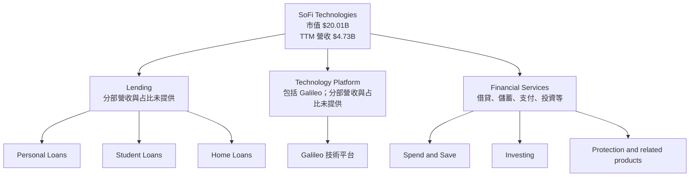
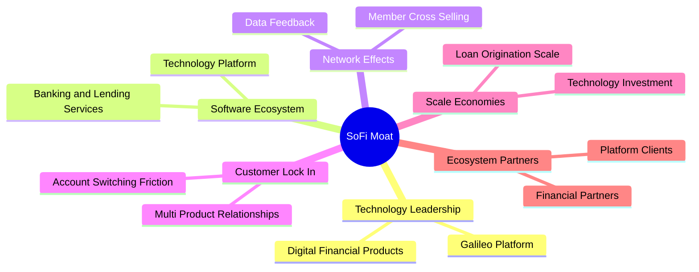
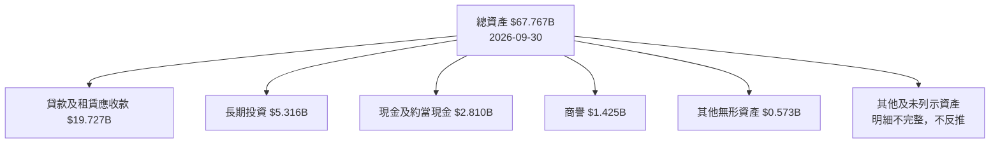
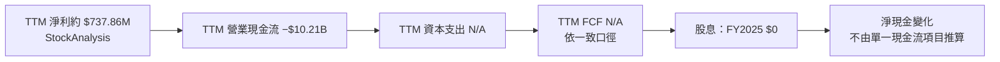
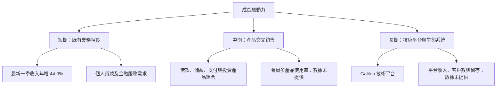
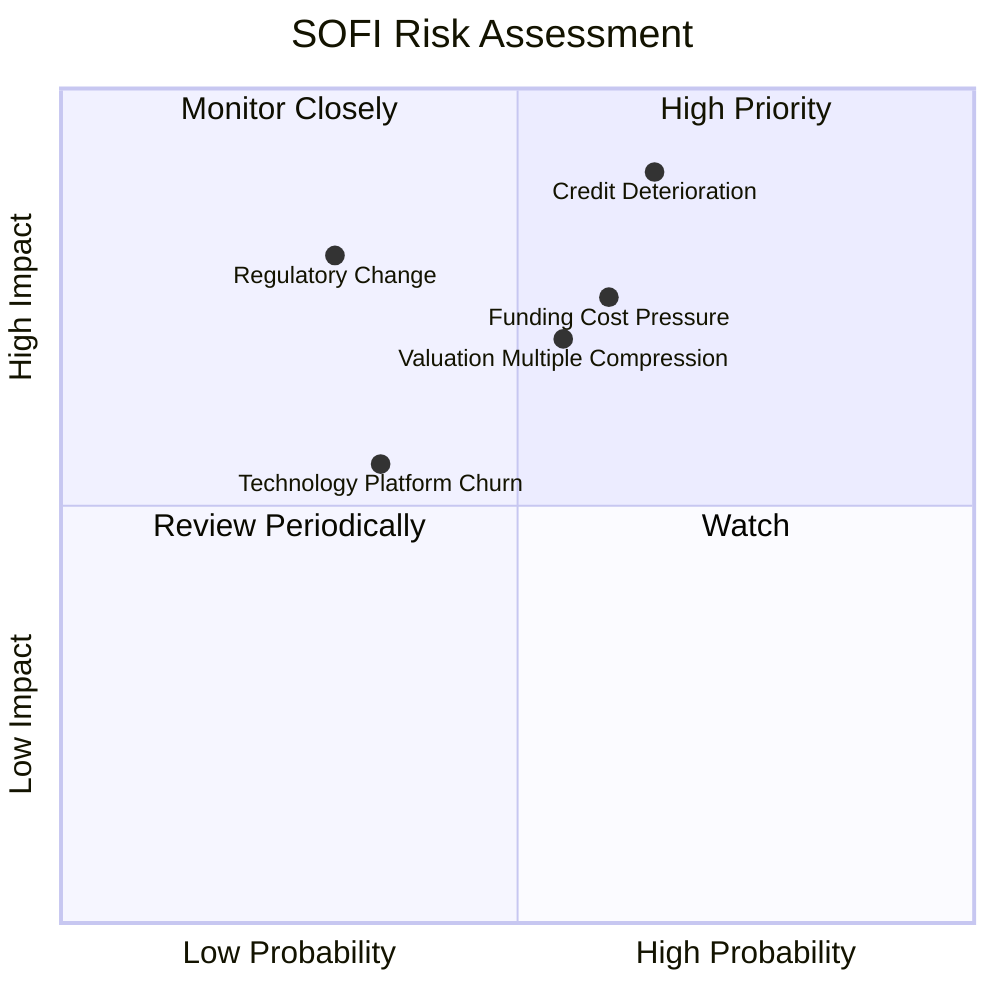
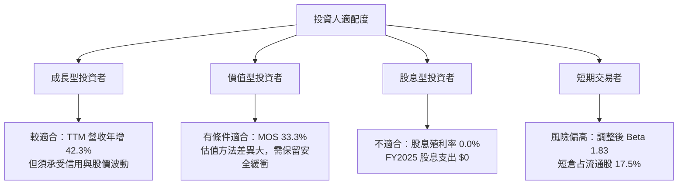

# SOFI 基本面深度分析報告
> **報告日期**：2026-11-15 ｜ **語言**：繁體中文 ｜ **數據來源**：SEC 申報資料 (XBRL)、Yahoo Finance、Finviz、StockAnalysis、Roic.ai ｜ **分析師**：CFA 級機構研究

## 目錄

| # | 章節 | 核心結論 |
|---|------|----------|
| 1 | 執行摘要 | 買入；加權合理價值 $23.13；MOS +33.3% |
| 2 | 公司概覽與商業模式 | 金融服務、放貸與金融科技平台組合；市場份額資料未提供 |
| 3 | 損益表深度分析 | TTM 營收 $4.73B，TTM 年增 42.3%；最新一季單季年增 44.0% |
| 4 | 資產負債表分析 | 現金及短期投資 $2.81B；總債務 N/A，淨現金按可用口徑為 $2.81B |
| 5 | 現金流量深度分析 | TTM 營業現金流 −$10.21B；TTM FCF 依一致口徑為 N/A |
| 6 | 獲利能力與資本效率 | ROIC 對放款機構不適用；WACC 採 14.00% |
| 7 | 相對估值分析 | 同業估值結果分歧；估值法加權結果高於現價 |
| 8 | DCF 內在價值評估 | DCF 不適用：放款現金流是資金來源與運用，不能視作一般企業 FCF |
| 9 | 成長催化劑 | 最新季收入成長 44.0%；未提供 TAM 數字與可核實催化劑日期 |
| 10 | 風險矩陣 | 放款信用、融資成本與高波動估值為主要風險 |
| 11 | 投資建議 | 買入；參考買入區間 $13.86–$20.82，持續追蹤信用及獲利品質 |

---

## 1. 執行摘要

SoFi 的增長與估值支持正面但有條件的判斷：SEC 10-Q 及價格資料庫計算的 TTM 營收為 **$4.73B、年增 42.3%**，最新一季單季營收年增 **44.0%**；然而 TTM 營業現金流為 **−$10.21B**，且金融業口徑下 TTM FCF 為 **N/A**。依金融業固定估值方法，加權合理價值為 **$23.13**，對比 2026-11-13 收盤價 **$15.42**，MOS 為 **+33.3%**，規則 20 評級為**買入**。ROIC 對放款機構不適用，不能以 ROIC 高於 WACC 作為「強烈買入」的確認，因此維持買入、不作上調。

### 1.0 一頁式投資儀表板（Portfolio Manager 30 秒速讀）

| 項目 | 內容 |
|------|------|
| **投資論點（3 句）** | ① TTM 營收 $4.73B、年增 42.3%，顯示金融服務與放貸組合仍在擴張。② 最新一季收入年增 44.0%，但放款機構的營業現金流受貸款增長與資金配置影響，TTM OCF 為 −$10.21B。③ 加權合理價值 $23.13，高於 2026-11-13 收盤價 $15.42；此差距依相對估值及分析師共識得出，不是 DCF 結果。 |
| **綜合評分** | **6.3/10**（引用 1.1 評分卡） |
| **財務健康** | 🟡 現金及短期投資 $2.81B，但總債務 N/A；放款機構 OCF 受貸款投放影響，不能單獨視作流動性惡化或改善。 |
| **ROIC vs WACC** | ROIC：N/A（金融業不適用）｜WACC：14.00%；無法據此判定 ROIC 是否高於 WACC。 |
| **FCF 趨勢** | TTM FCF：N/A；TTM FCF Yield：N/A。營業現金流 TTM 為 −$10.21B，但貸款投放會造成放款機構的現金流出。 |
| **估值** | Forward P/E **17.14x**（市場估值資料）；EV/EBITDA **N/A**（市場估值資料）｜FCF Yield **N/A**。 |
| **DCF 內在價值（基準）** | **N/A**；現價相對 DCF 的折溢價不適用。 |
| **安全邊際（MOS）** | **+33.3%＝($23.13 − $15.42) ÷ $23.13**；基準為第 8.8 節加權合理價值。🟢 超過 25%。 |
| **預期報酬（基準 12M）** | DCF 基準情境 N/A；以加權合理價值作靜態參考的隱含上行空間為 **+50.0%**，不等同已實現報酬或保證預測。 |
| **關鍵風險（前二）** | 無擔保消費貸款的信用週期與損失；融資成本或利率變化壓縮息差及估值。 |
| **評級 + 信心度** | 🟢 **買入**｜信心：中。估值模型依賴同業倍數與分析師共識；信用品質、CET1、逾放及淨沖銷率資料未提供。 |

### 1.1 綜合評分卡（全報告唯一）

| 維度 | 評分（1–10） | 主要依據（引用數字與其來源章節） |
|------|--------------|----------------------------------|
| 成長性 | 8.0 | TTM 營收年增 42.3%、最新一季單季年增 44.0%（第 3 章）；擴張快，但貸款增長亦增加資金與信用風險。 |
| 獲利能力 | 6.0 | TTM 淨利率約 15.6%、ROE 6.5%；金融業 ROIC、F-Score 不適用，營業利潤率 TTM N/A（第 3、6 章）。 |
| 財務健康 | 5.0 | 現金及短期投資 $2.81B、淨現金口徑 $2.81B；總債務 N/A，無法完整核驗槓桿（第 4 章）。 |
| 估值 | 7.0 | MOS +33.3%；同業 Forward P/E 法估值 $11.01，低於現價，而同業 P/B 法估值 $38.85，顯示方法分歧（第 7、8 章）。 |
| 護城河 | 6.0 | 具金融服務、放貸與 Galileo 技術平台的組合，但各業務收入占比及市場份額均未提供（第 2 章）。 |
| 管理層與資本配置 | 6.0 | FY2025 SBC $262.06M，約為年度收入 7.3%；FY2025 股息支出 $0，現有資料不足以評估回購與投資回報（第 3、5 章）。 |
| **綜合評分** | **6.3** | 六項算術平均：$(8.0+6.0+5.0+7.0+6.0+6.0)÷6=6.3$。 |

### 1.2 五大投資論點 + 三大核心風險

| 類型 | 項目 | 具體依據 | 信心度 |
|------|------|----------|--------|
| 🟢 **投資論點①** | 高速收入擴張 | TTM 營收 $4.73B、年增 42.3%；最新一季單季年增 44.0%，顯示客戶與貸款相關業務仍有增長動能。 | 🟢 高 |
| 🟢 **投資論點②** | 多業務平台組合 | Lending、Financial Services、Technology Platform 三個板塊降低對單一產品的完全依賴；但收入拆分未提供，無法判斷多元化的實際貢獻。 | 🟡 中 |
| 🟢 **投資論點③** | 盈利已轉正且上升 | FY2025 淨利 $481.32M；2026-09-30 季淨利 $240.99M。季度數據顯示盈利擴大，但需核對信用成本與一次性項目。 | 🟡 中 |
| 🟢 **投資論點④** | 資產負債表有現金緩衝 | 現金及短期投資 $2.81B，程式計算的淨現金口徑亦為 $2.81B；但債務總額 N/A，緩衝能力仍須結合債務明細確認。 | 🟡 中 |
| 🟢 **投資論點⑤** | 加權估值高於現價 | 加權合理價值 $23.13，較收盤價 $15.42 高 $7.71；MOS +33.3%，但同業 P/E 法本身給出 $11.01，反映估值依據分散。 | 🟡 中 |
| 🟡 **風險①** | 放款信用風險 | 淨沖銷率、逾放比及貸款組成資料 N/A；若信用惡化，需認列更多準備，可能抵銷利息收入及營運槓桿。 | 🔴 高衝擊 |
| 🔴 **風險②** | 估值與融資敏感度 | Beta（調整後）1.83，WACC 採 14.00%；若融資成本上升或風險溢酬擴大，金融股估值與貸款經濟性均可能受壓。 | 🔴 高衝擊 |
| 🟡 **風險③** | 現金流與盈餘品質解讀困難 | TTM OCF −$10.21B、FCF N/A；放貸現金流不能直接等同一般企業營運現金流，但仍需要披露貸款增長、存款及資本充足度數據。 | 🟡 中 |

### 1.3 快速統計卡片

| 指標 | 公司實際值（期間） | 同業中位數 | 狀態 |
|------|--------------------|------------|------|
| 營收成長（TTM） | **42.3%** | — | 🟢 |
| 營收成長（最新一季年增） | **44.0%** | **34.1%**（NU、HOOD、UPST） | 🟢 |
| 毛利率（TTM） | **84.2%**（市場資料） | **83.3%**（NU、HOOD、UPST） | 🟢 |
| 營業利益率（TTM） | **N/A**（SEC 10-Q 計算欄位不可用） | — | 🟡 |
| ROIC（TTM） | **N/A**（放款機構不適用） | — | 🟡 |
| Forward P/E | **17.14x**（市場資料） | **12.2x**（Peer Forward P/E 中位數） | 🟡 |
| FCF Yield（TTM） | **N/A** | — | 🟡 |
| Piotroski F-Score | **N/A（不適用放款機構）** | — | 🟡 |

### 1.4 投資結論

```text
╔══════════════════════════════════════════════════════════════════╗
║                    📊 投資結論摘要                               ║
╠══════════════════════════════════════════════════════════════════╣
║  評級：買入（MOS +33.3%；ROIC 對放款機構不適用）                 ║
║  價格（2026-11-13 收盤）：$15.42                                ║
║  DCF 內在價值（基準）：N/A（放款現金流不適用一般企業 DCF）       ║
║  安全邊際 MOS：+33.3%（＝($23.13−$15.42)÷$23.13）              ║
║  加權合理價值（8.8）：$23.13                                    ║
║  綜合評分：6.3/10（引用 1.1）                                   ║
║  適合投資人：可承受信用週期與股價波動、採分批布局的成長型投資人 ║
╚══════════════════════════════════════════════════════════════════╝
```

評級依 MOS 門檻為**買入**，未作質化調整；由於 DCF 為 N/A，本報告不提供悲觀／基準／樂觀 DCF 情境目標價。

---

## 2. 公司概覽與商業模式

### 2.1 業務結構與收入來源

公司概覽指出，SoFi 在美國、拉丁美洲、加拿大及香港提供金融服務，業務分為 Lending、Technology Platform、Financial Services。收入分部金額及占比未提供，因此不以推算方式補出。



以目前資料可以確認公司擁有放貸、金融服務與科技平台三類業務，但無法量化各板塊收入、利潤或交叉銷售比重。分部收入缺失是評估平台協同效應與增長質量的主要資料限制。

### 2.2 市場份額

**市場份額數據未提供**，因此不繪製市場份額圖表、不填入估計比例。以收入規模觀察，SoFi TTM 營收為 $4.73B、TTM 年增 42.3%；在本報告同業樣本中，最新一季營收年增 44.0%，高於 NU 的 34.4%、UPST 的 34.1% 與 HOOD 的 11.8%。不同公司的業務組合有差異，成長率比較不代表市場份額高低。

### 2.3 競爭護城河分析



這張圖表示可能形成護城河的機制，不代表這些優勢已被財務數據證實。會員數、產品滲透率、平台客戶留存及技術平台收入未提供，不能量化網路效應或客戶鎖定程度。

### 2.4 護城河強度

| 護城河項目 | 強度（強／中／弱） | 證據（引用數字或事實） | 會削弱它的情況 |
|------------|--------------------|------------------------|----------------|
| 技術與產品整合 | 中 | 公司包含金融服務、放貸與 Technology Platform；但單一平台收入及客戶留存資料未提供。 | 技術平台客戶流失、服務差異化下降。 |
| 軟體生態系統 | 中 | 公司營運 Galileo，並提供多類金融產品；平台營收占比 N/A。 | 客戶集中、價格競爭或技術替代。 |
| 網路效應 | 弱至中 | 可透過會員交叉銷售形成互補，但會員數及產品使用數據未提供。 | 客戶只使用單一產品，交叉銷售效果不足。 |
| 客戶鎖定 | 弱至中 | 多產品金融關係可能提高轉換摩擦，但帳戶留存與流失率 N/A。 | 產品同質化、優惠促銷令客戶轉移。 |
| 規模效應 | 中 | TTM 營收 $4.73B，收入年增 42.3%；但單位獲客成本與單位信用成本未提供。 | 高增長伴隨高獲客成本或更高信用損失。 |
| 生態夥伴 | 中 | Galileo 提供技術平台服務；客戶數、合約價值及續約率未提供。 | 客戶自建技術、合約流失或平台使用量下降。 |

**1.1「護城河」評分 6.0/10**：多業務與技術平台提供形成護城河的結構，但缺少分部營收、留存率與平台客戶數據，尚不足以認定護城河已被量化驗證。

---

## 3. 損益表深度分析

### 3.1 年度收入成長趨勢（近 4 年）

年度收入以年報資料所列數字呈現，年度增長率依相鄰年度收入計算；數字四捨五入至小數點後兩位。

```text
╔══════════════════════════════════════════════════════════════════╗
║              SoFi Technologies 年度收入趨勢 FY2022–FY2025        ║
╠══════════════════════════════════════════════════════════════════╣
║  FY2022  $1.57B  █████████░░░░░░░░░░░░░░░  YoY：基期            ║
║  FY2023  $2.11B  ████████████░░░░░░░░░░░  YoY：約 +34.4% 🟢    ║
║  FY2024  $2.61B  ███████████████░░░░░░░░  YoY：約 +23.7% 🟢    ║
║  FY2025  $3.61B  █████████████████████░░  YoY：約 +38.3% 🟢    ║
║                                                                  ║
║  FY2022–FY2025 三年 CAGR：約 +32.0%                              ║
╚══════════════════════════════════════════════════════════════════╝
```

年度收入由 FY2022 的 $1.57B 增至 FY2025 的 $3.61B。三年 CAGR 約 32.0%，反映公司處於擴張期；FY2024 增速放緩後，FY2025 再度加快。最新 TTM 收入年增 42.3%，高於 FY2025 年增，若後續能在不放寬貸款風險標準的情況下維持，將支持收入與規模效應；單靠收入增長仍不能證明每筆貸款的風險調整後回報改善。

### 3.2 季度收入趨勢分析

以下以 StockAnalysis 季度資料計算 QoQ、YoY；FY2026 Q3 YoY 與最新一季年增率另外引用程式計算的 44.0%，資料來源四捨五入差異可能造成小幅偏差。

| 季度 | 收入 | QoQ 成長 | YoY 成長 | 備註 |
|------|------|----------|----------|------|
| FY2025 Q4 | $1.020B | 約 +7.1% | 約 +39.0% | 對比 FY2025 Q3 $952.4M 及 FY2024 Q4 $734M。 |
| FY2026 Q1 | $1.091B（另一來源列 $1.100B） | 約 +7.0%（以 $1.020B 為基期） | 約 +42.5% | 不同資料源對季度值有約 $9M 差異。 |
| FY2026 Q2 | $1.205B（另一來源列 $1.219B） | 約 +10.4%（以 $1.091B 為基期） | 約 +42.6% | 以 StockAnalysis 數字計算。 |
| FY2026 Q3 | $1.370B（另一來源列 $1.385B） | 約 +13.7%（以 $1.205B 為基期） | 約 +43.9%；官方計算口徑 **44.0%** | 最新一季單季年增，絕非 TTM 成長率。 |

季度數據在不同來源間有差異；估值與摘要採用優先級較高的 TTM 營收 $4.73B 及最新一季單季年增 44.0%。季度收入逐季擴大，若來自會員金融服務與平台收入，通常有助收入來源多元化；但目前缺少分部資料，不能把增長全部歸因於科技平台或非放貸業務。

### 3.3 利潤率演變分析

| 利潤率指標 | FY2022 | FY2023 | FY2024 | FY2025 | 趨勢 | 評估 |
|------------|--------|--------|--------|--------|------|------|
| **毛利率** | N/A | N/A | N/A | N/A | 可比年度資料未提供；市場資料顯示 TTM 84.2%。 | 🟡 |
| **營業利益率** | N/A | N/A | N/A | 約 14.6%（FY2025） | FY2025 營業利益 $525.86M ÷ 收入 $3.61B；其他年度同口徑未提供。 | 🟡 |
| **淨利率** | 約 −20.4% | 約 −14.3% | 約 18.3% | 約 13.3% | 從虧損轉為盈利；FY2025 淨利 $481.32M，低於 FY2024 約 $498.67M。 | 🟡 |
| **最新一季營業利益率** | — | — | — | — | 市場資料列 19.4%，但 VERIFIED FIGURES 該欄為 N/A，故不作一致口徑結論。 | 🟡 |

**利潤率演變深度解析：**公司由 FY2022、FY2023 淨虧損轉為 FY2024、FY2025 淨利為正，顯示收入增長與成本結構已產生營運槓桿。不過 FY2025 淨利較 FY2024 略低，且淨利率也受分部組合、信貸準備、融資成本及稅項影響；資料未提供完整分部損益與信用成本拆分，不能將淨利率變化單獨歸因於成本控制。TTM 營業利潤率依 SEC 資料計算欄為 N/A，避免以不同來源數字替代。

### 3.4 費用結構分析

目前沒有完整、同口徑的 TTM 利息支出、信貸準備、營運費用與收入拆分，故不繪製會造成比例誤導的費用結構圓餅圖。已提供的 FY2025 SBC 為 $262.06M，約占 FY2025 收入 $3.61B 的 **7.3%**；此項顯示股權薪酬是不可忽視的股東成本，但不是公司總費用結構的完整代表。

### 3.5 季度 EPS 趨勢與盈餘品質（Quality of Earnings）

| 季度 | EPS 實際值 | 預估值與驚喜幅度 | 當季淨利 | 判讀 |
|------|------------|------------------|----------|------|
| 2025 Q4 | $0.13 | N/A | $173.55M | EPS 預估缺失，不能判定超預期或不及預期。 |
| 2026 Q1 | $0.12 | N/A | $166.73M | EPS 實際值可見，但預估值缺失。 |
| 2026 Q2 | $0.12 | N/A | $156.59M | EPS 實際值可見，但預估值缺失。 |
| 2026 Q3 | $0.19（另一來源列） | N/A | $240.99M | EPS 預估值及驚喜幅度 N/A；季度淨利較 Q2 增加。 |

提供的 EPS Beats/Misses 記錄中，四季 EPS Est、EPS Act 均為 NaN。因此，**無法可靠判斷過去四季是超預期或不及預期**；不能把缺失的預估值當作零，也不能據此下超預期結論。季度實際 EPS 數字來自 StockAnalysis，與估計值資料缺漏並存。

| 盈餘品質項目 | 數值/佔比 | 評估 |
|--------------|-----------|------|
| 股權薪酬 SBC / 營收 | 2025 年 SBC $262.06M ÷ FY2025 收入 $3.61B = **約 7.3%**；近四季 SBC 合計 $288.33M ÷ TTM 收入 $4.73B = **約 6.1%** | 🟡 比例不低；若持續以股權薪酬招聘及留才，現有股東承擔稀釋成本。 |
| SBC / 營業現金流 | 近四季 SBC $288.33M ÷ TTM OCF −$10.21B = **約 −2.8%** | 🔴 分母為負，此比率不能解讀為現金流覆蓋能力；負 OCF 主要須結合貸款增長與融資活動分析。 |
| FCF / 淨利（現金轉換率） | N/A（TTM FCF N/A） | 🟡 放款機構的貸款現金流使一般 FCF 轉換率不具代表性；不能用此資料確認淨利現金轉換。 |
| 一次性/非經常性損益 | N/A（未提供完整調節資料） | 無法判斷是否有一次性項目推高或壓低本期盈餘。 |
| 有效稅率異常 | **8.5%**（最新年有效稅率） | 🟡 偏低稅率可提升稅後利潤，但未提供多年稅務調節，不能假設可長期維持。 |
| 資本化支出 vs 費用化 | TTM Capex N/A；FY2025 SBC 另行披露 | N/A 無法量化資本化支出是否造成利潤時點差異。一般而言，銀行及金融科技的軟體開發資本化政策需查閱 10-K/10-Q 明細。 |

**盈餘品質結論：**GAAP 淨利已轉正，但其現金轉換率在本口徑下不可判定；SBC 約為 TTM 收入 6.1%，具有實際稀釋成本。對金融機構而言，貸款資產擴張可能令營業現金流大幅為負，故不能直接以負 OCF 判斷淨利虛假；但在缺少貸款增長、存款變化、信貸損失與監管資本數據時，獲利品質仍屬需持續驗證。

---

## 4. 資產負債表分析

### 4.1 資產結構分解

StockAnalysis 提供的 2026-09-30 資產總額為 $67.767B，並列出部分資產項目。下圖只展示有數字的主要項目；資產項目並未涵蓋全部資產，不以反推方式補出差額。



放款及租賃應收款是資產的重要組成部分；貸款資產擴大可支持利息收入，但同時增加信用風險、資金需求與利率風險。注意：資產細項來源列有長期投資 $5.316B，而程式計算的「現金及短期投資」為 $2.81B；兩者定義與來源不同，本報告不把它們混為同一現金口徑。

### 4.2 流動性與營運資金分析

金融機構的存款、貸款及融資結構與一般公司存貨—應收—應付現金轉換週期不同；DSO、DIO、DPO、CCC 不適用。流動比率與速動比率亦不宜不加調整地套用於放款機構。

| 指標 | 最新值 | 評估 |
|------|--------|------|
| 現金及短期投資 | **$2.81B** | 🟡 提供一定資金緩衝；但需與存款、借款到期結構及監管流動性指標合看。 |
| 總債務 | **N/A** | 🟡 無法以同一權威口徑判定總融資負債。 |
| 淨現金（負值代表淨負債） | **$2.81B** | 🟡 此為程式計算口徑；總債務缺漏限制了獨立覆核。 |
| DSO / DIO / DPO / CCC | 不適用（金融業） | — 放款機構貸款與存款不是一般企業的應收、存貨及應付項目。 |

### 4.3 債務結構分析

不同資料源對 SOFI 債務及淨現金口徑不一致：SEC 計算欄的總債務為 N/A，市場資料另列總債務 $3.98B、淨負債 $1.14B。依嚴格口徑規則，以下以 VERIFIED FIGURES 為主，不以市場來源替代缺漏欄位。

```text
╔══════════════════════════════════════════════════════════════════╗
║                    SoFi 債務健康診斷                              ║
╠══════════════════════════════════════════════════════════════════╣
║  總債務：           N/A       🟡 SEC 計算欄未提供                 ║
║  現金+短期投資：    $2.81B    🟢 提供資金緩衝                     ║
║  淨現金：           $2.81B    🟡 程式計算口徑；債務需再核驗       ║
║  Debt/EBITDA：      N/A       EBITDA 與債務口徑不可核驗           ║
║  利息保障倍數：     N/A       缺少一致口徑利息費用及 EBITDA       ║
║  放款機構重點：     N/A       淨沖銷率、逾放比、CET1 均未提供     ║
╚══════════════════════════════════════════════════════════════════╝
```

對銀行型金融機構，單看企業債務/EBITDA不如存款穩定性、批發融資依賴、資本充足及貸款質量重要。上述關鍵監管及信用指標缺失，降低了對資產負債表風險的判斷信心。

### 4.4 股東權益趨勢

| 財年 | 股東權益 | 年度變化 |
|------|----------|----------|
| 2022 | $5.53B | — |
| 2023 | $5.55B | 約 +0.4% |
| 2024 | $6.53B | 約 +17.7% |
| 2025 | $10.49B | 約 +60.8% |

```text
╔══════════════════════════════════════════════════════════════════╗
║                  SoFi 歷年股東權益                               ║
╠══════════════════════════════════════════════════════════════════╣
║  FY2022  $5.53B  ███████████░░░░░░░░░░░░░░░                     ║
║  FY2023  $5.55B  ███████████░░░░░░░░░░░░░░░                     ║
║  FY2024  $6.53B  █████████████░░░░░░░░░░░░░                     ║
║  FY2025 $10.49B  █████████████████████░░░░░                     ║
╚══════════════════════════════════════════════════════════════════╝
```

FY2025 股東權益增加約 60.8%，提高帳面資本緩衝；但權益增長可能同時包含資本募集、保留盈餘及其他權益項目，現有資料不足以精確拆分，不能將全部增幅視為由內生獲利累積。

---

## 5. 現金流量深度分析

### 5.1 現金流量瀑布圖



對銀行與放款機構而言，發放貸款會消耗現金，償還及融資則會回流資金，故營業現金流可能與淨利方向相反。圖中 TTM 淨利採 StockAnalysis 數字；TTM OCF 採程式計算數字；TTM Capex 及 FCF 依權威口徑為 N/A，不能以其他來源反推補值。

### 5.2 FCF 轉換率趨勢

| 財年 | FCF | 淨利 | FCF / 淨利 | 解讀 |
|------|-----|------|------------|------|
| 2022 | −$7.36B | −$320.41M | 約 22.97x（分子、分母皆負） | 數值比例不具一般現金轉換率含義；貸款資金流使 FCF 失真。 |
| 2023 | −$7.35B | −$300.74M | 約 24.44x（分子、分母皆負） | 同上，不代表正向現金覆蓋。 |
| 2024 | −$1.28B | $498.67M | 約 −2.57x | 正淨利對應負 FCF，需結合放款與存款變化。 |
| 2025 | −$3.99B | $481.32M | 約 −8.29x | 年度 FCF 仍為負；對放款機構並非直接營運價值指標。 |
| TTM 至 2026-09-30 | N/A | N/A | N/A | 一致口徑 TTM FCF 缺失，不補算。 |

### 5.3 自由現金流趨勢

年度 FCF 依現金流量表所列數字；TTM FCF 仍按一致口徑列為 N/A。FCF Yield 只在 TTM FCF 可用時才計算，因此此處不提供 TTM Yield。

```text
╔══════════════════════════════════════════════════════════════════╗
║                自由現金流：年度數據與限制                         ║
╠══════════════════════════════════════════════════════════════════╣
║  FY2022  −$7.36B  歷史現金流量表值；放款資金流影響大             ║
║  FY2023  −$7.35B  歷史現金流量表值；放款資金流影響大             ║
║  FY2024  −$1.28B  負值收窄，但仍不宜當作一般企業 FCF             ║
║  FY2025  −$3.99B  仍為負；需與貸款及融資增長一併檢視             ║
║  TTM      N/A     TTM FCF、FCF Yield 均不提供                     ║
╚══════════════════════════════════════════════════════════════════╝
```

### 5.4 資本配置評估

完整的回購、資本投資與資產負債表資金用途比例未提供，因此不繪製資本配置圓餅圖。

| 資本配置項目 | 可用數字 | 分析 |
|--------------|----------|------|
| 資本支出 | TTM N/A；FY2025 現金流量表列 −$251.12M | 對金融企業，設備與技術投資不是全部資金配置；不可用單一 Capex 判斷再投資強度。 |
| 股息 | FY2025 $0 | 未支付股息，資本較可能留在公司或用於業務增長；具體用途未提供。 |
| 股權薪酬 | FY2025 $262.06M | 約為年度收入 7.3%；須關注股數擴張與每股收益增長是否相匹配。 |
| 股票回購 | N/A | 沒有可核實金額，不對回購紀錄作定量判斷。 |
| 貸款及投資配置 | 放款淨額占總資產 79.3% | 資產配置以貸款為主；提高收益潛力，同時提高信用集中與週期風險。 |

---

## 6. 獲利能力與資本效率

### 6.1 ROE / ROA / ROIC 趨勢

| 指標 | 可用值 | 評估 |
|------|--------|------|
| ROE（TTM） | **6.5%**（程式計算口徑） | 有正向股東回報，但與 7.9% ROTCE 的分母不同，不應混用。 |
| ROA（TTM） | 1.3%（市場資料） | 金融業資產負債表規模大，需與信用成本、資本結構及同業定義比較。 |
| ROIC（TTM） | N/A | 放款機構 ROIC 不宜使用一般企業投入資本定義；金融負債本身是營運資金來源。 |
| ROTCE（TTM） | **7.9%** | 程式計算值，以有形帳面價值為分母；較適合與銀行類股比較。 |
| 同業／行業均值 | 未提供 | 不列入無來源的行業均值比較。 |

### 6.2 ROIC vs WACC 分析（核心價值創造判斷）

對放款機構，ROIC 與一般工業企業定義的投入資本不具有可比性；本節不宣稱 SOFI 的 ROIC 高於或低於 WACC。WACC 仍按程式提供值展示，供估值與資本成本參照。

```text
╔══════════════════════════════════════════════════════════════════╗
║                ROIC 與 WACC：放款機構口徑                        ║
╠══════════════════════════════════════════════════════════════════╣
║  WACC 輸入：                                                     ║
║  ├── 無風險利率：                 5.15%                          ║
║  ├── 市場風險溢酬：               5.00%                          ║
║  ├── 原始 Beta：                  2.24                           ║
║  ├── 調整後 Beta：                1.83                           ║
║  ├── 股權成本：                   14.29%                         ║
║  ├── 稅前債務成本：               29.04%                         ║
║  ├── 有效稅率：                   8.5%                           ║
║  ├── 股權／債務權重：             83.4%／16.6%                    ║
║  ├── 未設限計算 WACC：            16.33%                         ║
║  └── 採用 WACC：                  14.00%（限制在 7%–14% 區間）   ║
║                                                                  ║
║  ROIC：N/A（放款機構不適用一般企業 ROIC 定義）                   ║
║  EVA = ROIC − WACC：N/A；不能判定是否創造或摧毀股東價值          ║
╚══════════════════════════════════════════════════════════════════╝
```

逐步計算與來源：

1. **調整後 Beta** = \(⅔×2.24+⅓×1.00=1.83\)（四捨五入）。
2. **股權成本** = \(5.15\%+1.83×5.00\%=14.29\%\)。
3. **稅後債務成本** = \(29.04\%×(1−8.5\%)=26.5716\%\)。
4. **未設限 WACC** = \(83.4\%×14.29\%+16.6\%×26.5716\%=16.33\%\)（四捨五入）。
5. **採用 WACC** = 14.00%，因程式所用資本成本規則將 WACC 限制於 7%–14% 區間；不是重新估算或改用另一組權重。

這些資本成本輸入未提供無風險利率的具體觀測日期，也未提供債務市場價值與完整債務明細，因此沿用程式計算輸入。由於放款機構的存款、借款和貸款資產均屬核心經營項目，直接套用一般企業的 ROIC 減 WACC 會誤導價值創造判斷。

### 6.3 杜邦三因素分解

| 因素 | 數值（TTM） | 解讀 |
|------|-------------|------|
| 淨利率 | **15.6%** | 程式計算口徑；可反映盈利，但仍受信貸準備與稅率影響。 |
| 資產週轉率 | **0.07** | 金融機構資產以貸款及金融資產為主，低週轉率不能直接與非金融公司相比。 |
| 權益乘數 | **6.00** | 反映資產相對股東權益的槓桿；對金融機構須配合資本監管指標評估。 |
| **ROE** | **6.5%** | $15.6\%×0.07×6.00\%\approx6.5\%$；結果以來源列示值為準。 |

ROE 的主要機制是淨利率乘以權益乘數，但資產週轉率低是金融機構資產結構的特性。6.00x 權益乘數代表槓桿對 ROE 有放大作用，也使資產質量與監管資本更關鍵。

### 6.4 財務體質：Piotroski F-Score 與放款機構指標

Piotroski F-Score：**N/A，不適用於放款機構**。貸款增長會呈現營業現金流出，可能使傳統 F-Score 現金流測試錯誤解讀銀行經營狀況；九項測試不提供，不逐項補造。

| 放款機構指標 | 數值 | 定義差異與解讀 |
|--------------|------|----------------|
| 淨利息收入 NII / 總營收 | **64.0%** | 表示利息相關收入對總營收的重要性；不是銀行的 NIM。 |
| 淨利差代理值 | **5.36%** | 計算為 TTM NII ÷ 平均總資產；由於缺少生息資產分母，不能等同銀行正式公布的 NIM，正式 NIM 通常以平均生息資產作分母。 |
| 成本收入比代理值 | **80.8%** | 計算為（營收 − 稅前淨利）÷ 營收；含信貸準備，通常高於正式效率比率，不可直接當作純營運費用率。 |
| ROTCE | **7.9%** | 淨利 ÷ 有形帳面價值；較適合與銀行同業比較，但仍需確認有形權益計算口徑。 |
| P/TBV | **2.15x** | 股價相對有形帳面價值倍數；溢價需要由持續 ROTCE、增長與資產質量支撐。 |
| 放款淨額 / 總資產 | **79.3%** | 資產對貸款曝險高；支持利息收入，同時提高信用風險集中度。 |
| 淨沖銷率 | **N/A（數據未提供）** | 無法核實實際信用損失趨勢。 |
| 逾放比 | **N/A（數據未提供）** | 無法核實逾期及不良貸款比例。 |
| CET1 | **N/A（數據未提供）** | 無法判斷監管資本緩衝。 |

---

## 7. 相對估值分析

### 7.1 同業估值比較表格

Peer 倍數採 Yahoo Finance 資料。SOFI 的市場估值資料與自有歷史估值資料來自不同表格與計算口徑，因此並列註明，不混作單一精確倍數。

| 估值指標 | **SOFI** | **NU** | **HOOD** | **UPST** | SOFI 評估 |
|----------|----------|---------|---------|---------|-----------|
| **Trailing P/E** | 28.04x（市場估值資料；自有歷史表 27.5x） | 16.5x | 35.9x | 32.1x | 🟡 高於 NU、低於 HOOD 與 UPST；三家同業中位數為 32.1x。 |
| **Forward P/E** | 17.14x（市場估值資料） | 12.2x | 22.8x | 6.7x | 🟡 高於 NU、UPST，低於 HOOD；同業中位數 12.2x。 |
| **P/S Ratio** | 4.27x（市場估值資料；自有歷史表 4.4x） | 7.0x | 13.8x | 1.4x | 🟢 低於 NU、HOOD，高於 UPST；同業中位數 7.0x。 |
| **EV/EBITDA** | N/A（市場估值資料） | N/A | N/A | 27.3x | N/A；只一個同業提供倍數，不能計算同業中位數。 |
| **最新一季營收年增** | **44.0%** | 34.4% | 11.8% | 34.1% | 🟢 SOFI 高於樣本中三家公司；業務組合不同，成長率不等同風險調整後質量。 |
| **毛利率（TTM）** | 84.2%（市場資料） | 0.0% | 91.0% | 83.3% | 🟡 同業中位數 83.3%；NU 數字可能受金融業分類與毛利定義影響，跨公司可比性有限。 |

Peer Forward P/E 中位數為 12.2x，低於 SOFI 市場資料的 17.14x，表示 SOFI 相對同業具有溢價；是否合理取決於盈利增長能否延續、信用成本是否受控。第 8.8 節的固定估值方法採用同業 Forward P/E 中位數與公司 Forward EPS 0.90，對應估值 $11.01，而非用 SOFI 自身倍數回算現價。

### 7.2 歷史估值區間分析

以下採用自有五年 TTM 倍數資料。注意市場估值表的 P/E 28.04x 與歷史表 27.5x 略有差異，百分位與區間以下依歷史資料原值。

```text
╔══════════════════════════════════════════════════════════════════╗
║              SOFI 歷史估值區間與目前位置                         ║
╠══════════════════════════════════════════════════════════════════╣
║  P/E：27.0x ├─●27.5x──────────── 中位數 36.6x ─────────┤ 67.1x ║
║       目前歷史百分位：11%  🟢（接近自身區間低端）                 ║
║                                                                  ║
║  P/S： 2.6x ├────────●4.4x─中位數 4.5x────────────────┤ 14.6x ║
║       目前歷史百分位：43%  🟡                                   ║
║                                                                  ║
║  EV/EBITDA：19.0x ├────────────●63.6x 中位數 65.1x────┤148.7x ║
║       目前歷史百分位：48%  🟡                                   ║
╚══════════════════════════════════════════════════════════════════╝
```

P/E 處於自身五年區間第 11 百分位，低於中位數 36.6x；P/S 與 EV/EBITDA 分別位於第 43、48 百分位，接近中段。由於不同估值倍數反映的利潤、槓桿與資產結構不同，不能只依歷史 P/E 低百分位便認定整體估值便宜；EV/EBITDA 本身與市場估值欄位的 N/A 有資料源差異，應降低其參考權重。

### 7.3 情境價值（Bear / Base / Bull）

**N/A（DCF 無法計算：放款機構的貸款現金流是資金來源與運用，不是可直接用一般企業自由現金流估值的 FCFF）**。不提供悲觀、基準、樂觀 DCF 目標價，也不自行設定營收 CAGR、退出倍數或機率。

### 7.4 相對估值隱含價格區間

估值方法與每股價值完全採用程式計算的金融業固定方法。各方法使用同業中位數倍數，不採用公司本身目前倍數回算。

```text
╔══════════════════════════════════════════════════════════════════╗
║              相對估值每股價值與現價位置                          ║
╠══════════════════════════════════════════════════════════════════╣
║  $11.01 ───────── $15.42 ─────── $20.84 ────────────── $38.85   ║
║  同業Forward P/E   現價          分析師共識           同業P/B    ║
╚══════════════════════════════════════════════════════════════════╝
```

| 方法 | 每股價值 | 對現價上行空間 | 依據 |
|------|----------|----------------|------|
| 同業 Forward P/E | **$11.01** | **−28.6%** | 同業 Forward P/E 中位數 12.2x（NU、HOOD、UPST）× Forward EPS $0.90。 |
| 同業 P/B | **$38.85** | **+151.9%** | 同業 P/B 中位數 4.5x × 每股帳面價值 $8.71。 |
| 分析師共識目標價 | **$20.84** | **+35.1%** | 23 位分析師目標價平均值。 |

---

## 8. DCF 內在價值評估（Discounted Cash Flow）

### 8.0 估值推理鏈（Thinking Logic）

SoFi 是放款機構，資金投放形成的貸款現金流是核心營運活動；營業現金流負值不能直接代表可供所有資本提供者分配的自由現金流。因此本報告不建構一般企業 DCF，也不把其他資料源的資本支出或現金流自行帶入替代模型。

| 決策點 | 本報告採用 | 理由（含數字） | 曾考慮但否決 | 否決理由 |
|--------|-----------|----------------|--------------|----------|
| 現金流定義 | N/A | TTM OCF 為 −$10.21B，且放款資產占總資產 79.3%；貸款投放是資金運用，非一般企業營運資金變動。 | FCFF 或 FCFE | 缺少貸款增長、存款增長、監管資本與貸款損失的預測，無法建立可稽核銀行現金流模型。 |
| 預測期 N | N/A | 不建構 DCF，故無預測期。 | 5–10 年 | 無法在缺少關鍵信用及融資輸入下給予合理年度預測。 |
| 終值方法 | N/A | 不建構 DCF 終值。 | Gordon Growth、退出倍數 | 對放款機構直接套用一般企業終值會混淆資金與營運現金流。 |
| EBIT 基礎 | N/A | 金融業估值採盈利及帳面價值類相對估值法。 | GAAP EBIT / 非 GAAP EBIT | 缺乏可與一般企業 FCFF 一致連結的模型設定。 |

**Step 1 — 價值來源：**主要價值來源是貸款利息收入、金融服務交叉銷售與 Technology Platform 服務；各業務占 TTM 收入比重未提供，故無法量化其營收組成。放款成長與信用損失的平衡，是主導股權價值的變數。

**Step 2 — 模型選擇：**採金融業固定的同業 Forward P/E、同業 P/B 與分析師共識目標價加權；DCF MODEL 未計算。採用估值結果見 8.8，不能把它描述為 DCF 內在價值。

**Step 3 — 假設推導鏈：**DCF 假設（營收 CAGR、利潤率、g、預測期、Capex、D&A、營運資金、SBC 稀釋與終值）均不適用，不另行設值。資本成本採程式提供的 WACC 14.00%，但此處不將其輸入不存在的 DCF。

**Step 4 — 最脆弱環節：**相對估值最脆弱的假設是同業倍數能代表 SOFI 的風險與增長；若貸款信用表現弱於同業，現價可能更接近或低於同業 Forward P/E 法給出的 $11.01。

**Step 5 — 計算路徑：**DCF 流程圖不繪製，因為模型沒有 FCFF、終值、橋接或每股 DCF 內在價值數字。估值依據與加權計算在 8.8 完整列示。

### 8.1 模型假設總表（Model Inputs）

**N/A（DCF MODEL 未計算）**。原因是放款機構現金流屬資金來源與運用，依財務數據規則不建立一般企業 DCF。營收 CAGR、營業利潤率、有效稅率、Capex、D&A、ΔWC、SBC 組合、股數稀釋率、永續成長率及預測期均不適用；不得以假設值取代程式未提供的模型輸入。

### 8.2 折現率推導（WACC）

DCF 不適用，故此節不作 DCF 折現率輸入；第 6.2 節已列出程式提供的資本成本與 WACC 計算。為維持全報告一致，WACC 採用 **14.00%**，其未設限計算值為 **16.33%**，受 7%–14% 區間上限限制。β 使用調整後 **1.83**，由原始 Beta **2.24** 按 \(⅔×2.24+⅓×1.00\) 調整。由於缺少同口徑平均計息負債、利息費用及市場債務價值，不再另建 WACC。

### 8.3 逐年自由現金流預測（基準情境）

**N/A（DCF MODEL 未計算）**。不列逐年 FCFF、折現因子、PV 合計或年度推導式；原因為放款現金流不能直接視作一般企業 FCF，且關鍵信貸、存款、監管資本與貸款增長預測缺失。

### 8.4 終值計算（Terminal Value）

**N/A（DCF MODEL 未計算）**。沒有預測期 FCFF、永續成長率及退出倍數輸入，故不計算 Gordon Growth 或退出倍數終值，也不給終值占企業價值比重。

### 8.5 企業價值 → 每股內在價值（Bridge）

**N/A（DCF MODEL 未計算）**。沒有 FCFF 現值及終值，不能建立 EV → 股權價值 → DCF 每股價值橋接。DCF 折溢價亦為 N/A。現金 $2.81B、總債務 N/A、稀釋股數等資料不會被代入一個並不存在的 DCF 模型。

### 8.6 敏感性分析（WACC × 永續成長率）

**N/A（DCF MODEL 未計算）**。沒有基準 DCF 及敏感度矩陣，不能自行建構 WACC × g 情境或推算每股價值；也不提供 DCF 三情境或機率加權價值。

### 8.7 反推 DCF（Reverse DCF）

**N/A（DCF MODEL 未計算）**。當前股價無法在缺少適用的現金流模型時反解營收 CAGR、利潤率、永續成長率或預測期；不以任意變數回推市場預期。

### 8.8 估值三角驗證與安全邊際

估值方法、價值、權重及加權合理價值均採用金融業固定方法，未增刪方法或調整權重。相對估值採同業中位數倍數；不納入 DCF，因 DCF MODEL 為 N/A。

| 估值方法 | 隱含每股價值 | 上行空間（÷現價） | 權重 | 說明 |
|----------|--------------|-------------------|------|------|
| 同業 Forward P/E | **$11.01** | **−28.6%** | **50%** | Peer Forward P/E 中位數 12.2x × Forward EPS $0.90。 |
| 同業 P/B | **$38.85** | **+151.9%** | **40%** | Peer P/B 中位數 4.5x × 每股帳面價值 $8.71。 |
| 分析師共識目標價 | **$20.84** | **+35.1%** | **10%** | 23 位分析師平均目標價。 |
| **加權合理價值** | **$23.13** | **+50.0%** | **100%** | 公司類型為金融業；權重由程式依類型固定。DCF 因不適用而不在方法清單內。 |

**逐步演算：**

\[
11.01×50\%+38.85×40\%+20.84×10\%
=5.505+15.540+2.084
=23.129
\]

依資料呈現精度，加權合理價值為 **$23.13**。各權重合計 \(50\%+40\%+10\%=100\%\)。

MOS 與上行空間按固定定義計算：

\[
MOS=(23.13-15.42)÷23.13=7.71÷23.13=33.3\%
\]

\[
上行空間=(23.13-15.42)÷15.42=7.71÷15.42=50.0\%
\]

**折溢價（相對 DCF 基準內在價值）**：N/A，DCF 內在價值不存在。MOS 的唯一基準為加權合理價值 $23.13。

```text
╔══════════════════════════════════════════════════════════════════╗
║                  估值區間與安全邊際                              ║
╠══════════════════════════════════════════════════════════════════╣
║  $11.01 ───── $15.42 ───── $20.84 ───── [$23.13] ───── $38.85  ║
║  同業P/E       現價       分析師共識    加權合理值    同業P/B   ║
║                                                                  ║
║  安全邊際 MOS = ($23.13 − $15.42) ÷ $23.13 = +33.3%             ║
║  MOS 評估：🟢 >25% 充足（依加權合理價值，不是 DCF 值）           ║
║  上行空間 = ($23.13 − $15.42) ÷ $15.42 = +50.0%                 ║
║                                                                  ║
║  建議買入區間：$13.86 – $20.82                                  ║
║  合理持有參考：$20.82 – $23.13                                  ║
║  減碼考慮：高於 $23.13 時重新檢視估值與信用假設                  ║
╚══════════════════════════════════════════════════════════════════╝
```

買入區間上限約由 MOS 10% 對應價格推導：\($23.13×(1−10\%)=$20.817\)，按分取整約 **$20.82**。下限採 52 週低點 **$13.86** 作價格區間參考，不代表該價位必然具有基本面支撐。

> 🔎 **程式複算（Python，依本節各項自動重算）**
>
> 加權合理價值 = $11.01 × 50% + $38.85 × 40% + $20.84 × 10% = **$23.13**（權重合計 100%）
>
> 以價格 $15.42 計：MOS = **+33.3%**，上行空間 = **+50.0%**
>
> ✅ 與本節所寫數值一致。

### 8.9 DCF 模型的局限與失效條件

- **終值依賴度：**N/A，未建立 DCF。
- **最脆弱的估值假設：**同業 Forward P/E 12.2x 與 P/B 4.5x 是否適用於 SOFI；同業 P/E 法給出 $11.01，P/B 法給出 $38.85，兩者差距顯示估值高度依賴方法及帳面價值可持續性。
- **不適用情境說明：**放款機構貸款投放與融資活動使一般 FCFF 可能失真，應以盈利與帳面價值相對估值，並補充貸款損失、存款／融資結構、監管資本和 ROTCE 分析。
- **與第 10 章風險矩陣的連結：**信用惡化直接影響淨利與帳面價值；融資成本提高可能壓縮息差；利率與風險溢酬上升則可能令市場 P/E、P/B 倍數收縮。
- **最脆弱一環的方向與量級：**若市場只願意以同業 Forward P/E 中位數定價，程式計算的同業 P/E 估值為 $11.01，低於現價 $15.42；這是估值下行風險的可觀察參照，不是預測底部。

### 8.10 複算檢核表（Audit Trail）

| # | 檢核項目 | 檢查方式 | 結果 |
|---|----------|----------|------|
| 1 | 所有 DCF 高／中敏感度輸入都有推導 | DCF 假設未建立，明列 N/A 與原因。 | ✅ 不適用，未虛構輸入 |
| 2 | 每個假設都有來歷 | 未建立 DCF 假設；估值法依程式提供之方法、價值及權重。 | ✅ |
| 3 | WACC 算式與相乘相加 | 第 6.2 節列出 CAPM、稅後債務成本、權重及 16.33% 計算值。 | ✅ |
| 4 | Kd 分母與債務權重範圍一致 | 程式提供權重與債務成本，未提供可獨立覆核的計息負債明細。 | 🟡 原始明細不足，採用程式值 |
| 5 | WACC 與第 6.2 節同值 | 全文採用 WACC 14.00%，未設限計算值 16.33%。 | ✅ |
| 6 | 逐年表格年度數等於 N | DCF 未計算，無年度預測表。 | ✅ 不適用 |
| 7 | FY+1 九步算式可複算 | DCF 未計算，無 FY+1 FCFF。 | ✅ 不適用 |
| 8 | 預測期 PV 加總 | DCF 未計算，無預測期 PV。 | ✅ 不適用 |
| 9 | WACC > g | DCF 未計算，無 g。 | ✅ 不適用 |
| 10 | 終值以 FY+N 現金流為基礎 | DCF 未計算，無終值。 | ✅ 不適用 |
| 11 | EV → 每股價值橋接 | DCF 未計算，無 DCF 橋接。 | ✅ 不適用 |
| 12 | SBC 三要素組合相容 | DCF 未建模，未把 SBC 重複扣除或假設股數稀釋。 | ✅ 不適用 |
| 13 | 敏感性矩陣基準格等於基準 DCF | DCF 未計算，無矩陣。 | ✅ 不適用 |
| 14 | 矩陣格子符合 WACC > g | DCF 未計算，無矩陣。 | ✅ 不適用 |
| 15 | 三情境機率加總 | DCF 三情境未計算，未提供機率。 | ✅ 不適用 |
| 16 | 反推 DCF 一次解一變數 | DCF 未計算，未作反推。 | ✅ 不適用 |
| 17 | MOS 與折溢價基準一致 | MOS 以 $23.13 加權合理價值作分母；DCF 折溢價列 N/A。 | ✅ |
| 18 | 報告完整至第 11 章 | 已包含 11 個章節。 | ✅ |
| 19 | 加權價值為各方法乘權重之和 | $11.01×50%+$38.85×40%+$20.84×10%=$23.129，列示 $23.13。 | ✅ |
| 20 | 評級符合 MOS 門檻 | MOS +33.3%，ROIC 對放款機構不適用，依規則採買入。 | ✅ |

---

## 9. 成長催化劑

### 9.1 催化劑時間軸

目前資料沒有提供未來催化劑的確定日期、執行進度或公司正式財測時間軸，故不畫帶有假設日期的 Mermaid gantt 圖。可核實的近期訊息包括公司預期 2027 年盈利增長約 50%、且稱無需新募資；但該內容來自新聞標題，未附公司正式指引原文及財務橋接，應視為待核實管理層展望，而非已實現結果。

| 時間 | 可觀察事項 | 數據與限制 |
|------|------------|------------|
| 近期 | FY2026 Q4 與全年財報 | 下一期實際收入、信用成本與資金狀況尚未提供。 |
| 2027 年 | 新聞提及公司預期盈利增長約 50% | 尚需核對正式公司財測、EPS 定義及稅前／稅後計算口徑。 |
| 中長期 | Galileo、金融服務交叉銷售 | 缺少收入占比、平台客戶數、留存率及單位經濟數據，無法量化貢獻。 |

### 9.2 TAM 市場規模分析

**N/A（TAM 數據未提供）**。公司在金融服務、個人貸款、學生貸款、房屋貸款及技術平台等市場營運，但沒有可引用且注明來源與年份的 TAM 金額。現有可量化規模是 TTM 營收 $4.73B、TTM 年增 42.3%；此成長顯示業務擴張，但不能替代市場總量或滲透率數據。

### 9.3 成長驅動力結構圖

以下為業務層面的潛在驅動機制，不代表管理層已提供量化目標；唯一明確的近期成長數據是最新一季營收年增 44.0%。



---

## 10. 風險矩陣

### 10.1 風險評分矩陣

下圖的機率與衝擊座標為分析師的定性風險分類，不是公司財報數字，也不是統計模型結果。



### 10.2 風險清單詳細分析

以下風險機率與衝擊幅度是定性分析判斷，**並非公司財測或程式計算的財務數字**。因信用損失、CET1 與負債明細缺失，財務衝擊以定性描述為主，不虛構收入損失百分比。

| # | 風險項目 | 發生機率 | 財務衝擊 | 風險評分 | 緩解措施 |
|---|----------|----------|----------|----------|----------|
| 1 | 🔴 **消費貸款信用惡化** | 中高（分析師判斷） | 高；放款淨額占總資產 79.3%，若逾期或核銷上升，將增加信貸準備並壓低淨利與帳面價值；具體損失率 N/A。 | 🔴 高 | 每季追蹤淨沖銷率、30/90 天逾期率、貸款批次表現及準備金覆蓋；目前上述關鍵數據未提供。 |
| 2 | 🟠 **融資成本上升或利率錯配** | 中（分析師判斷） | 高；稅前債務成本輸入為 29.04%，利率或資金成本變化可能壓縮淨利差；金融業 NIM 正式值未提供。 | 🔴 高 | 追蹤存款成本、貸款重定價週期、固定／浮動利率貸款比例與淨利差代理值 5.36%。 |
| 3 | 🟠 **估值倍數收縮** | 中（分析師判斷） | 中高；同業 Forward P/E 法估值 $11.01，比現價 $15.42 低 28.6%；若市場風險溢酬提高，倍數可能進一步受壓。 | 🟠 中高 | 依加權合理價值 $23.13 與固定 MOS 規則分批建倉，追蹤 EPS 兌現與同業倍數。 |
| 4 | 🟡 **資金與資產負債表透明度不足** | 中（分析師判斷） | 中；總債務、淨沖銷率、逾放比與 CET1 為 N/A，降低對流動性及資本緩衝的把握。 | 🟠 中高 | 以 SEC 10-Q 核對借款、存款、資本與貸款明細；若仍未披露，降低估值信心。 |
| 5 | 🟡 **科技平台客戶流失或競爭** | 中低（分析師判斷） | 中；平台營收、客戶數、留存與集中度資料未提供，短期難量化影響。 | 🟡 中 | 追蹤 Galileo 客戶數、合約續約、平台交易量與分部營業利潤。 |
| 6 | 🟡 **監管與消費金融規則變動** | 中低（分析師判斷） | 中高；可能提高合規、資本或貸款承作成本；目前沒有可量化影響資料。 | 🟠 中高 | 追蹤監管資本、貸款承保規則及消費者保護要求變化。 |

---

## 11. 投資建議

### 11.1 最終評級與評分

依加權合理價值 $23.13 及 2026-11-13 收盤價 $15.42，MOS 為 **+33.3%**；依規則 20 評級為**買入**，沒有作一級調整。1.1 綜合評分為 **6.3/10**，分項依序為成長性 8.0、獲利能力 6.0、財務健康 5.0、估值 7.0、護城河 6.0、管理層與資本配置 6.0。評分反映增長與估值吸引力，並由信用及財務資料缺口抵銷部分優勢。

### 11.2 合理價值與隱含報酬率

| 估值參考 | 每股價值 | 相對現價 $15.42 | 機率／權重 | 備註 |
|----------|----------|-----------------|-------------|------|
| 同業 Forward P/E | $11.01 | −28.6% | 50% 權重 | 同業中位數 12.2x × Forward EPS $0.90。 |
| 同業 P/B | $38.85 | +151.9% | 40% 權重 | 同業中位數 4.5x × 每股帳面價值 $8.71。 |
| 分析師共識目標價 | $20.84 | +35.1% | 10% 權重 | 23 位分析師平均目標價。 |
| **加權合理價值** | **$23.13** | **+50.0% 上行空間** | **100%** | MOS **+33.3%**；不是 DCF 價值。 |
| DCF 悲觀／基準／樂觀情境 | N/A | N/A | N/A | DCF 不適用於此處現金流定義，未提供情境目標價。 |

### 11.3 買入時機與觸發因素

```text
╔══════════════════════════════════════════════════════════════════╗
║                  ✅ 買入觸發因素 Checklist                      ║
╠══════════════════════════════════════════════════════════════════╣
║  立即買入觸發條件（多數符合）：                                  ║
║  ✅ 股價低於 $20.82：對應加權合理價值的 MOS 約 10% 或以上        ║
║  ✅ 最新一季收入年增約 44.0%，且貸款信用品質未惡化               ║
║  ✅ 財報能補充淨沖銷率、逾放比與 CET1，降低資產負債表不確定性    ║
║                                                                  ║
║  加碼觸發條件（出現以下任一，且信用指標同步確認）：              ║
║  ☐ 股價回落至 $13.86–$15.42，且收入及信用表現符合預期           ║
║  ☐ 平台分部收入、會員留存或交叉銷售數據顯示可持續改善           ║
║  ☐ 盈利增長持續，同時 ROTCE 高於目前 7.9%                       ║
║                                                                  ║
║  減碼／重新評估觸發條件（出現以下任一）：                        ║
║  ☐ 股價高於 $23.13，且盈利與帳面價值成長未同步                  ║
║  ☐ 信用損失、逾期或融資成本上升，侵蝕利息收入                    ║
║  ☐ 公司披露的監管資本或流動性低於管理層目標                     ║
╚══════════════════════════════════════════════════════════════════╝
```

區間只用於分批布局與風險管理，不是保證價格支撐。由於 52 週低點為 $13.86，買入下限僅作歷史價格參考，基本面條件仍應優先。

### 11.4 投資人適配度分析



成長型投資者可關注收入增長及平台業務變現；價值型投資者須留意同業 P/E 與 P/B 方法對每股價值給出的巨大差距。股息型投資者缺少現金收益來源；短期交易者需考慮 Beta 與較高空頭部位帶來的波動風險。

### 11.5 每季財報監控清單（Quarterly Watch List）

| 監控項目 | 目前基準 | 加碼／正向觸發 | 減碼／負向觸發 |
|----------|----------|----------------|----------------|
| 總營收增長 | TTM +42.3%；最新一季單季 YoY +44.0% | 單季 YoY 維持 30% 以上，且增長不依賴放寬信用標準 | 連續兩季單季 YoY 低於 20% |
| 淨利息收入占比 | TTM 營收的 64.0% | NII 增長伴隨淨利差代理值穩定或上升 | NII 增長但淨利差代理值下降且信用成本上升 |
| 淨利差代理值 | 5.36% | 維持或提高，並由正式 NIM 數據支持 | 連續兩季下降；正式 NIM 若披露，需重新比較 |
| 成本收入比代理值 | 80.8% | 下降且不以降低貸款承保品質換取 | 上升並伴隨收入增長放緩 |
| 放款淨額／總資產 | 79.3% | 貸款增長與信用表現同步改善 | 貸款集中度提高，但逾期／核銷惡化 |
| 淨沖銷率、逾放比、CET1 | N/A（未提供） | 首次披露且符合監管與公司目標 | 未披露、或顯示信用／資本緩衝明顯轉弱 |
| ROTCE / P/TBV | ROTCE 7.9%；P/TBV 2.15x | ROTCE 持續改善，支持帳面價值溢價 | ROTCE 下滑而 P/TBV 維持高位 |
| SBC / 收入 | 近四季約 6.1% | SBC 比率下降或每股收益增長快於稀釋 | SBC 比率升高、股數增長削弱每股盈利 |
| 現金及債務 | 現金與短期投資 $2.81B；總債務 N/A | 補充債務、存款與到期結構且資金來源穩定 | 現金下滑、批發融資依賴上升或流動性收緊 |
| 財測與盈利指引 | 新聞提及 2027 年盈利增長約 50%，未核實正式指引 | 10-Q／財報確認盈利增長且有可查核的業務橋接 | 指引下修，或盈利增長主要靠非經常性因素 |

### 11.6 反面論證：什麼會證明論點錯誤（What Would Change My Mind）

```text
╔══════════════════════════════════════════════════════════════════╗
║              ⚠️ 論點失效條件（Disconfirming Evidence）           ║
╠══════════════════════════════════════════════════════════════════╣
║  本投資論點在下列情況成立時應重新檢視或退出：                    ║
║  ☐ 單季營收年增連續兩季低於 20%                                  ║
║  ☐ ROTCE 從目前 7.9% 持續下降，且帳面價值增長未改善              ║
║  ☐ 淨沖銷率或逾放比顯著惡化；目前缺少基準值，披露後建立門檻      ║
║  ☐ CET1 或其他核心資本指標低於管理層／監管要求                   ║
║  ☐ 現金及短期投資由 $2.81B 持續下降，且債務／融資成本上升         ║
║  ☐ 加權合理價值下修至現價以下，或同業估值支撐不再成立            ║
║  ☐ 股權薪酬長期維持在收入約 6.1% 以上，且每股盈利增長落後於營收 ║
╚══════════════════════════════════════════════════════════════════╝
```

**免責聲明：**本報告為 AI 自動生成，僅供研究參考，不構成投資建議。金融服務公司具有信用、監管、利率及資本風險；投資人應依自身風險承受能力及最新 SEC 申報資料作出判斷。

---

## 資料與來源

| 項目 | 內容 |
|------|------|
| 價格 | 15.42 USD，2026-11-13 收盤（Yahoo Finance 日線） |
| 財務報表 | SEC 10-Q filed 2026-11-05，最新季度 2026-09-30（FY2026 Q3） |
| 有回應的資料來源 | SEC 申報資料 (XBRL)、Yahoo Finance、Finviz、StockAnalysis、Roic.ai |
| 由程式計算 | TTM 數字、WACC、DCF 模型、估值方法與權重、加權合理價值、MOS、評級門檻、F-Score、杜邦分解、營運資金天數、綜合評分 |
| 撰寫模型 | openai / gpt-6-luna |

> 本區塊由產生報告的程式依實際取得的資料填寫，非模型撰寫。「由程式計算」的數字不是模型的估計；其餘判斷（評分、情境、策略）是模型的分析。
