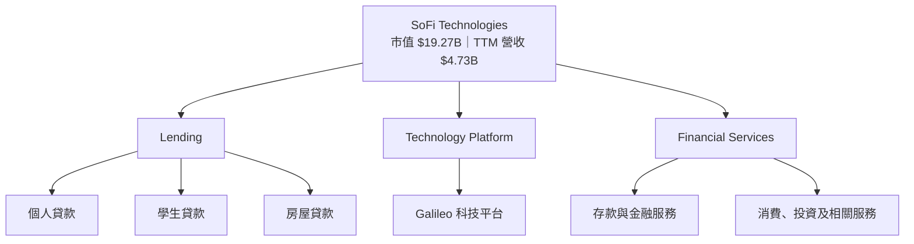
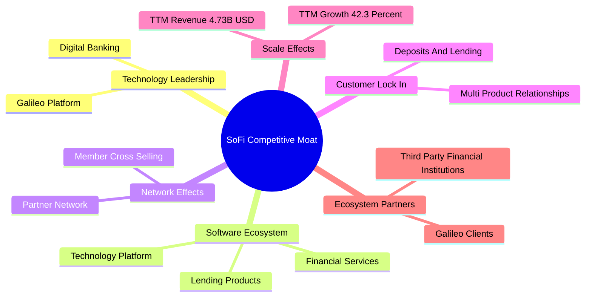
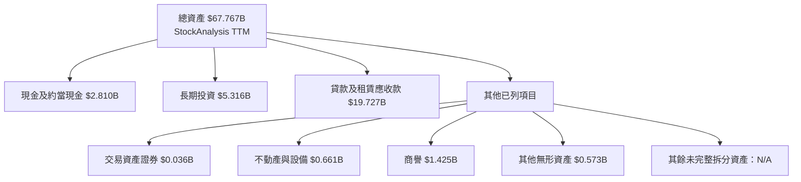
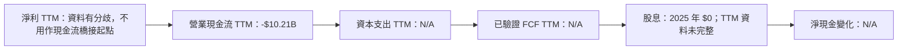
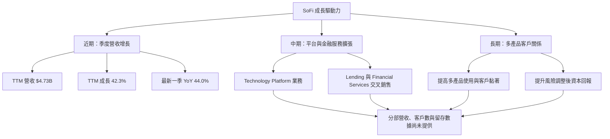
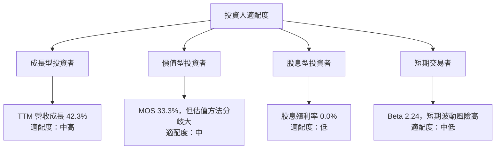

# SOFI 基本面深度分析報告
> **報告日期**：2026-11-17 ｜ **語言**：繁體中文 ｜ **數據來源**：SEC 申報資料 (XBRL)、Yahoo Finance、Finviz、StockAnalysis、Roic.ai ｜ **分析師**：CFA 級機構研究

## 目錄

| # | 章節 | 核心結論 |
|---|------|----------|
| 1 | 執行摘要 | 買入；加權合理價值 $22.27，MOS +33.3% |
| 2 | 公司概覽與商業模式 | 三業務板塊與金融科技平台形成交叉銷售機會；分部營收占比未提供 |
| 3 | 損益表深度分析 | TTM 營收 $4.73B、年增 42.3%；最新單季營收年增 44.0% |
| 4 | 資產負債表分析 | 已驗證淨現金 $2.81B；其他來源的債務數據與之有差異，須留意口徑 |
| 5 | 現金流量深度分析 | TTM 營業現金流為 -$10.21B；金融業放款增長會造成現金流出，TTM FCF 不可用 |
| 6 | 獲利能力與資本效率 | ROIC 不適用於放款機構；ROTCE 7.9%，低於 14.0% WACC 參考值但口徑不可直接等同 |
| 7 | 相對估值分析 | 估值低於自身歷史 P/S 中位數；相較同業估值高低因指標而異 |
| 8 | DCF 內在價值評估 | DCF 不適用；以固定金融業估值方法得加權合理價值 $22.27 |
| 9 | 成長催化劑 | TTM 營收成長 42.3%，金融服務交叉銷售與科技平台拓展是主要觀察方向 |
| 10 | 風險矩陣 | 信貸風險、融資成本與估值波動為主要風險 |
| 11 | 投資建議 | 買入；以 $20.04 作為 MOS 至少 10% 的估值上限參考 |

---

## 1. 執行摘要

截至 2026-11-16 收盤，SOFI 股價為 **$14.85**。公司 TTM 營收為 **$4.73B**、TTM 年增 **42.3%**，最新一季營收年增 **44.0%**，而程式計算的金融業估值方法給出加權合理價值 **$22.27**。因此，以加權合理價值為分母計算的 **MOS 為 +33.3%**，對應評級為**買入**。這並非強烈買入：放款機構不適合用一般公司 ROIC 作為價值創造判斷，而可用的 ROTCE 為 7.9%，無法證明 ROIC 高於 14.0% WACC。

### 1.0 一頁式投資儀表板（Portfolio Manager 30 秒速讀）

| 項目 | 內容 |
|------|------|
| **投資論點（3 句）** | ① TTM 營收 $4.73B、年增 42.3%，成長動能仍快。② 最新一季淨利 $240.99M，較前季 $156.59M 增加約 53.9%，顯示獲利具營運槓桿，但單季變化不等於長期趨勢。③ 加權合理價值 $22.27，相對 2026-11-16 收盤價 $14.85 有 +50.0% 上行空間。 |
| **綜合評分** | **6.2/10**（引用 1.1 評分卡） |
| **財務健康** | 🟡 已驗證現金與短期投資 $2.81B、淨現金 $2.81B；但總債務為 N/A，其他財務資料來源的債務口徑有差異。 |
| **ROIC vs WACC** | ROIC：N/A（金融業不適用）｜WACC：14.00%；不能據此直接宣稱創造或摧毀價值。 |
| **FCF 趨勢** | TTM FCF：N/A；營業現金流 -$10.21B，放款機構的放款變動可能造成營運現金流大幅流出。FCF Yield：N/A。 |
| **估值** | Forward P/E 約 16.5x（市場資料）｜EV/EBITDA：N/A（已驗證同業資料缺漏且 EBITDA 指標可比性有限）｜FCF Yield：N/A |
| **DCF 內在價值（基準）** | N/A（放款機構資金流量屬融資與放款活動，非一般企業自由現金流） |
| **安全邊際（MOS）** | **+33.3%＝($22.27 − $14.85) ÷ $22.27**（加權合理價值基準，來自 8.8）｜🟢 >25% 充足 |
| **預期報酬（基準情境 12M）** | DCF 情境為 N/A；以加權合理價值 $22.27 對比現價，隱含上行空間 +50.0%，並非保證的 12 個月報酬預測。 |
| **關鍵風險（前二）** | 信貸損失與資金成本上升；收入成長放緩或金融科技估值倍數收縮。 |
| **評級 + 信心度** | 🟢 **買入**（按程式提供的 MOS 評級；不調整一級）｜信心：中低 |

### 1.1 綜合評分卡（全報告唯一）

| 維度 | 評分（1–10） | 主要依據（引用數字與其來源章節） |
|------|--------------|----------------------------------|
| 成長性 | 8.0 | TTM 營收年增 42.3%，最新一季年增 44.0%（第 3 章）；數據顯示成長快，但未提供各分部成長貢獻。 |
| 獲利能力 | 6.0 | TTM ROE 6.5%、ROTCE 7.9%；最新一季營業利益率 19.4% 但 TTM 營業利益率 N/A，ROIC 不適用（第 3、6 章）。 |
| 財務健康 | 5.0 | 已驗證淨現金 $2.81B，但總債務 N/A，另有來源報告 $3.98B 總債務及 -$1.14B 淨負債，需核對口徑（第 4、5 章）。 |
| 估值 | 7.0 | MOS +33.3%；公司 P/S 4.3x 低於自身五年中位數 4.5x，但同業倍數與公司倍數因業務構成不同而不宜單看單一指標（第 7、8 章）。 |
| 護城河 | 6.0 | 三業務板塊與金融科技平台具交叉銷售及合作夥伴網絡基礎，但市場份額、會員留存與單位經濟數據未提供（第 2 章）。 |
| 管理層與資本配置 | 5.0 | 2025 年 SBC $262.06M，約為當年營收的 7.3%；未見回購支出數據，尚無法證明稀釋已被抵銷（第 3、5 章）。 |
| **綜合評分** | **6.2** | 六項算術平均：$(8.0+6.0+5.0+7.0+6.0+5.0)÷6=6.17$，四捨五入至一位小數為 6.2。 |

### 1.2 五大投資論點 + 三大核心風險

| 類型 | 項目 | 具體依據 | 信心度 |
|------|------|----------|--------|
| 🟢 **投資論點①** | 高速營收增長 | TTM 營收 $4.73B、年增 42.3%；最新一季年增 44.0%。若成長來自會員與多產品使用深化，規模可提高交叉銷售效率；分部數據未提供，仍需驗證成長來源。 | 🟢 中高 |
| 🟢 **投資論點②** | 盈利轉正後的槓桿潛力 | 2025 年淨利 $481.32M，2023、2022 年分別虧損 $300.74M、$320.41M；獲利轉正擴大了可用於資本再投資的內部資源。 | 🟢 中 |
| 🟢 **投資論點③** | 金融服務與放款交叉銷售 | 公司提供借貸、存款、消費、投資等服務，並經營 Lending、Technology Platform、Financial Services 三個板塊；若客戶能在同一平台使用多項產品，獲客成本有機會由多項產品共同承擔。 | 🟡 中 |
| 🟢 **投資論點④** | 估值相對自身歷史較低 | P/S 4.3x，低於五年中位數 4.5x；目前 P/E 26.5x，低於歷史中位數 36.6x。歷史區間參考價值有限，不能消除盈利與信用週期風險。 | 🟡 中 |
| 🟢 **投資論點⑤** | 加權估值高於現價 | 同業 Forward P/E、同業 P/B 與分析師共識三種方法加權後為 $22.27；相對 $14.85 現價，MOS +33.3%。估值對可比公司與帳面價值敏感。 | 🟡 中 |
| 🟡 **風險①** | 信貸損失與放款品質 | 放款淨額占總資產 79.3%；淨沖銷率、逾放比及 CET1 均未提供，難以直接判斷信用週期韌性。 | 🔴 高衝擊 |
| 🔴 **風險②** | 融資成本與淨息差壓力 | 淨利息收入占營收 64.0%，淨利差代理值 5.36%；若資金成本上升而資產收益率無法同步調整，核心收入與盈利可能受壓。 | 🔴 高衝擊 |
| 🟡 **風險③** | 稀釋與現金流解讀 | 2025 年 SBC $262.06M，約占 FY2025 營收 7.3%；TTM 營業現金流 -$10.21B，若貸款增長未轉化為風險調整後報酬，現金流負值可能持續。 | 🟡 中高 |

### 1.3 快速統計卡片

同業中位數以 NU、HOOD、UPST 已提供的同一指標計算；本公司指標優先使用已驗證數值。

| 指標 | 公司實際值（期間） | 同業中位數 | 狀態 |
|------|--------------------|------------|------|
| 營收成長（TTM） | **42.3%** | — | 🟢 |
| 營收成長（最新一季年增） | **44.0%** | **34.1%** | 🟢 |
| 毛利率（TTM） | **84.2%**（補充來源；已驗證核心區塊未列毛利率） | **83.3%** | 🟡 |
| 營業利益率（TTM） | **N/A** | — | 🟡 |
| ROIC（TTM） | **N/A（金融業不適用）** | — | 🟡 |
| Forward P/E | **約 16.5x** | **11.7x** | 🟡 |
| FCF Yield（TTM） | **N/A** | — | 🟡 |
| Piotroski F-Score | **N/A（不適用放款機構）** | — | 🟡 |

### 1.4 投資結論

```text
╔══════════════════════════════════════════════════════════════════╗
║                    📊 投資結論摘要                               ║
╠══════════════════════════════════════════════════════════════════╣
║  評級：買入（依 8.8 MOS 門檻；不調整一級）                       ║
║  價格（2026-11-16 收盤）：$14.85                                 ║
║  DCF 內在價值（基準）：N/A（放款機構 DCF 不適用）               ║
║  安全邊際 MOS：+33.3%＝($22.27−$14.85)÷$22.27                   ║
║  加權合理價值（8.8）：$22.27                                     ║
║  DCF 情境價值：N/A（DCF MODEL 不適用，未提供情境價值）          ║
║  綜合評分：6.2/10（引用 1.1）                                    ║
║  適合投資人：能承受高波動的成長型與長線投資人；不適合以股息為主者║
╚══════════════════════════════════════════════════════════════════╝
```

---

## 2. 公司概覽與商業模式

### 2.1 業務結構與收入來源

SoFi Technologies 提供貸款、金融服務與科技平台服務。公司揭露三個主要板塊，但現有資料未提供各板塊營收及獲利占比，故不拆分比例。市值為 $19.27B，TTM 營收為 $4.73B。



**業務經濟性**：Lending 主要受放款量、資金成本、信用損失與貸款出售／持有策略影響；Technology Platform 偏向企業技術服務，但本資料未披露客戶數、處理量、平台收入占比或分部毛利；Financial Services 有機會提高客戶留存與交叉銷售，但會員數、每會員收入及獲客成本均未提供。因此，不能據此量化各板塊對 42.3% TTM 成長的貢獻。

### 2.2 市場份額

市場份額數據未提供，近期新聞資料亦未提供可核實的 SoFi 市場份額與年份，故不繪製份額圖。公司 TTM 營收 $4.73B、TTM 成長 42.3%，最新一季成長 44.0%；其成長快於 NU、HOOD、UPST 最新一季營收年增率中位數 34.1%，但業務組合不同，不能直接等同市場份額提升。

### 2.3 競爭護城河分析



目前可確認的護城河更多是「可能具備」而非已由公開數字證實。缺少客戶留存率、活躍會員數、交叉銷售率、平台處理量和分部利潤率，無法證明網路效應已形成持續的定價權或低成本優勢。

### 2.4 護城河強度

| 護城河項目 | 強度（強／中／弱） | 證據（引用數字或事實） | 會削弱它的情況 |
|------------|--------------------|------------------------|----------------|
| 數位金融產品組合 | 中 | 提供貸款、存款、消費、投資等多種服務；TTM 營收 $4.73B。 | 客戶主要只使用單一產品，交叉銷售率低或獲客成本上升。 |
| 軟體生態與 Galileo | 中 | 公司有 Technology Platform 板塊並經營 Galileo；板塊收入與客戶數未提供。 | 客戶流失、交易量放緩、服務差異化不足或平台客戶自建系統。 |
| 網路效應 | 弱至中 | 會員可以使用多種金融產品，但會員數、留存與產品使用數據未提供。 | 產品組合未能形成多邊網絡，會員選擇轉換成本低。 |
| 客戶鎖定 | 弱至中 | 存款與借貸關係可形成一定黏著性，但存款留存與客戶流失率未提供。 | 利率優惠被競爭者快速複製，客戶以收益率為主而轉移資金。 |
| 規模效應 | 中 | 近年營收擴張；2025 年收入 $3.61B，TTM $4.73B。 | 以促銷補貼換取成長，固定成本未隨規模下降。 |
| 生態夥伴 | 中 | Galileo 具有金融科技平台與外部合作的業務定位；合作夥伴數量與收入集中度未提供。 | 大型客戶流失、客戶集中或合作夥伴改用替代平台。 |

**護城河分數理由**：1.1 評分卡的護城河分數為 **6.0/10**，依據是多產品與平台生態具有可觀的擴張空間，但關鍵留存、交叉銷售與平台單位經濟數據未提供，尚不足以證明護城河已轉化為穩定的超額回報。

---

## 3. 損益表深度分析

### 3.1 年度收入成長趨勢（近 4 年）

下圖年度營收取自年度損益表，金額四捨五入至 $0.01B；年度 YoY 與 CAGR 為依該表數字計算的近似值。2026 年 TTM $4.73B 不是完整財年，不納入年度 CAGR。

```text
╔══════════════════════════════════════════════════════════════════╗
║              SoFi 年度收入趨勢（FY2022-FY2025）                  ║
╠══════════════════════════════════════════════════════════════════╣
║  FY2022  $1.57B  ████████░░░░░░░░░░░░░░░░  基期                 ║
║  FY2023  $2.11B  ███████████░░░░░░░░░░░░░  YoY 約 +34.4% 🟢    ║
║  FY2024  $2.61B  ██████████████░░░░░░░░░░  YoY 約 +23.7% 🟢    ║
║  FY2025  $3.61B  ████████████████████░░░░  YoY 約 +38.3% 🟢    ║
╠══════════════════════════════════════════════════════════════════╣
║  FY2022–FY2025 CAGR ≈ (3.61÷1.57)^(1÷3)−1 = 約 32.0%             ║
║  2026 TTM $4.73B、TTM YoY +42.3%（非完整財年）                   ║
╚══════════════════════════════════════════════════════════════════╝
```

營收從 FY2022 的 $1.57B 增至 FY2025 的 $3.61B，三年複合年增約 32.0%。FY2024 年增約 23.7%，FY2025 回升至約 38.3%，TTM 年增進一步達 42.3%。這可能反映放款、金融服務及科技平台規模擴大；但因未提供分部營收，無法分辨成長究竟來自放款量、利息收入、非利息收入或平台客戶增加。

### 3.2 季度收入趨勢分析

季度收入採 StockAnalysis 季度序列（$B），並使用相鄰季度數據計算 QoQ；最新一季的 44.0% YoY 依已驗證單季數字引用。各來源季度收入略有差異，例如 Q3 2026 另有 $1.39B 的四捨五入值。

| 季度 | 營收（$B） | QoQ | YoY | 備註 |
|------|------------|-----|-----|------|
| 2025 Q4 | 1.025 | 約 +6.6% | 約 +40.2% | QoQ 以 Q3 2025 的 $0.962B 計算。 |
| 2026 Q1 | 1.100 | 約 +7.3% | 約 +42.5% | YoY 依 StockAnalysis 所列單季成長率。 |
| 2026 Q2 | 1.219 | 約 +10.8% | 約 +42.6% | 營收連續季增。 |
| 2026 Q3 | 1.385 | 約 +13.6% | **44.0%** | YoY 引用已驗證最新季度年增率；不同來源金額有四捨五入差異。 |

最新四季季度營收大致呈連續季增，QoQ 約由 6.6% 加速至 13.6%。這有利於提升固定成本吸收，但季度營收增長不等於信用調整後的獲利增長；仍需觀察撥備、資金成本及各板塊利潤率。

### 3.3 利潤率演變分析

| 利潤率指標 | FY2022 | FY2023 | FY2024 | FY2025／最新資料 | 趨勢 | 評估 |
|------------|--------|--------|--------|------------------|------|------|
| **毛利率** | N/A | N/A | N/A | TTM 84.2%（補充來源） | 歷史年度序列未提供 | 🟡 |
| **營業利益率** | N/A | N/A | N/A | TTM N/A；最新一季 19.4% | 無法構成可靠年度趨勢 | 🟡 |
| **淨利率** | 約 -20.4% | 約 -14.3% | 約 19.1% | FY2025 約 13.3%；TTM 約 15.6% | 由虧損轉盈；年度間有波動 | 🟡 |

FY2022、FY2023 淨利率是以年度淨利分別除以年度營收估算；FY2024、FY2025 同樣使用年度損益表數字。FY2025 淨利率約 13.3%，低於 FY2024 約 19.1%，但 TTM 淨利率資料為 15.6%。盈利改善與收入規模擴大相符，但資料缺少逐年成本項目與稅前調整，不能將利潤率變化單一歸因於定價、產品組合或成本削減。

**利潤率演變深度解析**：公司已從 FY2022–FY2023 的淨虧損轉為 FY2024–FY2025 獲利，顯示營收增長與成本結構改善可能形成營運槓桿。另一方面，FY2025 淨利低於 FY2024（$481.32M 對 $498.67M），雖然收入上升，淨利率仍有回落。利息收入、信貸撥備、資金成本與非經常性項目均可能影響金融業利潤率；缺少分項資料，應避免把單季營業利益率 19.4% 誤認為 TTM 或年度水準。

### 3.4 費用結構分析

可用資料未提供完整費用項目分解，也沒有可與營收一致勾稽的各成本金額，因此不繪製費用圓餅圖或費用結構方框圖。FY2025 SBC 為 $262.06M；其餘利息成本、信貸損失準備、行銷、薪酬及科技成本的可比明細未在本資料中完整提供。

### 3.5 季度 EPS 趨勢與盈餘品質（Quality of Earnings）

**近四季盈餘超預期情況**：可用的 EPS 估計與實際值均為 NaN，故無法判斷 2026 Q3、Q2、Q1、2025 Q4 是超預期或不及預期。這四季 EPS surprise 必須標示為資料缺漏，不能以 EPS 實際增長替代「超預期」判斷。

| 盈餘品質項目 | 數值／佔比 | 評估 |
|--------------|-----------|------|
| 股權薪酬 SBC / 營收 | FY2025：$262.06M ÷ $3.61B ≈ **7.3%**；依四季季度 SBC 加總 $288.33M ÷ TTM 營收 $4.73B ≈ **6.1%** | 🟡 SBC 對股東的經濟成本顯著；其後續稀釋效果取決於實際授予、歸屬與回購。 |
| SBC / 營業現金流 | TTM SBC 約 $288.33M；TTM OCF -$10.21B。直接比率約 -2.8%，但負分母不具通常解讀意義。 | 🔴 現金流受放款活動影響，不能把負分母計算的比率當成 SBC 負擔改善。 |
| FCF / 淨利（現金轉換率） | N/A（已驗證 TTM FCF N/A） | 🟡 不可用非核心 FCF 定義自行替代。 |
| 一次性／非經常性損益 | N/A（資料未提供可核實的分項） | 🟡 無法判斷是否有一次性收益推高淨利。 |
| 有效稅率異常 | 8.5%（最新年度有效稅率來源） | 🟡 低於常見法定稅率的可能性需進一步解釋；資料未提供稅務調節表，不能假定可持續。 |
| 資本化支出 vs 費用化 | 資本支出與資產資料口徑有差異；資本化政策明細 N/A | 🟡 目前無法判斷費用是否因資本化而遞延。 |

**盈餘品質結論**：GAAP 淨利已轉正，2025 年淨利 $481.32M，但 TTM FCF 不可用，營業現金流為 -$10.21B，且 SBC 約為 TTM 營收 6.1%。對放款機構而言，放款本金與貸款持有變動會使現金流與淨利的傳統轉換率失真；因此，不能簡單斷言淨利高估或低估。估值應同步追蹤信用成本、資本充足度、SBC 稀釋與帳面價值報酬。

---

## 4. 資產負債表分析

### 4.1 資產結構分解

最新資產負債表來源列示總資產 $67.767B，但可得資產明細不足以完整勾稽總資產，因此以下只呈現明確列出的項目，不將未披露部分反推為其他資產。



放款淨額占總資產 79.3% 的金融業指標顯示，資產端高度依賴貸款資產；這使信用品質、貸款期限與資金來源成為資產負債表分析核心。總資產 $67.767B 與其他簡表中的 FY2025 總資產 $50.66B 存在期間差異，應以各自標示的日期與資料來源解讀。

### 4.2 流動性與營運資金分析

SoFi 是放款機構，傳統 DSO、DIO、DPO、CCC 不適合描述其主要資產與負債的經濟循環，因此不套用一般工業企業營運資金週期。可用的金融業指標如下。

| 指標 | 數值 | 解讀 |
|------|------:|------|
| 現金與短期投資 | $2.81B | 已驗證的流動資產緩衝；不等同可自由使用的超額現金。 |
| 淨現金 | $2.81B | 已驗證欄位列示總債務 N/A，因此不應自行由其他口徑反推。 |
| 淨利息收入 NII / 總營收 | 64.0% | 利息收入是主要營收來源，對資產收益率與資金成本敏感。 |
| 淨利差代理值 | 5.36% | NII ÷ 平均總資產；並非公司正式 NIM，因缺少生息資產數據，通常會低於以生息資產為分母的 NIM。 |
| 放款淨額 / 總資產 | 79.3% | 資產集中於放款；信用風險變化對資產價值與盈利影響大。 |
| DSO / DIO / DPO / CCC | 不適用（金融業） | 工業企業存貨與應付款週轉模型不適用於放款機構。 |

### 4.3 債務結構分析

不同來源的負債資料不一致：已驗證財務欄位列示總債務 N/A、淨現金 $2.81B；補充財務快照則列示總債務 $3.98B、淨負債 $1.14B。這些數字的日期、債務範圍與是否包含存款等金融機構負債口徑未能在現有資料中調和，因此以下以已驗證欄位為主，並保留差異提示。

```text
╔══════════════════════════════════════════════════════════════════╗
║                   SoFi 債務健康診斷                              ║
╠══════════════════════════════════════════════════════════════════╣
║  總債務（已驗證）：N/A                                           ║
║  現金及短期投資：$2.81B                                          ║
║  已驗證淨現金：  $2.81B                                          ║
║  另一路徑資料：總債務 $3.98B、淨負債 $1.14B（口徑待核對）      ║
║  Debt/EBITDA：N/A（金融業且 EBITDA 資料缺漏）                   ║
║  Interest Coverage：N/A（利息費用與分母口徑不足）               ║
║  評估：🟡 現金緩衝存在，但不能忽略不同資料來源的負債差異        ║
╚══════════════════════════════════════════════════════════════════╝
```

銀行及放款機構的存款、批發融資、證券化與借款不能一概等同一般公司的有息債務。投資人應以 10-Q 的完整負債附註和監管資本資料確認融資結構；目前資料沒有足夠資訊計算可靠的 Debt/EBITDA 或利息保障倍數。

### 4.4 股東權益趨勢

| 財年 | 股東權益 | YoY 變化 | 解讀 |
|------|---------:|---------:|------|
| 2022 | $5.53B | — | 盈利仍為虧損，資本基礎已建立。 |
| 2023 | $5.55B | 約 +0.4% | 近乎持平；年度淨虧損約 $300.74M。 |
| 2024 | $6.53B | 約 +17.7% | 股權增加，但可用資料不足以完整拆分留存盈餘與發股等來源。 |
| 2025 | $10.49B | 約 +60.8% | 增幅明顯；需檢視發股、留存盈餘及其他權益變動明細，不能單由淨利解釋。 |

股東權益擴大能提升放款能力，但若增長依賴股權發行，對既有股東也可能帶來稀釋。股數由 2026 年 3 月的 1.281B 增至 2026 年 9 月的 1.297B，顯示期間股數增加；資料不足以把變化完全歸因於 SBC 或其他發行。

---

## 5. 現金流量深度分析

### 5.1 現金流量瀑布圖

TTM 營業現金流為 -$10.21B；已驗證資本支出與 FCF 均為 N/A。因此，不能在瀑布圖中將資本支出或 FCF 以其他來源數字代入，也不能用一般公司營運現金流的直覺解讀放款機構的貸款資金流。



### 5.2 FCF 轉換率趨勢

| 年度 | 營業現金流 | 資本支出 | FCF（來源列示） | 淨利 | FCF / 淨利 |
|------|------------:|---------:|----------------:|------:|-----------:|
| 2022 | -$7.26B | -$103.73M | -$7.36B | -$320.41M | 約 23.0x；負值比率無一般經濟意義 |
| 2023 | -$7.23B | -$121.19M | -$7.35B | -$300.74M | 約 24.4x；負值比率無一般經濟意義 |
| 2024 | -$1.12B | -$163.62M | -$1.28B | $498.67M | 約 -2.6x |
| 2025 | -$3.74B | -$251.12M | -$3.99B | $481.32M | 約 -8.3x |
| TTM | -$10.21B | N/A | **N/A（已驗證）** | TTM 淨利口徑來源有差異 | N/A |

表中年度 FCF 是補充現金流量表所列數字；放款本金與貸款餘額變動會顯著影響金融企業的營業現金流，因此這些比率不宜直接用來衡量一般企業式「盈餘現金轉換」。

### 5.3 自由現金流趨勢

```text
╔══════════════════════════════════════════════════════════════════╗
║           SoFi 現金流：年度來源列示值與 TTM 限制                 ║
╠══════════════════════════════════════════════════════════════════╣
║  FY2022 FCF（來源列示） -$7.36B  ◀ 現金流出                     ║
║  FY2023 FCF（來源列示） -$7.35B  ◀ 現金流出                     ║
║  FY2024 FCF（來源列示） -$1.28B  ◀ 現金流出縮小                 ║
║  FY2025 FCF（來源列示） -$3.99B  ◀ 現金流出擴大                 ║
║  TTM FCF（已驗證）      N/A      FCF Yield N/A                  ║
╠══════════════════════════════════════════════════════════════════╣
║  注意：放款機構貸款增長會形成現金流出，需與貸款增量及資金來源合看║
╚══════════════════════════════════════════════════════════════════╝
```

補充現金流表在 2026 年季度列示的營業現金流多季為大額負值，但這種現金流不應直接解讀為業務現金消耗或償債危機。對 SOFI 更重要的是信貸資產的風險調整後收益、存款與其他融資來源、資本要求與貸款出售能力。TTM FCF Yield 依已驗證資料為 N/A。

### 5.4 資本配置評估

可用資料沒有足以重建「貸款增長、資本支出、分紅、回購、現金留存」完整用途比例的資金流量明細，故不畫資本配置圓餅圖。

| 資本配置項目 | 可得資料 | 評估 |
|--------------|----------|------|
| 股息 | FY2025 $0；FY2024 現金股息 $16.50M | 公司當前資本回報以再投資為主。 |
| SBC | FY2025 $262.06M | SBC 是員工薪酬成本，也會造成潛在股數稀釋。 |
| 資本支出 | FY2025 $251.12M；TTM 已驗證值 N/A | 年度支出金額相對貸款資金流小，但不能由此推導科技平台投資效率。 |
| 回購 | 資料未提供 | 無法判斷是否抵銷 SBC 稀釋。 |
| 放款與資產配置 | 放款淨額占總資產 79.3% | 核心資本配置集中於金融資產，須以信用損失與風險調整後報酬衡量。 |

---

## 6. 獲利能力與資本效率

### 6.1 ROE / ROA / ROIC 趨勢

| 指標 | 數值 | 評估 |
|------|------|------|
| ROE（TTM，已驗證） | 6.5% | 資本回報為正，但未達高回報水準。 |
| ROE（補充市場資料） | 7.4% | 與已驗證值不同，可能來自期間或平均權益口徑差異；本報告以已驗證值為主。 |
| ROA（TTM，補充來源） | 1.3% | 金融業資產規模大，ROA 絕對值通常低於一般非金融企業；不宜跨產業直接比較。 |
| ROTCE（TTM） | 7.9% | 以淨利除以有形帳面價值計算的已提供指標。 |
| ROIC | N/A（金融業不適用） | 債務與存款是金融營運資金來源，傳統投入資本算法不具可比性。 |

沒有可引用的行業均值，因此不加入行業平均比較欄。金融公司應以 ROTCE、資產收益率、淨息差、信貸損失及監管資本衡量資本效率；本報告缺少部分必要信用與資本指標。

### 6.2 ROIC vs WACC 分析（核心價值創造判斷）

放款機構的存款與借款同時是資金來源和營運核心，傳統 ROIC 的投入資本定義會把金融負債處理得不一致。因此，ROIC vs WACC 在此不作直接價值創造判定。以下列出可用的資本成本資料；WACC 採已驗證指定值 **14.00%**，不另建 WACC。

```text
╔══════════════════════════════════════════════════════════════════╗
║                ROIC vs WACC 深度分析                            ║
╠══════════════════════════════════════════════════════════════════╣
║  ROIC：N/A（金融業不適用一般 ROIC 架構）                         ║
║                                                                  ║
║  資本成本資料（程式計算）：                                      ║
║  ├── 無風險利率（10Y 美債）：5.12%                              ║
║  ├── 市場風險溢酬 ERP：5.00%                                    ║
║  ├── 原始 Beta：2.24                                             ║
║  ├── 調整後 Beta：1.83（⅔×2.24＋⅓×1）                          ║
║  ├── 股權成本：14.26%                                            ║
║  ├── 稅前債務成本：29.04%                                       ║
║  ├── 股權／債務權重：82.9%／17.1%                              ║
║  ├── 未限制計算 WACC：16.37%                                    ║
║  └── 採用 WACC：14.00%（限制在 7%–14% 區間後的上限）           ║
║                                                                  ║
║  ROTCE：7.9%（與 WACC 的口徑不同，不直接計算 EVA）               ║
║  結論：可觀察 ROTCE 尚低於採用 WACC，但這不是 ROIC-WACC 等式。   ║
╚══════════════════════════════════════════════════════════════════╝
```

未限制 WACC 的計算為股權成本與稅後債務成本按資本權重加權後約 16.37%，而程式規定採用的 WACC 被限制在 7%–14% 區間，因此使用上限 **14.00%**。ROIC 不適用，故不計算 EVA 或「ROIC 為 WACC 幾倍」。ROTCE 7.9% 低於 WACC 只是風險提示，不是可直接替代 ROIC 的價值差額。

### 6.3 杜邦三因素分解

| 因素 | 數值（TTM） | 解讀 |
|------|-------------|------|
| 淨利率 | 15.6% | 已提供的 TTM 淨利率。 |
| 資產週轉率 | 0.07 | 金融機構持有大量貸款資產，資產週轉率低是業務模型特徵之一。 |
| 權益乘數 | 6.00 | 顯示資產規模相對於權益較大，槓桿對 ROE 有放大效果。 |
| **ROE** | **6.5%** | 15.6% × 0.07 × 6.00 = 6.55%，與提供值 6.5% 的差異屬四捨五入。 |

杜邦分解顯示，淨利率為正，但低資產週轉率與權益乘數共同決定 ROE。槓桿確實放大資產回報，但也會放大信用損失與資金成本變化的影響。

### 6.4 財務體質：Piotroski F-Score 與放款機構指標

Piotroski F-Score 對放款機構不適用：貸款資產增長可能導致營運現金流出，常規 F-Score 的現金流測試會將正常放款活動誤判為品質惡化。因此不列九項 F-Score 測試，也不補造分數。

| 放款機構指標 | 數值 | 解讀與口徑限制 |
|--------------|------:|----------------|
| NII / 總營收 | 64.0% | 淨利息收入占比高，營收對利率與融資成本敏感。 |
| 淨利差代理值 | 5.36% | NII ÷ 平均總資產；非正式 NIM，因分母不是生息資產，通常低於公司正式公布的 NIM。 |
| 成本收入比代理值 | 80.8% | (營收−稅前淨利) ÷ 營收，包含信用準備等項目，因此高於一般報告的效率比率，不可直接等同營運費用率。 |
| ROTCE | 7.9% | 淨利 ÷ 有形帳面價值，反映有形普通股權益回報。 |
| P/TBV | 2.07x | 市場價格約為有形帳面價值的 2.07 倍，估值包含對未來盈利能力的期待。 |
| 放款淨額 / 總資產 | 79.3% | 資產組合高度放款導向。 |
| 淨沖銷率 | N/A（數據未提供） | 不能以記憶或外部未驗證數字替代。 |
| 逾放比 | N/A（數據未提供） | 需要季報或公司揭露資料。 |
| CET1 | N/A（數據未提供） | 無法評估監管資本緩衝。 |

---

## 7. 相對估值分析

### 7.1 同業估值比較表格

本表同業倍數使用 NU、HOOD、UPST 的已提供 Peer multiples。SOFI Forward P/E 使用市場快照約 16.5x；另有估值方法計算採用 $0.90 Forward EPS，兩者在精確小數上略有差異。

| 估值指標 | **SOFI** | **NU** | **HOOD** | **UPST** | 本公司評估 |
|----------|---------:|-------:|---------:|--------:|-----------|
| **Trailing P/E** | 26.5x | 15.8x | 33.2x | 31.3x | 🟡 SOFI 低於 HOOD、UPST，高於 NU。 |
| **Forward P/E** | 約 16.5x | 11.7x | 21.1x | 6.5x | 🟡 高於同業中位數 11.7x；差異反映成長與獲利預期不同。 |
| **P/S Ratio** | 4.3x | 6.7x | 12.8x | 1.4x | 🟢 低於 NU、HOOD，但高於 UPST；需注意營收組成差異。 |
| **EV/EBITDA** | N/A（已驗證歷史欄位另列 60.9x） | N/A | N/A | 26.9x | 🔴 跨同業可比樣本不足，不據此作核心估值。 |
| **最新一季營收年增** | 44.0% | 34.4% | 11.8% | 34.1% | 🟢 SOFI 高於三家同業所列增長率。 |
| **毛利率 TTM** | 84.2%（補充來源） | 0.0% | 91.0% | 83.3% | 🟡 金融企業毛利率定義可比性有限，僅作參考。 |

同業公司的收入來源與盈利模式不同：NU 偏數位金融，HOOD 受交易活動影響，UPST 的信貸科技業務具較強周期性。因而 P/E、P/S 倍數只能提供估值區間參照，不能視為相同品質資產的直接定價。

### 7.2 歷史估值區間分析

```text
╔══════════════════════════════════════════════════════════════════╗
║            SOFI 歷史估值區間（TTM 倍數）                        ║
╠══════════════════════════════════════════════════════════════════╣
║  P/E        範圍 27.0x–67.1x｜中位數 36.6x｜目前 26.5x           ║
║             目前百分位：0%（資料庫計算）                         ║
║  P/S        範圍 2.6x–14.6x｜中位數 4.5x｜目前 4.3x              ║
║             目前百分位：43%                                      ║
║  EV/EBITDA  範圍 19.0x–148.7x｜中位數 65.1x｜目前 60.9x         ║
║             目前百分位：48%                                      ║
╚══════════════════════════════════════════════════════════════════╝
```

P/E 百分位顯示目前落在歷史區間低端，但當前 P/E 26.5x 略低於歷史資料列出的最低值 27.0x，可能受時間點、資料更新或四捨五入口徑影響。P/S 4.3x 接近歷史中位數 4.5x。EV/EBITDA 60.9x 仍屬歷史區間中段附近，且該倍數對金融企業的經濟含義有限。

### 7.3 情境價值（Bear / Base / Bull）

**N/A（DCF 無法計算：放款機構的資金流量屬資金與貸款活動，不適合以一般企業自由現金流建立 DCF；程式模型未提供三情境價值。）** 因此不另造營收 CAGR、利潤率、WACC 或目標價情境。

### 7.4 相對估值隱含價格區間

```text
╔══════════════════════════════════════════════════════════════════╗
║             相對估值方法隱含價格與現價位置                      ║
╠══════════════════════════════════════════════════════════════════╣
║  $10.56 ───────── $14.85 ───────────── $20.84 ─────── $37.27  ║
║  Forward P/E       現價               分析師共識       P/B       ║
║                                                                  ║
║  同業 Forward P/E：$10.56                                          ║
║  同業 P/B：        $37.27                                          ║
║  分析師共識：      $20.84                                          ║
╚══════════════════════════════════════════════════════════════════╝
```

| 方法 | 每股價值 | 相對現價 | 計算依據 |
|------|---------:|---------:|----------|
| 同業 Forward P/E | $10.56 | -28.9% | 同業中位數 Forward P/E 11.7x × SOFI Forward EPS $0.90。 |
| 同業 P/B | $37.27 | +151.0% | 同業中位數 P/B 4.3x × SOFI 每股帳面價值 $8.71。 |
| 分析師共識目標價 | $20.84 | +40.3% | 23 位分析師平均目標價。 |

三種方法得出的價格差距大，尤其同業 P/B 價值 $37.27 高於 Forward P/E 價值 $10.56。這表示市場對 SOFI 的合理價格高度依賴未來盈利能力與帳面資本回報；P/B 估值只有在帳面權益能產生可持續回報時才有說服力。

---

## 8. DCF 內在價值評估

### 8.0 估值推理鏈（Thinking Logic）

SOFI 是放款機構，貸款增長與資金流動會使營業現金流不能直接代表可供所有資本提供者分配的自由現金流；因此程式估值指定以**同業 Forward P/E、同業 P/B 與分析師共識**進行估值，而非自建一般公司 DCF。公司三個主要業務板塊的營收占比未提供，不能為各分部任意拆分價值或填入假設占比。

| 決策點 | 本報告採用 | 理由（含數字） | 曾考慮但否決 | 否決理由 |
|--------|-----------|----------------|--------------|----------|
| 現金流定義 | DCF 不適用 | TTM 營業現金流 -$10.21B；已驗證 TTM Capex、FCF 為 N/A，且貸款資金流屬營運核心。 | FCFF／FCFE | 一般企業 FCF 模型不能可靠處理貸款資產與融資負債。 |
| 預測期 N | N/A | 程式 DCF MODEL 標示 N/A。 | 自行設定預測年數 | 會形成未由指定模型支持的黑箱估值。 |
| 終值方法 | N/A | DCF 未計算。 | Gordon Growth、退出倍數 | 對金融機構資金流量定義不穩健。 |
| EBIT 基礎 | N/A | DCF 未計算；TTM 營業利益率為 N/A。 | GAAP EBIT 模型 | 缺少可用模型輸入及分部資料。 |

本公司估值較受未來盈利、帳面權益回報、信貸損失及同業倍數影響。相對估值也存在明顯分歧：Forward P/E 隱含 $10.56，P/B 隱含 $37.27。最脆弱的一環是對帳面權益能否持續產生高於資本成本回報的假設；ROTCE 為 7.9%，而採用 WACC 為 14.0%，雖兩者不能直接等同，但提示高 P/B 隱含的盈利轉化要求並不低。

### 8.1 模型假設總表（Model Inputs）

**N/A（數據未提供／不適用：程式 DCF MODEL 對放款機構標示 N/A；未建立預測期、營收 CAGR、EBIT 利潤率、稅率、Capex、D&A、營運資金變動、終值、稀釋股數及 DCF WACC 輸入。不得自建 DCF。）**

本報告的估值採用金融業固定方法：同業 Forward P/E 權重 50%、同業 P/B 權重 40%、分析師共識權重 10%，詳見 8.8。

### 8.2 折現率推導（WACC）

WACC 使用已驗證資本成本區塊的採用值，不自行重算或替換。原始 Beta 為 2.24，調整後 Beta 為 1.83，計算方法為 ⅔ × 2.24 + ⅓ × 1；無風險利率 5.12%、ERP 5.00%、股權成本 14.26%、稅前債務成本 29.04%、有效稅率 8.5%、股權／債務權重 82.9%／17.1%。程式計算未限制 WACC 為 16.37%，但因模型將 WACC 限制在 7%–14% 區間，採用 **14.00%**。

```text
╔══════════════════════════════════════════════════════════════════╗
║                    WACC 資本成本資料                             ║
╠══════════════════════════════════════════════════════════════════╣
║  無風險利率 Rf：5.12%（10Y Treasury；資料未提供觀察日期）        ║
║  ERP：5.00%（程式採用假設值）                                    ║
║  原始 Beta：2.24；調整後 Beta：1.83                              ║
║  Ke：14.26%（已驗證成本資本數據）                               ║
║  稅前 Kd：29.04%；有效稅率：8.5%                                 ║
║  E / D 權重：82.9% / 17.1%                                      ║
║  未限制 WACC：16.37%；區間限制後採用：14.00%                     ║
║  說明：這是固定資本成本輸入；非本章自行重新計算的折現率。        ║
╚══════════════════════════════════════════════════════════════════╝
```

由於 DCF MODEL 為 N/A，本報告不以 WACC 折現未提供的現金流，也不以不同債務範圍自行重建 WACC。第 6.2 節亦引用相同 14.00%。

### 8.3 逐年自由現金流預測（基準情境）

**N/A（放款機構的資金流量是放款與融資活動，非一般企業自由現金流；程式 DCF MODEL 未提供逐年預測，因此不列預測年度、不作逐年演算。）**

### 8.4 終值計算（Terminal Value）

**N/A（DCF MODEL 未計算終值；不適用 Gordon Growth 或退出倍數法。）**

### 8.5 企業價值 → 每股內在價值（Bridge）

**N/A（DCF MODEL 未提供企業價值、現金與債務橋接、稀釋股數或 DCF 每股內在價值。）**

本節不計算 DCF 折溢價。DCF 基準內在價值不存在，不能以任一相對估值方法替代 DCF 內在價值後再標為 DCF 折溢價。MOS 僅於 8.8 依加權合理價值計算。

### 8.6 敏感性分析（WACC × 永續成長率）

**N/A（沒有 DCF 基準現金流、永續成長率與敏感度矩陣；不自建矩陣、不提供 DCF 三情境價值或機率加權價值。）**

### 8.7 反推 DCF（Reverse DCF：市場在預期什麼）

**N/A（DCF 模型未建立，現價無法在指定程式模型中反推營收 CAGR、利潤率、永續成長率或預測期長度。）** 以市場價格推導營運假設至少需要同一套 DCF 的現金流、稅率與終值輸入；自行補建會違反估值模型唯一來源原則。

### 8.8 估值三角驗證與安全邊際

| 估值方法 | 隱含每股價值 | 上行空間（÷現價） | 權重 | 說明 |
|----------|--------------|-------------------|------|------|
| 同業 Forward P/E | $10.56 | -28.9% | 50% | 同業中位數 Forward P/E 11.7x × SOFI Forward EPS $0.90。 |
| 同業 P/B | $37.27 | +151.0% | 40% | 同業中位數 P/B 4.3x × SOFI 每股帳面價值 $8.71。 |
| 分析師共識目標價 | $20.84 | +40.3% | 10% | 23 位分析師的平均目標價；權重為固定參考權重。 |
| **加權合理價值** | **$22.27** | **+50.0%** | **100%** | 金融業估值方法；未納入 DCF。 |

**逐步演算（權重外顯）**：

- 同業 Forward P/E 加權值：$10.56 × 50% = $5.28。
- 同業 P/B 加權值：$37.27 × 40% = $14.908。
- 分析師共識加權值：$20.84 × 10% = $2.084。
- **加權合理價值**：$5.28 + $14.908 + $2.084 = $22.272，四捨五入至美分為 **$22.27**。
- **MOS**：($22.27 − $14.85) ÷ $22.27 = $7.42 ÷ $22.27 = **33.3%**。
- **上行空間**：($22.27 − $14.85) ÷ $14.85 = $7.42 ÷ $14.85 = **50.0%**。
- 權重合計：50% + 40% + 10% = 100%。依金融業固定估值權重；DCF 因不適用而不列為方法，也沒有被重新分配權重。

```text
╔══════════════════════════════════════════════════════════════════╗
║                  估值區間與安全邊際                              ║
╠══════════════════════════════════════════════════════════════════╣
║  $10.56 ─── $14.85 ───────── [$22.27] ───────────── $37.27     ║
║  Forward P/E   現價            加權合理價值           P/B        ║
║                                                                  ║
║  MOS = ($22.27−$14.85) ÷ $22.27 = +33.3%                        ║
║  MOS 評估：🟢 >25% 充足                                           ║
║  上行空間 = ($22.27−$14.85) ÷ $14.85 = +50.0%                  ║
║  （MOS 與上行空間分母不同，不可混用）                           ║
║                                                                  ║
║  建議買入價格上限：$20.04（使 MOS 至少約 10%）                   ║
║  現價 $14.85 位於該上限以下；下行沒有以估值方法界定的價格底部。  ║
╚══════════════════════════════════════════════════════════════════╝
```

上限計算：$22.27 × (1 − 10%) = $20.043，四捨五入為 **$20.04**。這是以加權合理價值和 10% MOS 推導的估值門檻，不是保證股價會到達的目標價。

> 🔎 **程式複算（Python，依本節各項自動重算）**
>
> 加權合理價值 = $10.56 × 50% + $37.27 × 40% + $20.84 × 10% = **$22.27**（權重合計 100%）
>
> 以價格 $14.85 計：MOS = **+33.3%**，上行空間 = **+50.0%**
>
> ✅ 與本節所寫數值一致。

### 8.9 DCF 模型的局限與失效條件

- **終值依賴度**：N/A，沒有 DCF 終值或企業價值，不能計算終值占比。
- **最脆弱的估值假設**：同業倍數的可比性與帳面價值轉化為獲利的能力。Forward P/E 法給出 $10.56，而 P/B 法給出 $37.27；若帳面權益回報無法改善，P/B 隱含價值可能偏高。
- **不適用情境說明**：貸款資產與融資活動構成金融公司的日常經營，故一般 FCFF／FCFE DCF 的現金流定義不穩定。應優先參考 P/E、P/B、ROTCE、資產品質與監管資本，而不是以一般企業 FCF 倍數定價。
- **與第 10 章風險矩陣的連結**：信用損失上升會壓低盈利與帳面價值；資金成本上升會壓縮 NII 與淨利差；成長放緩會使市場降低 Forward P/E 及 P/S。

### 8.10 複算檢核表（Audit Trail）

| # | 檢核項目 | 檢查方式 | 結果 |
|---|----------|----------|------|
| 1 | DCF 高／中敏感度輸入四段式推導 | DCF MODEL 為 N/A，未建立輸入 | N/A（未建 DCF） |
| 2 | 每個 DCF 假設有來歷 | 沒有建立 DCF 假設 | N/A |
| 3 | WACC 算式與資本權重 | 採已驗證數值：未限制 16.37%，採用 14.00% | ✅ |
| 4 | Kd 與 D 的債務範圍一致 | 不重建 Kd／D；採用已驗證整組 WACC | N/A（未重建） |
| 5 | WACC 與第 6.2 節相同 | 兩處均為 14.00% | ✅ |
| 6 | 預測年度數與 N 一致 | N/A，沒有逐年 DCF 預測 | N/A |
| 7 | FY+1 九步現金流複算 | 沒有 FY+1 模型列 | N/A |
| 8 | 預測期 PV 加總 | 沒有預測現金流現值 | N/A |
| 9 | WACC 與 g 比較 | 沒有 g | N/A |
| 10 | 終值基期及折現期 | 沒有終值 | N/A |
| 11 | EV 到每股價值橋接 | 沒有 DCF 橋接 | N/A |
| 12 | SBC 模型組合相容性 | 沒有 DCF EBIT 或 DCF 股數假設 | N/A |
| 13 | 敏感性矩陣基準格 | 沒有敏感性矩陣 | N/A |
| 14 | 敏感度矩陣有效格 | 沒有敏感性矩陣 | N/A |
| 15 | DCF 情境機率加總 | 沒有 DCF 情境 | N/A |
| 16 | 反推 DCF 每列只解一個變數 | 沒有 Reverse DCF 模型 | N/A |
| 17 | MOS 基準與折溢價基準一致 | MOS 以 8.8 加權價值 $22.27 為分母；未計 DCF 折溢價 | ✅ |
| 18 | 報告完整至第 11 章 | 已保留全部 11 章 | ✅ |
| 19 | 加權價值可複算 | $10.56×50%+$37.27×40%+$20.84×10%=$22.272，顯示 $22.27 | ✅ |
| 20 | 評級符合 MOS 門檻 | MOS +33.3%；採用給定評級「買入」，未調整一級 | ✅ |

---

## 9. 成長催化劑

### 9.1 催化劑時間軸

現有資料沒有公司提供的具體催化劑日期、產品上線時程或財測里程碑，不能編造時間軸日期。因此不以虛構日期繪製 Mermaid Gantt；以可觀察週期整理如下。

| 時間範圍 | 可能催化劑 | 可量化追蹤指標 | 現況 |
|----------|------------|--------------|------|
| 近期：未來季度 | 既有產品交叉銷售、放款與金融服務收入擴大 | 單季營收年增 44.0%；後續檢查成長是否維持 | 產品使用與分部貢獻未提供 |
| 中期：未來 1–2 年 | Technology Platform 客戶與交易量擴張；金融服務產品增加 | 平台分部營收、客戶數、留存與分部利潤 | 相關數字未提供 |
| 長期：多年 | 多項金融服務形成較高客戶黏著度；公司新聞提及 2030 年目標與多個十億美元業務路線圖 | 需以公司正式財測與分部收入逐年驗證 | 媒體標題不是財務指引，未提供目標金額細節 |

### 9.2 TAM 市場規模分析

**N/A（TAM 數據未提供）**。目前沒有可引用的市場總量數字、來源與年份，故不填入 TAM 金額或滲透率。以公司營收觀察，TTM 營收 $4.73B、年增 42.3%，最新一季營收年增 44.0%；若增長可由多板塊持續貢獻，仍有擴張空間，但目前缺乏市場份額及可服務市場資料以量化。

### 9.3 成長驅動力結構圖



---

## 10. 風險矩陣

### 10.1 風險評分矩陣

現有資料沒有各風險發生機率的歷史統計或公司量化指引。按「圖表數字需有可引用來源」的原則，不虛構機率與衝擊座標；下表以高／中／低定性排序。

| 優先級 | 風險 | 機率評估 | 潛在衝擊 |
|--------|------|----------|----------|
| 1 | 信貸損失與放款品質惡化 | 中高；放款淨額占總資產 79.3% | 高；淨沖銷率、逾放比與 CET1 未提供，風險緩衝難以量化。 |
| 2 | 融資成本上升與淨息差收縮 | 中；NII 占營收 64.0%，淨利差代理值 5.36% | 高；資金成本變動會直接影響主要營收來源。 |
| 3 | 成長放緩與估值倍數收縮 | 中；TTM 成長 42.3%，目前 Forward P/E 約 16.5x | 中高；若增長下降，P/E 與 P/S 都可能下修。 |
| 4 | SBC 與股數稀釋 | 中；FY2025 SBC $262.06M，約占營收 7.3% | 中；若股數增長快於每股盈利，股東收益被稀釋。 |
| 5 | 資料口徑與負債透明度 | 中；來源間淨現金／淨負債指標不一致 | 中；可能影響對資本緩衝與估值橋接的判斷。 |

### 10.2 風險清單詳細分析

| # | 風險項目 | 發生機率 | 財務衝擊 | 風險評分 | 緩解措施 |
|---|----------|----------|----------|----------|----------|
| 1 | 🔴 **信貸損失上升** | 中高；量化機率未提供 | 高；放款淨額占總資產 79.3%，信用損失可能侵蝕淨利與帳面價值 | 高 | 每季核對逾放、淨沖銷、撥備覆蓋、貸款組合及資產出售情形；目前關鍵比率缺漏，取得 10-Q 附註後再更新。 |
| 2 | 🔴 **資金成本與利率風險** | 中；具體機率未提供 | 高；NII 占營收 64.0%，利差代理值 5.36% | 高 | 追蹤存款成本、資產收益率、存款流入與負債期限；分辨低成本存款與批發融資的變化。 |
| 3 | 🟡 **成長回落與倍數下修** | 中 | 中高；最新一季年增 44.0%，估值對持續成長預期敏感 | 中高 | 以營收成長、EPS、分部增長及分析師財測修正作為指標；若連續兩季成長顯著低於目前水準需重估。 |
| 4 | 🟡 **SBC 稀釋** | 中 | 中；FY2025 SBC $262.06M，約占營收 7.3% | 中 | 追蹤稀釋股數增速、SBC/營收及是否有回購抵銷；目前回購資料未提供。 |
| 5 | 🟡 **金融業監管與資本要求** | 中；具體概率未提供 | 高；CET1 未提供，資本約束可能限制貸款成長與股東回報 | 中高 | 核對公司及銀行子公司的監管資本、資本充足與融資安排，不能以一般公司流動比率替代。 |

---

## 11. 投資建議

### 11.1 最終評級與評分

以 8.8 加權合理價值 $22.27、現價 $14.85 計算，MOS 為 +33.3%，對應評級為**買入**，沒有質化調整一級。依 1.1 評分卡，綜合評分為 **6.2/10**；其中成長性 8.0、獲利能力 6.0、財務健康 5.0、估值 7.0、護城河 6.0、管理層與資本配置 5.0。由於放款機構 ROIC 不適用且信貸品質指標缺漏，不將評級提高為強烈買入。

### 11.2 合理價值與隱含報酬率

| 估值基準 | 每股價值 | 相對 2026-11-16 收盤價 $14.85 | 說明 |
|----------|---------:|------------------------------:|------|
| 同業 Forward P/E | $10.56 | -28.9% | 同業中位數 11.7x × Forward EPS $0.90。 |
| 同業 P/B | $37.27 | +151.0% | 同業中位數 4.3x × 每股帳面價值 $8.71。 |
| 分析師共識 | $20.84 | +40.3% | 23 位分析師平均目標價。 |
| **加權合理價值** | **$22.27** | **+50.0%** | MOS +33.3%；為固定方法及權重計算。 |
| DCF 悲觀／基準／樂觀情境 | N/A | N/A | 金融業 DCF MODEL 未計算，不另造情境目標價。 |

### 11.3 買入時機與觸發因素

```text
╔══════════════════════════════════════════════════════════════════╗
║                  ✅ 買入觸發因素 Checklist                      ║
╠══════════════════════════════════════════════════════════════════╣
║  目前估值條件：                                                  ║
║  ✅ 2026-11-16 收盤價 $14.85，低於加權合理價值 $22.27           ║
║  ✅ MOS +33.3%，高於買入評級的 10% MOS 參考門檻                 ║
║  ✅ TTM 營收 $4.73B、年增 42.3%；最新一季年增 44.0%             ║
║                                                                  ║
║  加碼觸發條件（需同時確認信用指標）：                            ║
║  ☐ 單季營收年增維持在 30% 以上，並由多個業務板塊共同貢獻        ║
║  ☐ 淨沖銷率與逾放比未顯著惡化，且 CET1／資本資料得到確認        ║
║  ☐ ROTCE 持續改善，並有證據顯示非利息收入或平台收入增長         ║
║                                                                  ║
║  減碼／重新評估觸發條件：                                        ║
║  ☐ 信貸損失大幅上升，導致淨利或帳面價值連續惡化                 ║
║  ☐ 利差收縮與融資成本上升同時發生，NII 占比高使盈利受壓         ║
║  ☐ 營收年增低於 20% 並持續兩季，且 Forward EPS 下修             ║
║  ☐ SBC / 營收持續上升、稀釋股數加快且無回購抵銷                 ║
║  ☐ 股價高於 $20.04 且基本面沒有同步上修，MOS 低於約 10%          ║
╚══════════════════════════════════════════════════════════════════╝
```

**估值買入區間**：以 MOS 至少 10% 推導的價格上限約 **$20.04**；目前價格 $14.85 低於此上限。此為估值門檻而非預測價格下限，若股價低於現價且基本面未惡化，估值空間理論上增加；若信用品質轉差，則應先下修合理價值，而非只因股價下跌而加碼。

### 11.4 投資人適配度分析



### 11.5 每季財報監控清單（Quarterly Watch List）

| 監控指標 | 目前基準 | 觸發加碼／偏正面條件 | 觸發減碼／偏負面條件 |
|----------|----------|----------------------|----------------------|
| 營收成長 | TTM +42.3%；最新一季 YoY +44.0% | 單季 YoY 維持 30% 以上且分部來源較分散 | 單季 YoY 低於 20% 並連續兩季 |
| 淨利與 EPS | Q3 2026 淨利 $240.99M；季度 EPS surprise 資料缺漏 | 淨利增長伴隨信用指標穩定，EPS 高於一致預期 | EPS 連續下修或淨利增長主要由一次性項目帶動 |
| 營業利益率 | 最新一季 19.4%；TTM N/A | 公司後續提供可比口徑，且趨勢持續改善 | 可比口徑下連續兩季收縮 |
| NII / 總營收 | 64.0% | NII 增長而資金成本與信用損失受控 | NII 下滑並伴隨淨利差代理值收窄 |
| 淨利差代理值 | 5.36% | 代理值穩定或上升，並確認正式 NIM | 代理值持續下跌；需檢查存款成本與資產收益率 |
| 放款品質 | 放款淨額 / 總資產 79.3%；淨沖銷與逾放 N/A | 取得正式逾放、撥備及沖銷資料且未惡化 | 信用成本上升、逾放與沖銷率連續上升 |
| ROTCE | 7.9% | ROTCE 持續上升並逐步改善帳面資本回報 | ROTCE 下滑或長期低於資本成本且無改善跡象 |
| SBC / 營收 | FY2025 約 7.3%；TTM 約 6.1% | 占比下降，稀釋股數增速放緩 | SBC 占比升高且股數增長加快 |
| 資本與融資 | 已驗證淨現金 $2.81B；CET1 N/A | 10-Q 確認資本充足、融資來源穩定 | 資本緩衝縮小或融資成本快速上升 |
| 指引與分部披露 | 分部收入及正式指引未提供 | 具體指引上調，分部增長與回報可驗證 | 指引下修、平台客戶或貸款需求轉弱 |

### 11.6 反面論證：什麼會證明論點錯誤（What Would Change My Mind）

```text
╔══════════════════════════════════════════════════════════════════╗
║              ⚠️ 論點失效條件（Disconfirming Evidence）           ║
╠══════════════════════════════════════════════════════════════════╣
║  本投資論點在下列情況出現時應重新檢視或退出：                    ║
║  ☐ 最新季度營收年增低於 20%，並連續兩季未能恢復                  ║
║  ☐ 可比口徑營業利益率較 19.4% 最新單季水準收縮超過 5 個百分點    ║
║  ☐ 信貸損失持續上升，且公司未能提供可驗證的逾放、沖銷及撥備資料║
║  ☐ ROTCE 從 7.9% 持續下滑，且資本回報改善論點失效              ║
║  ☐ TTM SBC / 營收高於 8%，或稀釋股數增速持續高於盈利增長       ║
║  ☐ NII 占營收由 64.0% 顯著下降，且非利息收入無法補足差額        ║
║  ☐ 資料核對後確認公司實際為淨負債，且資本緩衝低於投資論點假設    ║
╚══════════════════════════════════════════════════════════════════╝
```

上述門檻是投資監控條件，不是公司指引或已發生事實。若信用品質惡化、盈利回報持續偏低，或營收成長未能轉化為每股盈利與帳面回報，即使現價仍低於目前加權合理價值，也應重新計算估值並下調投資論點信心度。

> **免責聲明**：本報告為 AI 自動生成，僅供研究參考，不構成投資建議。投資有風險，入市需謹慎。

---

## 資料與來源

| 項目 | 內容 |
|------|------|
| 價格 | 14.85 USD，2026-11-16 收盤（Yahoo Finance 即時報價（該交易日已收盤）） |
| 財務報表 | SEC 10-Q filed 2026-11-05，最新季度 2026-09-30（FY2026 Q3） |
| 有回應的資料來源 | SEC 申報資料 (XBRL)、Yahoo Finance、Finviz、StockAnalysis、Roic.ai |
| 由程式計算 | TTM 數字、WACC、DCF 模型、估值方法與權重、加權合理價值、MOS、評級門檻、F-Score、杜邦分解、營運資金天數、綜合評分 |
| 撰寫模型 | openai / gpt-6-luna |

> 本區塊由產生報告的程式依實際取得的資料填寫，非模型撰寫。「由程式計算」的數字不是模型的估計；其餘判斷（評分、情境、策略）是模型的分析。
