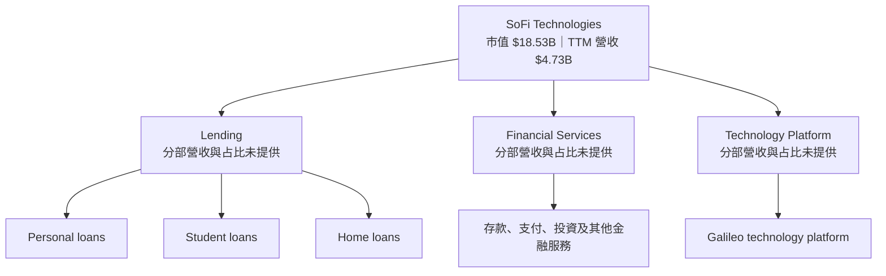
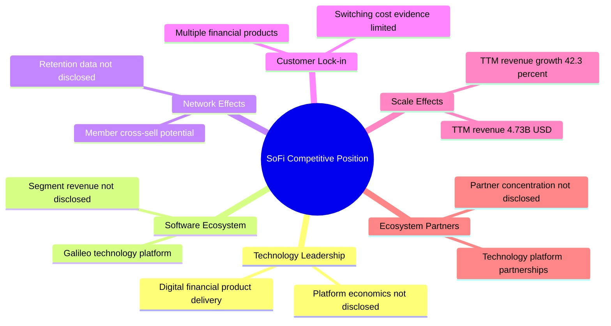
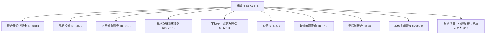
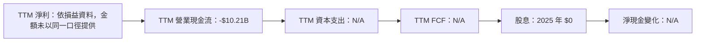
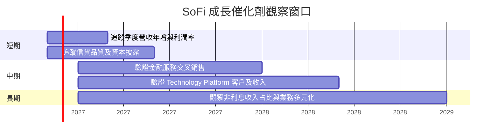
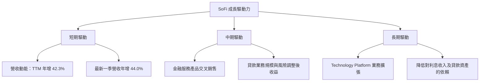
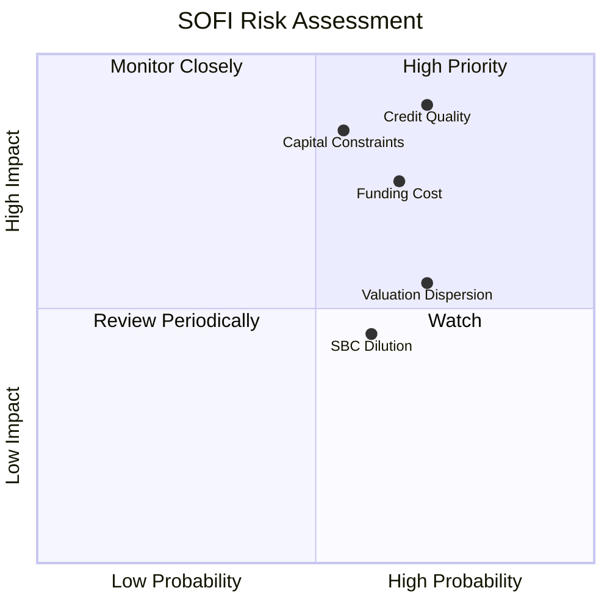
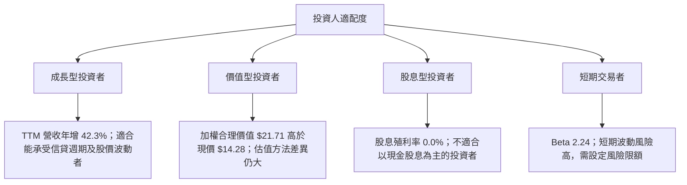

# SOFI 基本面深度分析報告
> **報告日期**：2026-11-18 ｜ **語言**：繁體中文 ｜ **數據來源**：SEC 申報資料 (XBRL)、Yahoo Finance、Finviz、StockAnalysis、Roic.ai 

## 目錄

| # | 章節 | 核心結論 |
|---|------|----------|
| 1 | 執行摘要 | 買入；加權合理價值 $21.71；MOS +34.2% |
| 2 | 公司概覽與商業模式 | 產品與金融服務組合提供交叉銷售機會；分部收入資料未提供 |
| 3 | 損益表深度分析 | TTM 營收 $4.73B、成長 42.3%；最新一季營收年增 44.0% |
| 4 | 資產負債表分析 | 現金及短期投資 $2.81B；總債務未提供，須審慎看待淨現金數字 |
| 5 | 現金流量深度分析 | TTM 營業現金流 −$10.21B；金融業貸款資金流使傳統 FCF 不具可比性 |
| 6 | 獲利能力與資本效率 | ROIC 不適用於貸款機構；ROTCE 7.9%，WACC 採用 14.00% |
| 7 | 相對估值分析 | 同業估值差異大；加權相對估值高於現價，但估值方法依賴同業倍數 |
| 8 | DCF 內在價值評估 | DCF 不適用；依金融業相對估值與分析師共識交叉驗證 |
| 9 | 成長催化劑 | 金融服務與貸款業務成長為主要驅動；TAM 及分部占比未提供 |
| 10 | 風險矩陣 | 信貸品質、資本充足及融資成本為主要風險 |
| 11 | 投資建議 | 依 MOS 評級為買入；以 $21.71 加權合理價值為估值錨點 |

---

## 1. 執行摘要

截至 **2026-11-17 收盤價 $14.28**，SOFI 的 TTM 營收為 **$4.73B**，TTM 年增 **42.3%**，最新一季營收年增 **44.0%**；最新一季營業利益率為 **19.4%**，但 TTM 營業利益率不可得。金融業估值模型給出的加權合理價值為 **$21.71**，相對現價的 MOS 為 **+34.2%**、上行空間為 **+52.0%**。由於 SOFI 是貸款機構，DCF 與一般企業 ROIC 不適用；ROIC 無法確認高於 WACC，因此依 MOS 門檻應為「買入」，不是「強烈買入」。此外，TTM 營業現金流為 **−$10.21B**，而金融業貸款增長會令營業現金流大幅受資金投放影響，故不能直接視為營運惡化或以此推導 FCF。

### 1.0 一頁式投資儀表板

| 項目 | 內容 |
|------|------|
| **投資論點（3 句）** | ① TTM 營收 **$4.73B**、年增 **42.3%**，顯示業務仍在擴張。② 最新一季營業利益率 **19.4%**，但 TTM 營業利益率與 ROIC 未提供，獲利可持續性仍需追蹤。③ 加權合理價值 **$21.71**，相對 **2026-11-17 收盤價 $14.28** 的 MOS 為 **+34.2%**。 |
| **綜合評分** | **6.6/10**（引用 1.1；六維度算術平均） |
| **財務健康** | 🟡 現金及短期投資 **$2.81B**，但總債務與貸款品質指標未提供；傳統流動比率對貸款機構的解讀有限。 |
| **ROIC vs WACC** | ROIC：不適用／未提供；WACC：**14.00%**。不能據此判定 ROIC 是否高於 WACC，也不應把 ROTCE 當作 ROIC。 |
| **FCF 趨勢** | TTM FCF、FCF Yield：**N/A**。TTM 營業現金流 **−$10.21B**，但貸款發放會形成營業現金流出，不能單獨視為自由現金流趨勢。 |
| **估值** | Forward P/E **15.87x**（Yahoo Finance）；EV/EBITDA **N/A**；FCF Yield **N/A**。 |
| **DCF 內在價值（基準）** | **N/A**（貸款機構現金流是資金來源與放款用途，不能直接用一般企業 FCF DCF）。現價相對 DCF 基準的折溢價：**N/A**。 |
| **安全邊際（MOS）** | **+34.2%＝($21.71 − $14.28) ÷ $21.71**；🟢 >25% 充足。分母為第 8.8 節加權合理價值。 |
| **預期報酬（基準情境 12M）** | DCF 基準情境 N/A；以 23 位分析師平均目標價 **$20.84** 作參考，較現價上行 **+45.9%**，並非模型承諾報酬。 |
| **關鍵風險（前二）** | 信貸損失與逾放風險資料缺漏；資本比率及融資結構變化可能限制放款擴張。 |
| **評級 + 信心度** | 🟢 **買入** ｜ 信心：中低（估值方法有正向空間，但貸款品質及資本指標缺漏） |

### 1.1 綜合評分卡

| 維度 | 評分（1–10） | 主要依據（引用數字與其來源章節） |
|------|--------------|----------------------------------|
| 成長性 | 8.5 | TTM 營收成長 **42.3%**、最新一季年增 **44.0%**（第 3 章）；但分部成長及客戶指標未提供。 |
| 獲利能力 | 6.0 | TTM 淨利率 **15.6%**、ROTCE **7.9%**，但 TTM 營業利益率與 ROIC 未提供（第 3、6 章）。 |
| 財務健康 | 5.5 | 現金及短期投資 **$2.81B**；總債務、CET1、逾放比及淨沖銷率未提供（第 4、6 章）。 |
| 估值 | 7.5 | 加權合理價值 **$21.71**、MOS **+34.2%**；但 P/B 相對估值對同業選取與帳面價值假設敏感（第 7、8 章）。 |
| 護城河 | 6.5 | Lending、Financial Services 與 Technology Platform 涵蓋多項金融服務；但平台收入占比、客戶留存及市場份額未提供（第 2 章）。 |
| 管理層與資本配置 | 5.5 | 2025 年 SBC **$262.06M**，占該年營收約 **7.3%**；股息殖利率 **0%**，回購及稀釋完整資料未提供（第 3、5 章）。 |
| **綜合評分** | **6.6** | 六項算術平均：(**8.5 + 6.0 + 5.5 + 7.5 + 6.5 + 5.5**) ÷ 6 = **6.6**（四捨五入至一位小數）。 |

### 1.2 五大投資論點 + 三大核心風險

| 類型 | 項目 | 具體依據 | 信心度 |
|------|------|----------|--------|
| 🟢 **投資論點①** | 高速營收擴張 | TTM 營收 **$4.73B**、年增 **42.3%**；最新一季年增 **44.0%**。若擴張伴隨風險調整後收益改善，規模可支持營運槓桿。 | 🟢 高 |
| 🟢 **投資論點②** | 多產品金融服務模式 | 提供 Lending、Financial Services 與 Technology Platform；若客戶跨產品使用增加，可提高客戶終身價值，但客戶數及交叉銷售數據未提供。 | 🟡 中 |
| 🟢 **投資論點③** | 最新季度盈利能力改善 | 最新季度營業利益率 **19.4%**；最新季度淨利 **$240.99M**，高於前季 **$156.59M**，QoQ 約增 **53.9%**。 | 🟡 中 |
| 🟢 **投資論點④** | 相對估值模型存在折價空間 | 加權合理價值 **$21.71**，高於現價 **$14.28**；模型含同業 Forward P/E、P/B 及分析師共識三種方法。 | 🟡 中 |
| 🟢 **投資論點⑤** | 平台與金融業務組合的潛在多元化 | 公司同時經營金融服務與科技平台；但各分部營收、利潤及客戶集中度未提供，尚不能證明收入已有效分散。 | 🟡 中低 |
| 🟡 **風險①** | 信貸品質及信用週期風險 | 淨沖銷率、逾放比未提供；若個人貸款違約上升，可能增加信用損失並壓低淨利息收入。 | 🔴 高衝擊 |
| 🔴 **風險②** | 資本及融資能力風險 | 新聞標題提及資本比率下降疑慮，但數據未提供 CET1 或資本比率；若監管資本受限，放款成長及股東回報可能受壓。 | 🔴 高衝擊 |
| 🟡 **風險③** | 股權薪酬稀釋 | 2025 年 SBC **$262.06M**，約占營收 **7.3%**；若薪酬增速長期高於股東價值增長，現有股東的經濟權益會被稀釋。 | 🟡 中 |

### 1.3 快速統計卡片

| 指標 | 公司實際值（期間） | 同業中位數 | 狀態 |
|------|--------------------|------------|------|
| 營收成長（TTM） | **42.3%** | — | 🟢 |
| 營收成長（最新一季年增） | **44.0%** | **34.1%**（NU、HOOD、UPST） | 🟢 |
| 毛利率（TTM） | **84.2%** | **83.3%**（Peer 區塊所列數值的中位數；NU 為 0.0%） | 🟡 |
| 營業利益率（TTM） | **N/A** | — | 🟡 |
| ROIC（TTM） | **N/A（貸款機構不適用）** | — | 🟡 |
| Forward P/E | **15.87x** | **11.4x** | 🟡 |
| FCF Yield（TTM） | **N/A** | — | 🟡 |
| Piotroski F-Score | **N/A（不適用於貸款機構）** | — | 🟡 |

> 同業最新一季營收成長中位數：34.4%、11.8%、34.1% 的中位數為 **34.1%**。同業毛利率欄含 NU 的 0.0%，不同金融平台的會計分類可能令比較失真，因此只作參考。

### 1.4 投資結論

```text
╔══════════════════════════════════════════════════════════════════╗
║                    📊 投資結論摘要                               ║
╠══════════════════════════════════════════════════════════════════╣
║  評級：買入（依 MOS 為買入；ROIC 不可用，未達強烈買入條件）      ║
║  價格（2026-11-17 收盤）：$14.28                                 ║
║  DCF 內在價值（基準）：N/A（貸款機構 DCF 不適用）                ║
║  安全邊際 MOS：+34.2%＝($21.71−$14.28)÷$21.71                   ║
║  加權合理價值（8.8）：$21.71                                     ║
║  綜合評分：6.6/10（引用 1.1）                                    ║
║  適合投資人：能承受信貸週期與股價波動的成長型、長線投資人        ║
╚══════════════════════════════════════════════════════════════════╝
```

---

## 2. 公司概覽與商業模式

### 2.1 業務結構與收入來源

SoFi Technologies, Inc. 在美國及部分海外市場提供貸款、金融服務及金融科技平台服務。公司提供個人貸款、學生貸款、房屋貸款及存款、支付、投資等產品，並經營 Galileo 等科技平台業務。公司整體市值約 **$18.53B**，TTM 營收 **$4.73B**。各分部營收與占比未提供，以下不以估算比例填補。



**商業模式含義：**貸款業務透過利息收入及信貸產品變現，金融服務可能承接客戶存款、交易及其他需求，科技平台則可透過服務合作夥伴獲得平台收入。由於分部收入、貸款收益率及各業務利潤率未提供，無法驗證收入是否已從貸款轉向資本需求較低的平台服務。

### 2.2 市場份額

市場份額數據未提供，亦沒有可引用的 TAM 數字，因此不呈現比例圖。以公司規模衡量，SOFI TTM 營收為 **$4.73B**，營收成長 **42.3%**；同業 NU、HOOD、UPST 最新一季營收成長分別為 **34.4%、11.8%、34.1%**。這顯示 SOFI 的營收增速高於所列同業，但不能由增速直接推論其市場份額較高。

### 2.3 競爭護城河分析



### 2.4 護城河強度

| 護城河項目 | 強度（強／中／弱） | 證據（引用數字或事實） | 會削弱它的情況 |
|------------|--------------------|------------------------|----------------|
| 技術與產品整合 | 中 | 提供 Lending、金融服務及科技平台產品；分部收入及技術平台成長未提供。 | 產品體驗未能提升留存，或競爭者快速複製功能。 |
| 軟體生態系統 | 中 | Galileo 是科技平台業務之一；平台客戶數、交易量、留存率及毛利未提供。 | 平台客戶集中、客戶自建系統或價格競爭加劇。 |
| 網路效應 | 弱至中 | 多產品可產生交叉銷售，但會員數與多產品使用率未提供。 | 客戶獲取成本升高、客戶主要使用單一產品。 |
| 客戶鎖定 | 中 | 貸款及金融服務可建立帳戶關係；存款留存及客戶流失率未提供。 | 利率競爭促使存款流失或客戶轉往大型銀行。 |
| 規模效應 | 中 | TTM 營收 **$4.73B**、年增 **42.3%**。 | 信貸損失或融資成本增速高於收入，令規模無法轉化成利潤。 |
| 生態夥伴 | 弱至中 | 公司經營 Galileo 平台，能服務金融科技合作關係；合約與客戶集中資料未提供。 | 合作夥伴轉換平台、合約續約下降或監管要求提高。 |

護城河評分卡分數為 **6.5/10**：產品覆蓋和營收規模提供一定基礎，但缺少會員留存、交叉銷售、平台客戶與分部獲利數據，尚不足以證實強網路效應。

---

## 3. 損益表深度分析

### 3.1 年度收入成長趨勢（近 4 年）

年度收入採年度損益表列示值。年度營收由 **2022 年 $1.57B** 增至 **2025 年 $3.61B**；三年 CAGR 約 **32.0%**。2025 年與 TTM 營收增長均顯示規模持續擴大，但銀行及貸款業務的收入增長需與信用損失及資金成本同步檢視。

```text
╔══════════════════════════════════════════════════════════════════╗
║          SoFi 年度收入趨勢（FY2022–FY2025）                     ║
╠══════════════════════════════════════════════════════════════════╣
║  FY2022  $1.57B  █████████░░░░░░░░░░░░░░░  YoY：基期           ║
║  FY2023  $2.11B  ██████████████░░░░░░░░░░  YoY：+34.4% 🟢      ║
║  FY2024  $2.61B  ██████████████████░░░░░░  YoY：+23.7% 🟢      ║
║  FY2025  $3.61B  █████████████████████████ YoY：+38.3% 🟢      ║
╠══════════════════════════════════════════════════════════════════╣
║  2022–2025 營收 CAGR：(3.61 ÷ 1.57)^(1/3) − 1 ≈ 32.0%          ║
╚══════════════════════════════════════════════════════════════════╝
```

### 3.2 季度收入趨勢分析

季度營收採 StockAnalysis 季度列值；最新一季 YoY 成長率採指定的最新季度驗證數字 **44.0%**。不同來源的 Q3 2026 營收顯示約 **$1.37B–$1.39B**，表中以 StockAnalysis 的 $1.370B 展示趨勢，成長率引用驗證值。

| 季度 | 營收 | QoQ 成長 | YoY 成長 | 備註 |
|------|------:|---------:|---------:|------|
| 2025 Q4 | $1.020B | — | 約 **39.0%** | 以 2024 Q4 $0.734B 作比較，資料來源為季度歷史列值。 |
| 2026 Q1 | $1.091B | **+7.0%** | **+42.5%** | 營收由上一季繼續擴張。 |
| 2026 Q2 | $1.205B | **+10.4%** | **+42.6%** | QoQ 成長加快。 |
| 2026 Q3 | $1.370B | **+13.7%** | **+44.0%** | 年增率採最新季度驗證值；來源間營收列值略有差異。 |

QoQ 由 Q1 的約 **7.0%** 提升至 Q3 的約 **13.7%**，表示季度收入動能增強；但貸款機構需要同時追蹤放款量、收益率、存款成本與信貸損失，單一營收指標不能說明風險調整後盈利是否同步改善。

### 3.3 利潤率演變分析

| 利潤率指標 | FY2022 | FY2023 | FY2024 | FY2025／TTM | 趨勢 | 評估 |
|------------|--------|--------|--------|-------------|------|------|
| **毛利率** | N/A | N/A | N/A | TTM **84.2%** | 歷年同口徑數據未提供 | 🟡 金融業收入與成本分類不宜直接套用一般產品公司毛利率。 |
| **營業利益率** | N/A | N/A | N/A | TTM **N/A**；最新季度 **19.4%** | 歷年年度口徑未提供；季度營業利益率可觀察但不可外推為 TTM | 🟡 |
| **淨利率** | N/A | N/A | N/A | TTM **15.6%** | TTM 有利潤，但年度口徑未提供可比序列 | 🟢／需追蹤 |
| **EBITDA 利潤率** | N/A | N/A | N/A | TTM **0.0%**（來源指標） | 與淨利率及營業利益率口徑不一致，需謹慎使用 | 🔴 可比性偏低 |

**利潤率演變深度解析：**最新季度營業利益率為 **19.4%**，而 TTM 營業利益率不可得，不能據最新季度直接推斷全年利潤率趨勢。TTM 淨利率為 **15.6%**；其維持能力取決於利息收入、存款成本、信用損失準備與非利息費用。資料未提供分部利潤與撥備拆分，因此無法把改善精確歸因於產品組合、定價或成本控制。

### 3.4 費用結構分析

資料沒有可完整勾稽的 TTM 費用分項，因此不繪製比例圓餅圖，避免把不完整項目拼成費用結構。已知 2025 年股權薪酬 **$262.06M**；2025 年營收 **$3.61B**，SBC 約占 **7.3%**。貸款機構的主要經濟成本還包括資金成本、信用損失及營運費用，但各自金額未提供。

### 3.5 季度 EPS 趨勢與盈餘品質（Quality of Earnings）

| 季度 | EPS 實際 | EPS 預期 | 超預期／不及預期 |
|------|---------:|---------:|------------------|
| 2025 Q4 | $0.13 | N/A | N/A：分析師 EPS 預期未提供 |
| 2026 Q1 | $0.12 | N/A | N/A：分析師 EPS 預期未提供 |
| 2026 Q2 | $0.12 | N/A | N/A：分析師 EPS 預期未提供 |
| 2026 Q3 | $0.18 | N/A | N/A：分析師 EPS 預期未提供 |

EPS 實際數字取 StockAnalysis 季度資料；盈餘驚喜紀錄中的 EPS 預估值為缺漏值，故不能判斷四季究竟超預期或不及預期。Q3 EPS 較 Q2 增加 **$0.06**，即 **($0.18 − $0.12) ÷ $0.12 = 50.0% QoQ**；季度淨利資料則顯示 Q3 **$240.99M**、Q2 **$156.59M**，QoQ 約 **53.9%**。此改善可能反映收入增加或費用及信貸因素變化，但缺少季度撥備與分部利潤資料，不能斷言主要來源。

| 盈餘品質項目 | 數值／佔比 | 評估 |
|--------------|-----------|------|
| 股權薪酬 SBC / 營收 | 2025 年 **$262.06M ÷ $3.61B = 7.3%**；按季度資料加總的 TTM SBC 約 **$288.33M**，約占 TTM 營收 **6.1%** | 🟡 SBC 是非現金費用，但會稀釋股東；需觀察股數增長是否放緩。 |
| SBC / 營業現金流 | TTM OCF 為負 **$10.21B**；比值不適合解讀 | 🔴 分母受放款資金流影響，負值比率不代表 SBC 可忽略。 |
| FCF / 淨利（現金轉換率） | **N/A**（TTM FCF 不可得） | 🟡 金融業貸款資金流使一般 FCF 轉換率缺乏可比性。 |
| 一次性／非經常性損益 | N/A | 是否存在重大一次性項目未提供。 |
| 有效稅率異常 | **8.5%**（最新年度有效稅率） | 🟡 低稅率可能令淨利受益；缺少多年稅率拆分，不能判定是否可持續。 |
| 資本化支出 vs 費用化 | TTM Capex **N/A** | 資本化與費用化明細不足，不能判定是否延遲認列成本。 |

**盈餘品質結論：**SOFI 有正的 TTM 淨利率 **15.6%**，且最新季度淨利增長，但 SBC 佔營收仍約 **6.1%–7.3%**（依期間口徑不同），對每股價值有稀釋影響。TTM FCF 與資本支出不可得，無法量化盈餘轉現金能力；此外貸款機構的 OCF 會隨放款及融資變化，不能直接用一般企業的 FCF 品質框架下結論。

---

## 4. 資產負債表分析

### 4.1 資產結構分解

資產明細採 StockAnalysis 2026-09-30 TTM 欄。分類項目未完整勾稽至總資產，故以下只列有披露的金額，不作剩餘項目反推。



貸款及租賃應收款 **$19.727B** 是資產主要組成之一，意味資產負債表的風險核心為貸款表現與資金來源，而非一般公司的應收帳款或庫存周轉。

### 4.2 流動性與營運資金分析

| 指標 | 最新值 | 一年前 | 變化 | 解讀 |
|------|------:|------:|------:|------|
| 現金及短期投資 | **$2.81B** | N/A | N/A | 現金緩衝存在，但不等於可自由運用資本；受監管資金與營運需求可能限制。 |
| 流動比率 | **1.086** | N/A | N/A | 銀行及貸款機構的資產負債科目不同於一般企業，單獨使用判斷有限。 |
| 速動比率 | **0.428** | N/A | N/A | 不宜直接套用非金融企業「短期償債」結論。 |
| DSO／DIO／DPO／CCC | 不適用（金融業） | 不適用（金融業） | 不適用 | 貸款及存款不是一般應收、存貨與應付帳款，因此傳統現金轉換週期不適用。 |

總債務在驗證數據中為 **N/A**，雖另有第三方頁面列出不同債務數字，本報告不以不同口徑拼接計算債務比率。驗證數據列示淨現金 **$2.81B**，但因總債務未提供，投資者仍應將其視為來源標示值，而非已完成債務明細調節的結果。

### 4.3 債務結構分析

```text
╔══════════════════════════════════════════════════════════════════╗
║                   SOFI 債務健康診斷                              ║
╠══════════════════════════════════════════════════════════════════╣
║  現金及短期投資：$2.81B   已披露；不等於全部無限制可用現金      ║
║  總債務：        N/A      不能計算 Debt/Equity 或 Debt/EBITDA    ║
║  淨現金：        $2.81B   驗證數值；總債務明細仍需追蹤          ║
║  利息保障倍數：  N/A      缺少可比的利息費用與分母              ║
║  信貸品質指標：  N/A      淨沖銷率、逾放比、CET1 均未提供       ║
╚══════════════════════════════════════════════════════════════════╝
```

對貸款機構而言，資本結構與融資來源應以存款、批發融資、監管資本及貸款資產品質一併評估。現有資料不足以計算利息保障倍數、淨負債/EBITDA 或標準化債務期限結構。

### 4.4 股東權益趨勢

| 年末 | 股東權益 | YoY 變化 |
|------|---------:|---------:|
| 2022 | $5.53B | — |
| 2023 | $5.55B | 約 **+0.4%** |
| 2024 | $6.53B | 約 **+17.7%** |
| 2025 | $10.49B | 約 **+60.6%** |

2025 年股東權益增加至 **$10.49B**，高於 2024 年 **$6.53B**；但權益變化可能同時受獲利、發股及其他綜合損益影響。單憑期末權益不能認定增加全部來自內生獲利，仍需配合股數變動與權益變動表分析。

---

## 5. 現金流量深度分析

### 5.1 現金流量瀑布圖

金融業放款會消耗營業現金，且存款與融資流入可抵銷，因此傳統「淨利 → OCF → Capex → FCF」瀑布不能完整反映經濟現金創造。依可用資料只呈現已確認項目：



### 5.2 FCF 轉換率趨勢

| 期間 | OCF | Capex | FCF | FCF / 淨利 |
|------|----:|------:|----:|-----------:|
| 2025 年 | −$3.74B | TTM Capex 欄位不可用；年度現金流來源另列 Capex 支出 | 依本報告統一定義不計算 | N/A |
| TTM 至 2026-09-30 | **−$10.21B** | **N/A** | **N/A** | N/A |

不可將營業現金流減去不同來源、不同期間的資本支出以反推 TTM FCF。貸款業務的放款與資產持有會影響 OCF，因此需另看淨利息收入、撥備、存款流量與資本比率。

### 5.3 自由現金流趨勢

```text
╔══════════════════════════════════════════════════════════════════╗
║               自由現金流：可驗證數據                            ║
╠══════════════════════════════════════════════════════════════════╣
║  TTM OCF（截至 2026-09-30）     -$10.21B                         ║
║  TTM Capex                      N/A                              ║
║  TTM FCF                        N/A                              ║
║  TTM FCF Yield                  N/A                              ║
║                                                                  ║
║  說明：貸款資產擴張可能造成營業現金流出；不以 OCF 代替 FCF。   ║
╚══════════════════════════════════════════════════════════════════╝
```

### 5.4 資本配置評估

可確認資料顯示 2025 年現金股息 **$0**，股息殖利率 **0.0%**；2025 年 SBC **$262.06M**。沒有足夠同期間資本用途數據拆分「回購、投資、資本支出、股息、留存」並形成可加總的資本配置圖，因此不畫圓餅圖。

| 配置項目 | 已知資料 | 評估 |
|----------|----------|------|
| 股息 | 2025 年 **$0**；殖利率 **0.0%** | 未以股息回饋股東，資本可留存支持貸款與業務發展。 |
| 股權薪酬 | 2025 年 **$262.06M** | 對人才留任可能有用，但需與股數稀釋及每股盈利增長一併評估。 |
| 回購 | N/A | 無法判斷是否抵銷 SBC 稀釋。 |
| 貸款及業務投資 | 放款淨額占總資產 **79.3%** | 資產配置以貸款為核心，資本回報取決於收益與信用風險。 |

---

## 6. 獲利能力與資本效率

### 6.1 ROE／ROA／ROIC 趨勢

| 指標 | 最新值 | 歷年趨勢 | 評估 |
|------|-------:|----------|------|
| ROE（TTM） | **6.5%**（驗證值） | 可比歷年序列未提供 | 正向但不高；須結合資本需求與風險調整後收益。 |
| ROA（TTM） | **1.3%** | 可比歷年序列未提供 | 銀行及貸款機構資產龐大，ROA 應與信用風險、資金成本一起看。 |
| ROTCE（TTM） | **7.9%** | 可比歷年序列未提供 | 有形權益報酬率，可作金融業股東回報參考。 |
| ROIC | **N/A（貸款機構不適用）** | N/A | 金融機構債務及融資是營業投入，不適合套用一般非金融公司的投入資本公式。 |

### 6.2 ROIC vs WACC 分析（核心價值創造判斷）

對貸款機構，WACC 可作資本成本參考，但傳統 ROIC 的投入資本定義不適用，因此無法以「ROIC − WACC」作可靠 EVA 判斷。金融業更適合觀察 ROTCE、資產收益、資本充足、貸款信用損失及 P/TBV。

```text
╔══════════════════════════════════════════════════════════════════╗
║             ROIC vs WACC：金融業適用性說明                      ║
╠══════════════════════════════════════════════════════════════════╣
║  10 年期無風險利率 Rf：       5.10%                              ║
║  股權風險溢酬 ERP：            5.00%                              ║
║  原始 Beta：                   2.24                               ║
║  調整後 Beta：                 1.83                               ║
║  股權成本 Ke：                 14.24%                             ║
║  稅前債務成本：                29.04%                             ║
║  權益／債務權重：              82.3%／17.7%                      ║
║  計算 WACC：                   16.42%                             ║
║  採用 WACC：                   14.00%（受 7%–14% 區間上限限制）  ║
║                                                                  ║
║  SOFI ROIC：                   N/A（貸款機構不適用）              ║
║  SOFI ROTCE：                  7.9%                               ║
║  結論：ROTCE 與 WACC 定義不同，不據此宣稱 EVA 正負。            ║
╚══════════════════════════════════════════════════════════════════╝
```

**WACC 使用一致性：**第 6.2 節與第 8.2 節皆採用 **14.00%**。提供的成本資本資料顯示未受限計算值為 **16.42%**，程式將 WACC 限制在 **7%–14%** 範圍，因此本報告採上限 **14.00%**。由於 DCF 對貸款機構不適用，該 WACC 不用來產生 SOFI 的 DCF 目標價。

### 6.3 杜邦三因素分解

| 因素 | 數值（TTM） | 解讀 |
|------|-------------|------|
| 淨利率 | **15.6%** | 對應每單位營收保留的淨利；仍受撥備、資金成本及稅率影響。 |
| 資產週轉率 | **0.07** | 金融業資產規模大，資產週轉率本身偏低並非可直接類比非金融公司。 |
| 權益乘數 | **6.00** | 顯示資產規模相對權益較大，金融槓桿是業務結構的重要部分。 |
| **ROE** | **6.5%** | **15.6% × 0.07 × 6.00 = 6.552% ≈ 6.5%**（依報告精度呈現）。 |

ROE 同時受淨利率、資產周轉與權益乘數影響；權益乘數為 **6.00**，表示槓桿對 ROE 有實質影響。因季度權益與資產的平均值未提供，依既定杜邦數字引用，不另行重算。

### 6.4 財務體質：Piotroski F-Score 與貸款機構指標

Piotroski F-Score：**N/A，不適用於貸款機構**。貸款成長會形成營業現金流出，使部分現金流測試錯誤判讀銀行業務。

| 貸款機構指標 | 數值 | 解讀 |
|--------------|------:|------|
| 淨利息收入 NII／總營收 | **64.0%** | 營收主要由淨利息收入貢獻；利率及資金成本變化會影響收入基礎。 |
| 淨利差代理值 NII／平均總資產 | **5.36%** | 這是以總資產作分母的代理值；因缺少生息資產數據，不能視為銀行正式 NIM，正式 NIM 通常會以生息資產為基礎而較高。 |
| 成本收入比代理值 | **80.8%** | 以（營收 − 稅前淨利）÷ 營收計算，包含信用損失準備，因此高於公司正式效率比率。 |
| 有形權益報酬率 ROTCE | **7.9%** | 衡量扣除無形資產後的有形權益回報；應與資本成本、信用風險同看。 |
| 股價／有形帳面價值 P/TBV | **1.99x** | 市場價格約為有形帳面價值的 1.99 倍；對資產品質敏感。 |
| 放款淨額／總資產 | **79.3%** | 貸款資產占比高，信貸品質與資產負債管理是核心風險。 |
| 淨沖銷率 | **N/A（數據未提供）** | 不以記憶或外部舊資料補填。 |
| 逾放比 | **N/A（數據未提供）** | 不以記憶或外部舊資料補填。 |
| CET1 | **N/A（數據未提供）** | 無法檢驗監管資本緩衝。 |

---

## 7. 相對估值分析

### 7.1 同業估值比較表格

同業倍數採 Yahoo Finance 提供的 Peer multiples；SOFI 數值採本報告所列市場估值資料。金融業公司在資產負債結構及盈利口徑上差異顯著，倍數比較需配合增速及風險判讀。

| 估值指標 | **SOFI** | **NU** | **HOOD** | **UPST** | 本公司評估 |
|----------|---------:|------:|--------:|--------:|-----------|
| **Trailing P/E** | **25.5x**（歷史估值區塊） | 15.4x | 31.9x | 29.7x | 🟡 約在同業區間中段；但本公司與同業業務組合不同。 |
| **Forward P/E** | **15.87x** | 11.4x | 20.3x | 6.2x | 🟡 高於同業中位數 **11.4x**；需由更高增長或較低風險支持。 |
| **P/S Ratio** | **4.1x**（自身歷史區塊） | 6.6x | 12.3x | 1.3x | 🟡 SOFI 低於 NU、HOOD，高於 UPST；金融收入分類差異大。 |
| **EV／EBITDA** | **58.2x**（自身歷史區塊） | N/A | N/A | 26.2x | 🔴 同業資料不足，且 SOFI 與 UPST 倍數差異大；不宜單一倍數定價。 |
| **最新季度營收年增** | **44.0%** | 34.4% | 11.8% | 34.1% | 🟢 高於所列同業，但成長未調整信貸風險。 |
| **毛利率（TTM）** | **84.2%** | 0.0% | 91.0% | 83.3% | 🟡 金融公司毛利率分類可能不同，參考價值有限。 |

同業中位數計算：Trailing P/E 為 **29.7x**；Forward P/E 為 **11.4x**；P/S 為 **6.6x**。SOFI Forward P/E **15.87x** 高於同業中位數，代表相對估值並非全面便宜；估值吸引力主要來自 8.8 的 P/B 相對估值及綜合估值結果。

### 7.2 歷史估值區間分析

```text
╔══════════════════════════════════════════════════════════════════╗
║               SOFI 自身歷史估值區間（TTM 倍數）                 ║
╠══════════════════════════════════════════════════════════════════╣
║  P/E：      範圍 27.0x–67.1x｜中位數 36.6x｜目前 25.5x          ║
║             目前歷史百分位：0%                                   ║
║  P/S：      範圍 2.6x–14.6x｜中位數 4.5x｜目前 4.1x              ║
║             目前歷史百分位：38%                                  ║
║  EV/EBITDA：範圍 19.0x–148.7x｜中位數 65.1x｜目前 58.2x         ║
║             目前歷史百分位：43%                                  ║
╚══════════════════════════════════════════════════════════════════╝
```

P/E 目前列示為 **25.5x**，低於歷史區間下緣 **27.0x**，且百分位為 **0%**；這可能與資料計算日期、每股盈利期間或估值序列口徑有關，應以來源的歷史估值欄位為準，不自行調整區間。P/S 與 EV/EBITDA 則分別位於自身歷史分布的 **38%** 與 **43%** 百分位。

### 7.3 情境價值（Bear / Base / Bull）

**N/A（DCF 無法計算：SOFI 為貸款機構，貸款發放及融資現金流是資金經營本身，不能直接視為一般企業自由現金流。）**因此不提供 DCF 悲觀、基準及樂觀情境目標價或機率。

### 7.4 相對估值隱含價格區間

```text
╔══════════════════════════════════════════════════════════════════╗
║                 相對估值隱含價格位置                            ║
╠══════════════════════════════════════════════════════════════════╣
║  $10.27 ───────── $14.28 ───────── $20.84 ───────── $36.24      ║
║  Forward P/E       現價            分析師共識        P/B          ║
╚══════════════════════════════════════════════════════════════════╝
```

| 方法 | 每股價值 | 相對現價 | 依據 |
|------|---------:|---------:|------|
| 同業 Forward P/E | **$10.27** | **−28.1%** | NU、HOOD、UPST Forward P/E 中位數 **11.4x** × SOFI Forward EPS **$0.90**。 |
| 同業 P/B | **$36.24** | **+153.8%** | 同業 P/B 中位數 **4.2x** × SOFI 每股帳面價值 **$8.71**。 |
| 分析師共識目標價 | **$20.84** | **+45.9%** | 23 位分析師平均目標價；分析師區間為 **$12–$30**。 |

方法間隱含價值相差 **$10.27–$36.24**，反映 P/B 法較容易受帳面價值與同業倍數差異影響。股價並非落在所有方法共同支持的狹窄區間內，應視加權合理價值為情境參考，不是確定的清算價值。

---

## 8. DCF 內在價值評估（Discounted Cash Flow）

> **結論：DCF MODEL 不適用。**貸款機構的貸款發放、存款與融資現金流是營運資金及資金供應的一部分，傳統企業自由現金流無法作為可靠估值基礎。本章不自行建立 DCF，也不提供 DCF 每股內在價值、敏感性矩陣或 DCF 三情境。

### 8.0 估值推理鏈（Thinking Logic）

**Step 1 — 價值主要由什麼決定？**  
SOFI 的估值主要由貸款資產的風險調整後回報、金融服務客戶經濟性，以及科技平台業務的可持續收入共同決定。已知放款淨額占總資產 **79.3%**、NII 占營收 **64.0%**；科技平台及金融服務的分部收入比重未提供，因此無法量化其估值占比。對整體價值最敏感的變數是信貸損失及資本約束，而非一般工業公司的終值成長率。

**Step 2 — 模型選擇**

| 決策點 | 本報告採用 | 理由 | 曾考慮但否決 | 否決理由 |
|--------|-----------|------|--------------|----------|
| 現金流定義 | 不採一般 FCFF／FCFE DCF | TTM OCF **−$10.21B** 且主要受放款資金流影響；FCF 為 N/A | 一般企業 FCFF DCF | 貸款及融資現金流不能當作企業可分配現金流。 |
| 預測期 | N/A | DCF 模型未建立 | 5–10 年 DCF | 任何年數均會形成自建模型，與貸款業務現金流特性不符。 |
| 終值方法 | N/A | DCF 模型未建立 | Gordon Growth／退出倍數 | 缺少可用 FCFF 基礎。 |
| EBIT 基礎 | N/A | 不適用 | GAAP EBIT DCF | 不能以一般企業 EBIT 直接估算貸款機構價值。 |

**Step 3 — 關鍵估值方法推導：**本報告使用的可量化估值錨點來自金融業固定估值方法：同業 Forward P/E **11.4x**、同業 P/B **4.2x**，以及 23 位分析師平均目標價 **$20.84**；不自行調整估值權重。

**Step 4 — 最脆弱的一環：**P/B 方法產生 **$36.24**，遠高於 Forward P/E 方法的 **$10.27**；若同業倍數不適用或帳面資產的風險調整價值較低，加權合理價值可能高估。

**Step 5 — 計算路徑圖：**本報告沒有 DCF 計算路徑；估值路徑採固定金融業方法與權重，見第 8.8 節。

### 8.1 模型假設總表（Model Inputs）

**N/A（DCF MODEL 未計算，原因：貸款機構現金流不適合以一般企業自由現金流折現。）**因此不自建預測期、營收 CAGR、營業利潤率、Capex、D&A、ΔWC、SBC 稀釋或永續成長率假設，也不以未提供數據填補。

### 8.2 折現率推導（WACC）

SOFI 的資本成本資料列示：無風險利率 **5.10%**、股權風險溢酬 **5.00%**、原始 Beta **2.24**，採用調整後 Beta **1.83**，調整方式為 **⅔ × 2.24 + ⅓ × 1**。股權成本資料列值 **14.24%**；稅前債務成本 **29.04%**；權益／債務權重 **82.3%／17.7%**。程式計算的 WACC 為 **16.42%**，受 **7%–14%** 範圍限制後採用 **14.00%**。

```text
╔══════════════════════════════════════════════════════════════════╗
║                    WACC 推導（折現率）                           ║
╠══════════════════════════════════════════════════════════════════╣
║  Rf（10Y 美債）：               5.10%                             ║
║  ERP（採用值）：                 5.00%                             ║
║  原始 Beta：                     2.24                              ║
║  調整後 Beta：                   1.83                              ║
║  股權成本 Ke（資料列值）：       14.24%                            ║
║  稅前債務成本 Kd：               29.04%                            ║
║  稅率：                          8.5%                              ║
║  股權／債務權重：                82.3%／17.7%                     ║
║  未受限計算 WACC：               16.42%                            ║
║  限制後採用 WACC：               14.00%（7%–14% 區間上限）        ║
╚══════════════════════════════════════════════════════════════════╝
```

資料已直接提供 WACC 及成本資本組成；因債務成本利息與負債餘額的完整分母、同一期市場市值權重明細未提供，本報告不自行另算 WACC，也不把一般總負債替代為計息負債重新推導。第 6.2 與本節一致採用 **14.00%**。

### 8.3 逐年自由現金流預測（基準情境）

**N/A（沒有逐年 DCF 預測）。**不能把公司 TTM 營收增速直接外推成 FCFF 預測，也不能以已缺漏的 TTM Capex 或 ΔWC 自行補值。

### 8.4 終值計算（Terminal Value）

**N/A（DCF 未建立，沒有 FY+N FCFF 可供計算終值）。**因此不計算 Gordon Growth 終值或退出倍數終值。

### 8.5 企業價值 → 每股內在價值（Bridge）

| 橋接項目 | 數值 |
|----------|------|
| 預測期 FCF 現值合計 | N/A |
| 終值現值 | N/A |
| 企業價值 EV | N/A |
| 現金及短期投資 | $2.81B |
| 總債務 | N/A |
| 股權價值 | N/A |
| 稀釋後流通股數 | 市場數據列示約 1.30B 股；不作 DCF 股數計算 |
| 每股 DCF 內在價值 | **N/A** |
| 2026-11-17 收盤價 | **$14.28** |
| DCF 折溢價 | **N/A** |

**折溢價定義：**現價 ÷ DCF 內在價值 − 1。由於 DCF 基準價值為 N/A，不能計算折溢價。本節不計算 MOS；MOS 僅以第 8.8 節加權合理價值為分母。

### 8.6 敏感性分析（WACC × 永續成長率）

**N/A（沒有 DCF MODEL 敏感性矩陣）。**不自行建立 WACC × 永續成長率矩陣，也不填入示意估值。

### 8.7 反推 DCF（Reverse DCF）

**N/A（缺少可用的 DCF 模型）。**現價無法在沒有現金流基礎的情況下，反推營收 CAGR、利潤率、永續成長率或預測期。

### 8.8 估值三角驗證與安全邊際

| 估值方法 | 隱含每股價值 | 上行空間（÷現價） | 權重 | 說明 |
|----------|--------------:|------------------:|------:|------|
| 同業 Forward P/E | **$10.27** | **−28.1%** | **50%** | 同業中位數 Forward P/E **11.4x** × SOFI Forward EPS **$0.90**。 |
| 同業 P/B | **$36.24** | **+153.8%** | **40%** | 同業中位數 P/B **4.2x** × SOFI 每股帳面價值 **$8.71**。 |
| 分析師共識目標價 | **$20.84** | **+45.9%** | **10%** | 23 位分析師平均目標價；屬參考輸入，不是財務承諾。 |
| **加權合理價值** | **$21.71** | **+52.0%** | **100%** | 金融業固定權重組合；DCF 因貸款機構現金流不適用而不列入。 |

逐步演算（按估值方法指定數值與權重）：

\[
\$10.27 \times 50\% + \$36.24 \times 40\% + \$20.84 \times 10\%
= \$5.135 + \$14.496 + \$2.084
= \$21.715
\]

估值方法資料列示加權合理價值 **$21.71**，以下 MOS 與上行空間依該指定值計算。為保持來源指定的加權合理價值一致，本報告全篇引用 **$21.71**，不另行改用單項估值。

- **MOS**＝(加權合理價值 − 現價) ÷ 加權合理價值  
  = **($21.71 − $14.28) ÷ $21.71 = $7.43 ÷ $21.71 = +34.2%**
- **上行空間**＝(加權合理價值 − 現價) ÷ 現價  
  = **($21.71 − $14.28) ÷ $14.28 = $7.43 ÷ $14.28 = +52.0%**
- **折溢價定義**以 DCF 基準內在價值為分母；因 DCF 為 N/A，折溢價不適用。

```text
╔══════════════════════════════════════════════════════════════════╗
║                  估值區間與安全邊際                              ║
╠══════════════════════════════════════════════════════════════════╣
║  $10.27 ─────── $14.28 ───────── [$21.71] ───────── $36.24      ║
║  Forward P/E      現價            加權合理值          P/B        ║
║                                                                  ║
║  安全邊際 MOS = ($21.71 − $14.28) ÷ $21.71 = +34.2%              ║
║  MOS 評估：🟢 >25% 充足                                            ║
║  上行空間 = ($21.71 − $14.28) ÷ $14.28 = +52.0%                 ║
║  DCF 目標與 DCF 折溢價：N/A                                      ║
╚══════════════════════════════════════════════════════════════════╝
```

**評級判定：**MOS **+34.2%** 達到 MOS ≥25% 的區間，但強烈買入還要求 ROIC > WACC。ROIC 對貸款機構不適用，無法證明該條件成立，因此依規則 20 評為 **買入**，不做質化升降級。

**買入區間參考：**若以 MOS ≥10% 作為買入條件，最高價格為 **$21.71 × (1 − 10%) = $19.54**。以現價為下界，買入區間參考為 **$14.28–$19.54**；該區間是由估值門檻推導，不代表短期價格必然到達。

> 🔎 **程式複算（Python，依本節各項自動重算）**
>
> 加權合理價值 = $10.27 × 50% + $36.24 × 40% + $20.84 × 10% = **$21.71**（權重合計 100%）
>
> 以價格 $14.28 計：MOS = **+34.2%**，上行空間 = **+52.0%**
>
> ✅ 與本節所寫數值一致。

### 8.9 DCF 模型的局限與失效條件

- **終值依賴度：**N/A，沒有 DCF 終值。
- **最脆弱的估值假設：**相對估值中 P/B 方法依賴 **4.2x** 同業中位數，所推價值 **$36.24**；若可比倍數下降或帳面價值風險上升，估值會向下。
- **不適用情境：**貸款發放和融資是金融業的核心資金活動，傳統 FCFF DCF 可靠度不足。應以風險調整後盈利、ROTCE、P/TBV、資本充足及貸款損失等指標為主。
- **與第 10 章風險連結：**信貸損失上升會壓低淨利與帳面價值；存款成本上升會壓縮 NII；資本比率下降可能限制貸款成長與資本回報。

### 8.10 複算檢核表（Audit Trail）

| # | 檢核項目 | 結果 |
|---|----------|------|
| 1 | DCF 高／中敏感度假設四段式推導 | N/A：DCF 未建立 |
| 2 | DCF 每一假設均有依據 | N/A：未建立 DCF 假設 |
| 3 | WACC 五步完整重算 | N/A：引用成本資本資料；採用 WACC **14.00%** |
| 4 | Kd 分母與債務權重範圍一致 | N/A：不自行重算；資料已提供成本資本權重 |
| 5 | WACC 與第 6.2 節一致 | ✅ 兩節均為 **14.00%** |
| 6 | 逐年表格年度數等於 N | N/A：DCF 未建立 |
| 7 | 代表年度 FCFF 與 PV 可複算 | N/A：沒有逐年現金流 |
| 8 | 預測期 PV 加總 | N/A |
| 9 | WACC 與 g 適用性 | N/A：沒有 Gordon Growth 模型 |
| 10 | 終值以 FY+N 現金流計算 | N/A |
| 11 | EV 至每股價值橋接 | N/A：無 DCF EV |
| 12 | SBC 與 DCF 股數處理相容 | N/A：沒有 DCF 模型 |
| 13 | 敏感性基準格與 DCF 內在價值一致 | N/A |
| 14 | 敏感性矩陣有效格檢查 | N/A |
| 15 | DCF 情境機率加總 | N/A |
| 16 | 反推 DCF 一次解一個變數 | N/A |
| 17 | MOS 與 DCF 折溢價分母區分 | ✅ MOS 採第 8.8 加權價值；DCF 折溢價為 N/A |
| 18 | 報告完整至第 11 章 | ✅ |
| 19 | 加權合理價值依固定方法及權重計算 | ✅ 方法價值、權重照列；使用指定加權值 **$21.71** |
| 20 | 評級符合 MOS 門檻 | ✅ MOS 達 25%，但 ROIC 不可用；評級為「買入」 |

> 權重逐項乘算的未四捨五入加總為 **$21.715**；來源指定加權合理價值為 **$21.71**。本報告依固定估值方法區塊引用 $21.71，MOS、上行空間及評級均採同一數值。

---

## 9. 成長催化劑

### 9.1 催化劑時間軸

以下時間軸為研究觀察窗口，並非公司財測或已確定事件日期；資料未提供公司正式目標時不填造日期。



### 9.2 TAM 市場規模分析

**N/A（TAM 數據未提供）。**公司目前 TTM 營收 **$4.73B**，TTM 年增 **42.3%**，最新一季年增 **44.0%**，顯示公司仍處於擴張階段。由於缺少總可服務市場與市場滲透率數據，不能據此推算可達市場規模或未來營收上限。

### 9.3 成長驅動力結構圖



短期可觀察營收成長能否伴隨穩定利潤率及信貸表現；中長期則需證明金融服務與科技平台擴張能提高非利息收入、降低對貸款資產的資本需求。後兩項缺少分部數據，目前屬需驗證的經營假設，而非已被財報證實的趨勢。

---

## 10. 風險矩陣

### 10.1 風險評分矩陣

下圖為定性判斷位置，不代表公司披露的事故機率或財務損失數字。橫軸與縱軸為研究分析的相對評估。



### 10.2 風險清單詳細分析

以下發生機率與風險分數為分析師定性判斷，不是公司披露的統計機率；由於財務數據未提供損失率與敏感度，財務衝擊不以虛構百分比表示。

| # | 風險項目 | 發生機率 | 財務衝擊 | 風險評分 | 緩解措施 |
|---|----------|----------|----------|----------|----------|
| 1 | 🔴 **信用損失與逾放上升** | 中高；定性估計 | 淨利、帳面價值與資本回報受壓；量化幅度 N/A | 🔴 高 | 持續追蹤淨沖銷率、逾放比、撥備與貸款組成；目前相關指標未提供，需待申報補齊。 |
| 2 | 🔴 **監管資本／資本比率受限** | 中；定性估計 | 可能限制放款增長或增加融資需求；財務幅度 N/A | 🔴 高 | 追蹤 CET1、資本比率及貸款資產增幅；目前 CET1 未提供。 |
| 3 | 🟠 **融資成本與存款競爭** | 中高；定性估計 | NII 占收入 **64.0%**，資金成本上升可能壓縮利差 | 🟠 中高 | 追蹤存款成本、資產收益率與淨利差；目前淨利差僅有代理值 **5.36%**。 |
| 4 | 🟡 **估值方法差異大** | 高；定性估計 | 隱含價格由 **$10.27** 至 **$36.24**，估值對方法與同業倍數敏感 | 🟡 中 | 將每股盈利、帳面價值和同業倍數分開監控，不以單一 P/B 結論交易。 |
| 5 | 🟡 **SBC 稀釋** | 中；定性估計 | 2025 年 SBC **$262.06M**，約占營收 **7.3%** | 🟡 中 | 監控稀釋後股數增幅、SBC 占收入比及回購是否抵銷稀釋。 |

---

## 11. 投資建議

### 11.1 最終評級與評分

SOFI 評級為 **買入**：加權合理價值 **$21.71**，相對 **2026-11-17 收盤價 $14.28** 的 MOS 為 **+34.2%**；但 ROIC 對貸款機構不適用，因此未能滿足「強烈買入」所需的 ROIC > WACC 條件，也未作一級調整。綜合評分為 **6.6/10**，六項分數依次為成長性 **8.5**、獲利能力 **6.0**、財務健康 **5.5**、估值 **7.5**、護城河 **6.5**、管理層與資本配置 **5.5**。

### 11.2 合理價值與隱含報酬率

| 估值參考 | 每股價值 | 相對現價 $14.28 | 權重／機率 | 說明 |
|----------|---------:|----------------:|-----------:|------|
| 同業 Forward P/E | **$10.27** | **−28.1%** | 50% | 同業中位數倍數 × 公司 Forward EPS。 |
| 同業 P/B | **$36.24** | **+153.8%** | 40% | 同業中位數倍數 × 每股帳面價值。 |
| 分析師共識目標價 | **$20.84** | **+45.9%** | 10% | 23 位分析師平均目標價。 |
| **加權合理價值** | **$21.71** | **+52.0% 上行空間；MOS +34.2%** | 100% | 全報告唯一 MOS 基準。 |
| DCF 悲觀／基準／樂觀情境 | **N/A** | **N/A** | N/A | DCF 對貸款機構不適用，不給情境價值。 |

### 11.3 買入時機與觸發因素

```text
╔══════════════════════════════════════════════════════════════════╗
║                  ✅ 買入觸發因素 Checklist                      ║
╠══════════════════════════════════════════════════════════════════╣
║  立即／持續持有條件：                                            ║
║  ✅ 現價 $14.28 低於加權合理價值 $21.71                          ║
║  ✅ TTM 營收年增 42.3%，最新一季年增 44.0%                      ║
║  ✅ 最新季度營業利益率 19.4%，後續需觀察能否維持                ║
║                                                                  ║
║  加碼觸發條件（需多項同時成立）：                                ║
║  ☐ 最新季度營收年增維持在 40% 左右或以上，且未以風險放寬換取    ║
║  ☐ 公司披露淨沖銷率、逾放比及 CET1，且未顯示信用或資本惡化     ║
║  ☐ SBC／營收下降，並能確認稀釋後股數增幅受控                    ║
║  ☐ 股價仍低於 $19.54，即以加權價值計算仍保有約 10% MOS          ║
║                                                                  ║
║  減碼／重新評估條件：                                            ║
║  ☐ 股價高於約 $23.88（加權價值上方約 10%），估值緩衝轉弱       ║
║  ☐ 營收成長明顯放緩，同時淨利率或季度營業利益率下滑             ║
║  ☐ 逾放、淨沖銷或資本比率披露顯示風險顯著升高                   ║
╚══════════════════════════════════════════════════════════════════╝
```

**區間說明：**$19.54 為 **$21.71 × 90%**，即 MOS 約 10% 的估值門檻；$23.88 約為 **$21.71 × 110%**，作為現價高於加權價值 10% 的重新評估參考，並非 DCF 樂觀情境目標價。

### 11.4 投資人適配度分析



### 11.5 每季財報監控清單（Quarterly Watch List）

| 監控指標 | 目前基準 | 加碼觀察門檻 | 減碼／重新評估門檻 |
|----------|----------|--------------|---------------------|
| 營收成長 | TTM **42.3%**；最新季 YoY **44.0%** | 成長維持約 40% 或以上，並伴隨風險指標穩定 | 連續兩季低於 25%，或增長下滑且利潤率同步轉弱 |
| 最新季度營業利益率 | **19.4%** | 保持正值且沒有明顯收縮 | 連續兩季下降，並伴隨淨利或資產回報惡化 |
| NII／總營收 | **64.0%** | NII 成長且資金成本可控 | NII 占比下滑並伴隨淨利息收入下降 |
| 淨利差代理值 | **5.36%** | 代理值穩定或上升，且公司披露正式 NIM 後口徑一致 | 代理值持續下滑；待公司正式披露生息資產口徑後量化 |
| 信貸品質 | 淨沖銷率、逾放比 **N/A** | 披露後信用指標穩定，撥備與放款相稱 | 逾放或淨沖銷率連續兩季惡化 |
| 資本充足 | CET1 **N/A** | 取得資本指標並確認資本可支持增長 | 資本比率持續下滑或管理層需補充資本 |
| ROTCE | **7.9%** | ROTCE 上升且帳面價值增長具質素 | ROTCE 持續下滑，或低於可持續資本成本 |
| SBC／營收 | 2025 年 **約 7.3%**；TTM 估計約 **6.1%** | 比率下降且股數增幅受控 | SBC 占營收上升或股數增速高於每股盈利增速 |
| 資本支出／FCF | TTM Capex、FCF **N/A** | 取得一致口徑後，觀察資金流與盈利的連動 | 若披露資料顯示非信貸因素造成持續現金短缺，需重新評估 |
| 分部與平台業務 | 分部收入占比 N/A | 披露平台收入、客戶及續約成長 | 平台客戶流失、收入放緩或分部經濟性惡化 |
| 管理層財測 | 目前資料未提供可核對的正式財測 | 後續財測達成並維持資本紀律 | 多次下修或財測與實際表現持續背離 |

### 11.6 反面論證：什麼會證明論點錯誤（What Would Change My Mind）

```text
╔══════════════════════════════════════════════════════════════════╗
║              ⚠️ 論點失效條件（Disconfirming Evidence）           ║
╠══════════════════════════════════════════════════════════════════╣
║  本投資論點在下列情況出現時應重新檢視或退出：                  ║
║  ☐ 最新季度營收年增連續兩季低於 25%                              ║
║  ☐ 最新季度營業利益率連續兩季低於 10%，或轉為負值               ║
║  ☐ 淨沖銷率或逾放比連續兩季上升，且撥備未能同步反映              ║
║  ☐ CET1 或其他監管資本比率下滑至限制放款／需補充資本             ║
║  ☐ SBC／營收持續高於 8%，且稀釋後股數增幅高於每股盈利增幅        ║
║  ☐ 加權估值方法的可比倍數下修，使合理價值低於現價                ║
║  ☐ 管理層財測連續下修，或核心平台業務無法呈現可驗證的收入貢獻    ║
╚══════════════════════════════════════════════════════════════════╝
```

> **免責聲明**：本報告為 AI 自動生成，僅供研究參考，不構成投資建議。投資有風險，入市需謹慎。

---

## 資料與來源

| 項目 | 內容 |
|------|------|
| 價格 | 14.28 USD，2026-11-17 收盤（Yahoo Finance 即時報價（該交易日已收盤）） |
| 財務報表 | SEC 10-Q filed 2026-11-05，最新季度 2026-09-30（FY2026 Q3） |
| 有回應的資料來源 | SEC 申報資料 (XBRL)、Yahoo Finance、Finviz、StockAnalysis、Roic.ai |
| 由程式計算 | TTM 數字、WACC、DCF 模型、估值方法與權重、加權合理價值、MOS、評級門檻、F-Score、杜邦分解、營運資金天數、綜合評分 |
| 撰寫模型 | openai / gpt-6-luna |

> 本區塊由產生報告的程式依實際取得的資料填寫，非模型撰寫。「由程式計算」的數字不是模型的估計；其餘判斷（評分、情境、策略）是模型的分析。
