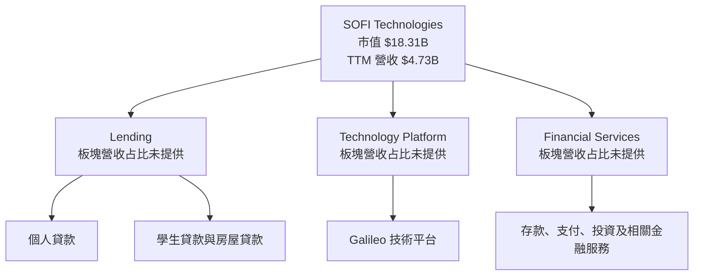
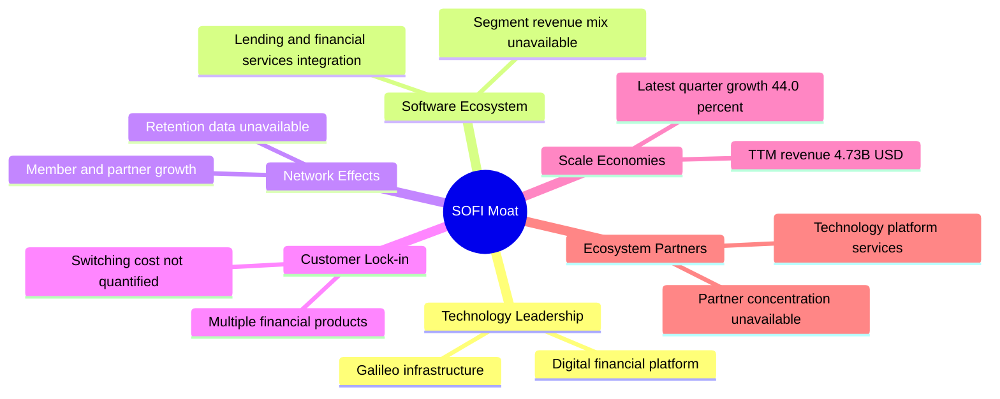
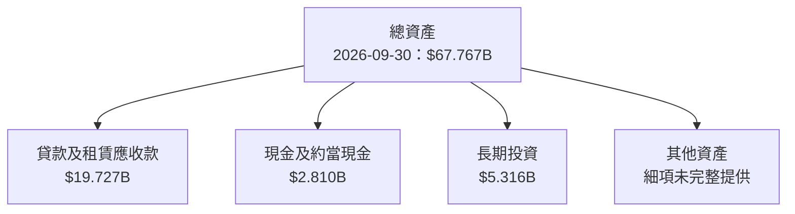
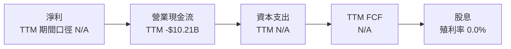
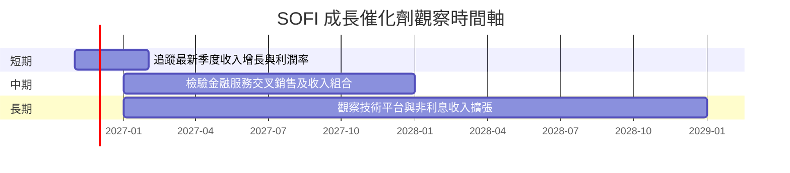
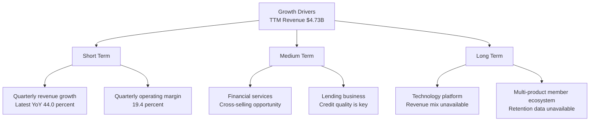
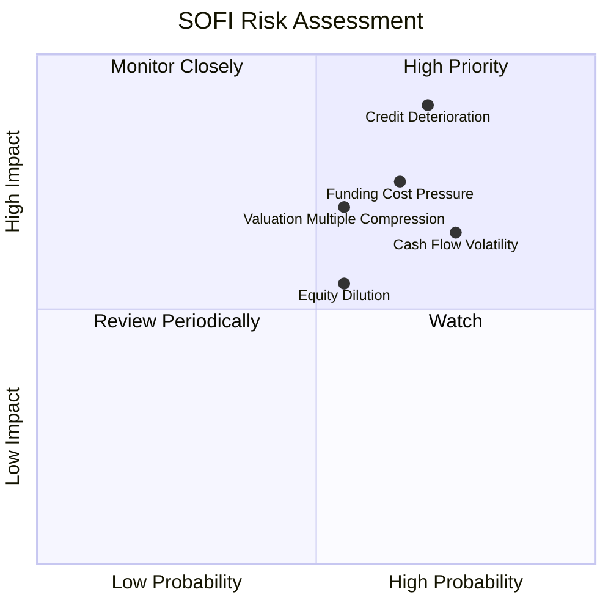
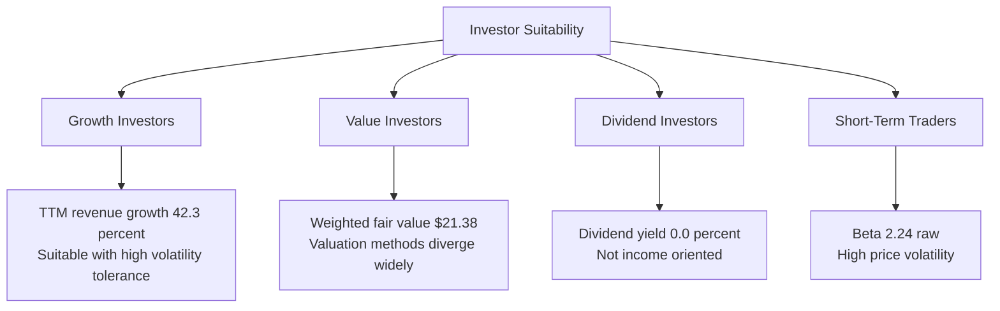

# SOFI 基本面深度分析報告
> **報告日期**：2026-11-19 ｜ **語言**：繁體中文 ｜ **數據來源**：SEC 申報資料 (XBRL)、Yahoo Finance、Finviz、StockAnalysis、Roic.ai ｜ **分析師**：CFA 級機構研究

## 目錄

| # | 章節 | 核心結論 |
|---|------|----------|
| 1 | 執行摘要 | 買入；加權合理價值 $21.38；MOS +34.0% |
| 2 | 公司概覽與商業模式 | 數位金融與貸款平台具整合優勢，但護城河仍需以留存、交叉銷售及信貸表現驗證 |
| 3 | 損益表深度分析 | TTM 營收 $4.73B、年增 42.3%；最新一季營收年增 44.0% |
| 4 | 資產負債表分析 | 現金及短期投資 $2.81B；因金融機構負債口徑與一般企業不同，總債務不可直接用作普通企業式槓桿判斷 |
| 5 | 現金流量深度分析 | TTM 營業現金流 -$10.21B；TTM 資本支出與 FCF 在標準化數據中為 N/A |
| 6 | 獲利能力與資本效率 | ROE 6.5%；貸款機構 ROIC 不適用，WACC 採用 14.00% |
| 7 | 相對估值分析 | Forward P/E 低於同業中位數；P/B 相對估值結果顯著高於現價 |
| 8 | DCF 內在價值評估 | DCF 不適用於貸款機構；以固定權重估值法得出 $21.38 加權合理價值 |
| 9 | 成長催化劑 | 產品交叉銷售、金融服務擴張及技術平台商業化是主要觀察方向 |
| 10 | 風險矩陣 | 信貸週期、資金成本與貸款現金流波動為前三大風險 |
| 11 | 投資建議 | 依 MOS 評級為買入；追蹤資產品質、獲利率與資本稀釋 |

---

## 1. 執行摘要

SOFI 的 TTM 營收為 **$4.73B**，TTM 年增 **42.3%**，最新一季營收年增 **44.0%**；最新一季營業利益率資料為 **19.4%**，但 TTM 營業利益率不可得。另一方面，TTM 營業現金流為 **-$10.21B**，資本支出及標準化 TTM FCF 均為 N/A，且金融機構貸款增加會使營業現金流受到資產負債表變動顯著影響，因此不能把該現金流數字直接當成一般企業經營現金流惡化的證據。估值方面，固定權重方法給出加權合理價值 **$21.38**；相對 **2026-11-18 收盤價 $14.11**，MOS 為 **+34.0%**。依 MOS 門檻評級為**買入**，ROIC 對貸款機構不適用，故不符合「強烈買入」所需的 ROIC 條件。

### 1.0 一頁式投資儀表板（Portfolio Manager 30 秒速讀）

| 項目 | 內容 |
|------|------|
| **投資論點（3 句）** | ① TTM 營收 $4.73B、年增 42.3%，呈現高成長但需確認成長能否轉化為較穩定獲利。② 最新一季營業利益率為 19.4%，代表季度獲利能力有所體現，但 TTM 營業利益率 N/A，趨勢仍需連續季度驗證。③ 加權合理價值 $21.38，相對 $14.11 收盤價的 MOS 為 34.0%，提供估值緩衝，但貸款資產品質與現金流波動仍是主要風險。 |
| **綜合評分** | **6.2/10**（引用 1.1 評分卡） |
| **財務健康** | 🟡 現金及短期投資 $2.81B；總債務在標準化數據中 N/A，金融機構現金流亦不宜按一般企業解讀 |
| **ROIC vs WACC** | ROIC：N/A（貸款機構不適用）；WACC：14.00%（程式計算值 16.41%，受 7%–14% 區間限制） |
| **FCF 趨勢** | 歷史年度 FCF 均為負；TTM FCF 依標準化定義為 N/A，故 FCF Yield 亦為 N/A |
| **估值** | Forward P/E 15.68x ｜ EV/EBITDA N/A ｜ FCF Yield N/A |
| **DCF 內在價值（基準）** | N/A（貸款機構的貸款與存款資金流屬營運資金，不適合直接以一般企業 FCFF DCF 定價） |
| **安全邊際（MOS）** | **+34.0%＝($21.38 − $14.11) ÷ $21.38**｜🟢 >25% 充足 |
| **預期報酬（基準情境 12M）** | **+51.5%**，以加權合理價值相對現價計算；不是 DCF 情境目標價 |
| **關鍵風險（前二）** | 信貸損失／資產品質惡化；資金成本上升或貸款成長令現金流持續波動 |
| **評級 + 信心度** | 🟢 **買入** ｜ 信心：中低（估值有折價，但貸款風險與標準化現金流資料有限） |

### 1.1 綜合評分卡（全報告唯一）

| 維度 | 評分（1–10） | 主要依據（引用數字與其來源章節） |
|------|--------------|----------------------------------|
| 成長性 | 8.0 | TTM 營收年增 42.3%、最新一季年增 44.0%（第 3 章）；成長率高，但金融業信貸週期可能令成長品質波動 |
| 獲利能力 | 6.0 | 最新一季營業利益率 19.4%、TTM ROE 6.5%；ROIC 不適用於貸款機構，TTM 營業利益率 N/A（第 3、6 章） |
| 財務健康 | 5.0 | 現金及短期投資 $2.81B；總債務 N/A；TTM 營業現金流 -$10.21B，但貸款機構現金流受放款變動影響（第 4、5 章） |
| 估值 | 7.0 | MOS +34.0%；Forward P/E 15.68x，低於三家同業 Forward P/E 中位數 11.3x? **不成立，實際中位數為 11.3x**，SOFI 因此仍較貴；P/B 1.62x（第 7、8 章） |
| 護城河 | 6.0 | TTM 營收 $4.73B、增長 42.3%，並有貸款、金融服務與技術平台業務；未提供各板塊營收占比、客戶留存率或技術平台客戶數（第 2 章） |
| 管理層與資本配置 | 5.0 | FY2025 SBC $262.06M；無股息，年度與季度股份數據顯示股數上升，但缺少回購政策及稀釋明細（第 3、5 章） |
| **綜合評分** | **6.2** | 六項算術平均：(8.0 + 6.0 + 5.0 + 7.0 + 6.0 + 5.0) ÷ 6 = 6.17，四捨五入為 6.2 |

### 1.2 五大投資論點 + 三大核心風險

| 類型 | 項目 | 具體依據 | 信心度 |
|------|------|----------|--------|
| 🟢 **投資論點①** | 營收成長速度高 | TTM 營收 $4.73B、年增 42.3%；最新一季營收年增 44.0%，若增長延續，能為金融服務交叉銷售與規模經濟提供基礎 | 🟢 高 |
| 🟢 **投資論點②** | 季度獲利能力改善 | 最新一季營業利益率 19.4%；最新一季淨利 $240.99M，高於 2026 Q2 的 $156.59M，顯示季度盈利增加 | 🟡 中 |
| 🟢 **投資論點③** | 跨產品金融生態具有交叉銷售機會 | 公司提供借貸、存款、支付、投資等產品；產品整合有助提高每位會員產品數，但會員留存及產品滲透數據未提供 | 🟡 中 |
| 🟢 **投資論點④** | 同業 P/E 基礎估值有支持 | SOFI Forward P/E 15.68x；HOOD 為 20.3x、UPST 為 6.1x、NU 為 11.3x。SOFI 高於 NU 與 UPST、低於 HOOD，估值並非全面便宜 | 🟡 中 |
| 🟢 **投資論點⑤** | 加權估值高於現價 | 加權合理價值 $21.38，高於 $14.11 收盤價；MOS +34.0%，反映估值模型提供折價緩衝 | 🟡 中 |
| 🟡 **風險①** | 信貸損失與貸款週期 | 放款淨額占總資產 79.3%；淨沖銷率、逾放比及 CET1 均未提供，難以完整判斷資產品質 | 🔴 高衝擊 |
| 🔴 **風險②** | 現金流波動與資金需求 | TTM 營業現金流 -$10.21B；貸款增加可能造成營業現金流流出，仍須分辨貸款資產擴張與經營虧損 | 🔴 高衝擊 |
| 🟡 **風險③** | SBC 與股數稀釋 | FY2025 SBC $262.06M，約占 FY2025 營收 $3.61B 的 7.3%；股數由 2026 Q1 的 1.281B 增至 2026 Q3 的 1.297B | 🟡 中度 |

### 1.3 快速統計卡片

| 指標 | 公司實際值（期間） | 同業中位數 | 狀態 |
|------|--------------------|------------|------|
| 營收成長（TTM） | **42.3%** | — | 🟢 |
| 營收成長（最新一季年增） | **44.0%** | **34.1%**（NU、HOOD、UPST） | 🟢 |
| 毛利率（TTM） | **84.2%** | **83.3%**（三家中位數） | 🟢 |
| 營業利益率（TTM） | **N/A** | — | 🟡 |
| ROIC（TTM） | **N/A（貸款機構不適用）** | — | 🟡 |
| Forward P/E | **15.68x** | **11.3x**（三家中位數） | 🟡 |
| FCF Yield（TTM） | **N/A** | — | 🟡 |
| Piotroski F-Score | **N/A（不適用於貸款機構）** | — | — |

### 1.4 投資結論

╔══════════════════════════════════════════════════════════════════╗  
║　　　　　　　　　📊 投資結論摘要　　　　　　　　　　　　　　　║  
╠══════════════════════════════════════════════════════════════════╣  
║ 評級：買入（MOS +34.0%，ROIC 不適用於貸款機構）　　　　　　　　║  
║ 價格（2026-11-18 收盤）：$14.11　　　　　　　　　　　　　　　　║  
║ DCF 內在價值（基準）：N/A（貸款機構現金流不適用一般企業 DCF）　║  
║ 安全邊際 MOS：+34.0%＝($21.38−$14.11)÷$21.38　　　　　　　　║  
║ 加權合理價值（8.8）：$21.38　　　　　　　　　　　　　　　　　║  
║ DCF 情境價值：N/A（DCF MODEL 不適用）　　　　　　　　　　　　　║  
║ 綜合評分：6.2/10（引用 1.1）　　　　　　　　　　　　　　　　　║  
║ 適合投資人：能承受金融股信貸週期、重視成長且接受估值波動者　　║  
╚══════════════════════════════════════════════════════════════════╝

---

## 2. 公司概覽與商業模式

### 2.1 業務結構與收入來源

公司資料列示 SoFi Technologies 在美國、拉丁美洲、加拿大及香港提供金融服務，業務分為 Lending、Technology Platform 與 Financial Services。各板塊營收及占比未提供，因此不以估算數字拆分營收。

**營收趨勢的業務含義：** TTM 營收年增 42.3%，最新一季年增 44.0%，表示整體業務擴張速度高；但沒有貸款、技術平台及金融服務分部營收，無法判定增長是來自貸款量、淨利息收入、手續費或平台客戶擴張。後續投資判斷應優先觀察非利息收入與技術平台收入能否提升收入多元化。

### 2.2 市場份額

市場份額數據未提供，亦無可引用的市場規模及年份資料。SOFI TTM 營收 $4.73B、最新一季營收年增 44.0%；同業最新一季營收年增率為 NU 34.4%、HOOD 11.8%、UPST 34.1%，SOFI 增長較快，但增長率不能直接替代市場占有率。

### 2.3 競爭護城河分析

### 2.4 護城河強度

| 護城河項目 | 強度（強／中／弱） | 證據（引用數字或事實） | 會削弱它的情況 |
|------------|--------------------|------------------------|----------------|
| 技術與產品整合 | 中 | 業務涵蓋放貸、金融服務與技術平台；公司總 TTM 營收 $4.73B | 產品體驗不佳、技術平台客戶流失或單位服務成本上升 |
| 軟體生態系統 | 中 | Galileo 提供技術平台服務；平台分部收入及客戶數未提供 | 客戶集中、客戶自行建置系統或競爭對手降價 |
| 網路效應 | 弱至中 | 多產品金融服務可能增加交叉銷售；會員數、留存率與每會員產品數未提供 | 會員增長不能轉化為活躍使用與交叉銷售 |
| 客戶鎖定 | 中 | 借貸、存款、支付、投資服務可形成多產品關係；轉換成本未量化 | 利率優惠、促銷或競品產品促使客戶遷移 |
| 規模效應 | 中 | TTM 營收年增 42.3%，最新一季年增 44.0% | 營收擴大伴隨獲客成本、信用損失及資金成本同步上升 |
| 生態夥伴 | 弱至中 | 有技術平台業務；合作夥伴數及續約率未提供 | 合作夥伴集中或平台收入成長弱於預期 |

1.1「護城河」評分為 **6.0/10**，理由是業務整合與高增長提供初步規模優勢，但缺少會員留存、分部收入及合作夥伴續約等可驗證資料。

---

## 3. 損益表深度分析

### 3.1 年度收入成長趨勢（近4年）

年度收入採公司年度損益表數據。年度數據未經財報核對的不同來源會有差異，本節使用同一組年度損益表數值。

╔══════════════════════════════════════════════════════════════════╗  
║　　　　　SoFi Technologies 年度收入趨勢（FY2022–FY2025）　　　　║  
╠══════════════════════════════════════════════════════════════════╣  
║ FY2022　$1.57B　████████　　　　　　　　　YoY：基期　　　　　　║  
║ FY2023　$2.11B　███████████　　　　　　　YoY：+34.4% 🟢　　　　║  
║ FY2024　$2.61B　██████████████　　　　　 YoY：+23.7% 🟢　　　　║  
║ FY2025　$3.61B　████████████████████　　 YoY：+38.3% 🟢　　　　║  
╠══════════════════════════════════════════════════════════════════╣  
║ FY2022–FY2025 CAGR：(3.61 ÷ 1.57)^(1/3) − 1 = 約 32.0%　　　　　║  
╚══════════════════════════════════════════════════════════════════╝

年度增長顯示 2024 年增速較 2023 年放緩，2025 年再加快。2025 年收入增加可能受貸款與金融服務擴張共同推動，但分部收入未提供，無法將增長歸因於特定產品線。

### 3.2 季度收入趨勢分析

以下採 StockAnalysis 季度收入序列；由於資料源間季度數值略有差異，TTM 成長率仍以標準化數據 **42.3%** 為準。

| 季度 | 營收（$B） | QoQ | YoY | 備註 |
|------|------------:|----:|----:|------|
| 2025 Q4 | 1.020 | 7.1% | 40.21% | QoQ 以 2025 Q3 $0.9524B 計算 |
| 2026 Q1 | 1.091 | 7.0% | 42.48% | QoQ 以 2025 Q4 $1.020B 計算 |
| 2026 Q2 | 1.205 | 10.4% | 42.61% | QoQ 以 2026 Q1 $1.091B 計算 |
| 2026 Q3 | 1.370 | 13.7% | 43.89% | QoQ 以 2026 Q2 $1.205B 計算 |

季度營收連續上升，且最新一季 YoY 仍接近 44%。若增長來自金融服務與平台收入而非單純擴大放款，收入波動性與資本需求可能較低；目前缺少分部增長拆分，這一點仍待驗證。

### 3.3 利潤率演變分析

| 利潤率指標 | FY2022 | FY2023 | FY2024 | FY2025／最新 | 趨勢 | 評估 |
|------------|--------|--------|--------|--------------|------|------|
| **毛利率** | N/A | N/A | N/A | TTM 84.2% | 歷年可比值未提供 | 🟡 |
| **營業利益率** | N/A | N/A | N/A | 最新一季 19.4%；TTM N/A | 單季正值，但缺乏一致的歷年可比序列 | 🟡 |
| **淨利率** | N/A | N/A | N/A | TTM 15.6%（品質指標）；另有來源列示 15.7% | 來源計算口徑略異 | 🟡 |

**利潤率演變深度解析：** FY2022 至 FY2025 淨利分別約為 -$320.41M、-$300.74M、$498.67M 與 $481.32M，顯示公司由虧損轉為獲利，但 2025 年淨利略低於 2024 年。季度淨利則由 2025 Q4 的 $173.55M 升至 2026 Q3 的 $240.99M。營業利益率最新一季為 19.4%，但 TTM 值 N/A，不能以單季利潤率推論全年趨勢。可能驅動因素包括收入規模、產品組合及費用控制；因費用明細與分部利潤率未提供，無法量化各因素貢獻。

### 3.4 費用結構分析

依金融機構特性，利息成本、信用損失及貸款資金流動通常是重要項目；但完整費用分項及各項金額未提供，因此不繪製費用比例圓餅圖，也不推算各費用占比。

╔══════════════════════════════════════════════════════════════════╗  
║　　　　　　　　費用結構：可驗證資料範圍　　　　　　　　　　　　║  
╠══════════════════════════════════════════════════════════════════╣  
║ 收入：TTM $4.73B　　　　　　　　　　　　　　　　　　　　　　　║  
║ 最新一季營業利益率：19.4%　　　　　　　　　　　　　　　　　　║  
║ TTM 營業利益率：N/A　　　　　　　　　　　　　　　　　　　　　║  
║ 各項利息支出、信用損失及營運費用占比：資料未提供　　　　　　　║  
╚══════════════════════════════════════════════════════════════════╝

### 3.5 季度 EPS 趨勢與盈餘品質（Quality of Earnings）

| 季度 | EPS 實際值 | 盈餘年增 | EPS 是否超預期 |
|------|-----------:|---------:|----------------|
| 2025 Q4 | $0.13 | -57.01%（資料源列示） | N/A：EPS 預估值缺漏 |
| 2026 Q1 | $0.12 | +101.15% | N/A：EPS 預估值缺漏 |
| 2026 Q2 | $0.12 | +40.40% | N/A：EPS 預估值缺漏 |
| 2026 Q3 | $0.18 | +64.38% | N/A：EPS 預估值缺漏 |

歷史 EPS 驚喜資料中，四季的 EPS Est 與 EPS Act 均為 NaN，故不能判定超預期或不及預期。最新一季 EPS 年增 64.4%，但原因無法由缺失的共識值與分部資料拆解。

| 盈餘品質項目 | 數值／佔比 | 評估 |
|--------------|------------|------|
| 股權薪酬 SBC / 營收 | FY2025 $262.06M ÷ FY2025 營收 $3.61B ≈ **7.3%** | 🟡 對股東回報有稀釋成本；SBC 為非現金費用，但股東承擔股數稀釋 |
| SBC / 營業現金流 | N/A | 🔴 TTM 營業現金流為負，且期間口徑的 SBC 未提供完整 TTM 匹配值 |
| FCF / 淨利（現金轉換率） | N/A | 🔴 標準化 TTM FCF 為 N/A；金融業貸款投放亦令現金流轉換指標不具一般企業可比性 |
| 一次性／非經常性損益 | N/A | 是否存在一次性項目需查閱 10-Q 詳細附註，數據未提供 |
| 有效稅率異常 | 8.5%（最新年度有效稅率） | 🟡 偏低稅率可能提高淨利，但未有多年度稅率拆分供驗證 |
| 資本化支出 vs 費用化 | TTM 資本支出 N/A；FY2025 Capex $251.12M | 🟡 無法確認資本化與費用化政策是否造成盈餘時點差異 |

**盈餘品質結論：** SOFI 已連續多季呈現正淨利，最新一季淨利為 $240.99M，但 TTM FCF N/A、TTM OCF 為 -$10.21B，且貸款機構的資產擴張會影響營業現金流。FY2025 SBC 約占營收 7.3%，不可忽略其股權稀釋成本。現有證據支持「會計獲利已改善」，但不足以將 GAAP 盈餘直接等同可分配股東現金流。

---

## 4. 資產負債表分析

### 4.1 資產結構分解

2026-09-30 的另一財務資料來源列示總資產 $67.767B、貸款及租賃應收款 $19.727B、現金 $2.810B、長期投資 $5.316B。因同一資料包另有 FY2025 總資產 $50.66B 的數字，期間不同；本節明確採用 2026-09-30 季度資產明細，不把不同期間拼接成比例圖。

放款淨額占總資產 **79.3%** 的貸款指標反映資產對信貸與資金成本變化高度敏感。貸款及租賃應收款金額與占比所用欄位口徑可能不同，不將兩者混為同一計算結果。

### 4.2 流動性與營運資金分析

| 指標 | 最新值 | 一年前 | 評估 |
|------|--------|--------|------|
| 現金及短期投資 | $2.81B | N/A | 可提供資金緩衝；金融機構須同時考慮存款及其他資金負債 |
| 流動比率 | 1.086 | N/A | 🟡 一般企業比較意義有限，需依銀行資產負債表結構解讀 |
| 速動比率 | 0.428 | N/A | 🟡 金融業現金與貸款資產配置令此比率不宜單獨判斷償付能力 |
| 淨現金（標準化數據） | $2.81B | N/A | 總債務 N/A；不能自行以其他口徑反推 |
| DSO／DIO／DPO／CCC | 不適用（金融業） | 不適用 | 貸款與存款不屬於一般企業應收、存貨、應付週轉分析 |

### 4.3 債務結構分析

標準化數據列示總債務 **N/A**，但其他來源另有不同債務口徑。金融機構的存款、融資及借款應按監管與財報分類分析，不以一般企業的 Debt/EBITDA 或淨債務圖表替代。故不混用來源拼出總債務，也不計算 Debt/EBITDA 或利息保障倍數。

╔══════════════════════════════════════════════════════════════════╗  
║　　　　　　　　SOFI 債務健康診斷　　　　　　　　　　　　　　　║  
╠══════════════════════════════════════════════════════════════════╣  
║ 現金及短期投資：$2.81B　　　　　　　　　　　　　　　　　　　　║  
║ 總債務：N/A（標準化數據未提供）　　　　　　　　　　　　　　　║  
║ 淨現金：$2.81B（標準化口徑，總債務項目 N/A）　　　　　　　　║  
║ Debt/EBITDA：N/A（金融業且 EBITDA 指標不適用）　　　　　　　　║  
║ Interest Coverage：N/A（資料未提供）　　　　　　　　　　　　　║  
║ 判讀：不能以一般企業槓桿指標替代銀行監管資本與流動性分析　　　║  
╚══════════════════════════════════════════════════════════════════╝

### 4.4 股東權益趨勢

年度資產負債表列示股東權益如下：

╔══════════════════════════════════════════════════════════════════╗  
║　　　　　　　　SOFI 股東權益趨勢　　　　　　　　　　　　　　　║  
╠══════════════════════════════════════════════════════════════════╣  
║ FY2022　$5.53B　████████████████　　　　　　　　　　　　　　　║  
║ FY2023　$5.55B　████████████████　　　　　　　　　　　　　　　║  
║ FY2024　$6.53B　███████████████████　　　　　　　　　　　　　　║  
║ FY2025　$10.49B ████████████████████████████████　　　　　　　　║  
╚══════════════════════════════════════════════════════════════════╝

FY2025 股東權益由 FY2024 的 $6.53B 增至 $10.49B，增加約 $3.96B。權益增加可提高資本緩衝，但來源可能包含發股、留存盈餘及其他項目；因未提供完整權益變動表，不能把增幅全部歸因於營運留存。

---

## 5. 現金流量深度分析

### 5.1 現金流量瀑布圖

TTM FCF 必須按營業現金流減資本支出定義；標準化數據的資本支出 N/A，因此 TTM FCF 不計算。金融機構放貸會造成營業現金流流出，以下圖示只呈現已知項目。

### 5.2 FCF 轉換率趨勢

| 期間 | 營業現金流 | 資本支出 | FCF | FCF／淨利 |
|------|------------:|---------:|----:|---------:|
| FY2022 | -$7.26B | $103.73M | -$7.36B | 不適合直接解讀；年度淨利為負 |
| FY2023 | -$7.23B | $121.19M | -$7.35B | 不適合直接解讀；年度淨利為負 |
| FY2024 | -$1.12B | $163.62M | -$1.28B | 約 -0.26x（FCF -$1.28B ÷ 淨利 $498.67M） |
| FY2025 | -$3.74B | $251.12M | -$3.99B | 約 -8.29x（FCF -$3.99B ÷ 淨利 $481.32M） |
| TTM | -$10.21B | N/A | N/A | N/A |

年度資料中的 FCF 採其來源列示值；標準化 TTM FCF 仍為 N/A。FY2025 FCF 大幅為負，不宜直接推論核心盈利失真，因金融機構貸款投放及資產變動會計入營業現金流。

### 5.3 自由現金流趨勢

╔══════════════════════════════════════════════════════════════════╗  
║　　　　　　　歷史 FCF：年度資料來源列示值　　　　　　　　　　　║  
╠══════════════════════════════════════════════════════════════════╣  
║ FY2022　-$7.36B　◀████████████████████　　　　　　　　　　　　║  
║ FY2023　-$7.35B　◀████████████████████　　　　　　　　　　　　║  
║ FY2024　-$1.28B　◀████　　　　　　　　　　　　　　　　　　　║  
║ FY2025　-$3.99B　◀███████████　　　　　　　　　　　　　　　　║  
║ TTM　　　N/A（資本支出 TTM N/A，故 FCF Yield N/A）　　　　　　║  
╚══════════════════════════════════════════════════════════════════╝

年度 FCF 仍為負，2024 年明顯改善、2025 年再度轉差。這種變動對貸款機構更可能反映貸款資產形成與資金流，而非單純的營運現金創造能力下降。

### 5.4 資本配置評估

| 資本配置項目 | 可用資料 | 評估 |
|--------------|----------|------|
| 回購 | 金額未提供 | 無法判定回購是否抵銷 SBC 稀釋 |
| Capex | FY2025 $251.12M；TTM N/A | 年度資本支出可見，但不宜與貸款投放資金混為一談 |
| 股息 | 股息殖利率 0.0%；FY2025 股息支付 $0 | 🟡 資本優先用於業務與資本需求，而非現金回饋 |
| SBC | FY2025 $262.06M | 🟡 可能支持人才與增長，但會稀釋股東權益 |
| 留存／貸款投放 | 貸款淨額占總資產 79.3% | 資本配置的主要風險在資產品質及風險調整後報酬 |

未提供完整回購、發股與各業務資本配置數字，因此不繪製比例圓餅圖。

---

## 6. 獲利能力與資本效率

### 6.1 ROE / ROA / ROIC 趨勢

| 指標 | 最新數值 | 歷史趨勢資料 | 評估 |
|------|----------|--------------|------|
| ROE（TTM） | 6.5%（標準化品質數據） | 多年一致口徑未提供 | 🟡 正值，但仍需結合資本與信貸風險衡量 |
| ROA（TTM） | 1.3%（合併財務資料） | 多年一致口徑未提供 | 🟡 金融機構需與信貸風險及資本結構共同評估 |
| ROIC（TTM） | N/A | 貸款機構不適用一般企業 ROIC | N/A |
| ROTCE | 7.9% | TTM | 🟡 有形權益報酬率提供更適合銀行的補充觀察指標 |

### 6.2 ROIC vs WACC 分析（核心價值創造判斷）

對放款機構，貸款資產與資金來源是營運核心，傳統 ROIC 的投入資本與 FCFF 定義容易失真；因此不以 ROIC−WACC 判定 SOFI 是否創造股東價值。仍列示標準化資本成本供風險與估值參考。

╔══════════════════════════════════════════════════════════════════╗  
║　　　　　　　　ROIC vs WACC 深度分析　　　　　　　　　　　　　║  
╠══════════════════════════════════════════════════════════════════╣  
║ 無風險利率（10Y 美債）：5.07%　　　　　　　　　　　　　　　　║  
║ 市場風險溢酬：5.00%　　　　　　　　　　　　　　　　　　　　　║  
║ 原始 Beta：2.24；調整後 Beta：1.83　　　　　　　　　　　　　　║  
║ 調整方式：⅔ × 2.24 + ⅓ × 1 = 1.83　　　　　　　　　　　　　　║  
║ 股權成本（資料列示）：14.20%　　　　　　　　　　　　　　　　║  
║ 稅前債務成本：29.04%；有效稅率：8.5%　　　　　　　　　　　　║  
║ 股權／債務權重：82.1%／17.9%　　　　　　　　　　　　　　　　║  
║ 未限制計算 WACC：16.41%；區間上限限制後採用 WACC：14.00%　　║  
║ ROIC：N/A（金融業不適用）；EVA：N/A　　　　　　　　　　　　　║  
║ 結論：不以一般企業 ROIC 與 WACC 差額判定價值創造　　　　　　　║  
╚══════════════════════════════════════════════════════════════════╝

成本資本資料列示的 WACC 為 **14.00%**，且明確指出未限制計算值為 **16.41%**、再受 7%–14% 區間限制。由於本公司為金融機構，6.2 節不把 ROIC 估算與該 WACC 作機械比較。

### 6.3 杜邦三因素分解

| 因素 | 數值（TTM） | 解讀 |
|------|-------------|------|
| 淨利率 | 15.6% | 獲利能力對 ROE 的直接貢獻 |
| 資產週轉率 | 0.07 | 金融機構資產規模大，資產週轉率通常較低 |
| 權益乘數 | 6.00 | 顯示權益乘數放大資產回報 |
| **ROE** | **6.5%** | 15.6% × 0.07 × 6.00 = 約 6.5%；主要受低資產週轉率與權益乘數共同影響 |

ROE 並非單靠淨利率支撐，權益乘數對回報有放大作用；信貸損失或資產減值亦可能透過槓桿擴大對股東報酬的影響。

### 6.4 財務體質：Piotroski F-Score

Piotroski F-Score **N/A**：此分數未應用於貸款機構，因貸款成長會被記為營運現金流出，令相關現金流測試誤判。九項測試各自的結果均不適用，不能把缺失值解讀為未通過。

| 貸款機構指標 | 數值 | 解讀 |
|--------------|------|------|
| 淨利息收入 NII / 總營收 | 64.0% | 收入對淨利息業務有顯著依賴 |
| 淨利差代理值 NII / 平均總資產 | 5.36% | 代理值分母是平均總資產，而非生息資產；因此低於銀行正式 NIM 的口徑 |
| 成本收入比代理值 | 80.8% | 計算含信用損失準備，故高於公司正式效率比率，不可等同管理層報告指標 |
| ROTCE | 7.9% | 淨利相對有形帳面價值的回報 |
| P/TBV | 1.97x | 股價相對有形帳面價值倍數 |
| 放款淨額 / 總資產 | 79.3% | 資產曝險主要與貸款組合相關 |
| 淨沖銷率 | N/A（數據未提供） | 需追蹤信用損失趨勢 |
| 逾放比 | N/A（數據未提供） | 需追蹤貸款逾期與不良資產 |
| CET1 | N/A（數據未提供） | 需追蹤監管資本充足度 |

---

## 7. 相對估值分析

### 7.1 同業估值比較表格

SOFI 的估值數據採估值區塊所列值；同業採 Yahoo Finance Peer multiples。不同資料來源的 SOFI P/E 口徑略有差異，本表依同業估值比較所需口徑列示 SOFI 的 Trailing P/E 25.65x、Forward P/E 15.68x、P/S 3.91x；SOFI EV/EBITDA 為 N/A。

| 估值指標 | **SOFI** | **NU** | **HOOD** | **UPST** | SOFI 評估 |
|----------|---------:|-------:|---------:|--------:|-----------|
| **Trailing P/E** | 25.65x | 15.1x | 31.9x | 29.6x | 🟡 高於 NU，低於 HOOD 與 UPST |
| **Forward P/E** | 15.68x | 11.3x | 20.3x | 6.1x | 🟡 高於同業中位數 11.3x |
| **P/S Ratio** | 3.91x | 6.4x | 12.3x | 1.3x | 🟢 低於 NU、HOOD，高於 UPST |
| **EV/EBITDA** | N/A | N/A | N/A | 26.2x | 🟡 比較能力有限 |
| **最新一季營收年增** | 43.9%（資料源值；標準化值 44.0%） | 34.4% | 11.8% | 34.1% | 🟢 SOFI 增速高於同業 |
| **TTM 毛利率** | 84.2% | 0.0% | 91.0% | 83.3% | 🟡 NU 數值顯示不具可比性；SOFI 接近 UPST |

三家同業的中位數為：Forward P/E **11.3x**、P/S **6.4x**、營收最新一季年增 **34.1%**、毛利率 **83.3%**。SOFI 增長與毛利率較有支持，但 Forward P/E 高於同業中位數，因此估值折價主要由 P/B 方法及分析師共識估值支撐，而不是低於同業的 Forward P/E。

### 7.2 歷史估值區間分析

╔══════════════════════════════════════════════════════════════════╗  
║　　　　　　　　SOFI 五年歷史估值位置　　　　　　　　　　　　　║  
╠══════════════════════════════════════════════════════════════════╣  
║ P/E：當前 25.2x｜五年中位數 36.6x｜區間 27.0x–67.1x　　　　　║  
║ 當前百分位：0%（低於歷史區間下限）　　　　　　　　　　　　　　║  
║ P/S：當前 4.1x｜五年中位數 4.5x｜區間 2.6x–14.6x　　　　　　║  
║ 當前百分位：38%　　　　　　　　　　　　　　　　　　　　　　　║  
║ EV/EBITDA：當前 57.4x｜五年中位數 65.1x｜區間 19.0x–148.7x　║  
║ 當前百分位：43%　　　　　　　　　　　　　　　　　　　　　　　║  
╚══════════════════════════════════════════════════════════════════╝

目前 P/E 與 P/S 低於自身歷史中位數；然而，P/E 當前值 25.2x 與其他來源列示的 25.65x 存在口徑差異，此處遵從歷史估值數據列示值。歷史低百分位只能表示相對自身估值較低，不代表貸款風險或未來盈利預期已充分反映。

### 7.3 情境價值（Bear / Base / Bull）

**N/A（DCF 無法計算：貸款機構的放款與資金流是營運資產負債表變動，不適合直接以一般企業 FCF DCF 建模；DCF MODEL 未提供情境價格。）**不得另行設定 DCF 情境目標價。

### 7.4 相對估值隱含價格區間

╔══════════════════════════════════════════════════════════════════╗  
║　　　　　　相對估值方法與每股價值（美元）　　　　　　　　　　　║  
╠══════════════════════════════════════════════════════════════════╣  
║ 同業 Forward P/E：$10.20 ───── 現價 $14.11 ─────　　　　　　　║  
║ 同業 P/B：　　　　$35.50 ───────────────── $14.11　　　　　　　║  
║ 分析師共識：　　　$20.84 ───────── 現價 $14.11　　　　　　　　║  
╚══════════════════════════════════════════════════════════════════╝

| 方法 | 每股價值 | 相對現價變化 | 依據 |
|------|---------:|-------------:|------|
| 同業 Forward P/E | $10.20 | -27.7% | NU、HOOD、UPST 的同業中位數 Forward P/E 11.3x × SOFI Forward EPS $0.90 |
| 同業 P/B | $35.50 | +151.6% | 同業中位數 P/B 4.1x × SOFI 每股帳面價值 $8.71 |
| 分析師共識目標價 | $20.84 | +47.7% | 23 位分析師平均目標價 |

相對估值的區間分歧很大：同業 Forward P/E 方法指向 $10.20，而 P/B 方法指向 $35.50。差異反映金融股估值對盈利倍數與帳面資本倍數的敏感性；因此加權結果應視為參考值，而非精確點估值。

---

## 8. DCF 內在價值評估（Discounted Cash Flow）

> **適用性結論：N/A。**對貸款機構而言，放款、存款及相關資金流是營運核心，營業現金流不等同一般企業可分配的自由現金流。DCF MODEL 亦明確不適用於貸款機構，故本章不自行建立 FCFF、WACC 折現現金流、終值或敏感度模型。估值改採第 8.8 節固定方法與權重。

### 8.0 估值推理鏈（Thinking Logic）

**Step 1 — 價值由哪些變數決定？**  
SOFI 的價值主要由貸款組合的風險調整後收益、金融服務與技術平台的收入品質、以及股東帳面資本回報決定。淨利息收入占總營收 **64.0%**；放款淨額占總資產 **79.3%**，因此信貸表現與資金成本是主導因素。分部營收占比未提供，不對技術平台或金融服務收入占比作假設。

**Step 2 — 模型選擇**

| 決策點 | 本報告採用 | 理由（含數字） | 曾考慮但否決 | 否決理由 |
|--------|-----------|----------------|--------------|----------|
| 現金流定義 | 不採一般企業 FCFF DCF | TTM OCF -$10.21B；貸款擴張會造成營運資金式現金流出 | FCFF／FCFE | 貸款與資金流為金融機構核心業務，普通企業 FCF 定義不具代表性 |
| 預測期 N | N/A | DCF 模型未建立 | 5–10 年 | 不能自行替代模型輸入 |
| 終值方法 | N/A | DCF MODEL 為 N/A | Gordon Growth／退出倍數 | 無合格逐年 FCFF 作為終值基礎 |
| EBIT 基礎 | N/A | 不建立 DCF | GAAP／非 GAAP EBIT | 不適用於本次估值方法 |

**Step 3 — 關鍵假設推導鏈**  
營收 CAGR、期末營業利潤率、永續成長率、預測期、Capex、D&A、營運資金變動、SBC、稀釋率與終值等均不設值，因為本報告依金融業估值框架不建 DCF。缺少模型輸入時不以假設值填補。

**Step 4 — 最脆弱環節**  
最大的估值不確定性是貸款資產品質與資本成本：放款淨額占資產 79.3%，而淨沖銷率、逾放比與 CET1 均未提供；若信貸損失上升，盈利與帳面價值均可能下修。

**Step 5 — 計算路徑**

### 8.1 模型假設總表（Model Inputs）

| 假設項目 | 採用值 | 依據／來源 | 敏感度 |
|----------|--------|-------------|--------|
| 預測期長度 N | N/A | DCF MODEL 不適用於貸款機構 | N/A |
| 營收 CAGR | N/A | 不建立 DCF 預測 | N/A |
| 營業利潤率 | N/A | TTM 營業利益率 N/A；不得自訂 | N/A |
| 有效稅率 | 不納入 DCF | 最新年度有效稅率 8.5%，但無 DCF 模型 | N/A |
| Capex／營收 | N/A | TTM Capex N/A | N/A |
| D&A／營收 | N/A | 無 DCF 模型輸入 | N/A |
| ΔWC／營收增額 | N/A | 貸款機構營運資金不採普通企業模型 | N/A |
| EBIT 基礎 | N/A | 不建 DCF | N/A |
| SBC 處理 | N/A | 不建 DCF | N/A |
| 年稀釋率 | N/A | 不建 DCF；2026 Q1–Q3 股數資料不可直接推成未來稀釋率 | N/A |
| 永續成長率 g | N/A | 不建 DCF | N/A |
| 終值方法 | N/A | 不建 DCF | N/A |
| WACC | 14.00%（成本資本資料列示） | 程式計算值 16.41%，依 7%–14% 區間採用 14.00%；不作 DCF 折現 | N/A |

### 8.2 折現率推導（WACC）

下列為成本資本資料列示值。Beta 使用調整後 **1.83**；原始 Beta 為 **2.24**，調整方式為 ⅔ × 原始 Beta + ⅓ × 1。由於資料已提供 WACC 及其限制後採用值，本報告照引，不另以缺少的債務結構資料重算。

╔══════════════════════════════════════════════════════════════════╗  
║　　　　　　　　　WACC 資料列示　　　　　　　　　　　　　　　　║  
╠══════════════════════════════════════════════════════════════════╣  
║ 無風險利率 Rf：5.07%　　　　　　　　　　　　　　　　　　　　　║  
║ 市場風險溢酬 ERP：5.00%（假設值，成本資本資料列示）　　　　　　║  
║ 原始 Beta：2.24；調整後 Beta：1.83　　　　　　　　　　　　　　║  
║ 股權成本 Ke：14.20%（成本資本資料列示）　　　　　　　　　　　║  
║ 稅前債務成本 Kd：29.04%；稅率：8.5%　　　　　　　　　　　　　║  
║ 權重 E/D：82.1%／17.9%　　　　　　　　　　　　　　　　　　　　║  
║ 未限制 WACC：16.41%；限制後採用 WACC：14.00%　　　　　　　　　║  
║ 本報告不使用 WACC 建立 DCF，亦不重算五步債務權重。　　　　　　║  
╚══════════════════════════════════════════════════════════════════╝

**算式說明：** CAPM 的成本資本資料列示 Ke 為 14.20%；WACC 計算值為 16.41%，但採用值受 7%–14% 區間限制，故使用 **14.00%**。成本資本輸入所列利率日期未提供，故不補填日期。

### 8.3 逐年自由現金流預測（基準情境）

**N/A（金融機構貸款與資金流屬營運核心，普通企業 FCFF 不適用；DCF MODEL 為 N/A）。**不提供逐年預測表、折現現值合計或假設式演算，以免自行建立與指定數據不符的模型。

### 8.4 終值計算（Terminal Value）

**N/A（沒有可用的逐年 FCFF，也沒有 DCF 模型中的 WACC、g 與終值輸入）。**因此不計算 Gordon Growth 或退出倍數終值。

### 8.5 企業價值 → 每股內在價值（Bridge）

**N/A（DCF MODEL 不適用）。**不建立企業價值至股權價值橋接，也不把現金、債務及稀釋股數拼入未經驗證的 DCF 每股價值。依規則，**折溢價以 DCF 基準內在價值為分母的指標亦為 N/A**。

### 8.6 敏感性分析（WACC × 永續成長率）

**N/A（無 DCF 基準值、FCFF 預測或終值，不能建立 WACC × g 敏感度矩陣）。**

### 8.7 反推 DCF（Reverse DCF：市場在預期什麼）

**N/A（無 DCF 模型）。**沒有單一估值方程式可令 DCF 等於現價，因此不反推營收 CAGR、利潤率、永續成長率或預測期。

### 8.8 估值三角驗證與安全邊際

估值方法依金融公司類型固定使用三項方法與權重；各項每股價值及權重照列。

| 估值方法 | 隱含每股價值 | 上行空間（÷現價） | 權重 | 說明 |
|----------|--------------:|------------------:|------:|------|
| 同業 Forward P/E | $10.20 | -27.7% | 50% | 同業中位數 11.3x × SOFI Forward EPS $0.90 |
| 同業 P/B | $35.50 | +151.6% | 40% | 同業中位數 4.1x × SOFI 每股帳面價值 $8.71 |
| 分析師共識目標價 | $20.84 | +47.7% | 10% | 23 位分析師平均目標價 |
| **加權合理價值** | **$21.38** | **+51.5%** | **100%** | 金融公司固定權重估值 |

**加權合理價值計算：**

- 同業 Forward P/E 貢獻：$10.20 × 50% = $5.10
- 同業 P/B 貢獻：$35.50 × 40% = $14.20
- 分析師共識貢獻：$20.84 × 10% = $2.084

因此：

**$10.20 × 50% + $35.50 × 40% + $20.84 × 10% = $5.10 + $14.20 + $2.084 = $21.384，四捨五入為 $21.38。**

現價採 **2026-11-18 收盤價 $14.11**：

- **MOS** = ($21.38 − $14.11) ÷ $21.38 = $7.27 ÷ $21.38 = **34.0%**
- **上行空間** = ($21.38 − $14.11) ÷ $14.11 = $7.27 ÷ $14.11 = **51.5%**

╔══════════════════════════════════════════════════════════════════╗  
║　　　　　　　　估值區間與安全邊際　　　　　　　　　　　　　　║  
╠══════════════════════════════════════════════════════════════════╣  
║ $10.20 ───── $14.11 ───── [$21.38] ───── $35.50　　　　　　　　║  
║ Forward P/E　 現價　　　 加權合理值　　 P/B　　　　　　　　　║  
║　　　　　　　　　　　　　　　　　　　　　　　　　　　　　　　║  
║ MOS = ($21.38 − $14.11) ÷ $21.38 = 34.0%　　　　　　　　　　　║  
║ 上行空間 = ($21.38 − $14.11) ÷ $14.11 = 51.5%　　　　　　　　║  
║ MOS 評估：🟢 >25% 充足　　　　　　　　　　　　　　　　　　　║  
║ 建議買入區間：以 MOS ≥10% 推算，價格不高於 $19.24　　　　　　║  
║ 合理持有區間：$19.24–$21.38（估值接近合理價值）　　　　　　　║  
║ 減碼考慮：高於 $21.38 後，重新檢視預期報酬與信貸風險　　　　　║  
╚══════════════════════════════════════════════════════════════════╝

買入區間上限計算：$21.38 × (1 − 10%) = $19.242，約 **$19.24**。此處採加權合理價值計算，並非 DCF 情境或 DCF 內在價值。

> 🔎 **程式複算（Python，依本節各項自動重算）**
>
> 加權合理價值 = $10.20 × 50% + $35.50 × 40% + $20.84 × 10% = **$21.38**（權重合計 100%）
>
> 以價格 $14.11 計：MOS = **+34.0%**，上行空間 = **+51.5%**
>
> ✅ 與本節所寫數值一致。

### 8.9 DCF 模型的局限與失效條件

- **終值依賴度：**N/A，未建 DCF，因此無法計算終值占 EV 比重。
- **最脆弱的估值輸入：**同業倍數與 P/B 權重。Forward P/E 法為 $10.20，P/B 法為 $35.50，分歧顯示合理價值依賴所選估值基礎。
- **不適用情境：**SOFI 為金融機構，普通企業 FCF 受貸款發放與資金取得影響，應以盈利能力、帳面價值、有形權益報酬率、資產品質與監管資本指標為主要分析工具。
- **與第 10 章風險矩陣的連結：**若信用損失上升，將衝擊淨利、ROTCE 與 P/B 合理性；若資金成本上升，將壓縮淨利息收入與盈利倍數。

### 8.10 複算檢核表（Audit Trail）

| # | 檢核項目 | 檢查方式 | 結果 |
|---|----------|----------|------|
| 1 | DCF 高／中敏感度輸入四段式推導 | DCF 未建立，沒有模型輸入 | N/A |
| 2 | 每個 DCF 假設有來歷 | 不提供 DCF 假設 | N/A |
| 3 | WACC 五步算式與計算 | 採用程式列示 WACC 14.00%，不重算 | N/A |
| 4 | Kd 分母與債務權重範圍一致 | 不自行估算 WACC | N/A |
| 5 | WACC 與第 6.2 節一致 | 兩處採用 14.00% | ✅ |
| 6 | 逐年表格年度數與 N 一致 | 沒有逐年預測表 | N/A |
| 7 | FY+1 FCFF／PV 複算 | 無 DCF | N/A |
| 8 | 預測期 PV 加總 | 無 DCF | N/A |
| 9 | WACC > g | 無 g | N/A |
| 10 | 終值基於 FY+N 並折現 N 期 | 無終值 | N/A |
| 11 | EV 至每股價值橋接 | 無 DCF 橋接 | N/A |
| 12 | SBC 模型組合一致性 | 無 DCF EBIT 與股數假設 | N/A |
| 13 | 敏感性矩陣基準格對應 DCF | 無 DCF | N/A |
| 14 | 矩陣有效格及 WACC > g | 無矩陣 | N/A |
| 15 | DCF 情境機率及加權計算 | 無 DCF 情境 | N/A |
| 16 | 反推 DCF 每列只解一個變數 | 無反推模型 | N/A |
| 17 | MOS 與折溢價基準正確 | MOS 用 $21.38 加權合理價值；DCF 折溢價 N/A | ✅ |
| 18 | 報告完整輸出至第 11 章 | 已包含第 1–11 章 | ✅ |
| 19 | 加權合理價值等於各方法加權總和 | $5.10 + $14.20 + $2.084 = $21.384，四捨五入 $21.38 | ✅ |
| 20 | 評級符合 MOS 門檻 | MOS 34.0%，ROIC 不適用；採買入而非強烈買入 | ✅ |

**說明：** DCF 專屬檢核項目因金融業 DCF 不適用而標示 N/A，並非已完成 DCF 驗算；估值結論依固定相對估值方法與權重計算。

---

## 9. 成長催化劑

### 9.1 催化劑時間軸

財務資料未提供具體產品發佈日期或管理層營運里程碑，因此時間軸按可觀察財報期分類，不虛構確切日期。

### 9.2 TAM 市場規模分析

**N/A（TAM 數據未提供）。**SOFI TTM 營收 $4.73B、年增 42.3%，最新一季營收年增 44.0%，顯示仍在擴張；但沒有可引用的市場總規模、年份與滲透率資料，不能計算 TAM 或市場滲透率。

### 9.3 成長驅動力結構圖

---

## 10. 風險矩陣

### 10.1 風險評分矩陣

機率及衝擊座標為研究判斷的定性排序，不是財務數據或精確機率估計。

### 10.2 風險清單詳細分析

| # | 風險項目 | 發生機率 | 財務衝擊 | 風險評分 | 緩解措施 |
|---|----------|----------|----------|----------|----------|
| 1 | 🔴 **信貸惡化與沖銷上升** | 中高；不設虛假百分比 | 高；可降低淨利、ROTCE 與帳面價值。放款淨額占總資產 79.3%；淨沖銷率與逾放比 N/A | 🔴 8.5/10 | 每季追蹤逾期、沖銷、貸款組合與信用準備；若連續惡化，降低估值倍數 |
| 2 | 🔴 **資金成本與淨息差壓縮** | 中高 | 高；NII 占總營收 64.0%，利率競爭可能壓縮利差 | 🔴 8.0/10 | 追蹤存款成本、NII、淨利差及存款組合；不只看放款增速 |
| 3 | 🟠 **營業現金流波動被誤判或持續擴大** | 高 | 中高；TTM OCF -$10.21B，貸款投放可能造成資金流出 | 🟠 7.5/10 | 將貸款發放、融資與核心獲利拆開檢視；核對季度資產負債表及監管流動性 |
| 4 | 🟠 **估值方法分歧／倍數收縮** | 中 | 中高；Forward P/E 法 $10.20，P/B 法 $35.50 | 🟠 7.0/10 | 定期比較盈利增長、P/TBV 及同業倍數；避免只依賴分析師目標價 |
| 5 | 🟡 **SBC 與股數稀釋** | 中 | 中；FY2025 SBC $262.06M，約占營收 7.3% | 🟡 6.0/10 | 追蹤每季稀釋股數、SBC／營收與股份回購對沖程度 |

---

## 11. 投資建議

### 11.1 最終評級與評分

加權合理價值 **$21.38**、現價 **$14.11**，MOS **+34.0%**，依規則 20 評級為**買入**；不調整 MOS 評級，但因 ROIC 對貸款機構不適用，故不採「強烈買入」。1.1 綜合評分為 **6.2/10**，六項分數依序為成長性 8.0、獲利能力 6.0、財務健康 5.0、估值 7.0、護城河 6.0、管理層與資本配置 5.0。

### 11.2 合理價值與隱含報酬率

| 估值項目 | 每股價值 | 相對 2026-11-18 收盤價 $14.11 | 機率 |
|----------|---------:|------------------------------:|-----:|
| 同業 Forward P/E | $10.20 | -27.7% | 固定估值權重 50% |
| 同業 P/B | $35.50 | +151.6% | 固定估值權重 40% |
| 分析師共識目標價 | $20.84 | +47.7% | 固定估值權重 10% |
| **加權合理價值** | **$21.38** | **+51.5%** | **100%** |
| DCF 悲觀／基準／樂觀情境 | N/A | N/A | DCF 不適用 |

### 11.3 買入時機與觸發因素

╔══════════════════════════════════════════════════════════════════╗  
║　　　　　　　　✅ 買入觸發因素 Checklist　　　　　　　　　　　║  
╠══════════════════════════════════════════════════════════════════╣  
║ 逐步建倉考慮：　　　　　　　　　　　　　　　　　　　　　　　　║  
║ ✅ 股價低於加權合理價值推算的 $19.24 買入上限　　　　　　　　　║  
║ ✅ 最新季度營收年增維持在 30% 以上　　　　　　　　　　　　　　║  
║ ✅ 最新季度營業利益率維持正值，且至少不低於已列示的 19.4%　　　║  
║　　　　　　　　　　　　　　　　　　　　　　　　　　　　　　　║  
║ 加碼觸發條件：　　　　　　　　　　　　　　　　　　　　　　　　║  
║ ☐ 核心收入增長持續，同時信用損失指標穩定或改善　　　　　　　　║  
║ ☐ ROTCE 高於目前 7.9%，且不靠資產風險增加推動　　　　　　　　║  
║ ☐ SBC／營收低於 FY2025 約 7.3%，或股數稀釋速度下降　　　　　　║  
║　　　　　　　　　　　　　　　　　　　　　　　　　　　　　　　║  
║ 減碼／重新檢視條件：　　　　　　　　　　　　　　　　　　　　　║  
║ ☐ 營收年增連續兩季低於 20%　　　　　　　　　　　　　　　　　║  
║ ☐ 最新一季營業利益率由 19.4% 明顯收縮，且淨利同步下降　　　　║  
║ ☐ 淨沖銷率或逾放比顯著上升；目前基準資料 N/A，須補足　　　　　║  
║ ☐ 股價高於 $21.38 後，預期報酬不足以補償信貸週期風險　　　　　║  
╚══════════════════════════════════════════════════════════════════╝

### 11.4 投資人適配度分析

- **成長型投資者：**較適合能承受波動者；TTM 營收成長 42.3%，但需承受信貸與資金成本風險。
- **價值型投資者：**可留意現價低於加權合理價值，但 Forward P/E 估值法低於現價，且不同方法估值分歧很大。
- **股息型投資者：**不適合以現金收入為主要目標，股息殖利率為 0.0%。
- **短期交易者：**波動可能較高，原始 Beta 2.24；短線價格亦可能偏離基本面估值。

### 11.5 每季財報監控清單（Quarterly Watch List）

| 監控指標 | 現有基準 | 加碼觀察門檻 | 減碼／重新檢視門檻 |
|----------|----------|--------------|--------------------|
| 營收年增 | TTM 42.3%；最新一季 44.0% | 維持高於 30% 且收入來源更分散 | 連續兩季低於 20% |
| 最新一季營業利益率 | 19.4% | 維持或改善 | 明顯低於 19.4%，且淨利同步下降 |
| 淨利息收入占比 | TTM 64.0% | 手續費及平台收入增加、收入集中度下降 | NII 收縮且非利息收入未補足 |
| 淨利差代理值 | 5.36% | 穩定或上升，並保持信用品質 | 持續下降且資金成本上升 |
| 成本收入比代理值 | 80.8% | 下降且不是透過延後信用損失確認 | 上升並伴隨營業利潤率收縮 |
| ROTCE | 7.9% | 逐步上升且資產品質穩定 | 下降並伴隨 P/TBV 折價 |
| 放款淨額／總資產 | 79.3% | 貸款成長與信用指標匹配 | 貸款集中度上升、信用指標轉差 |
| 淨沖銷率、逾放比、CET1 | N/A | 下一次財報取得並建立趨勢基準 | 指標取得後顯示資產品質或資本惡化 |
| SBC／營收與稀釋股數 | FY2025 SBC 約占營收 7.3%；2026 Q3 股數 1.297B | SBC 占比下降或每股盈利增長高於股數增長 | 股數持續擴張且每股盈利增速停滯 |
| 資本支出與現金流 | TTM Capex、FCF N/A；TTM OCF -$10.21B | 分辨貸款資產投放後，資本及流動性仍充足 | 營業現金流惡化且資金來源或流動性同步承壓 |

### 11.6 反面論證：什麼會證明論點錯誤（What Would Change My Mind）

╔══════════════════════════════════════════════════════════════════╗  
║　　　　　⚠️ 論點失效條件（Disconfirming Evidence）　　　　　　　║  
╠══════════════════════════════════════════════════════════════════╣  
║ 本投資論點在下列情況成立時應重新檢視或退出：　　　　　　　　　║  
║ ☐ 最新一季營收年增連續兩季低於 20%　　　　　　　　　　　　　║  
║ ☐ 最新一季營業利益率由 19.4% 明顯收縮，並連帶壓低淨利　　　　║  
║ ☐ ROTCE 低於目前 7.9%，且信貸風險指標同步惡化　　　　　　　　║  
║ ☐ 淨沖銷率、逾放比上升；取得數據後應設定可比較的季度門檻　　　║  
║ ☐ 現金及短期投資下降、資金成本上升，且營業現金流仍顯著為負　　║  
║ ☐ SBC／營收持續高於 FY2025 約 7.3%，股數稀釋加快　　　　　　　║  
║ ☐ 多個估值方法下的合理價值均低於市價，或加權 MOS 轉為負值　　　║  
║ ☐ ROIC 不適用於此類貸款機構；應改以 ROTCE、資產品質與資本充足度║  
╚══════════════════════════════════════════════════════════════════╝

> **免責聲明**：本報告為 AI 自動生成，僅供研究參考，不構成投資建議。投資有風險，入市需謹慎。

---

## 資料與來源

| 項目 | 內容 |
|------|------|
| 價格 | 14.11 USD，2026-11-18 收盤（Yahoo Finance 日線） |
| 財務報表 | SEC 10-Q filed 2026-11-05，最新季度 2026-09-30（FY2026 Q3） |
| 有回應的資料來源 | SEC 申報資料 (XBRL)、Yahoo Finance、Finviz、StockAnalysis、Roic.ai |
| 由程式計算 | TTM 數字、WACC、DCF 模型、估值方法與權重、加權合理價值、MOS、評級門檻、F-Score、杜邦分解、營運資金天數、綜合評分 |
| 撰寫模型 | openai / gpt-6-luna |

> 本區塊由產生報告的程式依實際取得的資料填寫，非模型撰寫。「由程式計算」的數字不是模型的估計；其餘判斷（評分、情境、策略）是模型的分析。
