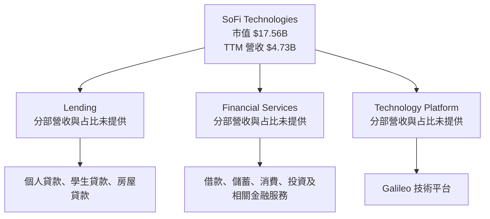
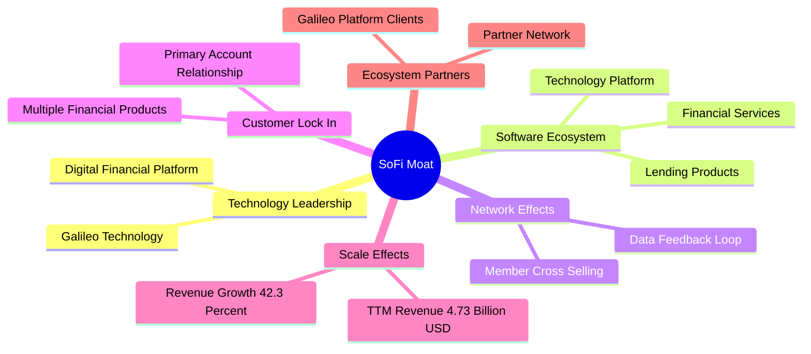
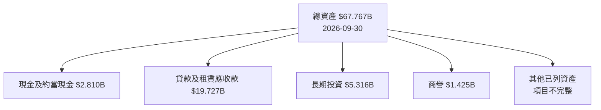
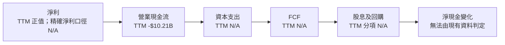
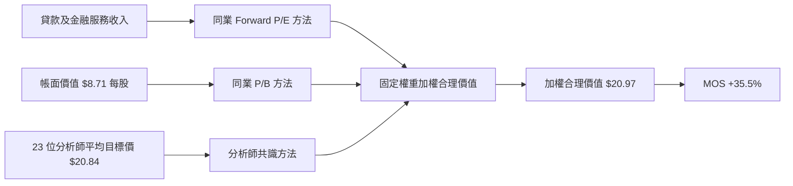
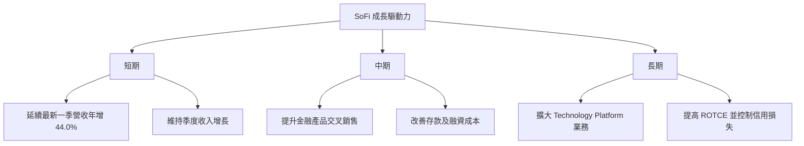
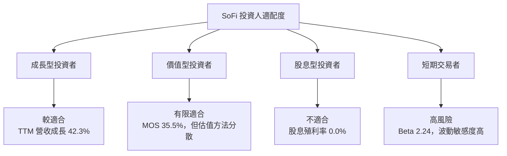

# SOFI 基本面深度分析報告
> **報告日期**：2026-11-20 ｜ **語言**：繁體中文 ｜ **數據來源**：SEC 申報資料 (XBRL)、Yahoo Finance、Finviz、StockAnalysis、Roic.ai ｜ **分析師**：CFA 級機構研究

## 目錄

| # | 章節 | 核心結論 |
|---|------|----------|
| 1 | 執行摘要 | 買入；加權合理價值 $20.97；MOS +35.5% |
| 2 | 公司概覽與商業模式 | 綜合金融服務平台；護城河有生態整合優勢，但分部收入及市場份額資料未提供 |
| 3 | 損益表深度分析 | TTM 營收 $4.73B，TTM 年增 42.3%；單季年增 44.0% |
| 4 | 資產負債表分析 | 現金及短期投資 $2.81B；計息債務總額資料未提供，流動性需按金融機構特性解讀 |
| 5 | 現金流量深度分析 | TTM 營業現金流 -$10.21B；TTM Capex 與 FCF 無法確認，貸款業務現金流不宜直接視為企業自由現金流 |
| 6 | 獲利能力與資本效率 | ROE 6.5%；放款機構應以 ROTCE、淨息差代理值等衡量，ROIC 比較不適用 |
| 7 | 相對估值分析 | 同業估值差異大；固定方法加權合理價值 $20.97 |
| 8 | DCF 內在價值評估 | DCF 不適用於金融機構，依資料不建立 DCF；以同業倍數、帳面價值及分析師共識三角驗證 |
| 9 | 成長催化劑 | TTM 營收年增 42.3%；可引用 TAM 數字與具體催化日期未提供 |
| 10 | 風險矩陣 | 信貸週期、融資成本及貸款資產品質為主要風險；逾放與沖銷數據未提供 |
| 11 | 投資建議 | 買入；合理買入區間 $13.53–$18.87，須追蹤成長、信貸品質及融資成本 |

---

## 1. 執行摘要

SOFI 2026-11-19 收盤價為 **$13.53**。SEC 10-Q 至 2026-09-30 的 TTM 營收為 **$4.73B**，較前一 TTM 增長 **42.3%**；最新一季營收年增 **44.0%**，反映金融服務與放款相關業務仍在擴張。金融類估值方法加權後的合理價值為 **$20.97**，安全邊際（MOS）為 **+35.5%**，隱含上行空間為 **+55.0%**。然而，TTM 營業現金流為 **-$10.21B**，而 TTM Capex 與依統一口徑計算的 FCF 均不可得；對貸款機構而言，貸款資產與存款變化會扭曲營業現金流，這項現金流不應直接解讀成一般公司的自由現金流。依規則 20，評級為**買入**；ROIC 不適用於貸款機構的標準判斷，因此不因 ROIC 假設調升為強烈買入。

### 1.0 一頁式投資儀表板

| 項目 | 內容 |
|------|------|
| **投資論點（3 句）** | ① TTM 營收 **$4.73B**、年增 **42.3%**，成長動能仍在。② 最新一季營收年增 **44.0%**，但同一季度 QoQ 增長約 **13.9%**，需觀察能否維持。③ 同業 Forward P/E 方法估值 **$9.98**，低於現價，而同業 P/B 方法估值 **$34.74**，顯示合理價值高度受帳面價值與估值方法影響。 |
| **綜合評分** | **6.2/10**（引用 1.1；六項平均） |
| **財務健康** | 🟡 現金及短期投資 **$2.81B**，但計息債務、逾放比、淨沖銷率與 CET1 資料未提供。 |
| **ROIC vs WACC** | ROIC：N/A（貸款機構不適用一般 ROIC 分析）；WACC **14.00%**。不能據此判定銀行式資本報酬是否高於資金成本。 |
| **FCF 趨勢** | TTM FCF：N/A；TTM 營業現金流 **-$10.21B**。FCF Yield：N/A。貸款機構營業現金流受放款與融資活動影響，不能直接等同可分配現金。 |
| **估值** | Forward P/E **15.04x**（Yahoo Finance 合併估值資料）；EV/EBITDA **N/A**；FCF Yield **N/A**。 |
| **DCF 內在價值（基準）** | N/A（金融機構的資金流與貸款資產形成過程使一般 DCF 不適用）；DCF 折溢價不適用。 |
| **安全邊際（MOS）** | **+35.5%**＝($20.97 − $13.53) ÷ $20.97；基準為 8.8 加權合理價值。🟢 >25% 充足。 |
| **預期報酬（基準情境 12M）** | DCF 三情境不適用；以加權合理價值計算的隱含上行空間 **+55.0%**，不等同保證的 12 個月報酬。 |
| **關鍵風險（前二）** | 信貸週期轉弱導致放款損失上升；存款與融資成本變化壓縮利差。逾放及沖銷指標未提供。 |
| **評級 + 信心度** | 🟢 **買入** ｜ 信心：中低（估值方法結果分散，信貸品質與資本監管指標缺漏）。 |

### 1.1 綜合評分卡

| 維度 | 評分（1–10） | 主要依據（引用數字與其來源章節） |
|------|--------------|----------------------------------|
| 成長性 | 8.0 | TTM 營收年增 **42.3%**、最新一季年增 **44.0%**（第 3 章）；成長高但放款週期敏感。 |
| 獲利能力 | 6.0 | TTM ROE **6.5%**；金融業 ROTCE **7.9%**，淨利差代理值 **5.36%**（第 6 章）；ROIC 不適用。 |
| 財務健康 | 5.0 | 現金及短期投資 **$2.81B**，但計息負債、逾放比、淨沖銷率與 CET1 未提供（第 4、6 章）。 |
| 估值 | 7.0 | MOS **+35.5%**；但同業 Forward P/E 對應 **$9.98**、同業 P/B 對應 **$34.74**，估值分散（第 7、8 章）。 |
| 護城河 | 6.0 | 多產品金融平台與 Galileo 技術平台構成整合優勢，但分部收入、留存率與單位經濟數據未提供（第 2 章）。 |
| 管理層與資本配置 | 5.0 | 2025 年 SBC **$262.06M**，約為年度營收的 **7.3%**；股息殖利率 **0.0%**，回購資料未提供（第 3、5 章）。 |
| **綜合評分** | **6.2** | 六項算術平均：(**8.0 + 6.0 + 5.0 + 7.0 + 6.0 + 5.0**) ÷ 6 = **6.2**。 |

### 1.2 五大投資論點 + 三大核心風險

| 類型 | 項目 | 具體依據 | 信心度 |
|------|------|----------|--------|
| 🟢 **投資論點①** | 高於 40% 的營收增長 | TTM 營收 **$4.73B**、TTM 年增 **42.3%**；最新一季年增 **44.0%**，顯示收入增長並非只來自單一季度。 | 🟢 高 |
| 🟢 **投資論點②** | 收入規模持續擴大 | 年度營收由 2022 年 **$1.57B** 增至 2025 年 **$3.61B**；三年 CAGR 約 **32.0%**，規模擴大有利於分攤科技與合規成本。 | 🟢 中高 |
| 🟢 **投資論點③** | 多產品交叉銷售機會 | 公司涵蓋放款、金融服務與技術平台；若會員在借貸、存款、支付與投資產品間交叉使用，可降低單一產品獲客成本。會員留存與交叉銷售數字未提供，需後續驗證。 | 🟡 中 |
| 🟢 **投資論點④** | 現金緩衝可提供調整空間 | 現金及短期投資 **$2.81B**；但需與金融機構的存款負債、受限制現金及資本要求一併觀察，不能全部視為可自由運用現金。 | 🟡 中 |
| 🟢 **投資論點⑤** | 加權估值較現價有折價空間 | 固定估值方法的加權合理價值 **$20.97**，相對現價隱含上行 **55.0%**；估值依賴同業 P/B 方法，因此不是無條件的便宜。 | 🟡 中 |
| 🟡 **風險①** | 信貸損失與放款品質惡化 | 淨沖銷率與逾放比資料未提供；若貸款損失率上升，利息收入的增長可能被信用成本抵銷。 | 🟡 中 |
| 🔴 **風險②** | 融資成本上升、利差受壓 | 淨利息收入占總營收 **64.0%**；利率或存款競爭使資金成本上升時，盈利會受到實質影響。 | 🔴 高衝擊 |
| 🟡 **風險③** | 估值方法分散 | 同業 Forward P/E 對應每股 **$9.98**，低於現價；同業 P/B 對應 **$34.74**，高於現價，合理價值區間對方法選擇敏感。 | 🟡 中 |

### 1.3 快速統計卡片

| 指標 | 公司實際值（期間） | 同業中位數 | 狀態 |
|------|--------------------|------------|------|
| 營收成長（TTM） | **42.3%** | — | 🟢 |
| 營收成長（最新一季年增） | **44.0%** | **34.1%**（NU、HOOD、UPST 中位數） | 🟢 |
| 毛利率（TTM） | **84.2%** | **83.3%**（同業中位數） | 🟢 |
| 營業利益率（TTM） | **N/A** | — | 🟡 |
| ROIC（TTM） | **N/A（貸款機構不適用）** | — | 🟡 |
| Forward P/E | **15.04x**（Yahoo Finance 合併估值資料） | **11.1x**（NU、HOOD、UPST 中位數） | 🟡 |
| FCF Yield（TTM） | **N/A** | — | 🟡 |
| Piotroski F-Score | **N/A（不適用貸款機構）** | — | 🟡 |

### 1.4 投資結論

```text
╔══════════════════════════════════════════════════════════════════╗
║                    📊 投資結論摘要                               ║
╠══════════════════════════════════════════════════════════════════╣
║  評級：買入（依規則 20；不因 ROIC 不適用而升級）                 ║
║  價格（2026-11-19 收盤）：$13.53                                 ║
║  DCF 內在價值（基準）：N/A（金融機構 DCF 不適用）                ║
║  安全邊際 MOS：+35.5%（以加權合理價值 $20.97 為分母）            ║
║  加權合理價值（8.8）：$20.97                                     ║
║  DCF 情境價值：N/A（DCF MODEL 不適用）                            ║
║  綜合評分：6.2/10（引用 1.1）                                    ║
║  適合投資人：能承受高波動、理解消費信貸與金融科技週期的成長型投資人║
╚══════════════════════════════════════════════════════════════════╝
```

---

## 2. 公司概覽與商業模式

### 2.1 業務結構與收入來源

公司資料顯示 SoFi Technologies 在美國及部分國際市場提供放款、金融服務及技術平台服務，主要分為 Lending、Financial Services、Technology Platform 三個板塊。各分部營收與占比未提供，因此不推算收入拆分；TTM 合併營收為 **$4.73B**。



**收入結構解讀：**公司既有貸款利息與相關收入，也有金融服務與技術平台收入。現有數據無法確認各板塊收入、利潤或客戶數，因此不能量化非放款收入的占比，也不能判斷科技平台對整體盈利的具體貢獻。

### 2.2 市場份額

市場份額數據未提供，且新聞資料沒有可引用的市場規模或年份，因此不繪製市場份額圖。SoFi TTM 營收為 **$4.73B**、年增 **42.3%**；同業最新一季營收年增率方面，NU 為 **34.4%**、UPST 為 **34.1%**、HOOD 為 **11.8%**。這些公司商業模式並不完全相同，成長率比較只作相對參考，不代表市場份額比較。

### 2.3 競爭護城河分析



### 2.4 護城河強度

| 護城河項目 | 強度（強／中／弱） | 證據（引用數字或事實） | 會削弱它的情況 |
|------------|--------------------|------------------------|----------------|
| 技術與數位服務 | 中 | 公司有 Technology Platform 業務與 Galileo；該分部收入及客戶留存資料未提供。 | 競爭者複製產品、平台客戶流失、技術故障或合規成本上升。 |
| 軟體生態系統 | 中 | 借貸、儲蓄、消費及投資服務覆蓋多個金融場景；分部收入與交叉銷售率未提供。 | 產品整合未能提高客戶使用深度，或獲客成本高於產品貢獻。 |
| 網路效應 | 弱至中 | TTM 營收年增 **42.3%**，但會員成長、留存率與推薦比例未提供，無法證明強網路效應。 | 成長依賴付費獲客，而非自然推薦或資料回饋。 |
| 客戶鎖定 | 中 | 多金融產品可能形成主要帳戶關係；現有資料沒有客戶留存及多產品使用率。 | 客戶能以低成本轉換至大型銀行、券商或其他金融科技平台。 |
| 規模效應 | 中 | 2025 年營收 **$3.61B**，較 2022 年 **$1.57B** 增長；規模增加可能攤薄固定科技成本。 | 壞帳、資金成本及合規費用增長快於收入。 |
| 生態夥伴 | 中 | Galileo 是平台業務之一，但夥伴數、處理交易量及集中度資料未提供。 | 主要合作夥伴自建、轉換供應商或談判壓低價格。 |

護城河在 1.1 評為 **6.0/10**，理由是產品與平台範圍具整合潛力，但客戶留存、交叉銷售、技術平台規模與單位經濟數據不足以證明其具強網路效應或高轉換成本。

---

## 3. 損益表深度分析

### 3.1 年度收入成長趨勢（近 4 年）

下列年度收入引用年度損益表；不同資料來源的歷史年度收入存在小幅差異，以下採同一年度表列示值。三年 CAGR 以 2022 至 2025 年計算。

```text
╔══════════════════════════════════════════════════════════════════╗
║              SoFi Technologies 年度收入趨勢（FY2022-FY2025）    ║
╠══════════════════════════════════════════════════════════════════╣
║  FY2022  $1.57B  █████████░░░░░░░░░░░░░░░  基期                ║
║  FY2023  $2.11B  █████████████░░░░░░░░░░░  YoY 約 +34.4%       ║
║  FY2024  $2.61B  █████████████████░░░░░░░  YoY 約 +23.7%       ║
║  FY2025  $3.61B  ███████████████████████░  YoY 約 +38.3%       ║
╠══════════════════════════════════════════════════════════════════╣
║  2022–2025 三年 CAGR：約 +32.0%                                 ║
╚══════════════════════════════════════════════════════════════════╝
```

計算：2025 年對 2024 年成長率 = ($3.61B ÷ $2.61B) − 1 = 約 **38.3%**；三年 CAGR = ($3.61B ÷ $1.57B)^(1/3) − 1 = 約 **32.0%**。成長顯示收入基礎擴大，但貸款利息收入通常受利率與信用週期影響，不能只以營收成長推斷可持續盈利增長。

### 3.2 季度收入趨勢分析

最近四季營收以季度損益表數列示；QoQ 以當季對前季計算。最新一季 YoY 以 VERIFIED FIGURES 的單季年增率為準。

| 季度 | 營收 | QoQ 成長 | YoY 成長 | 備註 |
|------|------:|---------:|---------:|------|
| 2025 Q4 | $1.03B | — | — | 比較基期；本組資料沒有同季去年收入可計算。 |
| 2026 Q1 | $1.10B | 約 **6.8%** | — | 以季度表列值計算：$1.10B ÷ $1.03B − 1。 |
| 2026 Q2 | $1.22B | 約 **10.9%** | — | 以季度表列值計算：$1.22B ÷ $1.10B − 1。 |
| 2026 Q3 | $1.39B | 約 **13.9%** | **44.0%** | YoY 為最新一季年增率，不是 TTM 成長率。 |

季度數列顯示 QoQ 增速由約 **6.8%** 升至 **13.9%**，收入動能加快；但金融機構收入亦可能受貸款發放、利息確認與季節性影響，仍須觀察後續季度是否延續。

### 3.3 利潤率演變分析

| 利潤率指標 | FY2022 | FY2023 | FY2024 | FY2025／TTM | 趨勢 | 評估 |
|------------|--------|--------|--------|-------------|------|------|
| **毛利率** | N/A | N/A | N/A | TTM **84.2%** | 年度序列未提供，不能判定趨勢 | 🟡 |
| **營業利益率** | N/A | N/A | N/A | TTM **N/A** | TTM 口徑未提供 | 🟡 |
| **淨利率** | 約 -20.4% | 約 -14.3% | 約 18.4% | TTM **15.6%**（DuPont） | 由虧損轉正；近年 TTM 約 15% | 🟡 |

年度淨利由 2022 年 **-$320.41M**、2023 年 **-$300.74M** 轉為 2024 年 **$498.67M**、2025 年 **$481.32M**。這顯示 GAAP 盈利狀態已有改變，但 2025 年淨利低於 2024 年約 **3.5%**，因此營收擴張尚未同步轉化成逐年上升的年度淨利。各年度毛利與營業利潤率明細不完整，不能將單季或其他來源的營業利益率混作 TTM 數字。

**利潤率演變深度解析：**金融公司的毛利率定義與一般軟體公司不同，成本分類會受利息支出、信貸損失及平台業務組合影響。TTM 淨利率約 **15.6%** 的同時，放款業務仍面臨信用成本與融資成本變化；若高增長收入來自風險較高的貸款而非較低資本消耗的服務收入，表面營收成長未必帶來同等幅度的風險調整後利潤增長。

### 3.4 費用結構分析

數據沒有提供可核實的 TTM 利息費用、信用減損費用、營業費用、銷售費用及研發費用拆分，因此不繪製費用結構圓餅圖，也不以估算比例補足。可確認的年度 SBC 為 2025 年 **$262.06M**，占該年營收約 **7.3%**；薪酬稀釋應納入股東回報評估。

### 3.5 季度 EPS 趨勢與盈餘品質（Quality of Earnings）

EPS beat/miss 資料中，2025 Q4 至 2026 Q3 的 EPS 預估值及實際值均為 NaN，因此無法判斷最近四季是否超預期或不及預期。季度 EPS 實際值分別為 **$0.13、$0.12、$0.12、$0.18**（依 StockAnalysis 數列）；但缺乏一致的分析師預估值，不能把 EPS 成長當成 beat/miss 結論。

| 盈餘品質項目 | 數值／佔比 | 評估 |
|--------------|-----------|------|
| 股權薪酬 SBC / 營收 | 2025 SBC **$262.06M** ÷ 2025 營收 **$3.61B** ≈ **7.3%** | 🟡 SBC 具稀釋效果；比例不低，需以流通股數增長與股東回報一併衡量。 |
| SBC / 營業現金流 | TTM SBC 的同口徑數字未提供；2025 年 SBC **$262.06M**，年度 OCF **-$3.74B** | 🟡 不能將不同期間混算。若以 2025 年口徑，負營業現金流使該比率不適合解讀為現金覆蓋率。 |
| FCF / 淨利（現金轉換率） | TTM FCF **N/A**；2025 年報列示 FCF **-$3.99B**、淨利 **$481.32M** | 🔴 年度列示現金流與淨利方向相反，但貸款發放會使金融機構 OCF 受資產負債變動影響，不能直接當作一般企業盈餘轉現率。 |
| 一次性／非經常性損益 | N/A（明細未提供） | 🟡 無法確認單次項目是否影響最新期間盈餘。 |
| 有效稅率異常 | **8.5%**（成本資本資料所列最新年度有效稅率） | 🟡 低於一般法定稅率直覺，但缺少稅務調節表，無法確認是否由稅務利益或遞延稅項造成。 |
| 資本化支出 vs 費用化 | TTM Capex **N/A**；年度資本支出明細與 TTM 口徑不一致 | 🟡 無法判定資本化支出是否造成當期費用低估。 |

**盈餘品質結論：**SoFi 已呈現正 GAAP 淨利，但 TTM FCF、資本支出與一次性項目資料未能依一致口徑核實。2025 SBC 約占營收 **7.3%**，對每股價值有稀釋風險；因此盈利應以 GAAP 淨利、信貸成本、股數變化和 ROTCE 共同追蹤，不宜單看 EPS 或營收增長。

---

## 4. 資產負債表分析

### 4.1 資產結構分解

2026-09-30 StockAnalysis 資產負債表列示總資產 **$67.767B**、現金及約當現金 **$2.810B**、貸款及租賃應收款 **$19.727B**。因為分類項目不一定完備，以下只呈現有數據的項目，不以差額反推其他資產。



貸款及租賃應收款是資產核心的一部分，金額約為 **$19.727B**；資產質量與撥備充足性會直接影響未來淨利。可用資料未包含逾放、淨沖銷與貸款分層，故無法對信貸組合風險作充分量化判斷。

### 4.2 流動性與營運資金分析

| 指標 | 最新值 | 一年前 | 變化 | 解讀 |
|------|------:|------:|------:|------|
| 現金及短期投資 | **$2.81B** | N/A | N/A | 引用 VERIFIED FIGURES；對金融機構而言，需與存款、受限制現金和流動性監管要求一併看待。 |
| 流動比率 | **1.086**（補充市場資料） | N/A | N/A | 一般企業流動比率不完全適用於銀行型資產負債表，流動負債定義也可能與資料庫分類不同。 |
| 速動比率 | **0.428**（補充市場資料） | N/A | N/A | 不以一般製造業標準解讀；金融機構需看可用流動資產及融資穩定度。 |
| DSO／DIO／DPO／CCC | 不適用（金融業） | 不適用（金融業） | 不適用 | 貸款與存款不是一般貿易應收、存貨及應付帳款循環，故不採用營運資金天數。 |

### 4.3 債務結構分析

```text
╔══════════════════════════════════════════════════════════════════╗
║                   SoFi 債務健康診斷                              ║
╠══════════════════════════════════════════════════════════════════╣
║  現金及短期投資： $2.81B  數值已提供                             ║
║  計息總債務：     N/A     VERIFIED FIGURES 未提供                ║
║  淨現金：         $2.81B  為指定口徑；不代表銀行存款負債已扣除   ║
║  Debt/EBITDA：    N/A     EBITDA 與計息債務口徑不足              ║
║  Interest Coverage：N/A   利息保障倍數所需資料不足               ║
╠══════════════════════════════════════════════════════════════════╣
║  解讀：應以融資來源、存款穩定性、流動性與監管資本為主，不以     ║
║  一般企業淨負債比率直接推論銀行型機構的違約風險。               ║
╚══════════════════════════════════════════════════════════════════╝
```

補充資料列示 2025 年底總債務 **$1.93B**，但 VERIFIED FIGURES 對指定的最新口徑列為 **N/A**。依數據優先規則，本報告不以歷史年度債務數字替代最新總債務，也不據此計算最新淨負債。

### 4.4 股東權益趨勢

| 年度 | 股東權益 | YoY 變化 | 解讀 |
|------|---------:|---------:|------|
| 2022 | $5.53B | — | 年度資產負債表所列。 |
| 2023 | $5.55B | 約 **+0.5%** | 權益大致持平。 |
| 2024 | $6.53B | 約 **+17.7%** | 權益增加，但需拆解增資、留存盈餘與股權薪酬來源。 |
| 2025 | $10.49B | 約 **+60.7%** | 增幅顯著；未提供完整權益變動表，不能單憑增加判定為內生資本累積。 |

---

## 5. 現金流量深度分析

### 5.1 現金流量瀑布圖

TTM 營業現金流為 **-$10.21B**；TTM Capex 與按「營業現金流 − 資本支出」定義的 FCF 均為 N/A。金融機構營業現金流可因新增貸款或存款變動而大幅波動，所以以下不把負 OCF 當成一般公司營運現金枯竭的直接證據。



### 5.2 FCF 轉換率趨勢

| 期間 | FCF | 淨利 | FCF / 淨利 | 解讀 |
|------|----:|----:|-----------:|------|
| FY2022 | -$7.36B | -$320.41M | 約 **-22.96x** | 負淨利期間，比率受負分母限制，且貸款資產變動可主導 OCF。 |
| FY2023 | -$7.35B | -$300.74M | 約 **-24.44x** | 同樣不宜以一般企業現金轉換率解讀。 |
| FY2024 | -$1.28B | $498.67M | 約 **-2.56x** | 會計獲利與列示 FCF 方向相反；需看貸款發放、融資與存款變動。 |
| FY2025 | -$3.99B | $481.32M | 約 **-8.29x** | 負 FCF 不必然等同虧損，但需確認貸款增長的資金來源及風險調整後報酬。 |
| TTM 至 2026-09-30 | **N/A** | N/A | **N/A** | TTM FCF 未提供，不以其他來源自行替代。 |

上述年度 FCF 是年度現金流量表列示數字；不替代 VERIFIED FIGURES 的 TTM FCF 欄位。銀行型業務在貸款快速增長時，現金流量表的 OCF 可能因放款而呈大額負值，故更應追蹤放款回報、信用損失、存款成本與資本充足程度。

### 5.3 自由現金流趨勢

```text
╔══════════════════════════════════════════════════════════════════╗
║               自由現金流：年度列示值及最新 TTM 狀態              ║
╠══════════════════════════════════════════════════════════════════╣
║  FY2022  -$7.36B  ← 負值；金融機構貸款資產增長可能影響 OCF      ║
║  FY2023  -$7.35B  ← 負值                                        ║
║  FY2024  -$1.28B  ← 負值收窄                                    ║
║  FY2025  -$3.99B  ← 負值擴大                                    ║
║  TTM     N/A      ← TTM Capex 與 FCF 未提供                     ║
╠══════════════════════════════════════════════════════════════════╣
║  FCF Yield（TTM）：N/A；不使用其他來源的不同口徑替代。          ║
╚══════════════════════════════════════════════════════════════════╝
```

### 5.4 資本配置評估

股息殖利率 **0.0%**，2025 年現金股息支付為 **$0**；回購金額未提供，年度 SBC 為 **$262.06M**。貸款機構的資本配置重點還包括貸款成長、存款融資、監管資本與風險加權資產，但相應細項沒有完整提供，因此不繪製資本配置比例圓餅圖。

| 配置項目 | 可核實數值 | 評估 |
|----------|------------|------|
| 股息 | 殖利率 **0.0%**；2025 年現金股息 $0 | 未以股息回饋股東，資金可留用於成長與資本需求。 |
| 回購 | N/A | 回購股數及金額資料未提供。 |
| SBC | 2025 年 **$262.06M** | 薪酬成本帶來股權稀釋風險。 |
| 放款與平台投資 | 分部投資明細 N/A | 貸款增長須以風險調整後回報衡量，不能僅追求資產規模。 |

---

## 6. 獲利能力與資本效率

### 6.1 ROE / ROA / ROIC 趨勢

| 指標 | 最新值 | 歷史資料 | 評估 |
|------|-------:|----------|------|
| ROE（TTM） | **6.5%**（VERIFIED FIGURES） | 年度可比序列未提供 | 正收益但回報仍需與資本成本、信貸風險及監管資本要求一併評估。 |
| ROA（TTM） | **1.3%**（補充市場資料） | 歷史可比序列未提供 | 金融機構資產基數大，ROA 不能單獨反映股東回報。 |
| ROIC（TTM） | **N/A** | 不適用於存貸款資產負債結構 | 不以一般工業公司的 NOPAT／投入資本方法對貸款機構下結論。 |
| ROTCE（TTM） | **7.9%** | 歷史序列未提供 | 有形權益回報是更貼近金融機構的參考指標，但仍需與同業及資本成本比較。 |

行業均值資料未提供，不列行業均值比較。公司 TTM ROE 在兩處來源略有差異：VERIFIED FIGURES 的品質指標為 **6.5%**，補充市場快照為 **7.4%**；本節採固定優先口徑 **6.5%**，不混用。

### 6.2 ROIC vs WACC 分析（核心價值創造判斷）

ROIC 對放款機構不適用，不能以「ROIC − WACC」直接判定創造或摧毀股東價值。以下提供指定資本成本作為折現率參考；**WACC 14.00%** 是程式限制後採用值，並非本報告重新估算的 WACC。

```text
╔══════════════════════════════════════════════════════════════════╗
║                ROIC vs WACC：金融機構適用性說明                 ║
╠══════════════════════════════════════════════════════════════════╣
║  10 年期無風險利率：                   5.05%                    ║
║  股權風險溢酬 ERP：                    5.00%                    ║
║  原始 Beta：                           2.24                     ║
║  調整後 Beta：                         1.83                     ║
║  股權成本 Ke：                         14.19%                   ║
║  稅前債務成本：                        29.04%                   ║
║  有效稅率：                            8.5%                     ║
║  股權／債務權重：                      81.5%／18.5%              ║
║  WACC 未限制計算值：                   16.48%                   ║
║  實際採用 WACC（限制於 7%–14%）：       14.00%                   ║
║                                                                  ║
║  ROIC：N/A（貸款機構不適用一般 ROIC 分析）                       ║
║  EVA = ROIC − WACC：N/A；不能判斷是否創造或摧毀價值。           ║
║  核心替代指標：ROTCE 7.9%、淨利差代理值 5.36%。                 ║
╚══════════════════════════════════════════════════════════════════╝
```

Beta 調整方式為 **2/3 × 原始 Beta 2.24 + 1/3 × 1 = 1.83**。股權成本引用給定 CAPM 結果 **14.19%**；債務成本稅後為 **29.04% × (1 − 8.5%) = 26.57%**。以給定權重核對未限制值：

**14.19% × 81.5% + 26.57% × 18.5% = 11.56% + 4.92% = 16.48%**。

由於採用值受到 **7%–14%** 區間限制，實際使用 WACC 為 **14.00%**。這些輸入來自成本資本資料；無風險利率觀測日、ERP 推導細節與債務成本所使用的負債分母未提供，故不另推算一套 WACC。對 SOFI，應優先比較 ROTCE、信用成本、淨息差、資本充足與同業估值，而不是套用非金融公司的 ROIC 評價。

### 6.3 杜邦三因素分解

| 因素 | 數值（TTM） | 解讀 |
|------|-------------|------|
| 淨利率 | **15.6%** | 每美元收入對應的淨利潤率。 |
| 資產週轉率 | **0.07** | 金融機構持有大量貸款資產，收入相對資產週轉率低於輕資產企業。 |
| 權益乘數 | **6.00** | 槓桿是金融機構商業模式的一部分，同時放大資產與風險。 |
| **ROE** | **6.5%** | **15.6% × 0.07 × 6.00 = 6.552% ≈ 6.5%**；三者相乘的結果符合所列 ROE。 |

ROE 由淨利率、資產週轉及權益槓桿共同決定；權益乘數 **6.00** 顯示槓桿具重要影響，但淨利率 **15.6%** 與資產週轉率 **0.07** 亦共同作用，不能只將 ROE 歸因於槓桿。

### 6.4 財務體質：金融業指標

Piotroski F-Score 為 **N/A**：該指標的現金流測試不適合貸款機構，放款增長會形成營業現金流出，容易錯誤解讀銀行型業務表現。九項測試不適用，因此不列逐項通過／未通過結果。

| 金融業指標 | 數值（TTM） | 解讀 |
|------------|-------------:|------|
| 淨利息收入 NII ÷ 總營收 | **64.0%** | 利息收入是主要收入來源之一，利差及信用成本對獲利重要。 |
| 淨利差代理值 | **5.36%** | NII ÷ 平均總資產；因缺少生息資產，低於以生息資產計算的正式 NIM。 |
| 成本收入比代理值 | **80.8%** | (營收 − 稅前淨利) ÷ 營收，包含信用準備，通常高於正式效率比率。 |
| ROTCE | **7.9%** | 淨利 ÷ 有形帳面價值；比一般 ROIC 更適合金融機構，但仍需同業與風險調整比較。 |
| P/TBV | **1.89x** | 市價相對有形帳面價值；較高倍數需由可持續有形權益回報支撐。 |
| 放款淨額 ÷ 總資產 | **79.3%** | 放款集中度高，資產品質與信貸週期是核心風險。 |
| 淨沖銷率 | **N/A（數據未提供）** | 不能引用記憶中的數字替代。 |
| 逾放比 | **N/A（數據未提供）** | 不能判定非應計貸款或逾期資產趨勢。 |
| CET1 | **N/A（數據未提供）** | 不能量化監管資本緩衝。 |

---

## 7. 相對估值分析

### 7.1 同業估值比較

NU、HOOD 與 UPST 商業模式各異；NU 偏向拉丁美洲金融科技，HOOD 偏向交易平台，UPST 偏向貸款科技。比較結果應視為估值參照，不代表完全同質公司。

| 估值指標 | **SOFI** | **NU** | **HOOD** | **UPST** | SOFI 評估 |
|----------|---------:|------:|--------:|--------:|-----------|
| **Trailing P/E** | **24.2x**（歷史估值口徑） | **14.8x** | **31.6x** | **27.9x** | 🟡 位於三家同業高低之間；SOFI 不是同業最低估值。 |
| **Forward P/E** | **15.04x**（市場估值快照） | **11.1x** | **20.1x** | **5.8x** | 🟡 高於同業中位數 **11.1x**；同業預估盈餘差異大。 |
| **P/S Ratio** | **3.9x**（歷史估值口徑） | **6.3x** | **12.2x** | **1.2x** | 🟡 低於 NU、HOOD，高於 UPST；商業模式與毛利結構有差異。 |
| **EV/EBITDA** | **54.6x**（自身歷史口徑） | N/A | N/A | **25.3x** | 🟡 同業資料不足以形成穩健中位數比較。 |
| **最新一季營收年增** | **44.0%** | **34.4%** | **11.8%** | **34.1%** | 🟢 SOFI 增長快於列示三家同業。 |
| **Gross Margin TTM** | **84.2%** | **0.0%** | **91.0%** | **83.3%** | 🟡 金融公司的毛利定義差異大，跨公司比較需謹慎。 |

同業 Forward P/E 中位數由 **11.1x、20.1x、5.8x** 排序後取中位數為 **11.1x**；以估值方法提供的 SOFI forward EPS **$0.90** 計算，對應每股價值 **$9.98**。市場快照所列 SOFI Forward P/E 為 **15.04x**，與方法欄以同業中位數回推的倍數不是同一概念，不能互換。

### 7.2 歷史估值區間分析

```text
╔══════════════════════════════════════════════════════════════════╗
║                  SOFI 歷史估值區間（5 年 TTM）                  ║
╠══════════════════════════════════════════════════════════════════╣
║  P/E        區間 27.0x–67.1x │ 中位數 36.6x │ 現值 24.2x       ║
║             當前百分位：0%（低於歷史區間）                       ║
║  P/S        區間 2.6x–14.6x  │ 中位數 4.5x  │ 現值 3.9x        ║
║             當前百分位：38%                                       ║
║  EV/EBITDA  區間 19.0x–148.7x│ 中位數 65.1x │ 現值 54.6x       ║
║             當前百分位：38%                                       ║
╚══════════════════════════════════════════════════════════════════╝
```

P/E **24.2x** 低於該資料庫列示的五年歷史區間下緣 **27.0x**，百分位為 **0%**；但歷史估值區間不保證估值必然回歸中位數。P/S **3.9x** 低於中位數 **4.5x**，EV/EBITDA **54.6x** 仍屬高絕對倍數，且 EBITDA 口徑存在可比性限制。

### 7.3 情境價值（Bear / Base / Bull）

**N/A（DCF 無法計算：貸款機構的放款與融資現金流是業務資金本身，不能套用一般企業自由現金流 DCF；資料未提供可替代的三情境 DCF 模型。）**因此不提供悲觀、基準及樂觀 DCF 價格，也不自行設定情境假設。

### 7.4 相對估值隱含價格區間

```text
╔══════════════════════════════════════════════════════════════════╗
║                 相對估值法回推每股價值                           ║
╠══════════════════════════════════════════════════════════════════╣
║  $9.98 ─────────── $13.53 ─────────────── $20.84 ───── $34.74   ║
║ 同業 Forward P/E    現價       分析師共識目標價   同業 P/B       ║
║  同業 P/E 權重 50%             共識權重 10%       P/B 權重 40%  ║
╚══════════════════════════════════════════════════════════════════╝
```

| 方法 | 每股價值 | 依據 |
|------|---------:|------|
| 同業 Forward P/E | **$9.98** | NU、HOOD、UPST 同業 Forward P/E 中位數 **11.1x** × SOFI Forward EPS **$0.90**。 |
| 同業 P/B | **$34.74** | 同業 P/B 中位數 **4.0x** × SOFI 每股帳面價值 **$8.71**。 |
| 分析師共識目標價 | **$20.84** | 23 位分析師平均目標價。 |

P/E 估值低於現價，P/B 估值顯著高於現價，代表估值對盈利預期、資產帳面值與有形資本的判讀差異很大；加權合理價值依第 8.8 節固定權重計算，不以單一方法取代。

---

## 8. DCF 內在價值評估（Discounted Cash Flow）

> **方法適用性結論：**程式計算指定 DCF MODEL 為 N/A，原因是金融機構的資金流是貸款及融資業務的一部分，不宜以一般公司 FCFF 作為自由現金流估值基礎。本章 8.1–8.7 不自行建立 DCF、不提供 DCF 內在價值、敏感度矩陣、三情境或反推 DCF；以第 8.8 節提供的固定估值方法作三角驗證。

### 8.0 估值推理鏈（Thinking Logic）

**Step 1 — 價值來源與主導變數**

SoFi 的股東價值主要由貸款風險調整後收益、金融服務及技術平台的可持續獲利能力，以及帳面／有形帳面資本的回報決定。已知淨利息收入占總營收 **64.0%**，而貸款淨額占總資產 **79.3%**，因此目前估值最受貸款資產品質、融資成本與 ROTCE 影響；兩個非放款分部的營收占比未提供，不能量化其增長選擇權價值。

**Step 2 — 模型選擇**

| 決策點 | 本報告採用 | 理由（含數字） | 曾考慮但否決 | 否決理由 |
|--------|-----------|----------------|--------------|----------|
| 現金流定義 | DCF 不適用 | TTM 營業現金流 **-$10.21B**，且貸款與融資流量本身屬業務資金循環。 | FCFF／FCFE | 會把放款或存款變動錯當一般資本支出／營運資金，且 DCF MODEL 明示 N/A。 |
| 預測期 N | N/A | 沒有 DCF 預測模型。 | 5–10 年 | 自行設定會違反固定模型數據要求。 |
| 終值方法 | N/A | 無可用 DCF 終值。 | Gordon Growth／退出倍數 | 不可為金融機構自行建立 DCF 終值。 |
| EBIT 基礎 | N/A | DCF 不建立。 | GAAP／非 GAAP | 模型不存在，不選擇 EBIT 口徑。 |

**Step 3 — 假設推導鏈**

營收 CAGR、期末營業利潤率、永續成長率、Capex、D&A、營運資金、SBC 與股數稀釋假設均不適用；若自行填入會構成另建模型。估值採用第 7.4、8.8 節固定的同業 P/E、同業 P/B 與分析師共識方法。

**Step 4 — 最脆弱的一環**

最脆弱處是同業 P/B 對有形帳面價值適用性與 ROTCE 的可持續性；SOFI P/TBV 為 **1.89x**、ROTCE 為 **7.9%**，若未來資產品質惡化或資金成本上升，帳面價值估值可能低於同業中位數 P/B 所暗示的水平。

**Step 5 — 計算路徑圖**



### 8.1 模型假設總表（Model Inputs）

DCF MODEL 為 N/A，故不列預測期、營收 CAGR、營業利潤率、稅率、Capex、D&A、營運資金、SBC、稀釋率、永續成長率或終值等假設。自行填入任何模型參數都會違反不得另建 DCF 的要求。

### 8.2 折現率推導（WACC）

本報告不以 WACC 折現一般公司 DCF；但為與第 6.2 節一致，列示提供的資本成本輸入。原始 Beta **2.24**，調整後 Beta **1.83**，調整公式為 **2/3 × 2.24 + 1/3 × 1 = 1.83**。

```text
╔══════════════════════════════════════════════════════════════════╗
║                    WACC 推導（折現率）                           ║
╠══════════════════════════════════════════════════════════════════╣
║  無風險利率 Rf（10Y 美債）：         5.05%                      ║
║  市場風險溢酬 ERP：                  5.00%                      ║
║  原始 Beta：                         2.24                       ║
║  調整後 Beta：                       1.83                       ║
║  股權成本 Ke（來源值）：             14.19%                     ║
║  稅前債務成本（來源值）：            29.04%                     ║
║  有效稅率：                          8.5%                       ║
║  股權／債務權重：                    81.5%／18.5%                ║
║  未限制 WACC（來源計算值）：         16.48%                     ║
║  限制區間：                          7%–14%                     ║
║  採用 WACC：                         14.00%                     ║
╚══════════════════════════════════════════════════════════════════╝
```

1. **Ke（CAPM）**：來源值為 **14.19%**；以顯示至兩位小數的輸入計算，5.05% + 1.83 × 5.00% = 14.20%，與來源 14.19% 的微小差異來自原始未四捨五入輸入。  
2. **稅前 Kd**：來源直接列示 **29.04%**；利息費用及平均計息負債分母未提供，不能另行反推。  
3. **稅後 Kd**：29.04% × (1 − 8.5%) = **26.57%**。  
4. **權重**：股權 **81.5%**、債務 **18.5%**；兩者合計 **100.0%**。市值與債務的原始分子資料未完整提供，因此引用計算區塊權重，不自行重建分母。  
5. **未限制 WACC**：14.19% × 81.5% + 26.57% × 18.5% = 11.56% + 4.92% = **16.48%**；按 7%–14% 限制區間採用 **14.00%**。  

這個 WACC 與第 6.2 節相同。DCF 為 N/A，故此折現率不會被用來推算 SOFI 的每股 DCF 價值。

### 8.3 逐年自由現金流預測（基準情境）

**N/A（DCF MODEL 未建立：金融機構放款現金流是資金運用本身，不適合一般 FCFF DCF；不得自行另建模型。）**

### 8.4 終值計算（Terminal Value）

**N/A（無 DCF 預測期與基準現金流，無法計算 Gordon Growth 終值或退出倍數終值。）**

### 8.5 企業價值 → 每股內在價值（Bridge）

**N/A（無 DCF 企業價值、現金與債務橋接模型，故 DCF 每股內在價值及相對現價折溢價不適用。）**

本節不計算 DCF 折溢價，也不計算 MOS。全報告 MOS 僅按 8.8 的加權合理價值計算。

### 8.6 敏感性分析（WACC × 永續成長率）

**N/A（沒有 DCF MODEL 敏感度矩陣；不自行建立 WACC × g 矩陣。）**

### 8.7 反推 DCF（Reverse DCF）

**N/A（沒有 DCF 模型可供以現價反解營收 CAGR、利潤率、永續成長率或預測期；不以猜測取代反推計算。）**

### 8.8 估值三角驗證與安全邊際

固定估值方法屬金融類公司方法，包含同業 Forward P/E、同業 P/B 與分析師共識目標價；不包含 DCF 或 EV/EBITDA 方法。

| 估值方法 | 隱含每股價值 | 上行空間（÷現價） | 權重 | 說明 |
|----------|--------------:|-------------------:|------:|------|
| 同業 Forward P/E | **$9.98** | **-26.2%** | **50%** | 同業 Forward P/E 中位數 **11.1x** × SOFI Forward EPS **$0.90**。 |
| 同業 P/B | **$34.74** | **+156.8%** | **40%** | 同業 P/B 中位數 **4.0x** × 每股帳面價值 **$8.71**。 |
| 分析師共識目標價 | **$20.84** | **+54.0%** | **10%** | 23 位分析師平均目標價。 |
| **加權合理價值** | **$20.97** | **+55.0%** | **100%** | 依固定權重計算。 |

**加權演算：**

$9.98 × 50% + $34.74 × 40% + $20.84 × 10%  
= $4.990 + $13.896 + $2.084  
= **$20.970 ≈ $20.97**。

權重合計為 **50% + 40% + 10% = 100%**。依 MOS 定義：

**MOS = ($20.97 − $13.53) ÷ $20.97 = $7.44 ÷ $20.97 = +35.5%。**

**上行空間 = ($20.97 − $13.53) ÷ $13.53 = $7.44 ÷ $13.53 = +55.0%。**

MOS 依規則 20 落在 **MOS ≥25%** 區間，但因 ROIC 不適用於貸款機構、無法確認 ROIC > WACC，故評級採**買入**而非強烈買入；未作質化上調或下調。

```text
╔══════════════════════════════════════════════════════════════════╗
║                  估值區間與安全邊際                              ║
╠══════════════════════════════════════════════════════════════════╣
║  $9.98 ─────── $13.53 ───────── [$20.97] ───────── $34.74       ║
║ 同業 Forward P/E  現價           加權合理價值       同業 P/B     ║
║                                                                  ║
║  安全邊際 MOS = ($20.97 − $13.53) ÷ $20.97 = +35.5%             ║
║  MOS 評估：🟢 >25% 充足                                        ║
║  上行空間 = ($20.97 − $13.53) ÷ $13.53 = +55.0%                 ║
║                                                                  ║
║  買入區間：$13.53–$18.87（上限為合理價值的 90%）                ║
║  合理持有區間：$18.87–$23.30（約對應 MOS -10% 至 +10% 邊界）     ║
║  減碼考慮：高於 $23.30 時，估值已超出約 10% MOS 對應區間         ║
╚══════════════════════════════════════════════════════════════════╝
```

買入區間上限計算：**$20.97 × (1 − 10%) = $18.873 ≈ $18.87**，且大於現價 **$13.53**，與買入評級一致。合理持有區間上緣按 **$20.97 ÷ (1 − 10%) = $23.30** 計算；此為以固定加權合理價值轉換的參考區間，不是 DCF 情境價。

> 🔎 **程式複算（Python，依本節各項自動重算）**
>
> 加權合理價值 = $9.98 × 50% + $34.74 × 40% + $20.84 × 10% = **$20.97**（權重合計 100%）
>
> 以價格 $13.53 計：MOS = **+35.5%**，上行空間 = **+55.0%**
>
> ✅ 與本節所寫數值一致。

### 8.9 DCF 模型的局限與失效條件

- **終值依賴度：**不適用；沒有 DCF 終值，不能聲稱某個終值占企業價值比例。
- **最脆弱的估值假設：**同業 Forward P/E 中位數 **11.1x** 是否適用，以及同業 P/B 中位數 **4.0x** 是否能由 SOFI 的 ROTCE **7.9%** 支撐。若可持續 ROTCE 低於市場預期，P/B 法價值可能下修。
- **不適用情境：**貸款發放會改變金融機構的現金流量，因此一般企業 FCFF DCF 可靠度低；宜以 P/B、P/TBV、ROTCE、信用損失與同業盈利估值為主。
- **與第 10 章風險的連結：**信用損失上升影響淨利與帳面資本；存款／批發融資成本上升影響淨利差；監管資本要求提升可能限制貸款及股東資本回報。

### 8.10 複算檢核表（Audit Trail）

| # | 檢核項目 | 檢查方式 | 結果 |
|---|----------|----------|------|
| 1 | DCF 敏感度輸入四段式推導 | DCF MODEL 為 N/A，無模型假設 | 不適用 |
| 2 | 每個 DCF 假設都有來歷 | 沒有建立 DCF 假設 | 不適用 |
| 3 | WACC 計算與限制 | 權重合計 100%；未限制值 16.48%，採用值 14.00% | ✅ |
| 4 | Kd 分母與債務權重口徑 | 利息費用與債務細項缺漏，引用提供的權重及債務成本，不重建 | ⚠️ 有限資料 |
| 5 | WACC 與第 6.2 節一致 | 兩節均採用 **14.00%** | ✅ |
| 6 | 逐年預測表年度數與 N | DCF 不適用，沒有 N | 不適用 |
| 7 | FY+1 FCFF 與 PV 算式 | DCF 不適用 | 不適用 |
| 8 | 預測期 PV 加總 | DCF 不適用 | 不適用 |
| 9 | WACC > g | 沒有 DCF 永續成長率 g | 不適用 |
| 10 | 終值基礎與折現期 | 沒有 DCF 終值 | 不適用 |
| 11 | EV 至每股價值橋接 | 沒有 DCF EV 橋接 | 不適用 |
| 12 | SBC 與股數組合 | 沒有 DCF 股數假設 | 不適用 |
| 13 | 敏感度基準格等於 8.5 | 沒有敏感度矩陣 | 不適用 |
| 14 | 矩陣有效格與 WACC > g | 沒有敏感度矩陣 | 不適用 |
| 15 | 三情境機率加總 | 沒有 DCF 三情境 | 不適用 |
| 16 | 反推 DCF 一次放開一個變數 | 無 DCF 模型可反推 | 不適用 |
| 17 | MOS、折溢價分母一致性 | MOS 使用 $20.97 加權合理價值；DCF 折溢價不計 | ✅ |
| 18 | 完整輸出至第 11 章 | 章節 1–11 均列出 | ✅ |
| 19 | 加權合理價值複算 | $4.990 + $13.896 + $2.084 = $20.970 | ✅ |
| 20 | 評級符合 MOS 規則 | MOS +35.5%；ROIC 不適用，採「買入」而非「強烈買入」 | ✅ |

---

## 9. 成長催化劑

### 9.1 催化劑時間軸

具體產品發布日期、管理層財測及季度催化事件日期未提供，因此不繪製包含推測日期的甘特圖。可追蹤的催化事件如下：

| 時間範圍 | 可追蹤催化因素 | 可核實基準 | 需確認的結果 |
|----------|----------------|-----------|-------------|
| 近期／下一次財報 | 營收增長與盈利延續 | 最新一季營收年增 **44.0%**；季度收入 **$1.39B** | 增長是否延續、淨利能否同步提高。 |
| 中期 | 金融產品交叉銷售與服務收入擴大 | TTM 營收 **$4.73B**；分部營收占比未提供 | 服務收入及非利息收入占比是否提高。 |
| 長期 | Galileo／Technology Platform 業務擴張 | 公司有技術平台業務；平台收入與客戶數未提供 | 平台收入成長、客戶留存與盈利貢獻能否量化。 |

### 9.2 TAM 市場規模分析

**N/A（TAM 數據未提供）。**可確認的公司規模為 TTM 營收 **$4.73B**、TTM 年增 **42.3%**，最新一季營收年增 **44.0%**。由於缺少可引用的市場規模、年份與公司市場份額，不能推算滲透率或市場份額。

### 9.3 成長驅動力結構圖



---

## 10. 風險矩陣

### 10.1 風險評分矩陣

財務數據沒有提供風險事件的客觀發生機率或損失幅度；依「圖表數字須有可引用數據」規則，不為象限座標虛構機率與衝擊分數。以下改用質化排序，並明確標示資料缺口。

| 優先級 | 風險 | 發生可能性 | 潛在衝擊 | 可量化資料缺口 |
|--------|------|------------|----------|--------------|
| 1 | 信貸週期轉弱、違約與沖銷升高 | 中至高 | 高 | 淨沖銷率、逾放比及貸款分層資料未提供。 |
| 2 | 融資成本上升、淨利差收窄 | 中 | 高 | NII 占營收 **64.0%**；存款成本、資金期限與利率敏感度未提供。 |
| 3 | 放款資產集中與資本要求 | 中 | 高 | 放款淨額占總資產 **79.3%**；CET1 未提供。 |
| 4 | 估值方法差異及盈利預期落差 | 中 | 中至高 | P/E 方法價值 **$9.98**、P/B 方法價值 **$34.74**，差距顯著。 |
| 5 | SBC 與股數稀釋 | 中 | 中 | 2025 年 SBC **$262.06M**，約占年度營收 **7.3%**；未提供最新 TTM SBC／股數變化完整拆解。 |

### 10.2 風險清單詳細分析

| # | 風險項目 | 發生機率 | 財務衝擊 | 風險評估 | 緩解措施 |
|---|----------|----------|----------|----------|----------|
| 1 | 🔴 **信貸品質惡化** | 中至高；非公司指引 | 高；可能同時增加撥備並壓低淨利 | 高優先級；逾放及淨沖銷數據缺漏使風險無法充分定價。 | 每季追蹤逾放、淨沖銷、逾期貸款、貸款組成及信用準備；必要時降低貸款增速。 |
| 2 | 🔴 **融資成本與利差壓縮** | 中 | 高；NII 占總營收 **64.0%** | 高優先級；資金成本變動可直接影響主要收入來源。 | 監控存款成本、存款留存、負債期限及利率敏感度；比較貸款收益率與資金成本。 |
| 3 | 🟡 **貸款集中度／資本監管限制** | 中 | 高；放款淨額占總資產 **79.3%** | 若資產增長快於資本累積，可能限制放款及股東資本回報。 | 追蹤 CET1、風險加權資產、資本緩衝與貸款成長的匹配程度。 |
| 4 | 🟡 **估值倍數收縮** | 中 | 中至高；同業估值法結果從 **$9.98** 至 **$34.74** | 合理價值對盈餘倍數與帳面價值倍數敏感。 | 以盈利、ROTCE、P/TBV 和同業估值交叉檢驗，不只依賴分析師共識。 |
| 5 | 🟡 **股權薪酬稀釋** | 中 | 中；2025 SBC 占營收約 **7.3%** | 長期股數上升會稀釋每股盈利與帳面價值。 | 追蹤年度 SBC／營收、稀釋後股數增長及回購是否抵銷稀釋。 |

---

## 11. 投資建議

### 11.1 最終評級與評分

依加權合理價值 **$20.97** 與 2026-11-19 收盤價 **$13.53** 計算，MOS 為 **+35.5%**，規則 20 的評級為**買入**；ROIC 對貸款機構不適用，無法證明 ROIC 高於 WACC，因此不提升至強烈買入。綜合評分為 **6.2/10**，六項分數依序為成長性 **8.0**、獲利能力 **6.0**、財務健康 **5.0**、估值 **7.0**、護城河 **6.0**、管理層與資本配置 **5.0**。

### 11.2 合理價值與隱含報酬率

| 估值基準 | 每股價值 | 相對現價 $13.53 | 機率／權重 | 備註 |
|----------|---------:|----------------:|------------:|------|
| 加權合理價值 | **$20.97** | **+55.0%** | 權重合計 100% | 由同業 Forward P/E、同業 P/B、分析師共識加權。 |
| 同業 Forward P/E | **$9.98** | **-26.2%** | **50%** | 11.1x × Forward EPS $0.90。 |
| 同業 P/B | **$34.74** | **+156.8%** | **40%** | 4.0x × 每股帳面價值 $8.71。 |
| 分析師共識 | **$20.84** | **+54.0%** | **10%** | 23 位分析師平均目標價。 |
| DCF 悲觀／基準／樂觀 | N/A | N/A | N/A | 金融機構 DCF 不適用，不提供自建情境價。 |

### 11.3 買入時機與觸發因素

```text
╔══════════════════════════════════════════════════════════════════╗
║                  ✅ 買入觸發因素 Checklist                      ║
╠══════════════════════════════════════════════════════════════════╣
║  目前觀察：2026-11-19 收盤 $13.53；低於加權合理價值 $20.97       ║
║                                                                  ║
║  逐步建倉條件：                                                  ║
║  ✅ 股價仍低於 $18.87（加權合理價值的 90%，約 MOS ≥10%）         ║
║  ✅ 最新一季營收年增率維持在 30% 以上（研究監控門檻）             ║
║  ✅ 財報提供逾放、淨沖銷與信用準備資料，且沒有明顯惡化           ║
║                                                                  ║
║  加碼觸發條件：                                                  ║
║  ☐ 營收增長延續，並且盈利或 ROTCE 同步改善                       ║
║  ☐ 存款及融資成本穩定，淨利差代理值不再下滑                       ║
║  ☐ 信貸指標可核實，且資本充足指標維持足夠緩衝                   ║
║                                                                  ║
║  減碼／重新評估條件：                                            ║
║  ☐ 股價高於 $23.30，且盈利與 ROTCE 未同步改善                    ║
║  ☐ 營收年增率連續兩季低於 25%（研究監控門檻）                     ║
║  ☐ 逾放或淨沖銷顯著上升，或融資成本上升侵蝕淨利差               ║
╚══════════════════════════════════════════════════════════════════╝
```

其中 **$18.87** 為 $20.97 × 90% 的計算結果；**$23.30** 為 $20.97 ÷ 90% 的計算結果。營收增長監控門檻是研究追蹤標準，不是公司財測或歷史事實。

### 11.4 投資人適配度分析



### 11.5 每季財報監控清單（Quarterly Watch List）

| 指標 | 最新基準 | 加碼觀察 | 減碼／重新評估觸發 |
|------|---------|----------|--------------------|
| 營收成長 | TTM **42.3%**；最新一季 YoY **44.0%** | 保持高於 30% 且分部收入來源更透明 | 連續兩季低於 25%（研究門檻）。 |
| 季度營收 | 最新一季 **$1.39B** | 季度營收延續增長，並非只靠貸款擴張 | 連續兩季 QoQ 下滑，需查明季節性或需求轉弱。 |
| 淨利及每股盈餘 | 最新季度淨利 **$240.99M**；EPS beat/miss 資料缺漏 | 淨利與每股盈餘同步增長，且股數稀釋受控 | 淨利下降而營收仍增，且原因不是一次性投資或季節性。 |
| 信貸品質 | 逾放比、淨沖銷率 **N/A** | 公司披露逾期、沖銷與撥備資料，指標穩定 | 信貸損失率快速上升或準備覆蓋下降。 |
| 淨利息收入／利差 | NII 占營收 **64.0%**；淨利差代理值 **5.36%** | 利差穩定，融資成本沒有侵蝕放款收益 | 淨利差代理值持續下滑，且信用損失增加。 |
| 資本與流動性 | 現金及短期投資 **$2.81B**；CET1 **N/A** | 披露監管資本與流動性緩衝 | CET1 或其他資本指標接近監管限制。 |
| SBC／股數 | 2025 SBC **$262.06M** | SBC 占收入下降且稀釋股數增長受控 | SBC 占收入上升、每股盈利增長落後於總淨利增長。 |
| 技術平台及服務收入 | 分部收入未提供 | 分部披露顯示平台收入與盈利貢獻擴大 | 平台收入停滯、客戶流失或收入高度依賴低利潤貸款。 |

### 11.6 反面論證：什麼會證明論點錯誤（What Would Change My Mind）

```text
╔══════════════════════════════════════════════════════════════════╗
║              ⚠️ 論點失效條件（Disconfirming Evidence）           ║
╠══════════════════════════════════════════════════════════════════╣
║  ☐ 最新一季營收年增率連續兩季低於 25%（研究監控門檻）            ║
║  ☐ 季度營收連續兩季 QoQ 下滑，且非季節性或比較基期所致          ║
║  ☐ 淨利息收入占比仍高，但淨利差代理值由 5.36% 持續收縮           ║
║  ☐ 逾放比或淨沖銷率明顯升高，且信用準備未同步增加               ║
║  ☐ ROTCE 由 7.9% 持續下降，且無法由短期投資或資本擴張解釋        ║
║  ☐ SBC 占營收持續高於 2025 年約 7.3%，並伴隨每股盈餘停滯         ║
║  ☐ 公司披露 CET1 或流動性指標接近監管限制                       ║
║  ☐ 股價超過 $23.30，但營收、ROTCE、資產品質均未同步改善          ║
╚══════════════════════════════════════════════════════════════════╝
```

> **免責聲明**：本報告為 AI 自動生成，僅供研究參考，不構成投資建議。投資有風險，入市需謹慎。

---

## 資料與來源

| 項目 | 內容 |
|------|------|
| 價格 | 13.53 USD，2026-11-19 收盤（Yahoo Finance 日線） |
| 財務報表 | SEC 10-Q filed 2026-11-05，最新季度 2026-09-30（FY2026 Q3） |
| 有回應的資料來源 | SEC 申報資料 (XBRL)、Yahoo Finance、Finviz、StockAnalysis、Roic.ai |
| 由程式計算 | TTM 數字、WACC、DCF 模型、估值方法與權重、加權合理價值、MOS、評級門檻、F-Score、杜邦分解、營運資金天數、綜合評分 |
| 撰寫模型 | openai / gpt-6-luna |

> 本區塊由產生報告的程式依實際取得的資料填寫，非模型撰寫。「由程式計算」的數字不是模型的估計；其餘判斷（評分、情境、策略）是模型的分析。
