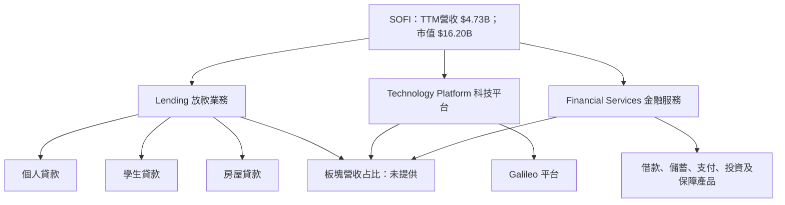
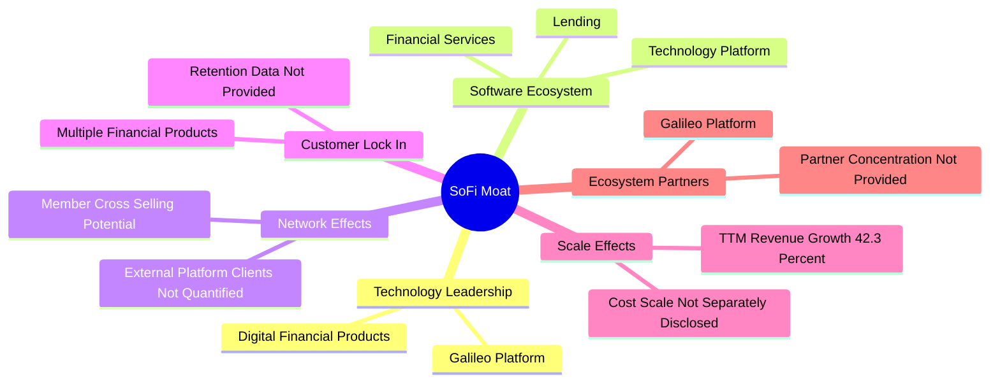
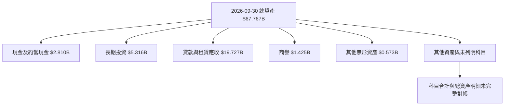
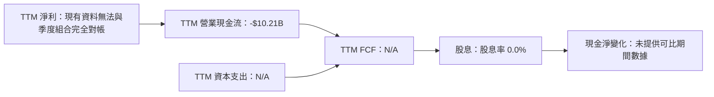
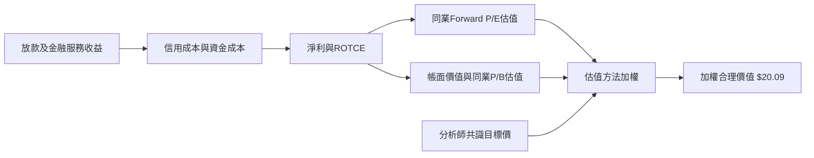
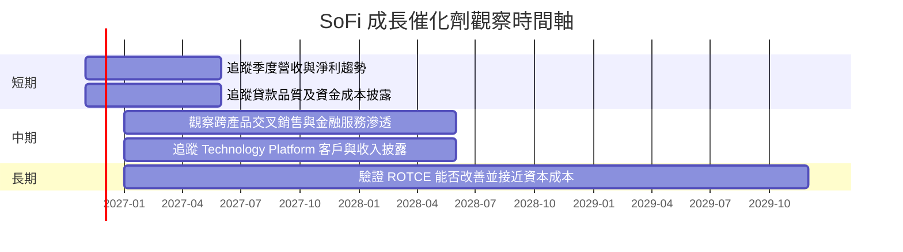
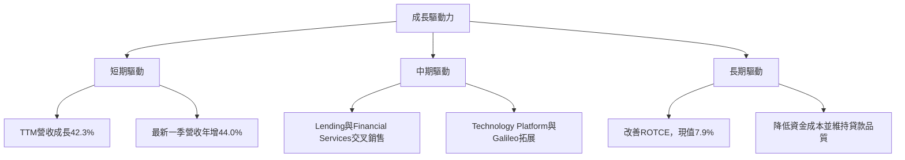
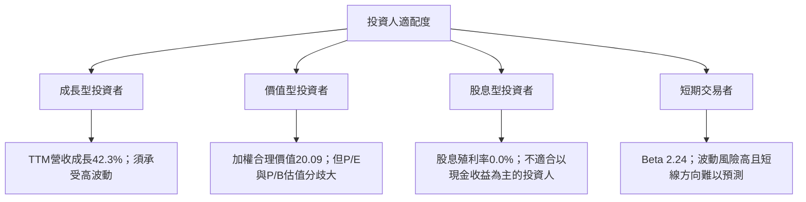

# SOFI 基本面深度分析報告
> **報告日期**：2026-11-21 ｜ **語言**：繁體中文 ｜ **數據來源**：SEC 申報資料 (XBRL)、Yahoo Finance、Finviz、StockAnalysis、Roic.ai ｜ **分析師**：CFA 級機構研究

## 目錄

| # | 章節 | 核心結論 |
|---|------|----------|
| 1 | 執行摘要 | 買入；加權合理價值 $20.09；MOS +37.9% |
| 2 | 公司概覽與商業模式 | 三個業務板塊提供交叉銷售機會，但各板塊收入占比未提供 |
| 3 | 損益表深度分析 | TTM 營收 $4.73B、年增 42.3%；現有數據不足以確認完整利潤率序列 |
| 4 | 資產負債表分析 | 現金及短期投資 $2.81B；總債務 N/A，不能可靠判定淨負債 |
| 5 | 現金流量深度分析 | TTM 營業現金流 -$10.21B；依統一口徑，TTM FCF N/A |
| 6 | 獲利能力與資本效率 | ROIC 不適用於放款機構；ROTCE 7.9%，低於 WACC 14.00% |
| 7 | 相對估值分析 | 同業 Forward P/E 法估值 $9.55，同業 P/B 法 $33.12；方法間分歧大 |
| 8 | DCF 內在價值評估 | DCF 不適用於放款機構；以同業估值與分析師共識三角驗證 |
| 9 | 成長催化劑 | 營收增長、交叉銷售與金融科技平台拓展為主要觀察方向；TAM 數字未提供 |
| 10 | 風險矩陣 | 信貸週期、融資成本及現金流解讀是前三項主要風險 |
| 11 | 投資建議 | MOS 支持買入評級；以 $18.08 作為 MOS 不低於 10% 的買入區間上限 |

---

## 1. 執行摘要

### 1.0 一頁式投資儀表板（Portfolio Manager 30 秒速讀）

| 項目 | 內容 |
|------|------|
| **投資論點（3 句）** | ① TTM 營收為 **$4.73B**、年增 **42.3%**，最新一季營收年增 **44.0%**，顯示目前業務仍有高增長。② TTM 淨利率為 **15.6%**，但 ROTCE 僅 **7.9%**，低於採用的 WACC **14.00%**，目前回報率尚未證明足以覆蓋資本成本。③ 財務類公司加權估值為 **$20.09/股**，相對 2026-11-20 收盤價 **$12.48**，MOS 為 **+37.9%**；但同業 Forward P/E 法僅支持 **$9.55/股**，估值方法差異顯著。 |
| **綜合評分** | **5.9/10**（引用 1.1 評分卡） |
| **財務健康** | 🟡 現金及短期投資 **$2.81B**；但總債務為 N/A，且 TTM 營業現金流為 **-$10.21B**，不能單憑現金餘額判定資本緩衝充足。 |
| **ROIC vs WACC** | ROIC：**N/A（放款機構不適用）**；ROTCE 代理：**7.9% vs WACC 14.00%**，方向上顯示股東資本回報尚低於資本成本，但兩者口徑不同，不等同 ROIC 判斷。 |
| **FCF 趨勢** | 依統一口徑，TTM FCF **N/A**（資本支出 N/A）；TTM 營業現金流 **-$10.21B**。FCF Yield **N/A**，不可將放款資金流出直接視為一般企業自由現金流。 |
| **估值** | Forward P/E **13.87x**（市場資料）；EV/EBITDA **N/A**；FCF Yield **N/A**。 |
| **DCF 內在價值（基準）** | **N/A**；放款機構的貸款融資與放款現金流屬營運本身，不適合以一般公司 FCFF DCF 估值；DCF 折溢價亦為 N/A。 |
| **安全邊際（MOS）** | **+37.9%**＝($20.09 加權合理價值 − $12.48 現價) ÷ $20.09；🟢 >25% 充足。 |
| **預期報酬（基準情境 12M）** | DCF 三情境 N/A；以加權合理價值作為估值參考，隱含上行空間 **+61.0%**，不是保證的 12 個月報酬預測。 |
| **關鍵風險（前二）** | ① 高成長是否伴隨信用損失上升；淨沖銷率、逾放比、CET1 均未提供。② TTM 營業現金流 **-$10.21B**，且資本支出、FCF 資料口徑有缺漏。 |
| **評級 + 信心度** | 🟢 **買入** ｜ 信心：**中低**；估值 MOS 有吸引力，但資料缺口及不同估值法的巨大落差降低信心。 |

### 1.1 綜合評分卡（全報告唯一）

| 維度 | 評分（1–10） | 主要依據（引用數字與其來源章節） |
|------|--------------|----------------------------------|
| 成長性 | 8.0 | TTM 營收成長 **42.3%**、最新一季年增 **44.0%**（第 3 章）；成長數據支持高分，但信貸敏感性仍需觀察。 |
| 獲利能力 | 5.0 | TTM 淨利率 **15.6%**，ROTCE **7.9%**；低於 WACC **14.00%**，且 ROIC 不適用（第 3、6 章）。 |
| 財務健康 | 5.0 | 現金及短期投資 **$2.81B**，但總債務 N/A、TTM 營業現金流 **-$10.21B**（第 4、5 章）。 |
| 估值 | 7.0 | 加權合理價值 **$20.09**，MOS **+37.9%**；然而同業 Forward P/E 估值為 **$9.55**，相對估值不一致（第 7、8 章）。 |
| 護城河 | 6.0 | 同時提供放款、金融服務及科技平台，並有跨產品交叉銷售可能；但板塊收入占比、客戶留存及平台客戶指標未提供（第 2 章）。 |
| 管理層與資本配置 | 4.5 | FY2025 SBC **$262.06M**，約為當年營收 **7.3%**；沒有可用的回購與股息支持證據，稀釋成本需持續監控（第 3、5 章）。 |
| **綜合評分** | **5.9** | 六項算術平均：(8.0 + 5.0 + 5.0 + 7.0 + 6.0 + 4.5) ÷ 6 = **5.9**。 |

### 1.2 五大投資論點 + 三大核心風險

| 類型 | 項目 | 具體依據 | 信心度 |
|------|------|----------|--------|
| 🟢 **投資論點①** | 營收仍處於快速增長階段 | TTM 營收 **$4.73B**，TTM 年增 **42.3%**；最新一季單季年增 **44.0%**。若增長由多個業務板塊共同推動，未來有機會提升交叉銷售與固定成本攤薄。 | 🟢 高 |
| 🟢 **投資論點②** | 盈利已具規模 | TTM 淨利率 **15.6%**，TTM ROE **6.5%**；但 ROE 受資產週轉與金融機構資產負債表特性影響，不能只用淨利率推論資本效率。 | 🟡 中 |
| 🟢 **投資論點③** | 多業務平台增加產品交叉銷售機會 | 公司涵蓋 Lending、Technology Platform、Financial Services；已知貸款產品包括個人貸款、學生貸款及房貸。各板塊貢獻未披露於現有資料。 | 🟡 中 |
| 🟢 **投資論點④** | 加權估值顯示折價 | 加權合理價值 **$20.09**，現價 **$12.48**，MOS **+37.9%**、上行空間 **+61.0%**；估值高度受 P/B 方法權重與估算驅動。 | 🟡 中 |
| 🟢 **投資論點⑤** | 市場價格已大幅回落 | 24 個月月收盤價資料顯示 2025-11 為 **$29.72**，2026-11 為 **$12.48**，下跌約 **58.0%**（($29.72−$12.48)÷$29.72）；低價本身不等同低估，但提供重新評估風險報酬的起點。 | 🟡 中 |
| 🟡 **風險①** | 放款品質與信用週期風險 | 淨沖銷率、逾放比及 CET1 均為 N/A；當營收快速成長時，若貸款組合信用品質惡化，信用成本可能侵蝕淨利。 | 🔴 高衝擊 |
| 🔴 **風險②** | 現金流量指標不易解讀且偏弱 | TTM 營業現金流 **-$10.21B**，資本支出與 FCF 在統一口徑下為 N/A；放款機構放款與存款現金流屬營運資金，需以監管及貸款品質指標補足。 | 🔴 高衝擊 |
| 🟡 **風險③** | 估值方法分歧大 | 同業 Forward P/E 法估值 **$9.55**，低於現價 **$12.48**；同業 P/B 法估值 **$33.12**，遠高於現價。加權值依賴方法權重，不能視為單一確定價值。 | 🟡 中高 |

### 1.3 快速統計卡片

| 指標 | 公司實際值（期間） | 同業中位數 | 狀態 |
|------|--------------------|------------|------|
| 營收成長（TTM） | **42.3%** | — | 🟢 |
| 營收成長（最新一季年增） | **44.0%** | **34.1%**（NU、HOOD、UPST 最新一季年增中位數） | 🟢 |
| 毛利率（TTM） | **84.2%**（Yahoo Finance／Finviz 彙整資料） | **83.3%**（NU、HOOD、UPST 中位數） | 🟢 |
| 營業利益率（TTM） | **N/A** | — | 🟡 |
| ROIC（TTM） | **N/A（放款機構不適用）** | — | 🟡 |
| Forward P/E | **13.87x**（市場估值資料） | **10.6x**（同業 Forward P/E 中位數） | 🟡 |
| FCF Yield（TTM） | **N/A** | — | 🟡 |
| Piotroski F-Score | **N/A（不適用放款機構）** | — | 🟡 |

### 1.4 投資結論

```
╔══════════════════════════════════════════════════════════════════╗
║                    📊 投資結論摘要                               ║
╠══════════════════════════════════════════════════════════════════╣
║  評級：買入（MOS +37.9%，依規則 20）                             ║
║  價格（2026-11-20 收盤）：$12.48                                 ║
║  DCF 內在價值（基準）：N/A（放款機構 DCF 不適用）                ║
║  安全邊際 MOS：+37.9%（＝($20.09−$12.48)÷$20.09）               ║
║  加權合理價值（8.8）：$20.09                                     ║
║  綜合評分：5.9/10（引用 1.1）                                    ║
║  適合投資人：能承受金融股與高 Beta 波動、採分批布局的成長型投資人 ║
╚══════════════════════════════════════════════════════════════════╝
```

評級依 MOS 門檻為「買入」，**未作一級調整**。主要支持是加權合理價值 $20.09、MOS +37.9%；主要保留是同業 Forward P/E 推導價 $9.55 低於現價，以及 ROTCE 7.9% 低於 WACC 14.00%。

---

## 2. 公司概覽與商業模式

### 2.1 業務結構與收入來源

現有資料未提供三個業務板塊的營收拆分，因此不填入板塊占比或金額。公司簡介指出，SoFi Technologies 在美國、拉丁美洲、加拿大及香港提供金融服務，並透過 Lending、Technology Platform、Financial Services 三個板塊營運。



業務組合理論上可透過會員關係促進產品交叉銷售，也能藉科技平台服務外部客戶；不過各板塊收入、客戶數、活躍度及單位經濟性未提供，無法量化其對 TTM 營收 $4.73B 的個別貢獻。

### 2.2 市場份額

市場份額數據未提供，故不製作市場份額圖或推估滲透率。SoFi TTM 營收 **$4.73B**、年增 **42.3%**，高於資料所列 NU、HOOD、UPST 最新季度營收年增中位數 **34.1%**；但跨業務模式比較營收成長，不能直接等同市場份額提升。

### 2.3 競爭護城河分析



### 2.4 護城河強度

| 護城河項目 | 強度（強／中／弱） | 證據（引用數字或事實） | 會削弱它的情況 |
|------------|--------------------|------------------------|----------------|
| 技術能力 | 中 | 公司同時經營金融科技平台與金融服務；Galileo 為科技平台品牌。外部客戶數、平台交易量與留存率未提供。 | 平台客戶流失、服務中斷或同業以更低成本提供相似技術。 |
| 軟體生態系統 | 中 | Lending、Technology Platform、Financial Services 三板塊並存；TTM 營收 $4.73B。板塊營收占比未知，不能證明交叉銷售已形成高轉換率。 | 產品使用率低、會員只使用單一產品或獲客成本上升。 |
| 網路效應 | 弱至中 | 多產品平台具備會員與交易資料累積的可能；目前無會員數、活躍率或網路效應量化資料。 | 會員成長不能轉化為留存、交易量或信用風險定價優勢。 |
| 客戶鎖定 | 中 | 公司提供借款、儲蓄、支付、投資與保障產品；欠缺流失率、存款穩定性及交叉持有資料。 | 客戶容易轉換至銀行、券商或其他金融科技平台。 |
| 規模效應 | 中 | TTM 營收年增 42.3%，公司已達 $4.73B TTM 營收規模。未提供各板塊成本收入比與邊際獲客成本。 | 增長需要持續高額行銷投入、信用損失或科技維護成本抵銷規模效益。 |
| 生態夥伴 | 中 | Galileo 平台及多市場營運顯示有合作與平台服務的可能；合作方集中度及合約期限未提供。 | 主要客戶自行建置平台、合約流失或合作夥伴議價能力上升。 |

第 1.1 節護城河評分為 **6.0/10**，理由是多產品與科技平台具有結構性優勢的可能，但客戶留存、平台規模、交叉銷售與板塊營收占比均缺乏可量化證據。

---

## 3. 損益表深度分析

### 3.1 年度收入成長趨勢（近 4 年）

下表採用年度損益表列示值；收入單位為十億美元。年增率以表內已四捨五入收入計算，與來源顯示精度可能略有差異。

```
╔══════════════════════════════════════════════════════════════════╗
║              SoFi 年度收入趨勢（FY2022–FY2025）                  ║
╠══════════════════════════════════════════════════════════════════╣
║  FY2022  $1.57B  ████████░░░░░░░░░░░░░░░░  YoY：基期             ║
║  FY2023  $2.11B  ███████████░░░░░░░░░░░░░  YoY：+34.4% 🟢       ║
║  FY2024  $2.61B  ██████████████░░░░░░░░░░  YoY：+23.7% 🟢       ║
║  FY2025  $3.61B  ████████████████████░░░░  YoY：+38.3% 🟢       ║
╠══════════════════════════════════════════════════════════════════╣
║  FY2022–FY2025 三年收入 CAGR：約 +32.0%                          ║
╚══════════════════════════════════════════════════════════════════╝
```

計算：FY2025 對 FY2022 的收入 CAGR = \((3.61 ÷ 1.57)^{1/3} - 1\) = **約 32.0%**。年度收入由 $1.57B 增至 $3.61B，顯示成長並非單一年度事件；但 TTM 收入為 $4.73B、TTM 年增 42.3%，高於 FY2022–FY2025 CAGR，應持續確認增量是否來自可重複的核心業務，而非周期性放款或資產負債表擴張。

### 3.2 季度收入趨勢分析

季度收入使用 StockAnalysis 季度資料；該來源 Q3 2026 營收為 $1.370B，與其他彙整表的 $1.39B 有小幅差異。以下以同一來源序列計算 QoQ，YoY 採來源列示的單季年增率。

| 季度 | 營收 | QoQ 成長 | YoY 成長 | 備註 |
|------|------:|---------:|---------:|------|
| Q4 2025 | $1.020B | +6.7% | +40.21% | 對比 Q3 2025 $952.4M；季度收入續增。 |
| Q1 2026 | $1.091B | +7.0% | +42.48% | 對比 Q4 2025；收入年增維持在 40% 以上。 |
| Q2 2026 | $1.205B | +10.5% | +42.61% | QoQ 成長加快；仍須看板塊組合與信用風險。 |
| Q3 2026 | $1.370B | +13.7% | +43.89% | YoY 成長與官方化彙整數 **44.0%** 接近；季度資料來源存在小幅差異。 |

QoQ 算式例：Q3 2026 對 Q2 2026 = \((1.370 ÷ 1.205)-1\) = **13.7%**。季度營收連續成長，有利於收入規模擴大；但金融機構營收成長需與放款品質、資金成本和淨利差一併判讀，不能只以營收加速判斷盈利質量同步改善。

### 3.3 利潤率演變分析

完整年度毛利率與營業利益率序列未提供。彙整資料列出 TTM 毛利率 **84.2%**、TTM 淨利率 **15.7%**；品質指標計算的 TTM 淨利率為 **15.6%**。因來源口徑略有差異，本報告以品質指標的 **15.6%** 作為杜邦與 ROE 分析使用值，其他利潤率則不補推。

| 利潤率指標 | FY2022 | FY2023 | FY2024 | FY2025 / TTM | 趨勢 | 評估 |
|------------|--------|--------|--------|---------------|------|------|
| **毛利率** | N/A | N/A | N/A | TTM **84.2%** | 歷史序列未提供 | 🟡 金融服務的毛利率定義與傳統製造業不同，需配合淨利息收入、信用成本解讀。 |
| **營業利益率** | N/A | N/A | N/A | TTM **N/A** | 不可計算 | 🟡 TTM 標準化口徑未提供；其他資料來源出現單季指標，不能替代 TTM。 |
| **淨利率** | 年度淨利為負 | 年度淨利為負 | 約 **19.1%** | TTM **15.6%** | FY2024 至 TTM 下降 | 🟡 FY2024 年淨利約 $498.67M、營收 $2.61B；之後 TTM 收入擴大，但淨利率略低，可能反映業務組合、資金及信用成本變化，現有資料不足以拆解。 |

**利潤率演變深度解析：** FY2024 與 FY2025 年淨利分別為 **$498.67M**、**$481.32M**，FY2025 淨利年減約 **3.5%**，而收入由 **$2.61B** 增至 **$3.61B**。這表示收入擴張沒有按相同比例轉化為淨利，可能涉及費用、信用成本、資金成本或業務組合變化；但缺少分項成本與準備金資料，不能將其歸因於單一因素。

### 3.4 費用結構分析

費用項目細分、利息支出、信用準備與分板塊成本未提供，故不繪製費用結構圓餅圖，避免用未披露比例製圖。可量化的補充數據是 FY2025 SBC **$262.06M**，占 FY2025 收入 **$3.61B** 約 **7.3%**；此項會以股權稀釋方式形成真實股東成本，即使非現金也不應忽略。

### 3.5 季度 EPS 趨勢與盈餘品質（Quality of Earnings）

EPS 估算與實際值在最近四季皆為 N/A，因此不能判定超預期或不及預期。StockAnalysis 列示的季度 EPS 實際值與淨利如下：

| 季度 | EPS 實際值 | EPS 預估 / 驚喜 | 淨利 | 判讀 |
|------|-----------:|----------------|-----:|------|
| Q4 2025 | $0.13 | N/A | $173.55M | 無預估值，不能判定 beat/miss。 |
| Q1 2026 | $0.12 | N/A | $166.73M | EPS 低於 Q4 2025；淨利亦季減。 |
| Q2 2026 | $0.12 | N/A | $156.59M | EPS持平；淨利低於 Q1。 |
| Q3 2026 | $0.18 | N/A | $240.99M | EPS 與淨利季增；無預估值，不能判定超預期。 |

| 盈餘品質項目 | 數值/佔比 | 評估 |
|--------------|-----------|------|
| 股權薪酬 SBC / 營收 | 約 **6.1%**（季度 SBC 合計 $288.33M ÷ TTM 收入 $4.73B） | 🟡 SBC 是股東經濟成本；以最新四季列示 SBC 合計計算，比例不可忽略。季度表與年度口徑可能存在資料庫期間差異。 |
| SBC / 營業現金流 | **-2.8%**（$288.33M ÷ -$10.21B） | 🔴 分母為負，負比例不代表 SBC 負擔低；應解讀為營業現金流絕對值遠高於 SBC，但該流量對放款機構會受貸款資金變動扭曲。 |
| FCF / 淨利（現金轉換率） | N/A | 🟡 TTM FCF 按統一口徑為 N/A，不能以其他來源的 FCF 數字替代。 |
| 一次性/非經常性損益 | N/A（明細未提供） | 🟡 無法判斷是否有一次性項目推升當期盈餘。 |
| 有效稅率異常 | **8.5%**（最新年度有效稅率） | 🟡 稅率低於一般成熟企業常見水準的可能性存在，但沒有稅務明細，不能判定是否由一次性稅務利益主導。 |
| 資本化支出 vs 費用化 | TTM Capex N/A；年度 Capex 資料不等同於放款資產投資 | 🟡 缺乏資本化政策與資本化開發成本明細，無法判斷是否遞延成本。 |

**盈餘品質結論：** TTM 淨利率 **15.6%** 顯示公司已能報告實質淨利，但 SBC 約占 TTM 收入 **6.1%**，會稀釋每股經濟利益；TTM 營業現金流為 **-$10.21B**，然而對放款機構現金流會包含放款與資金來源變化，不能直接以一般企業「淨利轉現金」標準定性。綜合而言，盈利存在，但需更多信貸成本、資金成本、稀釋股數及非經常項目資料，才能提高對盈利含金量的信心。

---

## 4. 資產負債表分析

### 4.1 資產結構分解

StockAnalysis 列示 2026-09-30 總資產 **$67.767B**，但其明細與其他來源的放款資產占比指標無法在現有資料中完全核對；故只呈現已披露的科目，不將缺漏項目按比例補齊。



品質指標顯示放款淨額占總資產 **79.3%**，但與另一來源的貸款與租賃應收金額不能直接對帳，故不反推任何缺失資產數值。

### 4.2 流動性與營運資金分析

| 指標 | 最新數值 | 歷史趨勢 | 解讀 |
|------|----------|----------|------|
| 現金及短期投資 | **$2.81B** | FY2025 現金等價物來源列示 $4.929B，但口徑不同 | 可作為資金緩衝的一部分；不能替代對存款穩定性、融資來源與監管資本的分析。 |
| 總債務 | **N/A** | 不能依其他資料來源或反推值補上 | 無法用統一來源判定總債務及淨負債。 |
| 流動比率 | **1.086x**（彙整資料） | 歷史序列未提供 | 一般企業流動比率對銀行與放款機構解讀有限，不宜單獨視為流動性充分。 |
| 速動比率 | **0.428x**（彙整資料） | 歷史序列未提供 | 金融機構資產負債表不適合直接套用傳統速動比率門檻。 |

**營運資金天數：** 金融業不適用一般 DSO／DIO／DPO／CCC 分析；品質指標未提供此組天數，因此不填表、不用放款或存款數據推算。

### 4.3 債務結構分析

```
╔══════════════════════════════════════════════════════════════════╗
║                   SoFi 債務健康診斷                              ║
╠══════════════════════════════════════════════════════════════════╣
║  總債務：        N/A        無法依統一口徑判定                   ║
║  現金+短期投資： $2.81B     最新品質指標                         ║
║  淨現金／淨負債：N/A        總債務缺漏，不以現金推定淨現金       ║
║                                                                  ║
║  Debt/EBITDA：   N/A        總債務與 TTM EBITDA 不適用/缺漏       ║
║  利息保障倍數：  N/A        利息費用及標準化 EBIT 未提供          ║
║  評估：🟡 現金規模可觀，但債務、存款與監管資本資料不足            ║
╚══════════════════════════════════════════════════════════════════╝
```

其他彙整來源曾列不同期間的借款資料，但與統一財務指標中的「總債務 N/A」不一致。本報告不混用不同期間與口徑，避免把金融機構的存款、融資及借款簡化為一般公司債務率。

### 4.4 股東權益趨勢

| 年度 | 股東權益 | 年增變化 | 解讀 |
|------|---------:|---------:|------|
| 2022 | $5.53B | — | 歷史基期。 |
| 2023 | $5.55B | 約 +0.4% | 權益大致持平。 |
| 2024 | $6.53B | 約 +17.7% | 權益規模增加；具體來源需對照增資、留存盈餘及其他綜合損益。 |
| 2025 | $10.49B | 約 +60.8% | 增幅明顯；僅有年度餘額，無法拆分增資、留存與其他項目。 |

```
╔══════════════════════════════════════════════════════════════════╗
║                   SoFi 股東權益變化                              ║
╠══════════════════════════════════════════════════════════════════╣
║  FY2022  $5.53B   ███████████░░░░░░░░░                           ║
║  FY2023  $5.55B   ███████████░░░░░░░░░                           ║
║  FY2024  $6.53B   █████████████░░░░░░░                           ║
║  FY2025  $10.49B  ████████████████████                           ║
╚══════════════════════════════════════════════════════════════════╝
```

---

## 5. 現金流量深度分析

### 5.1 現金流量瀑布圖

TTM 營業現金流為 **-$10.21B**；統一口徑資本支出為 N/A，因此 TTM FCF 亦為 N/A。放款資金流動會造成營業現金流大幅變動，不能以此直接推導企業現金獲利能力。



### 5.2 FCF 轉換率趨勢

| 期間 | FCF | 淨利 | FCF / 淨利 | 判讀 |
|------|-----:|-----:|-----------:|------|
| TTM 至 2026-09-30 | N/A | N/A（同口徑 TTM 淨利未在核定數據中提供） | N/A | 放款機構的現金流受放款活動影響，需配合資產負債表及信用數據判讀。 |
| FY2025 | 年度來源列示 -$3.99B | $481.32M | 不採用計算 | 年度 FCF 與 TTM 統一定義及口徑不同；本報告不拿它取代 TTM FCF。 |
| FY2024 | 年度來源列示 -$1.28B | $498.67M | 不採用計算 | 現金流量表可能反映放款資金運用，不宜與非金融企業同樣解讀。 |

### 5.3 自由現金流趨勢

```
╔══════════════════════════════════════════════════════════════════╗
║            自由現金流：依統一 TTM 定義                           ║
╠══════════════════════════════════════════════════════════════════╣
║  TTM 營業現金流       -$10.21B                                     ║
║  TTM 資本支出          N/A                                         ║
║  TTM FCF               N/A                                         ║
║  TTM FCF Yield         N/A                                         ║
╠══════════════════════════════════════════════════════════════════╣
║  判讀：放款機構現金流包含放款資金變化；不把負 OCF 直接等同         ║
║        經濟性自由現金流為負，也不以其他口徑替代核定 TTM FCF。      ║
╚══════════════════════════════════════════════════════════════════╝
```

### 5.4 資本配置評估

可量化的 FY2025 SBC 為 **$262.06M**，FY2025 現金股息支付為 **$0**；回購金額、收購、留存現金用途及貸款組合增長的資金分配未提供，因此不繪製資本配置圓餅圖。

| 資本配置項目 | 已知數值 | 評估 |
|--------------|---------:|------|
| 現金股息 | FY2025 **$0**；股息殖利率 **0.0%** | 資本回報主要不依賴現金股息。 |
| SBC | FY2025 **$262.06M** | 需納入股東稀釋成本評估。 |
| 資本支出 | TTM N/A；FY2025 年度資料來源列示 $251.12M | 年度資本支出不能替代 TTM 核定欄位。 |
| 股票回購 | N/A | 無足夠數據判斷是否有回購或淨股數抵銷 SBC。 |
| 投資／放款資金配置 | 分項 N/A | 對金融機構是核心資本配置，但缺少放款回報、信用損失與資本充足資料。 |

---

## 6. 獲利能力與資本效率

### 6.1 ROE / ROA / ROIC 趨勢

| 指標 | 最新數值 | 歷史數據 | 評估 |
|------|---------:|----------|------|
| ROE（TTM） | **6.5%** | 完整同口徑歷史序列 N/A | 正值但不高；金融機構須配合資產品質和資本結構解讀。 |
| ROA（彙整資料） | **1.3%** | 歷史序列 N/A | 可作為獲利相對資產規模的參考，但與品質指標 ROE 口徑不同。 |
| ROIC | **N/A** | 不適用於以放款與金融負債為核心的營運模式 | 傳統投入資本與營業資本定義不適合直接套用。 |
| ROTCE | **7.9%** | 歷史序列 N/A | 有形普通股權益報酬率低於 WACC 14.00%，顯示股東資本回報仍有提升空間。 |

行業均值未提供，不作同業 ROE／ROA 均值比較。

### 6.2 ROIC vs WACC 分析（核心價值創造判斷）

放款機構的利息收入、貸款資產與存款／融資負債屬日常營運核心，因此傳統 ROIC 不適用。本節以 ROTCE 作為較貼近金融機構股東回報的參考，但 ROTCE 與公司 WACC 的資本成本比較僅具方向性，不是嚴格同口徑 EVA 測算。

```
╔══════════════════════════════════════════════════════════════════╗
║                資本回報代理值 vs WACC 深度分析                   ║
╠══════════════════════════════════════════════════════════════════╣
║  WACC 估算：                                                     ║
║  ├── 無風險利率（10Y美債）：  4.91%                              ║
║  ├── 市場風險溢酬（ERP）：    5.00%                              ║
║  ├── 原始 Beta：              2.24                               ║
║  ├── 調整後 Beta：            1.83                               ║
║  ├── 股權成本：               14.05%                            ║
║  ├── 稅前債務成本：           29.04%                            ║
║  ├── 股權 / 債務權重：        80.3% / 19.7%                     ║
║  └── 採用 WACC：              14.00%（計算值 16.52%，受上限限制）║
║                                                                  ║
║  放款機構回報代理值：                                            ║
║  ├── ROTCE：                  7.9%                               ║
║  ├── ROIC：                   N/A（放款機構不適用）               ║
║  └── ROTCE − WACC：           7.9% − 14.00% = -6.1 個百分點      ║
║                                                                  ║
║  方向性判讀：ROTCE 低於 WACC，股東資本回報尚未覆蓋資本成本       ║
╚══════════════════════════════════════════════════════════════════╝
```

WACC 採用核定值 **14.00%**；其未受限計算值為 **16.52%**，但依設定限制於 **7%–14%** 區間而採上限 14.00%。公司 ROTCE **7.9%** 低於採用 WACC **14.00%**，差距 **-6.1 個百分點**。由於 ROTCE 與 WACC 的資本及風險口徑不完全相同，只能作警示性比較；不能因此宣稱精確的經濟附加價值為負。

### 6.3 杜邦三因素分解

| 因素 | 數值（TTM） | 解讀 |
|------|-------------|------|
| 淨利率 | **15.6%** | 對金融公司而言，利息與信用損失會影響收入及成本結構。 |
| 資產週轉率 | **0.07x** | 金融機構持有大量貸款及金融資產，資產週轉率低於一般輕資產企業並不意外。 |
| 權益乘數 | **6.00x** | 槓桿對資產規模及 ROE 有明顯影響，需配合監管資本資料判讀。 |
| **ROE** | **6.5%** | **15.6% × 0.07 × 6.00 = 約 6.5%**；計算採用來源提供數值，尾差來自四捨五入。 |

ROE 並非由高資產週轉率驅動；權益乘數 **6.00x** 顯示槓桿是金融機構資本結構的重要因素。是否屬過度槓桿，需 CET1 與其他監管資本指標，現有數據未提供。

### 6.4 財務體質：Piotroski F-Score 與放款指標

Piotroski F-Score 為 **N/A**，原因是該分數未套用於放款機構：貸款增長會造成營業現金流流出，使傳統現金流測試對銀行／放款機構產生誤判。九項個別測試結果因此均不適用，不列出空白測試表。

金融機構相關指標如下：

| 指標 | 數值 | 解讀 |
|------|-----:|------|
| 淨利息收入 NII / 總營收 | **64.0%** | 收入中淨利息收入占主要比重，顯示利率環境與資金成本對收益重要。 |
| 淨利差代理值 NII / 平均總資產 | **5.36%** | 這是代理值；分母為平均總資產而非生息資產，故通常低於公司報告的正式 NIM。 |
| 成本收入比代理值 | **80.8%** | 以（營收 − 稅前淨利）÷ 營收計算，包含信用準備，因此高於公司正式效率比率的可能性較大。 |
| ROTCE | **7.9%** | 淨利 ÷ 有形帳面價值，衡量普通股有形權益報酬。 |
| P/TBV | **1.74x** | 市場價格相對有形帳面價值的倍數；高於 1 倍代表市場計入未來盈利或成長期待。 |
| 放款淨額 / 總資產 | **79.3%** | 資產高度與放款相關，貸款品質對資產風險與收益至關重要。 |
| 淨沖銷率 | **N/A（數據未提供）** | 不引用記憶或外部未核對數值。 |
| 逾放比 | **N/A（數據未提供）** | 信用資產品質的重要缺口。 |
| CET1 | **N/A（數據未提供）** | 無法評估監管資本緩衝。 |

---

## 7. 相對估值分析

### 7.1 同業估值比較表格

公司估值採用市場估值資料；同業倍數採 Yahoo Finance 同業資料。公司市值倍數來源與歷史估值計算來源存在輕微差異，因此應重視估值區間與方法，而非小數點精度。

| 估值指標 | **SOFI** | **NU** | **HOOD** | **UPST** | SOFI 評估 |
|----------|---------:|-------:|--------:|--------:|-----------|
| **Trailing P/E** | **22.69x** | 14.1x | 28.6x | 25.7x | 🟡 高於 NU、低於 HOOD 與 UPST；同業業務模式與獲利周期不同。 |
| **Forward P/E** | **13.87x** | 10.6x | 18.2x | 5.3x | 🟡 高於三家同業中位數 **10.6x**；成長較快但也需承擔估值溢價。 |
| **P/S Ratio** | **3.46x** | 6.0x | 11.0x | 1.1x | 🟡 低於 NU、HOOD，高於 UPST；因商業模式與毛利口徑不同，P/S 只宜輔助。 |
| **EV/EBITDA** | **N/A** | N/A | N/A | 24.3x | 🟡 可比較樣本不足，不將 SOFI 的 N/A 補成估值。 |
| **最新一季營收年增** | **44.0%** | 34.4% | 11.8% | 34.1% | 🟢 高於三家同業；尚需信用品質與盈利成長驗證。 |
| **毛利率（TTM）** | **84.2%** | 0.0% | 91.0% | 83.3% | 🟡 NU 顯示 0.0% 可能受口徑影響；金融公司毛利率跨公司比較有限。 |

三家同業 Forward P/E 的中位數為 **10.6x**。SOFI 的 Forward P/E **13.87x** 高於同業中位數；然而估值還需考慮最新一季年增 **44.0%** 高於同業成長數據中位數 **34.1%**。這種成長溢價是否合理，取決於信用損失和 ROTCE 能否同步改善。

### 7.2 歷史估值區間分析

下列歷史估值取自價格資料與 SEC 財務資料計算；目前 P/E 百分位為歷史區間資料列示的 0%，不自行重算百分位。

```
╔══════════════════════════════════════════════════════════════════╗
║                 SOFI 五年歷史估值區間                           ║
╠══════════════════════════════════════════════════════════════════╣
║  P/E：       27.0x ├──────────────────────────────┤ 67.1x        ║
║               歷史中位數 36.6x ｜目前 22.3x ｜目前百分位 0%     ║
║  P/S：        2.6x ├──────────────────────────────┤ 14.6x        ║
║               歷史中位數 4.5x ｜目前 3.6x ｜目前百分位 29%      ║
║  EV/EBITDA： 19.0x ├─────────────────────────────┤ 148.7x       ║
║               歷史中位數 65.1x ｜目前 49.6x ｜目前百分位 33%    ║
╚══════════════════════════════════════════════════════════════════╝
```

相對自身歷史，P/E、P/S、EV/EBITDA 均低於歷史中位數；但歷史倍數區間很寬，尤其 EV/EBITDA 區間高達 **19.0x–148.7x**，表示其歷史倍數容易受盈利基期與獲利波動影響，不能單靠「低於歷史中位數」推定低估。

### 7.3 情境價值（Bear / Base / Bull）

**N/A（DCF 無法計算：放款機構的現金流屬融資與放款業務本身，不能用一般企業自由現金流 DCF 建模。）**因此不提供 DCF 情境價值、營收 CAGR 假設或情境機率。

### 7.4 相對估值隱含價格區間

```text
╔══════════════════════════════════════════════════════════════════╗
║                  相對估值每股價值比較                            ║
╠══════════════════════════════════════════════════════════════════╣
║  $9.55             $12.48                              $33.12    ║
║  同業Forward P/E ── 現價 ─────────────────────── 同業P/B法      ║
║                           $20.67 分析師共識目標價               ║
╚══════════════════════════════════════════════════════════════════╝
```

| 方法 | 每股價值 | 相對現價 | 依據 |
|------|---------:|---------:|------|
| 同業 Forward P/E | **$9.55** | **-23.5%** | 同業中位數 Forward P/E **10.6x** × SOFI Forward EPS **$0.90**；同業為 NU、HOOD、UPST。 |
| 同業 P/B | **$33.12** | **+165.4%** | 同業中位數 P/B **3.8x** × SOFI 每股帳面價值 **$8.71**。 |
| 分析師共識目標價 | **$20.67** | **+65.6%** | 23 位分析師平均目標價；分析師區間為 **$12.00–$30.00**。 |

同業 P/B 法高估值與 Forward P/E 法折價，說明市場對 SoFi 未來盈利能力與帳面價值變現能力存在重大分歧。

---

## 8. DCF 內在價值評估（Discounted Cash Flow）

### 8.0 估值推理鏈（Thinking Logic）

**Step 1 — 價值驅動來源**

SoFi 的價值主要由放款業務、金融服務及科技平台共同構成；TTM 總營收為 **$4.73B**，但各板塊收入占比未提供，因此無法把價值拆成有數字依據的分部估值。對金融機構而言，貸款資產收益、資金成本、信用損失與資本回報是核心變數；目前可用的參考包括 NII 占營收 **64.0%**、ROTCE **7.9%**、放款淨額占總資產 **79.3%**。由於放款及存款現金流是營運本身，使用一般 FCFF DCF 會把資金流誤當作可自由分配現金，故不建模。

**Step 2 — 方法選擇**

| 決策點 | 本報告採用 | 理由（含數字） | 曾考慮但否決 | 否決理由 |
|--------|-----------|----------------|--------------|----------|
| 現金流定義 | 不採一般 FCFF／FCFE DCF | TTM OCF **-$10.21B**，且放款資金是營運的一部分；TTM FCF N/A | 一般 FCFF | 對放款機構現金流定義不具可比性。 |
| 預測期 N | N/A | 不建立一般 DCF 模型 | 5–10 年 DCF | 缺乏適當 FCFF 定義及模型輸入。 |
| 終值方法 | N/A | 無一般 DCF 終值 | Gordon Growth、退出倍數 | 兩者依賴不可比的金融機構自由現金流。 |
| EBIT 基礎 | N/A | 不建立一般企業 DCF | GAAP EBIT 外推 | 財務公司 EBIT 與放款資金成本口徑不適合用一般企業方法直接估值。 |

**Step 3 — 關鍵輸入推導**

一般 DCF 的營收 CAGR、營業利潤率、稅率、Capex、D&A、營運資金變動、SBC、稀釋率、永續成長率及終值均不適用；不設定假設值，以免形成不可稽核的黑箱估值。相對估值採用程式計算的同業 Forward P/E、同業 P/B 與分析師共識，並照用固定權重。

**Step 4 — 最脆弱的一環**

最脆弱的估值環節是同業 P/B 方法給出 **$33.12/股**，但同業 Forward P/E 方法只給 **$9.55/股**；若 SoFi 的有形帳面價值無法轉化為較高 ROTCE，P/B 估值可能高估股權價值。此分歧以第 8.8 節方法值與第 10 章信用風險一併檢視。

**Step 5 — 估值路徑**



### 8.1 模型假設總表（Model Inputs）

**DCF MODEL：N/A。**放款機構的貸款現金流與資金流屬核心營運，不能以一般公司 FCFF 自由現金流定義直接建模。因此，以下一般企業 DCF 輸入均不適用，並非以假設數字補齊。

| 假設項目 | 採用值 | 依據 / 來源 | 敏感度 |
|----------|--------|-------------|--------|
| 預測期長度 N | N/A | 不建立一般 FCFF DCF | N/A |
| 營收 CAGR | N/A | 有 TTM 成長 **42.3%**，但不適用於缺乏放款機構現金流模型的 DCF | N/A |
| 營業利潤率 | N/A | TTM 營業利益率為 N/A | N/A |
| 有效稅率 | N/A（DCF 模型不使用） | 最新年度稅率 8.5%，但不補建模型 | N/A |
| Capex / 營收 | N/A | TTM 資本支出 N/A | N/A |
| D&A / 營收 | N/A | 一般 DCF 所需配套資料未形成有效模型 | N/A |
| 營運資金變動 / 營收增額 | N/A | 金融機構放款與存款資金流不宜以一般 ΔWC 假設處理 | N/A |
| EBIT 基礎 | N/A | 不建一般企業 DCF | N/A |
| SBC 處理 | N/A | 不建立 DCF 股權價值模型 | N/A |
| 年稀釋率 | N/A | 不建立預測股數模型 | N/A |
| 永續成長率 g | N/A | 無有效一般 DCF 終值 | N/A |
| 終值方法 | N/A | 不採 Gordon Growth 或退出倍數終值 | N/A |
| WACC | **14.00%** | 來源提供之採用 WACC；未受限計算值 16.52%，受 7%–14% 區間限制 | 已計算，但不作 DCF 折現 |

### 8.2 折現率推導（WACC）

WACC 由核定資本成本資料提供；以下呈現其組成與限制，不另建立第二個折現率。

```
╔══════════════════════════════════════════════════════════════════╗
║                    WACC 推導（折現率）                           ║
╠══════════════════════════════════════════════════════════════════╣
║  股權成本 Ke（CAPM）：                                           ║
║  ├── 無風險利率 Rf（10Y 美債）：      4.91%                      ║
║  ├── 市場風險溢酬 ERP：               5.00%                      ║
║  ├── 原始 Beta（Yahoo）：             2.24                       ║
║  ├── 調整後 Beta：                    1.83                       ║
║  ├── Beta 調整：                      ⅔×2.24 + ⅓×1 = 1.83       ║
║  └── Ke：                             14.05%                     ║
║                                                                  ║
║  債務成本 Kd：                                                   ║
║  ├── 稅前 Kd：                        29.04%                     ║
║  ├── 有效稅率：                       8.5%                       ║
║  └── 稅後 Kd：                        29.04%×(1−8.5%)=26.57%     ║
║                                                                  ║
║  資本結構：                                                      ║
║  ├── 股權權重 E：                     80.3%                      ║
║  ├── 債務權重 D：                     19.7%                      ║
║  ├── 未限制計算值：                   16.52%                     ║
║  └── 採用 WACC：                      14.00%（受區間上限限制）    ║
╚══════════════════════════════════════════════════════════════════╝
```

逐步演算（核定資本成本組成；不是以此另建 DCF）：

1. **Ke（CAPM）** = Rf + 調整後 β × ERP = **14.05%**（核定值；由 4.91%、1.83、5.00% 計算，來源報列 14.05%）。
2. **稅前 Kd** = **29.04%**（核定成本資料；利息費用與平均計息負債明細未提供，故不另行重算）。
3. **稅後 Kd** = 29.04% × (1 − 8.5%) = **26.5716% ≈ 26.57%**。
4. **資本權重** = 股權 **80.3%**；債務 **19.7%**；兩者相加為 **100.0%**。股權與債務市值／期末計息負債的原始金額未提供，因此不虛構美元金額。
5. **未限制 WACC** = 80.3% × 14.05% + 19.7% × 26.5716% = 11.28215% + 5.23661% = **16.51876% ≈ 16.52%**；受 7%–14% 區間限制，**採用 14.00%**。

無風險利率資料未附具體觀察日以外的日內時間；市場風險溢酬 **5.00%** 為核定假設。原始 Beta **2.24** 高於 1.5，採調整後 Beta **1.83**，調整方式為 \(⅔×2.24+⅓×1\)。未另加規模或國別溢酬。第 6.2 節與本節採用相同 WACC **14.00%**。

### 8.3 逐年自由現金流預測（基準情境）

**N/A（DCF MODEL 不適用）。**不預測 FY+1 至 FY+N 收入、EBIT、NOPAT、FCFF 或折現現值，也不以放款現金流外推一般企業自由現金流。

### 8.4 終值計算（Terminal Value）

**N/A（DCF MODEL 不適用）。**無預測期最後一年 FCFF，故不計 Gordon Growth 終值或退出倍數終值。

### 8.5 企業價值 → 每股內在價值（Bridge）

**N/A（DCF MODEL 不適用）。**無一般企業 DCF 企業價值，亦不以一般公司「現金 − 債務」橋接替代金融機構的股權估值。

- DCF 基準每股價值：**N/A**
- DCF 現價折溢價：**N/A**
- 本節不計算 MOS；MOS 依規定只使用第 8.8 節加權合理價值。

### 8.6 敏感性分析（WACC × 永續成長率）

**N/A（DCF MODEL 不適用）。**沒有可供敏感性測試的 FCFF、終值與每股 DCF 價值，因此不構造敏感度矩陣、DCF 三情境或機率加權值。

### 8.7 反推 DCF（Reverse DCF）

**N/A（DCF MODEL 不適用）。**現價不能在缺少有效放款機構 DCF 模型時反推出營收 CAGR、利潤率、永續成長率或預測期長度；不以假設模型聲稱市場隱含預期。

### 8.8 估值三角驗證與安全邊際

| 估值方法 | 隱含每股價值 | 上行空間（÷現價） | 權重 | 說明 |
|----------|--------------:|-------------------:|------:|------|
| 同業 Forward P/E | **$9.55** | **-23.5%** | **50%** | NU、HOOD、UPST 同業 Forward P/E 中位數 **10.6x** × SOFI Forward EPS **$0.90**。 |
| 同業 P/B | **$33.12** | **+165.4%** | **40%** | 同業 P/B 中位數 **3.8x** × SOFI 每股帳面價值 **$8.71**。 |
| 分析師共識目標價 | **$20.67** | **+65.6%** | **10%** | 23 位分析師平均目標價。 |
| **加權合理價值** | **$20.09** | **+61.0%** | **100%** | 金融類公司固定方法權重；不納入 DCF，因模型不適用。 |

逐步演算：

- 同業 Forward P/E 貢獻：$9.55 × 50% = **$4.775**。
- 同業 P/B 貢獻：$33.12 × 40% = **$13.248**。
- 分析師共識貢獻：$20.67 × 10% = **$2.067**。
- 加權合理價值 = $4.775 + $13.248 + $2.067 = **$20.090 ≈ $20.09**。
- 權重合計 = 50% + 40% + 10% = **100%**。
- MOS = ($20.09 − $12.48) ÷ $20.09 = $7.61 ÷ $20.09 = **37.9%**。
- 上行空間 = ($20.09 − $12.48) ÷ $12.48 = $7.61 ÷ $12.48 = **61.0%**。

估值方法與權重按金融類公司類型固定。未加入 DCF 或 EV/EBITDA 方法，因 DCF 對放款機構不適用，SOFI EV/EBITDA 及可比較同業數據不足。

```
╔══════════════════════════════════════════════════════════════════╗
║                  估值區間與安全邊際                              ║
╠══════════════════════════════════════════════════════════════════╣
║  $9.55 ───── $12.48 ───────────── [$20.09] ───────── $33.12     ║
║  Forward P/E     現價              加權合理值          P/B法      ║
║                                                                  ║
║  安全邊際 MOS = ($20.09 − $12.48) ÷ $20.09 = +37.9%             ║
║  MOS 評估：🟢 >25% 充足                                          ║
║  上行空間 = ($20.09 − $12.48) ÷ $12.48 = +61.0%                 ║
║                                                                  ║
║  建議買入區間：$9.55 – $18.08                                    ║
║  合理持有區間：$18.09 – $20.09                                   ║
║  減碼考慮區間：高於 $20.09，須檢查盈利及帳面價值是否兌現        ║
╚══════════════════════════════════════════════════════════════════╝
```

買入區間上限 **$18.08** 的計算方式為加權合理價值 × (1 − 10% MOS) = $20.09 × 90% = **$18.081 ≈ $18.08**。買入區間下限 **$9.55** 以同業 Forward P/E 法估值作參考，不代表股價必然有支撐。買入區間上限高於現價 **$12.48**，與「買入」評級一致。

> 🔎 **程式複算（Python，依本節各項自動重算）**
>
> 加權合理價值 = $9.55 × 50% + $33.12 × 40% + $20.67 × 10% = **$20.09**（權重合計 100%）
>
> 以價格 $12.48 計：MOS = **+37.9%**，上行空間 = **+61.0%**
>
> ✅ 與本節所寫數值一致。

### 8.9 DCF 模型的局限與失效條件

- **終值依賴度：**N/A，未建立 DCF，因此無終值現值占 EV 的比例。
- **最脆弱的估值假設：**P/B 法使用同業中位數 **3.8x** 得出 **$33.12/股**；若 SOFI 的 ROTCE **7.9%** 無法改善，帳面價值倍數可能不成立。相對地，同業 Forward P/E 法得出 **$9.55/股**，反映不同估值框架可產生重大落差。
- **不適用情境說明：**放款機構的資金來源、貸款發放與回收本身就是營運的一部分；一般 FCFF DCF 將現金流與資本支出視為企業可自由分配現金，容易誤估。更適合以盈利倍數、P/B、有形帳面價值、ROTCE、信用損失及監管資本進行交叉檢驗。
- **與第 10 章風險矩陣的連結：**信用惡化會壓低淨利、ROTCE 及可支持的 P/B；融資成本上升則可能侵蝕 NII 與淨利率。若這些風險發生，Forward P/E 與 P/B 推導價均可能下修。

### 8.10 複算檢核表（Audit Trail）

| # | 檢核項目 | 結果 |
|---|----------|------|
| 1 | 高／中敏感度 DCF 輸入完整推導 | N/A：未建立 DCF 模型。 |
| 2 | DCF 假設都有來源 | N/A：未填入 DCF 假設；相對估值來源已列明。 |
| 3 | WACC 五步算式與資本權重 | ✅ 權重 80.3% + 19.7% = 100.0%；未限制值 16.52%，採用值 14.00%。 |
| 4 | Kd 分母與債務權重口徑可核對 | N/A：來源未提供計息負債與平均餘額明細；照用核定 WACC 輸入，不另建 WACC。 |
| 5 | WACC 與第 6.2 節一致 | ✅ 兩處採用 **14.00%**。 |
| 6 | 逐年 DCF 表格年度數與預測期 N 一致 | N/A：沒有 DCF 模型及預測期。 |
| 7 | FY+1 FCFF 與 PV 可複算 | N/A：不計算。 |
| 8 | 預測期 PV 加總 | N/A：不計算。 |
| 9 | WACC > g | N/A：不設定永續成長率。 |
| 10 | 終值基於 FY+N 並折現 N 期 | N/A：不計算終值。 |
| 11 | EV → 股權價值 → 每股 DCF 價值橋接 | N/A：不計算 DCF 橋接。 |
| 12 | SBC 與 DCF 股數處理相容 | N/A：不建 DCF；公司層面 SBC 已在第 3 章量化。 |
| 13 | 敏感性矩陣基準格等於 DCF 基準值 | N/A：無 DCF 矩陣。 |
| 14 | 矩陣有效格符合 WACC > g | N/A：無 DCF 矩陣。 |
| 15 | DCF 三情境機率合計 100% | N/A：無 DCF 三情境。 |
| 16 | Reverse DCF 每列只放開一個變數且有軌跡 | N/A：不適用。 |
| 17 | MOS 以 8.8 加權合理價值為分母；折溢價以 DCF 為基準 | ✅ MOS **37.9%** 使用 $20.09；DCF 折溢價 N/A。 |
| 18 | 報告完整輸出至第 11 章 | ✅ 本報告包含第 1–11 章。 |
| 19 | 加權合理價值等於方法加權總和且未調整 | ✅ $9.55×50% + $33.12×40% + $20.67×10% = **$20.09**。 |
| 20 | 評級符合 MOS 門檻 | ✅ MOS **37.9%**，且 ROTCE 未達 WACC，不符合「強烈買入」條件；規則評級為 **買入**。 |

---

## 9. 成長催化劑

### 9.1 催化劑時間軸

以下列出可觀察的催化方向；資料沒有提供確切產品上市時間或管理層里程碑，因此不虛構日期。



### 9.2 TAM 市場規模分析

**N/A（TAM 數據未提供）。**公司橫跨放款、金融服務及科技平台，但目前未提供市場規模、可服務市場或公司滲透率數據，故不填 TAM 金額。可量化的成長線索是 TTM 營收 **$4.73B**、年增 **42.3%**；後續應觀察高增長能否轉化為較高 ROTCE，而非僅依靠資產與放款規模增加。

### 9.3 成長驅動力結構圖



---

## 10. 風險矩陣

### 10.1 風險評分矩陣

目前資料沒有經核定的風險發生機率或量化衝擊百分比。依規則不以主觀數字繪製帶有虛假精確度的 quadrantChart；以下以質性風險等級與已知財務指標呈現。

### 10.2 風險清單詳細分析

| # | 風險項目 | 發生機率 | 財務衝擊 | 風險評估 | 緩解措施 |
|---|----------|----------|----------|----------|----------|
| 1 | 🔴 **貸款信用品質惡化** | N/A（概率資料未提供） | 高；淨沖銷率、逾放比與準備金資料缺漏，難以量化 | 🔴 高 | 每季追蹤淨沖銷率、逾放比、逾期率、貸款撥備及產品別信用表現；若信用成本上升而營收仍靠擴大放款支撐，重新估算盈利。 |
| 2 | 🔴 **融資成本上升或淨利差壓縮** | N/A | 中高；NII 占營收 **64.0%**，利息收入對總收益具重要性 | 🔴 高 | 追蹤存款成本、資產收益率、NII、淨利差及資金來源集中度；確認價格調整能否覆蓋負債成本。 |
| 3 | 🔴 **營業現金流為負且指標難以辨識** | 已觀察到負值；未來概率 N/A | TTM OCF **-$10.21B**；資本支出及 TTM FCF N/A | 🔴 高 | 將放款資金流與營運費用、存款流變化分開閱讀；要求公司披露足夠的資產負債表及流動性指標。 |
| 4 | 🟡 **估值方法分歧與倍數收縮** | N/A | 同業 Forward P/E 法 **$9.55**，同業 P/B 法 **$33.12**；差距明顯 | 🟡 中高 | 以盈利、ROTCE、每股帳面價值與同業倍數交叉檢查，不以單一分析師目標價作為估值錨。 |
| 5 | 🟡 **股權薪酬造成稀釋** | 已觀察到 SBC 支出 | FY2025 SBC **$262.06M**，約為 FY2025 收入 **7.3%** | 🟡 中 | 追蹤流通股數、SBC/收入、每股盈餘及是否有回購抵銷稀釋。 |
| 6 | 🟡 **資本充足與監管緩衝不足以量化** | N/A | CET1 為 N/A；總債務亦為 N/A | 🟡 中高 | 取得 CET1、資本比率、流動性與監管披露後，重新評估下行情境及可承受的放款增長。 |

---

## 11. 投資建議

### 11.1 最終評級與評分

依加權合理價值 **$20.09**、現價 **$12.48** 計算，MOS 為 **+37.9%**，按規則 20 評級為 **買入**；未調整評級。綜合評分為 **5.9/10**，六項分數為成長性 8.0、獲利能力 5.0、財務健康 5.0、估值 7.0、護城河 6.0、管理層與資本配置 4.5。由於 ROTCE **7.9%** 低於 WACC **14.00%**，且信貸品質及債務數據缺漏，評級信心度為中低。

### 11.2 合理價值與隱含報酬率

| 方法 | 每股價值 | 相對 2026-11-20 收盤價 $12.48 | 機率 |
|------|---------:|------------------------------:|------|
| 同業 Forward P/E | $9.55 | -23.5% | N/A |
| 同業 P/B | $33.12 | +165.4% | N/A |
| 分析師共識目標價 | $20.67 | +65.6% | N/A |
| **加權合理價值** | **$20.09** | **+61.0%** | 固定方法權重 |
| DCF 悲觀／基準／樂觀情境 | N/A | N/A | N/A（DCF 不適用） |

### 11.3 買入時機與觸發因素

```
╔══════════════════════════════════════════════════════════════════╗
║                  ✅ 買入觸發因素 Checklist                       ║
╠══════════════════════════════════════════════════════════════════╣
║  立即評估買入的條件：                                            ║
║  ✅ 現價 $12.48 低於加權合理價值 $20.09，MOS 為 +37.9%           ║
║  ✅ TTM 營收年增 42.3%，最新一季單季年增 44.0%                   ║
║  ✅ 以 $18.08 為 MOS ≥10% 的買入區間上限                         ║
║                                                                  ║
║  加碼觸發條件：                                                  ║
║  ☐ 信用指標披露且穩定，NII/營收維持在現有 64.0% 左右或更高       ║
║  ☐ ROTCE 從 7.9% 改善，與 WACC 14.00% 的差距縮小                 ║
║  ☐ 營收成長維持正向，且 SBC/收入比例下降                         ║
║                                                                  ║
║  減碼／重新評估條件：                                            ║
║  ☐ 連續兩季營收年增低於 20%                                      ║
║  ☐ ROTCE 進一步下降且信用成本上升                                ║
║  ☐ 信用品質或監管資本出現明顯惡化                                ║
║  ☐ 股價高於 $20.09，但盈利與 ROTCE 未同步改善                    ║
╚══════════════════════════════════════════════════════════════════╝
```

**區間依據：**加權合理價值 $20.09 的 90% 為 $18.081，四捨五入為 **$18.08**，對應 MOS 約 10%。現價 $12.48 低於該上限；下限 $9.55 參考同業 Forward P/E 估值，不構成價格保證。

### 11.4 投資人適配度分析



### 11.5 每季財報監控清單（Quarterly Watch List）

| 監控指標 | 目前基準 | 觸發加碼觀察 | 觸發減碼／重估 |
|----------|----------|--------------|----------------|
| 營收成長 | TTM **42.3%**；最新一季年增 **44.0%** | 最新季度年增維持 **≥30%**，且不是單靠風險上升放款增長 | 連續兩季低於 **20%** |
| 淨利息收入占營收 | **64.0%** | 維持或改善，同時資金成本沒有加速上升 | 持續下降且 ROTCE 同步收縮 |
| ROTCE | **7.9%** | 呈連續改善趨勢，逐步靠近 WACC **14.00%** | 降至 **7.0% 以下**且信用成本升高 |
| 信用品質 | 淨沖銷率、逾放比 N/A | 公司披露後保持穩定或改善 | 淨沖銷率或逾放率連續上升 |
| CET1 / 監管資本 | N/A | 披露並維持足夠監管緩衝 | 資本比率大幅下降或限制放款能力 |
| 營業現金流 | TTM **-$10.21B** | 需拆解放款、存款與經營費用後判斷；不以單季轉正作唯一加碼訊號 | 經營費用現金流惡化，且資金流出無法由穩定融資支應 |
| SBC / 收入 | 最新四季列示約 **6.1%**；FY2025 約 **7.3%** | 比例下降，或流通股數成長減緩 | SBC 比率上升且每股收益增長落後淨利增長 |
| EPS 與預期差 | 最近四季 EPS 預估值 N/A | 公司披露明確財測後，實際結果持續達標 | 多季低於財測或下修全年目標 |
| 板塊收入與平台客戶 | 板塊拆分未提供 | 披露各板塊收入、客戶數與留存率並呈現改善 | 平台客戶流失或非放款業務增長停滯 |

### 11.6 反面論證：什麼會證明論點錯誤（What Would Change My Mind）

```
╔══════════════════════════════════════════════════════════════════╗
║              ⚠️ 論點失效條件（Disconfirming Evidence）            ║
╠══════════════════════════════════════════════════════════════════╣
║  本投資論點在下列情況成立時應重新檢視或退出：                    ║
║  ☐ 最新季度營收年增連續兩季低於 20%                              ║
║  ☐ ROTCE 低於目前 7.9%，且與 WACC 14.00% 的差距擴大             ║
║  ☐ 信用品質指標持續惡化，或公司無法提供足夠信用風險披露          ║
║  ☐ 營業現金流持續大幅為負，且不能由放款／存款資金流解釋          ║
║  ☐ SBC/收入持續高於 FY2025 約 7.3%，且流通股數快速增加           ║
║  ☐ 同業 Forward P/E 估值 $9.55 成為更合理的盈利定價錨            ║
║  ☐ 加權合理價值 $20.09 所依賴的 P/B 倍數無法由 ROTCE 改善支撐    ║
╚══════════════════════════════════════════════════════════════════╝
```

---

> **免責聲明**：本報告為 AI 自動生成，僅供研究參考，不構成投資建議。投資有風險，入市需謹慎。

---

## 資料與來源

| 項目 | 內容 |
|------|------|
| 價格 | 12.48 USD，2026-11-20 收盤（Yahoo Finance 日線） |
| 財務報表 | SEC 10-Q filed 2026-11-05，最新季度 2026-09-30（FY2026 Q3） |
| 有回應的資料來源 | SEC 申報資料 (XBRL)、Yahoo Finance、Finviz、StockAnalysis、Roic.ai |
| 由程式計算 | TTM 數字、WACC、DCF 模型、估值方法與權重、加權合理價值、MOS、評級門檻、F-Score、杜邦分解、營運資金天數、綜合評分 |
| 撰寫模型 | openai / gpt-6-luna |

> 本區塊由產生報告的程式依實際取得的資料填寫，非模型撰寫。「由程式計算」的數字不是模型的估計；其餘判斷（評分、情境、策略）是模型的分析。
