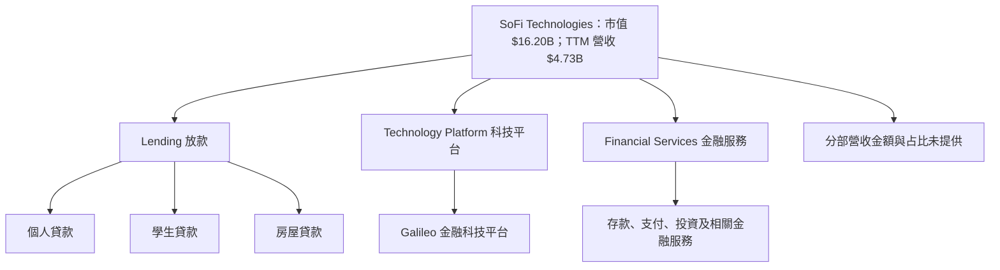
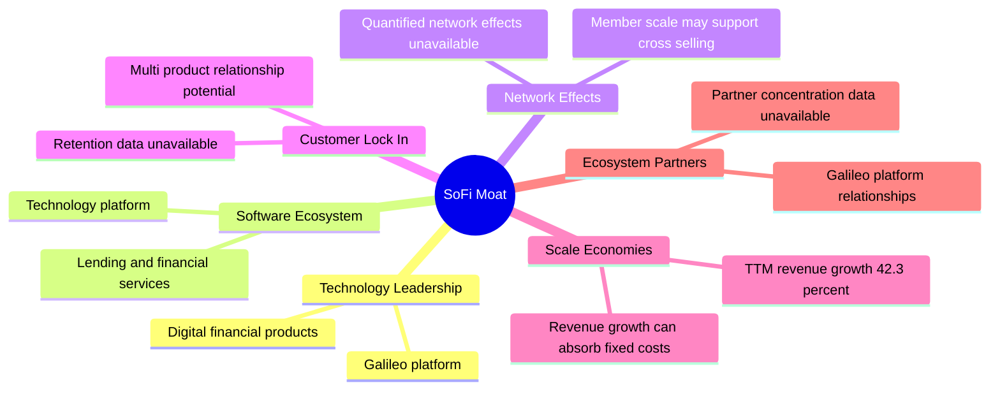
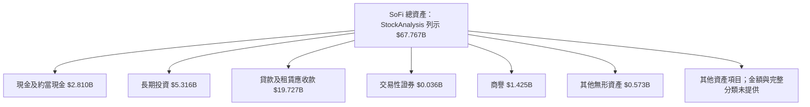
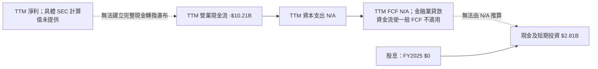
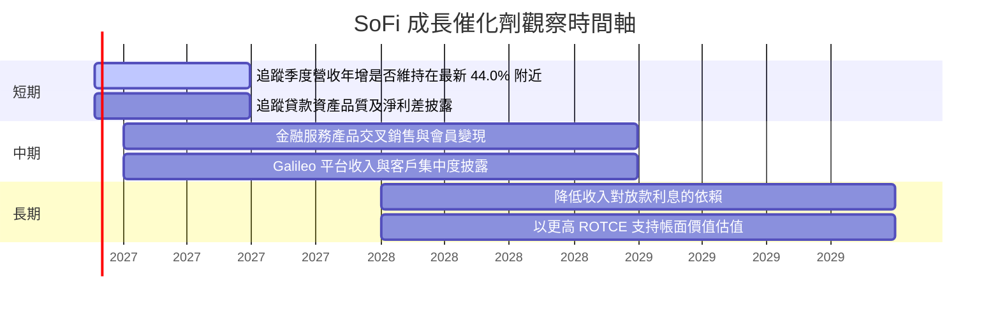
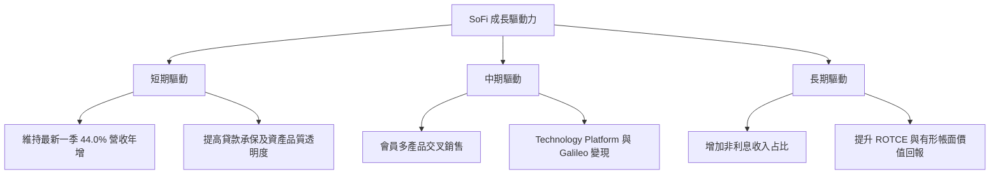
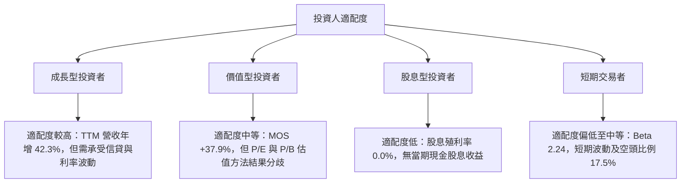

# SOFI 基本面深度分析報告
> **報告日期**：2026-11-21 ｜ **語言**：繁體中文 ｜ **數據來源**：SEC 申報資料 (XBRL)、Yahoo Finance、Finviz、StockAnalysis、Roic.ai ｜ **分析師**：CFA 級機構研究

## 目錄

| # | 章節 | 核心結論 |
|---|------|----------|
| 1 | 執行摘要 | 買入；加權合理價值 $20.09；MOS +37.9% |
| 2 | 公司概覽與商業模式 | 數位金融整合與平台業務具擴張潛力，收入組成與市場份額資料不足以量化護城河 |
| 3 | 損益表深度分析 | TTM 營收 $4.73B、TTM 成長 42.3%；最新一季年增 44.0% |
| 4 | 資產負債表分析 | 現金及短期投資 $2.81B；程式計算淨現金 $2.81B，但總債務欄位缺漏 |
| 5 | 現金流量深度分析 | TTM 營業現金流為 -$10.21B；貸款資金流使傳統 FCF 不適合作為銀行式業務估值指標 |
| 6 | 獲利能力與資本效率 | ROIC 對放款機構不適用；ROTCE 7.9%，尚不足以證明高於資本成本創造價值 |
| 7 | 相對估值分析 | P/E 低於同業中位數、P/B 相對估值結果高；自身 P/E 位於歷史區間低端 |
| 8 | DCF 內在價值評估 | DCF 不適用於放款機構；採金融業固定權重方法估值 |
| 9 | 成長催化劑 | 多產品交叉銷售、放款與金融服務擴張、科技平台變現；TAM 數字未提供 |
| 10 | 風險矩陣 | 信貸週期、資金成本與高成長估值是主要風險 |
| 11 | 投資建議 | 買入；參考加權合理價值 $20.09，按 MOS 規則推導買入區間上限約 $18.08 |

---

## 1. 執行摘要

SoFi 的 TTM 營收為 **$4.73B**，TTM 年增 **42.3%**，最新一季營收年增 **44.0%**，顯示貸款與金融服務平台仍在擴張；但 TTM 營業利益率與 FCF 均為 **N/A**，因為放款機構的資金流不宜直接以一般企業 FCF 解讀。相對估值方法計出的加權合理價值為 **$20.09**，高於 **2026-11-20 收盤價 $12.48**；**MOS = +37.9%**。依規則 20，該 MOS 若 ROIC 高於 WACC 可達強烈買入；然而 ROIC 對放款機構不適用、ROTCE 為 7.9%，因此採用系統提供的 **買入**評級，而非強烈買入。

### 1.0 一頁式投資儀表板（Portfolio Manager 30 秒速讀）

| 項目 | 內容 |
|------|------|
| **投資論點（3 句）** | ① TTM 營收 $4.73B、年增 42.3%，最新一季年增 44.0%，擴張速度仍高。② TTM 淨利率約 15.6%，但 ROTCE 7.9%，獲利轉化為股東報酬的能力仍需提升。③ 加權合理價值 $20.09 對比 $12.48 收盤價，模型 MOS 為 +37.9%，但相對估值中 P/B 法價值 $33.12 對結果影響不可忽視。 |
| **綜合評分** | **6.2/10**（引用 1.1 評分卡） |
| **財務健康** | 🟡 現金及短期投資 $2.81B；總債務欄為 N/A，淨現金 $2.81B 為程式計算值，須留意來源表格與其他資料欄位存在口徑差異。 |
| **ROIC vs WACC** | ROIC：N/A（金融業不適用）｜WACC：14.00%；不可將 ROTCE 直接等同 ROIC，但 ROTCE 7.9%低於該資本成本基準。 |
| **FCF 趨勢** | TTM 營業現金流 -$10.21B；TTM FCF 及 FCF Yield：N/A。銀行貸款資金變動使 FCF 不宜直接用作經濟自由現金流判讀。 |
| **估值** | Forward P/E 13.87x ｜ EV/EBITDA N/A ｜ FCF Yield N/A |
| **DCF 內在價值（基準）** | N/A（放款機構現金流是資金來源與貸款配置，DCF FCF 模型不適用） |
| **安全邊際（MOS）** | **+37.9%**＝($20.09 − $12.48) ÷ $20.09（基準為 8.8 加權合理價值）｜🟢 >25% |
| **預期報酬（基準情境 12M）** | DCF 情境 N/A；相對加權合理價值的上行空間為 **+61.0%**，不等同保證的 12 個月報酬預測。 |
| **關鍵風險（前二）** | 信貸損失／貸款資產品質惡化；高利率或資金成本變動壓縮淨利差。 |
| **評級 + 信心度** | 🟢 **買入** ｜ 信心：中。MOS 有吸引力，但信貸指標與總債務口徑資料不完整。 |

### 1.1 綜合評分卡（全報告唯一）

| 維度 | 評分（1–10） | 主要依據（引用數字與其來源章節） |
|------|--------------|----------------------------------|
| 成長性 | 8.0 | TTM 營收年增 42.3%、最新一季年增 44.0%（第 3 章）；成長速度高，但放款循環可能帶來波動。 |
| 獲利能力 | 6.0 | TTM 淨利率 15.6%、ROTCE 7.9%；ROIC 與 TTM 營業利益率 N/A，無法確認持續性資本報酬（第 3、6 章）。 |
| 財務健康 | 5.5 | 現金及短期投資 $2.81B、程式計算淨現金 $2.81B；總債務 N/A，流動比率 1.086、速動比率 0.428（第 4 章）。 |
| 估值 | 7.0 | MOS +37.9%；P/E 22.3x 低於自身五年中位數 36.6x，但加權合理價值高度受 P/B 方法影響（第 7、8 章）。 |
| 護城河 | 6.0 | 數位金融多產品與 Galileo 平台提供整合及分銷優勢，但分部收入、客戶留存與平台客戶集中度資料未提供（第 2 章）。 |
| 管理層與資本配置 | 4.5 | 2025 年 SBC $262.06M，相當於當年營收約 7.3%；未支付股息，回購資料未提供（第 3、5 章）。 |
| **綜合評分** | **6.2** | 六項算術平均：(8.0 + 6.0 + 5.5 + 7.0 + 6.0 + 4.5) ÷ 6 = 6.17，四捨五入至一位小數為 **6.2**。 |

### 1.2 五大投資論點 + 三大核心風險

| 類型 | 項目 | 具體依據 | 信心度 |
|------|------|----------|--------|
| 🟢 **投資論點①** | 高營收成長 | TTM 營收 $4.73B，TTM 年增 42.3%；最新一季年增 44.0%。持續成長將有機會提高平台固定成本吸收率。 | 🟢 高 |
| 🟢 **投資論點②** | 多產品金融平台 | Lending、Technology Platform、Financial Services 三個部門可支援交叉銷售；但分部收入比例未提供。 | 🟡 中 |
| 🟢 **投資論點③** | 近期獲利轉正並擴大 | 2025 年淨利 $481.32M；2026 年前三季每季淨利介於 $156.59M 至 $240.99M。 | 🟡 中 |
| 🟢 **投資論點④** | P/E 對自身歷史偏低 | P/E 22.3x，低於五年中位數 36.6x；當前歷史百分位為 0%。 | 🟡 中 |
| 🟢 **投資論點⑤** | 相對估值提供上行空間 | 加權合理價值 $20.09，對比收盤價 $12.48，上行空間 +61.0%。估值受 P/B 法高估值結果影響，需謹慎看待。 | 🟡 中 |
| 🟡 **風險①** | 信貸循環與貸款資產品質 | 放款淨額佔總資產 79.3%；淨沖銷率、逾放比未提供，難以直接衡量資產品質。 | 🔴 高衝擊 |
| 🔴 **風險②** | 融資與利率成本 | 調整後 Beta 1.83，股權成本 14.05%；存款與融資成本上升可能壓縮淨利差。 | 🔴 高衝擊 |
| 🟡 **風險③** | SBC 稀釋與估值假設 | TTM SBC 約 $288.33M，約為 TTM 營收 6.1%；若營收增長或股數控制不如預期，股東每股獲利可能落後公司營收增長。 | 🟡 中高 |

### 1.3 快速統計卡片

| 指標 | 公司實際值（期間） | 同業中位數 | 狀態 |
|------|--------------------|------------|------|
| 營收成長（TTM） | **42.3%** | — | 🟢 |
| 營收成長（最新一季年增） | **44.0%** | 34.1% | 🟢 |
| 毛利率（TTM） | **84.2%** | 83.3% | 🟢 |
| 營業利益率（TTM） | **N/A** | — | 🟡 |
| ROIC（TTM） | **N/A（放款機構不適用）** | — | 🟡 |
| Forward P/E | **13.87x** | 10.6x | 🟡 |
| FCF Yield（TTM） | **N/A** | — | 🟡 |
| Piotroski F-Score | **N/A** | — | 🟡 |

### 1.4 投資結論

```text
╔══════════════════════════════════════════════════════════════════╗
║                    📊 投資結論摘要                               ║
╠══════════════════════════════════════════════════════════════════╣
║  評級：買入（依規則 20；MOS +37.9%，ROIC 不適用於放款機構）      ║
║  價格（2026-11-20 收盤）：$12.48                                ║
║  DCF 內在價值（基準）：N/A（放款機構現金流不適用一般 DCF）       ║
║  安全邊際 MOS：+37.9%（以加權合理價值 $20.09 為分母）            ║
║  加權合理價值（8.8）：$20.09                                    ║
║  綜合評分：6.2/10（引用 1.1）                                   ║
║  適合投資人：能承受信貸週期、利率與高波動的成長型長線投資人      ║
╚══════════════════════════════════════════════════════════════════╝
```

---

## 2. 公司概覽與商業模式

### 2.1 業務結構與收入來源

公司提供放款、金融服務與科技平台服務，報告資料列有 Lending、Technology Platform、Financial Services 三個部門；但各部門營收金額與收入占比未提供，故不以估算比例繪製結構圖。



### 2.2 市場份額

市場份額數據未提供，因此不繪製市場份額圖表。SoFi 的 TTM 營收為 $4.73B、年增 42.3%，最新一季年增 44.0%；在提供的同業資料中，收入成長高於 NU 的 34.4%、HOOD 的 11.8% 與 UPST 的 34.1%，但公司商業模式與收入確認方式不完全相同，不能直接據此推論市占率。

### 2.3 競爭護城河分析



### 2.4 護城河強度

| 護城河項目 | 強度（強／中／弱） | 證據（引用數字或事實） | 會削弱它的情況 |
|------------|--------------------|------------------------|----------------|
| 數位產品與技術平台 | 中 | 業務涵蓋放款、金融服務及 Galileo；Technology Platform 分部收入未提供。 | 技術服務商品化、客戶流失或平台客戶集中度提高。 |
| 交叉銷售與會員生態 | 中 | 提供借貸、儲蓄、支付、投資等產品；會員留存、每位會員產品數與交叉銷售率未提供。 | 產品使用率低、客戶主要因利率或促銷轉換。 |
| 規模效應 | 中 | TTM 營收 $4.73B、年增 42.3%；但 TTM 營業利益率 N/A，尚無法確認規模擴張已轉為可持續利潤率優勢。 | 營收成長放緩而技術、行銷或信貸成本未同步下降。 |
| 資金與放款能力 | 中偏弱 | 放款淨額佔總資產 79.3%；淨沖銷率、逾放比與 CET1 未提供。 | 信用損失上升、融資成本提高或監管資本限制增長。 |
| 生態夥伴 | 中 | Galileo 提供金融科技平台服務；平台客戶數及客戶集中度資料未提供。 | 重要客戶自建、轉換供應商或平台收入成長低於預期。 |

1.1 的護城河評分為 **6.0/10**，反映 SoFi 具多產品與平台整合基礎，但尚缺收入分部、留存、客戶集中度及信貸品質等可驗證數據。

---

## 3. 損益表深度分析

### 3.1 年度收入成長趨勢（近 4 年）

年度收入依公司年度損益表資料；由 2022 至 2025 的收入 CAGR 約 32.0%。不同資料來源對 FY2024、FY2025 收入有小幅差異，本節沿用年度損益表列示數字；TTM 採用 SEC 計算值 $4.73B。

```text
╔══════════════════════════════════════════════════════════════════╗
║              SoFi 年度收入趨勢（FY2022–FY2025）                  ║
╠══════════════════════════════════════════════════════════════════╣
║  FY2022  $1.57B  ████████░░░░░░░░░░░░░░░░  YoY：基期            ║
║  FY2023  $2.11B  ███████████░░░░░░░░░░░░░  YoY：+34.4% 🟢       ║
║  FY2024  $2.61B  ██████████████░░░░░░░░░░  YoY：+23.7% 🟢       ║
║  FY2025  $3.61B  ████████████████████░░░░  YoY：+38.3% 🟢       ║
║                                                                  ║
║  2022–2025 CAGR = (3.61 ÷ 1.57)^(1/3) − 1 ≈ 32.0%               ║
╚══════════════════════════════════════════════════════════════════╝
```

2025 年收入增速回升至 38.3%，高於 2024 年約 23.7%，顯示當年收入擴張加快；TTM 年增 42.3% 與最新一季年增 44.0% 則延續此趨勢。收入成長本身仍不代表風險調整後利潤同步提升，關鍵在於貸款損失、融資成本及平台收入的組合。

### 3.2 季度收入趨勢分析

| 季度 | 營收 | QoQ 成長 | YoY 成長 | 備註 |
|------|------:|---------:|---------:|------|
| 2025 Q4 | $1.03B | — | 40.2% | 與 2025 Q3 比較，收入持續成長。 |
| 2026 Q1 | $1.10B | +6.8% | 42.5% | 年增加速；來源季度收入為 $1.091B。 |
| 2026 Q2 | $1.22B | +10.9% | 42.6% | QoQ 成長較 Q1 加快。 |
| 2026 Q3 | $1.39B | +13.9% | **44.0%** | 最新一季年增採用 SEC 計算值；季度收入來源列示 $1.385B。 |

QoQ 成長以相鄰季度列示營收計算，四捨五入至一位小數；最新季度 YoY 採用 SEC 最新季度數字 **44.0%**，不是 TTM 成長率。

### 3.3 利潤率演變分析

| 利潤率指標 | FY2022 | FY2023 | FY2024 | FY2025／TTM | 趨勢 | 評估 |
|------------|--------|--------|--------|-------------|------|------|
| **毛利率** | N/A | N/A | N/A | TTM 84.2% | 歷年數據未提供 | 🟡 單一期間不足以判讀長期趨勢 |
| **營業利益率** | N/A | N/A | N/A | TTM N/A；最新季度 19.4% | TTM 比率不可得 | 🟡 |
| **淨利率** | 由年度淨利與營收推算約 -20.4% | 約 -14.3% | 約 19.1% | TTM 15.6% | 從虧損轉正，TTM 低於 2024 | 🟡 |

年度淨利分別為 2022 年 -$320.41M、2023 年 -$300.74M、2024 年 $498.67M、2025 年 $481.32M。由虧損轉為獲利代表規模與成本結構已有改善；但 TTM 淨利率 15.6% 低於以年度表計算的 2024 年約 19.1%，需考慮利息收入、信用成本、營收組成與稅項影響。由於年度財報未提供相同口徑歷史毛利率與營業利益率，本報告不以缺漏數據推定其趨勢。

### 3.4 費用結構分析

完整費用明細與收入分部占比未提供，因此不繪製費用圓餅圖，也不以不完整損益表自行補足。可確認的股權薪酬為 FY2025 $262.06M、TTM 約 $288.33M；這是股東需承擔的稀釋成本之一，但不是全部營運費用。

### 3.5 季度 EPS 趨勢與盈餘品質（Quality of Earnings）

| 季度 | EPS | EPS 年增 | 淨利 | 估值／實際盈餘差異 |
|------|----:|--------:|-----:|------------------|
| 2025 Q4 | $0.13 | -57.0% | $173.55M | EPS 預估及實際值均為 N/A，無法判定超預期或不及預期。 |
| 2026 Q1 | $0.12 | +101.2% | $166.73M | EPS 預估值 N/A；報告資料列年增 101.2%。 |
| 2026 Q2 | $0.12 | +40.4% | $156.59M | EPS 預估值 N/A；淨利高於一年前同期。 |
| 2026 Q3 | $0.19 | +64.4% | $240.99M | EPS 預估值 N/A；季度淨利及 EPS 年增。 |

| 盈餘品質項目 | 數值／佔比 | 評估 |
|--------------|-----------|------|
| 股權薪酬 SBC / 營收 | TTM SBC 約 $288.33M ÷ TTM 營收 $4.73B = **約 6.1%** | 🟡 對股東報酬有實質稀釋，若持續高於收入增長，可能令每股經濟成果弱於公司總體增長。 |
| SBC / 營業現金流 | $288.33M ÷ -$10.21B = **-2.8%** | 🔴 比率的負號來自營業現金流為負，無法視為通常的費用負擔率；貸款資金流扭曲其解讀。 |
| FCF / 淨利（現金轉換率） | N/A | TTM FCF 為 N/A，不反推或採用其他定義替代。 |
| 一次性／非經常性損益 | N/A（資料未提供） | 未有足夠資料判定是否有重大一次性項目支撐當期盈餘。 |
| 有效稅率異常 | 8.5%（最新年度有效稅率） | 稅率相對低，但未提供充分稅務調節資料；不據此認定淨利由稅務利益帶動。 |
| 資本化支出 vs 費用化 | 相關明細 N/A | 資本化支出及研發費用化明細不足，無法判斷成本遞延程度。 |

EPS 歷史資料有四季數值，但 EPS Est 與 EPS Act 欄位均為 nan，因此不能可靠評估「超預期／不及預期」；每季的同比變化只能作為盈餘趨勢參考。整體而言，GAAP 淨利已有正向表現，但負營業現金流、FCF 不適用及 SBC 約占收入 6.1% 使其現金含量與每股獲利品質仍需審慎驗證。

---

## 4. 資產負債表分析

### 4.1 資產結構分解

以下使用 2026-09-30 季度資料中列示的部分資產項目；各細項並未涵蓋完整資產負債表，不能據此繪製完整比例圖。



資料來源間的總資產及現金數據口徑並不完全一致，因此 $67.767B 僅作為 StockAnalysis 期末資產表列示值，不與其他來源的總資產混算。

### 4.2 流動性與營運資金分析

| 指標 | 最新值 | 歷史趨勢 | 評估 |
|------|------:|----------|------|
| 現金及短期投資 | $2.81B | FY2025 現金 $4.93B；口徑不完全相同 | 🟡 可提供資金緩衝，但需與存款及融資需求一併觀察。 |
| 淨現金 | $2.81B | 程式計算值 | 🟡 總債務欄為 N/A，避免自行推算或與其他資料口徑拼接。 |
| 流動比率 | 1.086 | 歷史序列未提供 | 🟡 略高於 1，但傳統流動比率對金融業解讀有限。 |
| 速動比率 | 0.428 | 歷史序列未提供 | 🟡 不宜單獨套用一般非金融企業判斷。 |
| 營運資金天數 | 不適用（金融業） | DSO、DIO、DPO、CCC 未提供 | 放款、存款及金融資產負債結構不適用傳統存貨週轉分析。 |

### 4.3 債務結構分析

總債務在 SEC 計算區塊為 N/A；另一組市場資料列示總債務 $3.98B，但兩個資料來源口徑不一致。依要求不將其拼接至 SEC 計算值，也不推算 Debt/EBITDA 或利息保障倍數。

```text
╔══════════════════════════════════════════════════════════════════╗
║                   SoFi 債務健康診斷                              ║
╠══════════════════════════════════════════════════════════════════╣
║  總債務：        N/A（SEC 計算欄缺漏；其他來源口徑不一致）       ║
║  現金+短期投資： $2.81B  ████████████████░░░░  🟡                 ║
║  淨現金：        $2.81B（程式計算值）             🟡              ║
║  Debt/EBITDA：   N/A（總債務及 EBITDA 資料不足）                  ║
║  利息保障倍數： N/A（利息費用與可比盈利口徑未提供）              ║
║  解讀：放款機構需同時觀察存款資金、融資來源與資產品質，          ║
║        不宜單憑傳統非金融企業的流動性比率判定風險。              ║
╚══════════════════════════════════════════════════════════════════╝
```

### 4.4 股東權益趨勢

| 年度 | 股東權益 | YoY 變化 |
|------|---------:|---------:|
| 2022 | $5.53B | — |
| 2023 | $5.55B | +0.5% |
| 2024 | $6.53B | +17.6% |
| 2025 | $10.49B | +60.8% |

2025 年股東權益上升與資產負債表擴張一致，但權益增加的細項來源及每股帳面價值稀釋影響未提供，不能把股東權益增加直接等同每股價值提升。

---

## 5. 現金流量深度分析

### 5.1 現金流量瀑布圖

SoFi 是放款機構，貸款發放與貸款資產變動可能使營業現金流顯著為負。因 TTM 資本支出與 FCF 在 SEC 計算區塊為 N/A，不把負營業現金流機械式視為企業自由現金流。



### 5.2 FCF 轉換率趨勢

| 年度 | 淨利 | 營業現金流 | FCF／淨利 |
|------|-----:|-----------:|---------:|
| 2022 | -$320.41M | -$7.26B | 不適用；淨利為負且貸款資金流扭曲現金流 |
| 2023 | -$300.74M | -$7.23B | 不適用；同上 |
| 2024 | $498.67M | -$1.12B | 不適用；一般 FCF 轉換率不適合放款機構 |
| 2025 | $481.32M | -$3.74B | 不適用；貸款及存款等資金變動可能主導營業現金流 |
| TTM | N/A | -$10.21B | N/A；依 SEC 計算 FCF 為 N/A |

### 5.3 自由現金流趨勢

SEC 計算的 TTM 資本支出與 FCF 均為 N/A，因此不以其他資料來源所列 FCF 代替，也不繪製跨年度 FCF 數值趨勢圖。年度現金流量表顯示 FY2025 營業現金流為 -$3.74B，但放款資產增加會形成現金流出，並不直接等同營運虧損或企業價值流失。

### 5.4 資本配置評估

| 資本配置項目 | 已知數據 | 評估 |
|--------------|----------|------|
| 股息 | FY2025 $0；FY2024 -$16.50M | 目前股息殖利率 0.0%，資本主要留在業務內。 |
| 資本支出 | FY2025 約 $251.12M（年度現金流量表列示） | 金融科技與平台仍需投入，但 TTM Capex 在 SEC 計算區塊為 N/A。 |
| 股權薪酬 | FY2025 $262.06M | SBC 大於 FY2025 資本支出列示金額，須透過每股獲利及股數變化追蹤稀釋效果。 |
| 股票回購 | N/A | 回購金額未提供，不推定有或沒有回購。 |
| 貸款資產配置 | 放款淨額佔總資產 79.3% | 主要資產配置與信貸風險高度相關。 |

---

## 6. 獲利能力與資本效率

### 6.1 ROE / ROA / ROIC 趨勢

| 指標 | 最新可用值 | 歷史趨勢 | 評估 |
|------|-----------:|----------|------|
| ROE | 6.5%（SEC 程式計算） | 年度序列未提供 | 🟡 有正回報，但對成長型金融企業仍須結合信貸風險與資本需求評估。 |
| ROA | 1.3%（Yahoo／Finviz 合併資料） | 歷史序列未提供 | 🟡 只作來源交叉參考。 |
| ROIC | N/A（放款機構不適用） | N/A | 不使用一般企業 ROIC 與投入資本定義評估銀行式資產負債表。 |
| ROTCE | 7.9%（TTM） | 歷史序列未提供 | 🟡 有形權益報酬率反映股東回報，但低於 14.00% 的 WACC 基準。 |

### 6.2 ROIC vs WACC 分析（核心價值創造判斷）

對金融機構，存款與借款等負債本身是營運資金來源，傳統 ROIC／投入資本框架不適用；因此不計算 EVA，也不宣稱公司已經創造或摧毀股東價值。WACC 採資料計算值 14.00%，且程式計算的未限制值為 16.52%，依規則限制在 7%–14% 區間後採 14.00%。

```text
╔══════════════════════════════════════════════════════════════════╗
║                ROIC vs WACC 深度分析                            ║
╠══════════════════════════════════════════════════════════════════╣
║  資本成本輸入：                                                  ║
║  ├── 無風險利率（10Y 美債）：          4.91%                     ║
║  ├── 市場風險溢酬 ERP：                 5.00%                     ║
║  ├── 原始 Beta：                        2.24                      ║
║  ├── 調整後 Beta：                      1.83                      ║
║  ├── 股權成本 Ke：                      14.05%                    ║
║  ├── 稅前債務成本：                     29.04%                    ║
║  ├── 有效稅率：                         8.5%                      ║
║  ├── 股權／債務權重：                   80.3%／19.7%               ║
║  ├── 未限制 WACC：                      16.52%                    ║
║  └── 採用 WACC：                        14.00%（限制區間上限）     ║
║                                                                  ║
║  ROIC：N/A（放款機構不適用一般企業 ROIC 框架）                   ║
║  ROTCE：7.9%（TTM；不可直接等同 ROIC）                           ║
║                                                                  ║
║  結論：目前無足夠依據比較 ROIC 與 WACC。ROTCE 低於 14.00% WACC， ║
║        只能視作股東報酬仍待改善的警示，不能視為嚴格 EVA 結論。   ║
╚══════════════════════════════════════════════════════════════════╝
```

### 6.3 杜邦三因素分解

| 因素 | 數值（TTM） | 解讀 |
|------|-------------|------|
| 淨利率 | 15.6% | 盈利能力提供正向 ROE 貢獻。 |
| 資產週轉率 | 0.07 | 金融業資產以貸款、投資及現金為主，資產週轉率低於一般輕資產企業屬業態特性。 |
| 權益乘數 | 6.00 | 槓桿放大資產收益與損失，是 ROE 的重要組成。 |
| **ROE** | **6.5%** | 15.6% × 0.07 × 6.00 = 6.55%，與列示 6.5% 一致（四捨五入）。 |

杜邦結果顯示，ROE 同時受淨利率、低資產週轉率與權益乘數驅動，並非僅由營運利潤率決定；槓桿亦可能放大信用損失風險。

### 6.4 財務體質：Piotroski F-Score 與 Lender Metrics

Piotroski F-Score 為 **N/A**，因放款機構貸款成長會造成營業現金流出，傳統現金流測試可能錯誤判讀，故不適用。

| Lender 指標 | 數值（TTM） | 解讀 |
|-------------|------------:|------|
| 淨利息收入 NII / 總營收 | 64.0% | 收入中相當部分來自利息；利率與資金成本會直接影響盈利。 |
| 淨利差代理值 NII / 平均總資產 | 5.36% | 這是代理值，分母使用平均總資產而非生息資產，因此低於以生息資產計算的正式 NIM。 |
| 成本收入比代理值 | 80.8% | 依「營收－稅前淨利」除以營收計算，包含信用準備，會高於公司正式效率比率。 |
| ROTCE | 7.9% | 淨利除以有形帳面價值；是金融業股東回報參考指標，不等同 ROIC。 |
| P/TBV | 1.74x | 市場價格高於有形帳面價值，反映市場預期帳面資產可產生超額回報。 |
| 放款淨額 / 總資產 | 79.3% | 資產集中於貸款，信用品質與承保紀律是關鍵風險。 |
| 淨沖銷率 | N/A（數據未提供） | 無法定量評估實際信用損失。 |
| 逾放比 | N/A（數據未提供） | 無法定量評估逾期貸款變化。 |
| CET1 | N/A（數據未提供） | 無法定量評估監管資本緩衝。 |

---

## 7. 相對估值分析

### 7.1 同業估值比較表格

同業倍數取 Yahoo Finance 的 Peer multiples。SOFI 的即時估值表列示 P/E、Forward P/E、P/S 等；EV/EBITDA 對 SOFI 及多數同業為 N/A。

| 估值指標 | **SOFI** | **NU** | **HOOD** | **UPST** | SOFI 評估 |
|----------|---------:|-------:|--------:|--------:|-----------|
| **Trailing P/E** | 22.69x | 14.1x | 28.6x | 25.7x | 🟡 位於同業區間中段。 |
| **Forward P/E** | 13.87x | 10.6x | 18.2x | 5.3x | 🟡 高於同業中位數 10.6x；市場仍為增長預期付費。 |
| **P/S Ratio** | 3.46x | 6.0x | 11.0x | 1.1x | 🟢 低於 NU、HOOD，高於 UPST；商業模式不同，須審慎比較。 |
| **EV/EBITDA** | N/A | N/A | N/A | 24.3x | 🟡 無法做完整同業中位數比較。 |
| **最新一季營收年增** | 44.0% | 34.4% | 11.8% | 34.1% | 🟢 SOFI 高於列示三家同業。 |
| **毛利率（TTM）** | 84.2% | 0.0% | 91.0% | 83.3% | 🟡 SOFI 接近 UPST；NU 的統計口徑可比性有限。 |

Peer multiples 顯示 Forward P/E 中位數為 **10.6x**；SOFI Forward P/E 13.87x，反映市場對其未來成長已有一定溢價。不同公司收入結構與貸款風險差異大，P/S 尤其不能單獨作結論。

### 7.2 歷史估值區間分析

```text
╔══════════════════════════════════════════════════════════════════╗
║             SOFI 五年歷史估值區間（TTM 倍數）                    ║
╠══════════════════════════════════════════════════════════════════╣
║  P/E：       27.0x ├────────────────────────┤ 67.1x             ║
║               現值 22.3x；歷史中位數 36.6x；百分位 0%            ║
║  P/S：        2.6x ├────────────────────────┤ 14.6x             ║
║               現值 3.6x；歷史中位數 4.5x；百分位 29%             ║
║  EV/EBITDA： 19.0x ├────────────────────────┤148.7x             ║
║               現值 49.6x；歷史中位數 65.1x；百分位 33%           ║
╚══════════════════════════════════════════════════════════════════╝
```

P/E 現值 22.3x 低於提供的五年區間下限 27.0x，百分位為 0%；這代表估值相對自身歷史偏低，但也可能反映市場對成長、利率或信貸風險的重新定價。以收盤價 $12.48 計算，股價較 52 週高點 $30.42 低約 59.0%，並接近 52 週低點 $12.41。

### 7.3 情境價值（Bear / Base / Bull）

**N/A（DCF 無法計算：放款機構現金流包含資金來源與貸款配置，不能以一般企業 FCF DCF 建模）。**依規則不提供自行設定的 DCF 悲觀、基準或樂觀情境目標價。

### 7.4 相對估值隱含價格區間

```text
╔══════════════════════════════════════════════════════════════════╗
║              相對估值方法隱含每股價值                            ║
╠══════════════════════════════════════════════════════════════════╣
║  $9.55 同業 Forward P/E ── $12.48 現價 ── $20.67 分析師共識       ║
║              └────────── $20.09 加權合理價值 ──────────┘        ║
║                                                                  ║
║  同業 P/B 法：$33.12（上行空間 +165.4%，高估值敏感度較大）       ║
╚══════════════════════════════════════════════════════════════════╝
```

| 方法 | 每股價值 | 相對現價 | 推導依據 |
|------|---------:|---------:|----------|
| 同業 Forward P/E | $9.55 | -23.5% | 同業 Forward P/E 中位數 10.6x × 公司 Forward EPS $0.90。 |
| 同業 P/B | $33.12 | +165.4% | 同業 P/B 中位數 3.8x × 每股帳面價值 $8.71。 |
| 分析師共識目標價 | $20.67 | +65.6% | 23 位分析師平均目標價。 |

Forward P/E 方法反映相對保守的同業獲利倍數；P/B 方法給出較高價值，前提是帳面價值能維持穩定且產生足夠報酬。由於 ROTCE 7.9%，P/B 法的 $33.12 不宜孤立採用。

---

## 8. DCF 內在價值評估（Discounted Cash Flow）

### 8.0 估值推理鏈（Thinking Logic）

#### Step 1 — 價值由哪些變數決定？

SoFi 的價值主要由三個可觀察來源構成：放款業務的利息收入（NII 占總營收 64.0%）、Financial Services 的會員產品變現，以及 Technology Platform／Galileo 的平台服務；但只有 NII 比重有可引用數字，兩個其他分部的收入占比未提供。最重要的估值變數是貸款資產品質與風險調整後回報：放款淨額占總資產 79.3%，而淨沖銷率、逾放比缺漏。

#### Step 2 — 模型選擇

| 決策點 | 本報告採用 | 理由（含數字） | 曾考慮但否決 | 否決理由 |
|--------|-----------|----------------|--------------|----------|
| 現金流定義 | DCF：N/A；改用金融同業估值法 | TTM 營業現金流 -$10.21B，貸款資金變動並非一般自由現金流。 | 一般企業 FCFF／FCFE | 會把貸款發放及資金調度錯當作企業自由現金流。 |
| 預測期 N | N/A | DCF MODEL 未計算。 | 5–10 年 | 沒有模型計算基礎，不能自行建立預測。 |
| 終值方法 | N/A | DCF MODEL 未計算。 | Gordon Growth、退出倍數 | 不適用於缺少可比企業自由現金流的放款機構。 |
| EBIT 基礎 | N/A | DCF MODEL 未計算。 | GAAP EBIT／非 GAAP EBIT | 不建立 DCF 預測，亦不自建 EBIT 假設。 |
| 主要估值方法 | 同業 Forward P/E、同業 P/B、分析師共識 | 金融業固定權重分別 50%、40%、10%。 | DCF | 現金流型態不適合一般企業 FCF 模型。 |

#### Step 3 — 關鍵假設推導鏈

因 DCF MODEL 為 N/A，營收 CAGR、期末營業利潤率、永續成長率、預測期、Capex、折舊、營運資金、SBC、股數稀釋及終值均沒有可引用的程式模型輸入。本報告不建立替代假設，也不提供黑箱 DCF 內在價值。

#### Step 4 — 最脆弱環節

相對估值的主要脆弱環節是 P/B 法使用 3.8x 同業中位數乘以帳面價值 $8.71，而 ROTCE 僅 7.9%；若未來有形權益報酬不能支撐同業倍數，$33.12 的 P/B 隱含價值可能過高。

### 8.1 模型假設總表（Model Inputs）

**N/A（DCF MODEL 未計算：金融機構貸款現金流是資金來源與貸款配置，不是可直接折現的一般企業自由現金流）。**因此預測期、營收 CAGR、營業利潤率、稅率、Capex、D&A、營運資金變動、SBC、股數稀釋、永續成長率與終值方法均不建立替代數字。

### 8.2 折現率推導（WACC）

WACC 對第 6.2 節及本章採用同一數值 **14.00%**。Beta 使用調整後 Beta 1.83，其調整方式為 ⅔ × 原始 Beta 2.24 + ⅓。

```text
╔══════════════════════════════════════════════════════════════════╗
║                    WACC 資料輸入與採用值                         ║
╠══════════════════════════════════════════════════════════════════╣
║  無風險利率 Rf：                 4.91%（10Y 美債資料）            ║
║  市場風險溢酬 ERP：               5.00%（假設值）                 ║
║  原始 Beta：                      2.24（Yahoo Finance）            ║
║  調整後 Beta：                    1.83                            ║
║  股權成本 Ke：                    14.05%                          ║
║  稅前債務成本 Kd：                29.04%                          ║
║  有效稅率：                       8.5%                            ║
║  股權／債務權重：                 80.3%／19.7%                     ║
║  未限制 WACC：                    16.52%                          ║
║  限制區間：                       7%–14%                          ║
║  採用 WACC：                      14.00%（限制於上限）             ║
╚══════════════════════════════════════════════════════════════════╝
```

已提供 CAPM 股權成本 14.05%、稅前債務成本 29.04%、有效稅率 8.5% 及資本權重 80.3%／19.7%；但由於最終 WACC 有 7%–14% 的限制，程式採用 **14.00%**，而未限制計算值為 **16.52%**。因此不以自身四捨五入重算取代指定 WACC，也不將此折現率用來生成本報告不存在的 DCF。

### 8.3 逐年自由現金流預測（基準情境）

**N/A（DCF MODEL 未計算）。**放款機構的貸款與存款資金流使一般 FCFF 預測不適用；因此不提供 FY+1 至 FY+N 假設表、逐年算式、FCF CAGR 或預測現金流圖表。

### 8.4 終值計算（Terminal Value）

**N/A（DCF MODEL 未計算）。**因不存在可用的 DCF 預測期 FCFF、永續成長率或退出倍數，不計算 Gordon Growth 終值及退出倍數終值。

### 8.5 企業價值 → 每股內在價值（Bridge）

```text
╔══════════════════════════════════════════════════════════════════╗
║              企業價值 → 每股內在價值 橋接表                      ║
╠══════════════════════════════════════════════════════════════════╣
║  預測期 FCF 現值合計            N/A                              ║
║  終值現值 PV(TV)                N/A                              ║
║  = 企業價值 EV                  N/A                              ║
║  + 現金及短期投資               N/A（不建立 DCF 橋接）            ║
║  − 總債務                       N/A                              ║
║  = 股權價值                     N/A                              ║
║  ÷ 稀釋後流通股數               N/A                              ║
║  ★ 每股 DCF 內在價值            N/A                              ║
║  當前股價（2026-11-20 收盤）    $12.48                           ║
║  折溢價                         N/A（無 DCF 每股內在價值）        ║
╚══════════════════════════════════════════════════════════════════╝
```

### 8.6 敏感性分析（WACC × 永續成長率）

**N/A（DCF MODEL 未計算）。**不建立自行試算的 WACC × g 矩陣，也不提供 DCF 悲觀、基準與樂觀情境價值。

### 8.7 反推 DCF（Reverse DCF：市場在預期什麼）

**N/A（DCF MODEL 未計算）。**目前股價無法在沒有現金流預測模型的前提下反解營收 CAGR、利潤率、永續成長率或預測期。以同業估值方法比較，當前價格低於加權合理價值，但這不等於可由反推 DCF 證明市場隱含的營運預期。

### 8.8 估值三角驗證與安全邊際

公司類型為金融業，估值方法及權重依固定分類採用：同業 Forward P/E 50%、同業 P/B 40%、分析師共識 10%。DCF 因不適用放款機構現金流而未列入估值方法。

| 估值方法 | 隱含每股價值 | 上行空間（÷現價） | 權重 | 說明 |
|----------|--------------:|------------------:|-----:|------|
| 同業 Forward P/E | $9.55 | -23.5% | 50% | 同業中位數 10.6x × 公司 Forward EPS $0.90。 |
| 同業 P/B | $33.12 | +165.4% | 40% | 同業中位數 P/B 3.8x × 帳面價值每股 $8.71。 |
| 分析師共識目標價 | $20.67 | +65.6% | 10% | 23 位分析師平均目標價。 |
| **加權合理價值** | **$20.09** | **+61.0%** | **100%** | 金融業固定權重估值。 |

**逐步演算：**

- 加權合理價值 = $9.55 × 50% + $33.12 × 40% + $20.67 × 10%
- = $4.775 + $13.248 + $2.067
- = $20.090
- = **$20.09**（金額取小數點後兩位；權重合計 100%）

以上同業 P/E、P/B 及分析師共識為全部可計算方法；沒有加上 DCF 或其他估值方法，也沒有事後折讓。

```text
╔══════════════════════════════════════════════════════════════════╗
║                  估值區間與安全邊際                              ║
╠══════════════════════════════════════════════════════════════════╣
║  $9.55 同業 P/E ── $12.48 現價 ── $20.09 加權合理值 ── $33.12 P/B║
║                                                                  ║
║  安全邊際 MOS = ($20.09 − $12.48) ÷ $20.09 = +37.9%             ║
║  MOS 評估：🟢 >25%                                               ║
║  上行空間 = ($20.09 − $12.48) ÷ $12.48 = +61.0%                 ║
║  折溢價（相對 DCF 基準）：N/A（DCF 不適用）                      ║
║                                                                  ║
║  建議買入區間：$9.55 – $18.08                                   ║
║  其中上限依 MOS ≥10% 計算：$20.09 × 90% = $18.081               ║
║  合理持有參考：$18.08 – $20.09（不代表 DCF 公允價值）            ║
║  減碼評估：高於 $20.09 後，重新檢查估值與業務增長假設            ║
╚══════════════════════════════════════════════════════════════════╝
```

加權合理價值為 $20.09；MOS 分母採此加權值，折溢價則因 DCF 基準值不存在而不計算。買入區間下限參照同業 Forward P/E 隱含值 $9.55，上限使用 MOS 10% 對應價格 $20.09 × 90% = **$18.08**；區間上限高於現價，與買入評級一致。

> 🔎 **程式複算（Python，依本節各項自動重算）**
>
> 加權合理價值 = $9.55 × 50% + $33.12 × 40% + $20.67 × 10% = **$20.09**（權重合計 100%）
>
> 以價格 $12.48 計：MOS = **+37.9%**，上行空間 = **+61.0%**
>
> ✅ 與本節所寫數值一致。

### 8.9 DCF 模型的局限與失效條件

- **終值依賴度**：N/A，沒有 DCF 企業價值與終值，故無法計算終值占比。
- **最脆弱的估值假設**：加權估值中 P/B 法價值為 $33.12，依據同業中位數 P/B 3.8x；若 ROTCE 7.9%無法支撐此倍數，整體合理價值將下修。
- **不適用情境**：營業現金流 TTM -$10.21B，並受到貸款及融資資產負債變動影響。對 SoFi 的分析應以金融同業 P/E、P/B、ROTCE、淨利息收入及信貸品質為主，而非一般企業 FCF DCF。
- **與風險矩陣的連結**：信貸損失上升將衝擊淨利及 ROTCE；融資成本上升將影響 NII 與淨利差；平台收入成長不如預期會降低業務多元化估值。

### 8.10 複算檢核表（Audit Trail）

| # | 檢核項目 | 檢查方式 | 結果 |
|---|----------|----------|------|
| 1 | 所有 DCF 敏感度輸入均有推導 | DCF 模型為 N/A，不存在敏感度輸入 | N/A |
| 2 | 每個 DCF 假設都有來歷 | 未建立 DCF 假設表 | N/A |
| 3 | WACC 五步算式齊全且相乘相加正確 | 使用程式提供 WACC 14.00%、未限制值 16.52% | ✅ 採用值依來源限制區間 |
| 4 | Kd 分母與權重債務範圍一致 | 總債務資料口徑缺漏，不另行重算資本結構 | N/A |
| 5 | WACC 與第 6.2 節同值 | 兩節均為 14.00% | ✅ |
| 6 | 預測年度數與 N 一致 | DCF 預測期 N/A | N/A |
| 7 | FY+1 FCFF 及 PV 可複算 | DCF 未計算 | N/A |
| 8 | 預測期 PV 逐項加總 | DCF 未計算 | N/A |
| 9 | WACC > g | g 未提供，DCF 未計算 | N/A |
| 10 | 終值基於 FY+N 並折現 N 期 | DCF 未計算 | N/A |
| 11 | EV 至每股價值橋接可複算 | DCF 未計算 | N/A |
| 12 | SBC 組合 A／B／C 相容 | DCF 未建立，未做 EBIT 與股數處理 | N/A |
| 13 | 敏感性矩陣基準格等於 DCF 價值 | 敏感性矩陣未建立 | N/A |
| 14 | 矩陣格符合 WACC > g | 敏感性矩陣未建立 | N/A |
| 15 | 三情境機率合計 100% | DCF 情境未計算 | N/A |
| 16 | 反推 DCF 每列一次一變數 | Reverse DCF 未計算 | N/A |
| 17 | MOS 與 1.0 一致；DCF 折溢價基準 | MOS 均為 +37.9%；DCF 折溢價 N/A | ✅ |
| 18 | 報告完整至第 11 章 | 已列出第 1 至第 11 章 | ✅ |
| 19 | 加權合理價值等於方法加總 | $9.55×50% + $33.12×40% + $20.67×10% = $20.09 | ✅ |
| 20 | 評級符合 MOS 門檻 | MOS +37.9%；ROIC 不適用，採資料列示評級「買入」 | ✅ |

未執行的 DCF 檢核項目均因 DCF MODEL 明確為 N/A，而非以自行建立模型替代；估值結論的信心度因此較低於完整 DCF 與信貸資料俱全的情況。

---

## 9. 成長催化劑

### 9.1 催化劑時間軸



上述時間軸為研究追蹤安排，不代表公司正式財測或已確認的催化日期。

### 9.2 TAM 市場規模分析

**N/A（TAM 數據未提供）。**目前可以確認的是 TTM 營收 $4.73B、TTM 年增 42.3%，最新一季年增 44.0%，且業務涵蓋放款、金融服務及科技平台。沒有可引用的市場總規模與年份資料，因此不估算 TAM 金額或市場滲透率。

### 9.3 成長驅動力結構圖



---

## 10. 風險矩陣

### 10.1 風險評分矩陣

風險機率與衝擊的定量機率資料未提供；依規則不以未經核實的數字繪製量化 quadrantChart。下表採定性風險排序，並在個別項目明確區分資料與分析判斷。

### 10.2 風險清單詳細分析

| # | 風險項目 | 發生機率 | 財務衝擊 | 風險評估 | 緩解措施 |
|---|----------|----------|----------|----------|----------|
| 1 | 🔴 **信貸損失及放款資產品質** | 中高；屬分析師定性判斷 | 高；放款淨額佔總資產 79.3%，損失上升會壓低淨利與 ROTCE | 🔴 高 | 每季追蹤淨沖銷率、逾放比、貸款組成與核貸標準；目前相關指標 N/A，需待公司披露。 |
| 2 | 🔴 **利率與資金成本變動** | 中高；受利率及資金競爭影響 | 高；NII 占總營收 64.0%，淨利差代理值 5.36% | 🔴 高 | 監控存款成本、利息收入與利息費用趨勢，並比較 NII 增長是否高於資金成本。 |
| 3 | 🟠 **營業現金流波動與流動性解讀** | 高；TTM OCF 已為 -$10.21B | 中高；貸款增長可能持續消耗資金，但不能直接等同自由現金流虧損 | 🟠 中高 | 分辨貸款資產增長與核心營運獲利，追蹤現金、短期投資及融資來源；不以不適用 FCF 作為單一停損指標。 |
| 4 | 🟠 **SBC 稀釋與每股價值落後** | 中；TTM SBC 約為收入 6.1% | 中；高 SBC 可降低現有股東每股經濟利益 | 🟠 中 | 每季比較流通股數變化、SBC／收入與 EPS 增長。 |
| 5 | 🟡 **估值方法與 P/B 倍數回落** | 中；相對估值分歧大 | 中高；同業 P/B 法 $33.12，P/E 法 $9.55 | 🟠 中高 | 以 ROTCE、同業倍數與盈利預測交叉驗證，避免只依賴高 P/B 結果。 |

---

## 11. 投資建議

### 11.1 最終評級與評分

依加權合理價值 $20.09 與 2026-11-20 收盤價 $12.48 計算，MOS 為 +37.9%；但放款機構 ROIC 不適用，且 ROTCE 為 7.9%，因此依規則採 **買入**，沒有額外上調或下調一級。公司品質綜合評分為 **6.2/10**；六項分數為成長性 8.0、獲利能力 6.0、財務健康 5.5、估值 7.0、護城河 6.0、管理層與資本配置 4.5。

### 11.2 合理價值與隱含報酬率

| 估值參考 | 每股價值 | 相對現價 $12.48 | 機率／權重 | 解讀 |
|----------|---------:|----------------:|------------:|------|
| 同業 Forward P/E | $9.55 | -23.5% | 50%估值權重 | 反映同業估值下的較保守結果。 |
| 同業 P/B | $33.12 | +165.4% | 40%估值權重 | 對有形帳面價值與同業 P/B 倍數敏感。 |
| 分析師共識 | $20.67 | +65.6% | 10%估值權重 | 23 位分析師平均目標價。 |
| **加權合理價值** | **$20.09** | **+61.0%** | 100% | 本報告採用的 MOS 估值基準。 |
| DCF 悲觀／基準／樂觀情境 | N/A | N/A | N/A | DCF 模型不適用，不提供情境價值。 |

### 11.3 買入時機與觸發因素

```text
╔══════════════════════════════════════════════════════════════════╗
║                  ✅ 買入觸發因素 Checklist                      ║
╠══════════════════════════════════════════════════════════════════╣
║  立即買入觸發條件（多數符合）：                                  ║
║  ✅ 現價 $12.48 低於加權合理價值 $20.09                           ║
║  ✅ 加權估值 MOS +37.9%，高於 25% 門檻                            ║
║  ✅ TTM 營收年增 42.3%，最新一季年增 44.0%                        ║
║                                                                  ║
║  加碼觸發條件（出現以下任一）：                                  ║
║  ☐ 股價低於 $9.55 同業 Forward P/E 隱含價值，且信用指標未惡化     ║
║  ☐ 營收維持高成長，且 ROTCE 高於目前 7.9%                         ║
║  ☐ 公司披露淨沖銷率、逾放比及 CET1，顯示風險可控                 ║
║                                                                  ║
║  減碼／停損觸發條件（出現以下任一）：                            ║
║  ☐ 連續兩季營收年增低於 20%（分析師監控門檻）                    ║
║  ☐ 最新季度營業利益率低於已列示 19.4% 並持續惡化                 ║
║  ☐ 信貸損失或融資成本上升，造成淨利及 ROTCE 持續下降             ║
║  ☐ 股價高於 $20.09 後，盈利成長未能支撐更高估值                  ║
╚══════════════════════════════════════════════════════════════════╝
```

加碼與減碼門檻中除已披露的估值與營收數據外，其餘 20% 成長門檻是分析師監控規則，不是公司財測或歷史統計結論。

### 11.4 投資人適配度分析



### 11.5 每季財報監控清單（Quarterly Watch List）

| 監控指標 | 最新基準 | 加碼觸發 | 減碼／重新評估門檻 |
|----------|---------|----------|-------------------|
| 營收成長 | TTM 42.3%；最新一季 YoY 44.0% | 維持年增 30%以上，且收入組成不過度集中於高風險放款 | 連續兩季低於 20%（分析師監控門檻） |
| 淨利與 EPS | 2026 Q3 淨利 $240.99M、EPS $0.19 | 淨利與 EPS 持續同比增長 | 連續兩季同比轉負或大幅低於收入增長 |
| 最新季度營業利益率 | 19.4% | 持穩或提高 | 低於 15% 且連續兩季惡化（分析師監控門檻） |
| NII / 總營收 | 64.0% TTM | NII 增長與資金成本變化保持健康 | NII 占比快速下降且非利息收入未補足 |
| 淨利差代理值 | 5.36% | 維持或提升，並同時觀察資金成本 | 連續下降且淨利增長同步轉弱 |
| 成本收入比代理值 | 80.8% | 下降且 ROTCE 上升 | 上升並伴隨盈利下滑 |
| ROTCE | 7.9% | 持續提高，逐步逼近或超過資本成本基準 | 下滑至 5% 以下並連續兩季（分析師監控門檻） |
| 信貸品質 | 淨沖銷率、逾放比 N/A | 公司披露後維持穩定或改善 | 逾放與沖銷明顯惡化 |
| 現金與資金流 | 現金及短期投資 $2.81B；TTM OCF -$10.21B | 能說明貸款資產增長資金來源且流動性穩健 | 現金持續快速下降、融資來源受限 |
| SBC／股數 | TTM SBC 約 $288.33M，約為收入 6.1% | SBC／收入下降、股數增長受控 | SBC／收入增加且每股獲利增長落後總淨利 |
| 管理層財測 | N/A | 財測上修且實際結果跟進 | 財測下修或連續未達成 |

### 11.6 反面論證：什麼會證明論點錯誤（What Would Change My Mind）

```text
╔══════════════════════════════════════════════════════════════════╗
║              ⚠️ 論點失效條件（Disconfirming Evidence）           ║
╠══════════════════════════════════════════════════════════════════╣
║  本投資論點在下列情況成立時應重新檢視或退出：                    ║
║  ☐ 營收年增連續兩季低於 20%，且無非利息收入補足                  ║
║  ☐ 最新季度營業利益率由 19.4% 下滑至低於 15%，並持續惡化        ║
║  ☐ ROTCE 由 7.9% 下滑至 5% 以下且連續兩季未改善                  ║
║  ☐ 淨沖銷率或逾放比顯著上升；目前相關數據 N/A，披露後立即追蹤   ║
║  ☐ SBC／營收高於目前約 6.1%，且每股 EPS 成長落後淨利成長         ║
║  ☐ 現金及短期投資持續下降，且貸款資產增長無穩定資金來源支持      ║
║  ☐ 加權估值所依賴的 P/B 倍數下修，或帳面價值無法產生合理 ROTCE   ║
╚══════════════════════════════════════════════════════════════════╝
```

> **免責聲明**：本報告為 AI 自動生成，僅供研究參考，不構成投資建議。投資有風險，入市需謹慎。

---

## 資料與來源

| 項目 | 內容 |
|------|------|
| 價格 | 12.48 USD，2026-11-20 收盤（Yahoo Finance 日線） |
| 財務報表 | SEC 10-Q filed 2026-11-05，最新季度 2026-09-30（FY2026 Q3） |
| 有回應的資料來源 | SEC 申報資料 (XBRL)、Yahoo Finance、Finviz、StockAnalysis、Roic.ai |
| 由程式計算 | TTM 數字、WACC、DCF 模型、估值方法與權重、加權合理價值、MOS、評級門檻、F-Score、杜邦分解、營運資金天數、綜合評分 |
| 撰寫模型 | openai / gpt-6-luna |

> 本區塊由產生報告的程式依實際取得的資料填寫，非模型撰寫。「由程式計算」的數字不是模型的估計；其餘判斷（評分、情境、策略）是模型的分析。
