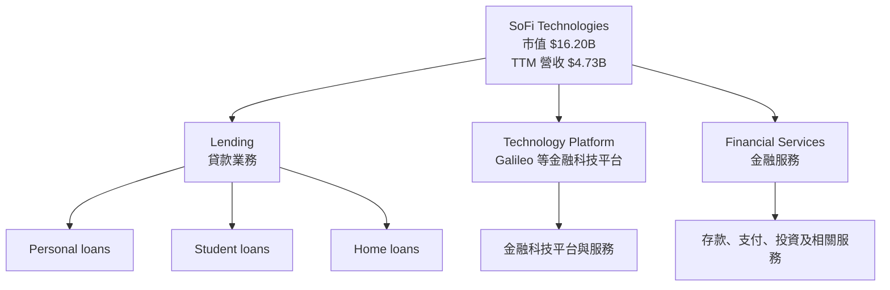
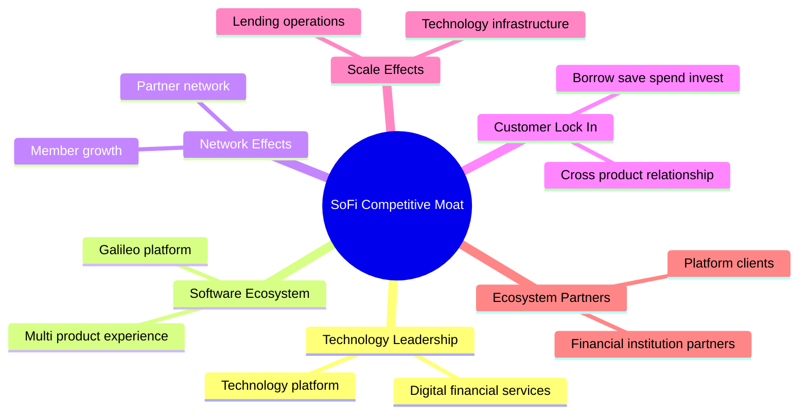
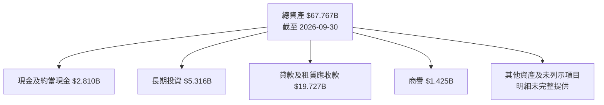
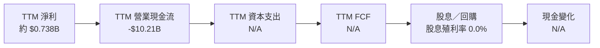
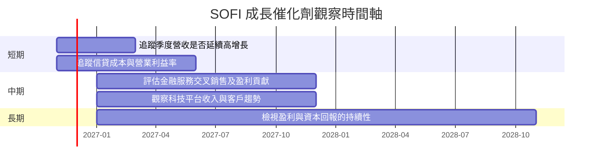
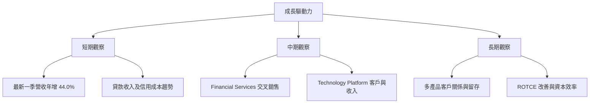
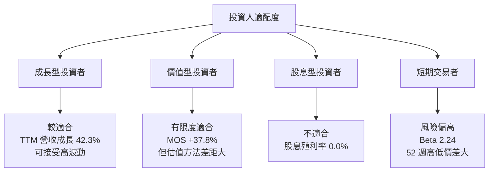

# SOFI 基本面深度分析報告
> **報告日期**：2026-11-22 ｜ **語言**：繁體中文 ｜ **數據來源**：SEC 申報資料 (XBRL)、Yahoo Finance、Finviz、StockAnalysis、Roic.ai ｜ **分析師**：CFA 級機構研究

## 目錄

| # | 章節 | 核心結論 |
|---|------|----------|
| 1 | 執行摘要 | 買入；加權合理價值 $20.07；MOS +37.8% |
| 2 | 公司概覽與商業模式 | 三大業務共用金融服務平台；市場份額與部門收入占比未提供 |
| 3 | 損益表深度分析 | TTM 營收 $4.73B、成長 42.3%；單季最新年增 44.0% |
| 4 | 資產負債表分析 | 現金及短期投資 $2.81B；總債務 N/A，流動性與資產擴張需追蹤 |
| 5 | 現金流量深度分析 | TTM 營業現金流 -$10.21B；TTM FCF N/A，貸款機構現金流需審慎解讀 |
| 6 | 獲利能力與資本效率 | ROIC 不適用於貸款機構；ROTCE 7.9%，低於 14.00% WACC 但口徑不可直接比較 |
| 7 | 相對估值分析 | SOFI 估值較自身五年區間偏低；相對同業各倍數呈現分化 |
| 8 | DCF 內在價值評估 | DCF N/A；採金融業加權相對估值，合理價值 $20.07 |
| 9 | 成長催化劑 | TTM 營收成長 42.3%，金融服務與貸款增長為主要觀察方向 |
| 10 | 風險矩陣 | 信貸品質、利率／監管變化與高現金流波動為主要風險 |
| 11 | 投資建議 | 買入；參考區間 $12.48–$18.06，按季度監控信貸及盈餘品質 |

---

## 1. 執行摘要

SOFI 的 TTM 營收為 **$4.73B**，TTM 年增 **42.3%**，最新一季營收年增 **44.0%**，顯示營收規模仍快速擴大；但 TTM 營業利益率與 FCF 均為 **N/A**，而 TTM 營業現金流為 **-$10.21B**，使得獲利品質及現金流不能只以報表淨利判斷。金融業估值方法計算的加權合理價值為 **$20.07**，相對 **2026-11-20 收盤價 $12.48** 的 MOS 為 **+37.8%**、上行空間為 **+60.8%**；依提供的規則 20 評級為 **買入**。DCF 不適用於以貸款資金流為主要營運現金流的貸款機構，因此本報告不建立 DCF 目標價，也不提供 DCF 情境估值。

### 1.0 一頁式投資儀表板（Portfolio Manager 30 秒速讀）

| 項目 | 內容 |
|------|------|
| **投資論點（3 句）** | ① TTM 營收 $4.73B、年增 42.3%，最新一季年增 44.0%，營收仍有擴張動能。② 淨利率約 15.6%（TTM，品質指標），但 TTM 營業現金流為 -$10.21B，貸款成長與現金流波動令獲利轉現品質需審慎評估。③ 加權合理價值 $20.07，相對 $12.48 收盤價 MOS +37.8%，但估值依賴同業倍數與分析師共識，非 DCF 現金流驗證。 |
| **綜合評分** | **6.2/10**（引用 1.1 評分卡） |
| **財務健康** | 🟡 現金及短期投資 $2.81B；總債務 N/A，流動比率與速動比率資料為 1.086、0.428，但金融業資產負債表不宜套用一般企業流動性解讀。 |
| **ROIC vs WACC** | ROIC：N/A（貸款機構不適用一般企業 ROIC）；WACC：14.00%。兩者不可直接比較，不能據此判定一般企業式的價值創造差額。 |
| **FCF 趨勢** | TTM FCF：N/A；FCF Yield：N/A。TTM 營業現金流 -$10.21B，但貸款發放及資金來源會顯著影響金融機構現金流。 |
| **估值** | Forward P/E **13.94x**（市場估值資料）；EV/EBITDA **N/A**（估值資料）；FCF Yield **N/A**。Peer multiples 中 SOFI 自身五年估值資料的 P/E 為 22.3x。 |
| **DCF 內在價值（基準）** | N/A（貸款機構現金流是資金流，不適合直接以一般企業 FCFF DCF 估值）；現價相對 DCF 折溢價 N/A。 |
| **安全邊際（MOS）** | **+37.8%**＝($20.07 − $12.48) ÷ $20.07；基準為第 8.8 節加權合理價值。🟢 >25% 充足。 |
| **預期報酬（基準情境 12M）** | DCF 基準情境：N/A。若以加權合理價值作為估值參考，隱含上行空間 **+60.8%**，不等同保證的 12 個月報酬預測。 |
| **關鍵風險（前二）** | ① 信貸損失增加或貸款需求放緩，壓縮利息收入及利潤。② TTM 營業現金流 -$10.21B，雖有金融業資金流特性，仍需驗證資產負債表承受力與現金流趨勢。 |
| **評級 + 信心度** | 🟢 **買入** ｜ 信心：中低。MOS 按規則 20 為買入；DCF 不適用且信貸品質核心數據缺漏，限制估值信心。 |

### 1.1 綜合評分卡（全報告唯一）

| 維度 | 評分（1–10） | 主要依據（引用數字與其來源章節） |
|------|--------------|----------------------------------|
| 成長性 | 8.0 | TTM 營收成長 42.3%、最新一季年增 44.0%（第 3 章），但未提供 TAM 與部門成長拆分。 |
| 獲利能力 | 6.0 | TTM 淨利率 15.6%、ROE 6.5%，但 TTM 營業利益率 N/A、ROIC 不適用（第 3、6 章）。 |
| 財務健康 | 5.0 | 現金及短期投資 $2.81B、淨現金數據 $2.81B；總債務 N/A，TTM 營業現金流 -$10.21B（第 4、5 章）。 |
| 估值 | 7.0 | MOS +37.8%，SOFI P/E 22.3x 低於自身五年中位數 36.6x；但同業倍數與加權方法結果分散（第 7、8 章）。 |
| 護城河 | 6.0 | 三大業務板塊與金融科技平台形成產品交叉銷售可能；但部門收入、客戶留存、平台客戶數及市場份額資料未提供（第 2 章）。 |
| 管理層與資本配置 | 5.0 | 2025 年 SBC $262.06M、TTM 營業現金流為負；股利殖利率 0%，沒有足夠資料判斷回購及資本配置效率（第 3、5 章）。 |
| **綜合評分** | **6.2** | 六項算術平均：(8.0 + 6.0 + 5.0 + 7.0 + 6.0 + 5.0) ÷ 6 = 6.17，四捨五入至一位小數為 **6.2**。 |

### 1.2 五大投資論點 + 三大核心風險

| 類型 | 項目 | 具體依據 | 信心度 |
|------|------|----------|--------|
| 🟢 **投資論點①** | 營收增長仍快 | TTM 營收 $4.73B、年增 42.3%；最新一季年增 44.0%，顯示核心業務需求與產品銷售仍在擴大。 | 🟢 高 |
| 🟢 **投資論點②** | 獲利已為正且淨利率具規模 | TTM 淨利率 15.6%、ROE 6.5%；但營業利益率 TTM 資料 N/A，應以後續季報確認可持續性。 | 🟡 中 |
| 🟢 **投資論點③** | 多產品金融服務模式具交叉銷售機會 | 公司有 Lending、Technology Platform、Financial Services 三個板塊；各板塊營收占比未提供，交叉銷售效益尚不能量化。 | 🟡 中 |
| 🟢 **投資論點④** | 相對自身歷史估值偏低 | P/E 22.3x，低於五年中位數 36.6x；但低於歷史中位數不等同於低估，需搭配獲利及風險檢驗。 | 🟡 中 |
| 🟢 **投資論點⑤** | 加權估值顯示價格有折讓 | 加權合理價值 $20.07，較 $12.48 現價高；其中同業 P/B 法估值 $33.12，與同業 Forward P/E 法的 $9.51 差距大，估值離散度高。 | 🟡 中 |
| 🟡 **風險①** | 貸款信用週期轉弱 | 淨沖銷率、逾放比、CET1 均 N/A；若違約與信用成本上升，將侵蝕利息收入與淨利。 | 🔴 高衝擊 |
| 🔴 **風險②** | 現金流解讀與融資風險 | TTM 營業現金流 -$10.21B，總債務 N/A；需確認現金流負值來自貸款擴張或營運壓力，不能只按淨利判斷。 | 🔴 高 |
| 🟡 **風險③** | 估值高度依賴同業倍數選擇 | 同業 Forward P/E 法為 $9.51，P/B 法為 $33.12；估值方法結果相距顯著，合理價值的不確定性高。 | 🟡 中 |

### 1.3 快速統計卡片

| 指標 | 公司實際值（期間） | 同業中位數 | 狀態 |
|------|--------------------|------------|------|
| 營收成長（TTM） | **42.3%** | — | 🟢 |
| 營收成長（最新一季年增） | **44.0%** | **34.1%**（NU、HOOD、UPST 最新季度年增率中位數） | 🟢 |
| 毛利率（TTM） | **84.2%**（市場資料） | **83.3%**（三家同業中位數） | 🟢 |
| 營業利益率（TTM） | **N/A** | — | 🟡 |
| ROIC（TTM） | **N/A（貸款機構不適用）** | — | 🟡 |
| Forward P/E | **13.94x**（市場估值資料） | **10.6x**（NU、HOOD、UPST 中位數） | 🟡 |
| FCF Yield（TTM） | **N/A** | — | 🟡 |
| Piotroski F-Score | **N/A（不適用於貸款機構）** | — | 🟡 |

### 1.4 投資結論

```text
╔══════════════════════════════════════════════════════════════════╗
║                    📊 投資結論摘要                               ║
╠══════════════════════════════════════════════════════════════════╣
║  評級：買入（依規則 20；MOS +37.8%，採用提供的評級）             ║
║  價格（2026-11-20 收盤）：$12.48                                 ║
║  DCF 內在價值（基準）：N/A（貸款機構不適用一般 FCFF DCF）        ║
║  安全邊際 MOS：+37.8%（＝($20.07−$12.48)÷$20.07）               ║
║  加權合理價值（8.8）：$20.07                                     ║
║  綜合評分：6.2/10（引用 1.1）                                    ║
║  適合投資人：可承受信貸週期與高波動、以中長期成長為主的投資人    ║
╚══════════════════════════════════════════════════════════════════╝
```

---

## 2. 公司概覽與商業模式

### 2.1 業務結構與收入來源

公司資料列出 Lending、Technology Platform、Financial Services 三大板塊。各板塊收入金額與占比未提供，因此不能用圖表呈現比例或推導各業務對總營收的貢獻。公司 TTM 營收為 $4.73B、市值 $16.20B。



貸款業務可能透過存款與放貸擴大利息收入；科技平台可透過對外提供基礎設施服務增加非利息收入；金融服務則有機會提升客戶關係深度。但收入占比、部門利潤、客戶與交易量資料不足，無法判斷營收增長究竟由哪一板塊主導。

### 2.2 市場份額

市場份額數據未提供，因此不繪製市占率圖表。以公司規模與成長比較，SOFI TTM 營收為 $4.73B，TTM 年增 42.3%；同業最新一季營收年增中位數約 34.1%。這顯示公司報表營收增長高於三家同業的最新季度中位數，但業務範圍及收入認列方式不同，不能據此直接推論市場份額上升。

### 2.3 競爭護城河分析



以上為業務結構層面的質化判斷，不代表已證明強網路效應。平台客戶數、留存率、每客戶收入及單位經濟性資料缺失，難以量化轉換成本或平台規模經濟。

### 2.4 護城河強度

| 護城河項目 | 強度（強／中／弱） | 證據（引用數字或事實） | 會削弱它的情況 |
|------------|--------------------|------------------------|----------------|
| 技術平台 | 中 | 公司有 Technology Platform 業務，並營運 Galileo；部門營收、客戶數及續約率未提供。 | 平台客戶流失、同業提供更低成本或更完整功能。 |
| 多產品生態系 | 中 | 公司提供借貸、儲蓄、支付、投資等金融產品；TTM 營收 $4.73B。 | 客戶只使用單一產品，交叉銷售及留存未能改善。 |
| 網路效應 | 弱至中 | 公司跨美國及其他市場營運，且有平台業務；網路效應的量化證據未提供。 | 客戶與合作夥伴數量未形成自我強化的增長循環。 |
| 客戶鎖定 | 弱至中 | 多產品金融關係可能提高轉換成本，但存款留存、產品滲透率未提供。 | 客戶容易轉移存款或貸款，利率優惠引發高流失。 |
| 規模效應 | 中 | TTM 營收年增 42.3%，已有一定規模；成本收入比代理值 80.8%。 | 增長帶來更高獲客、風險及合規成本，無法轉化為營運槓桿。 |
| 生態夥伴 | 中 | 公司擁有金融科技平台與貸款業務；合作夥伴數量及經濟貢獻未提供。 | 合作夥伴自建系統、改用競爭平台或降低依賴。 |

1.1 評分卡中的「護城河」評分為 **6.0/10**，理由是多產品與平台業務提供潛在整合優勢，但目前缺乏部門收入、客戶留存及平台規模的量化證據。

---

## 3. 損益表深度分析

### 3.1 年度收入成長趨勢（近4年）

以下收入按年度損益表列示數值；年度營收資料有不同來源的細微差異，使用同一組年度損益表數字計算 YoY。CAGR 為 2022 至 2025 三年複合成長率。

```text
╔══════════════════════════════════════════════════════════════════╗
║              SoFi 年度收入趨勢（FY2022–FY2025）                  ║
╠══════════════════════════════════════════════════════════════════╣
║  FY2022  $1.57B  ██████████░░░░░░░░░░░░░░░░  基期              ║
║  FY2023  $2.11B  ██████████████░░░░░░░░░░░░  YoY 約 +34.4%     ║
║  FY2024  $2.61B  ██████████████████░░░░░░░░  YoY 約 +23.7%     ║
║  FY2025  $3.61B  █████████████████████████░  YoY 約 +38.3%     ║
╠══════════════════════════════════════════════════════════════════╣
║  FY2022–FY2025 CAGR：約 +32.0%                                   ║
╚══════════════════════════════════════════════════════════════════╝
```

年度收入由 $1.57B 增至 $3.61B，三年 CAGR 約 32.0%。成長顯示客戶與產品規模擴大，但收入增長並不等同獲利或現金流改善；FY2025 淨利為 $481.32M，低於 FY2024 的 $498.67M，需將營收擴張與利潤變化分開觀察。

### 3.2 季度收入趨勢分析

以下使用季度資料（StockAnalysis，單位為 $B，採報表列示精度）；最新一季 YoY 率以季度年增率口徑表示，符合 44.0% 的最新季度年增資料。

| 季度 | 營收 | QoQ 成長 | YoY 成長 | 備註 |
|------|------:|---------:|---------:|------|
| 2025 Q4 | 1.025 | 約 +6.5% | +40.21% | QoQ 以 2025 Q3 的 $0.962B 計算；季增延續。 |
| 2026 Q1 | 1.100 | 約 +7.3% | +42.48% | YoY 以 2025 Q1 的 $0.772B 計算。 |
| 2026 Q2 | 1.219 | 約 +10.8% | +42.61% | YoY 以 2025 Q2 的 $0.855B 計算。 |
| 2026 Q3 | 1.385 | 約 +13.6% | **+44.0%** | 最新一季年增率，非 TTM 成長率；QoQ 以 2026 Q2 的 $1.219B 計算。 |

QoQ 成長率由 2025 Q4 約 6.5% 上升至 2026 Q3 約 13.6%，顯示季度收入增量加快。這可能反映貸款及金融服務業務擴張，但缺乏部門分拆及客戶指標，不能將單季加速直接外推為長期成長率。

### 3.3 利潤率演變分析

| 利潤率指標 | FY2022 | FY2023 | FY2024 | FY2025／TTM | 趨勢 | 評估 |
|------------|--------|--------|--------|-------------|------|------|
| **毛利率** | N/A | N/A | N/A | 84.2%（TTM，市場資料） | 歷史年度值未提供 | 🟡 金融服務公司的毛利率可比性低，應搭配淨息差與信用成本解讀。 |
| **營業利益率** | N/A | N/A | N/A | TTM N/A；最新一季 19.4% | 最新單季呈正值，但無法確認 TTM 趨勢 | 🟡 不將單季 19.4% 誤標為 TTM。 |
| **淨利率** | 約 -20.4% | 約 -14.3% | 約 19.1% | 15.6%（TTM 品質指標） | 從虧損轉為獲利，FY2025 低於 FY2024 | 🟡 盈利已轉正，但近期淨利增速、利息與信用成本需持續監控。 |

**利潤率演變深度解析**：FY2022–FY2023 仍為淨虧損，FY2024 起轉為盈利，反映收入規模擴大及費用負擔改善的可能性；但 FY2025 淨利 $481.32M 低於 FY2024 的 $498.67M，而 FY2025 收入增加至 $3.61B。按這組年度數據計算，淨利率約由 19.1% 降至 13.3%，說明收入增長尚未穩定轉化為更高淨利率。金融機構的貸款損失準備、資金成本、產品組合及稅項均可能影響利潤率；相關細分資料不足，不能將利潤率變化歸因於單一因素。

### 3.4 費用結構分析

費用結構的完整分項數據未提供，無法以財務數字製作合理的 Mermaid pie 或 ASCII 比例圖。可觀察到 TTM 淨利率 15.6%、成本收入比代理值 80.8%；後者包含信用準備費用，且不等同公司公布的營運效率比率，因此不宜與一般非金融企業費用率直接比較。

### 3.5 季度 EPS 趨勢與盈餘品質（Quality of Earnings）

最近四季 EPS 實際值可由季度財務資料觀察，但 EPS 預估值均為 N/A，因此無法確認每季盈餘是超預期或不及預期。

| 季度 | EPS 實際 | EPS 預估 | 超預期／不及預期 |
|------|---------:|---------:|------------------|
| 2025 Q4 | $0.13 | N/A | 無法判定；估值預測數據缺漏。 |
| 2026 Q1 | $0.12 | N/A | 無法判定；EPS YoY 資料約 +101.15%。 |
| 2026 Q2 | $0.12 | N/A | 無法判定；EPS YoY 資料約 +40.40%。 |
| 2026 Q3 | $0.19 | N/A | 無法判定；EPS YoY 資料約 +64.38%。 |

| 盈餘品質項目 | 數值／佔比 | 評估 |
|--------------|-----------|------|
| 股權薪酬 SBC / 營收 | 約 **6.1%**：TTM SBC 約 $288.33M ÷ TTM 營收 $4.73B | 🟡 SBC 仍構成股東成本，若以新股支付，會稀釋現有股東；年度 SBC FY2025 為 $262.06M。 |
| SBC / 營業現金流 | 約 **-2.8%**：TTM SBC 約 $288.33M ÷ TTM 營業現金流 -$10.21B | 🔴 負營業現金流作為分母時，該比率不具通常的「占比」意義；更重要的是 OCF 受貸款資產與融資變化影響。 |
| FCF / 淨利（現金轉換率） | **N/A**：TTM FCF 為 N/A | 🔴 無法用所採用的 FCF 口徑判斷 TTM 淨利現金轉換。 |
| 一次性／非經常性損益 | N/A（分項未提供） | 🟡 無法確認本期盈利是否受一次性項目影響。 |
| 有效稅率異常 | 8.5%（最新年度有效稅率） | 🟡 稅率偏低可能與稅務項目有關；缺少年度稅務調節表，不能判斷是否可持續。 |
| 資本化支出 vs 費用化 | TTM 資本支出 N/A；費用化與資本化明細 N/A | 🟡 無法檢查成本遞延或資本化支出是否提高當期利潤。 |

**盈餘品質結論**：SoFi 已呈現正淨利，季度 EPS 也維持正值，但 SBC 約占 TTM 營收 6.1%，且 TTM 營業現金流為 -$10.21B、TTM FCF N/A。由於銀行型貸款資產擴張會使現金流量表營運現金流受貸款發放與資金取得影響，負 OCF 不等於會計盈餘必然失真；然而在缺少貸款本金變化、信用損失及稅務調節資料時，不宜把會計淨利視為已被現金流充分驗證。

---

## 4. 資產負債表分析

### 4.1 資產結構分解

截至 2026-09-30 的資料列示總資產 $67.767B；其中部分資產類別與公司財務資料不同來源，且項目加總未必構成完整分類，因此圖表只呈現可辨識項目，不以圖示宣稱完整占比。



貸款及租賃應收款是金融機構資產配置的重要項目；其增長可能帶動利息收入，也同步增加信用風險及資本占用。各資產類別不能直接視為可即時動用的流動性。

### 4.2 流動性與營運資金分析

流動比率、速動比率為市場彙整資料；金融機構的存款、貸款與證券具有不同經濟功能，傳統企業流動性比率只供參考。總債務依主要標準化數據為 N/A，因此無法計算可靠的債務／權益或利息保障倍數。

| 指標 | 數值 | 解讀 |
|------|------:|------|
| 現金及短期投資 | $2.81B | 是可觀察的流動性緩衝，但與貸款資產及可能受限資金需分開檢視。 |
| 流動比率 | 1.086 | 略高於 1；金融機構口徑與一般企業不同。 |
| 速動比率 | 0.428 | 低於 1；不宜單獨判定財務壓力，因貸款及存款結構主導資產負債表。 |
| 總債務 | N/A | 缺少可採用的標準化 TTM 總債務數字。 |
| 淨現金 | $2.81B | 依標準化數據直接列示；總債務為 N/A，不能用此數字反推債務。 |

**營運資金天數**：貸款機構不適用一般企業 DSO／DIO／DPO／CCC 分析，且相關指標未提供。

### 4.3 債務結構分析

```text
╔══════════════════════════════════════════════════════════════════╗
║                   SoFi 債務健康診斷                              ║
╠══════════════════════════════════════════════════════════════════╣
║  總債務：        N/A       標準化 TTM 數據未提供                 ║
║  現金+短期投資： $2.81B    已提供的流動性數字                    ║
║  淨現金：        $2.81B    依標準化數據列示，非由債務反推         ║
║                                                                  ║
║  Debt/EBITDA：   N/A       EBITDA及適用口徑不足                  ║
║  Interest Coverage：N/A    利息費用及可比營業收益資料不足        ║
║  判讀：金融業資產負債表應優先追蹤存款、流動性及監管資本         ║
╚══════════════════════════════════════════════════════════════════╝
```

市場彙整數據另列示總債務 $3.98B、淨負債 $1.14B，但與標準化財務數據中的總債務 N/A、淨現金 $2.81B 不一致。為遵守主要標準化數據口徑，本報告不混用兩組數字，也不據此自行計算槓桿比率；應以公司申報資料逐項核對債務類別。

### 4.4 股東權益趨勢

```text
╔══════════════════════════════════════════════════════════════════╗
║                 SoFi 歷年股東權益變化                            ║
╠══════════════════════════════════════════════════════════════════╣
║  FY2022  $5.53B  ███████████░░░░░░░░░░░░░░░                    ║
║  FY2023  $5.55B  ███████████░░░░░░░░░░░░░░░                    ║
║  FY2024  $6.53B  █████████████░░░░░░░░░░░░░                    ║
║  FY2025 $10.49B  █████████████████████░░░░░                    ║
╚══════════════════════════════════════════════════════════════════╝
```

FY2025 股東權益升至 $10.49B，高於 FY2024 的 $6.53B。股東權益擴張可以支持資產與貸款規模，但可能來自增資、保留盈餘或其他權益變動；缺少完整權益變動表時，不能把全部增幅歸因於營運獲利。

---

## 5. 現金流量深度分析

### 5.1 現金流量瀑布圖

TTM 營業現金流為 -$10.21B；標準化 TTM 資本支出與 FCF 為 N/A。不能以其他來源的支出值反推或替代標準化 TTM FCF。



對貸款機構而言，貸款發放、貸款出售與存款或其他融資取得可能大幅改變 OCF，因此瀑布圖反映數值連接，不代表以一般工業公司方式解讀自由現金流。季度數據顯示營業現金流波動大，須查看貸款資產與融資項目明細。

### 5.2 FCF 轉換率趨勢

標準化 TTM FCF 為 N/A，不能計算可靠的 TTM FCF／淨利轉換率。歷史現金流資料雖列示年度 FCF，但金融機構 FCF 受到貸款發放與融資流量影響，以下比率僅作會計數字對照，不宜解讀為一般企業現金轉換能力。

| 年度 | 年度 FCF | 年度淨利 | FCF / 淨利 | 評估 |
|------|---------:|---------:|-----------:|------|
| FY2022 | -$7.36B | -$320.41M | 約 +22.96x | FCF、淨利均為負，正比率沒有正向現金轉換含義。 |
| FY2023 | -$7.35B | -$300.74M | 約 +24.44x | 同樣是負數相除，不能判斷盈餘品質良好。 |
| FY2024 | -$1.28B | $498.67M | 約 -2.57x | 現金流與會計淨利方向相反，可能反映金融資產／負債變動。 |
| FY2025 | -$3.99B | $481.32M | 約 -8.29x | 仍為負轉換，但需拆解貸款與存款資金流後才能判斷。 |
| TTM | N/A | 約 $737.86M | N/A | TTM FCF 依標準化數據為 N/A。 |

### 5.3 自由現金流趨勢

```text
╔══════════════════════════════════════════════════════════════════╗
║             自由現金流歷史資料（金融業口徑需審慎）               ║
╠══════════════════════════════════════════════════════════════════╣
║  FY2023  -$7.35B  ◀████████████████████                         ║
║  FY2024  -$1.28B  ◀████                                         ║
║  FY2025  -$3.99B  ◀████████████                                 ║
║  TTM     N/A      標準化 TTM 資本支出／FCF 資料未提供           ║
║                                                                  ║
║  TTM FCF Yield：N/A；金融機構 OCF 受貸款資產與融資變化影響。    ║
╚══════════════════════════════════════════════════════════════════╝
```

年度現金流顯示 FY2024 有所收窄、FY2025 再度轉差。這些年度 FCF 數字不應直接視為企業可自由分配的現金，後續分析需要將貸款本金增減、存款增減及證券投資拆分。

### 5.4 資本配置評估

完整的回購與資本支出占比資料不足，無法製作比例圓餅圖。已知 FY2025 SBC 為 $262.06M，FY2025 股息支付為 $0；市場資料列示股息殖利率 0.0%。目前較重要的資本配置問題是如何在貸款成長、流動性、安全資本及股東稀釋間取捨。

| 資本配置項目 | 可用數據 | 評估 |
|--------------|----------|------|
| 股息 | FY2025 現金股息支付 $0；殖利率 0.0% | 未以股息向股東回饋資本。 |
| SBC | FY2025 $262.06M；TTM 估算約 $288.33M | 對現有股東有稀釋成本，應追蹤股數變化。 |
| 資本支出 | FY2025 約 $251.12M；標準化 TTM N/A | 年度資本支出占收入規模有限，但資本化與費用化明細不足。 |
| 貸款及投資 | 貸款及租賃應收款 $19.727B；長期投資 $5.316B（2026-09-30） | 反映資產配置重心；需同步追蹤信用風險與流動性。 |
| 回購 | N/A | 無足夠資料判斷是否有實質回購。 |

---

## 6. 獲利能力與資本效率

### 6.1 ROE / ROA / ROIC 趨勢

| 指標 | 最新值 | 可用歷史趨勢 | 評估 |
|------|-------:|--------------|------|
| ROE（TTM） | **6.5%** | 其他年度同口徑歷史數值未提供 | 正值但不高；受資本基礎及淨利水準共同影響。 |
| ROA（TTM） | 1.3%（市場資料） | 歷史序列未提供 | 金融機構資產規模較大，ROA 需搭配信貸風險及資本比率觀察。 |
| ROIC | N/A（金融業不適用） | N/A | 金融機構的負債與資本本身是營運投入，不宜套用一般企業 ROIC。 |
| ROTCE | **7.9%** | 歷史序列未提供 | 有形權益報酬率低於股權成本輸入，反映當前有形資本盈利能力尚有限。 |

本報告不列未提供來源的行業均值。對貸款機構而言，ROTCE、信貸品質、監管資本與資金成本較一般企業 ROIC／營運資金天數更具解釋力。

### 6.2 ROIC vs WACC 分析（核心價值創造判斷）

**ROIC 與 WACC 不適用於直接比較**：SoFi 是金融服務及貸款公司，貸款與存款融資屬核心營運項目；一般企業 ROIC 的投入資本口徑會將營運融資誤當作一般債務。因此 ROIC = N/A，不計算 EVA 或宣稱 ROIC 高於／低於 WACC。依指定資本成本資料，WACC 為 **14.00%**，且已受上限限制。

```text
╔══════════════════════════════════════════════════════════════════╗
║             ROIC 與 WACC：貸款機構適用性說明                    ║
╠══════════════════════════════════════════════════════════════════╣
║  無風險利率（10Y 美債）：       4.91%                            ║
║  市場風險溢酬 ERP：             5.00%                            ║
║  原始 Beta：                    2.24                             ║
║  調整後 Beta：                  1.83                             ║
║  股權成本：                     14.05%                           ║
║  稅前債務成本：                 29.04%                           ║
║  有效稅率：                     8.5%                             ║
║  權重 E / D：                   80.3% / 19.7%                    ║
║  未限制計算值：                 16.52%                           ║
║  採用 WACC：                    14.00%（受 7%–14% 區間上限限制） ║
║                                                                  ║
║  ROIC：N/A（金融業不宜套用一般企業 ROIC）                        ║
║  結論：不計算 ROIC−WACC，也不據此判定價值創造或摧毀。            ║
╚══════════════════════════════════════════════════════════════════╝
```

指標定義方面，調整後 Beta 為 ⅔ × 原始 Beta 2.24 + ⅓ × 1 = 1.83（採用值依指定資本成本資料）。WACC 採用 14.00%；提供的未限制計算值為 16.52%，由於模型規則將 WACC 限制在 7%–14%，故採用上限 14.00%。不以不同口徑的債務與股權資料自行重算或替代該資本成本輸入。

### 6.3 杜邦三因素分解

| 因素 | 數值（TTM） | 解讀 |
|------|-------------|------|
| 淨利率 | 15.6% | 正淨利率對 ROE 提供正向貢獻。 |
| 資產週轉率 | 0.07 | 金融資產占比高，資產周轉率本就與非金融企業不同。 |
| 權益乘數 | 6.00 | 槓桿提高資產相對權益規模，同時放大信用與資金成本風險。 |
| **ROE** | **6.5%** | **15.6% × 0.07 × 6.00 = 6.5%**（依品質指標原值）。 |

DuPont 結果顯示，低資產週轉率由 6.00 倍權益乘數部分補足；因此 ROE 不能只看淨利率，資產槓桿是重要驅動因素。對貸款機構而言，槓桿需與監管資本及信貸損失承受能力一起看。

### 6.4 財務體質：Piotroski F-Score 與貸款機構指標

Piotroski F-Score：**N/A**。此分數不適用於貸款機構，因貸款成長可能在現金流量表中表現為營運現金流出，常見現金流測試會錯讀銀行式業務。

| 貸款機構指標 | 數值（TTM） | 解讀 |
|--------------|------------:|------|
| 淨利息收入 NII / 總營收 | 64.0% | 顯示利息收入是重要收入來源；NII 占比高也增加對利率及資金成本的敏感度。 |
| 淨利差代理值 NII / 平均總資產 | 5.36% | 代理值分母使用平均總資產而非生息資產，因此低於公司按生息資產計算的正式 NIM。 |
| 成本收入比代理值 | 80.8% | 計算包含信用準備，因此高於公司正式營運效率比率；不能把它直接當成純費用效率指標。 |
| ROTCE | 7.9% | 淨利相對有形帳面價值的回報；反映有形資本盈利能力。 |
| P/TBV | 1.74x | 股價相對有形帳面價值溢價；若 ROTCE 改善不足，溢價可能承壓。 |
| 放款淨額 / 總資產 | 79.3% | 資產高度集中於放款，成長與信用風險同步增加。 |
| 淨沖銷率 | N/A（數據未提供） | 無法判斷實際放款損失趨勢。 |
| 逾放比 | N/A（數據未提供） | 無法判斷逾期與不良貸款水準。 |
| CET1 | N/A（數據未提供） | 無法以監管資本比率評估損失吸收能力。 |

---

## 7. 相對估值分析

### 7.1 同業估值比較表格

同業倍數及最新季度成長率直接引用 Yahoo Finance 同業資料；SOFI 倍數採市場估值資料，前瞻 P/E 為 13.938215x。EV/EBITDA 的 SOFI TTM 值在主要估值資料中為 N/A；不得以貸款機構 EBITDA 倍數取代。

| 估值指標 | **SOFI** | **NU** | **HOOD** | **UPST** | SOFI 評估 |
|----------|---------:|-------:|---------:|---------:|-----------|
| **Trailing P/E** | 22.3x | 14.1x | 28.6x | 25.7x | 🟡 位於三家同業範圍內；低於 HOOD、UPST，高於 NU。 |
| **Forward P/E** | 13.94x | 10.6x | 18.2x | 5.3x | 🟡 高於同業中位數 10.6x；市場仍給予較高盈利成長定價。 |
| **P/S Ratio** | 3.6x | 6.0x | 11.0x | 1.1x | 🟢 低於 NU、HOOD，但高於 UPST。業務組合差異大，需謹慎比較。 |
| **EV/EBITDA（TTM）** | N/A | N/A | N/A | 24.3x | 🟡 同業數據亦多為 N/A，不適合建立完整中位數比較。 |
| **最新一季營收 YoY** | 44.0% | 34.4% | 11.8% | 34.1% | 🟢 SOFI 最新季度收入增長高於三家同業列示值。 |
| **Gross margin（TTM）** | 84.2% | 0.0% | 91.0% | 83.3% | 🟡 NU 的 0.0% 顯示金融公司毛利率口徑可比性有限。 |

Forward P/E 的公司市場數據與同業倍數資料可能因資料更新時間或股價變動存在差異；估值方法採同業中位數 10.6x，與第 8.8 節固定估值結果一致。

### 7.2 歷史估值區間分析

```text
╔══════════════════════════════════════════════════════════════════╗
║               SOFI 自身五年估值區間（TTM 倍數）                  ║
╠══════════════════════════════════════════════════════════════════╣
║  P/E：       範圍 27.0x–67.1x ｜中位數 36.6x｜現值 22.3x         ║
║              目前百分位排名 0%                                   ║
║                                                                  ║
║  P/S：       範圍 2.6x–14.6x ｜中位數 4.5x ｜現值 3.6x           ║
║              目前百分位排名 29%                                  ║
║                                                                  ║
║  EV/EBITDA： 範圍 19.0x–148.7x｜中位數 65.1x｜現值 49.6x        ║
║              目前百分位排名 33%                                  ║
╚══════════════════════════════════════════════════════════════════╝
```

P/E 22.3x 低於自身五年歷史區間最低值 27.0x，資料列示目前百分位排名 0%；P/S 及 EV/EBITDA 則仍在各自歷史區間內。歷史倍數較低可能表示價格折讓，也可能反映市場對信用風險、盈利品質或高波動的要求回報增加。

### 7.3 情境價值（Bear / Base / Bull）

**N/A（DCF 無法計算：貸款機構現金流是其資金與放款活動的一部分，不適合直接以一般企業自由現金流 DCF 建模；沒有可用的 DCF MODEL 情境數據，因此不提供悲觀、基準及樂觀 DCF 目標價。）**

### 7.4 相對估值隱含價格區間

```text
╔══════════════════════════════════════════════════════════════════╗
║                 相對估值方法隱含價格                            ║
╠══════════════════════════════════════════════════════════════════╣
║  $9.51             $12.48                  $20.67        $33.12  ║
║  Forward P/E       現價                    分析師共識    P/B     ║
║  -23.8%            基準                    +65.6%         +165.4% ║
╚══════════════════════════════════════════════════════════════════╝
```

| 方法 | 每股價值 | 相對現價 | 計算依據 |
|------|---------:|---------:|----------|
| 同業 Forward P/E | $9.51 | -23.8% | 同業中位數 Forward P/E 10.6x × SOFI Forward EPS $0.90。 |
| 同業 P/B | $33.12 | +165.4% | 同業中位數 P/B 3.8x × 每股帳面價值 $8.71。 |
| 分析師共識目標價 | $20.67 | +65.6% | 23 位分析師目標價平均值。 |

兩個同業估值方法差距很大：Forward P/E 法偏低，P/B 法偏高。金融機構 P/B 法對帳面價值及未來 ROTCE 的假設敏感，若有形資本回報無法改善，P/B 法所隱含的高價值未必能實現。

---

## 8. DCF 內在價值評估（Discounted Cash Flow）

### 8.0 估值推理鏈（Thinking Logic）

SoFi 的價值主要由貸款淨利息收入、金融服務收入與科技平台收入構成；目前公司資料未提供三大部門營收占比，無法各自量化其對估值的比重。作為貸款機構，貸款發放及融資資金流是營運模式的一部分，不是一般企業可直接用來計算 FCFF 的營運現金流，因此依金融業估值框架使用同業倍數及帳面價值法，不建構一般企業 DCF。

| 決策點 | 本報告採用 | 理由（含數字） | 曾考慮但否決 | 否決理由 |
|--------|-----------|----------------|--------------|----------|
| 現金流定義 | 不採用 FCFF／FCFE DCF | TTM 營業現金流 -$10.21B，主要受貸款與資金流影響；標準化 TTM FCF N/A。 | 一般企業 FCFF | 貸款資金流並非可自由分配現金流，DCF 模型未提供。 |
| 預測期 N | N/A | DCF MODEL 不適用，無預測期模型輸入。 | 5 年或 10 年 | 自行建立模型會違反估值輸入規則。 |
| 終值方法 | N/A | 無適用 DCF 模型。 | Gordon Growth、退出倍數 | 不能自行建立終值。 |
| EBIT 基礎 | N/A | DCF 不建模。 | GAAP EBIT 或非 GAAP EBIT | 不存在程式提供的 DCF 假設及預測。 |

**Step 3 — 假設推導鏈**：營收 CAGR、期末營業利潤率、永續成長率、預測期、資本支出、折舊、營運資金、SBC 組合、股數稀釋及終值方法皆無 DCF 模型輸入，故不作自行假設或推導。相對估值法的輸入依第 8.8 節固定估值方法列示。

**Step 4 — 最脆弱的一環**：相對估值結果依賴同業倍數及帳面價值的可比性；同業 Forward P/E 法為 $9.51、P/B 法為 $33.12，兩者差距顯著，故加權合理價值對方法選擇敏感。若 P/B 法的同業倍數不適用於 SOFI，合理價值可能向較低的 Forward P/E 方法靠攏。

**Step 5 — 計算路徑圖**：一般企業 DCF 計算路徑不適用於本案；本報告的估值推導採固定相對估值方法，詳見第 8.8 節。

### 8.1 模型假設總表（Model Inputs）

**N/A（數據未提供／模型不適用：金融機構貸款與融資現金流不適合直接套用一般企業 FCFF DCF；DCF MODEL 為 N/A，因此不建立預測期與營運假設。）**

### 8.2 折現率推導（WACC）

本節採用資本成本資料提供的 WACC 與組成，不另建模型。無風險利率、ERP、Beta、股權成本、稅前債務成本、有效稅率及資本結構均直接引用資本成本資料；原始 Beta 為 2.24，採用調整後 Beta 1.83，調整方式為 ⅔ × 2.24 + ⅓ × 1。

```text
╔══════════════════════════════════════════════════════════════════╗
║                    WACC 推導（折現率）                           ║
╠══════════════════════════════════════════════════════════════════╣
║  無風險利率 Rf（10Y 美債）：        4.91%                         ║
║  市場風險溢酬 ERP：                  5.00%                         ║
║  原始 Beta：                         2.24                          ║
║  調整後 Beta：                       1.83                          ║
║  股權成本 Ke：                       14.05%                        ║
║  稅前債務成本 Kd：                   29.04%                        ║
║  有效稅率：                          8.5%                          ║
║  股權／債務權重：                    80.3%／19.7%                  ║
║                                                                  ║
║  未限制計算值：                      16.52%                        ║
║  採用 WACC：                         14.00%                        ║
║  原因：計算值高於設定上限，限制於 7%–14% 範圍。                   ║
║  10Y 美債日期、ERP 假設依據細節：N/A（未提供）。                  ║
╚══════════════════════════════════════════════════════════════════╝
```

算式核對：股權成本依資本成本輸入為 **4.91% + 1.83 × 5.00% = 14.06%**，原資料列示 **14.05%**（由未四捨五入輸入形成的微小差異，採用原列示 14.05%）。稅後債務成本按所列數值為 **29.04% × (1 − 8.5%) = 26.5716%**。以列示權重計算的未限制 WACC 約為 **80.3% × 14.05% + 19.7% × 26.5716% = 16.52%**；採用值依規則為 **14.00%**。資本成本資料未提供利息費用與同口徑平均計息負債，故不另自行推算 Kd 或債務權重。

### 8.3 逐年自由現金流預測（基準情境）

**N/A（DCF MODEL 為 N/A）。** 不列 FY+1 至 FY+N 預測、FCFF、現值或自行生成的歷史錨點推演。原因是貸款機構現金流包含資金來源與放款活動，不能直接視為一般企業可分配自由現金流。

### 8.4 終值計算（Terminal Value）

**N/A（DCF MODEL 為 N/A；沒有可用的預測期 FCFF、永續成長率或退出倍數輸入，不計算終值。）**

### 8.5 企業價值 → 每股內在價值（Bridge）

**N/A（DCF MODEL 為 N/A；沒有可引用的 DCF 企業價值、DCF 股權價值或 DCF 每股價值。）** 本節 DCF 折溢價亦為 N/A；不計算 DCF 安全邊際。MOS 僅在第 8.8 節以加權合理價值為分母計算一次。

### 8.6 敏感性分析（WACC × 永續成長率）

**N/A（DCF MODEL 為 N/A）。** 不提供自行推導的敏感度矩陣或 DCF 三情境。貸款機構估值改以第 8.8 節程式計算的相對估值方法交叉驗證。

### 8.7 反推 DCF（Reverse DCF：市場在預期什麼）

**N/A（DCF MODEL 為 N/A）。** 沒有基準 DCF、預測期或營運假設，故不能用現價反解營收 CAGR、利潤率、永續成長率或預測期。

### 8.8 估值三角驗證與安全邊際

| 估值方法 | 隱含每股價值 | 上行空間（÷現價） | 權重 | 說明 |
|----------|--------------:|------------------:|------|------|
| 同業 Forward P/E | $9.51 | -23.8% | 50% | 同業中位數 Forward P/E 10.6x × SOFI Forward EPS $0.90。 |
| 同業 P/B | $33.12 | +165.4% | 40% | 同業中位數 P/B 3.8x × SOFI 每股帳面價值 $8.71。 |
| 分析師共識目標價 | $20.67 | +65.6% | 10% | 23 位分析師目標價平均值。 |
| **加權合理價值** | **$20.07** | **+60.8%** | **100%** | 依金融業固定估值方法權重加權；DCF 未納入，因不適用。 |

逐步演算：

**加權合理價值**  
= $9.51 × 50% + $33.12 × 40% + $20.67 × 10%  
= $4.755 + $13.248 + $2.067  
= **$20.070 = $20.07**

公司類型為金融業，權重依該類型固定設定，並非本報告自行判斷。三個方法均由估值方法資料列示，沒有額外增刪方法。

**MOS：**  
= (加權合理價值 − 現價) ÷ 加權合理價值  
= ($20.07 − $12.48) ÷ $20.07  
= $7.59 ÷ $20.07  
= **37.8%**

**上行空間：**  
= (加權合理價值 − 現價) ÷ 現價  
= ($20.07 − $12.48) ÷ $12.48  
= $7.59 ÷ $12.48  
= **60.8%**

**折溢價**以 DCF 基準值為分母；因 DCF 基準 N/A，此項 N/A，不以加權合理價值替代。

```text
╔══════════════════════════════════════════════════════════════════╗
║                 估值區間與安全邊際                               ║
╠══════════════════════════════════════════════════════════════════╣
║  $9.51 ─────── $12.48 ─────── [$20.07] ─────── $20.67 ─── $33.12║
║  Forward P/E   現價            加權合理值       共識目標   P/B法  ║
║                                                                  ║
║  安全邊際 MOS = ($20.07−$12.48)÷$20.07 = +37.8%                  ║
║  MOS 評估：🟢 >25% 充足                                           ║
║  上行空間 = ($20.07−$12.48)÷$12.48 = +60.8%                      ║
║                                                                  ║
║  建議買入區間：$12.48–$18.06                                     ║
║  （$18.06 約為 $20.07 × 90%，對應 MOS 約 10%；上限高於現價）       ║
║  合理持有區間：$18.06–$20.67（估值接近加權價值與共識目標）         ║
║  減碼考慮區間：高於 $33.12（高於 P/B 法隱含價值，需重新評估）      ║
╚══════════════════════════════════════════════════════════════════╝
```

買入區間上限計算：$20.07 × (1 − 10%) = **$18.063 ≈ $18.06**。此為按 MOS 門檻推導的估值參考區間，不代表個人風險承受度或市場價格一定會達到。

> 🔎 **程式複算（Python，依本節各項自動重算）**
>
> 加權合理價值 = $9.51 × 50% + $33.12 × 40% + $20.67 × 10% = **$20.07**（權重合計 100%）
>
> 以價格 $12.48 計：MOS = **+37.8%**，上行空間 = **+60.8%**
>
> ✅ 與本節所寫數值一致。

### 8.9 DCF 模型的局限與失效條件

- **終值依賴度**：N/A；未建立 DCF，沒有終值占企業價值比重。
- **最脆弱的假設**：相對估值方法的可比性，尤其是 P/B 中位數 3.8x 是否適用於 SOFI 的 7.9% ROTCE。若市場不接受該 P/B 倍數，價值可能更接近 $9.51 的 Forward P/E 法估值。
- **不適用情境說明**：貸款發放及融資現金流使一般 FCFF DCF 失真；應優先追蹤 P/B、P/TBV、ROTCE、淨息差代理值及信用損失。若未來能取得清晰的分部盈利、信用成本與資本資料，可再進行金融機構專屬估值。
- **與第 10 章風險矩陣的連結**：信貸損失上升會壓低淨利、ROTCE 與帳面價值回報；監管或利率變化會影響融資成本及 P/B 倍數；高增長而現金流持續惡化則可能削弱市場對盈利品質的信任。

### 8.10 複算檢核表（Audit Trail）

| # | 檢核項目 | 檢查方式 | 結果 |
|---|----------|----------|------|
| 1 | 所有 DCF 高／中敏感度輸入都有完整四段式推導 | DCF MODEL 為 N/A，未列 DCF 輸入 | N/A（模型不適用） |
| 2 | 每個假設都有來歷 | 相對估值方法、倍數與權重均列明來源數值 | ✅ |
| 3 | WACC 五步算式齊全且相乘相加正確 | 採用提供的權重、成本與 14.00% 限制值；列出未限制計算值 16.52% | ✅（採用值照列） |
| 4 | Kd 分母與債務權重為同一範圍計息負債 | 利息費用與同口徑計息負債明細未提供；不自行反算 | N/A（輸入缺漏） |
| 5 | WACC 與第 6.2 節同值 | 兩處均為 14.00% | ✅ |
| 6 | 逐年表格年度數等於 N，且無省略符號 | 無 DCF 年度預測表 | N/A（模型不適用） |
| 7 | FY+1 九步算式可複算 | 無 FY+1 預測 | N/A（模型不適用） |
| 8 | 預測期 PV 逐項加總正確 | 無預測期 PV | N/A（模型不適用） |
| 9 | WACC > g 或依規則處理 | 無 g 輸入 | N/A（模型不適用） |
| 10 | 終值以 FY+N 現金流為基礎、折現 N 期 | 無終值計算 | N/A（模型不適用） |
| 11 | DCF 橋接與每股價值可複算 | 無 DCF 橋接；相對估值的加權價值已列算式 | N/A（DCF 不適用） |
| 12 | SBC 組合合法且一致 | 無 DCF 股數與 SBC 處理模型 | N/A（模型不適用） |
| 13 | 敏感性矩陣基準格與 DCF 每股價值一致 | 無敏感性矩陣 | N/A（模型不適用） |
| 14 | 矩陣有效格與 WACC > g | 無敏感性矩陣 | N/A（模型不適用） |
| 15 | 三情境機率總和與加權算式正確 | 未提供 DCF 情境 | N/A（模型不適用） |
| 16 | 反推 DCF 每列只放開一變數且有試算軌跡 | 無反推模型 | N/A（模型不適用） |
| 17 | MOS 使用 8.8 加權價值；折溢價使用 DCF | MOS 為 +37.8%；DCF 折溢價 N/A | ✅ |
| 18 | 完整輸出至第 11 章 | 本報告含 11 個章節 | ✅ |
| 19 | 加權合理價值等於各方法價值與權重加總 | $9.51×50% + $33.12×40% + $20.67×10% = $20.07 | ✅ |
| 20 | 評級符合 MOS 門檻 | MOS +37.8%，採用提供評級「買入」 | ✅ |

本節模型相關檢核項目為 N/A 的原因，是貸款機構 DCF 不適用且指定模型為 N/A；未以自建 DCF 假設填補缺項。

---

## 9. 成長催化劑

### 9.1 催化劑時間軸

財務數據未提供明確產品推出或管理層里程碑日期，以下時間軸是待觀察的財報周期，不代表已公布事件日。



### 9.2 TAM 市場規模分析

**N/A（TAM 數據未提供）**。SoFi TTM 營收 $4.73B、TTM 年增 42.3%，最新一季年增 44.0%，可觀察到營收規模仍在快速成長。由於沒有可引用的市場總額、服務對象數或市場滲透率資料，不估算 TAM 或滲透率。

### 9.3 成長驅動力結構圖



目前最可量化的成長指標是 TTM 營收年增 42.3% 及最新季度年增 44.0%。中長期催化劑要透過部門收入、客戶留存、ROTCE 和信貸品質驗證，不能只依賴總營收成長推論。

---

## 10. 風險矩陣

### 10.1 風險評分矩陣

財務資料未提供風險事件的可驗證發生機率與衝擊百分比；以下不以虛構概率或分數繪製 quadrantChart，改列定性排序。

### 10.2 風險清單詳細分析

| # | 風險項目 | 發生可能性 | 財務衝擊 | 風險等級 | 緩解措施／追蹤指標 |
|---|----------|------------|----------|----------|--------------------|
| 1 | 信貸品質惡化 | 中至高；貸款淨額占總資產 79.3% | 可能增加貸款損失、壓低淨利及 ROTCE；淨沖銷率及逾放比 N/A | 🔴 高 | 每季追蹤淨沖銷率、逾放比、貸款損失準備與貸款組合風險；未公布則降低信心。 |
| 2 | 資金成本及利率變化 | 中 | NII 占營收 64.0%；NII/平均總資產代理值 5.36%，資金成本變動可能影響淨利差 | 🔴 高 | 監控存款成本、貸款收益率、資金來源與淨利息收入趨勢。 |
| 3 | 營業現金流長期為負 | 中 | TTM OCF -$10.21B；若不只是貸款資產擴張，可能反映資金與流動性壓力 | 🔴 高 | 拆解貸款本金、存款、證券與融資流量；每季對照現金及短期投資 $2.81B。 |
| 4 | 法規、利率上限或貸款條件變化 | 中 | 可能改變個人貸款定價與風險收益；相關單一政策衝擊尚無量化數據 | 🟡 中至高 | 監控貸款定價、發放量、信用成本與產品組合；評估政策對新貸款收益的影響。 |
| 5 | 估值方法分散及市場波動 | 高波動特徵；Beta 原始值 2.24 | Forward P/E 法 $9.51，P/B 法 $33.12；現價容易受倍數收縮影響 | 🟡 中至高 | 以加權價值、MOS 及每季盈利品質共同決策，不單看分析師共識。 |
| 6 | SBC 稀釋 | 中 | TTM SBC 約 $288.33M，約占 TTM 營收 6.1%；流通股數近期約 1.297B | 🟡 中 | 追蹤 SBC／收入、稀釋股數增幅及是否有回購抵銷。 |
| 7 | 機構監管資本不足資訊 | 不確定 | CET1 N/A，無法核對資本緩衝與承受損失能力 | 🟡 高不確定性 | 以 SEC 申報與監管資料補齊資本比率；CET1 未取得前避免高信心判斷。 |

---

## 11. 投資建議

### 11.1 最終評級與評分

依第 8.8 節加權合理價值 $20.07、2026-11-20 收盤價 $12.48 計算，MOS 為 +37.8%；依規則 20 採用 **買入**，不作質化調整。第 1.1 節綜合評分為 **6.2/10**，六項分數分別為成長性 8.0、獲利能力 6.0、財務健康 5.0、估值 7.0、護城河 6.0、管理層與資本配置 5.0；評分反映成長及估值吸引力，但也反映現金流和貸款風險資訊缺口。

### 11.2 合理價值與隱含報酬率

| 估值參考 | 每股價值 | 相對現價 $12.48 | 機率 |
|----------|---------:|----------------:|------|
| 加權合理價值（同業 Forward P/E、同業 P/B、分析師共識） | **$20.07** | **+60.8%** | N/A（未提供機率） |
| 同業 Forward P/E 法 | $9.51 | -23.8% | 不適用 |
| 同業 P/B 法 | $33.12 | +165.4% | 不適用 |
| 分析師共識目標價 | $20.67 | +65.6% | 23 位分析師平均值；非機率加權情境 |
| DCF 悲觀／基準／樂觀情境 | N/A | N/A | DCF 模型不適用 |

### 11.3 買入時機與觸發因素

```text
╔══════════════════════════════════════════════════════════════════╗
║                  ✅ 買入觸發因素 Checklist                      ║
╠══════════════════════════════════════════════════════════════════╣
║  立即建立或分批布局前確認：                                      ║
║  ✅ 股價低於 $18.06，對 $20.07 加權合理價值保有至少約 10% MOS     ║
║  ✅ 最新季度營收增長仍接近或高於 42.3% TTM 成長基準              ║
║  ✅ 信貸損失指標沒有明顯惡化，並取得逾放與沖銷相關數據            ║
║  ✅ 現金及短期投資與貸款、存款及融資流量可相互解釋                ║
║                                                                  ║
║  加碼觸發條件（需同時評估估值）：                                ║
║  ☐ 連續兩季收入維持高增長，且淨利與 ROTCE 同步改善               ║
║  ☐ 營業現金流改善可由貸款與融資結構合理解釋                      ║
║  ☐ SBC／營收下降，或稀釋股數增幅受控                            ║
║                                                                  ║
║  減碼／重新評估觸發條件：                                        ║
║  ☐ 貸款損失快速上升，或逾放／沖銷指標持續惡化                    ║
║  ☐ 連續兩季營收年增低於 20%（分析師設定監控門檻）                ║
║  ☐ 現金流惡化且無法由貸款擴張或融資安排解釋                      ║
║  ☐ 股價高於 $33.12 且 ROTCE、信用風險及盈利品質未同步改善        ║
╚══════════════════════════════════════════════════════════════════╝
```

以上 20% 營收增長門檻及 $33.12 觀察價是投資監控條件，不是公司指引或統計預測；應隨財報及估值輸入更新。

### 11.4 投資人適配度分析



SOFI 對成長型、可承受較高波動的投資人較具吸引力；價值型投資人需接受估值依賴同業倍數及信貸資料不完整；股息型投資人目前缺乏股息回報依據。短線交易者須留意波動率及價格接近 52 週低點的情況。

### 11.5 每季財報監控清單（Quarterly Watch List）

| 監控指標 | 當前基準 | 加碼觀察條件 | 減碼／重新評估條件 |
|----------|---------:|--------------|---------------------|
| 營收成長 | TTM +42.3%；最新一季 YoY +44.0% | 最新季度維持在 40% 左右或以上，且不靠單一業務暴增 | 連續兩季低於 20%（分析師設定門檻） |
| 淨利及 EPS | TTM 淨利約 $737.86M；EPS 最近一季 $0.19 | 淨利、EPS 與收入同步增長 | 收入增長但淨利連續兩季下降 |
| 營業利益率 | TTM N/A；最新季度 19.4% | 季度利潤率穩定或改善，且非一次性項目帶動 | 季度營業利益率較 19.4% 明顯收縮，並伴隨費用或信用成本增加 |
| 淨沖銷率／逾放比 | N/A | 取得並確認維持穩定或改善 | 指標上升且貸款損失準備同步增加 |
| NII / 總營收 | TTM 64.0% | 利息收入占比維持且淨息差代理值穩定 | 資金成本上升快於貸款收益率 |
| 淨利差代理值 | 5.36% | 趨勢穩定或改善 | 連續兩季下降，且無產品組合改善抵銷 |
| 成本收入比代理值 | 80.8% | 下降且不以壓低風險控制費用為代價 | 持續上升並伴隨利潤率收縮 |
| ROTCE | 7.9% | 持續改善，並確認資本品質 | 下滑且 P/TBV 仍高於帳面價值 |
| 現金及短期投資 | $2.81B | 與負債、存款及貸款擴張同步 | 大幅下降且融資成本或現金流壓力升高 |
| SBC／營收 | TTM 約 6.1% | 比率下降、股數增長受控 | 比率上升或稀釋速度加快 |
| 管理層財測 | 未提供 | 後續財測維持收入、盈利及信貸紀律 | 下修成長或信用成本展望 |

### 11.6 反面論證：什麼會證明論點錯誤（What Would Change My Mind）

```text
╔══════════════════════════════════════════════════════════════════╗
║              ⚠️ 論點失效條件（Disconfirming Evidence）           ║
╠══════════════════════════════════════════════════════════════════╣
║  本投資論點在下列情況成立時應重新檢視或退出：                    ║
║  ☐ 最新季度營收年增連續兩季低於 20%                              ║
║    （分析師設定門檻；目前最新季度年增為 44.0%）                  ║
║  ☐ 最新季度營業利益率較目前 19.4% 收縮超過 5 個百分點，且持續    ║
║  ☐ TTM 淨利轉負，或正淨利無法延續而 EPS 連續兩季下降             ║
║  ☐ 淨沖銷率或逾放比明顯上升；目前兩項數據均 N/A，需先補齊        ║
║  ☐ 現金及短期投資較 $2.81B 顯著下降，且資金流出無法由放款成長解釋║
║  ☐ TTM SBC／營收由約 6.1% 持續上升，並伴隨股數快速稀釋           ║
║  ☐ 加權估值所依賴的 P/B 中位數 3.8x 不再適用，合理價值明顯下修  ║
╚══════════════════════════════════════════════════════════════════╝
```

---

> **免責聲明**：本報告為 AI 自動生成，僅供研究參考，不構成投資建議。投資有風險，入市需謹慎。

---

## 資料與來源

| 項目 | 內容 |
|------|------|
| 價格 | 12.48 USD，2026-11-20 收盤（Yahoo Finance 日線） |
| 財務報表 | SEC 10-Q filed 2026-11-05，最新季度 2026-09-30（FY2026 Q3） |
| 有回應的資料來源 | SEC 申報資料 (XBRL)、Yahoo Finance、Finviz、StockAnalysis、Roic.ai |
| 由程式計算 | TTM 數字、WACC、DCF 模型、估值方法與權重、加權合理價值、MOS、評級門檻、F-Score、杜邦分解、營運資金天數、綜合評分 |
| 撰寫模型 | openai / gpt-6-luna |

> 本區塊由產生報告的程式依實際取得的資料填寫，非模型撰寫。「由程式計算」的數字不是模型的估計；其餘判斷（評分、情境、策略）是模型的分析。
