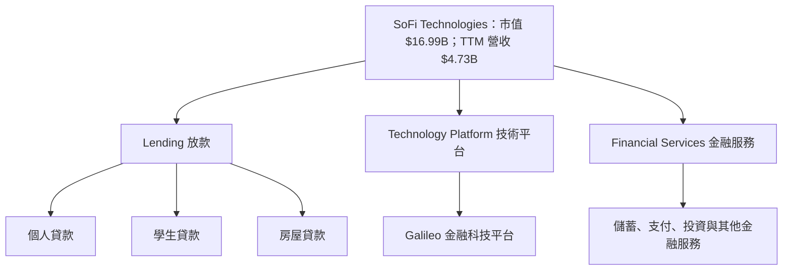
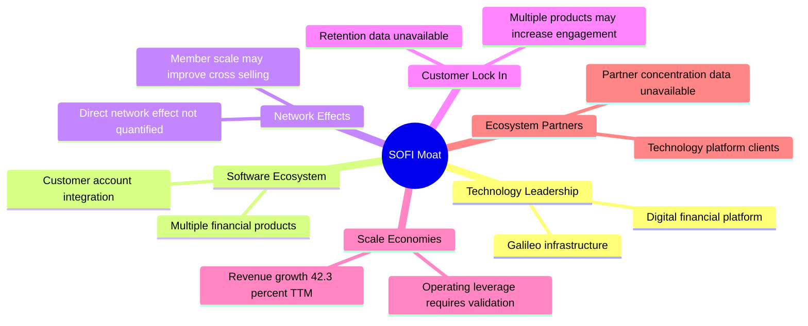
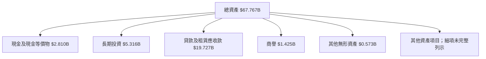
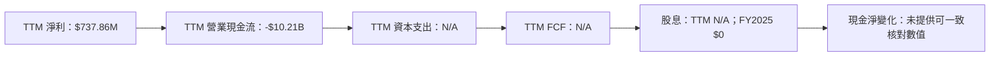
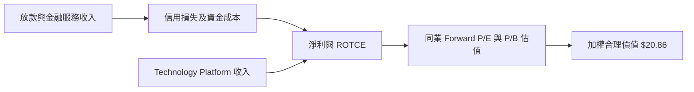
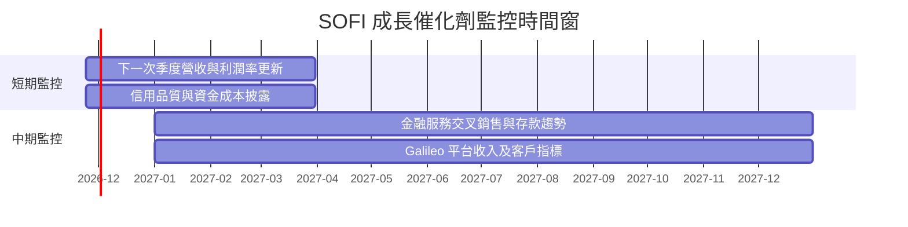
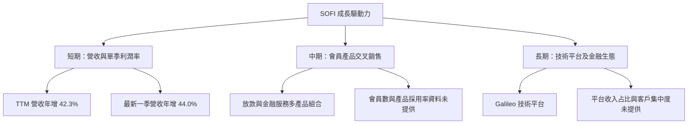
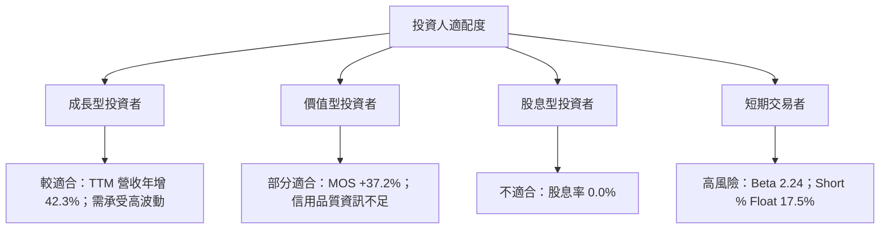

# SOFI 基本面深度分析報告
> **報告日期**：2026-11-24 ｜ **語言**：繁體中文 ｜ **數據來源**：SEC 申報資料 (XBRL)、Yahoo Finance、Finviz、StockAnalysis、Roic.ai ｜ **分析師**：CFA 級機構研究

## 目錄

| # | 章節 | 核心結論 |
|---|------|----------|
| 1 | 執行摘要 | 買入；加權合理價值 $20.86；MOS +37.2% |
| 2 | 公司概覽與商業模式 | 數位金融與放款平台具交叉銷售潛力，量化市場份額未提供 |
| 3 | 損益表深度分析 | TTM 營收 $4.73B、TTM 年增 42.3%；最新單季年增 44.0% |
| 4 | 資產負債表分析 | 現金及短期投資 $2.81B；總債務欄為 N/A，其他來源數字有差異 |
| 5 | 現金流量深度分析 | TTM 營業現金流 -$10.21B；貸款擴張使一般 FCF 指標不適用 |
| 6 | 獲利能力與資本效率 | ROIC 不適用於放款機構；ROTCE 7.9%，放款及信用指標資料不完整 |
| 7 | 相對估值分析 | 對同業 Forward P/E 有折價；估值方法加權結果高於現價 |
| 8 | DCF 內在價值評估 | DCF 不適用於銀行式放款機構；改以規定的相對估值方法三角驗證 |
| 9 | 成長催化劑 | 營收成長、交叉銷售及技術平台為觀察重點，TAM 數據未提供 |
| 10 | 風險矩陣 | 信貸週期、融資成本與監管政策為主要風險 |
| 11 | 投資建議 | 買入；建議觀察區間 $12.41–$18.77，並以信用品質與資本充足度作驗證 |

## 1. 執行摘要

SOFI 的 TTM 營收為 **$4.73B**，TTM 年增 **42.3%**，最新一季營收年增 **44.0%**，顯示成長仍快；但 TTM 營業現金流為 **-$10.21B**，且放款機構的貸款資金流會令傳統 FCF 難以解讀，因此 FCF 與 FCF Yield 均採用 N/A。依金融業估值方法，Forward P/E、同業 P/B 及分析師共識目標價加權後，合理價值為 **$20.86**；相對 **2026-11-23 收盤價 $13.09**，MOS 為 **+37.2%**，按 MOS 門檻評級為**買入**。由於逾放比、淨沖銷率及 CET1 等核心信用與資本數據未提供，評級信心度為中低，而非只依價格折價給予高信心。

### 1.0 一頁式投資儀表板（Portfolio Manager 30 秒速讀）

| 項目 | 內容 |
|------|------|
| **投資論點（3 句）** | ① TTM 營收 $4.73B、年增 42.3%，反映會員金融服務及放款規模仍在擴張。② 最新一季營收年增 44.0%，營業利益率（單季）19.4%，顯示營收成長與獲利已有一定同步性。③ 加權合理價值 $20.86，較 $13.09 收盤價高；但 TTM 營業現金流 -$10.21B 且貸款品質數據缺漏，仍須留意資產品質與資金成本。 |
| **綜合評分** | **6.3/10**（引用 1.1 評分卡） |
| **財務健康** | 🟡 現金及短期投資 $2.81B；總債務在核驗指標中為 N/A，其他來源有不同口徑數字，流動性不宜只看現金餘額。 |
| **ROIC vs WACC** | ROIC：N/A（放款機構不適用一般企業 ROIC）；參考 ROTCE 7.9% vs WACC 14.00%，但兩者口徑不同，不可直接視為價值利差。 |
| **FCF 趨勢** | TTM 營業現金流 -$10.21B；資本支出及 FCF（核驗口徑）N/A；FCF Yield N/A。 |
| **估值** | Forward P/E 14.62x（Yahoo Finance 彙整值）｜EV/EBITDA N/A（同業資料僅 UPST 有數值，不能形成有效中位數）｜FCF Yield N/A |
| **DCF 內在價值（基準）** | N/A（放款機構現金流包含融資與貸款資金，DCF 不適用）；因此 DCF 折溢價 N/A。 |
| **安全邊際（MOS）** | **+37.2%＝($20.86 − $13.09) ÷ $20.86**；🟢 >25% 充足（基準為 8.8 加權合理價值）。 |
| **預期報酬（基準情境 12M）** | N/A（無可用 DCF 情境或 12 個月模型）；加權合理價值的隱含上行空間為 +59.4%，不等同 12M 預期報酬。 |
| **關鍵風險（前二）** | 信貸惡化推高損失；存款與批發融資成本上升壓縮淨息差。 |
| **評級 + 信心度** | 🟢 **買入**（依 MOS 門檻；無質化調級）｜信心：中低 |

### 1.1 綜合評分卡（全報告唯一）

| 維度 | 評分（1–10） | 主要依據（引用數字與其來源章節） |
|------|--------------|----------------------------------|
| 成長性 | 8.0 | TTM 營收年增 42.3%、最新一季年增 44.0%（第 3 章）；成長數據強，但單一季度增速不保證持續。 |
| 獲利能力 | 6.0 | 最新一季營業利益率 19.4%、ROE（核驗值）6.5%、ROTCE 7.9%；TTM 營業利益率與一般 ROIC 為 N/A（第 3、6 章）。 |
| 財務健康 | 5.5 | 現金及短期投資 $2.81B、核驗總債務 N/A；TTM 營業現金流 -$10.21B，且信用指標未提供（第 4、5、6 章）。 |
| 估值 | 7.0 | MOS +37.2%；同業 Forward P/E 中位數 11.0x，SOFI Forward P/E 約 14.62x，估值方法間分歧明顯（第 7、8 章）。 |
| 護城河 | 6.0 | 多產品金融平台與 Galileo 技術平台可形成交叉銷售，但收入分部占比、客戶留存與平台收入明細未提供（第 2 章）。 |
| 管理層與資本配置 | 5.5 | 2025 年 SBC $262.06M；無股息，回購資料未提供；不能只憑營收增長判定資本配置效率（第 3、5 章）。 |
| **綜合評分** | **6.3** | 六項算術平均：(8.0 + 6.0 + 5.5 + 7.0 + 6.0 + 5.5) ÷ 6 = 6.33，四捨五入至一位小數。 |

### 1.2 五大投資論點 + 三大核心風險

| 類型 | 項目 | 具體依據 | 信心度 |
|------|------|----------|--------|
| 🟢 **投資論點①** | 營收成長延續 | TTM 營收 $4.73B，年增 42.3%；最新一季年增 44.0%。若成長延續，可能支撐會員與金融服務規模擴大。 | 🟢 高 |
| 🟢 **投資論點②** | 已有正向季度獲利 | 最新一季淨利 $240.99M，單季營業利益率 19.4%；相對過往虧損年度，獲利模式已有改善。 | 🟢 中 |
| 🟢 **投資論點③** | 金融服務平台交叉銷售 | 公司橫跨 Lending、Technology Platform、Financial Services；交叉銷售可提升每位會員的產品採用，但分部收入數據未提供。 | 🟡 中 |
| 🟢 **投資論點④** | 核驗估值顯示折價空間 | 加權合理價值 $20.86，MOS +37.2%；其中同業 P/B 方法得出 $34.68，惟其與 Forward P/E 方法 $9.85 差距很大。 | 🟡 中 |
| 🟢 **投資論點⑤** | 會員金融服務可拓寬收入來源 | 存貸、支付、投資及借貸服務涵蓋多種個人金融需求；現有數據未提供會員數、產品滲透率及留存率，尚不能量化單位經濟效益。 | 🟡 中 |
| 🟡 **風險①** | 信貸品質數據不足 | 淨沖銷率、逾放比及貸款分期品質均未提供，難以確認高成長是否伴隨風險放寬。 | 🔴 高衝擊 |
| 🔴 **風險②** | 現金流呈現容易被誤讀 | TTM 營業現金流 -$10.21B；放款機構的貸款資金流會造成大額流出，不能單以傳統企業 FCF 判定經營失敗，但亦需追蹤資金來源。 | 🔴 高衝擊 |
| 🟡 **風險③** | 估值方法分歧 | 同業 Forward P/E 隱含 $9.85，而同業 P/B 隱含 $34.68；估值結果對股本報酬與同業倍數高度敏感。 | 🟡 中 |

### 1.3 快速統計卡片

| 指標 | 公司實際值（期間） | 同業中位數 | 狀態 |
|------|--------------------|------------|------|
| 營收成長（TTM） | **42.3%** | — | 🟢 |
| 營收成長（最新一季年增） | **44.0%** | 34.1% | 🟢 |
| 毛利率（TTM） | **84.2%** | 83.3% | 🟢 |
| 營業利益率（TTM） | **N/A** | — | 🟡 |
| ROIC（TTM） | **N/A（放款機構不適用）** | — | 🟡 |
| Forward P/E | **14.62x** | 11.0x | 🟡 |
| FCF Yield（TTM） | **N/A** | — | 🟡 |
| Piotroski F-Score | **N/A（未套用於放款機構）** | — | 🟡 |

### 1.4 投資結論

╔══════════════════════════════════════════════════════════════════╗  
║                    📊 投資結論摘要                               ║  
╠══════════════════════════════════════════════════════════════════╣  
║  評級：買入（MOS +37.2%，依規則 20；無質化調級）                 ║  
║  價格（2026-11-23 收盤）：$13.09                                 ║  
║  DCF 內在價值（基準）：N/A（放款機構現金流不適用）               ║  
║  安全邊際 MOS：+37.2%（＝($20.86−$13.09)÷$20.86）              ║  
║  加權合理價值（8.8）：$20.86                                     ║  
║  DCF 情境價值：N/A（DCF MODEL 未計算）                           ║  
║  綜合評分：6.3/10（引用 1.1）                                    ║  
║  適合投資人：能承受高波動、看重營收擴張並願意追蹤信用風險者      ║  
╚══════════════════════════════════════════════════════════════════╝  

## 2. 公司概覽與商業模式

### 2.1 業務結構與收入來源

SOFI 是美國金融服務公司，業務涵蓋放款、金融服務與技術平台。可用數據沒有各分部營收、占比或 Galileo 收入拆分，以下只呈現可確認的公司規模與業務關係，不推估分部占比。

放款收入受貸款需求、利率、信用損失及融資成本影響；技術平台則可能提供較不依賴資產負債表的收入來源，但現有資料未提供其收入占比、毛利或客戶數，無法量化兩者對整體獲利的相對貢獻。

### 2.2 市場份額

市場份額數據未提供，亦無可引用的年份與來源數字，因此不繪製市占圖。SOFI TTM 營收 $4.73B、年增 42.3%，最新單季年增 44.0%，高於所列同業 NU、HOOD、UPST 最新季度營收年增率中位數 34.1%；這代表營收增速較快，不等同市場份額已提升。

### 2.3 競爭護城河分析

### 2.4 護城河強度

| 護城河項目 | 強度（強／中／弱） | 證據（引用數字或事實） | 會削弱它的情況 |
|------------|--------------------|------------------------|----------------|
| 技術與產品整合 | 中 | 同時提供放款、支付、儲蓄、投資等服務，並營運 Galileo；分部收入與留存數據未提供。 | 產品體驗差異縮小、平台可靠性或資安事件。 |
| 軟體生態系統 | 中 | 技術平台與自有金融產品可形成多產品關係；平台收入占比、客戶數均未提供。 | 客戶集中、客戶流失或競爭平台價格下降。 |
| 網路效應 | 弱至中 | 會員增加理論上能增加交叉銷售機會，但會員數及轉換率未提供，沒有直接網路效應的量化證據。 | 會員增加未帶動產品數或每會員收入。 |
| 客戶鎖定 | 中 | 多產品帳戶可能增加轉換成本，但留存率、存款穩定性與客戶取得成本未提供。 | 客戶以利率或促銷為主要選擇，易轉移資金。 |
| 規模效應 | 中 | TTM 營收年增 42.3%，最新單季營業利益率 19.4%；尚無完整 TTM 營業利益率趨勢。 | 營收增長伴隨信用損失、行銷或融資成本更快增加。 |
| 生態夥伴 | 中 | Galileo 提供技術平台服務，但合作夥伴收入及集中度未提供。 | 大型合作夥伴轉向自建或更換供應商。 |

**1.1 護城河評分為 6.0/10**：產品廣度與技術平台提供建立黏著度的可能性，但缺少會員、留存、分部收入與合作夥伴集中度數據，尚不足以證明護城河已轉化為持續的定價能力。

## 3. 損益表深度分析

### 3.1 年度收入成長趨勢（近 4 年）

年度收入取自所列年度損益表，金額為四捨五入數；年增率按該表數字計算。

╔══════════════════════════════════════════════════════════════════╗  
║              SOFI 年度收入趨勢（FY2022–FY2025）                 ║  
╠══════════════════════════════════════════════════════════════════╣  
║ FY2022  $1.57B   ██████████░░░░░░░░░░░░░░░░   基期              ║  
║ FY2023  $2.11B   ██████████████░░░░░░░░░░░░   YoY 約 +34.4%     ║  
║ FY2024  $2.61B   ██████████████████░░░░░░░░   YoY 約 +23.7%     ║  
║ FY2025  $3.61B   █████████████████████████░   YoY 約 +38.3%     ║  
║                                                                  ║  
║ FY2022–FY2025 收入 CAGR：約 32.0%                                ║  
╚══════════════════════════════════════════════════════════════════╝  

**計算**：FY2023 YoY = $2.11B ÷ $1.57B − 1 ≈ 34.4%；FY2024 YoY = $2.61B ÷ $2.11B − 1 ≈ 23.7%；FY2025 YoY = $3.61B ÷ $2.61B − 1 ≈ 38.3%。三年 CAGR = ($3.61B ÷ $1.57B)^(1/3) − 1 ≈ 32.0%。年度表與另一資料來源的營收略有差異，該 CAGR 只反映此處採用的年度表口徑；TTM 成長仍引用核驗值 42.3%。

### 3.2 季度收入趨勢分析

季度營收採用 StockAnalysis 季度資料（單位：$B）；最新季度年增率則按核驗指標標示為 44.0%。

| 季度 | 營收 | QoQ 成長 | YoY 成長 | 備註 |
|------|------:|---------:|---------:|------|
| 2025 Q4 | 1.020 | 約 +7.1% | N/A（此表未提供前一年同期） | 相較 2025 Q3 $0.9524B。 |
| 2026 Q1 | 1.091 | 約 +7.0% | 約 +42.5% | 相較 2025 Q1 $0.7661B。 |
| 2026 Q2 | 1.205 | 約 +10.5% | 約 +42.6% | 相較 2025 Q2 $0.8449B。 |
| 2026 Q3 | 1.370 | 約 +13.7% | **44.0%（核驗值，單季）** | StockAnalysis 報表的營收為 $1.385B，來源口徑不同；年增率採核驗單季值。 |

季度數據呈現連續環比增加；最新季度高於前幾季的環比增速，可能來自放款與金融服務規模擴張，但缺乏分部收入明細，無法確認增長來源及各分部的可持續性。

### 3.3 利潤率演變分析

| 利潤率指標 | FY2022 | FY2023 | FY2024 | FY2025 | 趨勢 | 評估 |
|------------|--------|--------|--------|--------|------|------|
| **毛利率** | N/A | N/A | N/A | N/A | 年度歷史值未提供；TTM 彙整值 84.2% | 🟡 |
| **營業利益率** | N/A | N/A | N/A | N/A | TTM 核驗值 N/A；最新一季為 19.4% | 🟡 |
| **淨利率** | 負值 | 負值 | 約 19.1% | 約 13.3% | FY2025 淨利低於 FY2024，儘管營收上升 | 🟡 |

淨利潤資料顯示，公司從 2022、2023 年虧損轉為 2024、2025 年盈利；但 2025 年淨利 $481.32M 低於 2024 年 $498.67M，而年度營收由 $2.61B 升至 $3.61B。這代表收入擴張沒有在該年度一比一轉化為淨利增長，可能與貸款損失、資金成本、業務組合或費用變化有關；現有數據不足以拆解各因素貢獻。最新一季營業利益率 19.4% 是單季數字，不應與 N/A 的 TTM 營業利益率混用。

### 3.4 費用結構分析

分部費用及營收成本拆分未提供，無法建立有根據的費用結構圓餅圖。已知 SBC：2025 年 $262.06M；TTM 可由所列四季數字加總約為 $288.33M。利息費用、信貸損失及營運費用的 TTM 明細未提供，因此不以不完整項目拼湊費用占比。

### 3.5 季度 EPS 趨勢與盈餘品質（Quality of Earnings）

EPS 預期值資料在四個季度均為 N/A，因此不能判定是否超預期或不及預期。已披露的最新季度 EPS 成長率為 64.4% YoY，但「EPS 成長」不等於「超預期」。

| 盈餘品質項目 | 數值/佔比 | 評估 |
|--------------|-----------|------|
| 股權薪酬 SBC / 營收 | TTM SBC 約 $288.33M ÷ TTM 營收 $4.73B ≈ **6.1%** | 🟡 占營收比例具實質性，會稀釋股東經濟利益；此處以可用季度 SBC 加總估算，非核驗品質指標。 |
| SBC / 營業現金流 | $288.33M ÷ -$10.21B ≈ **-2.8%**；以流出絕對值計約 2.8% | 🟡 負營業現金流包含放款資金流，比例不能直接解讀為薪酬占經營現金創造比重。 |
| FCF / 淨利（現金轉換率） | **N/A**（核驗 TTM FCF 與同口徑淨利現金轉換資料不足） | 🟡 金融業貸款現金流令傳統 FCF 轉換率失真。 |
| 一次性/非經常性損益 | **N/A**（缺少完整損益附註拆分） | 🟡 無法判定非經常項目對最新季度盈餘的影響。 |
| 有效稅率異常 | 8.5%（最新年度有效稅率） | 🟡 稅率低於一般名目稅率的可能原因未在資料中拆分，估值不宜假設長期維持此值。 |
| 資本化支出 vs 費用化 | TTM 資本支出 N/A；年度資本支出資料可見，資本化政策明細未提供 | 🟡 無法排除資本化與費用化差異對當期獲利的影響。 |

**盈餘品質結論**：SOFI 已呈現正淨利及正季度營業利益，但 TTM FCF 不可用且營業現金流為負，主要需依放款機構的資產負債表、貸款品質與資金成本評估盈餘含金量。SBC 約占 TTM 營收 6.1%，代表每股價值仍受股權薪酬稀釋影響；在缺少信貸損失拆解前，不宜把單季獲利增長直接外推為穩態盈餘。

## 4. 資產負債表分析

### 4.1 資產結構分解

以下資產項目取自 StockAnalysis TTM 資產負債表；細項並非完整資產調節表，未列出的資產不作反推。

貸款及租賃應收款是金融機構的核心生息資產，約占所列總資產的 29.1%（$19.727B ÷ $67.767B）；但放款淨額占總資產的核驗比例為 79.3%，與上述會計科目口徑不同，應以 Lender Metrics 的定義為準，不可混用。

### 4.2 流動性與營運資金分析

| 指標 | 最新值 | 歷史趨勢 | 評估 |
|------|--------|----------|------|
| 現金及短期投資 | $2.81B | N/A（核驗資料未提供同口徑歷史趨勢） | 🟡 現金提供流動性緩衝，但需同時看存款穩定性與融資到期結構。 |
| Current Ratio | 1.086 | 歷史趨勢 N/A | 🟡 金融機構一般流動性不宜單靠此比率判定。 |
| Quick Ratio | 0.428 | 歷史趨勢 N/A | 🟡 並非銀行資產負債管理的核心監控指標。 |
| 總債務 | N/A（核驗指標） | N/A | 🟡 其他資料來源列出不同債務金額，需回到 SEC 分項核對。 |

**營運資金天數**：不適用（金融業）。DSO、DIO、DPO、CCC 用於一般企業存貨與應收應付循環，不適合直接評估放款機構。

### 4.3 債務結構分析

核驗指標的總債務為 **N/A**，但其他彙整資料分別出現總債務 $3.98B、年度債務 $1.93B，以及不同期間借款數字。由於口徑與期間未能一致核對，不將其中任一個數字冒充為核驗總債務，也不計算 Debt/EBITDA 或利息保障倍數。

╔══════════════════════════════════════════════════════════════════╗  
║                   SOFI 債務健康診斷                              ║  
╠══════════════════════════════════════════════════════════════════╣  
║  總債務（核驗口徑）：N/A；其他來源數字口徑有差異                 ║  
║  現金及短期投資： $2.81B                                         ║  
║  淨現金：         $2.81B（核驗欄位；總債務未提供）               ║  
║  Debt/EBITDA：    N/A（債務口徑及 EBITDA 不足）                   ║  
║  Interest Coverage：N/A（計息負債及利息覆蓋資料不足）             ║  
║  判讀：須以 SEC 10-Q 的借款、存款、證券化及到期結構作逐項核對    ║  
╚══════════════════════════════════════════════════════════════════╝  

核驗資料列示 Net cash $2.81B，同時總債務為 N/A；這不是可由現金減債務重算出的淨現金，而是應原值引用的資料欄位。另有彙整財務表列出現金 $2.85B、債務 $3.98B、淨債務 $1.14B，與核驗口徑不一致；本報告不將兩種口徑混算。

### 4.4 股東權益趨勢

╔══════════════════════════════════════════════════════════════════╗  
║                 SOFI 歷年股東權益（年度）                        ║  
╠══════════════════════════════════════════════════════════════════╣  
║ 2022  $5.53B   ███████████░░░░░░░░░░░░░░░░                      ║  
║ 2023  $5.55B   ███████████░░░░░░░░░░░░░░░░                      ║  
║ 2024  $6.53B   █████████████░░░░░░░░░░░░░░                      ║  
║ 2025  $10.49B  █████████████████████░░░░░░░                      ║  
╚══════════════════════════════════════════════════════════════════╝  

股東權益由 2024 年 $6.53B 增至 2025 年 $10.49B，增加約 60.6%。權益增長可增強損失吸收能力，但也可能受增發及累積盈餘影響；現有資料未提供完整股數稀釋、資本交易與監管資本調節，因此不能將權益增加全數視為內生資本創造。

## 5. 現金流量深度分析

### 5.1 現金流量瀑布圖

金融機構的營業現金流包含貸款發放與收回，不能當作一般公司的經營自由現金流。圖中僅標示有數字的項目；資本支出及 FCF 的核驗 TTM 值為 N/A。

### 5.2 FCF 轉換率趨勢

| 年度 | FCF | 淨利 | FCF / 淨利 | 解讀 |
|------|-----:|-----:|-----------:|------|
| 2022 | -$7.36B | -$320.41M | 不具解讀性 | 淨利為負，且現金流受放款資金變動影響。 |
| 2023 | -$7.35B | -$300.74M | 不具解讀性 | 同上。 |
| 2024 | -$1.28B | $498.67M | 約 -2.6x | 傳統比率偏低，但不宜直接套用一般企業判準。 |
| 2025 | -$3.99B | $481.32M | 約 -8.3x | 現金流與淨利方向背離，應拆分貸款組合及存款資金變化。 |
| TTM | N/A | $737.86M | N/A | 核驗 TTM FCF 不可用。 |

表中年度 FCF 取自年度現金流資料，並非核驗 TTM FCF 定義的替代值。負現金流的主要分析重點是貸款資產增長與負債融資，不是直接推斷盈利無現金支撐。

### 5.3 自由現金流趨勢

╔══════════════════════════════════════════════════════════════════╗  
║              歷史 FCF（報表口徑）與核驗 TTM                      ║  
╠══════════════════════════════════════════════════════════════════╣  
║ FY2022  -$7.36B  ◀ 大額流出；金融業口徑需審慎解讀                ║  
║ FY2023  -$7.35B  ◀ 大額流出；貸款與資金流可能為主因              ║  
║ FY2024  -$1.28B  ◀ 較前期收斂                                    ║  
║ FY2025  -$3.99B  ◀ 流出再擴大                                    ║  
║ TTM     N/A      ◀ 核驗資本支出與 FCF 均未提供                   ║  
║ FCF Yield（TTM）：N/A                                             ║  
╚══════════════════════════════════════════════════════════════════╝  

### 5.4 資本配置評估

資本配置金額以有資料的年度項目為限；沒有可靠數字的資本用途不繪製比例圖。

| 資本用途 | 可用數據 | 評估 |
|----------|----------|------|
| 資本支出 | FY2025 $251.12M（報表列示支出）；TTM 核驗值 N/A | 對技術與營運基礎建設的投入需配合營收及效率指標評估。 |
| 股權薪酬 | FY2025 $262.06M | 形成股東稀釋成本，應同時追蹤股數變化及每股盈餘。 |
| 股息 | FY2025 $0；股息率 0.0% | 未以股息回饋股東。 |
| 回購 | 資料未提供 | 不推定存在回購。 |
| 留存與貸款資產投入 | 資金流明細不足 | 需依 SEC 申報中的放款、存款與投資明細追蹤。 |

## 6. 獲利能力與資本效率

### 6.1 ROE / ROA / ROIC 趨勢

| 指標 | 可用期間與數值 | 評估 |
|------|----------------|------|
| ROE | TTM 6.5%（核驗品質數據）；其他彙整來源為 7.4% | 🟡 口徑有差異；本節採核驗值 6.5%。 |
| ROA | TTM 1.3%（彙整財務資料） | 🟡 放款機構需與信用成本及資產風險共同判讀。 |
| ROIC | N/A（金融業不適用一般投入資本定義） | 不以非金融企業方式計算或比較。 |
| ROTCE | TTM 7.9% | 🟡 比帳面 ROE 更貼近有形股本回報，但仍須搭配監管資本及信用損失。 |

一般行業均值未提供，故不列行業均值比較。

### 6.2 ROIC vs WACC 分析（核心價值創造判斷）

放款機構的債務、存款與貸款本身是核心營運資產負債，不適合直接以一般非金融公司的 ROIC−WACC 判定價值創造。核驗數據提供 WACC 14.00%，但 ROIC 為 N/A；ROTCE 7.9% 可作為股本回報參考，不能當成 ROIC 直接相減。

╔══════════════════════════════════════════════════════════════════╗  
║                ROIC vs WACC 深度分析                            ║  
╠══════════════════════════════════════════════════════════════════╣  
║  折現率參考（核驗 Cost of capital）：                            ║  
║  ├── 無風險利率（10Y 美債）：4.92%                               ║  
║  ├── 市場風險溢酬 ERP：5.00%                                     ║  
║  ├── Beta（原始）：2.24；採用調整後 Beta：1.83                   ║  
║  ├── 股權成本 Ke（核驗）：14.05%                                 ║  
║  ├── 稅前債務成本：29.04%；有效稅率：8.5%                        ║  
║  ├── 資本權重：股權 81.0%，債務 19.0%                            ║  
║  └── WACC：核驗計算值 16.43%，限制於 7%–14% 區間後採用 14.00%   ║  
║                                                                  ║  
║  ROIC：N/A（放款機構，定義不適用）                               ║  
║  ROTCE：7.9%（股本回報參考，非 ROIC）                            ║  
║  WACC 與 ROTCE 差：7.9% − 14.00% = -6.1 個百分點                ║  
║  判讀：此差值僅作風險提示，不可視為正式 EVA                      ║  
╚══════════════════════════════════════════════════════════════════╝  

**CAPM 檢核說明**：Beta 採調整後 1.83，公式為 ⅔ × 原始 Beta 2.24 + ⅓ × 1；核驗股權成本為 14.05%。因原始數字經未列出的精度處理，股權成本採核驗值，不以顯示至兩位小數的數字重新替換。WACC 的計算值 16.43% 超過核驗設定上限，故採用 14.00%。此 WACC 是估值輸入，不代表銀行監管資本或存款成本分析的替代值。

### 6.3 杜邦三因素分解

| 因素 | 數值（TTM） | 解讀 |
|------|-------------|------|
| 淨利率 | 15.6% | 核驗杜邦數據；顯示每單位營收的淨利貢獻。 |
| 資產週轉率 | 0.07 | 金融機構資產規模大，週轉率通常不是獨立判斷獲利品質的充分指標。 |
| 權益乘數 | 6.00 | 財務槓桿對 ROE 有放大效果，須與資本充足及信用損失一起看。 |
| **ROE** | **6.5%** | 15.6% × 0.07 × 6.00 ≈ 6.5%；數值以核驗杜邦列為準。 |

### 6.4 財務體質：金融業 Lender Metrics

Piotroski F-Score 為 **N/A**，因放款成長會造成營運現金流出，該指標的現金流測試會誤讀銀行型業務。核驗資料未列出九項測試結果，因此不逐項編造。

| 指標 | 數值 | 解讀 |
|------|------:|------|
| 淨利息收入 NII / 總營收 | 64.0% | 顯示利息收入是主要收入來源之一；該比例不等同淨利差。 |
| 淨利差代理值 NII / 平均總資產 | 5.36% | **代理值**；缺乏生息資產分母，因此會低於以生息資產計算的正式 NIM。 |
| 成本收入比代理值 | 80.8% | **代理值**，公式含信貸準備，因此高於一般公司或銀行公布的效率比率。 |
| ROTCE | 7.9% | 淨利除以有形帳面價值，反映有形普通股權益回報。 |
| P/TBV | 1.83x | 市場對有形帳面價值的定價倍數。 |
| 放款淨額 / 總資產 | 79.3% | 資產配置高度倚重放款，信用品質及資金成本重要性高。 |
| 淨沖銷率 | N/A（數據未提供） | 必須以後續申報資料追蹤。 |
| 逾放比 | N/A（數據未提供） | 必須以後續申報資料追蹤。 |
| CET1 | N/A（數據未提供） | 不能據此判定監管資本緩衝。 |

## 7. 相對估值分析

### 7.1 同業估值比較表格

SOFI 的 Forward P/E、P/S 等欄位採市場資料彙整值；NU、HOOD、UPST 倍數採 Yahoo Finance 同業資料。SOFI P/E 不同資料源有 23.4x 與 23.8x 差異，表中比較採市場估值欄位 23.8x，歷史位置則依核驗歷史估值 23.4x。

| 估值指標 | **SOFI** | **NU** | **HOOD** | **UPST** | SOFI 評估 |
|----------|---------:|------:|--------:|--------:|-----------|
| **Trailing P/E** | 23.8x | 14.8x | 31.0x | 27.8x | 🟡 介於同業高低端。 |
| **Forward P/E** | 14.62x | 11.0x | 19.8x | 5.8x | 🟡 高於同業中位數 11.0x；市場對成長仍給溢價。 |
| **P/S Ratio** | 3.63x | 6.3x | 11.9x | 1.2x | 🟢 低於 NU、HOOD，但高於 UPST；公司業務組合不同。 |
| **EV/EBITDA** | N/A | N/A | N/A | 25.3x | 🟡 同業只提供一家公司有效值，無可比中位數。 |
| **最新一季營收 YoY** | 44.0% | 34.4% | 11.8% | 34.1% | 🟢 SOFI 高於所列三家。 |
| **毛利率（TTM）** | 84.2% | 0.0% | 91.0% | 83.3% | 🟡 SOFI 介於兩家正毛利同業之間；NU 口徑可比性需審慎。 |

SOFI Forward P/E 14.62x 高於 peer median 11.0x，代表若只看未來盈餘倍數，市場定價並非同業最低；另一方面，SOFI 的單季營收增速 44.0% 高於同業列值。金融服務平台與金融科技公司業務結構不同，倍數只能作參考，不能取代信用損失與股本回報分析。

### 7.2 歷史估值區間分析

╔══════════════════════════════════════════════════════════════════╗  
║               SOFI 過去 5 年估值區間（TTM）                     ║  
╠══════════════════════════════════════════════════════════════════╣  
║ P/E：       現值 23.4x ｜歷史區間 27.0x–67.1x ｜中位數 36.6x   ║  
║             核驗百分位 0%；目前低於歷史區間下緣               ║  
║ P/S：       現值 3.8x ｜歷史區間 2.6x–14.6x ｜中位數 4.5x     ║  
║             核驗百分位 29%                                      ║  
║ EV/EBITDA：現值 52.5x｜歷史區間 19.0x–148.7x｜中位數 65.1x   ║  
║             核驗百分位 33%                                      ║  
╚══════════════════════════════════════════════════════════════════╝  

核驗 P/E 現值 23.4x 低於歷史區間下緣 27.0x；這可能反映市場風險折價、來源口徑差異，或盈餘基礎變化，不能僅以百分位推斷股價便宜。EV/EBITDA 52.5x 仍高於 UPST 單一有效同業倍數 25.3x，且本公司 EBITDA 資料口徑不完整，故需保留。

### 7.3 情境價值（Bear / Base / Bull）

**N/A（DCF 無法計算：放款機構的現金流包含融資與貸款資金，不適合以一般企業自由現金流折現；因此沒有可引用的 DCF MODEL Scenarios。）**

### 7.4 相對估值隱含價格區間

╔══════════════════════════════════════════════════════════════════╗  
║              相對估值每股價值與現價位置                         ║  
╠══════════════════════════════════════════════════════════════════╣  
║ 同業 Forward P/E： $9.85  ＜ 現價 $13.09                         ║  
║ 分析師共識目標價： $20.67 ＞ 現價 $13.09                         ║  
║ 同業 P/B：         $34.68 ＞ $20.67                              ║  
╚══════════════════════════════════════════════════════════════════╝  

- **同業 Forward P/E $9.85**：peer median 11.0x × SOFI Forward EPS $0.90（核驗估值方法所用數字）。
- **同業 P/B $34.68**：peer median P/B 4.0x × 每股帳面價值 $8.71。
- **分析師共識 $20.67**：23 位分析師平均目標價，屬外部參考而非營運模型估值。

## 8. DCF 內在價值評估（Discounted Cash Flow）

> **適用性結論：DCF MODEL 為 N/A。** SOFI 是放款機構，貸款發放和資金籌措是核心業務活動；營業現金流不能直接等同企業自由現金流。本章不另建一般企業 DCF，也不提供杜撰的 DCF 目標價、敏感度或情境價值。估值採第 8.8 節由金融業估值規則固定的三種方法。

### 8.0 估值推理鏈（Thinking Logic）

SOFI 的估值主要由三類因素決定：① 放款與金融服務形成的利息及非利息收入；② Technology Platform 的收入與獲利貢獻；③ 資產品質、融資成本及資本要求對股本報酬的影響。TTM NII 占營收 64.0%，可確認利息收入是重要來源，但未提供各業務分部營收占比，不能替它們指定比例。

| 決策點 | 本報告採用 | 理由（含數字） | 曾考慮但否決 | 否決理由 |
|--------|-----------|----------------|--------------|----------|
| 現金流定義 | 不採一般 FCFF/FCFE DCF | TTM 營業現金流 -$10.21B，放款資金流使傳統 FCF 失去可比性 | 以 FCFF 直接折現 | 財務資料明確將 lender DCF 標示為 N/A。 |
| 預測期 N | N/A | 無 DCF 預測模型 | 自行設定 5–10 年 | 無管理層財測或可核驗假設，會形成黑箱估值。 |
| 終值方法 | N/A | 無有效 FCFF 基礎 | Gordon Growth 或退出倍數 | 不適用於本次已規定的估值框架。 |
| EBIT 基礎 | N/A | 不建立 DCF | 自行推估 GAAP EBIT | TTM 營業利益率核驗值 N/A。 |

關鍵假設推導鏈：營收 CAGR、期末營業利潤率、g、Capex、ΔWC、股數稀釋及終值均**不適用**，原因是指定模型為 N/A；不將歷史增速外推成假設值。最脆弱的投資論點不是 DCF 假設，而是相對估值中同業 P/B 得出的價值能否由可持續 ROTCE 支撐。

### 8.1 模型假設總表（Model Inputs）

| 假設項目 | 採用值 | 依據 / 來源 | 敏感度 |
|----------|--------|-------------|--------|
| 預測期長度 N | N/A | DCF MODEL：放款機構現金流不適用 | N/A |
| 營收 CAGR | N/A | 不另建 DCF | N/A |
| 營業利潤率 | N/A | TTM 營業利益率核驗值為 N/A | N/A |
| 有效稅率 | N/A | 不進行 DCF 預測 | N/A |
| Capex / 營收 | N/A | TTM 資本支出核驗值為 N/A | N/A |
| D&A / 營收 | N/A | 未建立 DCF | N/A |
| ΔWC / 營收增額 | N/A | 一般企業營運資金模型不適用於放款機構 | N/A |
| EBIT 基礎 | N/A | 不建立 DCF 模型 | N/A |
| SBC 處理 | N/A | 不建立 DCF；SBC 另於第 3.5 節分析 | N/A |
| 年稀釋率 | N/A | 不建立 DCF | N/A |
| 永續成長率 g | N/A | 無終值計算 | N/A |
| 終值方法 | N/A | 無有效 FCFF | N/A |
| WACC | 14.00%（核驗採用值） | 成本資本區塊計算值 16.43%，受 7%–14% 區間限制 | 不用於 DCF |

DCF 為 N/A，故不適用預測 FCFF、SBC 組合 A/B/C、逐年稀釋股數及預測期表格；不提供虛構輸入。

### 8.2 折現率推導（WACC）

本節照列核驗成本資本資料。SOFI 的放款機構估值不以此 WACC 建立 DCF；此折現率只用於保留資本成本資料的一致披露。

╔══════════════════════════════════════════════════════════════════╗  
║                    WACC 推導（折現率）                           ║  
╠══════════════════════════════════════════════════════════════════╣  
║  股權成本 Ke（CAPM，核驗值）：14.05%                             ║  
║  ├── 無風險利率 Rf（10Y 美債）：4.92%                            ║  
║  ├── 市場風險溢酬 ERP：5.00%                                     ║  
║  ├── 原始 Beta：2.24；調整後 Beta：1.83                          ║  
║  ├── 調整：⅔ × 2.24 + ⅓ × 1 = 1.83                             ║  
║  └── Ke：核驗 CAPM 輸出 14.05%                                   ║  
║                                                                  ║  
║  債務成本：稅前 29.04%；有效稅率 8.5%                            ║  
║  稅後 Kd：29.04% × (1 − 8.5%) = 26.58%（四捨五入）              ║  
║  權重：股權 81.0%；債務 19.0%                                    ║  
║  計算 WACC：0.810 × 14.05% + 0.190 × 26.58% = 16.43%            ║  
║  採用 WACC：16.43% 限制於 7%–14% 區間後 = 14.00%                ║  
╚══════════════════════════════════════════════════════════════════╝  

五步核對：

1. **Ke**：採用核驗 CAPM 輸出 **14.05%**；調整後 Beta 為 ⅔ × 2.24 + ⅓ × 1 = 1.83。
2. **稅前 Kd**：核驗值 **29.04%**；利息與計息負債的平均餘額拆分未提供，因此不自行重算。
3. **稅後 Kd**：29.04% × (1 − 8.5%) = 26.5716%，按兩位小數約 **26.57%**；成本資本輸入以其內部未四捨五入數字計算。
4. **權重**：股權 81.0% + 債務 19.0% = **100.0%**；市值與計息負債構成明細未完整提供，不另反推。
5. **WACC**：核驗計算值 **16.43%**，限制於 7%–14% 區間後採用 **14.00%**。

顯示到兩位小數的中間數字與程式使用的未四捨五入輸入可能有尾差；報告保留核驗採用值，不以自行重算值替換。第 6.2 節亦採用同一 14.00%。

### 8.3 逐年自由現金流預測（基準情境）

**N/A（DCF MODEL 未提供年度 FCFF 預測；放款機構現金流是資金來源及貸款資產變化的一部分，不能以一般企業 FCFF 模型計算。）** 因無預測期 N，不能建立 FY+1 至 FY+N 表格、折現因子或逐年 PV 加總。

### 8.4 終值計算（Terminal Value）

**N/A（沒有可用 FCFF 預測值，因此 Gordon Growth 與退出倍數終值均不適用。）** 不計算終值佔企業價值比重。

### 8.5 企業價值 → 每股內在價值（Bridge）

**N/A（無 DCF 企業價值可供橋接。）** DCF 基準每股內在價值、現價對 DCF 的折溢價均為 N/A；安全邊際只在 8.8 以加權合理價值計算。

### 8.6 敏感性分析（WACC × 永續成長率）

**N/A（無 DCF 基準 FCFF、終值及永續成長率；不建立敏感度矩陣、逐格演算或三情境 DCF。）**

### 8.7 反推 DCF（Reverse DCF：市場在預期什麼）

**N/A（無可用 DCF 模型，不能以股價反解營收 CAGR、營業利潤率、永續成長率或預測年數。）** 市場價格可由相對估值與分析師共識交叉參考，但不能稱為 Reverse DCF 結果。

### 8.8 估值三角驗證與安全邊際

金融業估值方法名稱、每股價值及權重依固定方法原值列示。DCF 方法不在金融業核驗方法中，沒有加入估值權重。

| 估值方法 | 隱含每股價值 | 上行空間（÷現價） | 權重 | 說明 |
|----------|--------------:|-------------------:|------:|------|
| 同業 Forward P/E | $9.85 | -24.8% | 50% | 同業中位數 11.0x × Forward EPS $0.90。 |
| 同業 P/B | $34.68 | +164.9% | 40% | 同業中位數 4.0x × 每股帳面價值 $8.71。 |
| 分析師共識目標價 | $20.67 | +57.9% | 10% | 23 位分析師平均目標價。 |
| **加權合理價值** | **$20.86** | **+59.4%** | **100%** | 金融業固定權重；方法間差異大，需以營運與資產品質驗證。 |

**逐步演算**：

- 加權合理價值 = $9.85 × 50% + $34.68 × 40% + $20.67 × 10%
- = $4.925 + $13.872 + $2.067
- = $20.864 ≈ **$20.86**（金額四捨五入至美分；加總用未四捨五入結果）。
- MOS = ($20.86 − $13.09) ÷ $20.86 = $7.77 ÷ $20.86 ≈ **37.2%**。
- 上行空間 = ($20.86 − $13.09) ÷ $13.09 = $7.77 ÷ $13.09 ≈ **59.4%**。

╔══════════════════════════════════════════════════════════════════╗  
║                  估值區間與安全邊際                              ║  
╠══════════════════════════════════════════════════════════════════╣  
║  $9.85 ─────── $13.09 ─────── [$20.86] ─────── $34.68            ║  
║  Forward P/E    現價           加權合理值       同業 P/B          ║  
║                                                                  ║  
║  MOS = ($20.86 − $13.09) ÷ $20.86 = +37.2%                      ║  
║  上行空間 = ($20.86 − $13.09) ÷ $13.09 = +59.4%                 ║  
║  MOS 評估：🟢 >25% 充足                                          ║  
║  建議買入區間：$12.41–$18.77（上限對應 MOS ≥10%）               ║  
║  合理持有參考：$18.77–$20.86                                    ║  
║  減碼考慮：高於 $20.86 時重新檢視風險與成長假設                  ║  
╚══════════════════════════════════════════════════════════════════╝  

加權價值由同業 Forward P/E、同業 P/B 及分析師共識構成；固定金融業權重分別為 50%、40%、10%。DCF 與同業 EV/EBITDA 未納入：前者不適用於放款機構，後者缺少足以計算同業中位數的公司資料。買入區間上限計算為 $20.86 × (1 − 10%) = $18.774 ≈ $18.77；下限參考 52 週低點 $12.41，並非估值模型的硬性底價。

> 🔎 **程式複算（Python，依本節各項自動重算）**
>
> 加權合理價值 = $9.85 × 50% + $34.68 × 40% + $20.67 × 10% = **$20.86**（權重合計 100%）
>
> 以價格 $13.09 計：MOS = **+37.2%**，上行空間 = **+59.4%**
>
> ✅ 與本節所寫數值一致。

### 8.9 DCF 模型的局限與失效條件

- **終值依賴度**：N/A，沒有 DCF 終值。
- **最脆弱的估值環節**：同業 P/B 方法得出 $34.68，但該價值依賴每股帳面價值 $8.71 與 4.0x 同業中位數；若可持續有形股本回報不足，P/B 法的參考力會下降。另一端，同業 Forward P/E 方法僅得 $9.85，低於現價，顯示估值對方法選擇敏感。
- **不適用情境說明**：放款機構 FCF 受到貸款發放、資金籌措及存款變動影響，傳統 DCF 可靠度低；較適合用 P/B、P/TBV、股本回報及信用損失作主要檢驗。
- **與第 10 章風險矩陣的連結**：信貸惡化會壓低淨利與 ROTCE；存款競爭或融資成本上升會壓縮淨息差；監管資本要求上升會限制資產成長與資本回報。

### 8.10 複算檢核表（Audit Trail：輸出前自我驗算）

| # | 檢核項目 | 檢查方式 | 結果 |
|---|----------|----------|------|
| 1 | 高／中敏感度 DCF 輸入均有推導 | DCF MODEL 為 N/A，未建立輸入 | ✅ 不適用 |
| 2 | 每個 DCF 假設都有來歷 | 未建立 DCF 假設 | ✅ 不適用 |
| 3 | WACC 算式及權重 | 採核驗計算值 16.43%、封頂採用 14.00%；權重 81% + 19% | ✅ |
| 4 | Kd 與債務權重範圍一致 | 債務分項及平均計息負債明細不足；未自行重算 | ✅ 未作不一致推算 |
| 5 | WACC 與第 6.2 節同值 | 兩處均採 14.00% | ✅ |
| 6 | 逐年預測年數完整 | 無 DCF 預測期，沒有逐年表 | ✅ 不適用 |
| 7 | FY+1 FCFF 演算 | 無 DCF 模型 | ✅ 不適用 |
| 8 | 預測期 PV 加總 | 無 DCF 模型 | ✅ 不適用 |
| 9 | WACC > g | 無 g 假設 | ✅ 不適用 |
| 10 | 終值基期及折現期 | 無 DCF 終值 | ✅ 不適用 |
| 11 | DCF 橋接 | 無 DCF EV | ✅ 不適用 |
| 12 | SBC 組合 A/B/C | 無 DCF EBIT、FCFF 或股數預測；未混合扣除 SBC | ✅ 不適用 |
| 13 | 敏感度基準格 | 無矩陣 | ✅ 不適用 |
| 14 | 矩陣 WACC 與 g 有效性 | 無矩陣 | ✅ 不適用 |
| 15 | DCF 情境機率 | 無 DCF 情境 | ✅ 不適用 |
| 16 | Reverse DCF 一次解一變數 | 未建立 Reverse DCF | ✅ 不適用 |
| 17 | MOS 與折溢價基準 | MOS 只採 8.8 加權值；DCF 折溢價為 N/A | ✅ |
| 18 | 報告完整至第 11 章 | 已列出全部 11 章 | ✅ |
| 19 | 加權合理價值 | $9.85×50% + $34.68×40% + $20.67×10% = $20.864，顯示 $20.86 | ✅ |
| 20 | 評級符合 MOS 門檻 | MOS +37.2%、ROIC N/A（金融業）；採核驗評級「買入」 | ✅ |

## 9. 成長催化劑

### 9.1 催化劑時間軸

以下時間段是研究監控時間窗，不是公司財測或已承諾事件日期。

### 9.2 TAM 市場規模分析

**N/A（TAM 數據未提供）**。公司 TTM 營收 $4.73B、年增 42.3%，顯示現有業務仍在擴張；但沒有可引用的市場規模、年份或市場滲透率，因此不推算 TAM 或滲透率。

### 9.3 成長驅動力結構圖

## 10. 風險矩陣

### 10.1 風險評分矩陣

可用財務資料沒有風險事件的發生機率與衝擊分布，故不以主觀數值繪製 quadrantChart，避免把估計坐標誤呈為財務事實。下表以定性高、中、低排序。

### 10.2 風險清單詳細分析

| # | 風險項目 | 發生機率 | 財務衝擊 | 風險評估 | 緩解措施 |
|---|----------|----------|----------|----------|----------|
| 1 | 🔴 信貸品質惡化 | 中高；利率與經濟週期敏感 | 高：提高撥備、降低淨利與 ROTCE | 🔴 高 | 每季追蹤逾放比、淨沖銷率、貸款批次表現；目前上述指標 N/A，取得後再評估。 |
| 2 | 🔴 融資成本與淨息差壓力 | 中 | 高：NII 占營收 64.0%，成本上升可能直接壓縮主要收入來源 | 🔴 高 | 追蹤存款成本、存款組合、借款期限與利率敏感度；現有明細不足。 |
| 3 | 🟡 消費信貸監管或利率上限變動 | 中 | 中高：可能影響貸款定價、需求及風險調整報酬 | 🟡 中高 | 追蹤相關法案、監管政策及產品定價變化；新聞標題提及利率上限，但未提供已生效政策細節。 |
| 4 | 🟡 貸款資金流使現金流表波動 | 高 | 中：TTM 營業現金流 -$10.21B，可能被誤讀或反映資金需求上升 | 🟡 中高 | 分開追蹤放款發放、償還、存款及證券化融資，不單看傳統 FCF。 |
| 5 | 🟡 高波動與空頭部位 | 中 | 中：Beta 2.24、Short % Float 17.5%、Short Ratio 4.19 | 🟡 中 | 控制持倉與槓桿，避免以短期股價走勢替代基本面判斷。 |

## 11. 投資建議

### 11.1 最終評級與評分

核驗加權合理價值 $20.86、現價 $13.09，MOS 為 +37.2%；按核驗 MOS 評級為**買入**，不作質化調級。1.1 綜合評分為 **6.3/10**，六項分數依序為成長性 8.0、獲利能力 6.0、財務健康 5.5、估值 7.0、護城河 6.0、管理層與資本配置 5.5。由於信貸品質及監管資本數據缺漏，對估值折價的信心低於單看 MOS 所呈現的程度。

### 11.2 合理價值與隱含報酬率

| 估值項目 | 每股價值 | 相對現價 $13.09 | 說明 |
|----------|---------:|----------------:|------|
| 加權合理價值 | **$20.86** | **+59.4%** | 依金融業固定方法加權；MOS +37.2%。 |
| DCF 悲觀情境 | N/A | N/A | DCF MODEL 未提供。 |
| DCF 基準情境 | N/A | N/A | DCF MODEL 未提供。 |
| DCF 樂觀情境 | N/A | N/A | DCF MODEL 未提供。 |

上行空間 +59.4% 是現價至加權合理價值的價差，不是有明確時間範圍的預期報酬，也不應直接解讀為 12 個月報酬預測。

### 11.3 買入時機與觸發因素

╔══════════════════════════════════════════════════════════════════╗  
║                  ✅ 買入觸發因素 Checklist                      ║  
╠══════════════════════════════════════════════════════════════════╣  
║  目前觀察條件：                                                  ║  
║  ✅ 2026-11-23 收盤價 $13.09，低於加權合理價值 $20.86            ║  
║  ✅ MOS +37.2%，高於買入評級對應門檻                             ║  
║  ☐ 下一季營收仍維持正向年增，並確認增長來源                      ║  
║  ☐ 公布逾放比、淨沖銷率與資本充足度，且未顯示惡化                ║  
║                                                                  ║  
║  加碼觸發條件：                                                  ║  
║  ☐ 單季營收增長延續，且獲利增長不依賴一次性項目                  ║  
║  ☐ 信貸品質披露穩定，ROTCE 高於目前 7.9%                         ║  
║  ☐ 股價低於 $18.77，且基本面假設未轉弱                           ║  
║                                                                  ║  
║  減碼／重新評估條件：                                            ║  
║  ☐ 信貸損失快速上升，或主要貸款類別逾放明顯惡化                  ║  
║  ☐ 利息收入占比高達 64.0%，但淨利差持續收縮                      ║  
║  ☐ 股價高於加權合理價值 $20.86，且獲利或資產品質未同步改善      ║  
╚══════════════════════════════════════════════════════════════════╝  

建議買入區間為 **$12.41–$18.77**：下限參考 52 週低點 $12.41；上限為加權合理價值 $20.86 按 10% MOS 門檻計算的約 $18.77。由於評級為買入，區間上限高於現價 $13.09；投資者可分批建立部位，而非將估值模型視為精確底價。

### 11.4 投資人適配度分析

### 11.5 每季財報監控清單（Quarterly Watch List）

| 監控指標 | 目前基準 | 加碼觀察門檻 | 減碼／重新評估門檻 |
|----------|----------|--------------|--------------------|
| 營收增長 | TTM 年增 42.3%；最新季度年增 44.0% | 單季年增維持正值，且能確認來源不是單一低基期因素 | 連續兩季年增低於 20%（研究門檻，非公司指引） |
| 單季營業利益率 | 最新季度 19.4% | 營收成長同時維持或提高 | 連續兩季較 19.4% 收縮超過 3 個百分點 |
| 淨利息收入占營收 | TTM 64.0% | NII 穩定且淨利差代理值不下降 | NII 或淨利差代理值連續兩季走弱 |
| 淨利差代理值 | 5.36% | 持平或上升，並確認正式 NIM | 下降且同時出現資金成本升高 |
| 信用品質 | 淨沖銷率、逾放比 N/A | 公布數據且貸款批次表現穩定 | 淨沖銷、逾放率快速升高；需依公司正式披露門檻判斷 |
| 資本充足度 | CET1 N/A | SEC 或監管申報提供可比較數據 | 資本比率下降或監管緩衝不足 |
| 現金流與資本支出 | TTM OCF -$10.21B；TTM Capex、FCF N/A | 拆分貸款現金流後，資金來源與存款穩定性維持健康 | 資金流出伴隨存款流失、融資成本升高 |
| 股權薪酬 | TTM SBC 約 $288.33M，約占營收 6.1% | SBC 占營收下降且每股盈利增長 | SBC 持續增加但每股盈餘沒有相應改善 |
| 管理層展望 | 此處未提供完整管理層財測 | 財測維持或上調，且有實際季度數據支持 | 下修全年營收、獲利或信用展望 |

上述百分點觸發值屬研究監控門檻，不是公司已發布的財測或監管標準；應隨新季度披露更新。

### 11.6 反面論證：什麼會證明論點錯誤（What Would Change My Mind）

╔══════════════════════════════════════════════════════════════════╗  
║              ⚠️ 論點失效條件（Disconfirming Evidence）           ║  
╠══════════════════════════════════════════════════════════════════╣  
║ 本投資論點在下列情況出現時應重新檢視或退出：                    ║  
║ ☐ 最新一季營收年增連續兩季低於 20%，且沒有可驗證的新收入來源   ║  
║ ☐ 單季營業利益率由 19.4% 起連續收縮逾 3 個百分點               ║  
║ ☐ 淨沖銷率或逾放比顯示持續惡化，令淨利及 ROTCE 明顯下行         ║  
║ ☐ ROTCE 低於目前 7.9% 且持續下降，P/TBV 估值難以維持            ║  
║ ☐ NII 占營收 64.0% 的主要收入引擎受資金成本上升而持續收縮       ║  
║ ☐ SBC 占營收高於目前約 6.1%，且每股盈餘沒有同步成長             ║  
║ ☐ 核驗相對估值所依據的每股帳面價值或同業倍數顯著下修             ║  
╚══════════════════════════════════════════════════════════════════╝  

**免責聲明**：本報告為 AI 自動生成，僅供研究參考，不構成投資建議。投資有風險，入市需謹慎。

---

## 資料與來源

| 項目 | 內容 |
|------|------|
| 價格 | 13.09 USD，2026-11-23 收盤（Yahoo Finance 日線） |
| 財務報表 | SEC 10-Q filed 2026-11-05，最新季度 2026-09-30（FY2026 Q3） |
| 有回應的資料來源 | SEC 申報資料 (XBRL)、Yahoo Finance、Finviz、StockAnalysis、Roic.ai |
| 由程式計算 | TTM 數字、WACC、DCF 模型、估值方法與權重、加權合理價值、MOS、評級門檻、F-Score、杜邦分解、營運資金天數、綜合評分 |
| 撰寫模型 | openai / gpt-6-luna |

> 本區塊由產生報告的程式依實際取得的資料填寫，非模型撰寫。「由程式計算」的數字不是模型的估計；其餘判斷（評分、情境、策略）是模型的分析。
