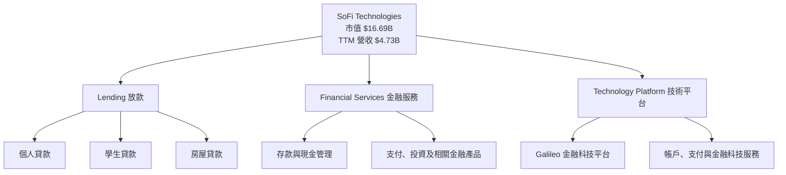
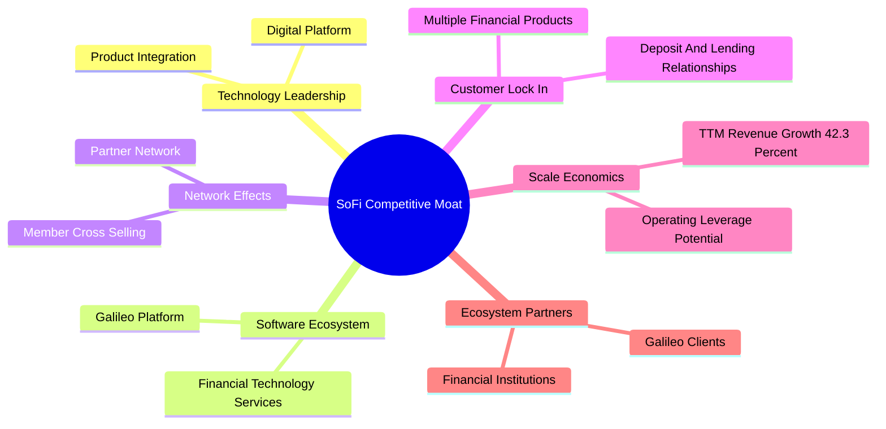
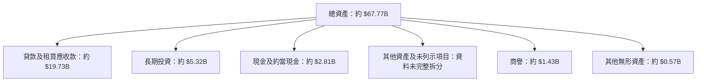
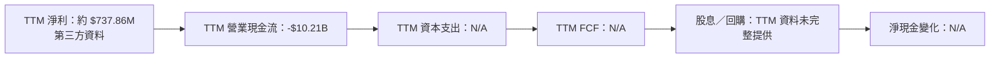
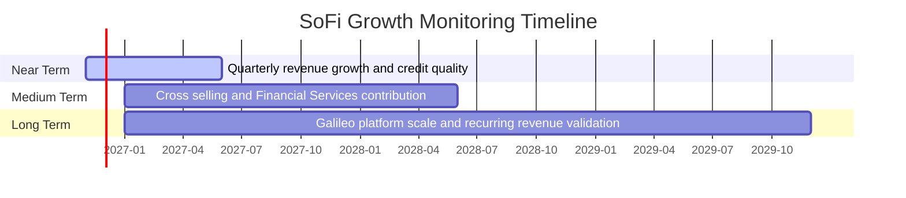
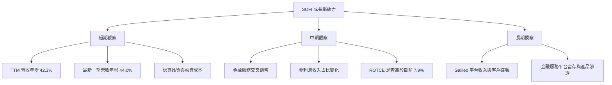
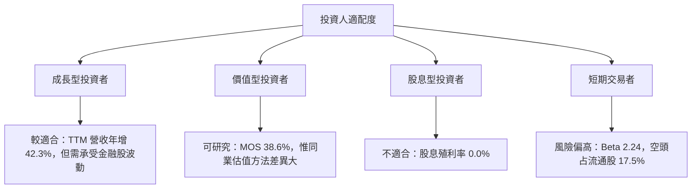

# SOFI 基本面深度分析報告
> **報告日期**：2026-11-25 ｜ **語言**：繁體中文 ｜ **數據來源**：SEC 申報資料 (XBRL)、Yahoo Finance、Finviz、StockAnalysis、Roic.ai ｜ **分析師**：CFA 級機構研究

## 目錄

| # | 章節 | 核心結論 |
|---|------|----------|
| 1 | 執行摘要 | 買入；加權合理價值 $20.96；MOS +38.6% |
| 2 | 公司概覽與商業模式 | 數位金融平台具交叉銷售潛力，但分部營收與市占數據未提供 |
| 3 | 損益表深度分析 | TTM 營收 $4.73B、年增 42.3%；季度成長快，盈餘超預期資料缺漏 |
| 4 | 資產負債表分析 | 現金與短期投資 $2.81B；總債務 N/A，不能據此判定完整淨負債狀況 |
| 5 | 現金流量深度分析 | TTM 營業現金流 -$10.21B；TTM FCF N/A，貸款業現金流須審慎解讀 |
| 6 | 獲利能力與資本效率 | ROIC 不適用於放款機構；ROTCE 7.9%，WACC 採用值 14.00% |
| 7 | 相對估值分析 | 同業估值差異大；SOFI 位於自身歷史 P/E 區間低端 |
| 8 | DCF 內在價值評估 | DCF N/A；採金融業相對估值與分析師共識加權，合理價值 $20.96 |
| 9 | 成長催化劑 | 金融服務交叉銷售與平台規模化是主要觀察點，TAM 數據未提供 |
| 10 | 風險矩陣 | 信貸、融資成本、營運現金流解讀為前三大風險 |
| 11 | 投資建議 | 依 MOS 門檻為買入；以信貸品質、ROTCE 與資金結構作為追蹤重點 |

---

## 1. 執行摘要

截至 2026-11-24，SOFI 收盤價為 **$12.86**。加權合理價值為 **$20.96**，安全邊際 MOS 為 **+38.6%**，但 ROIC 對放款機構不適用，且 TTM FCF 為 N/A，因此依估值規則的結果是**買入**，而非強烈買入。支持估值的核心數據包括：TTM 營收 **$4.73B、年增 42.3%**，最新一季營收年增 **44.0%**，TTM 淨利息收入占營收 **64.0%**；另一方面，TTM 營業現金流為 **-$10.21B**，且淨沖銷率、逾放比、CET1 均未提供，估值與風險判斷須保留信貸資料缺口折價。

### 1.0 一頁式投資儀表板（Portfolio Manager 30 秒速讀）

| 項目 | 內容 |
|------|------|
| **投資論點（3 句）** | ① TTM 營收年增 **42.3%**，最新一季年增 **44.0%**，顯示平台與金融服務收入擴張。② 淨利息收入占 TTM 營收 **64.0%**，放款業務是收入核心，也使信貸週期成為關鍵風險。③ 收盤價 **$12.86** 低於加權合理價值 **$20.96**，但 TTM 營業現金流 **-$10.21B**，不可把現金流出簡單視為自由現金流惡化或忽略。 |
| **綜合評分** | **6.2/10**（引用 1.1；六項算術平均） |
| **財務健康** | 🟡 現金與短期投資 **$2.81B**；總債務 N/A，無法完整確認淨負債與融資彈性。 |
| **ROIC vs WACC** | ROIC：N/A（放款機構不適用）；WACC：**14.00%**（程式計算 16.46%，受 7%–14% 區間上限限制）。不得據此宣稱 ROIC 高於或低於 WACC。 |
| **FCF 趨勢** | TTM FCF：**N/A**；TTM 營業現金流 **-$10.21B**。FCF Yield：N/A。 |
| **估值** | Forward P/E **14.36x** ｜ EV/EBITDA：N/A ｜ FCF Yield：N/A |
| **DCF 內在價值（基準）** | **N/A**；放款機構的融資與貸款現金流屬營運活動，傳統 FCFF DCF 不適用。折溢價不適用。 |
| **安全邊際（MOS）** | **+38.6%**＝($20.96 − $12.86) ÷ $20.96（分母為 8.8 加權合理價值）｜ 🟢 >25% |
| **預期報酬（基準情境 12M）** | **+63.0%**，以加權合理價值計算；非 DCF 情境目標。 |
| **關鍵風險（前二）** | 信貸品質惡化而逾放／沖銷資料未提供；高利率或融資條件轉差壓抑放款與淨利差。 |
| **評級 + 信心度** | 🟢 **買入** ｜ 信心：中低；相對估值具折價訊號，但信貸品質與現金流口徑資料不完整。 |

### 1.1 綜合評分卡（全報告唯一）

| 維度 | 評分（1–10） | 主要依據（引用數字與其來源章節） |
|------|--------------|----------------------------------|
| 成長性 | 8.0 | TTM 營收年增 **42.3%**、最新一季年增 **44.0%**（第 3 章），增長明確，但缺分部貢獻與會員數序列。 |
| 獲利能力 | 6.0 | TTM ROE **6.5%**、ROTCE **7.9%**，成本收入比代理值 **80.8%**（第 6 章）；盈利改善但資本回報仍有提升空間。 |
| 財務健康 | 5.0 | 現金與短期投資 **$2.81B**、淨現金數值 **$2.81B**，但總債務 N/A，且營業現金流 **-$10.21B**（第 4–5 章）。 |
| 估值 | 7.0 | MOS **+38.6%**；自身 P/E **23.0x**，低於五年中位數 **36.6x**（第 7–8 章）。 |
| 護城河 | 6.0 | 同一金融平台涵蓋放款、金融服務及技術平台；但各分部收入、留存率與市場份額未提供（第 2 章）。 |
| 管理層與資本配置 | 5.0 | FY2025 SBC **$262.06M**，股利支出為 $0；SBC 對股東稀釋有實質成本，回購與資本配置成效資料不足。 |
| **綜合評分** | **6.2** | 六項算術平均：(8.0 + 6.0 + 5.0 + 7.0 + 6.0 + 5.0) ÷ 6 = **6.2**。 |

### 1.2 五大投資論點 + 三大核心風險

| 類型 | 項目 | 具體依據 | 信心度 |
|------|------|----------|--------|
| 🟢 **投資論點①** | 營收增長具延續性 | TTM 營收 **$4.73B、年增 42.3%**；最新一季年增 **44.0%**。若增長由客戶交叉銷售及平台使用增加支撐，可改善固定成本吸收。 | 🟢 高 |
| 🟢 **投資論點②** | 盈利已轉正並擴大 | TTM 淨利約 **$737.86M**（StockAnalysis），近年由虧損轉為獲利；但淨利數據與不同來源的季度資料存在口徑差異。 | 🟡 中 |
| 🟢 **投資論點③** | 多產品金融平台 | 放款、金融服務與技術平台同時營運，產品涵蓋個人貸款、學生貸款、房貸、存款、支付及投資；交叉銷售可能提高每位會員價值。 | 🟡 中 |
| 🟢 **投資論點④** | 相對自身歷史估值偏低 | P/E **23.0x**，低於五年中位數 **36.6x**；P/S **3.7x**，低於中位數 **4.5x**。估值折價不代表信貸風險已充分反映。 | 🟡 中 |
| 🟢 **投資論點⑤** | 加權估值顯示折價 | 同業 Forward P/E、同業 P/B 與分析師共識加權後為 **$20.96**，相對現價上行空間 **63.0%**。此估值對同業倍數與帳面價值假設敏感。 | 🟡 中 |
| 🟡 **風險①** | 信貸品質不透明 | 淨沖銷率、逾放比、CET1 均 N/A；若放款組合惡化，淨利及帳面價值均可能受損。 | 🔴 高衝擊 |
| 🔴 **風險②** | 營業現金流大幅為負 | TTM 營業現金流 **-$10.21B**；金融機構放款與存款變動會扭曲傳統現金流解讀，但仍需確認資金來源和資產負債表擴張風險。 | 🔴 高衝擊 |
| 🟡 **風險③** | 融資成本與利率敏感 | Beta（調整後）**1.83**，股權成本 **14.04%**；利率或資金成本上升可能壓縮放款需求與利差。 | 🟡 中高 |

### 1.3 快速統計卡片

| 指標 | 公司實際值（期間） | 同業中位數 | 狀態 |
|------|--------------------|------------|------|
| 營收成長（TTM） | **42.3%** | — | 🟢 |
| 營收成長（最新一季年增） | **44.0%** | **34.1%**（NU、HOOD、UPST） | 🟢 |
| 毛利率（TTM） | **84.2%** | **83.3%** | 🟢 |
| 營業利益率（TTM） | **N/A** | — | 🟡 |
| ROIC（TTM） | **N/A（金融業指標不適用）** | — | 🟡 |
| Forward P/E | **14.36x** | **11.1x** | 🟡 |
| FCF Yield（TTM） | **N/A** | — | 🟡 |
| Piotroski F-Score | **N/A（不適用放款機構）** | — | 🟡 |

> 同業中位數為可用同業數字計算：最新一季營收成長率中位數為 34.1%；毛利率中位數為 83.3%；Forward P/E 中位數為 11.1x。

### 1.4 投資結論

╔══════════════════════════════════════════════════════════════════╗  
║                    📊 投資結論摘要                               ║  
╠══════════════════════════════════════════════════════════════════╣  
║  評級：買入（MOS +38.6%；ROIC 對放款機構不適用）                 ║  
║  價格（2026-11-24 收盤）：$12.86                                 ║  
║  DCF 內在價值（基準）：N/A（金融業現金流不適用）                 ║  
║  加權合理價值（8.8）：$20.96                                     ║  
║  安全邊際 MOS：+38.6%＝($20.96−$12.86)÷$20.96                  ║  
║  DCF 情境價值：N/A（未建立 DCF 情境）                            ║  
║  綜合評分：6.2/10（引用 1.1）                                    ║  
║  適合投資人：能承受金融股與信貸週期風險的成長型、長線投資人      ║  
╚══════════════════════════════════════════════════════════════════╝

---

## 2. 公司概覽與商業模式

### 2.1 業務結構與收入來源

SOFI 以金融服務平台經營放款、金融服務及技術平台；公司市值 **$16.69B**、TTM 營收 **$4.73B**。分部營收及占比未提供，故不以推估數字填補。

主要收入與資產結構顯示放款業務仍是核心：淨利息收入占 TTM 營收 **64.0%**。技術平台及非利息金融服務可能帶來收入多元化，但各自營收、獲利與客戶留存數據未提供，無法量化其對總體盈利的貢獻。

### 2.2 市場份額

市場份額數據未提供，故不呈現市占圖或推算比例。SOFI 的 TTM 營收為 **$4.73B**、年增 **42.3%**；同業最新一季營收年增中位數為 **34.1%**，但同業業務組合與會計口徑不同，不能直接視為市占提升的證據。

### 2.3 競爭護城河分析

上述為業務模式上的潛在優勢，不等於已證明的高轉換成本或強網路效應。現有資料未提供會員數、活躍率、產品滲透率、客戶獲取成本或流失率，無法驗證平台效應已轉化為可持續定價權。

### 2.4 護城河強度

| 護城河項目 | 強度（強／中／弱） | 證據（引用數字或事實） | 會削弱它的情況 |
|------------|--------------------|------------------------|----------------|
| 技術平台與產品整合 | 中 | 同時經營放款、金融服務與 Galileo 技術平台；技術平台分部營收未提供。 | 技術平台客戶流失、服務可靠度下降或同業產品快速追上。 |
| 軟體生態系統 | 中 | Galileo 提供金融科技平台服務；客戶數、交易量及平台收入未提供。 | 客戶集中度高、合作夥伴自建系統或價格競爭加劇。 |
| 網路效應 | 弱至中 | 產品涵蓋借貸、存款、支付、投資等，具交叉銷售可能；實際會員滲透率未提供。 | 會員只使用單一產品，交叉銷售未能降低獲客成本。 |
| 客戶鎖定 | 弱至中 | 多產品帳戶可能增加轉換成本；留存與存款穩定度數據未提供。 | 優惠利率競爭或客戶將存款、貸款分散至其他平台。 |
| 規模效應 | 中 | TTM 營收年增 **42.3%**，規模擴張可能攤薄固定科技成本。 | 增長伴隨更高信貸損失、行銷支出或融資成本。 |
| 生態夥伴 | 中 | 技術平台對外提供金融科技服務；具體合作夥伴與營收貢獻未提供。 | 合作集中、合作方議價力上升或監管限制。 |

第 1.1 節護城河評分為 **6.0/10**，理由是業務組合與平台整合具有交叉銷售可能，但缺少分部收入、留存與平台客戶數等可驗證數據。

---

## 3. 損益表深度分析

### 3.1 年度收入成長趨勢（近 4 年）

╔══════════════════════════════════════════════════════════════════╗  
║              SOFI 年度收入趨勢（FY2022–FY2025）                   ║  
╠══════════════════════════════════════════════════════════════════╣  
║ FY2022  $1.57B  █████████░░░░░░░░░░░░░░░  基期                  ║  
║ FY2023  $2.11B  ████████████░░░░░░░░░░░░░  YoY 約 +34.4% 🟢    ║  
║ FY2024  $2.61B  ███████████████░░░░░░░░░░  YoY 約 +23.7% 🟢    ║  
║ FY2025  $3.61B  █████████████████████░░░░  YoY 約 +38.3% 🟢    ║  
╠══════════════════════════════════════════════════════════════════╣  
║ FY2022–FY2025 營收 CAGR：約 +31.9%                               ║  
╚══════════════════════════════════════════════════════════════════╝

年度營收取自公司年度損益表，FY2025 約 **$3.61B**。CAGR 算式為 \((3.61 ÷ 1.57)^{1/3} - 1\)，約 **31.9%**。FY2025 加速至約 38.3%，顯示增長並非線性；產品組合、貸款發放與金融服務擴張可能共同推動，資料未提供分部拆解，因此不將增速單獨歸因於某一業務。

### 3.2 季度收入趨勢分析

| 季度 | 營收 | QoQ 成長 | YoY 成長 | 備註 |
|------|------:|---------:|---------:|------|
| 2025 Q4 | $1.03B | 約 +5.2%（對 2025 Q3） | +40.21% | 季度營收持續擴張。 |
| 2026 Q1 | $1.10B | 約 +6.8% | +42.48% | 年增加快，QoQ 增長較溫和。 |
| 2026 Q2 | $1.22B | 約 +10.9% | +42.61% | 季度動能上升。 |
| 2026 Q3 | $1.39B | 約 +13.6%（季度表列 $1.39B） | **+44.0%** | 最新一季年增率明確為單季數字，不是 TTM。 |

QoQ 以季度資料約數計算，來源數字可能因不同資料庫四捨五入而略有差異。最新一季營收年增 **44.0%**，而 TTM 成長率為 **42.3%**；兩者均顯示增長持續，但不應把單季高增速直接外推為全年預測。

### 3.3 利潤率演變分析

| 利潤率指標 | FY2022 | FY2023 | FY2024 | FY2025 / TTM | 趨勢 | 評估 |
|------------|--------|--------|--------|--------------|------|------|
| 毛利率 | N/A | N/A | N/A | TTM **84.2%** | 歷史序列未提供 | 🟡 |
| 營業利益率 | N/A | N/A | N/A | TTM **N/A** | SEC 驗證口徑未提供 | 🟡 |
| 淨利率 | 約 -20.4%* | 約 -14.3%* | 約 19.1%* | TTM **15.6%**（品質數據） | 轉盈後維持正值；年度口徑有來源差異 | 🟡 |

\*以年度損益表營收與淨利相除的約數；年度表中 FY2024 淨利、不同供應商的營收及淨利數字並非完全一致，不應與驗證口徑混為一談。TTM 驗證淨利率採品質數據 **15.6%**。

TTM 營業利益率及最新一季營業利益率在驗證數據中均為 N/A；另有整合型第三方資料呈現最新季度營業利益率 **19.4%**，但因口徑衝突，本報告不將其作為主要結論。獲利改善主要可確認為公司由過往虧損轉為正淨利；成本效率、信貸準備及產品組合各自的量化影響未提供。

### 3.4 費用結構分析

支出明細不足以構成可核對的費用占比，故不畫 Mermaid 圓餅圖或 ASCII 費用比例圖。可用的盈利資訊包括 TTM 成本收入比代理值 **80.8%**，但該代理值包含信用準備，通常高於公司公布的效率比率；不可將其當成純營運費用率。

### 3.5 季度 EPS 趨勢與盈餘品質（Quality of Earnings）

EPS 預估與實際驚喜資料在四個季度均為 N/A，故**無法判定超預期或不及預期**。StockAnalysis／Roic.ai 季度序列顯示最近四季 EPS 約為：2025 Q4 **$0.13–$0.14**、2026 Q1 **$0.12–$0.13**、Q2 **$0.12**、Q3 **$0.18–$0.19**；不同來源的基本／稀釋口徑存在差異，以下僅作趨勢參考，不作 surprise 判定。

| 盈餘品質項目 | 數值/佔比 | 評估 |
|--------------|-----------|------|
| 股權薪酬 SBC / 營收 | 近四季 SBC 約 **$288.33M** ÷ TTM 營收 **$4.73B** ≈ **6.1%** | 🟡 比重不低，若持續發放會稀釋每股經濟利益。 |
| SBC / 營業現金流 | $288.33M ÷ **-$10.21B**；以營業現金流絕對值計約 **2.8%** | 🟡 分母為負，該比例不能解讀為 SBC 覆蓋現金流；只反映規模。 |
| FCF / 淨利（現金轉換率） | **N/A**（TTM FCF N/A） | 🟡 不可用未驗證的 FCF 替代。 |
| 一次性/非經常性損益 | N/A（未提供完整調節表） | 🟡 無法判定本期淨利是否受一次性項目顯著影響。 |
| 有效稅率異常 | **8.5%**（最新年度有效稅率輸入） | 🟡 低於常見法定稅率的方向性參考，但未提供稅項明細，無法判定是否為一次性稅務利益。 |
| 資本化支出 vs 費用化 | TTM Capex N/A；年度資本支出 FY2025 約 **$251.12M** | 🟡 缺少資本化政策與研發費用明細，無法判斷是否遞延成本。 |

**盈餘品質結論**：公司已呈現正淨利，但 FCF 轉換率、一次性損益與資本化政策無法完整驗證。SBC 約占 TTM 營收 **6.1%**，代表 GAAP 淨利仍需轉換成每股股東回報來檢視；不能只以淨利成長等同股東價值成長。

---

## 4. 資產負債表分析

### 4.1 資產結構分解

StockAnalysis 提供截至 2026-09-30 資產總額約 **$67.77B**，貸款及租賃應收款約 **$19.73B**、長期投資約 **$5.32B**、現金等價物約 **$2.81B**。以下僅列已披露項目，不代表資產完整分解或各項比例：

貸款資產是資產負債表的重要組成，意謂信貸損失、放款回收與融資結構是資產品質的核心。因分類與期末數字來自不同資料來源，不對上述項目計算資產占比。

### 4.2 流動性與營運資金分析

| 指標 | 最新值 | 一年前 | 評估 |
|------|--------|--------|------|
| 現金與短期投資 | **$2.81B** | N/A | 提供流動性緩衝，但金融機構還須看存款穩定性、資產可變現性及監管資本。 |
| 流動比率 | **1.086**（整合型市場資料） | N/A | 對銀行／放款業務不宜直接套用一般企業門檻。 |
| 速動比率 | **0.428**（整合型市場資料） | N/A | 金融機構資產負債表結構不同，解讀有限。 |
| DSO 應收帳款天數 | 不適用（金融業） | 不適用 | 貸款資產不是一般商業應收帳款週轉。 |
| DIO 存貨天數 | 不適用（金融業） | 不適用 | 金融業無一般存貨週轉分析意義。 |
| DPO 應付帳款天數 | 不適用（金融業） | 不適用 | 一般供應商應付帳款指標不適用。 |
| CCC 現金轉換週期 | 不適用（金融業） | 不適用 | 貸款發放與存款融資應以金融機構資產負債表指標評估。 |

總債務及淨沖銷率、逾放比、CET1 均未提供，無法由現金餘額單獨判斷整體資本安全邊際。

### 4.3 債務結構分析

╔══════════════════════════════════════════════════════════════════╗  
║                   SOFI 債務健康診斷                              ║  
╠══════════════════════════════════════════════════════════════════╣  
║  現金及短期投資： $2.81B  可提供流動性緩衝                       ║  
║  總債務：         N/A      驗證數據未提供                         ║  
║  淨現金數值：     $2.81B   驗證數據列示；因總債務 N/A，須審慎解讀 ║  
║  Debt/EBITDA：    N/A      總債務與可比 EBITDA 資料不足            ║  
║  利息保障倍數：   N/A      利息費用與可比口徑資料不足              ║  
║  淨沖銷率／逾放比／CET1：N/A（數據未提供）                        ║  
╚══════════════════════════════════════════════════════════════════╝

其他市場資料列出債務數字，但與驗證數據中總債務 N/A、淨現金 **$2.81B** 的口徑不一致。本報告依優先引用規則保留驗證口徑，不以外部債務數字反推或改寫。

### 4.4 股東權益趨勢

| 財年 | 股東權益 | 年度變化 | 解讀 |
|------|---------:|---------:|------|
| 2022 | $5.53B | — | 基期。 |
| 2023 | $5.55B | 約 +0.5% | 權益大致持平。 |
| 2024 | $6.53B | 約 +17.7% | 資本基礎增加。 |
| 2025 | $10.49B | 約 +60.7% | 權益明顯擴大；須結合增資、盈餘留存與股份稀釋拆解，細項未提供。 |

╔══════════════════════════════════════════════════════════════════╗  
║                SOFI 股東權益變化（年度）                         ║  
╠══════════════════════════════════════════════════════════════════╣  
║ FY2022  $5.53B  ███████████░░░░░░░░░░░░░░                         ║  
║ FY2023  $5.55B  ███████████░░░░░░░░░░░░░░                         ║  
║ FY2024  $6.53B  █████████████░░░░░░░░░░░░                         ║  
║ FY2025  $10.49B █████████████████████░░░░░                         ║  
╚══════════════════════════════════════════════════════════════════╝

股東權益成長提升了帳面資本基礎，但若來自股權發行，對既有股東的每股價值影響須與每股帳面價值和盈利能力一併衡量。

---

## 5. 現金流量深度分析

### 5.1 現金流量瀑布圖

TTM 淨利、營業現金流可得，但驗證數據中的 Capex 與 FCF 為 N/A。由於放款機構的貸款發放與存款變動會進入營業現金流，不能將一般企業式 FCF 瀑布直接當作可分配現金流。

### 5.2 FCF 轉換率趨勢

| 年度 | 營業現金流 | 資本支出 | 歷史 FCF | FCF／淨利 |
|------|-----------:|---------:|---------:|---------:|
| 2022 | -$7.26B | -$103.73M | -$7.36B | N/A（虧損口徑下比率不具可比性） |
| 2023 | -$7.23B | -$121.19M | -$7.35B | N/A（虧損口徑下比率不具可比性） |
| 2024 | -$1.12B | -$163.62M | -$1.28B | 約 -257%（依年度報表數字計算，淨利為正） |
| 2025 | -$3.74B | -$251.12M | -$3.99B | 約 -829%（依年度報表數字計算） |
| TTM | -$10.21B | N/A | **N/A** | N/A |

年度 FCF 數字來自歷史現金流表，TTM FCF 則依驗證數據明確為 N/A，不以不同資料來源拼接。金融機構營業現金流為負，可能反映貸款資產擴張與資金配置，不應直接等同營運虧損；但亦須核對存款增長、批發融資與資產出售情形。

### 5.3 自由現金流趨勢

╔══════════════════════════════════════════════════════════════════╗  
║                   歷史年度 FCF（非 TTM）                         ║  
╠══════════════════════════════════════════════════════════════════╣  
║ FY2022  -$7.36B  ← 負值                                           ║  
║ FY2023  -$7.35B  ← 負值                                           ║  
║ FY2024  -$1.28B  ← 負值幅度縮小                                   ║  
║ FY2025  -$3.99B  ← 再度擴大                                       ║  
║ TTM      N/A     ← 驗證數據未提供 TTM Capex／FCF                  ║  
║ TTM FCF Yield：N/A                                                 ║  
╚══════════════════════════════════════════════════════════════════╝

對 SOFI 這類放款機構，這些年度 FCF 數字不適合作為傳統企業「可分配自由現金」的直接替代；仍應追蹤貸款資產成長是否由穩定存款融資，及資產負債表是否具足夠資本緩衝。

### 5.4 資本配置評估

完整資本用途比例未提供，不畫 pie chart。已知 FY2025 SBC **$262.06M**，股利支付 **$0**；年度資本支出約 **$251.12M**。FY2025 SBC 相當於年度營收約 **7.3%**（$262.06M ÷ $3.61B），顯示股權薪酬是需持續監控的股東成本；目前資料不足以量化回購、併購及新增貸款投資的總資本配置比例。

---

## 6. 獲利能力與資本效率

### 6.1 ROE / ROA / ROIC 趨勢

| 指標 | 最新數值 | 歷史／補充 | 評估 |
|------|---------:|-------------|------|
| ROE（驗證口徑） | **6.5%** | 其他整合型市場資料列 7.4%，有口徑差異 | 🟡 正值，但尚不能單獨證明高資本回報。 |
| ROA | N/A（驗證數據未提供） | 其他市場資料列 1.3% | 🟡 不以非驗證值替代。 |
| ROIC | N/A（放款機構不適用） | 以貸款與存款為核心的企業不宜直接套用一般非金融企業 ROIC | — |
| ROTCE | **7.9%** | 淨利 ÷ 有形帳面價值 | 🟡 有正回報，但需與金融業股權資本成本及信貸風險共同看待。 |

金融業通常應以 ROTCE、資產品質、資本充足率與淨息差等衡量，而非直接將 ROIC 與一般企業 WACC 作價值創造判斷。

### 6.2 ROIC vs WACC 分析（核心價值創造判斷）

╔══════════════════════════════════════════════════════════════════╗  
║                ROIC vs WACC 深度分析                             ║  
╠══════════════════════════════════════════════════════════════════╣  
║  無風險利率（10Y 美債）：4.90%                                    ║  
║  市場風險溢酬 ERP：5.00%                                          ║  
║  原始 Beta：2.24；採用調整後 Beta：1.83                          ║  
║  股權成本：4.90% + 1.83 × 5.00% = 14.05%（輸入值 14.04%）       ║  
║  稅前債務成本：29.04%；有效稅率：8.5%                            ║  
║  股權／債務權重：80.7%／19.3%                                     ║  
║  程式計算 WACC：16.46%；受 7%–14% 區間上限限制，採用 14.00%       ║  
║  ROIC：N/A（金融業不適用）                                        ║  
║  ROIC − WACC／EVA：N/A；不得據此宣稱創造或摧毀價值               ║  
╚══════════════════════════════════════════════════════════════════╝

Beta 調整公式為 **⅔ × 原始 Beta 2.24 + ⅓ × 1 = 1.83**。利率與 Beta 顯示股權風險溢酬要求偏高；但放款機構資本與負債的經濟角色不同，且總債務資料缺漏，因此該 WACC 不是銀行監管資本回報門檻。**ROIC vs WACC 與營運資金天數對放款機構不適用**；本報告不以 ROIC N/A 推導 EVA。

### 6.3 杜邦三因素分解

| 因素 | 數值（TTM） | 解讀 |
|------|-------------|------|
| 淨利率 | **15.6%** | 正淨利率是 ROE 為正的主要來源。 |
| 資產週轉率 | **0.07** | 金融機構持有大量貸款資產，資產週轉率低於一般輕資產企業屬業務結構所致。 |
| 權益乘數 | **6.00** | 資產相對權益較高，槓桿對 ROE 有放大作用，也放大信貸與融資風險。 |
| **ROE** | **6.5%** | 15.6% × 0.07 × 6.00 = **6.55%**，四捨五入為 **6.5%**。 |

ROE 來自淨利率、資產週轉與槓桿共同作用；低資產週轉率由金融資產密集型業務造成，權益乘數 **6.00** 亦代表不能只以淨利率判斷股東回報品質。

### 6.4 財務體質：Piotroski F-Score 與放款機構指標

Piotroski F-Score **N/A**：該分數未套用於放款機構，因貸款成長會表現為營業現金流流出，現金流測試可能對銀行或貸款公司產生誤判。

| 放款機構指標 | 數值 | 解讀 |
|------|------:|------|
| 淨利息收入 NII / 總營收 | **64.0%** | 收入主要依賴放款與利息收入，利率、資金成本及信貸品質均會影響獲利。 |
| 淨利差代理值 NII / 平均總資產 | **5.36%** | 這是代理值；因缺少生息資產資料，通常低於以生息資產為分母的正式 NIM。 |
| 成本收入比代理值 | **80.8%** | 代理值包含信用準備，故高於正式效率比率，不應與銀行報表的 efficiency ratio 混用。 |
| ROTCE | **7.9%** | 淨利 ÷ 有形帳面價值，反映有形普通股權益回報。 |
| P/TBV | **1.80x** | 股價相對有形帳面價值倍數；須結合 ROTCE 和資產品質判讀。 |
| 放款淨額 / 總資產 | **79.3%** | 資產集中於放款，資產品質與信用損失是核心風險。 |
| 淨沖銷率、逾放比、CET1 | **N/A（數據未提供）** | 重要信貸與資本安全指標缺漏，限制估值信心。 |

---

## 7. 相對估值分析

### 7.1 同業估值比較表格

| 估值指標 | **SOFI** | **NU** | **HOOD** | **UPST** | SOFI 評估 |
|----------|---------:|---------:|---------:|---------:|-----------|
| **Trailing P/E** | **23.38x** | 14.8x | 30.3x | 27.5x | 🟡 位於同業範圍中間；公司獲利與業務組合不同。 |
| **Forward P/E** | **14.36x** | 11.1x | 19.2x | 5.7x | 🟡 高於同業中位數 11.1x，低於 HOOD；UPST 預估倍數極低但不代表風險較低。 |
| **P/S（TTM）** | **3.56x** | 6.3x | 11.6x | 1.2x | 🟢 低於 NU、HOOD，高於 UPST；需考慮收入結構與毛利口徑。 |
| **EV/EBITDA（TTM）** | N/A | N/A | N/A | 25.2x | 🟡 SOFI 與兩家同業缺值，無法做完整橫向比較。 |
| **營收成長（最新一季 YoY）** | **44.0%** | 34.4% | 11.8% | 34.1% | 🟢 SOFI 高於三家同業所列數字。 |
| **毛利率（TTM）** | **84.2%** | 0.0% | 91.0% | 83.3% | 🟡 不同金融科技業務模型與資料口徑造成差異，毛利率不宜單獨比較。 |

同業資料顯示 SOFI Forward P/E **14.36x** 高於同業中位數 **11.1x**，但成長率 **44.0%** 高於三家可比公司所列的最新季度增速。此差異可支撐一定溢價，惟信貸品質與資本回報的資料缺口不支持無條件給予成長溢價。

### 7.2 歷史估值區間分析

╔══════════════════════════════════════════════════════════════════╗  
║              SOFI 五年 TTM P/E 歷史區間                          ║  
╠══════════════════════════════════════════════════════════════════╣  
║ 歷史低點   27.0x ├──────────────────────────┤ 歷史高點 67.1x    ║  
║ 五年中位數 36.6x                                                     ║  
║ 目前       23.0x  位於所列歷史區間下方；百分位排名 0%             ║  
║ P/S 目前 3.7x；中位數 4.5x；區間 2.6x–14.6x；百分位 29%          ║  
║ EV/EBITDA 目前 51.4x；中位數 65.1x；區間 19.0x–148.7x；百分位 33%║  
╚══════════════════════════════════════════════════════════════════╝

目前 P/E **23.0x** 低於歷史區間下限 **27.0x**，歷史百分位排名為 **0%**；P/S 與 EV/EBITDA 則分別處在第 29 與 33 百分位。這代表估值相對自身歷史偏低，但若市場下修未來盈利、或信貸風險提高，歷史均值回歸未必發生。

### 7.3 情境價值（Bear / Base / Bull）

**N/A（DCF 無法計算：放款機構的融資與貸款現金流屬營運現金流，傳統 FCFF 不適用；未提供 DCF MODEL 情境值。）**  
依規則不另行設定 DCF 悲觀／基準／樂觀目標價。

### 7.4 相對估值隱含價格區間

╔══════════════════════════════════════════════════════════════════╗  
║             相對估值法隱含每股價值                               ║  
╠══════════════════════════════════════════════════════════════════╣  
║ 同業 Forward P/E   $9.90  ────── 現價 $12.86 ──────              ║  
║ 同業 P/B           $34.86 ────── 分析師共識 $20.67               ║  
║ 加權合理價值       $20.96                                         ║  
╚══════════════════════════════════════════════════════════════════╝

- **同業 Forward P/E：$9.90**＝同業中位數 **11.1x** × SOFI Forward EPS **$0.90**。同業為 NU、HOOD、UPST。
- **同業 P/B：$34.86**＝同業中位數 **4.0x** × SOFI 每股帳面價值 **$8.71**。
- **分析師共識目標價：$20.67**＝23 位分析師平均目標價。

兩種相對估值給出的價值差異很大：Forward P/E 偏向低於現價，而 P/B 顯示明顯高於現價。加權結果依金融業固定方法權重計算，不應忽略方法間分歧。

---

## 8. DCF 內在價值評估（Discounted Cash Flow）

### 8.0 估值推理鏈（Thinking Logic）

**模型適用性先行判斷：DCF N/A。** 對放款機構，貸款發放、存款吸收與融資安排是核心營運活動，營業現金流不能直接視為一般企業 FCFF；驗證資料亦明確將 DCF 模型列為 N/A。因此不自行建立現金流預測、WACC 矩陣或反推 DCF，以避免把資金流錯當可分配自由現金流。

**Step 1 — 價值來源。** SOFI 的價值主要由放款業務的淨利息收入、金融服務與技術平台的非利息收入、以及風險調整後的股東資本回報決定。可量化的收入組成只有淨利息收入占 TTM 營收 **64.0%**；其他分部占比未提供。最關鍵變數是信貸品質與 ROTCE 能否在風險可控下持續提升。

**Step 2 — 方法選擇。**

| 決策點 | 本報告採用 | 理由（含數字） | 曾考慮但否決 | 否決理由 |
|--------|-----------|----------------|--------------|----------|
| 現金流定義 | 不採用 DCF | TTM 營業現金流 **-$10.21B**，而放款活動本身會造成現金流變動 | FCFF／FCFE | 無法把貸款與融資現金流可靠地分離為可分配自由現金流 |
| 預測期 N | N/A | 模型被判定不適用 | 任意設定 5–10 年 | 缺少可被核對的銀行／放款機構資產品質與貸款現金流預測 |
| 終值方法 | N/A | 沒有可用 DCF 現金流 | Gordon Growth／退出倍數 | 不應以一般企業終值方法替代金融業資本回報估值 |
| EBIT 基礎 | N/A | 無 DCF；本報告不自建 EBIT 模型 | GAAP／非 GAAP EBIT | 不能把放款機構營業活動簡化為一般企業 FCFF |

**Step 3 — 關鍵假設推導鏈。** DCF MODEL 為 N/A，故營收 CAGR、期末營業利潤率、永續成長率、預測期、Capex、D&A、ΔWC、SBC 與股數稀釋等均不作 DCF 假設。替代估值採第 7.4 節提供的同業倍數、帳面價值與分析師共識，並按固定權重加權。

**Step 4 — 最脆弱環節。** 相對估值最脆弱的假設是同業 P/B 中位數 **4.0x** 能否適用於 SOFI；若信貸損失上升或 ROTCE 未改善，P/B 法的 **$34.86** 可能高估可持續帳面價值回報。

### 8.1 模型假設總表（Model Inputs）

**N/A（DCF 模型不適用：金融機構貸款與融資現金流屬營運現金流；因此不建立預測期、FCFF、終值或稀釋股數模型。）**

### 8.2 折現率推導（WACC）

╔══════════════════════════════════════════════════════════════════╗  
║                    WACC 推導（折現率）                           ║  
╠══════════════════════════════════════════════════════════════════╣  
║ 無風險利率 Rf（10Y 美債）：4.90%                                 ║  
║ 市場風險溢酬 ERP：5.00%                                          ║  
║ 原始 Beta：2.24；調整後 Beta：1.83                               ║  
║ Ke 輸入值：14.04%                                                ║  
║ 稅前債務成本：29.04%                                             ║  
║ 有效稅率：8.5%                                                   ║  
║ 股權／債務權重：80.7%／19.3%                                     ║  
║ 未限制計算 WACC：16.46%；採用 WACC：14.00%                       ║  
║ 採用原因：計算值被限制在 7%–14% 區間，故採用上限 14.00%           ║  
╚══════════════════════════════════════════════════════════════════╝

CAPM 驗算使用提供的調整後 Beta：\(4.90\% + 1.83 \times 5.00\% = 14.05\%\)，輸入資料列示 Ke 為 **14.04%**，兩者相差 0.01 個百分點，屬四捨五入差異。WACC 各組成與加權方式以程式提供值為準，不自行改算或另建 WACC。此採用值亦與第 6.2 節一致。

### 8.3 逐年自由現金流預測（基準情境）

**N/A（DCF 模型不適用，原因如 8.0 所述）。** 不提供年度 FCFF 預測、折現因子或現值加總，也不以一般公司現金流表推估金融機構可分配現金。

### 8.4 終值計算（Terminal Value）

**N/A（無 DCF 預測現金流，無法計算 Gordon Growth 或退出倍數終值。）**

### 8.5 企業價值 → 每股內在價值（Bridge）

**N/A（未建立 DCF，無企業價值、股權價值或 DCF 每股內在價值橋接。）**  
價格基準為 **2026-11-24 收盤 $12.86**。依估值定義，本節不計算 MOS；本報告折溢價亦不適用，因缺少 DCF 基準內在價值。

### 8.6 敏感性分析（WACC × 永續成長率）

**N/A（DCF 模型未提供；不自建敏感性矩陣、情境估值或機率加權值。）**

### 8.7 反推 DCF（Reverse DCF：市場在預期什麼）

**N/A（無可用 DCF 模型；不能由股價單獨回推出營收成長、利潤率或永續成長假設。）**

### 8.8 估值三角驗證與安全邊際

| 估值方法 | 隱含每股價值 | 上行空間（÷現價） | 權重 | 說明 |
|----------|--------------:|-------------------:|------:|------|
| 同業 Forward P/E | **$9.90** | **-23.0%** | **50%** | 同業中位數 11.1x × Forward EPS $0.90。 |
| 同業 P/B | **$34.86** | **+171.1%** | **40%** | 同業中位數 4.0x × 每股帳面價值 $8.71。 |
| 分析師共識目標價 | **$20.67** | **+60.7%** | **10%** | 23 位分析師平均目標價，作為輔助參考。 |
| **加權合理價值** | **$20.96** | **+63.0%** | **100%** | 金融業固定權重；DCF 未列入，因 DCF 不適用且估值方法區塊未納入 DCF。 |

**逐步演算（權重外顯）**：

\[
\$9.90 \times 50\% + \$34.86 \times 40\% + \$20.67 \times 10\%
= \$4.95 + \$13.944 + \$2.067
= \$20.961
\approx \$20.96
\]

權重合計：**50% + 40% + 10% = 100%**。此為金融類公司固定估值方法權重；估值方法中沒有同業 EV/EBITDA 或 DCF，故不增列方法。

MOS 算式：

\[
(\$20.96-\$12.86) \div \$20.96
= \$8.10 \div \$20.96
= 38.6\%
\]

上行空間算式：

\[
(\$20.96-\$12.86) \div \$12.86
= \$8.10 \div \$12.86
= 63.0\%
\]

╔══════════════════════════════════════════════════════════════════╗  
║                  估值區間與安全邊際                              ║  
╠══════════════════════════════════════════════════════════════════╣  
║ $9.90 同業 P/E ── $12.86 現價 ── [$20.96 加權合理價值] ── $34.86║  
║ 安全邊際 MOS = ($20.96−$12.86)÷$20.96 = +38.6%                  ║  
║ 上行空間 = ($20.96−$12.86)÷$12.86 = +63.0%                     ║  
║ MOS 評估：🟢 >25%                                                ║  
║ DCF 基準值：N/A；不得以加權合理價值冒充 DCF 內在價值             ║  
║ 買入區間（MOS ≥10%）：$12.86–$18.86                              ║  
║ 合理持有參考區間（MOS 約 -10% 至 +10%）：$18.86–$23.06           ║  
║ 減碼考慮參考：高於 $23.06；非 DCF 樂觀情境價值                   ║  
╚══════════════════════════════════════════════════════════════════╝

買入區間上限依 MOS 10% 門檻計算：**$20.96 × (1 − 10%) = $18.86**；下限以目前價格 **$12.86** 作為觀察區間下緣，不代表股價保底。持有參考上下緣以加權合理價值 ±10% 計算：**$20.96 × 90% = $18.86**、**$20.96 × 110% = $23.06**。

> 🔎 **程式複算（Python，依本節各項自動重算）**
>
> 加權合理價值 = $9.90 × 50% + $34.86 × 40% + $20.67 × 10% = **$20.96**（權重合計 100%）
>
> 以價格 $12.86 計：MOS = **+38.6%**，上行空間 = **+63.0%**
>
> ✅ 與本節所寫數值一致。

### 8.9 DCF 模型的局限與失效條件

- **終值依賴度**：N/A；DCF 未建立，不能計算終值占企業價值比重。
- **最脆弱的估值假設**：同業 P/B 中位數 **4.0x** 及 Forward P/E 中位數 **11.1x**。P/B 法給出 **$34.86**，Forward P/E 法給出 **$9.90**，差距顯示估值對倍數選擇高度敏感。
- **不適用情境說明**：貸款與融資現金流是金融機構核心經營活動；傳統 FCF／DCF 可靠度低。應優先使用 ROTCE、P/TBV、淨息差、信貸損失與資本充足率，並以 P/E、P/B 做交叉驗證。
- **與第 10 章風險矩陣的連結**：信貸損失上升可能同時下修淨利、帳面價值與可接受 P/B；融資成本上升則可能壓低淨息差與 Forward EPS，直接降低同業 P/E 估值。

### 8.10 複算檢核表（Audit Trail）

| # | 檢核項目 | 檢查方式 | 結果 |
|---|----------|----------|------|
| 1 | 所有高／中敏感度 DCF 輸入都有完整推導 | DCF 未建立，假設不適用 | ✅ N/A，原因已說明 |
| 2 | 每個假設都有來歷 | 未提供 DCF 假設 | ✅ N/A，未臆造輸入 |
| 3 | WACC 五步算式與重算 | 採用輸入 WACC 14.00%，計算值 16.46% 並受上限約束 | ✅ 引用固定輸入 |
| 4 | Kd 分母與債務權重範圍一致 | 不自行重算 Kd／權重 | ✅ 直接採用程式數值 |
| 5 | WACC 與第 6.2 節同值 | 兩處均為 14.00% | ✅ |
| 6 | 預測期年度數與 N 一致 | DCF N/A，無年度表 | ✅ N/A |
| 7 | 代表年度 FCFF 與 PV 可複算 | 無 DCF 年度預測 | ✅ N/A |
| 8 | 預測期 PV 加總 | 無預測期現值 | ✅ N/A |
| 9 | WACC > g | 無永續成長率 g | ✅ N/A |
| 10 | 終值以 FY+N 現金流為基礎 | 無終值計算 | ✅ N/A |
| 11 | EV 至每股 DCF 價值橋接 | 無 DCF 橋接 | ✅ N/A |
| 12 | SBC 組合相容 | 未建立 DCF 股數假設 | ✅ N/A |
| 13 | 敏感性矩陣基準格與 DCF 值一致 | 未建立矩陣 | ✅ N/A |
| 14 | 矩陣有效格條件 | 未建立矩陣 | ✅ N/A |
| 15 | 三情境機率加總 | 無 DCF 情境 | ✅ N/A |
| 16 | Reverse DCF 每列只放開一個變數 | 未建立 Reverse DCF | ✅ N/A |
| 17 | MOS 分母與 1.0 一致；DCF 折溢價基準 | MOS 以 $20.96 加權合理價值為分母；DCF N/A | ✅ |
| 18 | 報告完整至第 11 章 | 已完成 | ✅ |
| 19 | 加權價值等於估值方法加權總和 | 算式結果 $20.961，四捨五入 $20.96 | ✅ |
| 20 | 評級符合 MOS 門檻 | MOS +38.6%、ROIC 不適用；採買入 | ✅ |

---

## 9. 成長催化劑

### 9.1 催化劑時間軸

財務數據未提供特定產品發布時程或管理層財測日期，以下時間軸只列可追蹤的業務觀察區間，不代表公司已公布的催化日期。

### 9.2 TAM 市場規模分析

**N/A（TAM 數據未提供）。** SOFI TTM 營收 **$4.73B**、TTM 年增 **42.3%**，最新一季年增 **44.0%**，可見公司營收規模仍在快速擴大；但缺少可核對的市場規模、滲透率及分部營收資料，不以外部印象填寫 TAM。

### 9.3 成長驅動力結構圖

---

## 10. 風險矩陣

### 10.1 風險評分矩陣

財務資料未提供各風險事件的統計發生機率或損失分布；因此不以主觀機率數字製作 quadrantChart，避免把未經資料支持的坐標誤作模型結果。以下採定性風險排序。

### 10.2 風險清單詳細分析

| # | 風險項目 | 發生機率 | 財務衝擊 | 風險評估 | 緩解措施 |
|---|----------|----------|----------|----------|----------|
| 1 | 🔴 **信貸品質惡化** | 中至高；實際概率 N/A | 高；放款淨額占總資產 **79.3%**，信用損失會侵蝕淨利及帳面價值 | 🔴 高 | 每季檢查淨沖銷率、逾放比、逾期貸款、貸款組合與信用準備；目前以上部分關鍵指標未提供，需向申報文件核實。 |
| 2 | 🔴 **營業現金流與融資結構壓力** | 中；實際概率 N/A | 高；TTM 營業現金流 **-$10.21B**，總債務 N/A | 🔴 高 | 追蹤存款穩定度、貸款發放與出售、短期／長期融資來源及資產負債期限錯配。 |
| 3 | 🟡 **利率與資金成本變化** | 中；實際概率 N/A | 中至高；NII 占營收 **64.0%**，對利率、存款成本與貸款需求敏感 | 🟡 中高 | 追蹤淨利息收入、代理淨利差 **5.36%**、存款成本與固定／浮動利率曝險。 |
| 4 | 🟡 **平台與分部增長不均** | 中；實際概率 N/A | 中；TTM 營收年增 **42.3%**，但分部收入分解未提供 | 🟡 中 | 逐季核對各分部收入、平台客戶、交易量及非利息收入增速。 |
| 5 | 🟡 **SBC 稀釋與盈利品質** | 中；實際概率 N/A | 中；近四季 SBC 約占 TTM 營收 **6.1%** | 🟡 中 | 追蹤稀釋股數、SBC 占營收比、管理層薪酬與股東回報。 |

---

## 11. 投資建議

### 11.1 最終評級與評分

依 MOS **+38.6%**，規則 20 對應買入；ROIC 對放款機構不適用，因此不以一般企業 ROIC/WACC 門檻升格為強烈買入，也未因質化因素另行調整一級。公司綜合評分為 **6.2/10**；六項分數依序為成長性 **8.0**、獲利能力 **6.0**、財務健康 **5.0**、估值 **7.0**、護城河 **6.0**、管理層與資本配置 **5.0**，均引用第 1.1 節。

### 11.2 合理價值與隱含報酬率

| 估值依據 | 每股價值 | 相對現價 $12.86 | 機率／權重 | 說明 |
|----------|---------:|----------------:|------------:|------|
| 同業 Forward P/E | $9.90 | -23.0% | 50% 權重 | 對未來 EPS 與同業倍數較敏感。 |
| 同業 P/B | $34.86 | +171.1% | 40% 權重 | 受同業 P/B 中位數與帳面價值影響。 |
| 分析師共識 | $20.67 | +60.7% | 10% 權重 | 23 位分析師平均目標價。 |
| **加權合理價值** | **$20.96** | **+63.0%** | 100% 權重 | 依固定金融業估值權重加總。 |
| DCF 悲觀／基準／樂觀 | N/A | N/A | N/A | DCF 模型不適用，未提供 DCF 情境價值。 |

### 11.3 買入時機與觸發因素

╔══════════════════════════════════════════════════════════════════╗  
║                  ✅ 買入觸發因素 Checklist                       ║  
╠══════════════════════════════════════════════════════════════════╣  
║  目前估值觀察：收盤價 $12.86；加權合理價值 $20.96；MOS +38.6%   ║  
║                                                                  ║  
║  建議持續確認後分批建立部位：                                    ║  
║  ✅ 營收增長維持在可支持規模經濟的水平，季度年增不急速下滑       ║  
║  ✅ 信貸損失、逾放及沖銷資料確認未出現惡化                       ║  
║  ✅ 淨利息收入與代理淨利差保持穩定                               ║  
║                                                                  ║  
║  加碼觸發條件：                                                  ║  
║  ☐ ROTCE 較目前 7.9% 持續改善，且不是由槓桿單獨推升              ║  
║  ☐ 分部資料顯示金融服務或技術平台收入持續擴張                   ║  
║  ☐ 信貸品質資料可得，且資金來源與資產期限結構透明               ║  
║                                                                  ║  
║  減碼／重新檢視條件：                                            ║  
║  ☐ 最新一季營收年增連續兩季低於 20%                              ║  
║  ☐ ROTCE 跌至 5% 以下，或淨利息收入占比快速下降且盈利受損       ║  
║  ☐ 公布的淨沖銷率或逾放比明顯上升，且準備金未同步增加           ║  
║  ☐ SBC 占營收持續高於 8%，或稀釋股數增速加快                    ║  
╚══════════════════════════════════════════════════════════════════╝

上列百分比為投資監控門檻，屬分析框架而非公司財測；須以後續季報驗證。買入區間的估值參考上限為 **$18.86**，對應相對加權合理價值 **10% MOS** 的價格門檻；股價波動可能使實際成交價格偏離估值區間。

### 11.4 投資人適配度分析

### 11.5 每季財報監控清單（Quarterly Watch List）

| 監控項目 | 最新基準 | 觸發加碼訊號 | 觸發減碼／重新評估訊號 |
|----------|---------|--------------|------------------------|
| 營收成長 | TTM **42.3%**；最新一季 YoY **44.0%** | 最新一季年增維持 30% 以上且分部結構健康 | 連續兩季低於 20% |
| 淨利息收入占營收 | **64.0%** | NII 增長且淨利差穩定 | NII 下滑並伴隨資金成本上升 |
| 淨利差代理值 | **5.36%** | 保持穩定或上升，且信用損失未惡化 | 明顯收縮並伴隨淨利下降 |
| 成本收入比代理值 | **80.8%** | 下降且不是削減必要風險控制投入 | 上升並伴隨營業利益或淨利轉弱 |
| ROTCE | **7.9%** | 持續改善，並由盈利能力而非單純加槓桿帶動 | 低於 5% 或連續下滑 |
| 放款淨額／總資產 | **79.3%** | 放款增長與資金、風險準備相匹配 | 放款集中提高但逾放／沖銷惡化 |
| SBC／營收 | 近四季約 **6.1%** | 比率下降且每股盈利同步提升 | 持續高於 8% 或稀釋股數加速 |
| Capex 與 FCF | TTM Capex、FCF：**N/A** | 揭露完整資料並能解釋貸款擴張對現金流的影響 | 現金流壓力惡化且融資來源不明 |
| 信貸風險指標 | 淨沖銷率、逾放比、CET1：**N/A** | 申報資料持續披露且趨勢穩定 | 指標惡化、準備金不足或資本緩衝下降 |
| 管理層財測 | 未提供 | 實際結果持續達成或超越財測 | 多次下修財測或增長品質惡化 |

### 11.6 反面論證：什麼會證明論點錯誤（What Would Change My Mind）

╔══════════════════════════════════════════════════════════════════╗  
║              ⚠️ 論點失效條件（Disconfirming Evidence）            ║  
╠══════════════════════════════════════════════════════════════════╣  
║  ☐ 最新一季營收年增連續兩季低於 20%，顯示平台增長明顯放緩       ║  
║  ☐ ROTCE 低於 5% 且持續兩季，表明帳面資本回報不足               ║  
║  ☐ 淨沖銷率或逾放比連續上升，且信用準備未跟上                    ║  
║  ☐ 營業現金流仍大幅為負，同時存款或融資來源沒有相應改善          ║  
║  ☐ SBC／營收高於 8% 並持續增加，抵銷每股盈利成長                 ║  
║  ☐ 加權估值所依據的同業倍數下修，且公司盈利／帳面價值同步轉弱     ║  
╚══════════════════════════════════════════════════════════════════╝

上述條件若出現，應重新檢視增長是否具盈利與資本回報支撐，而不是僅依歷史估值折價維持買入結論。

> **免責聲明**：本報告為 AI 自動生成，僅供研究參考，不構成投資建議。投資有風險，入市需謹慎。

---

## 資料與來源

| 項目 | 內容 |
|------|------|
| 價格 | 12.86 USD，2026-11-24 收盤（Yahoo Finance 日線） |
| 財務報表 | SEC 10-Q filed 2026-11-05，最新季度 2026-09-30（FY2026 Q3） |
| 有回應的資料來源 | SEC 申報資料 (XBRL)、Yahoo Finance、Finviz、StockAnalysis、Roic.ai |
| 由程式計算 | TTM 數字、WACC、DCF 模型、估值方法與權重、加權合理價值、MOS、評級門檻、F-Score、杜邦分解、營運資金天數、綜合評分 |
| 撰寫模型 | openai / gpt-6-luna |

> 本區塊由產生報告的程式依實際取得的資料填寫，非模型撰寫。「由程式計算」的數字不是模型的估計；其餘判斷（評分、情境、策略）是模型的分析。
