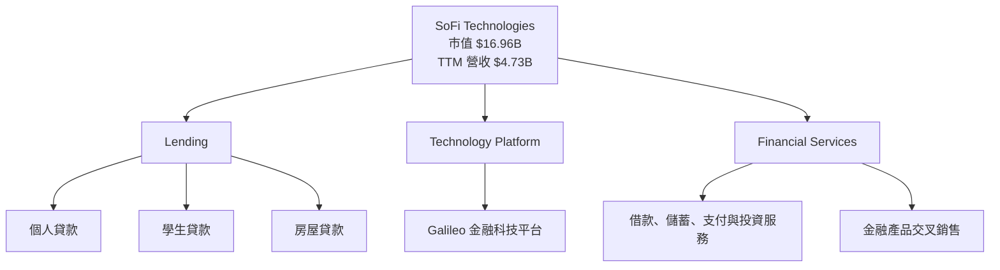
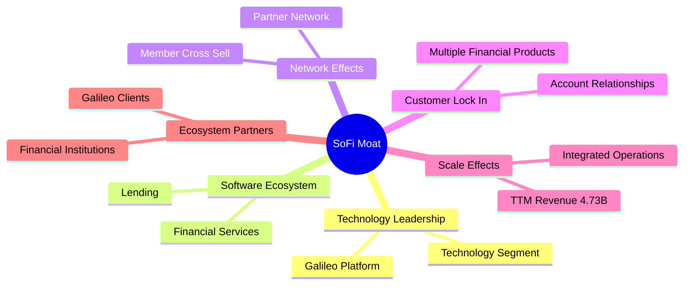
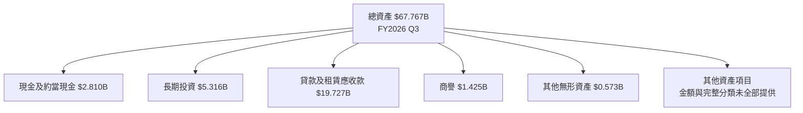
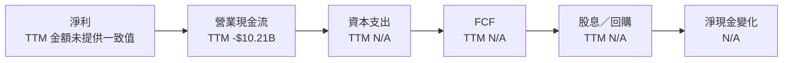
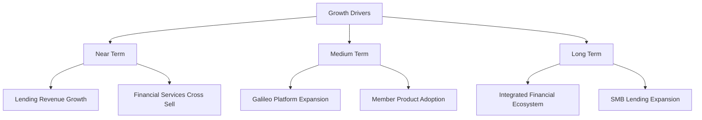
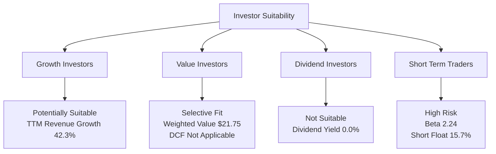

# SOFI 基本面深度分析報告

> **報告日期**：2026-11-26 ｜ **語言**：繁體中文 ｜ **數據來源**：SEC 申報資料 (XBRL)、Yahoo Finance、Finviz、StockAnalysis、Roic.ai ｜ **分析師**：CFA 級機構研究

## 目錄

| # | 章節 | 核心結論 |
|---|------|----------|
| 1 | 執行摘要 | 買入；加權合理價值 $21.75；MOS 39.9% |
| 2 | 公司概覽與商業模式 | 三大業務構成金融科技平台，但板塊收入占比未提供 |
| 3 | 損益表深度分析 | TTM 營收 $4.73B、成長 42.3%；TTM 營業利益率 N/A |
| 4 | 資產負債表分析 | 現金及短期投資 $2.81B；總債務 N/A，流動性與債務需審慎解讀 |
| 5 | 現金流量深度分析 | TTM 營業現金流 -$10.21B；TTM FCF N/A，不宜套用一般企業解讀 |
| 6 | 獲利能力與資本效率 | 放款機構以貸款指標替代 ROIC；ROIC 無法確認 |
| 7 | 相對估值分析 | 同業估值分歧大；SOFI 相對自身歷史 P/E 處於低位 |
| 8 | DCF 內在價值評估 | DCF N/A：放款機構現金流包含融資與放款活動，不宜用一般 FCFF 模型 |
| 9 | 成長催化劑 | 金融服務交叉銷售、放款與科技平台是潛在驅動力；TAM 數據未提供 |
| 10 | 風險矩陣 | 信用品質、融資成本與高波動估值為主要風險 |
| 11 | 投資建議 | 買入；以加權合理價值與貸款指標作為核心追蹤依據 |

---

## 1. 執行摘要

截至 2026-11-25 收盤，SOFI 股價為 **$13.07**。公司 TTM 營收 **$4.73B**，TTM 年增率 **42.3%**，最新一季營收年增率 **44.0%**；然而，金融機構的放款與存款變化會大幅影響營業現金流，TTM 營業現金流為 **-$10.21B**，而適用於一般企業的 TTM FCF 在可引用的標準口徑中為 **N/A**。依金融類估值方法加權得出的合理價值為 **$21.75**，安全邊際（MOS）為 **39.9%**；按估值規則 20，評級為**買入**。此結論依賴相對估值及分析師共識，不代表傳統 DCF 已確認內在價值。

### 1.0 一頁式投資儀表板（Portfolio Manager 30 秒速讀）

| 項目 | 內容 |
|------|------|
| **投資論點（3 句）** | ① TTM 營收 **$4.73B**、年增 **42.3%**，營收擴張為主要正面證據。② 最新一季營收年增 **44.0%**，但貸款組合的信用成本與融資條件可能影響盈利持續性。③ 加權合理價值 **$21.75**，高於 2026-11-25 收盤價 **$13.07**，但 TTM FCF 為 **N/A**，不能以一般企業自由現金流驗證估值。 |
| **綜合評分** | **6.2/10**（引用 1.1 評分卡） |
| **財務健康** | 🟡 現金及短期投資 **$2.81B**；總債務 N/A，且 TTM 營業現金流 **-$10.21B**。 |
| **ROIC vs WACC** | ROIC：N/A（放款機構不適用一般 ROIC 口徑）；WACC **14.00%**。無法據此判斷 ROIC 是否高於 WACC。 |
| **FCF 趨勢** | TTM FCF **N/A**；FCF Yield **N/A**。銀行放款與存款現金流不是一般企業 FCF 的可比口徑。 |
| **估值** | Forward P/E **14.60x** ｜ EV/EBITDA **N/A** ｜ FCF Yield **N/A** |
| **DCF 內在價值（基準）** | **N/A**；無法計算 DCF 折溢價。 |
| **安全邊際（MOS）** | **+39.9%**＝（加權合理價值 **$21.75** − 現價 **$13.07**）÷ 加權合理價值 **$21.75**｜🟢 >25%（基準為 8.8 加權合理價值） |
| **預期報酬（基準情境 12M）** | DCF 情境 N/A；加權合理價值相對現價的上行空間為 **+66.4%**，不是時間保證或報酬預測。 |
| **關鍵風險（前二）** | 信用品質惡化與貸款損失上升；高利率或資金成本上升壓縮利差。 |
| **評級 + 信心度** | 🟢 **買入** ｜ 信心：中低（DCF 不適用，且貸款損失、逾放率、CET1 等關鍵資料未提供） |

### 1.1 綜合評分卡（全報告唯一）

| 維度 | 評分（1–10） | 主要依據（引用數字與其來源章節） |
|------|--------------|----------------------------------|
| 成長性 | 8.0 | TTM 營收成長 **42.3%**、最新一季年增 **44.0%**（第 3 章）；最新一季營收 QoQ 約 **13.9%**。 |
| 獲利能力 | 6.0 | TTM ROE **6.5%**；ROIC 不適用於放款機構的一般口徑，ROTCE **7.9%**（第 6 章）。 |
| 財務健康 | 5.0 | 現金及短期投資 **$2.81B**，但總債務 N/A、TTM 營業現金流 **-$10.21B**（第 4、5 章）。 |
| 估值 | 7.0 | MOS **39.9%**；Forward P/E **14.60x**，但估值方法採用的同業 Forward P/E 估值為 **$10.30**，與帳面價值法結果差異大（第 7、8 章）。 |
| 護城河 | 6.0 | 業務涵蓋 Lending、Technology Platform、Financial Services；營收規模 **$4.73B**，但板塊收入、客戶留存及平台客戶數等數據未提供（第 2 章）。 |
| 管理層與資本配置 | 5.0 | 2025 年 SBC **$262.06M**、約占當年營收 **7.3%**；未提供回購資料，且近年仍以擴張為主（第 3、5 章）。 |
| **綜合評分** | **6.2** | 六項算術平均：（8.0 + 6.0 + 5.0 + 7.0 + 6.0 + 5.0）÷ 6 = **6.2**。 |

### 1.2 五大投資論點 + 三大核心風險

| 類型 | 項目 | 具體依據 | 信心度 |
|------|------|----------|--------|
| 🟢 **投資論點①** | 收入成長維持高檔 | TTM 營收 **$4.73B**、TTM 年增 **42.3%**；最新一季年增 **44.0%**，顯示各項業務仍在擴張。 | 🟢 高 |
| 🟢 **投資論點②** | 多業務模式可分散收入來源 | Lending、Technology Platform、Financial Services 三板塊可支援交叉銷售；但各板塊收入及利潤占比未提供，分散效果尚難量化。 | 🟡 中 |
| 🟢 **投資論點③** | 當前估值低於部分歷史水準 | P/E 歷史資料顯示當前 **23.3x**、五年中位數 **36.6x**；當前 P/S **3.8x**，低於歷史中位數 **4.5x**。 | 🟡 中 |
| 🟢 **投資論點④** | 近期季度營收與淨利增加 | FY2026 Q3 營收 **$1.39B**、淨利 **$240.99M**；相對 Q2 營收 **$1.22B**、淨利 **$156.59M**，營收 QoQ 約 **13.9%**。 | 🟡 中 |
| 🟢 **投資論點⑤** | 估值模型顯示相對價格折讓 | 同業 Forward P/E 法價值 **$10.30**，低於現價；P/B 法 **$36.33**，共識目標價 **$20.67**，方法間落差顯著，故應視為估值分歧而非單一精準目標。 | 🟡 中 |
| 🟡 **風險①** | 貸款信用損失上行 | 淨沖銷率、逾放比未提供；若貸款組合惡化，預期損失與備抵增加可能抵銷收入成長。 | 🟡 中 |
| 🔴 **風險②** | 資金成本及流動性壓力 | TTM 營業現金流 **-$10.21B**；金融業現金流受放款與存款變動影響，若融資成本上升而貸款收益率未能同步調整，利差會受壓。 | 🔴 高衝擊 |
| 🟡 **風險③** | 股權薪酬及股數稀釋 | 2025 年 SBC **$262.06M**，約占當年營收 **7.3%**；若長期維持高額 SBC，股東每股盈餘增幅可能低於公司營收與總淨利增幅。 | 🟡 中 |

### 1.3 快速統計卡片

| 指標 | 公司實際值（期間） | 同業中位數 | 狀態 |
|------|--------------------|------------|------|
| 營收成長（TTM） | **42.3%** | — | 🟢 |
| 營收成長（最新一季年增） | **44.0%** | **34.1%** | 🟢 |
| 毛利率（TTM） | **84.2%** | **83.3%** | 🟢 |
| 營業利益率（TTM） | **N/A** | — | 🟡 |
| ROIC（TTM） | **N/A（金融業不採一般 ROIC）** | — | 🟡 |
| Forward P/E | **14.60x** | **11.5x** | 🟡 |
| FCF Yield（TTM） | **N/A** | — | 🟡 |
| Piotroski F-Score | **N/A（不適用放款機構）** | — | 🟡 |

### 1.4 投資結論

╔══════════════════════════════════════════════════════════════════╗  
║                    📊 投資結論摘要                               ║  
╠══════════════════════════════════════════════════════════════════╣  
║  評級：買入（MOS 規則給出買入；未作質化調整）                    ║  
║  價格（2026-11-25 收盤）：$13.07                                 ║  
║  DCF 內在價值（基準）：N/A（放款機構 DCF 不適用）                ║  
║  安全邊際 MOS：+39.9%（以加權合理價值 $21.75 為分母）            ║  
║  加權合理價值（8.8）：$21.75                                     ║  
║  綜合評分：6.2/10（引用 1.1）                                    ║  
║  適合投資人：能承受高波動、重視營收成長與金融科技平台擴張者      ║  
╚══════════════════════════════════════════════════════════════════╝

---

## 2. 公司概覽與商業模式

### 2.1 業務結構與收入來源

公司資料顯示 SoFi Technologies 在美國及部分國際市場經營三大板塊：Lending、Technology Platform、Financial Services。整體市值約 **$16.96B**，TTM 營收 **$4.73B**。各板塊收入金額、占比與分部利潤未提供，因此不將收入組合比例化。

### 2.2 市場份額

市場份額數據未提供，亦無可引用的市場份額年份與來源，因此不製作市占率圖表。SOFI TTM 營收 **$4.73B**、成長 **42.3%**；同業 NU、HOOD、UPST 最新季度營收年增分別為 **34.4%**、**11.8%**、**34.1%**，SOFI 的最新一季年增 **44.0%** 高於上述同業資料。

### 2.3 競爭護城河分析

上述為業務結構層面的質化分析，不代表已證實的客戶網路效應；客戶數、平台交易量、留存率、交叉銷售率與各板塊收入比例均未提供。

### 2.4 護城河強度

| 護城河項目 | 強度（強／中／弱） | 證據（引用數字或事實） | 會削弱它的情況 |
|------------|--------------------|------------------------|----------------|
| 技術平台 | 中 | 公司經營 Technology Platform，包含 Galileo；但平台營收、客戶數及續約資料未提供。 | 客戶流失、平台功能商品化，或競爭者以較低成本提供類似服務。 |
| 軟體生態系統 | 中 | 三大板塊可支援借貸、儲蓄、支付與投資等金融服務。 | 產品間交叉使用率不足，或獲客成本超過客戶終身價值。 |
| 網路效應 | 弱至中 | 金融平台具有潛在雙邊網路特性；實際活躍會員與合作機構數未提供。 | 新增用戶無法提升平台效用，或合作方可輕易轉換服務商。 |
| 客戶鎖定 | 中 | 多產品金融關係可能提升切換成本；現有資料沒有留存率或每戶產品數。 | 存款利率、貸款利率或服務體驗不具競爭力。 |
| 規模效應 | 中 | TTM 營收 **$4.73B**、員工 **6,100**；尚無可引用的單位成本趨勢。 | 規模擴張同步帶來信用損失、行銷與合規成本上升。 |
| 生態夥伴 | 中 | Galileo 所屬科技平台可服務金融機構；合作夥伴與收入集中度未提供。 | 主要客戶內製、合作終止或產業議價能力轉向客戶。 |

**1.1 護城河評分為 6.0/10**：三板塊及 Galileo 提供跨產品與平台化基礎，但缺少留存、平台客戶、收入占比與客戶集中度等可量化證據。

---

## 3. 損益表深度分析

### 3.1 年度收入成長趨勢（近 4 年）

年度收入採公司年度損益表所列數字；來源資料中 FY2024、FY2025 的營收在不同資料表有小幅差異，以下依年度損益表表列值呈現。FY2022 至 FY2025 的 CAGR 約 **32.0%**，計算為 \((3.61 ÷ 1.57)^{1/3}-1\)。

╔══════════════════════════════════════════════════════════════════╗  
║              SoFi 年度收入趨勢（FY2022–FY2025）                 ║  
╠══════════════════════════════════════════════════════════════════╣  
║  FY2022  $1.57B  ██████████░░░░░░░░░░░░░░░  YoY：基期          ║  
║  FY2023  $2.11B  █████████████░░░░░░░░░░░░  YoY：約 +34.4% 🟢 ║  
║  FY2024  $2.61B  ██████████████████░░░░░░░  YoY：約 +23.7% 🟢 ║  
║  FY2025  $3.61B  █████████████████████████  YoY：約 +38.3% 🟢 ║  
╠══════════════════════════════════════════════════════════════════╣  
║  FY2022–FY2025 收入 CAGR：約 +32.0%                              ║  
╚══════════════════════════════════════════════════════════════════╝

成長不是每年線性增加：FY2024 年增放緩至約 **23.7%**，FY2025 回升至約 **38.3%**。這種波動可能反映放款量、金融服務產品滲透及業務組合變動；分部數據不足，無法精確歸因至單一板塊。

### 3.2 季度收入趨勢分析

| 季度 | 營收 | QoQ 成長 | YoY 成長 | 備註 |
|------|------:|---------:|---------:|------|
| FY2025 Q4 | $1.03B | N/A | N/A | 季度損益表數字取至兩位小數。 |
| FY2026 Q1 | $1.10B | 約 **6.8%** | **42.48%** | QoQ 依季度損益表數字計算；YoY 依 StockAnalysis 季度資料。 |
| FY2026 Q2 | $1.22B | 約 **10.9%** | **42.61%** | 成長延續；資料表來源間有四捨五入差異。 |
| FY2026 Q3 | $1.39B | 約 **13.9%** | **44.0%** | 最新一季年增率依官方核對數據；不是 TTM 成長率。 |

QoQ 連續提高有利於反映近期業務活動改善，但季度營收受到放款量與會計分類影響，需搭配信用損失、資金成本及各板塊收入判讀。

### 3.3 利潤率演變分析

| 利潤率指標 | FY2022 | FY2023 | FY2024 | FY2025／TTM | 趨勢 | 評估 |
|------------|--------|--------|--------|-------------|------|------|
| **毛利率** | N/A | N/A | N/A | TTM **84.2%** | 歷年可比資料不足 | 🟡 |
| **營業利益率** | N/A | N/A | N/A | TTM **N/A**；最新一季 **19.4%** | TTM 與最新單季不能混為一談 | 🟡 |
| **淨利率** | 約 -20.4% | 約 -14.3% | 約 19.1% | TTM **15.6%** | 由虧轉盈後，年度與 TTM 數值有波動 | 🟡 |

FY2022 至 FY2024 年度淨利率為依年度營收與淨利簡單計算；不同資料來源的 FY2024 營收數字略有差異，因此年度淨利率僅作方向性觀察。TTM 杜邦口徑淨利率 **15.6%**，採用其指定數值；另一資料表的 TTM 淨利率為 **15.7%**，屬來源口徑差異。

最新一季營業利益率為 **19.4%**，但 TTM 營業利益率未提供，不應直接將單季值當作 TTM。若未來營收成長延續且單位獲客成本、信用損失及營運費用控制得宜，規模可能改善盈利；反之，貸款損失或存款成本增加會侵蝕利潤。

### 3.4 費用結構分析

N/A（費用明細未提供足以建立一致費用結構的資料；不得自行估算各項費用占比，因此不繪製圓餅圖）。

### 3.5 季度 EPS 趨勢與盈餘品質（Quality of Earnings）

過去四季 EPS 估值與實際值欄位為 NaN，因此無法判定每季超預期或不及預期。季度實際 EPS 數據顯示 FY2025 Q4 **$0.13**、FY2026 Q1 **$0.12**、Q2 **$0.12**、Q3 **$0.18**；FY2026 Q3 年增 **64.4%**。EPS 實際值成長與季度淨利上升方向一致，但缺少一致的分析師預期數據，不能標註 beat／miss。

| 盈餘品質項目 | 數值／佔比 | 評估 |
|--------------|-----------|------|
| 股權薪酬 SBC / 營收 | FY2025 **$262.06M ÷ $3.61B ≈ 7.3%** | 🟡 比例偏高，若持續會稀釋既有股東的每股盈餘與持股比例。 |
| SBC / 營業現金流 | FY2025 SBC **$262.06M**；TTM OCF **-$10.21B** | 🟡 不宜用負營業現金流直接解讀成經濟比率；放款機構的貸款發放會造成現金流出。 |
| FCF / 淨利（現金轉換率） | TTM FCF **N/A** | 🟡 無法計算。其他報表列有現金流數字，但標準核對口徑的 TTM Capex 與 FCF 為 N/A，故不以衝突來源替代。 |
| 一次性／非經常性損益 | N/A | 無足夠明細確認一次性項目對近期盈餘的影響。 |
| 有效稅率異常 | **8.5%**（最新年度有效稅率） | 🟡 稅率低於一般成熟企業常見水準；缺少稅務調節表，不能判定是否由一次性稅務利益造成。 |
| 資本化支出 vs 費用化 | TTM Capex **N/A**；FY2025 Capex 表列 **$251.12M** | 🟡 可引用年度支出，但無法據此判斷資本化政策是否遞延成本或高估當期盈餘。 |

**盈餘品質結論**：GAAP TTM 淨利率與 ROE 顯示公司已具盈利能力，但 TTM FCF 無法依一致定義計算，SBC 亦達 FY2025 營收約 **7.3%**。因此，估值不應只依賴 EPS 成長；需同步監控 SBC、每股稀釋、信用損失與資金成本。

---

## 4. 資產負債表分析

### 4.1 資產結構分解

FY2026 Q3 資產負債表資料列示總資產 **$67.767B**，但下列圖表只列可取得的部分資產項目，不能視為完整資產加總。

貸款及租賃應收款為重要資產項目；其規模與資產品質是銀行型業務的核心，但逾放、核銷、貸款期限與抵押品結構未提供，無法單憑總資產判斷信用風險。

### 4.2 流動性與營運資金分析

| 指標 | 數值 | 評估 |
|------|------:|------|
| 現金及短期投資 | **$2.81B** | 有一定現金資源，但不能單獨代表可用流動性或存款覆蓋能力。 |
| 流動比率 | **1.086** | 🟡 略高於 1；銀行業資產負債管理不宜只靠一般流動比率評價。 |
| 速動比率 | **0.428** | 🟡 低於 1；對金融機構的解讀有限。 |
| 淨現金（核對口徑） | **$2.81B** | 核對數據列為淨現金；同時總債務標為 N/A，故不能據此重建淨負債橋接。 |
| 總債務 | **N/A** | 不以其他來源的不同口徑替代核對值。 |

金融業營運資金天數不適用。DSO、DIO、DPO、CCC 是一般製造與零售企業營運週期指標，未提供金融業適用的同等 QUALITY FIGURES，也不應套用。

### 4.3 債務結構分析

╔══════════════════════════════════════════════════════════════════╗  
║                   SoFi 債務健康診斷                              ║  
╠══════════════════════════════════════════════════════════════════╣  
║  現金及短期投資： $2.81B   可引用核對值                         ║  
║  總債務：         N/A      核對口徑未提供                         ║  
║  淨現金：         $2.81B   核對數據列示值                         ║  
║  Debt/EBITDA：    N/A      TTM EBITDA 口徑資料不可用               ║  
║  利息保障倍數：   N/A      缺少一致的利息費用與 EBITDA 資料        ║  
║  評估：🟡 缺少債務期限、計息負債與存款結構，無法完整評估槓桿風險 ║  
╚══════════════════════════════════════════════════════════════════╝

其他市場資料列示總債務 **$3.98B**、淨負債 **$1.14B**，與核對數據中總債務 N/A、淨現金 **$2.81B** 的口徑不一致。本報告不把兩組數字拼接或反推，債務結論以核對欄位為準，並將衝突列為資料限制。

### 4.4 股東權益趨勢

| 年度 | 股東權益 | 年變化 |
|------|---------:|-------:|
| 2022 | $5.53B | — |
| 2023 | $5.55B | 約 +0.4% |
| 2024 | $6.53B | 約 +17.7% |
| 2025 | $10.49B | 約 +60.6% |

╔══════════════════════════════════════════════════════════════════╗  
║                股東權益趨勢（年度）                             ║  
╠══════════════════════════════════════════════════════════════════╣  
║  2022  $5.53B  █████████████░░░░░░░░░░░░░░░░                    ║  
║  2023  $5.55B  █████████████░░░░░░░░░░░░░░░░                    ║  
║  2024  $6.53B  ████████████████░░░░░░░░░░░░░                   ║  
║  2025  $10.49B ██████████████████████████████                   ║  
╚══════════════════════════════════════════════════════════════════╝

FY2025 權益較 FY2024 增加約 **60.6%**，可能與盈利、資本活動或其他權益變動相關；沒有權益變動明細，無法將增加額單獨歸因於留存盈餘或增發。

---

## 5. 現金流量深度分析

### 5.1 現金流量瀑布圖

金融機構的「放款」通常是資產配置與營業活動現金流的重要來源，不可將該現金流直接視為一般企業自由現金流。故以下只呈現已核對的現金流資訊，不把 N/A 資料補成虛構的瀑布金額。

### 5.2 FCF 轉換率趨勢

年度報表列有年度 FCF，但放款機構的營運現金流可能包含貸款發放與資產負債變化，因此 FCF／淨利比率不宜視為一般企業的獲利現金轉換品質。

| 年度 | FCF | 淨利 | FCF／淨利（機械計算） | 解讀 |
|------|------:|------:|---------------------:|------|
| 2022 | -$7.36B | -$320.41M | 約 +2,297% | 淨利為負且營業現金流包含放款資金變化，比率失真。 |
| 2023 | -$7.35B | -$300.74M | 約 +2,444% | 同樣不具一般企業現金轉換意義。 |
| 2024 | -$1.28B | $498.67M | 約 -257% | FCF 為負，不能直接判作盈利品質差，需拆解貸款與存款變動。 |
| 2025 | -$3.99B | $481.32M | 約 -829% | 同上；不應用單一 FCF 比率評價銀行營運。 |
| TTM | **N/A** | — | **N/A** | 核對口徑 TTM Capex 與 FCF 均 N/A。 |

### 5.3 自由現金流趨勢

╔══════════════════════════════════════════════════════════════════╗  
║                 自由現金流（FCF）趨勢                           ║  
╠══════════════════════════════════════════════════════════════════╣  
║  FY2022 年度報表 FCF：-$7.36B                                    ║  
║  FY2023 年度報表 FCF：-$7.35B                                    ║  
║  FY2024 年度報表 FCF：-$1.28B                                    ║  
║  FY2025 年度報表 FCF：-$3.99B                                    ║  
║  TTM FCF：N/A（核對口徑 Capex 未提供）                            ║  
║  TTM FCF Yield：N/A                                               ║  
╚══════════════════════════════════════════════════════════════════╝

年度 FCF 數據顯示現金流受放款與資產負債表擴張影響較大，不能簡化為「自由現金流持續消耗」或「FCF 盈利轉換差」。分析重點應改為存款穩定性、融資成本、貸款增長、貸款出售及信用損失。

### 5.4 資本配置評估

資本配置占比數據不足，故不製作圓餅圖。

| 項目 | 可得資料 | 評估 |
|------|----------|------|
| 資本支出 | FY2025 報表列示 **$251.12M**；TTM Capex **N/A** | 需區分科技平台投資與金融機構資產負債擴張。 |
| 股息 | 2025 年股息 **$0**；資料列示殖利率 **0.0%** | 目前以再投資與擴張為主。 |
| 回購 | N/A | 缺少可引用的回購金額。 |
| SBC | FY2025 **$262.06M** | 需觀察相對營收及股數的持續變化。 |
| 留存／投資 | N/A | 無法可靠拆分各用途比重。 |

---

## 6. 獲利能力與資本效率

### 6.1 ROE / ROA / ROIC 趨勢

| 指標 | 數值 | 評估 |
|------|------:|------|
| ROE（TTM，核對口徑） | **6.5%** | 以核對品質指標為準；其他來源列 7.4%，存在口徑差異。 |
| ROA（TTM） | **1.3%** | 對放款機構而言，資產配置與信用成本會顯著影響此指標。 |
| ROIC（TTM） | **N/A** | 放款機構的債務與營運資金具有融資屬性，通常不適合套用一般企業 ROIC。 |
| ROTCE（TTM） | **7.9%** | 依金融業有形權益報酬率指標；是否足以覆蓋股權成本需考慮高風險股權要求報酬。 |

行業均值未提供，不作未經核實的對比。

### 6.2 ROIC vs WACC 分析（核心價值創造判斷）

對放款機構，傳統投入資本回報率 ROIC 不適用，因借款、存款與貸款本身是營運核心資產負債，而非單純融資工具。因此不能以未提供的 NOPAT／投入資本推導 ROIC，也不能直接宣稱公司創造或摧毀股東價值。

╔══════════════════════════════════════════════════════════════════╗  
║                ROIC vs WACC 深度分析                            ║  
╠══════════════════════════════════════════════════════════════════╣  
║  無風險利率（10Y 美債）：4.85%                                   ║  
║  股權風險溢酬 ERP：5.00%                                         ║  
║  原始 Beta：2.24；調整後 Beta：1.83                              ║  
║  股權成本：13.98%                                                ║  
║  稅前債務成本：29.04%；有效稅率：8.5%                            ║  
║  股權／債務權重：81.0%／19.0%                                   ║  
║  WACC 計算值：16.38%；限制區間後採用 WACC：14.00%                ║  
║  ROIC：N/A（放款機構不適用一般企業 ROIC）                        ║  
║  結論：無法計算 ROIC−WACC，價值創造判斷需改看 ROTCE 等金融指標   ║  
╚══════════════════════════════════════════════════════════════════╝

WACC 使用指定的 **14.00%**，為 6.2 與 8 章共同折現率口徑。資料列示計算值 **16.38%**，但採用值受 **7%–14%** 區間限制，故使用上限 **14.00%**。由於 DCF 模型對放款機構標示 N/A，此 WACC 不用來另建本報告的放款現金流 DCF。

### 6.3 杜邦三因素分解

| 因素 | 數值（TTM） | 解讀 |
|------|-------------|------|
| 淨利率 | **15.6%** | 核對杜邦數值；盈利能力是 ROE 的主要正面來源。 |
| 資產週轉率 | **0.07** | 金融機構資產基數大，資產週轉率與非金融企業不可直接比較。 |
| 權益乘數 | **6.00** | 槓桿放大資產與股東權益回報，也增加資金及信用風險敏感度。 |
| **ROE** | **6.5%** | **15.6% × 0.07 × 6.00 = 約 6.5%**；四捨五入差異符合呈現精度。 |

ROE 受低資產週轉率與權益乘數共同影響，不能只以淨利率判斷股東資本回報；槓桿對 ROE 有放大作用，但不是無風險的回報來源。

### 6.4 財務體質：Piotroski F-Score 與 Lender Metrics

Piotroski F-Score **N/A**：該指標不適用於放款機構，因貸款增長會造成營業現金流出，相關現金流測試可能錯判銀行經營狀況。九項測試未提供逐項結果，不補造分數。

| 金融業指標 | 數值 | 解讀 |
|------------|------:|------|
| 淨利息收入 NII／總營收（TTM） | **64.0%** | 收入中利息相關業務占比高；利率與資產負債結構會影響該部分收入。 |
| 淨利差代理值 | **5.36%** | 以 NII ÷ 平均總資產計算；因缺少生息資產分母，低於正式 NIM 的可比性，且不可稱為公司正式公布 NIM。 |
| 成本收入比代理值 | **80.8%** | 依 \((營收−稅前淨利)÷營收\) 計算，包含信用損失準備，因此高於銀行正式效率比率。 |
| ROTCE | **7.9%** | 淨利 ÷ 有形帳面價值；用於觀察有形股東資本報酬。 |
| P/TBV | **1.82x** | 股價約為有形帳面價值的 1.82 倍，估值要求未來維持有形資本回報。 |
| 放款淨額／總資產 | **79.3%** | 資產集中於貸款，信用風險與資產品質尤為重要。 |
| 淨沖銷率 | **N/A（數據未提供）** | 不能引用未核實的外部數字。 |
| 逾放比 | **N/A（數據未提供）** | 需在財報中追蹤。 |
| CET1 | **N/A（數據未提供）** | 無法量化資本充足度。 |

---

## 7. 相對估值分析

### 7.1 同業估值比較

本公司 P/E、Forward P/E、P/S 取市場估值資料；同業倍數取 Yahoo Finance 同業資料。不同來源及計算時點可能造成與歷史估值區塊內倍數略有差異。

| 估值指標 | **SOFI** | **NU** | **HOOD** | **UPST** | 本公司評估 |
|----------|---------:|------:|--------:|--------:|-----------|
| **Trailing P/E** | **23.76x** | 15.4x | 30.3x | 28.3x | 🟡 介於同業之間；若改用歷史估值核對口徑為 23.3x。 |
| **Forward P/E** | **14.60x** | 11.5x | 19.3x | 5.9x | 🟡 高於 NU、UPST，低於 HOOD；同業業務組合與風險差異大。 |
| **P/S Ratio** | **3.62x** | 6.6x | 11.7x | 1.2x | 🟡 低於 NU、HOOD，高於 UPST；金融機構收入定義未必一致。 |
| **EV/EBITDA** | N/A | N/A | N/A | 25.5x | 🟡 多數同業缺數，且金融業 EBITDA 可比性有限。 |
| **最新一季營收年增** | **44.0%** | 34.4% | 11.8% | 34.1% | 🟢 SOFI 成長率高於所列同業。 |
| **毛利率（TTM）** | **84.2%** | 0.0% | 91.0% | 83.3% | 🟡 NU 的毛利率口徑可能不可比；SOFI 接近 UPST。 |

### 7.2 歷史估值區間分析

╔══════════════════════════════════════════════════════════════════╗  
║                   SOFI 歷史估值區間                              ║  
╠══════════════════════════════════════════════════════════════════╣  
║  P/E：當前 23.3x ｜ 五年中位數 36.6x ｜ 區間 27.0x–67.1x        ║  
║  當前百分位排名：0%（依歷史估值核對數據）                        ║  
║  判讀：當前 P/E 低於五年區間下緣 27.0x                           ║  
║                                                                  ║  
║  P/S：當前 3.8x ｜ 五年中位數 4.5x ｜ 區間 2.6x–14.6x           ║  
║  當前百分位排名：29%                                             ║  
║                                                                  ║  
║  EV/EBITDA：當前 52.4x ｜ 中位數 65.1x ｜ 區間 19.0x–148.7x     ║  
║  當前百分位排名：33%                                             ║  
╚══════════════════════════════════════════════════════════════════╝

P/E 當前低於歷史區間下緣，可能代表估值收縮，也可能反映盈利品質、風險或市場要求回報率改變。不得單憑低於歷史區間推定價格必然回升。

### 7.3 情境價值（Bear / Base / Bull）

N/A（DCF 無法計算：放款機構的現金流包含融資及放款活動，標準 FCFF DCF 不適用；不得另建情境目標價。）

### 7.4 相對估值隱含價格區間

╔══════════════════════════════════════════════════════════════════╗  
║                 相對估值方法與股價位置                          ║  
╠══════════════════════════════════════════════════════════════════╣  
║  同業 Forward P/E：$10.30  ─── 現價 $13.07                       ║  
║  同業 P/B：        $36.33  ─── 現價 $13.07                       ║  
║  分析師共識：      $20.67  ─── 現價 $13.07                       ║  
║                                                                  ║  
║  各方法指向差距大，帳面價值法高於 P/E 法                         ║  
╚══════════════════════════════════════════════════════════════════╝

| 方法 | 每股價值 | 推導依據 |
|------|---------:|----------|
| 同業 Forward P/E | **$10.30** | NU、HOOD、UPST 同業 Forward P/E 中位數 **11.5x × Forward EPS $0.90**。 |
| 同業 P/B | **$36.33** | 同業 P/B 中位數 **4.2x × 每股帳面價值 $8.71**。 |
| 分析師共識目標價 | **$20.67** | 23 位分析師平均目標價。 |

---

## 8. DCF 內在價值評估（Discounted Cash Flow）

> SOFI 是以貸款、存款與金融服務為核心的金融公司。貸款發放與存款變化會直接進入現金流，普通企業常用的 FCFF 無法直接代表放款機構的可分配現金。因此，本報告不自建 DCF，也不輸出 DCF 情境價值或敏感性矩陣。

### 8.0 估值推理鏈（Thinking Logic）

**Step 1 — 價值來源**  
SOFI 的價值主要由放款業務的風險調整後回報、金融服務交叉銷售，以及 Technology Platform 的平台收入構成；三大板塊占營收比重均未提供，故不能量化各自價值。公司 TTM 營收 **$4.73B**、TTM ROE **6.5%**、ROTCE **7.9%**，顯示收入成長與資本回報需要一併評估。對估值最關鍵的變數是貸款組合的信用損失及資金成本，而非一般工業公司式的營收轉換為自由現金流。

**Step 2 — 模型選擇**

| 決策點 | 本報告採用 | 理由（含數字） | 曾考慮但否決 | 否決理由 |
|--------|-----------|----------------|--------------|----------|
| 現金流定義 | 不採傳統 FCFF／FCFE DCF | TTM 營業現金流 **-$10.21B**，對放款機構受貸款資產與融資變動影響。 | 一般企業 FCFF | 可能把放款與存款融資現金流誤當可分配現金。 |
| 預測期 N | N/A | DCF 模型標示 N/A。 | 任意設定 5 年或 10 年 | 缺乏適用的現金流模型輸入。 |
| 終值方法 | N/A | 無預測期 FCFF，無法計算 Gordon Growth 或退出倍數終值。 | Gordon Growth | 終值基礎現金流缺失。 |
| EBIT 基礎 | N/A | 不建構 DCF。 | GAAP EBIT／非 GAAP EBIT | 任一選擇都會形成未經核實的模型假設。 |

**Step 3 — 關鍵假設推導鏈**  
DCF 模型輸出為 N/A，因此營收 CAGR、期末營業利潤率、永續成長率、Capex、D&A、營運資金、年稀釋率與終值假設均不另行設定。這些數字若無適用模型依據，填入模型會製造虛假的精確度。

**Step 4 — 最脆弱的一環**  
若忽略貸款資產、存款與資金成本的資產負債表效應，以一般企業 FCFF 推導價值會造成模型失真；因此改以同業 P/E、P/B 與分析師共識交叉驗證。

### 8.1 模型假設總表（Model Inputs）

N/A（DCF MODEL 未提供可使用的逐年假設；原因：放款機構現金流是融資與放款活動，不適用標準 FCFF DCF。）

### 8.2 折現率推導（WACC）

╔══════════════════════════════════════════════════════════════════╗  
║                    WACC 推導（折現率）                           ║  
╠══════════════════════════════════════════════════════════════════╣  
║  無風險利率 Rf（10Y 美債）：4.85%                                ║  
║  市場風險溢酬 ERP：5.00%（假設值，採用核對輸入）                 ║  
║  原始 Beta：2.24                                                  ║  
║  調整後 Beta：1.83＝⅔×2.24＋⅓×1                                 ║  
║  股權成本 Ke：13.98%（採用核對輸入）                             ║  
║  稅前債務成本：29.04%（採用核對輸入）                             ║  
║  有效稅率：8.5%                                                   ║  
║  股權／債務權重：81.0%／19.0%                                    ║  
║  程式計算值：16.38%；經 7%–14% 區間限制後採用 **14.00%**         ║  
╚══════════════════════════════════════════════════════════════════╝

核對輸入列示 WACC 計算值 **16.38%**、採用值 **14.00%**。若只以表列四捨五入輸入重算，可能與程式內部未四捨五入值出現尾差；本報告依規定採用 WACC **14.00%**，不另造一個折現率。10 年期美債收益率日期未另行提供，故不補寫日期。債務成本、權重及權益市值計算的底層負債明細亦未完整提供，不能聲稱已獨立復算五步 WACC。

### 8.3 逐年自由現金流預測（基準情境）

N/A（DCF 模型未建立，無 FY+1 至 FY+N 預測值、年度 FCFF 或折現因子。）

### 8.4 終值計算（Terminal Value）

N/A（無預測期 FCFF，不能計算 Gordon Growth 終值或退出倍數終值。）

### 8.5 企業價值 → 每股內在價值（Bridge）

N/A（沒有 DCF 企業價值及股權價值橋接，故 DCF 基準內在價值、折溢價均為 N/A；此處不計算 MOS。）

### 8.6 敏感性分析（WACC × 永續成長率）

N/A（沒有 DCF 基準價值、永續成長率與預測 FCFF，不能建立可複算的 WACC × g 矩陣。）

### 8.7 反推 DCF（Reverse DCF：市場在預期什麼）

N/A（沒有可用的 DCF 模型，不能以現價反解單一變數，也不提供未經計算的市場隱含營收成長率或利潤率。）

### 8.8 估值三角驗證與安全邊際

金融類公司固定估值方法與權重如下；DCF 方法未列於核對估值方法中，因此不加入或另行配置權重。

| 估值方法 | 隱含每股價值 | 上行空間（÷現價） | 權重 | 說明 |
|----------|--------------|-------------------|------|------|
| 同業 Forward P/E | **$10.30** | **-21.2%** | **50%** | 同業 Forward P/E 中位數 **11.5x × Forward EPS $0.90**。 |
| 同業 P/B | **$36.33** | **+178.0%** | **40%** | 同業 P/B 中位數 **4.2x × 每股帳面價值 $8.71**。 |
| 分析師共識目標價 | **$20.67** | **+58.1%** | **10%** | 23 位分析師平均目標價。 |
| **加權合理價值** | **$21.75** | **+66.4%** | **100%** | 權重依金融類公司固定規則採用。 |

**逐步演算（權重外顯）**：

$$
10.30 \times 50\% + 36.33 \times 40\% + 20.67 \times 10\%
= 5.15 + 14.532 + 2.067
= 21.749
\approx \mathbf{21.75}
$$

**安全邊際 MOS**（以加權合理價值為分母）：

$$
(21.75 - 13.07) \div 21.75
= 8.68 \div 21.75
= 39.9\%
$$

**上行空間**（以現價為分母）：

$$
(21.75 - 13.07) \div 13.07
= 8.68 \div 13.07
= 66.4\%
$$

估值方法對應金融類公司固定權重；未納入 DCF，因放款機構現金流不適用標準 FCFF DCF。相對估值法採同業中位數，不以 SOFI 自身現行倍數回推價格。

╔══════════════════════════════════════════════════════════════════╗  
║                  估值區間與安全邊際                              ║  
╠══════════════════════════════════════════════════════════════════╣  
║  $10.30 ─────── $13.07 ─────── [$21.75] ─────── $36.33          ║  
║  同業 P/E       現價          加權合理值       同業 P/B          ║  
║                                                                  ║  
║  安全邊際 MOS = (21.75 − 13.07) ÷ 21.75 = 39.9%                 ║  
║  MOS 評估：🟢 >25%                                               ║  
║  上行空間 = (21.75 − 13.07) ÷ 13.07 = 66.4%                     ║  
║  建議買入區間：不高於 $19.58（加權合理價值的 90%）              ║  
╚══════════════════════════════════════════════════════════════════╝

買入上限 **$19.58** 的算式為 **$21.75 × 90% = $19.575 ≈ $19.58**，相當於價格不高於合理價值的 90%；此為 MOS 至少約 10% 的估值參考，不是 DCF 目標價。

> 🔎 **程式複算（Python，依本節各項自動重算）**
>
> 加權合理價值 = $10.30 × 50% + $36.33 × 40% + $20.67 × 10% = **$21.75**（權重合計 100%）
>
> 以價格 $13.07 計：MOS = **+39.9%**，上行空間 = **+66.4%**
>
> ✅ 與本節所寫數值一致。

### 8.9 DCF 模型的局限與失效條件

- **終值依賴度**：N/A；未建構 DCF，無終值占企業價值比率。
- **最脆弱的假設**：信用損失與資金成本。兩者可能同時影響淨利息收入、備抵與股東資本回報。
- **不適用情境說明**：TTM 營業現金流 **-$10.21B** 受到貸款資產擴張影響，標準 FCFF 的現金流邏輯不適用。可採同業 P/E、P/B、ROTCE、帳面價值及信用成本趨勢作交叉檢驗。
- **與第 10 章風險矩陣的連結**：信用損失上升會壓低盈利與帳面價值；資金成本上升會壓低利差，並可能使同業 P/E、P/B 的合理倍數下降。

### 8.10 複算檢核表（Audit Trail）

| # | 檢核項目 | 檢查方式 | 結果 |
|---|----------|----------|------|
| 1 | 高／中敏感度 DCF 輸入均有推導 | 對照 8.1、8.0 | N/A：未建 DCF |
| 2 | 每個 DCF 假設都有來歷 | 檢查輸入表依據 | N/A：未建 DCF |
| 3 | WACC 五步算式齊全且相乘相加正確 | 需完整底層債務資料 | ⚠️ 無法獨立復算；採核對值 14.00% |
| 4 | Kd 分母與債務權重同範圍 | 比對計息負債明細 | ⚠️ 債務明細不足 |
| 5 | WACC 與第 6.2 節相同 | 比對兩節 | ✅ 均為 14.00% |
| 6 | 逐年表格年度數符合 N | 檢查 DCF 預測表 | N/A：無預測期 |
| 7 | FY+1 FCFF 與 PV 可複算 | 檢查年度計算 | N/A |
| 8 | 預測期 PV 加總正確 | 逐年加總 | N/A |
| 9 | WACC > g | 檢查基準假設 | N/A：g 未設定 |
| 10 | 終值以 FY+N 現金流為基礎 | 檢查終值基期 | N/A |
| 11 | EV 至每股價值橋接可複算 | 重算橋接 | N/A |
| 12 | SBC EBIT、扣除方式、股數相容 | 檢查 DCF 設定 | N/A：無 DCF |
| 13 | 矩陣基準格等於 DCF 基準價 | 比較兩者 | N/A |
| 14 | 矩陣有效格符合 WACC > g | 掃描矩陣 | N/A |
| 15 | 三情境機率合計 100% | 重算權重 | N/A |
| 16 | Reverse DCF 每列只解一個變數 | 檢查反推表 | N/A |
| 17 | MOS 用 8.8 加權價值；折溢價用 DCF | 比對引用值 | ✅ MOS 僅採加權值；DCF 折溢價 N/A |
| 18 | 報告完整輸出至第 11 章 | 檢查章節 | ✅ |
| 19 | 加權合理價值等於方法加權總和 | 重算 | ✅ 21.749，呈現 **$21.75** |
| 20 | 評級符合 MOS 規則 | MOS 對照門檻 | ✅ MOS 39.9%，依核對評級為買入 |

---

## 9. 成長催化劑

### 9.1 催化劑時間軸

N/A（財務資料與新聞摘要未提供具有來源與日期的催化劑時程，故不自行指定季度或年份。）

### 9.2 TAM 市場規模分析

N/A（TAM 數據未提供）。以目前已知數據觀察，SOFI TTM 營收 **$4.73B**、年增 **42.3%**，最新一季年增 **44.0%**；相較所列 NU、HOOD、UPST 最新季營收成長率，SOFI 的成長較快，但不能由此推定市場份額或可服務市場規模。

### 9.3 成長驅動力結構圖

近期新聞摘要提及 SOFI 擴大 SMB Lending，但未提供財務金額、客戶規模或預期貢獻，應視為待驗證的業務方向，而不是已量化催化劑。

---

## 10. 風險矩陣

### 10.1 風險評分矩陣

發生機率與損失金額未提供經驗數據或量化情境，為避免把主觀機率誤呈為財務事實，不製作帶數字座標的 quadrantChart。以下以定性風險矩陣表示：

| 風險 | 發生機率判斷 | 潛在衝擊 | 優先級 |
|------|--------------|----------|--------|
| 貸款信用惡化 | 中至高，視經濟與貸款組合而定 | 高：可能增加備抵與核銷、壓低盈利 | 🔴 高 |
| 融資成本上升 | 中 | 高：可能壓縮利差與淨利息收入 | 🔴 高 |
| 股權稀釋 | 中 | 中：SBC 可能降低每股盈利增幅 | 🟡 中 |
| 科技平台客戶集中／流失 | N/A | 中至高，平台收入及集中度未提供 | 🟡 中 |
| 高波動與估值倍數收縮 | 有市場波動證據 | 高：股價 Beta **2.24**、Short % Float **15.7%** | 🔴 高 |

### 10.2 風險清單詳細分析

| # | 風險項目 | 發生機率 | 財務衝擊 | 風險評級 | 緩解措施 |
|---|----------|----------|----------|----------|----------|
| 1 | 🔴 **貸款信用風險** | 中至高；不給未經資料支持的百分比 | 若逾放、核銷增加，備抵上升會壓低淨利與 ROTCE；淨沖銷率與逾放比目前 N/A。 | 🔴 高 | 每季追蹤逾放、核銷、貸款來源分數、備抵覆蓋率與貸款組合變化。 |
| 2 | 🔴 **存款與融資成本風險** | 中 | 成本收入比代理值 **80.8%**；成本持續增加可能侵蝕利差。 | 🔴 高 | 追蹤存款成本、資金期限、貸款重定價速度與淨利息收入占比 **64.0%**。 |
| 3 | 🟡 **營業現金流負值被誤讀／資金管理風險** | 中 | TTM OCF **-$10.21B**；若伴隨融資壓力而非單純貸款擴張，可能增加流動性風險。 | 🟡 中至高 | 將現金流拆分貸款發放、存款變化、貸款出售與營運費用，不以 OCF 單值判斷。 |
| 4 | 🟡 **SBC 與稀釋** | 中 | FY2025 SBC **$262.06M**，約占營收 **7.3%**。 | 🟡 中 | 監控完全稀釋股數、SBC／營收與每股淨利增長。 |
| 5 | 🔴 **估值與市場波動** | 中至高 | Beta **2.24**；Short % Float **15.7%**；52 週高低為 **$30.42／$11.95**。 | 🔴 高 | 以分批操作控制持倉風險，並追蹤盈利、信用與資金成本是否支持當前估值。 |

---

## 11. 投資建議

### 11.1 最終評級與評分

依 MOS **39.9%**，核對評級為**買入**，本報告沒有再依質化因素調整一級；此評級建立在加權相對估值，不是 DCF 結論。1.1 綜合評分為 **6.2/10**，六項分數分別為成長性 **8.0**、獲利能力 **6.0**、財務健康 **5.0**、估值 **7.0**、護城河 **6.0**、管理層與資本配置 **5.0**。

### 11.2 合理價值與隱含報酬率

| 估值項目 | 每股價值 | 相對 2026-11-25 收盤價 $13.07 | 說明 |
|----------|---------:|------------------------------:|------|
| 加權合理價值 | **$21.75** | **+66.4%** 上行空間 | 依同業 Forward P/E、同業 P/B 與分析師共識固定權重計算。 |
| 悲觀 DCF 情境 | N/A | N/A | DCF 不適用，未設定情境價值。 |
| 基準 DCF 情境 | N/A | N/A | DCF 不適用，未設定情境價值。 |
| 樂觀 DCF 情境 | N/A | N/A | DCF 不適用，未設定情境價值。 |

### 11.3 買入時機與觸發因素

╔══════════════════════════════════════════════════════════════════╗  
║                  ✅ 買入觸發因素 Checklist                      ║  
╠══════════════════════════════════════════════════════════════════╣  
║  目前可考慮分批布局的條件：                                      ║  
║  ✅ 股價低於加權合理價值 $21.75；現價為 $13.07                   ║  
║  ✅ TTM 營收成長 42.3%，最新一季年增 44.0%                      ║  
║  ✅ 同業估值與自身歷史估值均顯示估值存在分歧／折讓               ║  
║                                                                  ║  
║  加碼前確認：                                                    ║  
║  ☐ 信用品質保持穩定，逾放與核銷指標不持續惡化                   ║  
║  ☐ 淨利息收入與貸款收益增長未被資金成本上升抵銷                 ║  
║  ☐ 每股盈利增長能追上總淨利增長，股數稀釋受控                   ║  
║                                                                  ║  
║  減碼／停損檢視條件：                                            ║  
║  ☐ 最新一季營收年增率連續兩季低於 20%                           ║  
║  ☐ 最新一季營業利益率由 19.4% 收縮超過 5 個百分點               ║  
║  ☐ 淨沖銷或逾放指標顯著惡化，並伴隨備抵與融資成本上升           ║  
║  ☐ 股價高於加權合理價值且盈利、帳面價值未同步上修               ║  
╚══════════════════════════════════════════════════════════════════╝

以上門檻是投資監控觸發點，不是公司財測或保證。營業利益率 **19.4%** 為最新一季資料，不應誤作 TTM 利潤率。

### 11.4 投資人適配度分析

### 11.5 每季財報監控清單（Quarterly Watch List）

| 追蹤指標 | 最新已知值 | 加碼觀察條件 | 減碼／重新評估條件 |
|----------|-----------:|--------------|--------------------|
| 營收年增率 | TTM **42.3%**；最新季 **44.0%** | 最新季度年增維持在 **30% 以上**，且營收組成未集中於單一高風險來源。 | 連續兩季低於 **20%**。 |
| 最新季營業利益率 | **19.4%** | 在收入成長下維持或改善。 | 較 **19.4%** 收縮超過 **5pp**，並非由一次性支出解釋。 |
| 淨利息收入占營收 | **64.0%** | NII 成長至少與收入保持一致。 | NII 占比明顯下滑，且非由策略性非利息收入提升抵銷。 |
| 成本收入比代理值 | **80.8%** | 代理比率改善，並確認信用損失未被忽略。 | 比率上升且伴隨利差或信用品質惡化。 |
| 淨利差代理值 | **5.36%** | 代理利差穩定或改善，並留意其不是正式 NIM。 | 代理利差連續收縮。 |
| ROTCE | **7.9%** | 有形資本回報持續改善。 | ROTCE 下滑且 P/TBV **1.82x** 未相應下降。 |
| 貸款資產品質 | 淨沖銷率、逾放比 N/A | 財報中新增並披露相關數據，且維持穩定。 | 逾放、核銷及備抵同步上升。 |
| 資本適足率 | CET1 N/A | 取得披露資料並確認資本緩衝。 | 資本緩衝持續減少或監管資本受壓。 |
| SBC／稀釋股數 | FY2025 SBC **$262.06M** | SBC／營收比例下降，或 EPS 成長超過股數增長。 | SBC／營收持續高於約 **7.3%** 且每股盈餘未同步改善。 |
| 資金成本與存款 | N/A | 存款成本與貸款收益率變化維持合理利差。 | 存款成本升幅持續高於貸款收益率調整。 |
| 現金流與 Capex | TTM OCF **-$10.21B**；TTM FCF **N/A** | 拆解貸款發放與資金來源後，流動性仍穩健。 | 負 OCF 同時伴隨融資渠道收縮或可用流動性下降。 |

### 11.6 反面論證：什麼會證明論點錯誤（What Would Change My Mind）

╔══════════════════════════════════════════════════════════════════╗  
║              ⚠️ 論點失效條件（Disconfirming Evidence）           ║  
╠══════════════════════════════════════════════════════════════════╣  
║  本投資論點在下列情況成立時，應重新檢視或退出：                  ║  
║  ☐ 最新季度營收年增連續兩季低於 20%                              ║  
║  ☐ 最新一季營業利益率較 19.4% 收縮超過 5 個百分點               ║  
║  ☐ 逾放、淨沖銷與備抵同步惡化，並未被收入成長抵銷               ║  
║  ☐ 淨利差代理值 5.36% 持續下降，且存款成本繼續上升              ║  
║  ☐ ROTCE 由 7.9% 進一步下滑，P/TBV 仍維持高於帳面價值            ║  
║  ☐ SBC／營收持續高於 FY2025 約 7.3%，每股盈餘未同步成長          ║  
║  ☐ 營業現金流持續為負且同時出現融資能力或流動性惡化             ║  
╚══════════════════════════════════════════════════════════════════╝

> **免責聲明**：本報告由 AI 自動生成，僅供研究參考，不構成投資建議。財務資料存在來源與口徑差異；投資人應核對公司 SEC 申報資料並評估自身風險承受度。投資有風險，入市需謹慎。

---

## 資料與來源

| 項目 | 內容 |
|------|------|
| 價格 | 13.07 USD，2026-11-25 收盤（Yahoo Finance 即時報價（該交易日已收盤）） |
| 財務報表 | SEC 10-Q filed 2026-11-05，最新季度 2026-09-30（FY2026 Q3） |
| 有回應的資料來源 | SEC 申報資料 (XBRL)、Yahoo Finance、Finviz、StockAnalysis、Roic.ai |
| 由程式計算 | TTM 數字、WACC、DCF 模型、估值方法與權重、加權合理價值、MOS、評級門檻、F-Score、杜邦分解、營運資金天數、綜合評分 |
| 撰寫模型 | openai / gpt-6-luna |

> 本區塊由產生報告的程式依實際取得的資料填寫，非模型撰寫。「由程式計算」的數字不是模型的估計；其餘判斷（評分、情境、策略）是模型的分析。
