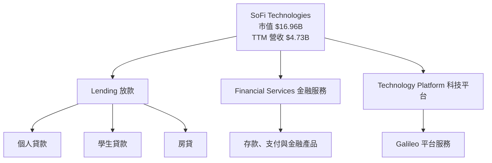
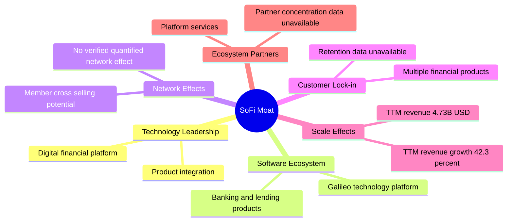
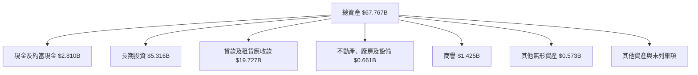
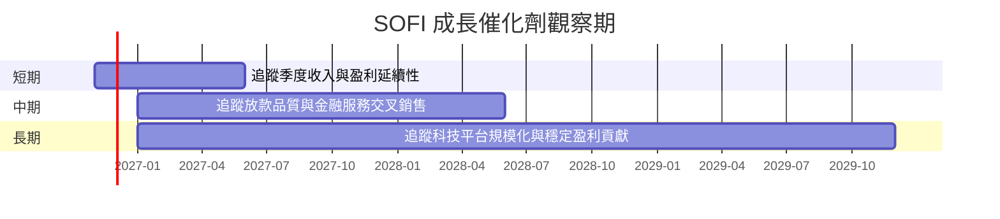
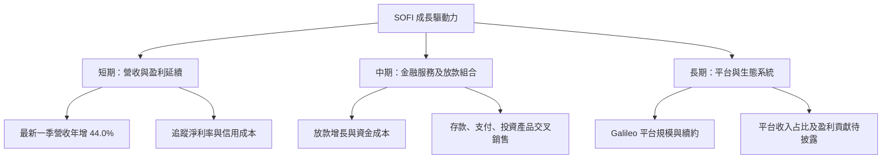
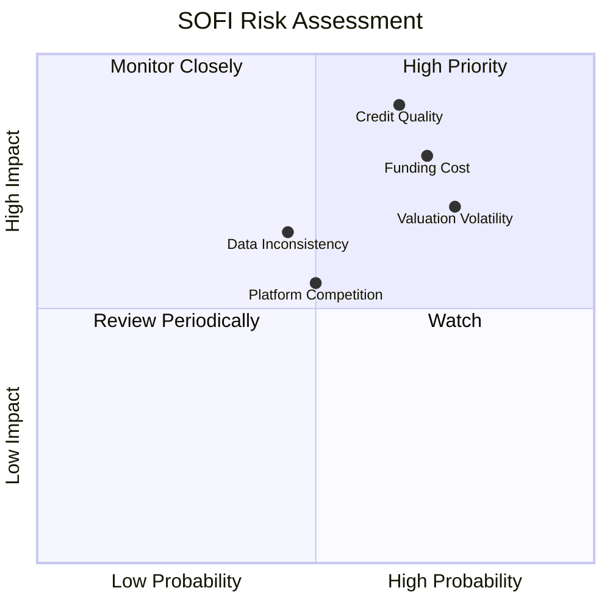
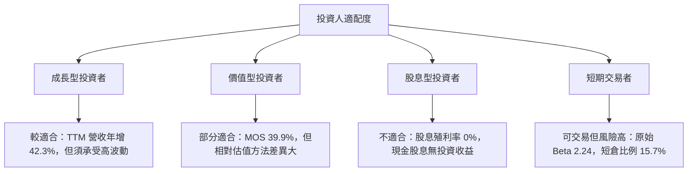

# SOFI 基本面深度分析報告
> **報告日期**：2026-11-27 ｜ **語言**：繁體中文 ｜ **數據來源**：SEC 申報資料 (XBRL)、Yahoo Finance、Finviz、StockAnalysis、Roic.ai ｜ **分析師**：CFA 級機構研究

> **數據口徑說明**：SOFI 是放款機構，放款與資金籌措會令營業現金流大幅波動，因此一般企業的 FCF、營運資金與 ROIC 分析不宜直接套用。SEC／標準化財務數據所列 TTM 營業現金流為 **-$10.21B**，但資本支出及 FCF 欄位為 **N/A**；其他資料來源提供不同的現金流數字，本報告不以其替代標準化 TTM FCF。不同來源的收入、債務與季度數字亦有差異，涉及規則要求原值引用的項目優先採用標準化數據，其他來源則明確標示。

## 目錄

| # | 章節 | 核心結論 |
|---|------|----------|
| 1 | 執行摘要 | 買入；加權合理價值 $21.74；MOS +39.9% |
| 2 | 公司概覽與商業模式 | 三業務平台有交叉銷售潛力，市場份額與分部收入占比未提供 |
| 3 | 損益表深度分析 | TTM 營收 $4.73B、年增 42.3%；盈利增長快於收入 |
| 4 | 資產負債表分析 | 標準化數據顯示淨現金 $2.81B，但總債務不可得 |
| 5 | 現金流量深度分析 | 標準化 TTM FCF 為 N/A；放款機構現金流受貸款擴張影響 |
| 6 | 獲利能力與資本效率 | ROTCE 7.9%；ROIC 不適用於放款業務，不能直接與 WACC 比較 |
| 7 | 相對估值分析 | 同業估值分散；相對估值方法支持的價值區間差距大 |
| 8 | DCF 內在價值評估 | DCF 不適用；採金融業估值方法，得加權合理價值 $21.74 |
| 9 | 成長催化劑 | 金融服務交叉銷售、放款及科技平台發展是主要觀察方向 |
| 10 | 風險矩陣 | 信用週期、資金成本及高波動估值是主要風險 |
| 11 | 投資建議 | 買入；以 MOS、信用品質和盈利持續性作為追蹤依據 |

## 1. 執行摘要

### 1.0 一頁式投資儀表板

| 項目 | 內容 |
|------|------|
| **投資論點（3 句）** | ① TTM 營收 **$4.73B**、年增 **42.3%**，顯示業務仍在擴張；② TTM 淨利率約 **15.6%**，但標準化 TTM FCF 為 **N/A**，獲利現金轉換尚不能由該口徑驗證；③ 2026-11-25 收盤價 **$13.07**，低於加權合理價值 **$21.74**，MOS 為 **+39.9%**。 |
| **綜合評分** | **6.4/10**（引用 1.1；六項算術平均） |
| **財務健康** | 🟡 現金及短期投資 **$2.81B**、標準化淨現金 **$2.81B**；總債務缺值，另有來源數字不一致。 |
| **ROIC vs WACC** | ROIC：**N/A（放款機構不適用）**；WACC：**14.00%**。ROTCE 為 **7.9%**，低於股權成本 **13.98%**，但兩者並非完全同口徑的 ROIC/WACC 比較。 |
| **FCF 趨勢** | 標準化 TTM FCF：**N/A**；標準化 TTM 營業現金流為 **-$10.21B**。FCF Yield：**N/A**。 |
| **估值** | Forward P/E **14.597154x**（Yahoo／Finviz 合併資料）；EV/EBITDA **N/A**；FCF Yield **N/A**。 |
| **DCF 內在價值（基準）** | **N/A**；放款機構的貸款與資金現金流不能以一般公司 FCFF 直接估值，故不計算 DCF 折溢價。 |
| **安全邊際（MOS）** | **+39.9%**＝（加權合理價值 **$21.74** − 現價 **$13.07**）÷ **$21.74**；🟢 依本報告定義屬充足。 |
| **預期報酬（基準情境 12M）** | 以加權合理價值衡量，上行空間 **+66.3%**；不是 DCF 情境預測。 |
| **關鍵風險（前二）** | 放款信用惡化及資金成本上升；高波動與估值回撤。 |
| **評級 + 信心度** | 🟢 **買入** ｜ 信心：**中**。MOS 與加權估值提供支持，但現金流及信用品質資料存在缺口。 |

### 1.1 綜合評分卡（全報告唯一）

| 維度 | 評分（1–10） | 主要依據（引用數字與其來源章節） |
|------|--------------|----------------------------------|
| 成長性 | 8.0 | 標準化 TTM 營收年增 **42.3%**、最新一季年增 **44.0%**（第 3 章）；成長數據強，但增長能否轉化為可持續回報仍需驗證。 |
| 獲利能力 | 6.0 | TTM 淨利率 **15.6%**、ROTCE **7.9%**；TTM 營業利益率及 ROIC 均為 N/A，難以判斷經濟利潤（第 3、6 章）。 |
| 財務健康 | 5.5 | 現金及短期投資與標準化淨現金均為 **$2.81B**，但總債務 N/A，且放款資產品質指標缺失（第 4、6 章）。 |
| 估值 | 7.5 | MOS **+39.9%**；同業 Forward P/E 中位數 **11.5x**、本公司 Forward P/E **14.597154x**，估值方法結果分歧（第 7、8 章）。 |
| 護城河 | 5.5 | 公司跨放款、金融服務及科技平台營運，但分部營收、客戶留存及單位經濟數據未提供（第 2 章）。 |
| 管理層與資本配置 | 6.0 | 2025 年 SBC **$262.06M**、2022–2025 年無明確回購數據；現金股息為零，股東稀釋須持續監控（第 3、5 章）。 |
| **綜合評分** | **6.4** | 六項算術平均：\((8.0+6.0+5.5+7.5+5.5+6.0)÷6=6.4167\)，四捨五入至一位小數。 |

### 1.2 五大投資論點 + 三大核心風險

| 類型 | 項目 | 具體依據 | 信心度 |
|------|------|----------|--------|
| 🟢 **投資論點①** | 營收擴張速度高 | TTM 營收 **$4.73B**、年增 **42.3%**；最新一季營收年增 **44.0%**，顯示增長未只依賴單一年度基期。 | 🟢 高 |
| 🟢 **投資論點②** | 盈利已具規模 | TTM 淨利率 **15.6%**、TTM ROTCE **7.9%**，公司已由過往虧損轉為盈利；但仍需留意信貸損失與資本要求。 | 🟡 中 |
| 🟢 **投資論點③** | 金融服務與放款可交叉銷售 | 公司提供借貸、存款、支付、投資等產品；如會員使用多項產品，理論上可改善獲客回收，但產品滲透率與留存資料未提供。 | 🟡 中 |
| 🟢 **投資論點④** | 市場估值低於加權合理價值 | 現價 **$13.07**，加權合理價值 **$21.74**，MOS **+39.9%**；該估值受同業 P/B 法支撐較大。 | 🟡 中 |
| 🟢 **投資論點⑤** | 24 個月股價回撤已反映部分悲觀預期 | 2026-11-25 收盤 **$13.07**，相較 52 週高點 **$30.42** 下跌約 **57.0%**；但價格回撤本身不代表基本面已觸底。 | 🟡 中 |
| 🟡 **風險①** | 信用品質與貸款損失資料不足 | 淨沖銷率、逾放比、CET1 均為 N/A，無法由資料直接驗證貸款組合風險。 | 🟡 中度 |
| 🔴 **風險②** | 高利率與融資成本壓力 | WACC 為 **14.00%**，原始資本成本計算值 **16.38%**；股權成本 **13.98%**，利率與信用利差變化會影響融資成本與估值。 | 🔴 高衝擊 |
| 🔴 **風險③** | 現金流及負債口徑不一致 | 標準化 TTM OCF 為 **-$10.21B**、FCF 為 N/A；另一來源報告總債務 **$3.98B**，與標準化總債務 N/A 不一致。 | 🔴 高衝擊 |

### 1.3 快速統計卡片

| 指標 | 公司實際值（期間） | 同業中位數 | 狀態 |
|------|--------------------|------------|------|
| 營收成長（TTM） | **42.3%** | — | 🟢 |
| 營收成長（最新一季年增） | **44.0%** | **34.1%**（NU、HOOD、UPST 最新季度年增率中位數） | 🟢 |
| 毛利率（TTM） | **84.2%** | **83.3%** | 🟢 |
| Forward P/E | **14.597154x** | **11.5x** | 🟡 |
| FCF Yield（TTM） | **N/A** | — | 🟡 無法評估 |

> 營業利益率 TTM、ROIC 與 Piotroski F-Score 對本放款機構的標準化可比數據未提供，依規則不列全為 N/A 的欄位。

### 1.4 投資結論

```text
╔══════════════════════════════════════════════════════════════════╗
║                    📊 投資結論摘要                               ║
╠══════════════════════════════════════════════════════════════════╣
║  評級：🟢 買入（依規則 20；未作一級調整）                        ║
║  價格（2026-11-25 收盤）：$13.07                                 ║
║  DCF 內在價值（基準）：N/A（放款機構現金流不適用一般 DCF）       ║
║  安全邊際 MOS：+39.9%（以加權合理價值 $21.74 為基準）            ║
║  加權合理價值（8.8）：$21.74                                     ║
║  綜合評分：6.4/10（引用 1.1）                                    ║
║  適合投資人：能承受高波動、願意追蹤貸款品質與盈利轉換的成長型投資人║
╚══════════════════════════════════════════════════════════════════╝
```

依 MOS 門檻應為「買入」；MOS **+39.9%** 且標準化規則已給出「買入」，本報告不因質化因素上下調整。DCF 為 N/A，因此不提供 DCF 悲觀、基準、樂觀情境目標價。

## 2. 公司概覽與商業模式

### 2.1 業務結構與收入來源

公司總市值約 **$16.96B**，TTM 營收 **$4.73B**。公司經營 Lending、Financial Services、Technology Platform 三大業務；分部營收占比與金額未提供，故不估算分部權重。



收入主要來自放款及金融服務，科技平台則提供不同類型的平台服務。由於分部收入、分部利潤與平台客戶數未提供，無法量化平台業務對整體盈利的貢獻，也不能推斷單一業務占比。

### 2.2 市場份額

市場份額數據未提供，因此不繪製市場份額圖，也不估算占比。以公司規模與成長率觀察，SOFI TTM 營收為 **$4.73B**、年增 **42.3%**；同業最新季度營收年增率中位數為 **34.1%**，SOFI 的單季年增率 **44.0%** 高於該中位數，但公司與同業的產品及收入確認口徑並不完全一致。

### 2.3 競爭護城河分析



### 2.4 護城河強度

| 護城河項目 | 強度（強／中／弱） | 證據（引用數字或事實） | 會削弱它的情況 |
|------------|--------------------|------------------------|----------------|
| 技術與產品整合 | 中 | 同時經營放款、金融服務與科技平台，並有 Galileo 平台業務；分部營收與技術平台指標未提供。 | 平台服務差異化不足、服務中斷或同業可低成本複製。 |
| 軟體生態系統 | 中 | 多種金融產品可在一家公司內提供；實際多產品客戶比例未提供。 | 客戶僅使用單一產品，交叉銷售沒有改善獲客成本或留存。 |
| 網路效應 | 弱至中 | TTM 營收成長 **42.3%**，但營收成長不等同於網路效應，會員互動資料缺失。 | 會員數增長無法改善定價、留存或成本。 |
| 客戶鎖定 | 弱至中 | 存款與借貸等金融產品可提高使用黏著度；存款留存及流失率未提供。 | 客戶可低成本轉換至競爭平台，或優惠補貼停止後大量流失。 |
| 規模效應 | 中 | TTM 營收 **$4.73B**，最新一季年增 **44.0%**；未提供不同規模下單位成本變化。 | 成長伴隨信用損失、獲客成本或管理費用同步上升。 |
| 生態夥伴 | 弱至中 | Galileo 顯示有平台服務模式；合作夥伴數、集中度與續約率未提供。 | 主要夥伴流失、平台收入集中或技術平台成長放緩。 |

1.1 評分卡中「護城河」為 **5.5/10**，理由是業務組合提供交叉銷售可能性，但客戶留存、分部盈利、平台規模等量化證據不足。

## 3. 損益表深度分析

### 3.1 年度收入成長趨勢（近 4 年）

以下採年度損益表數字；年度收入與 TTM 標準化數據來自不同期間資料，故不混用。

```text
╔══════════════════════════════════════════════════════════════════╗
║              SoFi 年度收入趨勢（FY2022–FY2025）                  ║
╠══════════════════════════════════════════════════════════════════╣
║  FY2022  $1.57B  ███████████░░░░░░░░░░░░░░░  基期               ║
║  FY2023  $2.11B  ███████████████░░░░░░░░░░░  YoY: +34.4% 🟢    ║
║  FY2024  $2.61B  ███████████████████░░░░░░░  YoY: +23.7% 🟢    ║
║  FY2025  $3.61B  ██████████████████████████  YoY: +38.3% 🟢    ║
╠══════════════════════════════════════════════════════════════════╣
║  FY2022–FY2025 CAGR = (3.61 ÷ 1.57)^(1/3) − 1 = 約 32.0%       ║
╚══════════════════════════════════════════════════════════════════╝
```

FY2024 增幅降至 **23.7%**，FY2025 回升至 **38.3%**。資料未提供足夠分部拆解，無法判斷增長回升究竟來自貸款規模、金融服務交叉銷售或平台收入；但標準化 TTM 年增 **42.3%** 顯示近期總體增長仍快。

### 3.2 季度收入趨勢分析

| 季度 | 營收 | QoQ 成長 | YoY 成長 | 備註 |
|------|------:|---------:|---------:|------|
| 2025 Q4 | $1.03B | — | — | 以年度季度表列示數字計算。 |
| 2026 Q1 | $1.10B | 約 **6.8%** | 約 **43.9%** | QoQ 以四捨五入季度收入估算；YoY 採標準化最新季度口徑。 |
| 2026 Q2 | $1.22B | 約 **10.9%** | **42.6%**（StockAnalysis） | 季度資料來源之間有四捨五入差異。 |
| 2026 Q3 | $1.39B | 約 **13.9%** | **44.0%**（標準化） | 最新一季年增率是單季 YoY，不是 TTM 成長率。 |

QoQ 以季度收入表中的四捨五入數字計算，故與 StockAnalysis 的精確數值可能略有差異。最新一季營收加速，代表收入增量仍在擴大；但金融服務與放款機構需同步檢查信用成本、存款成本及貸款組合風險，單看營收不足以證明單位經濟改善。

### 3.3 利潤率演變分析

| 利潤率指標 | FY2022 | FY2023 | FY2024 | FY2025／TTM | 趨勢 | 評估 |
|------------|--------|--------|--------|-------------|------|------|
| 毛利率 | N/A | N/A | N/A | **84.2% TTM** | 歷史序列未提供 | 🟡 單期數據不足以判斷趨勢 |
| 營業利益率 | N/A | N/A | N/A | **TTM N/A；最新季度 19.4%** | 最新季度為正 | 🟡 不以單季外推 TTM |
| 淨利率 | N/A | N/A | N/A | **15.6% TTM**（DuPont 口徑） | 盈利已轉正，但缺少一致歷史利潤率序列 | 🟡 |

FY2025 年度淨利為 **$481.32M**，低於 FY2024 的 **$498.67M**，按這組年度數據約下降 **3.5%**；但另一資料來源列出 FY2024 淨利 **$479.14M**，顯示資料庫版本有差異。最新季度營業利益率 **19.4%** 是季度數字，不能當作 TTM 利潤率。產品組合、定價與成本分項未提供，故不能把利潤變動歸因於特定項目。

### 3.4 費用結構分析

金融服務公司的收入與成本結構不等同一般工業企業的銷貨成本架構。公司分部費用拆解、利息費用、信用損失準備與其他營業費用占比未提供，因此不繪製費用圓餅圖，以免將未披露項目誤作精確比例。

可用的參考指標是成本收入比代理值 **80.8%**；此值定義為「（營收 − 稅前淨利）÷ 營收」，包含信用準備，因此高於金融機構自行公布的效率比率，不宜與銀行業常見效率比率直接等同。

### 3.5 季度 EPS 趨勢與盈餘品質（Quality of Earnings）

| 季度 | EPS 實際值（資料來源） | EPS 年增率 | EPS 預期／超預期情況 |
|------|------------------------:|-----------:|----------------------|
| 2025 Q4 | $0.14（Roic.ai） | StockAnalysis：-57.01% | 預期值缺失，無法判斷超預期或不及預期。 |
| 2026 Q1 | $0.13（Roic.ai） | StockAnalysis：101.15% | 預期值缺失，無法判斷超預期或不及預期。 |
| 2026 Q2 | $0.12（Roic.ai） | StockAnalysis：40.40% | 預期值缺失，無法判斷超預期或不及預期。 |
| 2026 Q3 | $0.19（Roic.ai） | StockAnalysis：64.38% | 預期值缺失，無法判斷超預期或不及預期。 |

Earnings History 的 EPS Est 與 EPS Act 為 nan，因此無法可靠評估最近四季的「超預期／不及預期」；可觀察到實際 EPS 由 2026 Q2 的 **$0.12** 上升至 Q3 的 **$0.19**，但單季增長仍可能受信用準備、稅務或股數變動影響。

| 盈餘品質項目 | 數值／佔比 | 評估 |
|--------------|-----------|------|
| 股權薪酬 SBC / 營收 | 近四季 SBC 約 **$288.33M**；除以 TTM 營收 **$4.73B**，約 **6.1%** | 🟡 SBC 對股東有稀釋成本；須觀察收入增長能否長期高於 SBC 增幅。 |
| SBC / 營業現金流 | SBC 約 **$288.33M**；TTM OCF **-$10.21B** | 🔴 分母為負值，比例不適合解讀為一般覆蓋率；OCF 本身受貸款資產變動影響。 |
| FCF / 淨利（現金轉換率） | **N/A**（標準化 TTM FCF 缺失） | 🔴 無法以標準化 FCF 驗證淨利現金轉換。 |
| 一次性／非經常性損益 | N/A | 缺少可完整核對的一次性項目明細，不能判定當期淨利是否由一次性收益推動。 |
| 有效稅率異常 | 最新年度有效稅率 **8.5%** | 🟡 低於一般長期稅率假設，但沒有年度稅項明細以判斷是否可持續。 |
| 資本化支出 vs 費用化 | 標準化 TTM Capex **N/A**；FY2025 資料另列 Capex **$251.12M** | 🟡 不以不同期間口徑推算 TTM 資本化比例；資本化政策細節未提供。 |

**盈餘品質結論**：GAAP 盈利已轉正，但 SBC 約占 TTM 收入 **6.1%**，不應視為零成本。由於標準化 FCF、TTM 資本支出與一次性損益明細缺失，尚不能確認淨利的現金含量。估值應優先以金融業相對估值與帳面價值作參照，並折價看待高 SBC 和現金流口徑的不確定性。

## 4. 資產負債表分析

### 4.1 資產結構分解

最新 TTM 資產負債表總資產為 **$67.767B**。下圖列出有明確金額的主要項目；資產總額、類別間可能存在其他資產與抵銷項，不應把下列項目誤認為完整資產加總。



貸款及租賃應收款 **$19.727B** 是金融業資產核心，約為總資產的 **29.1%**（19.727÷67.767）；另有長期投資 **$5.316B**。資產分類與金融機構監管報表口徑不同，故不把傳統「流動／非流動」營運資產解讀直接套用。

### 4.2 流動性與營運資金分析

| 指標 | 數值 | 解讀 |
|------|------|------|
| 現金及短期投資 | **$2.81B** | 標準化數據；銀行與放款機構資金須同時看存款與監管流動性，不能只看現金餘額。 |
| 標準化淨現金 | **$2.81B** | 原值引用；標準化總債務為 N/A，故此指標不能取代完整債務到期分析。 |
| Current Ratio | **1.086**（其他整合資料） | 金融業的流動資產、流動負債分類不同於非金融企業，解讀有限。 |
| Quick Ratio | **0.428**（其他整合資料） | 同樣不宜直接套用一般公司短期償債門檻。 |

**營運資金天數**：本次品質指標未提供 DSO／DIO／DPO／CCC；對放款機構，存貨與傳統現金轉換週期不適用，不以一般企業模型補算。

### 4.3 債務結構分析

```text
╔══════════════════════════════════════════════════════════════════╗
║                   SOFI 債務健康診斷                              ║
╠══════════════════════════════════════════════════════════════════╣
║  現金及短期投資：$2.81B  標準化數據                               ║
║  總債務：        N/A      標準化資料未提供                        ║
║  淨現金：        $2.81B   原值引用；需配合債務缺值解讀            ║
║                                                                  ║
║  Debt/EBITDA：   N/A      TTM EBITDA 口徑不可用                   ║
║  Interest Coverage：N/A   未提供可核對利息保障倍數               ║
║  債務來源差異：其他市場資料列總債務 $3.98B，無法與標準化資料調節  ║
╚══════════════════════════════════════════════════════════════════╝
```

放款機構的存款、借款及證券化融資本身可能是業務資金來源，不宜只用一般公司的「淨現金」概念判斷槓桿。不同資料來源的債務數字不一致，投資前應以最新 10-Q 的負債附註、到期結構及融資類型進一步核對。

### 4.4 股東權益趨勢

| 年度 | 股東權益 | YoY 變動 |
|------|---------:|---------:|
| 2022 | $5.53B | — |
| 2023 | $5.55B | 約 **+0.4%** |
| 2024 | $6.53B | 約 **+17.7%** |
| 2025 | $10.49B | 約 **+60.8%** |

FY2025 權益增加約 **$3.96B**。資料未提供足夠的增資、可轉換證券、累積盈餘及其他綜合損益拆分，不能把增幅全歸因於淨利；員工股權薪酬與股本變化需一併追蹤。

## 5. 現金流量深度分析

### 5.1 現金流量瀑布圖

標準化 TTM 淨利未在同一現金流資料列提供，標準化 Capex 與 FCF 亦為 N/A。為避免混用其他來源重組，以下呈現資料關係而不填入缺值。


### 5.2 FCF 轉換率趨勢

標準化 TTM FCF 為 N/A，因此 FCF／淨利轉換率無法計算。年度現金流資料列 FY2025 OCF **-$3.74B**、Capex **-$251.12M**、FCF **-$3.99B**，但放款機構貸款增長可使營業現金流呈現大額流出；該口徑不能直接視作核心業務虧損。

### 5.3 自由現金流趨勢

| 期間 | OCF | Capex | FCF | FCF Yield |
|------|----:|------:|----:|---------:|
| TTM（至 2026-09-30，標準化） | **-$10.21B** | **N/A** | **N/A** | **N/A** |
| FY2025（其他歷史現金流表） | -$3.74B | -$251.12M | -$3.99B | N/A |
| FY2024（其他歷史現金流表） | -$1.12B | -$163.62M | -$1.28B | N/A |
| FY2023（其他歷史現金流表） | -$7.23B | -$121.19M | -$7.35B | N/A |

由於不同資料源的現金流定義與期間數字不一致，不能以 FY 歷史數列替代標準化 TTM FCF，也不應將負 OCF 簡單視為盈餘品質差。對 SOFI，須拆解貸款發放、貸款出售、存款流量及證券化等項目後才可評估現金轉換。

### 5.4 資本配置評估

FY2025 SBC 為 **$262.06M**；現金股息資料列為 **$0**。回購、貸款出售與資本投資的完整 TTM 金額未提供，因此不以未披露數字繪製資本配置圓餅圖。

| 配置項目 | 可用資料 | 評估 |
|----------|----------|------|
| 股權薪酬 | FY2025 **$262.06M** | 以股份支付有利於保留現金，但會稀釋股東持股。 |
| 現金股息 | FY2025 **$0** | 公司未以現金股息作主要股東回報。 |
| 資本支出 | TTM N/A；FY2025 **$251.12M** | 需以 10-Q 核對持續性投資與資本化政策。 |
| 股票回購 | N/A | 無法判斷是否抵銷 SBC 稀釋。 |

## 6. 獲利能力與資本效率

### 6.1 ROE／ROA／ROIC 趨勢

| 指標 | 最新數值 | 歷史／補充數據 | 評估 |
|------|---------:|----------------|------|
| ROE（標準化 TTM） | **6.5%** | 其他整合資料列 **7.4%**，口徑有差異 | 🟡 以標準化 6.5% 作主要比較；不同來源可能使用不同平均權益或期間。 |
| ROA | **1.3%**（其他整合資料） | 歷史序列未提供 | 🟡 對放款機構須同時看信用成本與資本需求。 |
| ROIC | **N/A** | 放款機構融資負債屬營運模式一部分，普通企業 ROIC 難以直接比較 | 不套用一般企業 ROIC/WACC 結論。 |
| ROTCE | **7.9%** | lender metrics | 🟡 可反映有形普通權益回報，但低於股權成本代理值。 |

### 6.2 ROIC vs WACC 分析（核心價值創造判斷）

放款機構的存款與借款是營運資金來源，將其視為一般公司的債務資本並計算 ROIC，容易把放款規模及資金結構混入投入資本。因此 **ROIC 不適用**；不能以一般企業 ROIC − WACC 宣稱創造或摧毀價值。可作為補充比較的是 ROTCE **7.9%** 與股權成本 **13.98%**，前者低於後者約 **6.08 個百分點**，顯示目前有形權益回報尚未覆蓋估算股權成本，但二者期間與風險口徑仍有差異。

```text
╔══════════════════════════════════════════════════════════════════╗
║             SOFI 資本成本與放款機構回報分析                     ║
╠══════════════════════════════════════════════════════════════════╣
║  無風險利率（10Y Treasury）：4.85%                               ║
║  股權風險溢酬（假設）：       5.00%                               ║
║  原始 Beta（Yahoo）：         2.24                                ║
║  調整後 Beta：                1.83                                ║
║  股權成本（CAPM，已提供）：   13.98%                              ║
║  稅前債務成本（已提供）：     29.04%                              ║
║  有效稅率：                   8.5%                                ║
║  股權／債務權重：             81.0%／19.0%                        ║
║  WACC 原始計算值：            16.38%                              ║
║  區間限制後採用 WACC：        14.00%                              ║
║                                                                  ║
║  ROIC：N/A（放款業務不適用一般企業口徑）                         ║
║  ROTCE：7.9%                                                      ║
║  ROTCE 與 Ke 差：7.9% − 13.98% = -6.08 個百分點                   ║
║  結論：現有回報指標低於股權成本代理值，尚無充分證據確認超額回報。║
╚══════════════════════════════════════════════════════════════════╝
```

本節 WACC **14.00%** 直接採用資本成本數據，原始計算值 **16.38%** 被限制在 **7%–14%** 區間後取上限 **14.00%**；第 8 章若有 DCF 應使用同一 WACC，但本公司 DCF 為 N/A。

### 6.3 杜邦三因素分解

| 因素 | 數值（TTM） | 解讀 |
|------|-------------|------|
| 淨利率 | **15.6%** | 有盈利能力，但對金融機構須注意信用準備與資金成本。 |
| 資產週轉率 | **0.07** | 資產規模大、收入相對資產較低，符合金融機構資產負債表特徵。 |
| 權益乘數 | **6.00** | 槓桿對 ROE 有放大效果；需與貸款品質及監管資本一起評估。 |
| **ROE** | **6.5%** | 15.6% × 0.07 × 6.00 ≈ 6.5%（按提供的已計算指標原值引用）。 |

ROE 由淨利率、資產週轉率與權益乘數共同構成，權益乘數 **6.00x** 意味著槓桿是回報形成的一部分；若信用損失增加，槓桿亦可能放大權益回報下滑。

### 6.4 財務體質：Piotroski F-Score／Lender Metrics

Piotroski F-Score **N/A（不適用於放款機構）**：貸款增長會帶來營業現金流流出，傳統現金流測試可能錯誤解讀銀行／放款機構的營運狀況，因此不列九項 F-Score 測試結果。

| 放款機構指標 | 數值 | 解讀 |
|--------------|-----:|------|
| 淨利息收入 NII ÷ 總營收 | **64.0%** | 顯示利息收入是收入的重要組成，但未提供分部利率與費用拆分。 |
| 淨利差代理值：NII ÷ 平均總資產 | **5.36%** | 代理值；缺少生息資產，因此通常會低於以生息資產為分母的正式 NIM。 |
| 成本收入比代理值 | **80.8%** | 定義含信用準備，會高於公司自行公布的效率比率，不能直接視作正式效率比。 |
| ROTCE | **7.9%** | 有形普通權益報酬率；低於 13.98% 股權成本代理值。 |
| P/TBV | **1.82x** | 市價相對有形帳面價值的倍數。 |
| 放款淨額 ÷ 總資產 | **79.3%** | 放款資產比重高，信用週期對資產與盈利影響重大。 |
| 淨沖銷率 | **N/A（數據未提供）** | 無法量化已核銷貸款損失。 |
| 逾放比 | **N/A（數據未提供）** | 無法評估逾期與不良貸款趨勢。 |
| CET1 | **N/A（數據未提供）** | 無法從目前資料判斷監管資本緩衝。 |

## 7. 相對估值分析

### 7.1 同業估值比較表格

| 估值指標 | **SOFI** | **NU** | **HOOD** | **UPST** | SOFI 評估 |
|----------|---------:|-------:|---------:|--------:|-----------|
| **Trailing P/E** | **23.3x**（自身歷史區塊） | **15.4x** | **30.3x** | **28.3x** | 🟡 SOFI 介於 NU 與 HOOD／UPST 之間；SOFI 口徑採歷史估值區塊。 |
| **Forward P/E** | **14.597154x** | **11.5x** | **19.3x** | **5.9x** | 🟡 SOFI 高於同業中位數 **11.5x**；UPST 前瞻倍數受盈利預期影響較大。 |
| **P/S** | **3.8x**（自身歷史區塊） | **6.6x** | **11.7x** | **1.2x** | 🟡 SOFI 位於三家同業範圍內，商業模式不同使 P/S 可比性有限。 |
| **EV/EBITDA** | **52.4x** | N/A | N/A | **25.5x** | 🔴 只有 UPST 可比數據；SOFI TTM EBITDA 口徑需審慎。 |
| 最新一季營收 YoY | **44.0%** | **34.4%** | **11.8%** | **34.1%** | 🟢 SOFI 高於三家同業各自所列的最新季度增速。 |
| TTM 毛利率 | **84.2%** | **0.0%** | **91.0%** | **83.3%** | 🟡 SOFI 接近 UPST，略低於 HOOD；金融服務業毛利率口徑可能不同。 |

同業中位數 Forward P/E 為 **11.5x**，由 NU **11.5x**、HOOD **19.3x**、UPST **5.9x** 排序後的中間值。SOFI 的 Forward P/E 高於同業中位數，估值是否合理取決於其盈利增長及信用風險能否優於同業；不能單靠高增長率判定折價。

### 7.2 歷史估值區間分析

```text
╔══════════════════════════════════════════════════════════════════╗
║                 SOFI 五年估值區間（TTM 倍數）                   ║
╠══════════════════════════════════════════════════════════════════╣
║  P/E        27.0x ├────────中位數 36.6x────────┤ 67.1x          ║
║  現值：23.3x；低於歷史區間下緣，百分位：0%                     ║
║                                                                  ║
║  P/S         2.6x ├────中位數 4.5x────┤ 14.6x                   ║
║  現值：3.8x；歷史百分位：29%                                    ║
║                                                                  ║
║  EV/EBITDA  19.0x ├────────中位數 65.1x────────┤ 148.7x        ║
║  現值：52.4x；歷史百分位：33%                                   ║
╚══════════════════════════════════════════════════════════════════╝
```

P/E、P/S 與 EV/EBITDA 均低於各自五年中位數，但歷史區間最低倍數不等同於合理價值下限。P/E 現值 **23.3x** 低於列示歷史範圍 **27.0x–67.1x**；需注意不同計算資料源對當前 P/E 另列 **23.763636x**，本節遵循自身歷史區塊原值。

### 7.3 情境價值（Bear / Base / Bull）

**N/A（DCF 無法計算：放款機構的現金流是資金與貸款配置的一部分，不能以一般企業 FCFF 估值；無 DCF MODEL 情境輸出，故不提供情境目標價。）**

### 7.4 相對估值隱含價格區間

```text
╔══════════════════════════════════════════════════════════════════╗
║                 相對估值方法隱含每股價值                        ║
╠══════════════════════════════════════════════════════════════════╣
║  同業 Forward P/E       $10.30  ├── 現價 $13.07 ──┤              ║
║  同業 P/B               $36.33  ├───────────────────────┤        ║
║  分析師共識目標價       $20.56  ├───────────┤                    ║
║                                                                  ║
║  估值範圍：$10.30 至 $36.33；各方法差異顯著，不能視作窄幅區間。║
╚══════════════════════════════════════════════════════════════════╝
```

| 方法 | 每股價值 | 相對現價 | 依據 |
|------|---------:|---------:|------|
| 同業 Forward P/E | **$10.30** | **-21.2%** | 同業 Forward P/E 中位數 **11.5x** × SOFI Forward EPS **$0.90**；同業為 NU、HOOD、UPST。 |
| 同業 P/B | **$36.33** | **+178.0%** | 同業 P/B 中位數 **4.2x** × 每股帳面價值 **$8.71**。 |
| 分析師共識目標價 | **$20.56** | **+57.3%** | 22 位分析師平均目標價。 |

## 8. DCF 內在價值評估（Discounted Cash Flow）

### 8.0 估值推理鏈

SOFI 是放款機構，貸款發放、存款籌集與貸款出售會直接影響現金流；營業現金流並非一般企業可分配現金流的直接代理。標準化 TTM OCF 為 **-$10.21B**、Capex 與 FCF 均為 **N/A**，因此不建立一般 FCFF DCF，也不以缺失的 Capex、貸款資金流或淨負債反推模型輸入。估值採金融業的同業 Forward P/E、同業 P/B 與分析師共識目標價，按既定權重加權。

| 決策點 | 本報告採用 | 理由（含數字） | 曾考慮但否決 | 否決理由 |
|--------|-----------|----------------|--------------|----------|
| 現金流定義 | 不採一般 FCFF／FCFE DCF | 標準化 TTM OCF **-$10.21B**，Capex、FCF 為 N/A；放款資金流是業務核心 | 一般企業 FCFF | 可能把貸款擴張的資金流出誤當經營現金流惡化，或漏掉融資需求 |
| 預測期 N | N/A | 不建立 DCF | 5–10 年預測 | 缺少可驗證的信用損失、資金成本與分部盈利假設 |
| 終值方法 | N/A | 不適用一般企業 FCFF 終值 | Gordon Growth／退出倍數 | 不能以缺失 FCF 推導終值 |
| EBIT 基礎 | N/A | 不計 DCF | GAAP／非 GAAP EBIT | 放款機構資金成本與信用準備是核心經濟項目，資料不足以建立模型 |

### 8.1 模型假設總表（Model Inputs）

**N/A（DCF MODEL 不適用：缺少可用的標準化 TTM Capex、FCF，以及放款機構所需的信用成本、融資與資本需求預測；依要求不自行另建 DCF。）**

因此預測期、營收 CAGR、期末營業利潤率、D&A／營收、營運資金變動、SBC 股數處理、永續成長率及終值方法均不估算。

### 8.2 折現率推導（WACC）

WACC 及組成直接引用資本成本數據；未另行重算或替換。

```text
╔══════════════════════════════════════════════════════════════════╗
║                    WACC 推導（折現率）                           ║
╠══════════════════════════════════════════════════════════════════╣
║  無風險利率（10Y Treasury）：      4.85%                         ║
║  股權風險溢酬（假設）：             5.00%                         ║
║  原始 Beta（Yahoo）：               2.24                          ║
║  調整後 Beta：                      1.83                          ║
║  調整方式：⅔ × 2.24 + ⅓ × 1 = 1.83                              ║
║  股權成本 Ke（已計算）：            13.98%                        ║
║  稅前債務成本（已計算）：            29.04%                        ║
║  有效稅率：                         8.5%                          ║
║  股權／債務權重：                   81.0%／19.0%                   ║
║  WACC 原始計算值：                  16.38%                        ║
║  區間限制：                         7%–14%                        ║
║  採用 WACC：                        14.00%                        ║
╚══════════════════════════════════════════════════════════════════╝
```

**逐步演算資料限制**：標準化資本成本數據提供的股權成本、稅前債務成本、權重、原始 WACC 與限制後 WACC 如上，並未提供可重現 Kd 的利息費用、平均計息負債明細及市值／債務權重原始金額。故不得用不完整輸入自行改算 WACC；本報告一致採用 **14.00%**，與第 6.2 節相同。Rf 日期未另列，ERP 為假設輸入；未另加規模或國別溢酬。

### 8.3 逐年自由現金流預測（基準情境）

**N/A（放款機構的資金現金流不是一般企業自由現金流；標準化 TTM Capex 與 FCF 亦為 N/A）。**不列逐年預測、折現因子、PV 合計及 ASCII FCF 預測圖，避免自行建立與既定 DCF 模型不一致的數值。

### 8.4 終值計算（Terminal Value）

**N/A（無可用 FCFF 預測，故不能計算 Gordon Growth 終值或退出倍數終值）。**不存在可檢驗的 FY+N 現金流基礎，亦不計算終值占企業價值比重。

### 8.5 企業價值 → 每股內在價值（Bridge）

**N/A（沒有可用 DCF 企業價值、DCF 現金流預測與統一淨負債橋接數據）。**標準化現金及短期投資為 **$2.81B**，但標準化總債務為 N/A；不以其他來源債務數字拼接出 DCF 股權價值。本節不計算 DCF 折溢價或 MOS。

### 8.6 敏感性分析（WACC × 永續成長率）

**N/A（沒有 DCF 基準每股價值、FCFF 與終值，無法建立 WACC × g 矩陣或三情境模型）。**不提供估算值或自行試算格。

### 8.7 反推 DCF（Reverse DCF）

**N/A（放款機構一般企業 DCF 不適用，且無可用 DCF 模型輸出）。**因此無法由現價 **$13.07** 反推營收 CAGR、營業利潤率、永續成長率或預測期長度。

### 8.8 估值三角驗證與安全邊際

| 估值方法 | 隱含每股價值 | 上行空間（÷現價） | 權重 | 說明 |
|----------|--------------:|------------------:|------:|------|
| 同業 Forward P/E | **$10.30** | **-21.2%** | **50%** | 同業中位數 Forward P/E **11.5x** × SOFI Forward EPS **$0.90**。 |
| 同業 P/B | **$36.33** | **+178.0%** | **40%** | 同業中位數 P/B **4.2x** × 每股帳面價值 **$8.71**。 |
| 分析師共識目標價 | **$20.56** | **+57.3%** | **10%** | 22 位分析師平均目標價；作為交叉參考。 |
| **加權合理價值** | **$21.74** | **+66.3%** | **100%** | 金融業估值方法權重固定；未加入 DCF。 |

**加權計算**：

\[
\$10.30 \times 50\%+\$36.33 \times 40\%+\$20.56 \times 10\%
=\$5.15+\$14.532+\$2.056
=\$21.738
\approx \$21.74
\]

權重合計為 **50%+40%+10%=100%**。公司類型為金融業，故採既定同業 Forward P/E、同業 P/B 與分析師共識目標價權重；DCF 與 EV/EBITDA 方法因未提供可計算值而未列入。

```text
╔══════════════════════════════════════════════════════════════════╗
║                  估值區間與安全邊際                              ║
╠══════════════════════════════════════════════════════════════════╣
║  $10.30 ─── $13.07 ───────── [$21.74] ───────── $36.33          ║
║  同業P/E      現價             加權合理值        同業P/B         ║
║                                                                  ║
║  MOS = ($21.74 − $13.07) ÷ $21.74 = +39.9%                      ║
║  上行空間 = ($21.74 − $13.07) ÷ $13.07 = +66.3%                 ║
║  MOS 評估：🟢 大於 25%                                           ║
║                                                                  ║
║  買入參考上限：$19.57（加權合理價值的 90%；MOS ≥ 10%）           ║
║  合理持有參考：$19.57–$23.91（MOS 約 +10% 至 -10%）              ║
║  減碼參考：高於 $23.91（MOS 低於 -10%）                         ║
╚══════════════════════════════════════════════════════════════════╝
```

MOS 算式：\((21.74-13.07)÷21.74=8.67÷21.74=39.9\%\)。上行空間算式：\((21.74-13.07)÷13.07=8.67÷13.07=66.3\%\)。買入參考上限為 **$21.74×90%=$19.566≈$19.57**；合理持有上緣為 **$21.74×110%=$23.914≈$23.91**。這些是由 MOS 定義推得的價格門檻，不是 DCF 情境目標價。

> 🔎 **程式複算（Python，依本節各項自動重算）**
>
> 加權合理價值 = $10.30 × 50% + $36.33 × 40% + $20.56 × 10% = **$21.74**（權重合計 100%）
>
> 以價格 $13.07 計：MOS = **+39.9%**，上行空間 = **+66.3%**
>
> ✅ 與本節所寫數值一致。

### 8.9 DCF 模型的局限與失效條件

- **終值依賴度**：N/A，沒有可計算的 DCF EV 或終值。
- **最脆弱的假設**：並非 DCF 輸入，而是金融業相對估值中的同業倍數能否合理套用至 SOFI。P/B 法推得 **$36.33**，Forward P/E 法僅 **$10.30**，兩者差距反映盈利與帳面價值估值的不確定性。
- **不適用情境說明**：放款機構的資金流、貸款發放與融資活動構成營運模式，標準化 TTM OCF **-$10.21B** 不宜直接視作可分配現金流；應以 P/E、P/B、ROTCE、信用損失及資本充足率為主。
- **與第 10 章風險矩陣的連結**：信用損失上升會壓低盈利與帳面價值；資金成本上升會壓低淨利息收入及估值倍數；若放款增長依賴高成本融資，P/B 法的合理倍數也可能下修。

### 8.10 複算檢核表（Audit Trail）

| # | 檢核項目 | 檢查方式 | 結果 |
|---|----------|----------|------|
| 1 | DCF 高／中敏感度輸入四段式推導 | DCF MODEL 為 N/A，沒有模型輸入可推導 | N/A |
| 2 | 每個 DCF 假設都有來歷 | 不另建 DCF，未填入假設數字 | N/A |
| 3 | WACC 五步算式及重算 | 採標準化提供的 WACC **14.00%**，不以缺失底層資料重算 | 已採同一值；底層重算資料不足 |
| 4 | Kd 分母與 D 權重同範圍 | 利息費用、平均計息負債與金額權重未提供 | N/A |
| 5 | WACC 與第 6.2 節一致 | 兩節均採 **14.00%** | ✅ |
| 6 | 逐年表格年度數等於 N | 沒有 DCF 年度表 | N/A |
| 7 | FY+1 九步計算可複算 | 沒有 DCF 預測 | N/A |
| 8 | 預測期 PV 加總 | 沒有 DCF 預測 | N/A |
| 9 | WACC > g | 沒有設定 g | N/A |
| 10 | 終值基於 FY+N 並折現 N 期 | 沒有終值 | N/A |
| 11 | DCF 橋接至每股價值 | 沒有 DCF EV | N/A |
| 12 | SBC 組合與股數相容 | 不建 DCF，不設定 EBIT 或稀釋率 | N/A |
| 13 | 敏感性矩陣基準格等於 DCF 基準值 | 沒有矩陣 | N/A |
| 14 | 敏感性矩陣格子有效性 | 沒有矩陣 | N/A |
| 15 | 三情境機率合計 | 沒有 DCF 情境 | N/A |
| 16 | 反推 DCF 單一變數與疊代軌跡 | 沒有反推 DCF | N/A |
| 17 | MOS 分母與折溢價基準 | MOS 以 **$21.74** 加權合理值為分母；DCF 折溢價 N/A | ✅ |
| 18 | 報告完整至第 11 章 | 已列出第 1 至第 11 章 | ✅ |
| 19 | 加權合理價值等於各方法加權總和 | **$5.15+$14.532+$2.056=$21.738≈$21.74** | ✅ |
| 20 | 評級符合 MOS 門檻 | MOS **+39.9%**；採用規則 20 已計算評級「買入」 | ✅ |

## 9. 成長催化劑

### 9.1 催化劑時間軸

公司未提供未來催化劑的具體日期；以下按觀察時間分類，不把未披露事件標示為確定發生時間。



### 9.2 TAM 市場規模分析

**N/A（TAM 數據未提供）**。SOFI TTM 營收 **$4.73B**、年增 **42.3%**，最新一季年增 **44.0%**，提供了公司目前擴張速度的量化依據，但不能據此推算可服務市場總額或市場滲透率。判斷成長空間需要公司分部收入、會員數、產品滲透率與市場規模資料。

### 9.3 成長驅動力結構圖



## 10. 風險矩陣

### 10.1 風險評分矩陣

以下機率與衝擊座標是分析師的**定性風險排序**，不是公司披露的統計發生率。



### 10.2 風險清單詳細分析

| # | 風險項目 | 發生機率 | 財務衝擊 | 風險評估 | 緩解措施 |
|---|----------|----------|----------|----------|----------|
| 1 | 🔴 **放款信用風險** | 中高；定性估計 | 高；損失準備上升會壓低淨利與帳面價值，具體幅度 N/A | 🔴 高 | 每季追蹤淨沖銷率、逾放比、貸款期限與抵押品；目前均缺數據，應以 10-Q 補齊。 |
| 2 | 🔴 **資金成本與利率風險** | 中高；定性估計 | 高；稅前債務成本資料列 **29.04%**，股權成本 **13.98%** | 🔴 高 | 追蹤存款成本、資產收益率、期限錯配與融資來源；避免只以營收增長判斷利差。 |
| 3 | 🟠 **估值波動與高 Beta** | 高；Beta 原始值 **2.24** | 高；股價由 52 週高 **$30.42** 至 **$13.07**，跌幅約 **57.0%** | 🟠 高 | 分批建倉、以估值門檻控制倉位，並監控實際盈利與預期差。 |
| 4 | 🟡 **數據源及指標口徑差異** | 中 | 中；總債務、FCF、季度數據存在不同來源差異 | 🟡 中 | 優先核對 SEC 10-Q 原始財報；分清單季、TTM、年度及管理層非 GAAP 指標。 |
| 5 | 🟡 **科技平台競爭與執行** | 中 | 中；平台收入占比、客戶集中度及續約數據未提供 | 🟡 中 | 持續檢視平台收入成長、客戶留存、服務可用性與單位經濟。 |

## 11. 投資建議

### 11.1 最終評級與評分

SOFI 的標準化 TTM 營收年增 **42.3%**、最新一季年增 **44.0%**，加權合理價值 **$21.74** 相對 2026-11-25 收盤 **$13.07** 對應 MOS **+39.9%**，因此按規則 20 評為 **買入**，未作一級調整。1.1 綜合評分為 **6.4/10**，六項分數依序為成長性 **8.0**、獲利能力 **6.0**、財務健康 **5.5**、估值 **7.5**、護城河 **5.5**、管理層與資本配置 **6.0**。

### 11.2 合理價值與隱含報酬率

| 估值參考 | 每股價值 | 相對現價 | 機率／權重 | 說明 |
|----------|---------:|---------:|-----------:|------|
| 加權合理價值 | **$21.74** | **+66.3% 上行空間** | 權重合計 100% | 由同業 Forward P/E、同業 P/B、分析師共識目標價加權。 |
| 悲觀 DCF 情境 | N/A | N/A | N/A | DCF 不適用，未自行估算情境價值。 |
| 基準 DCF 情境 | N/A | N/A | N/A | DCF 不適用，未自行估算情境價值。 |
| 樂觀 DCF 情境 | N/A | N/A | N/A | DCF 不適用，未自行估算情境價值。 |

加權合理價值的主要不確定性來自方法結果分歧：同業 Forward P/E 指向 **$10.30**，同業 P/B 指向 **$36.33**，分析師共識為 **$20.56**。因此 **$21.74** 是依既定權重形成的參考值，不代表精確的單一目標價。

### 11.3 買入時機與觸發因素

```text
╔══════════════════════════════════════════════════════════════════╗
║                  ✅ 買入觸發因素 Checklist                       ║
╠══════════════════════════════════════════════════════════════════╣
║  目前判斷：加權合理價值 $21.74；現價 $13.07；MOS +39.9%          ║
║                                                                  ║
║  建議確認後分批布局：                                            ║
║  ✅ 季度營收年增維持在 30% 以上，且盈利同步增長                  ║
║  ✅ 信用損失與存款成本未明顯快於利息收入增長                      ║
║  ✅ 最新季營業利益率 19.4% 未因信用成本上升而快速回落            ║
║                                                                  ║
║  加碼觸發條件：                                                  ║
║  ☐ 連續兩季營收年增 ≥ 30%，且 ROTCE 高於前期 7.9%                ║
║  ☐ 公司披露淨沖銷率、逾放比及 CET1，且趨勢維持可控               ║
║  ☐ 買入價格仍不高於加權合理價值的 90%，約 $19.57                 ║
║                                                                  ║
║  減碼／重新評估條件：                                            ║
║  ☐ 連續兩季營收年增低於 20%                                      ║
║  ☐ 最新季度營業利益率較 19.4% 下滑 5 個百分點以上               ║
║  ☐ ROTCE 長期低於 7.9%，或信用損失顯著侵蝕淨利與帳面價值         ║
║  ☐ 股價進入 MOS 低於 -10% 的參考區域，即高於約 $23.91            ║
╚══════════════════════════════════════════════════════════════════╝
```

### 11.4 投資人適配度分析



### 11.5 每季財報監控清單（Quarterly Watch List）

| 指標 | 目前參考值 | 加碼觀察條件 | 減碼／重估條件 |
|------|-----------:|--------------|----------------|
| 營收成長 | TTM **42.3%**；最新一季 YoY **44.0%** | YoY 維持 **≥30%** | 連續兩季低於 **20%** |
| 最新季度營業利益率 | **19.4%** | 維持或改善，且不靠一次性項目 | 較 **19.4%** 下滑逾 **5 個百分點** |
| TTM 淨利率 | **15.6%** | 盈利增長與收入成長方向一致 | 淨利率連續兩季下滑且信用準備增加 |
| ROTCE | **7.9%** | 連續改善並接近／超過股權成本代理值 **13.98%** | 回落低於目前水準且無明確改善路徑 |
| NII／總營收 | **64.0%** | 利息收入占比及利差保持穩定 | NII 增長落後資金成本或貸款收益率 |
| 淨沖銷率、逾放比、CET1 | **N/A** | 公司披露且信用指標穩定 | 指標明顯惡化或監管資本緩衝下降 |
| SBC／營收 | 近四季估算約 **6.1%** | SBC 增幅低於營收增幅，稀釋可控 | SBC 長期高於收入增長或股份數加速上升 |
| FCF、Capex | 標準化 TTM **N/A** | 取得可調節的放款機構現金流明細 | 營業現金流惡化且無法由貸款增長解釋 |
| 管理層財測 | 本資料未提供 | 實際結果達成或超越指引 | 下修財測或連續未達目標 |

### 11.6 反面論證：什麼會證明論點錯誤（What Would Change My Mind）

| 可量化失效條件 | 對投資論點的影響 |
|----------------|------------------|
| 核心營收連續兩季年增 **低於 20%** | 現有成長溢價缺少支撐，需下調可接受估值倍數。 |
| 最新季度營業利益率從 **19.4%** 下滑逾 **5 個百分點**，且非短期投資造成 | 表示收入增長沒有轉化為盈利槓桿，盈利預期需下修。 |
| ROTCE 連續多季低於目前 **7.9%**，且淨利息收入占比下滑 | 代表資本回報與產品組合轉弱，P/B 合理倍數可能下降。 |
| 淨沖銷率或逾放比顯著上升，或 CET1 明顯下降 | 貸款資產風險增加，削弱盈利、資本緩衝及 P/TBV 支撐；現時基準值未提供。 |
| SBC 占收入長期高於目前約 **6.1%**，同時流通股數持續快速增加 | 股東每股經濟利益可能落後於公司總營收與淨利增長。 |
| 標準化淨現金轉為淨負債，且資金成本上升 | 加重融資與估值風險，應重新檢查資產負債表及估值方法。 |
| 股價上升至約 **$23.91** 以上而基本面未同步改善 | 按加權合理價值計算，MOS 低於 **-10%**，風險回報比不再支持原有買入判斷。 |

> **免責聲明**：本報告為 AI 自動生成，僅供研究參考，不構成投資建議。投資有風險，入市需謹慎。

---

## 資料與來源

| 項目 | 內容 |
|------|------|
| 價格 | 13.07 USD，2026-11-25 收盤（Yahoo Finance 日線） |
| 財務報表 | SEC 10-Q filed 2026-11-05，最新季度 2026-09-30（FY2026 Q3） |
| 有回應的資料來源 | SEC 申報資料 (XBRL)、Yahoo Finance、Finviz、StockAnalysis、Roic.ai |
| 由程式計算 | TTM 數字、WACC、DCF 模型、估值方法與權重、加權合理價值、MOS、評級門檻、F-Score、杜邦分解、營運資金天數、綜合評分 |
| 撰寫模型 | openai / gpt-6-luna |

> 本區塊由產生報告的程式依實際取得的資料填寫，非模型撰寫。「由程式計算」的數字不是模型的估計；其餘判斷（評分、情境、策略）是模型的分析。
