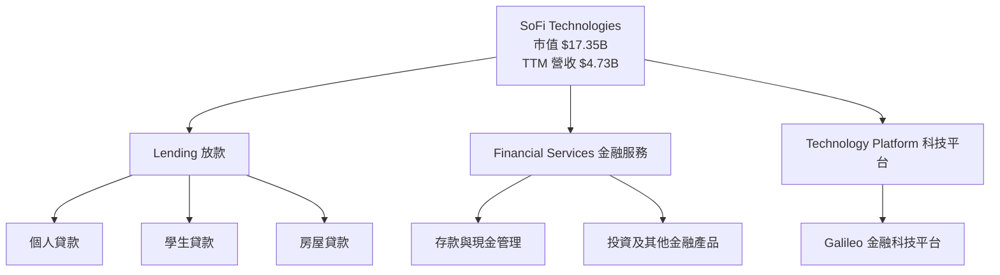
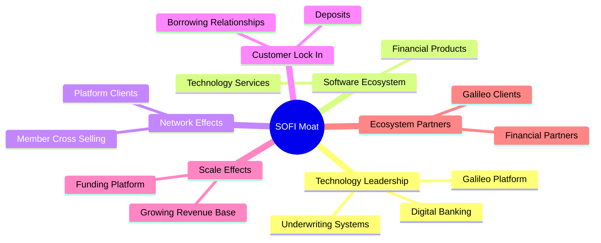
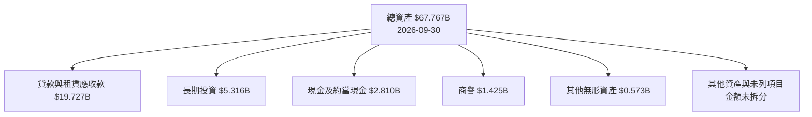
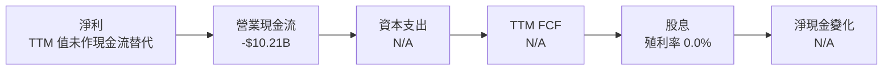
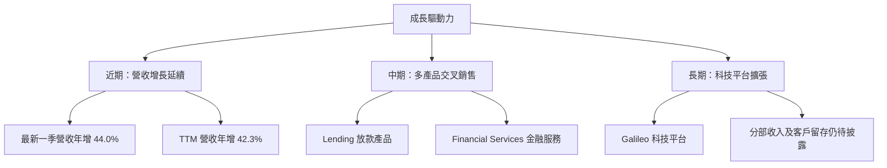
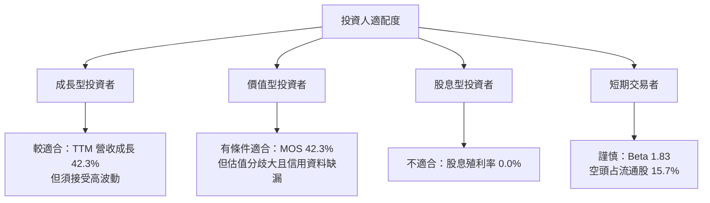

# SOFI 基本面深度分析報告
> **報告日期**：2026-11-28 ｜ **語言**：繁體中文 ｜ **數據來源**：SEC 申報資料 (XBRL)、Yahoo Finance、Finviz、StockAnalysis、Roic.ai ｜ **分析師**：CFA 級機構研究

## 目錄

| # | 章節 | 核心結論 |
|---|------|----------|
| 1 | 執行摘要 | 買入；加權合理價值 $22.64；MOS +42.3% |
| 2 | 公司概覽與商業模式 | 金融服務、貸款與科技平台組成；收入分部占比未提供，護城河以品牌、產品整合及平台能力為主 |
| 3 | 損益表深度分析 | TTM 營收 $4.73B、TTM 成長 42.3%；營業利潤率 TTM 數據未提供 |
| 4 | 資產負債表分析 | 現金及短期投資 $2.81B；債務總額未提供，貸款機構的流動性不宜以一般企業指標解讀 |
| 5 | 現金流量深度分析 | TTM 營業現金流為 -$10.21B；TTM FCF 未提供，放款現金流不能直接視為一般企業自由現金流 |
| 6 | 獲利能力與資本效率 | ROIC 對放款機構不適用；ROTCE 7.9%，WACC 採用 14.00%，但兩者非完全同口徑 |
| 7 | 相對估值分析 | 公司估值低於自身五年 P/E 中位數，但相對同業 Forward P/E 有溢價 |
| 8 | DCF 內在價值評估 | DCF 不適用；按金融業固定方法加權合理價值 $22.64，MOS +42.3% |
| 9 | 成長催化劑 | TTM 營收成長 42.3%、最新一季年增 44.0%；TAM 數據未提供 |
| 10 | 風險矩陣 | 信貸品質、融資成本與估值波動為主要風險；逾放、淨沖銷與 CET1 數據未提供 |
| 11 | 投資建議 | 買入；合理價值 $22.64，建議關注信貸品質、成長延續及資本充足度 |

---

## 1. 執行摘要

SOFI 最新一季營收年增 **44.0%**，TTM 營收 **$4.73B**、TTM 年增 **42.3%**，顯示業務仍處於快速擴張期；但 TTM 營業現金流為 **-$10.21B**，且 TTM FCF 在可核對的核心數據中為 N/A。由於 SOFI 是放款機構，放款與資金配置會使傳統 FCF 失真，估值不採 DCF，而依金融業固定方法得出 **$22.64 加權合理價值**。以 2026-11-25 收盤價 **$13.07** 計，MOS 為 **+42.3%**，按規則 20 評級為 **買入**；但信貸品質與資本充足度關鍵數據缺漏，投資信心為中低。

### 1.0 一頁式投資儀表板（Portfolio Manager 30 秒速讀）

| 項目 | 內容 |
|------|------|
| **投資論點（3 句）** | ① TTM 營收 **$4.73B、年增 42.3%**，規模擴張仍快。② 最新一季營收年增 **44.0%**，高於同業三家公司成長率中位數 **34.1%**。③ 加權合理價值 **$22.64**，較現價 **$13.07** 高 **73.2%**，但估值依賴相對估值而非可用 DCF。 |
| **綜合評分** | **6.2/10**（引用 1.1 評分卡） |
| **財務健康** | 🟡 現金及短期投資 **$2.81B**；貸款機構的資金流與一般企業不同，且逾放、淨沖銷、CET1 未提供。 |
| **ROIC vs WACC** | ROIC：N/A（金融業不適用）；WACC **14.00%**。不以 ROTCE 直接替代 ROIC。 |
| **FCF 趨勢** | 傳統 FCF 不適合作為銀行／放款機構核心指標；TTM 營業現金流 **-$10.21B**，TTM FCF Yield：N/A。 |
| **估值** | Forward P/E **14.86x** ｜ EV/EBITDA：N/A ｜ FCF Yield：N/A |
| **DCF 內在價值（基準）** | N/A；放款機構現金流代表資金來源與放款，不適用一般企業 FCFF DCF。 |
| **安全邊際（MOS）** | **+42.3%**＝($22.64 − $13.07) ÷ $22.64；基準為 8.8 加權合理價值。🟢 >25% |
| **預期報酬（基準情境 12M）** | 12 個月情境估值未提供；加權合理價值隱含上行空間 **+73.2%**，不等同 12 個月報酬預測。 |
| **關鍵風險（前二）** | 信貸損失與放款品質惡化；高 Beta 與股價波動放大估值回撤。 |
| **評級 + 信心度** | 🟢 **買入** ｜ 信心：中低（關鍵貸款品質與資本指標缺漏） |

### 1.1 綜合評分卡（全報告唯一）

| 維度 | 評分（1–10） | 主要依據（引用數字與其來源章節） |
|------|--------------|----------------------------------|
| 成長性 | 8.0 | TTM 營收年增 **42.3%**、最新一季年增 **44.0%**（第 3 章）；同業最新季成長中位數 **34.1%**。 |
| 獲利能力 | 6.0 | TTM 淨利率 **15.6%**、ROTCE **7.9%**；營業利潤率 TTM 未提供，且 ROTCE 低於 14.07% 股權成本參考值（第 6 章）。 |
| 財務健康 | 5.0 | 現金及短期投資 **$2.81B**；但總債務、淨沖銷率、逾放比與 CET1 未提供，現金流含放款資金變動（第 4、5、6 章）。 |
| 估值 | 7.0 | MOS **42.3%**；公司 P/E 低於自身五年中位數 **36.6x**，但 Forward P/E **14.86x** 高於同業中位數 **12.0x**（第 7、8 章）。 |
| 護城河 | 6.0 | 多產品金融服務與 Galileo 科技平台提供交叉銷售及平台收入可能性；分部收入、客戶留存與平台單位經濟數據未提供（第 2 章）。 |
| 管理層與資本配置 | 5.0 | 2025 年 SBC **$262.06M**，約占當年營收 **7.3%**；公司無股息，回購資料未提供，不能確認稀釋是否已被抵銷（第 3、5 章）。 |
| **綜合評分** | **6.2** | 六項算術平均：(8.0 + 6.0 + 5.0 + 7.0 + 6.0 + 5.0) ÷ 6 = **6.2**。 |

### 1.2 五大投資論點 + 三大核心風險

| 類型 | 項目 | 具體依據 | 信心度 |
|------|------|----------|--------|
| 🟢 **投資論點①** | 高成長仍延續 | TTM 營收 **$4.73B**、年增 **42.3%**；最新一季年增 **44.0%**，高於同業成長率中位數 **34.1%**。 | 🟢 高 |
| 🟢 **投資論點②** | 獲利已具規模 | TTM 淨利率 **15.6%**；截至 2026-09-30 的季度淨利 **$240.99M**，較前一季 **$156.59M** 上升。 | 🟡 中 |
| 🟢 **投資論點③** | 相對自身歷史估值偏低 | P/E 現值 **23.3x**，低於五年中位數 **36.6x**；但仍高於自身五年區間下限 **27.0x** 的資料存在內部不一致，需謹慎解讀。 | 🟡 中 |
| 🟢 **投資論點④** | 多產品與平台組合 | Lending、Financial Services、Technology Platform 三板塊可支援客戶交叉銷售；分部收入與利潤率未提供，尚無法量化其貢獻。 | 🟡 中 |
| 🟢 **投資論點⑤** | 加權估值具上行空間 | 8.8 加權合理價值 **$22.64**，較 **$13.07** 現價高 **73.2%**；其中同業 P/B 方法權重 40%，對帳面價值假設敏感。 | 🟡 中 |
| 🟡 **風險①** | 放款信用損失上升 | 淨沖銷率與逾放比未提供；若信貸損失快於收入及利息收入增長，淨利率與帳面價值可能同時承壓。 | 🔴 高衝擊 |
| 🔴 **風險②** | 融資成本與資金結構 | WACC 採用值 **14.00%**，稅前債務成本輸入 **29.04%**；若高資金成本無法轉嫁，淨利息收入會受壓。 | 🟡 中 |
| 🟡 **風險③** | 高波動與股權稀釋 | Beta 調整值 **1.83**、空頭占流通股 **15.7%**；2025 年 SBC 約占營收 **7.3%**，可能侵蝕每股價值。 | 🔴 高衝擊 |

### 1.3 快速統計卡片

| 指標 | 公司實際值（期間） | 同業中位數 | 狀態 |
|------|--------------------|------------|------|
| 營收成長（TTM） | **42.3%** | — | 🟢 |
| 營收成長（最新一季年增） | **44.0%** | **34.1%** | 🟢 |
| 毛利率（TTM） | **84.2%** | **83.3%** | 🟢 |
| Forward P/E | **14.86x** | **12.0x** | 🟡 |
| FCF Yield（TTM） | **N/A** | — | 🟡 |
| Piotroski F-Score | **N/A（不適用放款機構）** | — | — |

> 營業利益率 TTM 與 ROIC 對應欄位不列：核心可核對數據未提供，且 ROIC 不適合直接套用於放款機構。

### 1.4 投資結論

```text
╔══════════════════════════════════════════════════════════════════╗
║                    📊 投資結論摘要                               ║
╠══════════════════════════════════════════════════════════════════╣
║  評級：買入（依 8.8 加權合理價值計算之 MOS，未作一級調整）       ║
║  價格（2026-11-25 收盤）：$13.07                                ║
║  DCF 內在價值（基準）：N/A（金融業現金流定義不適用一般 DCF）    ║
║  安全邊際 MOS：+42.3%（以加權合理價值 $22.64 為分母）           ║
║  加權合理價值（8.8）：$22.64                                    ║
║  DCF 情境價值：N/A（DCF MODEL 未計算，不自行建立情境目標價）     ║
║  綜合評分：6.2/10（引用 1.1）                                   ║
║  適合投資人：能承受高波動、看好金融科技成長且願意追蹤信貸風險者 ║
╚══════════════════════════════════════════════════════════════════╝
```

---

## 2. 公司概覽與商業模式

### 2.1 業務結構與收入來源

SOFI 提供存款、消費金融、投資及放款等服務，並經營 Galileo 科技平台。公司披露的三大板塊為 Lending、Financial Services、Technology Platform；各分部營收及占比未提供，故不推算或填入比例。



### 2.2 市場份額

市場份額數據未提供，無可引用的市場份額或年份資料，因此不繪製市場份額圖。SOFI TTM 營收 **$4.73B**、年增 **42.3%**；同業 NU、HOOD、UPST 的最新季度收入年增中位數為 **34.1%**，可見 SOFI 增長速度較快，但不能據此推定市場份額提升。

### 2.3 競爭護城河分析



以上節點是質化結構，不代表公司已公布相應客戶數、留存率或收入占比。2026 年員工數為 **6,100**；科技平台業務的客戶規模與續約率未提供，不能僅依平台存在便認定網路效應已形成。

### 2.4 護城河強度

| 護城河項目 | 強度（強／中／弱） | 證據（引用數字或事實） | 會削弱它的情況 |
|------------|--------------------|------------------------|----------------|
| 產品整合與交叉銷售 | 中 | 同時經營放款、金融服務、投資及存款產品；分部交叉銷售率未提供。 | 用戶留存或產品滲透不如預期，獲客成本上升。 |
| 科技平台 | 中 | Galileo 被列為科技平台業務；收入、客戶數及毛利貢獻未提供。 | 客戶流失、平台價格競爭或客戶自建系統。 |
| 品牌與用戶關係 | 中 | 產品覆蓋借貸、儲蓄、消費及投資；客戶數與品牌轉換率未提供。 | 大型銀行或數位金融競爭者以更低成本獲客。 |
| 規模效應 | 弱至中 | TTM 營收 **$4.73B**、最新季度增長 **44.0%**；單位成本與獲客成本資料未提供。 | 增長依靠高補貼，未能轉化為營運效率。 |
| 資金與信貸能力 | 中 | 現金及短期投資 **$2.81B**；信貸損失及資本充足率未提供。 | 信貸週期惡化或融資成本上升。 |

**1.1「護城河」評分為 6.0/10**：多產品與科技平台具備形成客戶關係及交叉銷售優勢的條件，但缺少留存、平台客戶、分部獲利等數據佐證其競爭優勢已轉化為持續超額回報。

---

## 3. 損益表深度分析

### 3.1 年度收入成長趨勢（近 4 年）

以下年度營收取年度損益表，金額以其披露值呈現；年度增長率以相鄰年度數值計算，因原數據四捨五入，成長率屬約數。

```text
╔══════════════════════════════════════════════════════════════════╗
║              SOFI 年度收入趨勢（FY2022-FY2025）                  ║
╠══════════════════════════════════════════════════════════════════╣
║  FY2022  $1.57B  ██████████░░░░░░░░░░░░░░░  起始年度            ║
║  FY2023  $2.11B  █████████████░░░░░░░░░░░░  YoY 約 +34.4% 🟢   ║
║  FY2024  $2.61B  █████████████████░░░░░░░░  YoY 約 +23.7% 🟢   ║
║  FY2025  $3.61B  ███████████████████████░░  YoY 約 +38.3% 🟢   ║
║                                                                  ║
║  三年 CAGR：(3.61 ÷ 1.57)^(1/3) − 1 ≈ 31.9%                     ║
╚══════════════════════════════════════════════════════════════════╝
```

營收從 FY2022 的 **$1.57B** 增至 FY2025 的 **$3.61B**，三年 CAGR 約 **31.9%**。TTM 營收成長 **42.3%** 高於這段歷史 CAGR，代表近期收入增速加快；其持續性取決於放款需求、金融產品交叉銷售與科技平台業務，而分部拆分數據未提供，尚無法確認成長來源是否足夠多元。

### 3.2 季度收入趨勢分析

| 季度 | 營收 | QoQ 成長 | YoY 成長 | 備註 |
|------|------|----------|----------|------|
| 2025 Q4 | $1.03B | 約 +34.2%* | N/A | QoQ 以 2025 Q3 StockAnalysis 營收 $952.4M 計算；不同來源季度值有差異。 |
| 2026 Q1 | $1.10B | 約 +6.8% | **42.48%** | YoY 取 StockAnalysis 季度資料。 |
| 2026 Q2 | $1.22B | 約 +10.9% | **42.61%** | YoY 取 StockAnalysis 季度資料。 |
| 2026 Q3 | $1.39B | 約 +13.9% | **44.0%** | 最新季度年增率採核心財務數據；季度營收採年度損益表資料。 |

\*2025 Q4 的比較基期資料源不一致，因此該 QoQ 僅作近似參考。營收逐季增加，反映收入擴張延續；最新一季年增仍略高於前兩季約 **42%**，但不同來源的季營收有 **$1.37B** 與 **$1.39B** 之差異，本文不把此差異解讀為實質趨勢變化。

### 3.3 利潤率演變分析

| 利潤率指標 | FY2022 | FY2023 | FY2024 | FY2025 / TTM | 趨勢 | 評估 |
|------------|--------|--------|--------|--------------|------|------|
| **毛利率** | N/A | N/A | N/A | TTM **84.2%** | 年度序列未提供 | 🟡 |
| **營業利益率** | N/A | N/A | N/A | TTM **N/A** | 未能建立可核對序列 | 🟡 |
| **淨利率** | 年度淨損 | 年度淨損 | 約 **19.1%** | TTM **15.6%** | 由盈利轉為正值，TTM 利潤率低於 FY2024 約值 | 🟡 |

FY2024 淨利率約值以年度淨利 **$498.67M ÷ $2.61B** 計算，約 **19.1%**；FY2025 年度淨利 **$481.32M**、營收 **$3.61B**，按表列數字約為 **13.3%**。由於不同來源的年度收入、淨利和 TTM 數字存在差異，歷年利潤率只作方向性判讀。核心財務數據未提供營業利潤率 TTM，故不以其他資料源的季度營業利益推算替代。

**利潤率演變深度解析：**公司年度收入增加，但利潤率並未跟收入同比例上升；可能受產品組合、資金成本、信貸準備及科技平台投入影響。具體各項費用及分部利潤率未提供，因此不能將利潤率變化單獨歸因於某一業務。未來若收入繼續成長而信貸成本受控，固定費用攤薄可能帶來營運槓桿；反之，信用損失或存款成本上升可能抵銷規模效應。

### 3.4 費用結構分析

N/A（數據未提供：缺少可完整核對的利息支出、信貸損失準備、營運費用及分部費用結構；只列部分費用會造成不完整的成本占比圖，故不繪製 Mermaid 圓餅圖或費用結構方框圖。）

### 3.5 季度 EPS 趨勢與盈餘品質（Quality of Earnings）

| 季度 | EPS 實際值 | EPS 預期值 | 超預期／不及預期 | 原因判讀 |
|------|------------|------------|------------------|----------|
| 2026 Q3 | N/A | N/A | 無法判定 | 預期與實際 EPS 欄位為空值。季度淨利為 **$240.99M**。 |
| 2026 Q2 | N/A | N/A | 無法判定 | 預期與實際 EPS 欄位為空值。季度淨利為 **$156.59M**。 |
| 2026 Q1 | N/A | N/A | 無法判定 | 預期與實際 EPS 欄位為空值。季度淨利為 **$166.73M**。 |
| 2025 Q4 | N/A | N/A | 無法判定 | 預期與實際 EPS 欄位為空值。季度淨利為 **$173.55M**。 |

財報提供的季度淨利顯示 2026 Q3 較 2026 Q2 增加；但 EPS estimate 與 actual 均缺值，無法判定過去四季盈餘是否超出市場預期，也不能虛構「beat/miss」原因。

| 盈餘品質項目 | 數值／佔比 | 評估 |
|--------------|-----------|------|
| 股權薪酬 SBC / 營收 | 最近四季 SBC 合計約 **$288.33M**；除以 TTM 營收 **$4.73B**，約 **6.1%** | 🟡 稀釋負擔不可忽略；SBC 為非現金費用，但對股東的經濟成本透過股數稀釋實現。 |
| SBC / 營業現金流 | $288.33M ÷ -$10.21B ≈ **-2.8%** | 🔴 分母為負且受放款資金流影響，比例不宜當作正向覆蓋指標。 |
| FCF / 淨利（現金轉換率） | **N/A** | TTM FCF 核心數值未提供；放款現金流也不適合直接與淨利比較。 |
| 一次性／非經常性損益 | N/A（未提供可核對明細） | 無法判斷淨利是否受一次性項目明顯推升。 |
| 有效稅率異常 | 最新年度有效稅率 **8.5%** | 稅率低於常見企業稅率，但缺少稅務調節表；未能量化其對盈利的影響。 |
| 資本化支出 vs 費用化 | TTM Capex 核心數據 N/A；其他資料源列示年度 Capex，口徑不同 | 無法確認資本化支出是否使當期費用偏低。 |

**盈餘品質結論：**SOFI TTM 淨利率為 **15.6%**，且公司已報告正向淨利，但 SBC 約占 TTM 營收 **6.1%**，意味帳面盈利並非全部可視為既有股東的每股經濟收益。由於 FCF、信貸損失準備及非經常性項目細節缺漏，對 GAAP 盈利含金量的判斷為中等偏低信心；估值宜依 EPS 與帳面價值方法交叉驗證，不宜用傳統 FCF 倍數作核心依據。

---

## 4. 資產負債表分析

### 4.1 資產結構分解

最新季末總資產為 **$67.767B**，資料源列示貸款與租賃應收款 **$19.727B**、長期投資 **$5.316B**、現金等項目及其他資產。下圖為部分項目，不代表完整加總；由於各項分類及總額口徑可能不同，不以缺少項目推算餘額。



資產負債表的資產主要與放款、投資及資金配置有關，不能僅以現金占比或流動比率推斷金融機構的流動性安全；存款期限、可抵押資產、流動性覆蓋率與資本監管數據未提供。

### 4.2 流動性與營運資金分析

| 指標 | 最新值 | 評估 |
|------|--------|------|
| 現金及短期投資 | **$2.81B** | 🟡 有現金資源，但對金融機構須與存款及批發融資到期結構一併看。 |
| 流動比率 | **1.086x** | 🟡 一般公司口徑約略高於 1，但不適合作為銀行流動性的主要判斷。 |
| 速動比率 | **0.428x** | 🟡 金融資產與負債結構不同，不宜直接套用工業企業標準。 |
| 總債務／淨負債 | **N/A**（核心數據總債務未提供）；核心數據列示淨現金 **$2.81B** | 🟡 不以不同來源的債務口徑自行重算淨負債。 |

**營運資金天數：**放款機構的核心資產負債項目是貸款、存款與金融資產，傳統營運資金天數並不適用；QUALITY FIGURES 未提供 DSO／DIO／DPO／CCC 數字。

### 4.3 債務結構分析

```text
╔══════════════════════════════════════════════════════════════════╗
║                   SOFI 債務健康診斷                              ║
╠══════════════════════════════════════════════════════════════════╣
║  現金及短期投資： $2.81B  ████████████░░░░░░░░  已披露          ║
║  總債務：         N/A     數據未提供              不自行估算      ║
║  淨現金：         $2.81B  核心數據列示            口徑需審慎      ║
║                                                                  ║
║  Debt/EBITDA：   N/A（總債務及可比 EBITDA 不適用／未提供）       ║
║  Interest Coverage：N/A（利息保障倍數未提供）                   ║
║                                                                  ║
║  ⚠️ 放款機構的存款與借款是資金來源，不能只看企業式淨負債。      ║
╚══════════════════════════════════════════════════════════════════╝
```

市場資料另列總債務 **$3.98B**、淨負債 **$1.14B**，但核心核對數據將總債務列為 N/A、淨現金列為 **$2.81B**。為遵守已核對核心數據的優先順序，本報告不將不同來源數字混合計算；此差異本身也降低債務判斷信心。

### 4.4 股東權益趨勢

| 年度 | 股東權益 | 年度變化 | 解讀 |
|------|----------|----------|------|
| 2022 | $5.53B | — | 歷史基期。 |
| 2023 | $5.55B | 約 +0.4% | 接近持平。 |
| 2024 | $6.53B | 約 +17.7% | 權益規模增加。 |
| 2025 | $10.49B | 約 +60.8% | 增幅顯著；須結合股權發行、留存盈餘及其他權益變動判讀。 |

```text
╔══════════════════════════════════════════════════════════════════╗
║                   SOFI 股東權益趨勢                              ║
╠══════════════════════════════════════════════════════════════════╣
║  2022  $5.53B  ███████████░░░░░░░░░░░░░░░░                      ║
║  2023  $5.55B  ███████████░░░░░░░░░░░░░░░░                      ║
║  2024  $6.53B  █████████████░░░░░░░░░░░░░░                      ║
║  2025 $10.49B  █████████████████████░░░░░░░                      ║
╚══════════════════════════════════════════════════════════════════╝
```

---

## 5. 現金流量深度分析

### 5.1 現金流量瀑布圖

核心數據顯示 TTM 營業現金流為 **-$10.21B**，但 TTM 資本支出與 FCF 為 N/A。對貸款機構，放款增加會大量占用現金，故以下流程圖只呈現指標關係，不填入未提供的現金流金額。



### 5.2 FCF 轉換率趨勢

| 期間 | 營業現金流 | 資本支出 | FCF | FCF／淨利 |
|------|------------|----------|-----|-----------|
| TTM 至 2026-09-30 | **-$10.21B** | **N/A** | **N/A** | **N/A** |
| FY2025 | -$3.74B | 年度資料源列示 -$251.12M | 不採作核心 TTM FCF | 不適用作為核心比較 |
| FY2024 | -$1.12B | 年度資料源列示 -$163.62M | 不採作核心 TTM FCF | 不適用作為核心比較 |

放款業務中，現金流可因貸款發放、貸款出售、存款變化而大幅波動；因此負營業現金流不必然代表營運虧損，但仍需觀察融資來源、貸款資產品質及資金期限。由於最新 TTM FCF 為 N/A，本報告不計算現金轉換率或 FCF CAGR。

### 5.3 自由現金流趨勢

```text
╔══════════════════════════════════════════════════════════════════╗
║                SOFI 自由現金流：可核對資訊                       ║
╠══════════════════════════════════════════════════════════════════╣
║  TTM 營業現金流   -$10.21B  ◀ 放款與資金流可能造成現金外流       ║
║  TTM 資本支出      N/A       核心數據未提供                       ║
║  TTM FCF           N/A       不以其他來源反推                     ║
║  TTM FCF Yield     N/A       分子未提供                           ║
╠══════════════════════════════════════════════════════════════════╣
║  ⚠️ 對放款機構，以淨利、ROTCE、資本充足與信用品質補充判讀。     ║
╚══════════════════════════════════════════════════════════════════╝
```

### 5.4 資本配置評估

| 資本配置項目 | 可用數據 | 評估 |
|--------------|----------|------|
| 股息 | 殖利率 **0.0%**；FY2025 股息支出 **$0** | 現金回報不是目前主要股東回報途徑。 |
| 回購 | N/A | 回購金額未提供，不能假設有抵銷 SBC 稀釋。 |
| SBC | FY2025 **$262.06M**；TTM 四季合計約 **$288.33M** | 持續稀釋風險，約占 TTM 營收 **6.1%**。 |
| Capex | TTM N/A；年度資料有披露但與 TTM 口徑不一 | 不以不一致數據繪製資本配置比例圖。 |
| 放款與投資配置 | 貸款及租賃應收款最新季末 **$19.727B** | 反映金融機構核心資產配置，但放款收益與信貸成本未提供完整拆分。 |

沒有足以完整加總的資本配置數據，因此不繪製 Mermaid 圓餅圖；用比例圖會將缺漏項目錯誤地視作已知。

---

## 6. 獲利能力與資本效率

### 6.1 ROE / ROA / ROIC 趨勢

| 指標 | 最新值 | 歷史資料 | 評估 |
|------|--------|----------|------|
| ROE | TTM **6.5%**（核心品質數據）；另一來源列 **7.4%** | 年度可比序列未提供 | 🟡 數據源差異降低判讀信心。 |
| ROA | **1.3%** | 年度可比序列未提供 | 🟡 對放款機構具有參考價值，但信貸損失與資產風險資料缺漏。 |
| ROIC | **N/A** | 不適用金融機構一般口徑 | — 放款、存款與監管資本是營運核心，不宜以一般工業企業投入資本計算。 |
| ROTCE | **7.9%** | 歷史序列未提供 | 🟡 可作有形權益回報參考，但不等於 ROIC。 |

### 6.2 ROIC vs WACC 分析（核心價值創造判斷）

ROIC 對金融機構不適用，且沒有足夠資料計算 NOPAT 與一般企業投入資本；因此不以杜撰的 ROIC 減 WACC 判定價值創造。SOFI 的 lender ROTCE 為 **7.9%**，低於資金成本資料中的股權成本 **14.07%**，可視為回報尚未覆蓋股東要求報酬的警示，但兩項指標定義不同，不能當作正式 ROIC–WACC 利差。

```text
╔══════════════════════════════════════════════════════════════════╗
║                ROIC vs WACC 深度分析                            ║
╠══════════════════════════════════════════════════════════════════╣
║  WACC（核心資金成本數據）：採用值 14.00%                         ║
║  ├── 無風險利率（10Y 美債）：        4.94%                       ║
║  ├── 市場風險溢酬（假設）：          5.00%                       ║
║  ├── 原始 Beta：                     2.24                        ║
║  ├── 調整後 Beta：                   1.83                        ║
║  ├── 股權成本：                      14.07%                      ║
║  ├── 稅前債務成本：                  29.04%                      ║
║  ├── 股權／債務權重：                81.3%／18.7%                ║
║  ├── 未限制計算值：                  16.41%                      ║
║  └── 採用 WACC：                     14.00%（限制於 7%–14%）     ║
║                                                                  ║
║  ROIC：N/A（金融業不適用一般工業企業投入資本定義）               ║
║  ROTCE：7.9%（金融業指標；不可與 ROIC 直接互換）                 ║
║  結論：無法做正式 ROIC − WACC EVA；ROTCE 低於 Ke 是觀察警訊。    ║
╚══════════════════════════════════════════════════════════════════╝
```

### 6.3 杜邦三因素分解

| 因素 | 數值（TTM） | 解讀 |
|------|-------------|------|
| 淨利率 | **15.6%** | 盈利能力來源；需與信貸成本及資金成本共同評估。 |
| 資產週轉率 | **0.07x** | 金融機構資產規模大，週轉率通常不宜與非金融企業直接比較。 |
| 權益乘數 | **6.00x** | 槓桿明顯放大權益回報，也放大信貸與資金風險。 |
| **ROE** | **6.5%** | **15.6% × 0.07 × 6.00 = 6.5%**（按提供的 DuPont 數據照錄）。 |

ROE 結構顯示，資產週轉率低而權益乘數高，槓桿對權益回報有重要影響；但低週轉率在金融機構具有行業特性，不能單獨視為營運效率差。數值依 QUALITY FIGURES 既定口徑，不另行重算或補值。

### 6.4 財務體質：金融業貸款機構指標

Piotroski F-Score **N/A**：該分數未應用於放款機構，因貸款成長會使現金流測試將放款流出誤判為弱勢。

| 指標 | 數值 | 解讀 |
|------|------|------|
| 淨利息收入 NII／總營收 | **64.0%** | 反映利息收入是主要收入來源之一；NII 比重高會使淨息差及資金成本更關鍵。 |
| 淨利差代理值 | **5.36%** | NII／平均總資產；由於缺少生息資產口徑，不能等同公司正式公布的 NIM，正式 NIM 通常以生息資產為分母。 |
| 成本收入比代理值 | **80.8%** | (營收 − 稅前淨利)／營收，包含信貸準備，故高於一般營運效率比率。 |
| ROTCE | **7.9%** | 淨利／有形帳面價值；衡量有形普通權益回報，不等於 ROIC。 |
| P/TBV | **1.87x** | 市場價格相對有形帳面價值；估值反映市場對未來盈利能力的預期。 |
| 放款淨額／總資產 | **79.3%** | 資產配置偏放款，信用週期及資產品質對財務表現影響大。 |
| 淨沖銷率 | **N/A（數據未提供）** | 不引用外部記憶數字。 |
| 逾放比 | **N/A（數據未提供）** | 不引用外部記憶數字。 |
| CET1 | **N/A（數據未提供）** | 無法評估監管資本緩衝。 |

---

## 7. 相對估值分析

### 7.1 同業估值比較表格

同業數據來自 Yahoo Finance 的 Peer multiples。Forward P/E 中位數按 NU **12.0x**、HOOD **19.9x**、UPST **6.0x** 排序，取中間值 **12.0x**。本公司倍數採所列市場資料；與自身歷史核對數字略有差異時，歷史比較以專用歷史估值數據為準。

| 估值指標 | **SOFI** | **NU** | **HOOD** | **UPST** | SOFI 評估 |
|----------|----------|---------|---------|---------|-----------|
| **Trailing P/E** | **23.3x** | 16.1x | 31.3x | 28.8x | 🟡 位於同業區間內；SOFI 比 NU 高、低於 HOOD 與 UPST。 |
| **Forward P/E** | **14.86x** | 12.0x | 19.9x | 6.0x | 🟡 高於同業中位數 **12.0x**；市場為較快成長支付溢價。 |
| **P/S Ratio** | **3.8x** | 6.9x | 12.0x | 1.3x | 🟢 低於 NU、HOOD，高於 UPST；同業 P/S 中位數 **6.9x**。 |
| **EV/EBITDA** | **N/A** | N/A | N/A | 25.8x | — SOFI 及多數同業倍數缺值，不比較中位數。 |
| **最新季度收入年增** | **44.0%** | 34.4% | 11.8% | 34.1% | 🟢 SOFI 高於三家同業中位數 **34.1%**。 |
| **毛利率 TTM** | **84.2%** | 0.0% | 91.0% | 83.3% | 🟡 SOFI 接近 HOOD、UPST；NU 數值為 0.0%，可能受金融業分類口徑影響。 |

### 7.2 歷史估值區間分析

歷史數據的 P/E 現值、中位數與區間按專用歷史估值資料照錄。其列示現值 **23.3x** 低於區間下限 **27.0x**，與百分位 **0%** 及其他市場 P/E 資料並非完全一致，應視為數據源口徑或時間差異的警示，不自行修正。

```text
╔══════════════════════════════════════════════════════════════════╗
║             SOFI 歷史估值位置（五年 TTM 倍數）                   ║
╠══════════════════════════════════════════════════════════════════╣
║  P/E：     現值 23.3x  | 五年中位數 36.6x | 範圍 27.0x–67.1x   ║
║            現值百分位 0%                                         ║
║  P/S：     現值 3.8x   | 五年中位數 4.5x  | 範圍 2.6x–14.6x    ║
║            現值百分位 29%                                        ║
║  EV/EBITDA：現值 52.4x | 五年中位數 65.1x | 範圍 19.0x–148.7x ║
║            現值百分位 33%                                        ║
╚══════════════════════════════════════════════════════════════════╝
```

### 7.3 情境價值（Bear / Base / Bull）

N/A（DCF 無法計算：SOFI 為放款機構，貸款發放與融資現金流是業務資金流，不是一般企業可自由分配的自由現金流；DCF MODEL 未提供，因此不給悲觀、基準或樂觀 DCF 目標價。）

### 7.4 相對估值隱含價格區間

| 方法 | 每股價值 | 權重 | 依據 |
|------|----------|------|------|
| 同業 Forward P/E | **$10.81** | 50% | NU、HOOD、UPST 同業 Forward P/E 中位數 **12.0x** × SOFI Forward EPS **$0.90**。 |
| 同業 P/B | **$37.94** | 40% | 同業 P/B 中位數 **4.4x** × SOFI 每股帳面價值 **$8.71**。 |
| 分析師共識目標價 | **$20.56** | 10% | 22 位分析師平均目標價。 |

```text
╔══════════════════════════════════════════════════════════════════╗
║               相對估值價格位置（美元／股）                       ║
╠══════════════════════════════════════════════════════════════════╣
║  $10.81 ──── $13.07 ───── $20.56 ───────────── $37.94           ║
║  Forward P/E   現價          共識目標價          同業 P/B        ║
║  50% 權重                    10% 權重            40% 權重        ║
╚══════════════════════════════════════════════════════════════════╝
```

估值分布很寬，主要來自兩種方法對不同財務基礎的敏感度：Forward P/E 指向 **$10.81**，低於現價；同業 P/B 指向 **$37.94**，遠高於現價。P/B 對帳面價值和同業中位數倍數極為敏感，故加權結果不等於單一方法的確定目標價。

---

## 8. DCF 內在價值評估（Discounted Cash Flow）

### 8.0 估值推理鏈（Thinking Logic）

**Step 1 — 價值由哪些變數決定？**

SOFI 的價值主要由放款淨利息收入、金融服務交叉銷售，以及科技平台的服務收入與獲利能力構成；NII 約占 TTM 營收 **64.0%**，貸款淨額約占總資產 **79.3%**。因此，放款利差與信貸損失是最重要的價值驅動項；科技平台收入占比未提供，無法量化其獨立貢獻。

**Step 2 — 使用何種估值方法？**

| 決策點 | 本報告採用 | 理由（含數字） | 曾考慮但否決 | 否決理由 |
|--------|-----------|----------------|--------------|----------|
| 現金流定義 | 不使用一般企業 FCFF DCF | TTM 營業現金流 **-$10.21B**，放款與資金流是營運內容；TTM FCF 未提供。 | FCFE／FCFF DCF | 現金流不代表可分配給股東的自由現金流，且缺乏一致口徑預測模型。 |
| 預測期 N | N/A | DCF MODEL 未建立。 | 任意 5–10 年期模型 | 會引入未經核對的貸款成長、損失率、資本需求與終值假設。 |
| 終值方法 | N/A | DCF MODEL 未提供。 | Gordon Growth／退出倍數 | 缺少可用 FCFF 基礎與假設，不能自行建立。 |
| EBIT 基礎 | N/A | 營業利潤率 TTM 核心數據為 N/A；金融機構不宜按一般 EBIT DCF。 | GAAP EBIT DCF | 會把金融機構利息收入與資金成本的核心經濟關係錯置。 |

**Step 3 — 關鍵假設的推導鏈**

N/A。由於 DCF MODEL 明確為 N/A，沒有可引用或可稽核的預測期、營收 CAGR、利潤率、終值、稀釋股數或每股 DCF 值。本報告不另建 DCF，也不以任意假設填表。

**Step 4 — 最脆弱的一環**

若以一般企業 DCF 將放款現金流錯當可分配 FCF，估值可能大幅偏離金融機構的經濟價值；因此本報告改以同業 Forward P/E、同業 P/B 與分析師共識交叉估值。

**Step 5 — 計算路徑**

DCF 路徑不繪製，因相關預測輸入及 DCF 輸出均未提供。後續估值採 8.8 金融業固定估值方法，不把它誤稱為 DCF 內在價值。

### 8.1 模型假設總表（Model Inputs）

N/A（DCF MODEL 未提供；不建立模型，因此預測期、營收 CAGR、營業利潤率、稅率、Capex、D&A、營運資金、SBC 處理、稀釋率及永續成長率均不填估計值。）

### 8.2 折現率推導（WACC）

核心資金成本資料給定 WACC 為 **14.00%**，並註明未限制計算值 **16.41%** 被限制在 **7%–14%** 區間內。以下只說明已提供的資金成本數據，不將其用於建立 DCF。

```text
╔══════════════════════════════════════════════════════════════════╗
║                    WACC 資料摘要（非 DCF 輸入推導）              ║
╠══════════════════════════════════════════════════════════════════╣
║  無風險利率 Rf：                    4.94%                       ║
║  市場風險溢酬 ERP：                 5.00%（假設輸入）            ║
║  原始 Beta：                        2.24                        ║
║  調整後 Beta：                      1.83                        ║
║  股權成本 Ke：                     14.07%                       ║
║  稅前債務成本 Kd：                 29.04%                       ║
║  有效稅率：                         8.5%                        ║
║  股權／債務權重：                  81.3%／18.7%                 ║
║  未限制計算值：                    16.41%                       ║
║  採用值：                          14.00%（受 7%–14% 上限約束） ║
╚══════════════════════════════════════════════════════════════════╝
```

資料所列 Beta 調整方式為 **⅔ × 原始 Beta + ⅓ × 1**，即 **⅔ × 2.24 + ⅓ × 1 = 1.8267**，四捨五入為 **1.83**。核心數據沒有說明無風險利率觀察日，因此不另行補寫日期；亦未提供債務加權構成明細，故不重建 WACC 五步算式。第 6.2 採用同一 WACC **14.00%**。

### 8.3 逐年自由現金流預測（基準情境）

N/A（DCF MODEL 未提供預測年數、逐年營收、利潤率、NOPAT、FCFF、折現因子及現值；不建立逐年 DCF，也不推導 FCF CAGR。）

### 8.4 終值計算（Terminal Value）

N/A（缺少可用 FCFF、永續成長率及預測期長度，不能檢查 WACC 與 g，也不能計算 Gordon Growth 或退出倍數終值。）

### 8.5 企業價值 → 每股內在價值（Bridge）

N/A（無 DCF 企業價值、終值、現金／債務橋接與 DCF 每股價值；核心債務總額亦未提供。以下折溢價不計算，避免把相對估值加權值錯稱為 DCF 內在價值。）

> **折溢價基準：**本報告規定折溢價應以 DCF 基準值為分母；因 DCF 基準值為 N/A，折溢價亦為 N/A。安全邊際只在 8.8 以加權合理價值計算。

### 8.6 敏感性分析（WACC × 永續成長率）

N/A（無 DCF 基準現金流、WACC × g 矩陣與情境輸出，不繪製或反推敏感性矩陣，也不設悲觀／基準／樂觀 DCF 目標價。）

### 8.7 反推 DCF（Reverse DCF）

N/A（DCF MODEL 未提供，且不自行建模；沒有可用的一條估值方程式來反解單一變數。）

### 8.8 估值三角驗證與安全邊際

| 估值方法 | 隱含每股價值 | 上行空間（÷現價） | 權重 | 說明 |
|----------|--------------|-------------------|------|------|
| 同業 Forward P/E | **$10.81** | **-17.3%** | **50%** | NU、HOOD、UPST 同業 Forward P/E 中位數 **12.0x** × SOFI Forward EPS **$0.90**。 |
| 同業 P/B | **$37.94** | **+190.3%** | **40%** | 同業 P/B 中位數 **4.4x** × SOFI 每股帳面價值 **$8.71**。 |
| 分析師共識目標價 | **$20.56** | **+57.3%** | **10%** | 22 位分析師平均目標價；作為參考，不是單一估值驅動。 |
| **加權合理價值** | **$22.64** | **+73.2%** | **100%** | 金融業估值方法固定權重；DCF 未計算，因此不納入。 |

**逐步演算：**

加權合理價值  
= $10.81 × 50% + $37.94 × 40% + $20.56 × 10%  
= $5.405 + $15.176 + $2.056  
= **$22.637**  
= **$22.64**（四捨五入至美分）。

權重合計：**50% + 40% + 10% = 100%**。

**MOS 與上行空間：**

- MOS = ($22.64 − $13.07) ÷ $22.64  
  = $9.57 ÷ $22.64  
  = **42.3%**。
- 上行空間 = ($22.64 − $13.07) ÷ $13.07  
  = $9.57 ÷ $13.07  
  = **73.2%**。

本公司類型為金融業，方法權重依金融業固定設定。沒有 DCF 值可納入，且 EV/EBITDA 相關方法未列於固定估值方法清單，故不另加方法或調整權重。

```text
╔══════════════════════════════════════════════════════════════════╗
║                  估值區間與安全邊際                              ║
╠══════════════════════════════════════════════════════════════════╣
║  $10.81 ───── $13.07 ───── [$22.64] ───── $37.94                ║
║  Forward P/E   現價          加權合理值         同業 P/B        ║
║                                                                  ║
║  安全邊際 MOS = ($22.64 − $13.07) ÷ $22.64 = +42.3%             ║
║  MOS 評估：🟢 >25% 充足                                         ║
║  上行空間 = ($22.64 − $13.07) ÷ $13.07 = +73.2%                 ║
║                                                                  ║
║  建議買入區間：$11.95 – $20.38                                  ║
║  上限依 MOS ≥ 10% 計：$22.64 × (1 − 10%) = $20.376 ≈ $20.38     ║
║  下限參考 52 週低點 $11.95，不代表該價位必然具有基本面支撐。   ║
║  合理持有區間：$20.38 – $22.64                                  ║
║  減碼考慮區間：高於 $22.64，或信貸品質與資本指標惡化時。       ║
╚══════════════════════════════════════════════════════════════════╝
```

> 🔎 **程式複算（Python，依本節各項自動重算）**
>
> 加權合理價值 = $10.81 × 50% + $37.94 × 40% + $20.56 × 10% = **$22.64**（權重合計 100%）
>
> 以價格 $13.07 計：MOS = **+42.3%**，上行空間 = **+73.2%**
>
> ✅ 與本節所寫數值一致。

### 8.9 DCF 模型的局限與失效條件

- **終值依賴度：**N/A；DCF 未建立，不能計算終值占企業價值比重。
- **最脆弱的假設：**相對估值的同業 P/B **4.4x** 及每股帳面價值 **$8.71**。若 SOFI 的可持續 ROTCE **7.9%** 無法支持同業倍數，P/B 法推導的 **$37.94** 可能明顯偏高。
- **不適用情境說明：**SOFI 的貸款發放與資金來源會主導現金流，傳統 FCFF DCF 可靠度低。對金融業應優先使用 P/E、P/B、ROTCE、資本充足與信用品質；必要時用分部估值，但分部數據未提供。
- **與第 10 章風險矩陣的連結：**信貸損失惡化會降低淨利、帳面價值與 ROTCE；融資成本上升會壓縮 NII；上述變化都會削弱 Forward P/E 與 P/B 估值的合理性。

### 8.10 複算檢核表（Audit Trail）

| # | 檢核項目 | 檢查方式 | 結果 |
|---|----------|----------|------|
| 1 | DCF 高／中敏感度假設完整四段式推導 | DCF 為 N/A，無模型假設可檢查 | N/A |
| 2 | DCF 假設依據欄完整 | 不建 DCF | N/A |
| 3 | WACC 五步算式與乘加正確 | 沿用給定 WACC 14.00%，不重建 WACC | N/A |
| 4 | Kd 分母與 D 權重口徑一致 | 債務構成明細未提供 | N/A |
| 5 | WACC 與第 6.2 同值 | 兩處均採用 14.00% | ✅ |
| 6 | 逐年預測年度數等於 N | DCF 未提供預測年度 | N/A |
| 7 | FY+1 FCFF 與 PV 可複算 | 無逐年模型 | N/A |
| 8 | 預測期 PV 加總正確 | 無預測期 PV | N/A |
| 9 | WACC > g | 永續成長率未提供 | N/A |
| 10 | 終值以 FY+N 現金流為基礎 | DCF 未建立 | N/A |
| 11 | EV 至每股價值橋接可複算 | DCF 橋接未提供 | N/A |
| 12 | SBC 組合 A／B／C 相容 | DCF 未建立，不適用 SBC 模型設定 | N/A |
| 13 | 敏感性矩陣基準格等於 DCF 每股值 | 敏感性矩陣未提供 | N/A |
| 14 | 敏感性矩陣只列有效 WACC > g 格 | 矩陣未提供 | N/A |
| 15 | 三情境機率與加權算式 | DCF 情境未提供 | N/A |
| 16 | 反推 DCF 一次只解一個變數 | 反推 DCF 未提供 | N/A |
| 17 | MOS 分母與折溢價分母一致 | MOS 依 $22.64；DCF 折溢價 N/A | ✅ |
| 18 | 報告完整輸出至第 11 章 | 已輸出至第 11 章 | ✅ |
| 19 | 加權合理價值等於各項價值加權和 | $5.405 + $15.176 + $2.056 = $22.637，四捨五入 $22.64 | ✅ |
| 20 | 評級符合 MOS 門檻 | MOS +42.3%，ROIC 不適用；依提供規則採買入 | ✅ |

**修正與限制說明：**因 DCF MODEL 為 N/A，DCF 專屬檢核項目如實標為 N/A，不以自行估算假設冒充已完成模型；可計算的估值加權、MOS、上行空間與評級已核對一致。

---

## 9. 成長催化劑

### 9.1 催化劑時間軸

具體公告日期、產品上線日期與管理層財測未提供，故不為短中長期催化劑指定未經證實的日程或繪製假設日期甘特圖。

| 觀察期間 | 催化劑 | 可查核指標 |
|----------|--------|----------|
| 近期 | 營收增長能否保持高於 40% | TTM 營收成長 **42.3%**；最新一季年增 **44.0%**。 |
| 中期 | 金融服務及科技平台能否擴大對總收入貢獻 | 目前缺少分部收入、客戶數與留存率，須待公司披露。 |
| 中長期 | 信貸風險穩定下提高有形權益回報 | ROTCE **7.9%**；淨沖銷、逾放與 CET1 未提供，需補齊追蹤。 |

### 9.2 TAM 市場規模分析

N/A（TAM 數據未提供）。SOFI TTM 營收 **$4.73B**、年增 **42.3%**，顯示目前仍有快速擴張，但缺少個人貸款、存款、金融科技平台等可引用市場規模與滲透率，不能量化 TAM 或推算市場滲透率。

### 9.3 成長驅動力結構圖



---

## 10. 風險矩陣

### 10.1 風險評分矩陣

風險概率及量化機率未由財務數據或公司披露提供，因此不以主觀數字繪製 quadrantChart，避免把估計座標呈現為實證資料。主要風險如下：

| 風險 | 可能性判斷 | 潛在衝擊 |
|------|------------|----------|
| 信貸損失及貸款品質 | 中高；放款淨額占總資產 **79.3%** | 高；損失增加會壓低淨利、ROTCE 與帳面價值。 |
| 融資成本與利差 | 中；NII 占總營收 **64.0%**，成本收入比代理值 **80.8%** | 高；資金成本上升可能直接壓縮利差。 |
| 估值與市場波動 | 高；調整後 Beta **1.83**、空頭占流通股 **15.7%** | 中高；高估值波動可能造成價格與基本面短期脫鉤。 |
| 股權稀釋 | 中；TTM SBC 約占營收 **6.1%** | 中；若股數增長快於每股盈利增長，股東回報被稀釋。 |

### 10.2 風險清單詳細分析

| # | 風險項目 | 發生機率 | 財務衝擊 | 風險評估 | 緩解措施 |
|---|----------|----------|----------|----------|----------|
| 1 | 🔴 **放款信用品質惡化** | 中高；貸款淨額／總資產 **79.3%** | 高；淨沖銷率、逾放比未提供，無法精確估損 | 🔴 高 | 每季追蹤逾放、淨沖銷、逾期遷徙率、準備金覆蓋與放款組合。 |
| 2 | 🔴 **資金成本上升或存款流失** | 中；NII 占營收 **64.0%** | 高；利差下降將影響核心收益 | 🔴 高 | 追蹤存款成本、存款成長、資產負債期限缺口及利率敏感度。 |
| 3 | 🟡 **高 Beta 與估值回撤** | 高；調整後 Beta **1.83** | 中高；市場資料 52 週高低為 **$30.42／$11.95** | 🔴 高 | 分批建倉、設定估值與信用指標雙重風控，不以單一目標價決策。 |
| 4 | 🟡 **SBC 稀釋** | 中；TTM SBC／營收約 **6.1%** | 中；減少每股盈利及每股帳面價值增長 | 🟡 中 | 追蹤稀釋股數增速、SBC 占營收比例及回購抵銷情況。 |
| 5 | 🟡 **資料口徑不一致** | 已觀察到 | 中；營收、債務、ROE 與季度營業利潤率來源有差異 | 🟡 中 | 以 SEC 10-Q／10-K 為優先，要求同口徑比較並核對財報附註。 |

---

## 11. 投資建議

### 11.1 最終評級與評分

依加權合理價值 **$22.64** 與 2026-11-25 收盤價 **$13.07** 計算，MOS 為 **42.3%**，依評級規則應為「買入」；本報告未作一級質化調整。1.1 評分卡的六項分數依序為成長性 **8.0**、獲利能力 **6.0**、財務健康 **5.0**、估值 **7.0**、護城河 **6.0**、管理層與資本配置 **5.0**，綜合評分 **6.2/10**。

### 11.2 合理價值與隱含報酬率

| 價值參考 | 每股價值 | 相對現價 $13.07 | 說明 |
|----------|----------|-----------------|------|
| 同業 Forward P/E | $10.81 | -17.3% | 12.0x 同業中位數 × Forward EPS $0.90。 |
| 分析師共識 | $20.56 | +57.3% | 22 位分析師平均目標價。 |
| **加權合理價值** | **$22.64** | **+73.2%** | 估值方法依固定金融業權重加權。 |
| 同業 P/B | $37.94 | +190.3% | 4.4x 同業中位數 × 每股帳面價值 $8.71。 |
| DCF 悲觀／基準／樂觀 | N/A | N/A | DCF MODEL 未提供，且放款機構不適用一般企業 FCF DCF。 |

### 11.3 買入時機與觸發因素

```text
╔══════════════════════════════════════════════════════════════════╗
║                  ✅ 買入觸發因素 Checklist                      ║
╠══════════════════════════════════════════════════════════════════╣
║  立即買入觸發條件（多數符合）：                                  ║
║  ✅ 價格低於加權合理價值的 90%：$22.64 × 90% = $20.38           ║
║  ✅ 最新季度收入年增維持在 40% 以上，現值為 44.0%               ║
║  ✅ 信貸品質與監管資本指標有透明、可核對的改善                   ║
║                                                                  ║
║  加碼觸發條件（出現以下任一）：                                  ║
║  ☐ 連續兩季收入年增 ≥ 40%，且淨利增長未被信貸準備惡化抵銷       ║
║  ☐ ROTCE 高於目前 7.9%，並呈連續改善                            ║
║  ☐ 新披露的淨沖銷率、逾放比及 CET1 顯示信用與資本緩衝穩定       ║
║                                                                  ║
║  減碼／停損觸發條件（出現以下任一）：                             ║
║  ☐ 最新季度收入年增連續兩季低於 25%                              ║
║  ☐ ROTCE 連續兩季低於 5%，或淨利轉為持續虧損                     ║
║  ☐ 信貸損失快速上升，並伴隨資本充足度惡化                       ║
║  ☐ 股價高於 $22.64 且基本面未支持更高帳面價值或盈利預期          ║
╚══════════════════════════════════════════════════════════════════╝
```

上述門檻為投資監控條件，不是公司財測。買入上限 **$20.38** 對應加權合理價值 **$22.64** 的 10% MOS 門檻；下限 **$11.95** 參考已披露 52 週低點，並不構成基本面保證。

### 11.4 投資人適配度分析



### 11.5 每季財報監控清單（Quarterly Watch List）

| 監控指標 | 目前基準 | 加碼觸發條件 | 減碼／重估條件 |
|----------|----------|--------------|----------------|
| 營收成長 | TTM **42.3%**；最新季年增 **44.0%** | 季度年增維持 ≥ 40% | 連續兩季低於 25% |
| 淨利及淨利率 | TTM 淨利率 **15.6%** | 淨利增長與營收增長一致，且無信用損失突增 | 淨利率較目前下降超過 3 個百分點並持續兩季 |
| ROTCE | **7.9%** | 持續上升並朝股權成本靠近 | 連續兩季低於 5% |
| NII／總營收 | **64.0%** | NII 增長不低於總營收且利差穩定 | NII 占比快速下滑且不能由其他高質收入補足 |
| 淨利差代理值 | **5.36%** | 維持或改善，並能由正式 NIM 核對 | 下降且資金成本上升 |
| 成本收入比代理值 | **80.8%** | 下降且非因削減必要風險管理開支 | 持續升高並伴隨淨利下滑 |
| 信貸品質 | 淨沖銷率、逾放比 N/A | 披露後保持穩定或改善 | 逾放與淨沖銷持續升高 |
| 監管資本 | CET1 N/A | 披露後高於適用監管要求並保有緩衝 | 資本緩衝明顯縮小 |
| SBC／營收 | TTM 約 **6.1%** | 比率下降或每股盈利增長高於股數增長 | SBC 比率上升且稀釋加速 |
| 資金流與資本支出 | TTM OCF **-$10.21B**；TTM FCF N/A | 搭配貸款資產、融資來源披露後能解釋現金流 | 資金來源惡化或現金流出不再由正常放款週轉解釋 |
| 管理層財測 | 未提供可核對財測 | 財測達成且調升 | 連續下修或重大偏離先前指引 |

### 11.6 反面論證：什麼會證明論點錯誤（What Would Change My Mind）

```text
╔══════════════════════════════════════════════════════════════════╗
║              ⚠️ 論點失效條件（Disconfirming Evidence）           ║
╠══════════════════════════════════════════════════════════════════╣
║  本投資論點在下列情況成立時應重新檢視或退出：                    ║
║  ☐ 最新季度營收年增連續兩季低於 25%                              ║
║  ☐ TTM 淨利率由 15.6% 下滑超過 3 個百分點並持續兩季             ║
║  ☐ ROTCE 連續兩季低於 5%，且無明確改善路徑                       ║
║  ☐ 淨沖銷率、逾放比顯示信用損失持續加速                          ║
║  ☐ CET1 或其他資本指標顯示資本緩衝不足                          ║
║  ☐ SBC／營收高於目前約 6.1%，同時流通股數增長快於每股盈利        ║
║  ☐ Forward P/E 中的盈利預期下修，使加權合理價值低於現價          ║
╚══════════════════════════════════════════════════════════════════╝
```

> **免責聲明**：本報告為 AI 自動生成，僅供研究參考，不構成投資建議。投資有風險，入市需謹慎。

---

## 資料與來源

| 項目 | 內容 |
|------|------|
| 價格 | 13.07 USD，2026-11-25 收盤（Yahoo Finance 日線） |
| 財務報表 | SEC 10-Q filed 2026-11-05，最新季度 2026-09-30（FY2026 Q3） |
| 有回應的資料來源 | SEC 申報資料 (XBRL)、Yahoo Finance、Finviz、StockAnalysis、Roic.ai |
| 由程式計算 | TTM 數字、WACC、DCF 模型、估值方法與權重、加權合理價值、MOS、評級門檻、F-Score、杜邦分解、營運資金天數、綜合評分 |
| 撰寫模型 | openai / gpt-6-luna |

> 本區塊由產生報告的程式依實際取得的資料填寫，非模型撰寫。「由程式計算」的數字不是模型的估計；其餘判斷（評分、情境、策略）是模型的分析。
