# SOXQ 基本面深度分析報告
> **報告日期**：2026-11-13 ｜ **語言**：繁體中文 ｜ **數據來源**：Yahoo Finance、Finviz ｜ **分析師**：CFA 級機構研究

> **標的性質說明**：SOXQ 是 Invesco PHLX Semiconductor ETF，不是營運公司。它沒有可供本報告分析的公司損益表、資產負債表、營業現金流、公司層級 ROIC 或 WACC。以下依基金框架分析投資策略、價格、指數曝險、費用與資料限制；缺乏的持倉、基金規模、費用率及追蹤誤差均標示 N/A，不以公司財報模型替代。

## 目錄

| # | 章節 | 核心結論 |
|---|------|----------|
| 1 | 執行摘要 | 依價格代理合理價值計算 MOS 為 0%；評級持有，但此非獨立內在價值估計 |
| 2 | 公司概覽與商業模式 | 追蹤 30 家美國上市半導體企業；採修正市值加權，基金非分散型 |
| 3 | 損益表深度分析 | ETF 無公司損益表；營收、利潤率、EPS 驚喜均為 N/A |
| 4 | 資產負債表分析 | 基金現金、負債、流動性及淨資產資料未提供 |
| 5 | 現金流量深度分析 | 基金層級 OCF、Capex、FCF 不適用；分配率資料需另行核驗 |
| 6 | 獲利能力與資本效率 | ROIC/WACC 不適用；應改看持倉企業獲利與指數估值 |
| 7 | 相對估值分析 | Trailing P/E 35.12402；同類 ETF 倍數及歷史估值分位數未提供 |
| 8 | DCF 內在價值評估 | 公司 FCFF DCF 不適用；以收盤價作暫定比較基準，非內在價值 |
| 9 | 成長催化劑 | AI、資料中心、晶片週期及設備投資可能影響持倉，但基金曝險細目未提供 |
| 10 | 風險矩陣 | 集中度、半導體週期與估值回落為主要風險 |
| 11 | 投資建議 | 持有；等待估值、持倉與基金費用資料補齊後再作更高信心判斷 |

---

## 1. 執行摘要

SOXQ 的基金章程指出，基金一般至少將總資產 90% 投資於其基準指數成分證券；指數由 Nasdaq 編製，採修正市值加權，涵蓋 30 家在美國上市、從事半導體業務的公司，且基金屬非分散型。提供資料的 **2026-11-12 收盤價為 $82.71**，Trailing P/E 為 **35.12402**；但基金持倉權重、費用率、AUM、追蹤誤差、指數預期盈餘及配息明細均缺漏。因此，報告以 **$82.71 作為暫定市場價格代理合理價值**，算得 MOS 為 **0.0%**，依評級規則為持有。這不是由基金資產淨值或成分股估值推導出的獨立公允價值；信心度低，不能解讀為市場價格已被基本面驗證。

### 1.0 一頁式投資儀表板（Portfolio Manager 30 秒速讀）

| 項目 | 內容 |
|------|------|
| **投資論點（3 句）** | ① 基金至少 90% 資產一般投資於指數成分證券，提供半導體產業集中曝險。② 指數涵蓋 30 家公司且採修正市值加權，能參與大型半導體企業表現，但非分散型特徵使集中風險仍高。③ Trailing P/E 為 **35.12402**，但指數盈餘、成分權重及同類 ETF 估值未提供，無法確認目前估值是否合理。 |
| **護城河評分** | ETF 本身無企業護城河；產品差異化評分 **5/10（暫定）**，理由：策略具清楚產業定位，但費用率、追蹤誤差及規模資料缺漏 |
| **管理層／資本配置評分** | **N/A**：基金經理人及基金資本配置績效資料未提供；基金產品評估暫列 **5/10** |
| **財務健康** | **N/A／不適用**：基金無公司式營業負債表；基金現金與負債明細未提供 |
| **ROIC vs WACC** | **N/A／不適用**：SOXQ 是 ETF，不是營運公司 |
| **FCF 趨勢** | **N/A／不適用**：基金不提供營業現金流減資本支出之公司 FCF |
| **估值** | Trailing P/E **35.12402**｜Forward P/E **N/A**｜EV/EBITDA **N/A**｜FCF Yield **N/A** |
| **DCF 內在價值（基準）** | **N/A**：ETF 無公司層級 FCFF 與可用股數／淨負債橋接資料 |
| **安全邊際（MOS）** | **0.0%＝($82.71 − $82.71) ÷ $82.71**；使用第 8.8 節「價格代理合理價值」$82.71，並非 DCF 價值。此代理沒有獨立估值證據，不能視為實質下檔保護 |
| **預期報酬（基準情境 12M）** | **N/A**：沒有可稽核的 12 個月收益模型或分析師目標價 |
| **關鍵風險（前二）** | 半導體景氣與資本支出週期反轉；非分散型基金的集中與高估值風險 |
| **評級 + 信心度** | 🟡 **持有**｜信心：低。評級按暫定 MOS 0.0% 落入持有門檻；獨立內在價值未能建立 |

### 1.1 核心評分儀表板

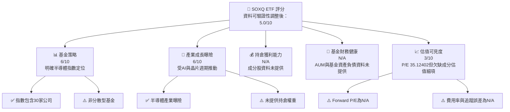

### 1.2 評分進度條視覺化

```text
╔══════════════════════════════════════════════════════════════╗
║              SOXQ 多維度評分儀表板（1-10分）                 ║
╠══════════════════════════════════════════════════════════════╣
║ 基金策略    6.0 ▓▓▓▓▓▓▓▓▓▓▓▓░░░░░░░░  ★★★☆☆ 明確但集中     ║
║ 產業成長曝險6.0 ▓▓▓▓▓▓▓▓▓▓▓▓░░░░░░░░  ★★★☆☆ 長期機會伴隨週期║
║ 獲利品質    N/A  未提供持倉公司財務資料                       ║
║ 財務健康    N/A  未提供基金資產負債表                         ║
║ 估值合理性  3.0 ▓▓▓▓▓▓░░░░░░░░░░░░░░  ★★☆☆☆ 估值資訊不足   ║
║ 護城河深度  N/A  ETF 無企業護城河                             ║
║ 管理層執行  N/A  未提供追蹤差異與經理人資料                   ║
║ 技術創新曝險6.0 ▓▓▓▓▓▓▓▓▓▓▓▓░░░░░░░░  ★★★☆☆ 指數產業曝險   ║
╠══════════════════════════════════════════════════════════════╣
║ 綜合總分    5.0 ▓▓▓▓▓▓▓▓▓▓░░░░░░░░░░  🟡 資料不足，審慎持有 ║
╚══════════════════════════════════════════════════════════════╝
```

### 1.3 五大投資論點 + 三大核心風險

| 類型 | 項目 | 具體依據 | 信心度 |
|------|------|----------|--------|
| 🟢 **投資論點①** | 半導體主題集中曝險 | 指數包含 30 家美國上市半導體公司，基金一般至少 90% 投資於指數成分證券 | 🟢 高（依基金說明） |
| 🟢 **投資論點②** | 可參與晶片產業成長 | 近期新聞涉及 TSM、ASML、TER、MPWR、NXPI、MCHP 等半導體鏈公司；但新聞標題不等於基金實際持倉或權重 | 🟡 中 |
| 🟢 **投資論點③** | 兩年價格上升 | 月度價格由 2024-11 的 $38.37 升至 2026-11-12 收盤 $82.71，區間變動 **+115.6%**；過往漲幅不代表未來報酬 | 🟡 中 |
| 🟢 **投資論點④** | 可透過單一基金取得一籃子產業曝險 | 指數包含 30 家公司，但成分權重未提供，無法量化集中度 | 🟡 中 |
| 🟢 **投資論點⑤** | 近期高波動可能帶來分批進場機會 | 52 週高 $115.23、低 $48.32；收盤價較高點低 **28.2%**，但區間低點不是估值底部 | 🟡 中 |
| 🟡 **風險①** | 半導體景氣週期反轉 | 2026-06 月度收盤 $112.00 至 2026-07 的 $88.97，單月回落約 **20.6%**；顯示價格對預期變化敏感 | 🔴 高衝擊 |
| 🔴 **風險②** | 集中及非分散型結構 | 基金明確標示 non-diversified；遇到半導體共同下跌時，產業內多檔持倉可能同向回落 | 🔴 高衝擊 |
| 🔴 **風險③** | 估值、費用與配息資料品質 | P/E 35.12402，但 Forward P/E、費用率與追蹤誤差 N/A；資料包列示股息殖利率 35.0%，數值異常且未有配息明細佐證 | 🔴 高資料風險 |

### 1.4 快速統計卡片

| 指標 | SOXQ 資料 | 行業／同類均值 | S&P 500 均值 | 狀態 |
|------|-------------|----------|--------------|------|
| 基金單季／TTM 營收成長 | N/A | N/A | N/A | ⚪ ETF 不適用 |
| 毛利率／淨利率 | N/A | N/A | N/A | ⚪ ETF 不適用 |
| ROE／ROIC | N/A | N/A | N/A | ⚪ ETF 不適用 |
| Trailing P/E | **35.12402** | N/A | N/A | 🟡 可見但缺乏比較基準 |
| Forward P/E | **N/A** | N/A | N/A | 🔴 未提供 |
| 費用率 | N/A | N/A | N/A | 🔴 未提供 |
| 追蹤誤差 | N/A | N/A | N/A | 🔴 未提供 |
| 基金 AUM | N/A | N/A | N/A | 🔴 未提供 |
| 2026-11-12 收盤價 | **$82.71** | — | — | 🔵 VERIFIED FIGURE |

### 1.5 投資結論

```text
╔══════════════════════════════════════════════════════════════════╗
║                    📊 投資結論摘要                               ║
╠══════════════════════════════════════════════════════════════════╣
║  評級：持有（按價格代理 MOS 0.0%）                               ║
║  價格（2026-11-12 收盤）：$82.71                                ║
║  DCF 內在價值（基準）：N/A（ETF 不適用公司 FCFF DCF）            ║
║  安全邊際 MOS：0.0%（以第8.8節價格代理合理價值$82.71為分母）     ║
║  估值情境：                                                       ║
║    悲觀參考：$48.32（52週低點，非目標價）                        ║
║    基準參考：$82.71（收盤價代理，非獨立公允價值）                ║
║    樂觀參考：$115.23（52週高點，非目標價）                       ║
║  投資評分：5.0/10（資料可驗證性調整後）                          ║
║  適合投資人：能承受產業集中及高波動、採長期配置與再平衡者        ║
╚══════════════════════════════════════════════════════════════════╝
```

評級依據是價格代理合理價值 $82.71 與收盤價 $82.71 相同，故 MOS 為 0.0%，落在持有門檻。由於此代理值本身不是獨立估值，這項評級是「資料不足下的中性處置」，不是對成分股合理價值的確證。

---

## 2. 公司概覽與商業模式

### 2.1 業務結構與收入來源

SOXQ 是基金，不從半導體產品或服務取得營業收入。基金投資目的在於提供對 PHLX Semiconductor Index 的追蹤曝險。資料指出，指數由 Nasdaq 編製，採修正市值加權，涵蓋 30 家在美國上市、從事半導體業務的公司；基金通常至少將 90% 總資產投入指數成分證券。基金持倉名稱、個別權重、現金比例、管理費及其他基金收入資料均未提供。

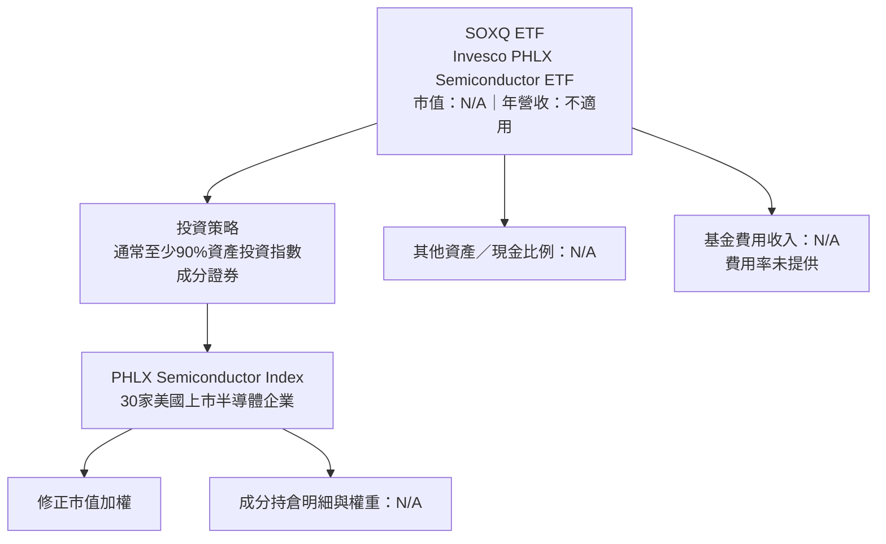

### 2.2 市場份額與資產配置

SOXQ 在半導體 ETF 市場的份額、AUM 及相對交易規模均未提供，不能製作有數據根據的市場份額圖。下圖僅示意基金章程中的投資政策門檻，不代表當日精確資產配置。

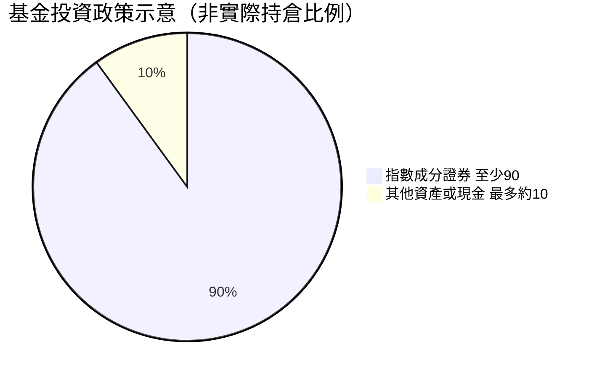

> 90% 是基金說明的「通常至少」投資比例；實際配置可能高於 90%，第二區塊僅為政策示意，不是經核實的實際持倉資料。

### 2.3 競爭護城河分析

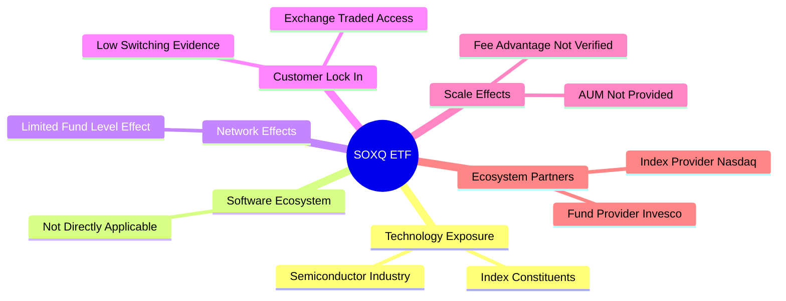

SOXQ 的投資價值主要來自指數方法、基金執行品質及成本，而非傳統公司的專利、客戶鎖定或網路效應。由於費用率、AUM、追蹤差異和同類基金比較數據均未提供，無法判定其相對競爭力。

### 2.4 護城河／產品競爭力評分

```text
╔══════════════════════════════════════════════════════════════╗
║                SOXQ 產品競爭力評分                           ║
╠══════════════════════════════════════════════════════════════╣
║ 指數辨識度       6/10  ▓▓▓▓▓▓▓▓▓▓▓▓░░░░░░░░  🟡 產業定位清楚║
║ 成分分散程度     4/10  ▓▓▓▓▓▓▓▓░░░░░░░░░░░░  🔴 只聚焦半導體║
║ 費用競爭力       N/A   費用率未提供                           ║
║ 追蹤品質         N/A   追蹤誤差及追蹤差異未提供               ║
║ 流動性／規模     N/A   AUM及交易資料未提供                    ║
║ 基金品牌與發行商 6/10  ▓▓▓▓▓▓▓▓▓▓▓▓░░░░░░░░  🟡 發行商為Invesco║
╠══════════════════════════════════════════════════════════════╣
║ 綜合產品評估     5.0/10  ▓▓▓▓▓▓▓▓▓▓░░░░░░░░░░  🟡 資料不完整 ║
╚══════════════════════════════════════════════════════════════╝
```

---

## 3. 損益表深度分析

SOXQ 沒有公司營業收入、毛利、營業利益、淨利或 EPS；基金的投資報酬主要由持倉價格變動、股息及費用造成。因此不得將成分股財務數字冒充 SOXQ 財報，也無法由目前資料計算基金 TTM 或單季營收成長率。

### 3.1 年度收入成長趨勢（近 4 年）

| 期間 | 基金營收 | YoY | 說明 |
|------|------:|------:|------|
| FY2023 | N/A | N/A | ETF 無企業營收表 |
| FY2024 | N/A | N/A | ETF 無企業營收表 |
| FY2025 | N/A | N/A | ETF 無企業營收表 |
| FY2026 | N/A | N/A | ETF 無企業營收表 |

```text
╔══════════════════════════════════════════════════════════════════╗
║             SOXQ 基金營業收入趨勢（FY2023–FY2026）              ║
╠══════════════════════════════════════════════════════════════════╣
║  FY2023  N/A  無基金損益表資料                                   ║
║  FY2024  N/A  無基金損益表資料                                   ║
║  FY2025  N/A  無基金損益表資料                                   ║
║  FY2026  N/A  無基金損益表資料                                   ║
║  4年收入 CAGR：N/A（營業收入不適用）                              ║
╚══════════════════════════════════════════════════════════════════╝
```

### 3.2 季度收入趨勢分析

| 指標 | 最近一季 | 前一季 | YoY／QoQ | 備註 |
|------|------:|------:|------:|------|
| 基金營收 | N/A | N/A | N/A | 無損益表 |
| 基金 EPS | N/A | N/A | N/A | ETF 無公司 EPS |
| 2026-06 月收盤價 | $112.00 | 2026-05：$100.87 | QoQ 不適用；月增 **+11.0%** | 依價格序列計算，不代表基金收入成長 |
| 2026-09 月收盤價 | $99.40 | 2026-06：$112.00 | 2026Q3 對 2026Q2 月末比較 **−11.3%** | 以季度末月收盤價作價格代理比較 |
| 2026-11-12 收盤價 | $82.71 | 2026-10：$84.12 | 11 月截至 11/12 相對 10 月月末 **−1.7%** | 非完整月份，不可稱為完整季度報酬 |

截至 2026-11-12 的價格不是完整 2026 年第四季資料，不能據此計算完整 QoQ 報酬。若需要基金總報酬，還須加入分配與費用，這些資料並未提供。

### 3.3 利潤率演變分析

| 利潤率指標 | FY2023 | FY2024 | FY2025 | FY2026 | 趨勢 | 評估 |
|------------|--------|--------|--------|--------|------|------|
| 毛利率 | N/A | N/A | N/A | N/A | ETF 不適用 | ⚪ |
| 營業利益率 | N/A | N/A | N/A | N/A | ETF 不適用 | ⚪ |
| EBITDA 利潤率 | N/A | N/A | N/A | N/A | ETF 不適用 | ⚪ |
| 淨利率 | N/A | N/A | N/A | N/A | ETF 不適用 | ⚪ |

基金報酬受到成分股獲利、估值、權重變動、基金費用及追蹤差異影響；但成分股利潤率與持倉權重均未提供，故不能把價格漲跌解釋為利潤率改善或惡化。

### 3.4 費用結構分析

SOXQ 的基金費用率、交易成本、行政費、現金拖累與追蹤差異均為 N/A，無法計算費用占比。

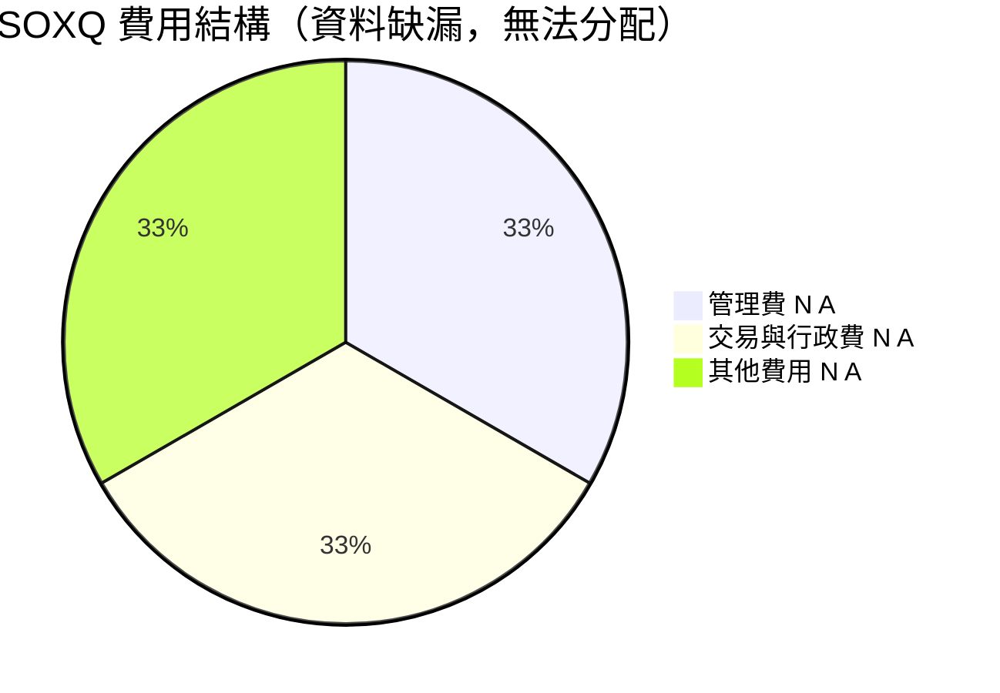

```text
╔══════════════════════════════════════════════════════════════╗
║                    費用結構資料狀態                           ║
╠══════════════════════════════════════════════════════════════╣
║ 費用率（Expense Ratio）      N/A                              ║
║ 交易成本                     N/A                              ║
║ 追蹤誤差                     N/A                              ║
║ 實際持倉與現金拖累           N/A                              ║
║ 評估                         尚不能確認 SOXQ 成本競爭力       ║
╚══════════════════════════════════════════════════════════════╝
```

### 3.5 EPS 趨勢與盈餘品質（Quality of Earnings）

| 盈餘品質項目 | 數值／佔比 | 評估 |
|--------------|-----------|------|
| 過去 4 季 EPS 超預期／不及預期 | N/A | ETF 無公司 EPS 盈餘公告 |
| SBC／營收 | N/A | 應分析成分股而非 ETF |
| SBC／營業現金流 | N/A | 基金 OCF 未提供 |
| FCF／淨利 | N/A | ETF 無公司式 FCF 與淨利 |
| 一次性／非經常性損益 | N/A | 無基金損益明細 |
| 有效稅率 | N/A | 投資人稅務結果取決於分配及個人稅務狀況 |
| 資本化支出 vs 費用化 | 不適用 | ETF 不經營晶片製造設備 |

**盈餘品質結論**：SOXQ 本身沒有可評估的 GAAP 淨利或股權薪酬。基金的經濟報酬品質應透過成分股盈利、基金費用、追蹤差異及分配來源評估；目前資料不足，不能判斷持倉盈餘是否高品質。

---

## 4. 資產負債表分析

### 4.1 資產結構分解

基金資產總額、現金、投資證券、應收款及應付費用均未提供。基金章程只提供指數投資政策，不能據此推算當日資產配置。

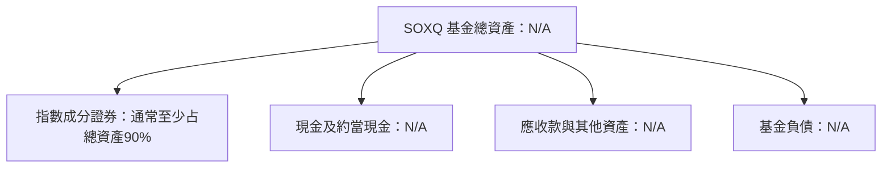

### 4.2 流動性指標分析

| 指標 | SOXQ | 近年趨勢 | 同類 ETF 均值 | 評估 |
|------|------:|------:|------:|------|
| 基金 AUM | N/A | N/A | N/A | 缺資料 |
| 現金比例 | N/A | N/A | N/A | 缺資料 |
| Bid-ask spread | N/A | N/A | N/A | 缺資料 |
| 成交量 | N/A | N/A | N/A | 缺資料 |
| 基金流入／流出 | N/A | N/A | N/A | 缺資料 |
| Current ratio／Quick ratio | N/A | 不適用於一般 ETF 分析 | N/A | 不應以企業流動比率替代 |

### 4.3 債務結構分析

```text
╔══════════════════════════════════════════════════════════════════╗
║                  SOXQ 基金資產負債診斷                           ║
╠══════════════════════════════════════════════════════════════════╣
║  基金總資產：        N/A          █░░░░░░░░░░░░░░░░░░░          ║
║  基金總負債：        N/A          N/A                            ║
║  淨現金／淨負債：    $0.00（資料包欄位值；不等於完整基金帳）     ║
║  Debt/EBITDA：       不適用                                      ║
║  利息保障倍數：      不適用                                      ║
║  評語：              缺基金財務報表，不能據 $0.00 推論無負債     ║
╚══════════════════════════════════════════════════════════════════╝
```

資料包所列 Net Cash / Debt 為 **$0.00**，但其他現金、債務欄位均為 N/A。因此該欄不能被解讀為經驗證的基金淨現金為零，也不能據此進行 DCF 股權價值橋接。

### 4.4 股東權益趨勢

| 年度 | 基金淨資產／持有人權益 | 年變動 | 說明 |
|------|------:|------:|------|
| FY2023 | N/A | N/A | 基金資產負債資料未提供 |
| FY2024 | N/A | N/A | 同上 |
| FY2025 | N/A | N/A | 同上 |
| FY2026 | N/A | N/A | 同上 |

基金持有人權益受申購贖回、持倉報酬、分配及費用影響；在缺少 AUM 與資金流量資料時，無法區分淨資產變化來自市場報酬還是資金流。

---

## 5. 現金流量深度分析

### 5.1 現金流量瀑布圖

基金沒有可直接對應「淨利 → 營業現金流 → Capex → FCF」的企業現金流瀑布。下圖改以 ETF 投資報酬結構示意。

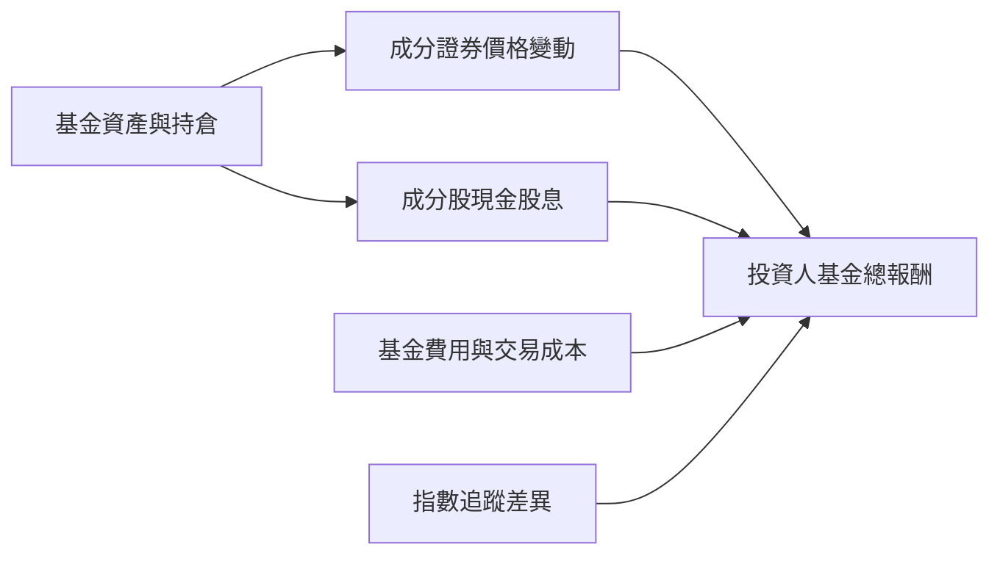

### 5.2 FCF 轉換率趨勢

| 期間 | FCF／淨利 | 基金分配／持倉現金收入 | 趨勢 |
|------|------:|------:|------|
| FY2023 | N/A | N/A | 無基金現金流及分配細目 |
| FY2024 | N/A | N/A | 無資料 |
| FY2025 | N/A | N/A | 無資料 |
| FY2026 TTM | N/A | N/A | 無資料 |

### 5.3 自由現金流趨勢

**TTM FCF = 營業現金流 − 資本支出**為公司分析定義；SOXQ 是基金，資料包中的 OCF、Capex、FCF 均為 N/A，不應把持倉企業的 FCF 合計冒充為基金 FCF。

```text
╔══════════════════════════════════════════════════════════════════╗
║                 SOXQ 基金 FCF（營業現金流－Capex）               ║
╠══════════════════════════════════════════════════════════════════╣
║  FY2023 FCF：N/A     FCF Yield：N/A                              ║
║  FY2024 FCF：N/A     FCF Yield：N/A                              ║
║  FY2025 FCF：N/A     FCF Yield：N/A                              ║
║  TTM FCF：   N/A     FCF Yield：N/A                              ║
║  說明：基金非營運公司；不得將持倉公司 FCF 合併冒充基金數值       ║
╚══════════════════════════════════════════════════════════════════╝
```

### 5.4 資本配置評估

ETF 的投資配置應以證券持倉及現金比例衡量，不是以公司回購、Capex、股息與留存收益衡量。實際配置明細未提供。

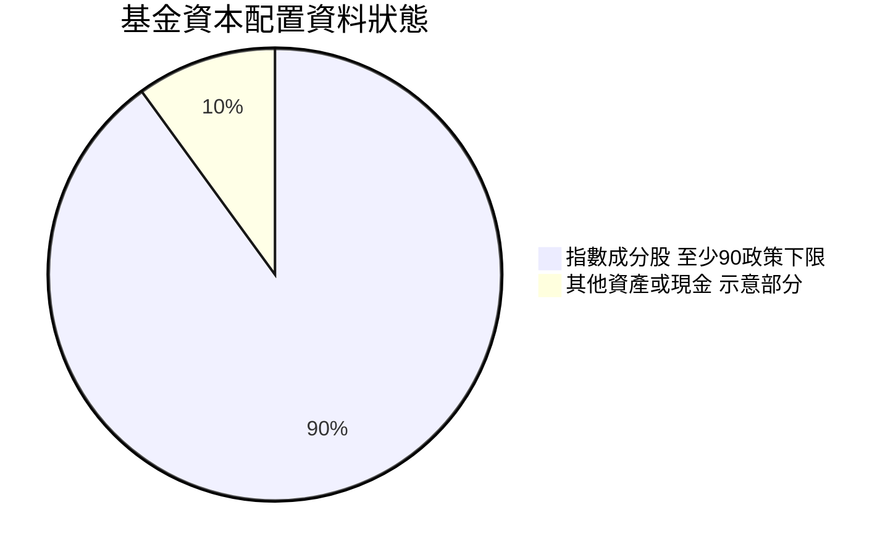

| 配置項目 | 資料 | 評估 |
|----------|------|------|
| 指數成分股 | 通常至少占總資產 90% | 🟢 符合主題投資定位 |
| 現金／其他資產 | N/A | 無法計算實際比例 |
| 基金配息 | 資料包列示殖利率 **35.0%** | 🔴 明顯需核驗；沒有配息明細，不能視為可靠現金收益率 |
| 管理費與交易成本 | N/A | 無法衡量成本拖累 |
| 回購／Capex／留存 | 不適用 | 這些是公司資本配置項目 |

---

## 6. 獲利能力與資本效率

### 6.1 ROE／ROA／ROIC 趨勢

| 指標 | FY2023 | FY2024 | FY2025 | FY2026 TTM | 評估 |
|------|------:|------:|------:|------:|------|
| ROE | N/A | N/A | N/A | N/A | 基金不適用企業 ROE 分析 |
| ROA | N/A | N/A | N/A | N/A | 基金持倉報酬不等於基金 ROA |
| ROIC | N/A | N/A | N/A | N/A | ETF 無企業營業投入資本 |
| 同業均值 | N/A | N/A | N/A | N/A | 需成分股資料另行計算 |

### 6.2 ROIC vs WACC 分析

SOXQ 沒有企業營業利潤、投入資本或公司融資成本，故不能計算 ROIC、WACC 或 EVA。提供的 Beta 亦為 N/A；基金折現率若要用於持倉分析，須根據成分股估值、風險與資本結構建模，不能將基金當成單一營運公司。

```text
╔══════════════════════════════════════════════════════════════════╗
║                ROIC vs WACC：SOXQ 不適用                         ║
╠══════════════════════════════════════════════════════════════════╣
║  無風險利率 Rf：N/A（資料包未提供 Cost of capital inputs）       ║
║  ERP：         N/A                                                ║
║  Beta：        N/A                                                ║
║  股權成本 Ke： N/A                                                ║
║  債務成本 Kd： N/A                                                ║
║  WACC：        N/A（無法為 ETF 建立公司資本結構）                 ║
║  ROIC：        N/A（無公司 NOPAT 與投入資本）                     ║
║  EVA：         N/A                                                ║
║  結論：不能判斷 SOXQ 是否以 ROIC 高於 WACC 創造企業價值           ║
╚══════════════════════════════════════════════════════════════════╝
```

### 6.3 杜邦三因素分解

杜邦分析用於公司 ROE；SOXQ 的 ETF 單位價格報酬不是公司淨利率、資產週轉率與財務槓桿的乘積。

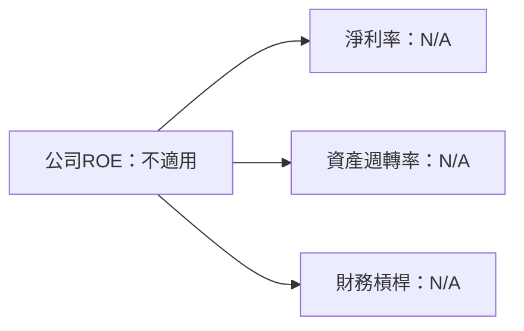

### 6.4 獲利能力儀表板

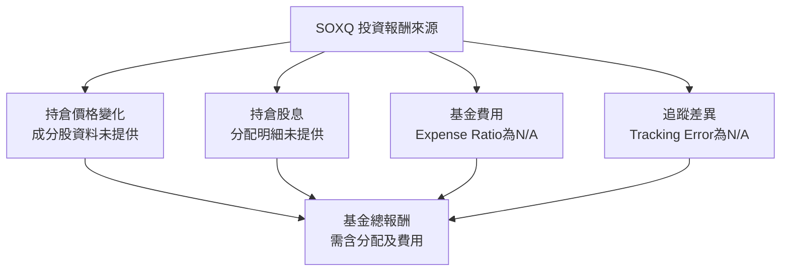

---

## 7. 相對估值分析

### 7.1 同業 ETF 比較

SOXQ 的同業比較標的可包括 iShares Semiconductor ETF（SOXX）及 VanEck Semiconductor ETF（SMH）。但提供資料沒有 Peer multiples，也沒有同業 ETF 的費用率、P/E、AUM 或追蹤誤差。以下不引用未經核實的倍數。

| 估值／基金指標 | **SOXQ** | **SOXX** | **SMH** | 評估 |
|----------|----------:|---------:|--------:|-----------|
| Trailing P/E | **35.12402** | N/A | N/A | 🟡 SOXQ 有數值，但成分口徑及日期未提供 |
| Forward P/E | N/A | N/A | N/A | 🔴 無法比較 |
| P/S Ratio | N/A | N/A | N/A | 🔴 無法比較 |
| EV/EBITDA | N/A | N/A | N/A | ETF 不適用基金層級 EV/EBITDA |
| FCF Yield | N/A | N/A | N/A | 無基金層級 FCF |
| 費用率 | N/A | N/A | N/A | 🔴 成本競爭力未能判斷 |
| AUM | N/A | N/A | N/A | 流動性及規模比較未能判斷 |
| 追蹤誤差 | N/A | N/A | N/A | 🟡 尚無基金執行品質比較 |

### 7.2 歷史估值區間分析

資料包沒有「Valuation vs own history」歷史估值區間，故不自行估計估值百分位。可以分析的是價格歷史，而不是歷史 P/E 分位。

| 指標 | 數值 | 計算／說明 |
|------|------:|------|
| 最新收盤價 | **$82.71** | 2026-11-12 收盤，原值引用 |
| 52 週高點 | $115.23 | 提供數據 |
| 52 週低點 | $48.32 | 提供數據 |
| 距 52 週高點 | **−28.2%** | ($82.71 − $115.23) ÷ $115.23 |
| 高於 52 週低點 | **+71.2%** | ($82.71 − $48.32) ÷ $48.32 |
| 歷史 P/E 區間／百分位 | N/A | 未提供 |

```text
╔══════════════════════════════════════════════════════════════════╗
║             SOXQ 價格區間（非估值區間）                          ║
╠══════════════════════════════════════════════════════════════════╣
║  52週低 $48.32  ├────────── 現價 $82.71 ──────────┤ 52週高 $115.23║
║                         距高點 −28.2%                            ║
║  注意：此區間只描述過去交易價格，不代表合理價值或支撐位。         ║
╚══════════════════════════════════════════════════════════════════╝
```

### 7.3 情境參考價格（歷史價格，不是估值目標）

因為基金持倉及估值資料不足，不能以營收 CAGR、營業利潤率或企業退出倍數推導目標價。以下只列出歷史 52 週價格區間作壓力參考，不是悲觀／基準／樂觀內在價值。

| 情境參考 | 價格 | 相對 $82.71 | 性質 |
|------|------:|------:|------|
| 🔴 區間低點參考 | $48.32 | **−41.6%** | 52 週低點；不是預測底部 |
| 🟡 現價錨點 | $82.71 | **0.0%** | 2026-11-12 收盤 |
| 🟢 區間高點參考 | $115.23 | **+39.3%** | 52 週高點；不是目標價 |

算式例：相對區間低點的變動為 `($48.32 ÷ $82.71) − 1 = −41.6%`；相對區間高點為 `($115.23 ÷ $82.71) − 1 = +39.3%`。

### 7.4 相對估值隱含價格區間

| 方法 | 隱含股價 | 狀態 |
|------|------:|------|
| 同業 Forward P/E 回推 | N/A | 同業倍數、指數盈餘與持倉權重缺漏 |
| EV/EBITDA 回推 | N/A | ETF 無基金層級 EV/EBITDA |
| EV/Sales 回推 | N/A | ETF 無公司營收 |
| FCF Yield 回推 | N/A | 基金層級 FCF Yield 為 N/A |
| 分析師共識目標價 | N/A | 共識、分析師人數與目標價均未提供 |

```text
╔══════════════════════════════════════════════════════════════════╗
║                  相對估值回推結果                               ║
╠══════════════════════════════════════════════════════════════════╣
║  Forward P/E：N/A     EV/EBITDA：N/A     FCF Yield：N/A           ║
║  可稽核目標價區間：N/A（成分估值與同業倍數未提供）               ║
║  $82.71 為市場成交價，不是相對估值推導出的合理價值               ║
╚══════════════════════════════════════════════════════════════════╝
```

---

## 8. DCF 內在價值評估（Discounted Cash Flow）

> **適用性結論**：SOXQ 是 ETF，不是營運企業；資料包沒有基金層級 FCFF、營收、稅率、Capex、營運資金、持倉估值明細或可供企業 DCF 橋接的股數／負債資料。把持倉企業財報自行加總會造成口徑不一致，故本章不虛構 DCF。以下依要求完整說明模型不可用之處，並採透明的價格代理做 MOS 計算；此代理不能替代獨立內在價值。

### 8.0 估值推理鏈（Thinking Logic）

**Step 1 — 價值來源與主導變數**

SOXQ 的價值主要由兩個來源共同決定：① 指數成分股的價格及盈餘變化；② 持倉股息、基金費用與指數追蹤差異。成分比例資料只有基金政策最低門檻「通常至少 90%」；精確持倉權重及基金費用均未提供，因此不能將兩項來源量化為收入佔比。估值主導變數應是成分股未來盈餘與市場估值倍數，而非 SOXQ 自身公司 FCF。

**Step 2 — 模型選擇**

| 決策點 | 本報告採用 | 理由 | 曾考慮但否決 | 否決理由 |
|--------|-----------|------|--------------|----------|
| 現金流定義 | N/A | ETF 無公司 FCFF／FCFE | FCFF／FCFE DCF | 缺少必要現金流輸入，不能可稽核計算 |
| 預測期 N | N/A | 無成分股合併預測 | 5 年或 10 年 DCF | 任選期限會形成無資料支撐的假設 |
| 終值方法 | N/A | 無 FY+N FCFF／EBITDA | Gordon Growth、退出倍數 | 無基礎現金流與企業價值 |
| EBIT 基礎 | N/A | ETF 沒有 EBIT | GAAP 或非 GAAP EBIT | 不適用 |
| 替代估值錨 | 最新收盤價代理 | 只用已驗證價格 $82.71，方便計算市場距離 | 將價格稱為 DCF 公允價值 | 價格不是獨立估值依據 |

**Step 3 — 高敏感度輸入推導鏈**

DCF 的營收 CAGR、期末營業利潤率、g、WACC、Capex、稀釋率等關鍵輸入全部缺乏 ETF 層級或成分股資料，因此沒有可被證據錨定的採用值。為避免任意填入假設，本報告均標示 N/A，不製作假裝精確的 DCF。

**Step 4 — 最脆弱的一環**

最脆弱的一環是以市場收盤價作代理合理價值；它沒有基金淨值、持倉逐股估值或分析師預期支持，因此只能得到算術上的 0% MOS，不能解讀為投資安全邊際。

**Step 5 — 計算路徑圖**

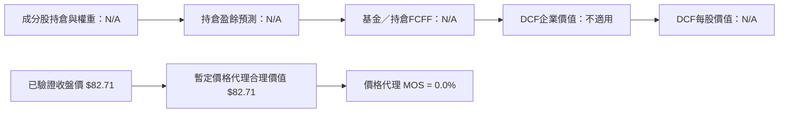

### 8.1 模型假設總表（Model Inputs）

| 假設項目 | 採用值 | 依據／來源 | 敏感度 |
|----------|--------|-------------|--------|
| 預測期長度 N | N/A | ETF 無成分股現金流預測 | 🔴 高 |
| 營收 CAGR | N/A | 基金無營收；持倉資料未提供 | 🔴 高 |
| 營業利潤率 | N/A | 基金無 EBIT | 🔴 高 |
| 有效稅率 | N/A | 無合併持倉稅務資料 | 🟢 低 |
| Capex／營收 | N/A | 無基金營業 Capex | 🟡 中 |
| D&A／營收 | N/A | 無基金營業 D&A | 🟢 低 |
| ΔWC／營收增額 | N/A | 基金無營運資金預測 | 🟢 低 |
| EBIT 基礎 | N/A | 不適用 | 🟡 中 |
| SBC 處理 | N/A | 無成分股 SBC 彙總 | 🟡 中 |
| 年稀釋率 | N/A | ETF 單位數及申贖資料未提供 | 🟡 中 |
| 永續成長率 g | N/A | 沒有可資本化的基金 FCFF | 🔴 高 |
| 終值方法 | N/A | Gordon Growth／退出倍數均缺必要輸入 | 🔴 高 |
| WACC | N/A | Cost of capital inputs 未提供，且 ETF 非企業 | 🔴 高 |
| SBC 相容性 | 不適用 | 沒有 EBIT、FCFF 或稀釋股數模型，不採 A/B/C 企業 DCF 組合 | — |

**FCF 定義**：企業 DCF 常用 `FCFF = NOPAT + D&A − Capex − ΔWC`。SOXQ 沒有可用 NOPAT 或上述營運項目，因此全章不計算 FCFF。

### 8.2 折現率推導（WACC）

資料包沒有 Rf、ERP、Beta、Kd、稅率、資本結構權重等 Cost of capital inputs；ETF 亦無法直接用公司式資本結構推導 WACC。

```text
╔══════════════════════════════════════════════════════════════════╗
║             WACC 推導：不適用，不能建立公司折現率                ║
╠══════════════════════════════════════════════════════════════════╣
║  Rf：N/A             ERP：N/A             Beta：N/A               ║
║  Ke：N/A             Kd：N/A              E權重：N/A              ║
║  D權重：N/A          WACC：N/A                                     ║
║  原因：ETF非單一營運企業；且VERIFIED FIGURES未提供資本成本輸入     ║
╚══════════════════════════════════════════════════════════════════╝
```

**逐步演算（WACC）**

1. Ke（CAPM）：`N/A`，Rf、Beta、ERP 均無資料。  
2. 稅前 Kd：`N/A`，利息費用及計息負債均無資料。  
3. 稅後 Kd：`N/A`，稅率與 Kd 均無資料。  
4. 權重：`N/A`，基金市場市值及計息債務資料未提供。  
5. WACC：`N/A`；同第 6.2 節，ROIC/WACC 均不適用。

### 8.3 逐年自由現金流預測

| 項目 | FY+1 | FY+2 | FY+3 | FY+4 | FY+5 |
|------|------|------|------|------|------|
| 營收 | N/A | N/A | N/A | N/A | N/A |
| 營收 YoY | N/A | N/A | N/A | N/A | N/A |
| 營業利潤率 | N/A | N/A | N/A | N/A | N/A |
| EBIT | N/A | N/A | N/A | N/A | N/A |
| 稅 | N/A | N/A | N/A | N/A | N/A |
| NOPAT | N/A | N/A | N/A | N/A | N/A |
| + D&A | N/A | N/A | N/A | N/A | N/A |
| − Capex | N/A | N/A | N/A | N/A | N/A |
| − ΔWC | N/A | N/A | N/A | N/A | N/A |
| FCFF | N/A | N/A | N/A | N/A | N/A |
| 折現因子 | N/A | N/A | N/A | N/A | N/A |
| FCFF 現值 PV | N/A | N/A | N/A | N/A | N/A |

預測期 FCF 現值合計：**N/A**，無可加總的 FCFF。  
逐步演算：營收、EBIT、稅、NOPAT、D&A、Capex、ΔWC、FCFF 與折現因子均缺資料，故不能列出可複算數值。

```text
╔══════════════════════════════════════════════════════════════════╗
║            自由現金流：歷史實際 vs 模型預測                      ║
╠══════════════════════════════════════════════════════════════════╣
║  FY2024（實）  N/A   基金現金流量資料未提供                     ║
║  FY2025（實）  N/A   基金現金流量資料未提供                     ║
║  FY+1（預）    N/A   無成分股合併預測                            ║
║  FY+5（預）    N/A   無成分股合併預測                            ║
║  FCF CAGR：N/A；不能比較歷史與預測 FCF                            ║
╚══════════════════════════════════════════════════════════════════╝
```

### 8.4 終值計算（Terminal Value）

適用性檢查：`WACC N/A vs g N/A → WACC > g？無法判定，DCF 終值不適用。`

| 方法 | 計算式 | 終值 TV | TV 現值 | 佔總 EV 比重 |
|------|--------|---------|---------|--------------|
| Gordon Growth | N/A | N/A | N/A | N/A |
| 退出倍數法 | N/A | N/A | N/A | N/A |

缺少 FCFF(FY+N)、EBITDA(FY+N)、WACC 及 g，不能計算終值或其現值。此處不提供替代性假設數字。

### 8.5 企業價值 → 每股內在價值（Bridge）

```text
╔══════════════════════════════════════════════════════════════════╗
║         DCF企業價值 → 每股內在價值橋接：不適用                   ║
╠══════════════════════════════════════════════════════════════════╣
║  預測期 FCF 現值合計：N/A                                        ║
║  終值現值 PV(TV)：    N/A                                        ║
║  企業價值 EV：        N/A                                        ║
║  + 現金：             N/A                                        ║
║  − 總債務：           N/A                                        ║
║  股權價值：           N/A                                        ║
║  ÷ 稀釋股數：         N/A                                        ║
║  DCF每股內在價值：    N/A                                        ║
║  2026-11-12收盤價：   $82.71                                     ║
║  DCF折溢價：          N/A                                        ║
╚══════════════════════════════════════════════════════════════════╝
```

逐步演算：EV、股權價值、每股 DCF 價值及折溢價均因必要輸入缺漏而為 N/A。依 MOS 定義規則，本節**不計算 MOS**。資料包的淨現金／淨負債欄位 $0.00 不能替代基金完整資產負債資料。

### 8.6 敏感性分析（WACC × 永續成長率）

| g（列）／WACC（欄） | WACC N/A | WACC N/A | WACC N/A | WACC N/A | WACC N/A |
|-----------|------|------|------|------|------|
| g N/A | N/A | N/A | N/A | N/A | N/A |
| g N/A | N/A | N/A | N/A | N/A | N/A |
| g N/A | N/A | N/A | N/A | N/A | N/A |
| g N/A | N/A | N/A | N/A | N/A | N/A |
| g N/A | N/A | N/A | N/A | N/A | N/A |

由於 WACC、g 與預測 FCFF 均為 N/A，所有矩陣格皆不能形成有效 DCF。不能以任意折現率或永續成長率填入每股價值。

**三情境 DCF**：悲觀、基準及樂觀情境所需的營收 CAGR、利潤率、g、WACC 與 FCFF 都無法建立，因此每股內在價值及機率加權 DCF 均為 N/A。不得用歷史價格區間冒充 DCF 情境。

**敏感度結論**：g 每 +1pp、WACC 每 +1pp、期末營業利潤率每 +1pp 對 DCF 價值的影響均為 N/A。SOXQ 的主要估值變數是成分股盈餘和估值倍數，但目前資料不足以計量。

### 8.7 反推 DCF（Reverse DCF）

現價只有一條方程式，但缺少成分股合併 FCFF、估值與折現輸入，不能解出營收 CAGR、利潤率、g 或預測期 N。

| 求解的變數 | 固定輸入 | 市場隱含值 | 公司／基金歷史實際 | 判斷 |
|------------------------|--------------|------------------------------|--------------|------|
| 未來 N 年營收 CAGR | N/A | N/A | N/A | 無法求解 |
| 期末營業利潤率 | N/A | N/A | N/A | 無法求解 |
| 永續成長率 g | N/A | N/A | N/A | 無法求解 |
| 高成長持續年數 N | N/A | N/A | N/A | 無法求解 |

**逐步演算／疊代軌跡**：N/A。沒有可計算的 FCFF 對照現價，不能聲稱市場隱含某一營收增速或利潤率。

### 8.8 估值三角驗證與安全邊際

| 估值方法 | 隱含每股價值 | 上行空間（÷現價） | 權重 | 說明 |
|----------|--------------:|-------------------:|------:|------|
| DCF | N/A | N/A | 0% | ETF 不適用企業 FCFF DCF |
| 同業估值 | N/A | N/A | 0% | Peer multiples 未提供 |
| 分析師共識 | N/A | N/A | 0% | 共識目標價未提供 |
| 市場價格代理 | $82.71 | 0.0% | 100% | 暫代基準，非獨立公允價值 |
| **加權合理價值（價格代理）** | **$82.71** | **0.0%** | **100%** | 資料不足下的比較基準，不是內在價值估計 |

**逐步演算（權重外顯）**：

`$82.71 × 100% = $82.71`

因沒有獨立估值方法可用，價格代理權重 100% 只是為了提供一致的 MOS 算術基準，不代表研究者認為成交價等於公允價值。

```text
╔══════════════════════════════════════════════════════════════════╗
║                 估值區間與安全邊際                               ║
╠══════════════════════════════════════════════════════════════════╣
║  52週低 $48.32 ── 現價 $82.71 ── 價格代理值 $82.71 ── 高 $115.23║
║                                                                  ║
║  加權合理價值（代理）：$82.71                                    ║
║  MOS = ($82.71 − $82.71) ÷ $82.71 = 0.0%                         ║
║  上行空間 = ($82.71 − $82.71) ÷ $82.71 = 0.0%                    ║
║  折溢價對DCF基準：N/A（DCF基準價值不存在）                       ║
║                                                                  ║
║  評級：🟡 持有（MOS落在−10%至+10%）                               ║
║  買入區間：暫不給基本面買入區間；若只按代理值算MOS≥10%，         ║
║             價格需≤$74.44，但該門檻非獨立估值結論                 ║
╚══════════════════════════════════════════════════════════════════╝
```

買入門檻算式：`$82.71 × (1 − 10%) = $74.439 ≈ $74.44`。此數值僅為價格代理的數學門檻，因代理不具內在價值資訊，不應當成已驗證買點。

### 8.9 DCF 模型的局限與失效條件

- **終值依賴度**：N/A；沒有 DCF 終值，不能計算終值佔 EV 比重。
- **最脆弱的假設**：價格代理合理價值等同收盤價的處理方式；若實際成分股合理價值低於現價，MOS 可能為負，反之亦然。
- **不適用情境**：本標的是基金，企業 DCF 不適用。較合適方法是逐一取得持倉與權重後，以成分股估值彙總，再加入基金費用、追蹤差異、分配與交易成本。
- **與風險矩陣連結**：半導體週期轉弱會壓低成分股盈餘預期；估值壓縮直接降低基金價格；費用率與追蹤差異影響基金相對指數報酬。

### 8.10 複算檢核表（Audit Trail）

| # | 檢核項目 | 檢查方式 | 結果 |
|---|----------|----------|------|
| 1 | 高／中敏感度輸入有完整推導 | DCF 輸入缺漏；未虛構推導 | ✅ 明確標示 N/A |
| 2 | 每個假設都有來歷 | 缺少輸入均註明資料包未提供 | ✅ |
| 3 | WACC 五步算式可計算 | Rf、ERP、Beta、資本結構均缺漏 | ✅ 不適用，未填假數 |
| 4 | Kd 分母與債務權重一致 | Kd 與 D 均未計算 | ✅ 不適用 |
| 5 | WACC 與第 6.2 節一致 | 兩處均為 N/A | ✅ |
| 6 | 逐年表格年度數 | 表格呈現 FY+1 至 FY+5；但 DCF 模型不適用 | ✅ 已標明無預測值 |
| 7 | FY+1 九步算式可複算 | 基礎財務輸入缺漏 | ✅ 未提供假算式 |
| 8 | 預測 PV 加總 | 所有項目 N/A | ✅ 無可加總數字 |
| 9 | WACC > g | WACC 與 g 均 N/A | ✅ 不適用 |
| 10 | 終值基期與折現期 | 無可用 FCFF 與 WACC | ✅ 不適用 |
| 11 | EV → 每股價值橋接 | EV、現金、債務及股數缺漏 | ✅ 未虛構橋接 |
| 12 | SBC 組合相容 | 不採企業 EBIT／FCFF 模型 | ✅ 不適用 |
| 13 | 敏感性矩陣基準格 | DCF 值 N/A | ✅ 不適用 |
| 14 | 矩陣有效性 | 所有格標示 N/A，未填無效數字 | ✅ |
| 15 | 三情境機率加權 | DCF 情境不可建立 | ✅ 不適用 |
| 16 | Reverse DCF 單變數求解 | 必要模型輸入缺漏 | ✅ 未聲稱有解 |
| 17 | MOS 基準與折溢價基準一致 | MOS 用第 8.8 節代理價值；DCF 折溢價 N/A | ✅ |
| 18 | 報告完整至第 11 章 | 已列出全部 11 章 | ✅ |
| 19 | 加權合理價值總和 | `$82.71 × 100% = $82.71` | ✅ |
| 20 | 評級符合 MOS 門檻 | MOS 0.0%，依規則為持有 | ✅ |

---

## 9. 成長催化劑

SOXQ 的成長來自持倉成分股的價格與分配，不是 ETF 自身營收成長。近期新聞標題提及 TSM、ASML、TER、MPWR、NXPI、MCHP 等半導體鏈公司，但資料沒有列出 SOXQ 是否持有、持倉權重或事件對指數的實際貢獻，因此只將其視為產業線索，而非基金已確認催化劑。

### 9.1 催化劑時間軸

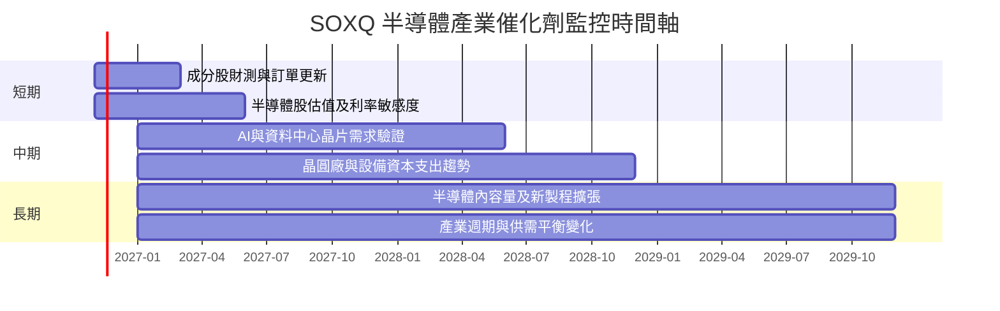

### 9.2 TAM 市場規模分析

提供資料未包含半導體 TAM、滲透率、SOXQ 成分股各市場收入或基金持倉權重，故不以外部未核實數值填補。

```text
╔══════════════════════════════════════════════════════════════════╗
║              半導體 TAM 與 SOXQ 可歸因收入                       ║
╠══════════════════════════════════════════════════════════════════╣
║ AI／資料中心半導體 TAM：N/A     市場滲透率：N/A                  ║
║ 邏輯與記憶體市場 TAM：N/A       市場滲透率：N/A                  ║
║ 半導體設備 TAM：N/A             市場滲透率：N/A                  ║
║ SOXQ持倉收入與市場曝險：N/A     個別權重未提供                    ║
║ 結論：可定性追蹤產業需求，不應將未驗證TAM當成基金收入預測        ║
╚══════════════════════════════════════════════════════════════════╝
```

### 9.3 成長驅動力結構圖

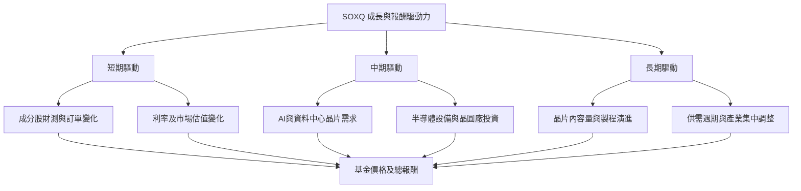

---

## 10. 風險矩陣

### 10.1 風險評分矩陣

下列機率與衝擊位置為分析師定性評估，並非數據包提供的統計機率。

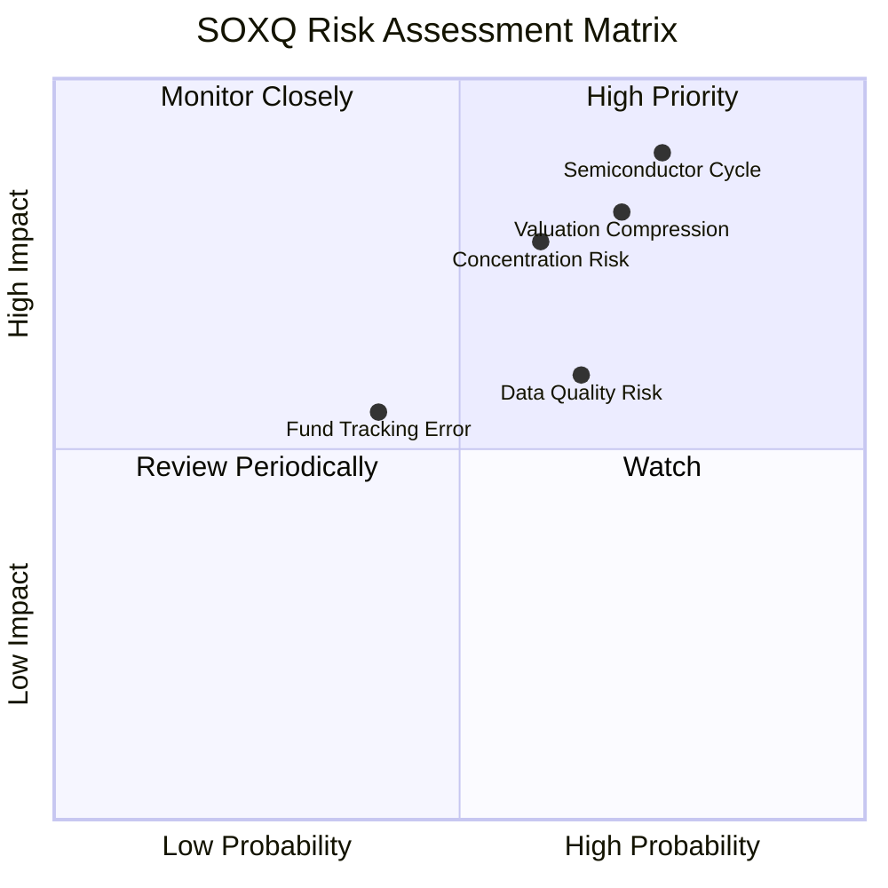

### 10.2 風險清單詳細分析

| # | 風險項目 | 發生機率 | 財務／價格衝擊 | 風險評分 | 緩解措施 |
|---|----------|----------|----------|----------|----------|
| 1 | 🔴 **半導體週期與資本支出反轉** | 中高，分析師估計 60–75% 會在持有期內出現階段性波動 | 高；2026-06 月收盤 $112.00 至 2026-07 $88.97，月度價格回落約 20.6%，顯示週期預期可迅速重估 | 🔴 8.5/10 | 分批投入、設定產業曝險上限；觀察庫存、訂單、設備投資與成分股財測 |
| 2 | 🔴 **估值收縮** | 中高，分析師估計 55–70% | Trailing P/E **35.12402**；若盈利預期不變但估值倍數下降，價格仍可下跌 | 🔴 8.0/10 | 追蹤成分股遠期盈餘與估值；避免只用價格動能加碼 |
| 3 | 🔴 **非分散型及持倉集中** | 中，分析師估計 45–60% | 基金明示 non-diversified；未提供持倉權重，無法定量單一公司集中度 | 🔴 7.5/10 | 核實前十大持倉與權重；跨產業分散整體投資組合 |
| 4 | 🟡 **基金費用及追蹤誤差不明** | 中，分析師估計 35–50% | 費用率、AUM、追蹤差異皆 N/A，無法估算相對指數報酬拖累 | 🟡 5.5/10 | 查閱最新基金說明書、每日 NAV、持倉檔與追蹤資料 |
| 5 | 🟡 **分配資料品質問題** | 中，分析師估計 35–50% | 資料包列示股息殖利率 35.0%，沒有配息歷史與分配性質佐證；若誤信會高估現金收益 | 🟡 6.0/10 | 以基金官方分配公告核對金額、除息日與分配來源；核實前不納入收益預期 |

---

## 11. 投資建議

### 11.1 最終綜合評級雷達圖

```text
╔══════════════════════════════════════════════════════════════╗
║                SOXQ 最終綜合評分（1-10）                    ║
╠══════════════════════════════════════════════════════════════╣
║ 基金策略清晰度   6.0  ▓▓▓▓▓▓▓▓▓▓▓▓░░░░░░░░  ★★★☆☆          ║
║ 產業成長曝險     6.0  ▓▓▓▓▓▓▓▓▓▓▓▓░░░░░░░░  ★★★☆☆          ║
║ 持倉獲利品質     N/A  成分股財務資料未提供                   ║
║ 基金財務健康     N/A  AUM與基金資產負債資料未提供            ║
║ 估值可見度       3.0  ▓▓▓▓▓▓░░░░░░░░░░░░░░  ★★☆☆☆          ║
║ 費用競爭力       N/A  費用率未提供                           ║
║ 風險控制適配度   4.0  ▓▓▓▓▓▓▓▓░░░░░░░░░░░░  ★★☆☆☆ 高集中度║
╠══════════════════════════════════════════════════════════════╣
║ 資料調整後總分   5.0  ▓▓▓▓▓▓▓▓▓▓░░░░░░░░░░  🟡 中性持有     ║
╚══════════════════════════════════════════════════════════════╝
```

### 11.2 目標價與隱含報酬率

| 情境／參考 | 價格 | 相對 2026-11-12 收盤 $82.71 | 權重 | 解讀 |
|------|------:|------:|------:|------|
| 🔴 52 週低點參考 | $48.32 | **−41.6%** | 不適用 | 歷史價格低點，非悲觀估值目標 |
| 🟡 價格代理基準 | $82.71 | **0.0%** | 100% | 僅為 MOS 算術代理，不是獨立合理價值 |
| 🟢 52 週高點參考 | $115.23 | **+39.3%** | 不適用 | 歷史價格高點，非樂觀估值目標 |
| DCF／分析師共識目標價 | N/A | N/A | — | 必要輸入未提供 |

**最終評級：🟡 持有。** 按第 8.8 節代理 MOS 0.0% 落在持有門檻；但因加權合理價值只是收盤價代理，投資決策應優先補齊基金官方持倉、NAV、費用率、追蹤誤差及成分股估值。

### 11.3 買入時機與觸發因素

```text
╔══════════════════════════════════════════════════════════════════╗
║                  ✅ 買入觸發因素 Checklist                      ║
╠══════════════════════════════════════════════════════════════════╣
║  目前處置：中性持有；不把52週價格區間視為基本面買賣點            ║
║                                                                  ║
║  考慮開始分批配置前：                                            ║
║  ☐ 核實官方費用率、AUM、Bid-ask spread與追蹤差異                 ║
║  ☐ 取得完整持倉與前十大權重，確認單一持倉及產業集中度            ║
║  ☐ 以成分股遠期盈餘和估值倍數檢查35.12402的Trailing P/E          ║
║  ☐ 核實35.0%股息殖利率是否為錯誤欄位或特殊分配                   ║
║                                                                  ║
║  加碼觸發條件：                                                  ║
║  ☐ 成分股盈餘預期沒有下修，且估值回落後風險報酬改善              ║
║  ☐ 半導體庫存、訂單、資本支出與基金持倉資料相互印證              ║
║  ☐ 持倉權重與基金追蹤品質符合投資組合風險限制                    ║
║                                                                  ║
║  減碼／重新檢視條件：                                            ║
║  ☐ 成分股盈利預期連續下修，或半導體資本支出普遍縮減              ║
║  ☐ 成分集中度明顯升高，超出投資組合設定上限                      ║
║  ☐ 基金費用、追蹤差異或流動性劣於同類 ETF                        ║
║  ☐ 配息資料無法核實，或特殊分配被誤判為可持續收益                ║
╚══════════════════════════════════════════════════════════════════╝
```

### 11.4 投資人適配度分析

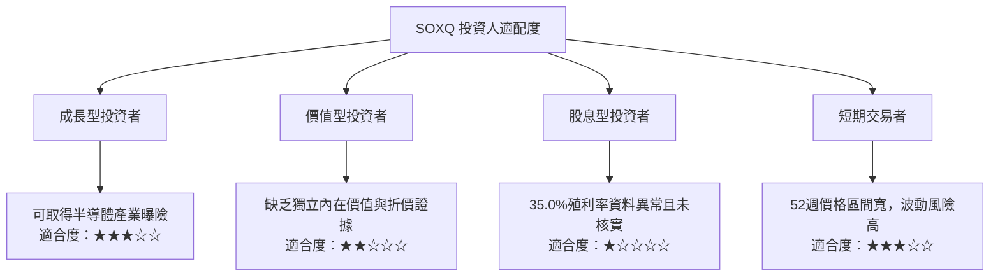

### 11.5 每季財報監控清單（Quarterly Watch List）

| 監控項目 | 目前資料 | 觸發加碼條件 | 觸發減碼／重估條件 |
|----------|----------|--------------|--------------------|
| 基金持倉及前十大權重 | N/A | 權重透明且集中度符合投資組合限制 | 單一持倉或前十大權重超出風險預算 |
| 指數成分與定期調整 | 指數涵蓋 30 家公司 | 成分變動能改善產業曝險品質 | 指數集中或持倉流動性惡化 |
| 費用率 | N/A | 官方費用資料確認成本具競爭力 | 費用高於可替代同類基金 |
| AUM 與流動性 | N/A | AUM、成交與價差足以支援部位規模 | 流動性下降或交易成本上升 |
| 追蹤差異／誤差 | N/A | 長期追蹤差異接近指數報酬扣費後合理範圍 | 追蹤偏離持續擴大 |
| 成分股營收與 EPS 財測 | N/A | 共識盈餘穩定或上修 | 多數主要成分股下修財測 |
| AI／資料中心相關需求 | 近期新聞有產業線索，無持倉權重 | 訂單與收入數據證實需求轉為實際盈餘 | 需求減速或投資回報不足 |
| 半導體庫存、訂單、Capex | N/A | 庫存正常化且訂單改善 | 庫存累積、訂單取消、Capex 普遍下調 |
| 基金分配與股息殖利率 | 資料包列示 35.0%，未核實 | 官方分配記錄可驗證且來源清楚 | 資料錯誤或分配不可持續 |

### 11.6 反面論證：什麼會證明論點錯誤（What Would Change My Mind）

```text
╔══════════════════════════════════════════════════════════════════╗
║              ⚠️ 論點失效條件（Disconfirming Evidence）           ║
╠══════════════════════════════════════════════════════════════════╣
║  下列狀況出現時，應重新評估 SOXQ 的持有理由：                    ║
║  ☐ 多數主要成分股連續兩季下修營收或 EPS 財測                      ║
║  ☐ 半導體庫存上升且訂單、設備投資同步轉弱                         ║
║  ☐ 成分股盈餘預期下修，但指數估值仍維持高位                       ║
║  ☐ 官方資料顯示基金費用率或追蹤差異明顯不利於同類替代品           ║
║  ☐ 前十大持倉集中度超過投資組合設定上限                           ║
║  ☐ 35.0%股息殖利率無法由官方分配資料核實，且投資論點依賴該收益    ║
║  ☐ 基金價格長期顯著落後其基準指數，且無合理費用或現金解釋         ║
║                                                                  ║
║  核心反面論證：若半導體需求與盈餘成長低於市場預期，且估值同步收縮，║
║  SOXQ 的集中曝險會放大下行；僅憑歷史價格上漲無法證明論點有效。    ║
╚══════════════════════════════════════════════════════════════════╝
```

> **免責聲明**：本報告為 AI 自動生成，僅供研究參考，不構成投資建議。資料包未提供 SOXQ 的持倉明細、費用率、AUM、追蹤誤差及多項基金財務資料；報告中的價格代理估值與歷史價格區間不等同於獨立內在價值或目標價。投資有風險，入市需謹慎。