# SOXQ 基本面深度分析報告
> **報告日期**：2026-11-14 ｜ **語言**：繁體中文 ｜ **數據來源**：Yahoo Finance、Finviz ｜ **分析師**：CFA 級機構研究

> **標的性質說明**：SOXQ 是 Invesco PHLX Semiconductor ETF，並非營運公司。它沒有可供分析的公司損益表、資產負債表、營業現金流、ROIC 或公司 WACC。以下依 ETF 框架分析持股策略、費用、追蹤、價格與估值資料；沒有提供的基金或持股資料均標示 N/A，不以假設值冒充實際數據。

## 目錄

| # | 章節 | 核心結論 |
|---|------|----------|
| 1 | 執行摘要 | 2026-11-13 收盤 $79.85；ETF 基金淨值與持倉估值資料不足，合理價值、MOS 均為 N/A，採審慎觀望 |
| 2 | 公司概覽與商業模式 | 追蹤美國上市的 30 家大型半導體企業；至少 90% 資產投資於指數成分證券，基金屬非多元化 |
| 3 | 損益表深度分析 | ETF 無公司損益表；單季及 TTM 營收、利潤率、EPS 均 N/A |
| 4 | 資產負債表分析 | 基金資產、負債及流動性明細 N/A；不能套用公司槓桿分析 |
| 5 | 現金流量深度分析 | 公司口徑 FCF 不適用；配息殖利率資料列為 35.0%，但未驗證且高度可疑 |
| 6 | 獲利能力與資本效率 | ROIC、WACC、ROE、ROA 不適用；不能據此判斷 ETF 本身創造或摧毀營運價值 |
| 7 | 相對估值分析 | 提供的追蹤 P/E 為 33.909477x；同類 ETF 倍數及自身歷史估值區間 N/A |
| 8 | DCF 內在價值評估 | DCF 不適用於 ETF；缺少持股現金流、NAV 與完整成分股資料，不能產出可稽核的內在價值或 MOS |
| 9 | 成長催化劑 | 半導體需求、AI 資本支出與產業週期是潛在驅動力；基金持倉權重及產業 TAM 貢獻未提供 |
| 10 | 風險矩陣 | 半導體週期、集中持倉與估值波動為主要風險 |
| 11 | 投資建議 | 基本面估值資料不足，建議觀望／持有既有部位；須先取得 NAV、費用率、持倉與追蹤資料再設定基本面買入區間 |

---

## 1. 執行摘要

截至 **2026-11-13 收盤價 $79.85**，SOXQ 過去 24 個月收盤價由 $38.37 升至 $79.85，累計約 **+108.1%**；但相對 52 週高點 $115.23 已回落約 **30.7%**，反映報酬潛力與回撤風險並存。數據包提供的追蹤 P/E 為 **33.909477x**，但未提供組成持股、基金 NAV、費用率、追蹤誤差、AUM 或同類 ETF 倍數；因此不能可靠推出合理價值、DCF 或安全邊際。基於資料完整性而非已計算 MOS，本報告給予 **🟡觀望／持有既有部位**，不宣稱其符合 MOS 門檻評級。

### 1.0 一頁式投資儀表板（Portfolio Manager 30 秒速讀）

| 項目 | 內容 |
|------|------|
| **投資論點（3 句）** | ① SOXQ 追蹤由 30 家美國上市半導體企業構成的修正市值加權指數，基金通常至少 90% 資產投資於指數證券。② 2026-11-13 收盤 $79.85，較 24 個月前 $38.37 上升約 108.1%，但較 52 週高點 $115.23 下跌約 30.7%。③ 追蹤 P/E 為 33.909477x，但持倉、費用率與 NAV 缺失，無法確認估值是否具吸引力。 |
| **護城河評分** | 5.0/10：指數化與低成本可能有產品競爭力，但費用率、規模與追蹤品質均 N/A |
| **管理層／資本配置評分** | 5.0/10：基金管理與資本配置歷史資料 N/A，僅能確認其指數追蹤策略 |
| **財務健康** | 🟡不適用：ETF 非營運公司，基金資產負債與流動性明細 N/A |
| **ROIC vs WACC** | N/A vs N/A：ETF 本身沒有營運 ROIC；不能以公司 WACC 框架評價基金 |
| **FCF 趨勢** | N/A；公司 FCF Yield N/A。35.0% 配息殖利率欄位未驗證，不應視為可靠現金收益 |
| **估值** | Trailing P/E **33.909477x** ｜ Forward P/E N/A ｜ EV/EBITDA N/A ｜ FCF Yield N/A |
| **DCF 內在價值（基準）** | N/A；缺乏基金 NAV、成分股現金流與權重資料，無法計算現價折溢價 |
| **安全邊際（MOS）** | N/A；加權合理價值不可計算，不能以基金歷史價格替代內在價值 |
| **預期報酬（基準情境 12M）** | N/A；沒有足以支持 12 個月目標價的持倉估值及預測資料 |
| **關鍵風險（前二）** | 半導體景氣與估值波動；非多元化基金集中度及成分股集中風險 |
| **評級 + 信心度** | 🟡觀望／持有既有部位 ｜ 信心：低（投資框架可判讀，估值資料不足） |

**指標一致性註記：** MOS 必須以第 8.8 節加權合理價值為分母。本報告第 8.8 節無法計算該合理價值，故執行摘要與第 8 章均列 MOS 為 N/A，不以任意價格代填。

### 1.1 核心評分儀表板

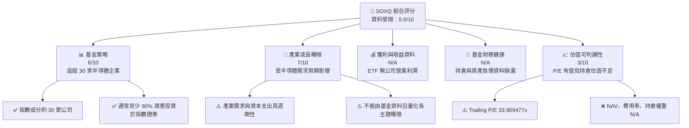

### 1.2 評分進度條視覺化

下列為依現有資料評估的研究可判讀性與策略特質分數，不是基金業績排名；N/A 項不以虛構分數補值。

```text
╔══════════════════════════════════════════════════════════════╗
║              SOXQ 多維度評分儀表板（1-10分）                ║
╠══════════════════════════════════════════════════════════════╣
║ 基金策略    6.0 ▓▓▓▓▓▓▓▓▓▓▓▓░░░░░░░░  ★★★☆☆               ║
║ 產業成長曝險7.0 ▓▓▓▓▓▓▓▓▓▓▓▓▓▓░░░░░░  ★★★★☆               ║
║ 獲利品質    N/A  ETF 無公司盈餘數據                           ║
║ 財務健康    N/A  基金資產負債明細缺漏                         ║
║ 估值可判讀性3.0 ▓▓▓▓▓▓░░░░░░░░░░░░░░  ★★☆☆☆               ║
║ 費用／追蹤  N/A  費用率與追蹤誤差未提供                       ║
╠══════════════════════════════════════════════════════════════╣
║ 資料可用性  2.0 ▓▓▓▓░░░░░░░░░░░░░░░░  ★☆☆☆☆               ║
╚══════════════════════════════════════════════════════════════╝
```

### 1.3 五大投資論點 + 三大核心風險

| 類型 | 項目 | 具體依據 | 信心度 |
|------|------|----------|--------|
| 🟢 **論點①** | 半導體產業集中曝險 | 指數涵蓋 30 家美國上市半導體企業，適合表達產業觀點；成分權重未提供 | 中 |
| 🟢 **論點②** | 兩年價格動能為正 | $38.37 至 $79.85，約 +108.1%；歷史漲幅不代表未來報酬 | 高（歷史價格） |
| 🟡 **論點③** | 指數規則清楚 | 採修正市值加權，基金通常至少 90% 資產投入指數證券 | 中 |
| 🟡 **風險①** | 景氣循環與大幅回撤 | 最新收盤較 52 週高點 $115.23 回落約 30.7% | 高 |
| 🔴 **風險②** | 非多元化與集中度 | 基金明確標示 non-diversified；最大持倉及產業內集中度未提供 | 中 |
| 🔴 **風險③** | 估值與基金運作資料不足 | P/E 33.909477x，但費用率、追蹤誤差、NAV、AUM 均 N/A | 高 |
| 🟠 **資料警示** | 配息殖利率 35.0% | 數據包有列此值，但未提供配息金額或計算期間；不得當作可持續收益率 | 高 |

### 1.4 快速統計卡片

| 指標 | SOXQ 數值 | 行業均值 | S&P 500 均值 | 狀態 |
|------|-------------|----------|--------------|------|
| 收入 YoY 成長 | N/A | N/A | N/A | 不適用：ETF 無營收 |
| 毛利率 | N/A | N/A | N/A | 不適用 |
| 淨利率 | N/A | N/A | N/A | 不適用 |
| ROE | N/A | N/A | N/A | 不適用 |
| Trailing P/E | **33.909477x** | N/A | N/A | 🟡無同口徑比較資料 |
| Forward P/E | N/A | N/A | N/A | 無資料 |
| 最新收盤價 | **$79.85，2026-11-13** | — | — | 52 週區間中段 |
| 配息殖利率 | **35.0%（未驗證）** | N/A | N/A | 🔴不宜據此推算收益 |

### 1.5 投資結論

```text
╔══════════════════════════════════════════════════════════════════╗
║                    📊 投資結論摘要                               ║
╠══════════════════════════════════════════════════════════════════╣
║  評級：🟡觀望／持有既有部位（估值資料不足，非 MOS 門檻評級）    ║
║  價格（2026-11-13 收盤）：$79.85                                ║
║  DCF 內在價值（基準）：N/A（ETF DCF 不適用）                    ║
║  安全邊際 MOS：N/A（無可驗證的加權合理價值）                    ║
║  12 個月目標價：N/A（無持倉估值、NAV 與前瞻資料）                ║
║  52 週觀察區間：$48.32 – $115.23（歷史區間，不是估值目標）      ║
║  投資評分：資料可判讀性 2.0/10；產業曝險適配度 6.0/10            ║
║  適合投資人：能承受產業集中與高波動、希望取得半導體曝險者        ║
╚══════════════════════════════════════════════════════════════════╝
```

---

## 2. 公司概覽與商業模式

### 2.1 業務結構與收入來源

SOXQ 透過持有指數成分證券提供半導體產業曝險，不自行設計或銷售晶片。基金資產規模、投資人費用、成分權重與現金比例均未提供，因此不能將「資產至少 90% 投資指數證券」誤寫為基金收入或實際持倉比例。

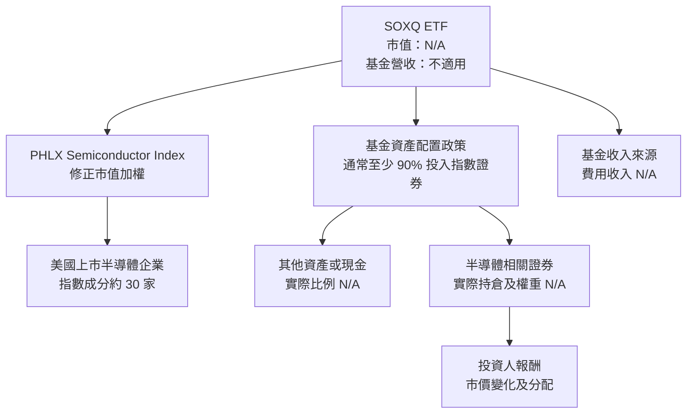

基金說明指出，其指數衡量美國上市、由指數提供者界定為半導體業務的 30 家大型企業表現；指數採修正市值加權。由於非多元化，實際風險主要取決於成分權重和個別大型持倉，現有資料不足以計算前十大持倉集中度。

### 2.2 市場份額／基金資產配置界限

SOXQ 在半導體 ETF 市場的市占率資料未提供，不能繪製市場份額圓餅圖。以下圓餅圖只呈現基金文件所載配置政策的**邊界示意**，不是實際持倉：指數證券至少 90%，其餘資產至多 10%。

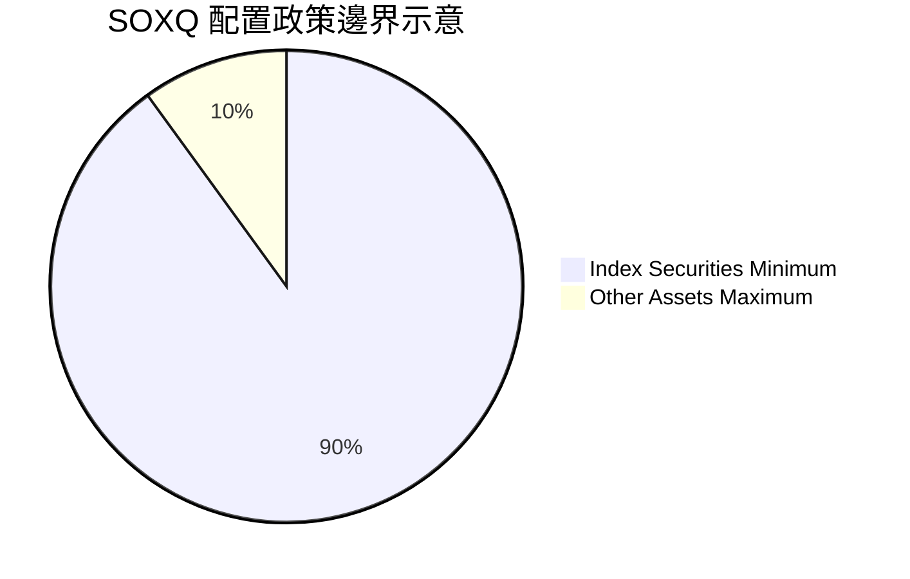

> 上圖為 90%／10% 的政策邊界示意，不表示 SOXQ 當日實際配置恰為 90%／10%。實際持倉與現金比例 N/A。

### 2.3 競爭護城河分析

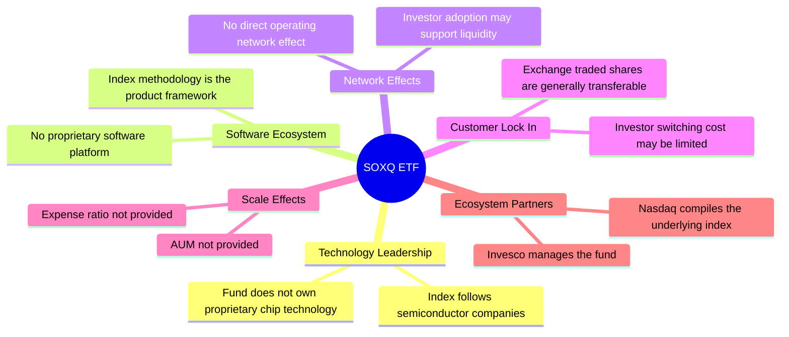

### 2.4 護城河強度評分

| 護城河項目 | 評分 | 證據與評語 |
|---|---:|---|
| 指數方法差異化 | 5/10 | 修正市值加權、約 30 家成分股；與其他半導體 ETF 的差異需以持倉比較確認 |
| 費用競爭力 | N/A | 費用率未提供，不能判斷是否低於同類 |
| 規模效應 | N/A | AUM 未提供 |
| 流動性與追蹤品質 | N/A | 成交量、買賣價差與追蹤誤差未提供 |
| 投資人轉換成本 | 3/10 | ETF 通常可於市場交易及轉換，資料未顯示特殊鎖定機制 |
| **綜合評估** | **5/10（低信心）** | 現有資料足以識別策略，但不足以證明費用、規模或追蹤優勢 |

```text
╔══════════════════════════════════════════════════════════════╗
║                  SOXQ 護城河強度評分                        ║
╠══════════════════════════════════════════════════════════════╣
║ 指數方法差異化  5/10  ▓▓▓▓▓▓▓▓▓▓░░░░░░░░░░  🟡 有明確規則 ║
║ 費用競爭力      N/A   費用率未提供                           ║
║ 規模效應        N/A   AUM 未提供                              ║
║ 流動性追蹤      N/A   追蹤誤差與成交資料未提供               ║
║ 投資人鎖定      3/10  ▓▓▓▓▓▓░░░░░░░░░░░░░░  🟡 易於轉換   ║
╠══════════════════════════════════════════════════════════════╣
║ 綜合護城河      5/10  ▓▓▓▓▓▓▓▓▓▓░░░░░░░░░░  🟡 待驗證     ║
╚══════════════════════════════════════════════════════════════╝
```

---

## 3. 損益表深度分析

SOXQ 是基金，沒有公司層級的營收、毛利、營業利益或淨利。基金可能取得股息、利息及其他收入，但本資料包沒有基金損益表，不能將成分股的營收或盈餘加總成 SOXQ 的公司營收。

### 3.1 年度收入成長趨勢（近 4 年）

| 年度 | ETF 公司營收 | YoY | 判讀 |
|---|---:|---:|---|
| 近四年 | N/A | N/A | ETF 非營運公司，基金收入明細未提供 |

```text
╔══════════════════════════════════════════════════════════════╗
║              SOXQ 基金收入趨勢：無公司營收資料               ║
╠══════════════════════════════════════════════════════════════╣
║ FY-3：N/A　YoY：N/A　基金損益表未提供                        ║
║ FY-2：N/A　YoY：N/A　基金損益表未提供                        ║
║ FY-1：N/A　YoY：N/A　基金損益表未提供                        ║
║ 最新年度：N/A　YoY：N/A　基金損益表未提供                    ║
╠══════════════════════════════════════════════════════════════╣
║ ETF 投資人報酬應以含分配的 NAV／市價總報酬衡量；該序列 N/A  ║
╚══════════════════════════════════════════════════════════════╝
```

### 3.2 季度收入趨勢分析

| 指標 | 最近四季 | QoQ | YoY | 備註 |
|---|---:|---:|---:|---|
| 基金營收 | N/A | N/A | N/A | 無基金損益表 |
| 成分股合計營收 | N/A | N/A | N/A | 未提供成分股清單、權重及財報資料 |
| 基金 EPS | N/A | N/A | N/A | ETF 不能直接用單一公司 EPS 口徑分析 |
| 市價表現 | 有月度價格 | 不等同營收成長 | 不等同盈餘成長 | 市價變動不能替代營運數據 |

### 3.3 利潤率演變分析

| 利潤率指標 | FY-3 | FY-2 | FY-1 | 最新 | 評估 |
|---|---:|---:|---:|---:|---|
| 毛利率 | N/A | N/A | N/A | N/A | ETF 無公司毛利率 |
| 營業利益率 | N/A | N/A | N/A | N/A | ETF 無公司營業利益 |
| EBITDA 利潤率 | N/A | N/A | N/A | N/A | 不適用 |
| 淨利率 | N/A | N/A | N/A | N/A | 基金損益表未提供 |

成分股的產品組合、定價與成本可能影響指數盈餘，但沒有持倉和季度財務數據，無法量化其加權利潤率趨勢或解釋利潤率變化。

### 3.4 費用結構分析

基金費用率、交易成本、現金拖累及稅務費用皆未提供，不能製作實際費用比例圖。

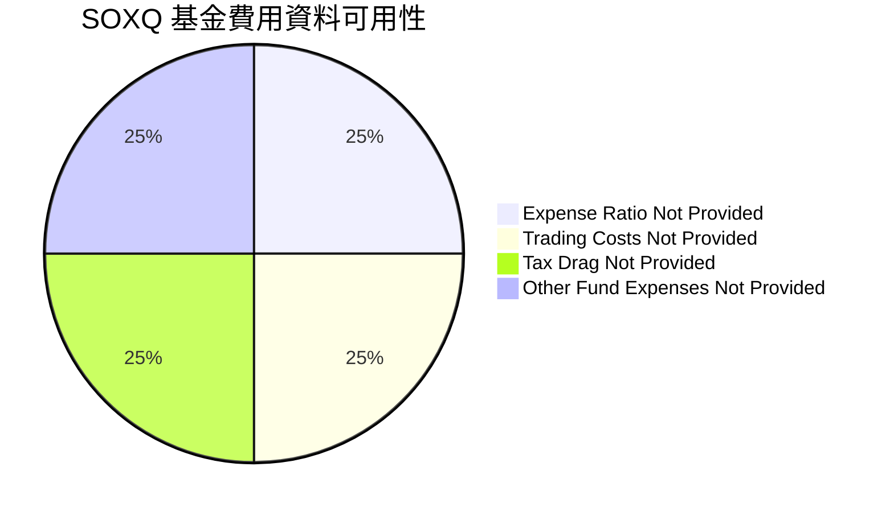

```text
╔══════════════════════════════════════════════════════════════╗
║                    基金費用資料檢核                          ║
╠══════════════════════════════════════════════════════════════╣
║ 管理費／費用率：N/A　　交易成本：N/A                         ║
║ 追蹤誤差：N/A　　　　現金拖累：N/A                           ║
║ 結論：目前無法計算持有人每年承擔的總成本                      ║
╚══════════════════════════════════════════════════════════════╝
```

### 3.5 季度 EPS 趨勢與盈餘品質（Quality of Earnings）

| 盈餘品質項目 | 數值／佔比 | 評估 |
|---|---|---|
| 最近四季 EPS 超預期／不及預期 | N/A | 數據包無 EPS 預期或實際盈餘紀錄 |
| 股權薪酬 SBC／營收 | N/A | ETF 不具公司層級 SBC |
| SBC／營業現金流 | N/A | 不適用 |
| FCF／淨利 | N/A | ETF 公司口徑 FCF 不適用 |
| 一次性／非經常性損益 | N/A | 基金財務明細未提供 |
| 有效稅率 | N/A | 需以基金與持倉稅務資料判斷 |
| 資本化支出 vs 費用化 | N/A | ETF 不適用公司資本支出分類 |

**盈餘品質結論：** 無法判定基金盈餘或成分股盈餘品質。35.0% 配息殖利率沒有配息金額、期間或計算方法佐證，不能據此推論基金現金收益或可持續配息能力。

---

## 4. 資產負債表分析

### 4.1 資產結構分解

ETF 資產主要是持有證券及可能的現金、應收款等，但本資料包沒有 SOXQ 基金資產負債表或當日持倉。下圖呈現資產項目類別，不表示其實際比例。

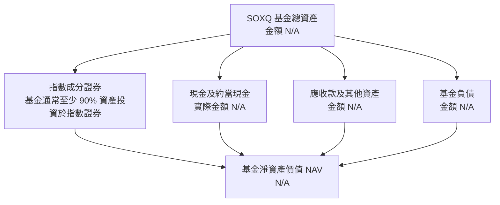

### 4.2 流動性指標分析

| 指標 | SOXQ | 同類 ETF | 評估 |
|---|---:|---:|---|
| 現金比率 | N/A | N/A | 基金現金資料未提供 |
| 基金負債／淨資產 | N/A | N/A | 基金資產負債表未提供 |
| 買賣價差 | N/A | N/A | 需成交與報價資料 |
| AUM | N/A | N/A | 無法評估基金規模及清算風險 |
| 成交量／流動性 | N/A | N/A | 無市場成交數據 |

### 4.3 債務結構分析

ETF 不宜套用營運公司的 Debt/EBITDA、利息保障倍數或淨現金分析。基金自身負債、證券借貸及其他融資資料皆 N/A；市場報價欄位的「Net Cash / Debt $0.00」不能替代基金資產負債表。

```text
╔══════════════════════════════════════════════════════════════╗
║                   SOXQ 基金負債健康診斷                      ║
╠══════════════════════════════════════════════════════════════╣
║ 基金總負債：          N/A　　未提供基金資產負債表             ║
║ 現金及短期投資：      N/A　　不得以公司欄位 $0.00 代替         ║
║ 淨現金／淨負債：      N/A　　無基金帳面資料                   ║
║ Debt/EBITDA：         N/A　　ETF 不適用公司 EBITDA 口徑        ║
║ Interest Coverage：   N/A　　基金利息收入與支出明細未提供      ║
╠══════════════════════════════════════════════════════════════╣
║ 結論：不能由目前數據判斷基金槓桿或流動性                      ║
╚══════════════════════════════════════════════════════════════╝
```

### 4.4 股東權益趨勢

ETF 的基金淨資產由投資人申購／贖回、持倉價格變動、分配及費用影響；本資料包沒有 AUM、NAV 或資金流序列。

```text
╔══════════════════════════════════════════════════════════════╗
║                SOXQ 基金淨資產趨勢                           ║
╠══════════════════════════════════════════════════════════════╣
║ FY-3：N/A　　FY-2：N/A　　FY-1：N/A　　最新：N/A             ║
║ AUM 與 NAV 歷史資料未提供，無法衡量申購、贖回或淨資產變化    ║
╚══════════════════════════════════════════════════════════════╝
```

---

## 5. 現金流量深度分析

### 5.1 現金流量瀑布圖

SOXQ 沒有公司淨利及營業現金流的分析口徑。對 ETF 投資人而言，較合適的現金流分析是基金分配、總報酬與持倉現金流，但本資料包不足以量化。

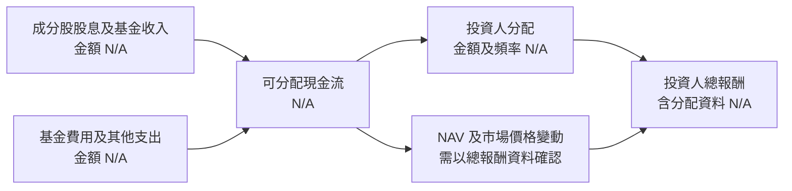

### 5.2 FCF 轉換率趨勢

| 指標 | 數值 | 說明 |
|---|---:|---|
| 營業現金流 TTM | N/A | ETF 無公司口徑營業現金流 |
| 資本支出 TTM | N/A | ETF 不適用公司 Capex 口徑 |
| FCF TTM＝OCF－Capex | N/A | 數據包亦列為 N/A |
| FCF／淨利 | N/A | 基金損益與現金流明細缺漏 |

### 5.3 自由現金流趨勢

```text
╔══════════════════════════════════════════════════════════════╗
║             SOXQ：公司口徑自由現金流不適用                    ║
╠══════════════════════════════════════════════════════════════╣
║ TTM OCF：N/A　　TTM Capex：N/A　　TTM FCF：N/A               ║
║ FCF Yield：N/A　　不能把成分股 FCF 或基金分配直接混為一談     ║
╚══════════════════════════════════════════════════════════════╝
```

### 5.4 資本配置評估

基金的現金配置與分配政策資料未提供，不能將其拆成公司式「回購／Capex／投資」比例。

| 配置項目 | 數值 | 評估 |
|---|---:|---|
| 指數證券 | 通常至少 90% 資產 | 基金政策描述，不代表實際比例 |
| 現金及其他資產 | N/A | 實際金額未提供 |
| 基金費用 | N/A | 費用率未提供 |
| 投資人分配 | N/A | 配息金額與頻率未提供 |
| 「35.0% Dividend Yield」 | 35.0%（未驗證） | 高度需要核對來源、分配期間及計算方式 |

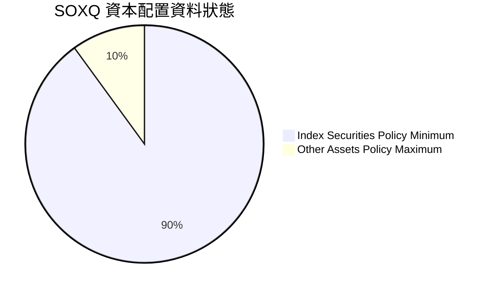

> 圖表僅為基金配置政策界限示意；不應解讀為實際投資人資產配置或資本配置比例。

---

## 6. 獲利能力與資本效率

### 6.1 ROE／ROA／ROIC 趨勢

| 指標 | SOXQ | 同業均值 | 評估 |
|---|---:|---:|---|
| ROE | N/A | N/A | ETF 不是具營運股東權益的公司 |
| ROA | N/A | N/A | 無基金損益與資產報酬資料 |
| ROIC | N/A | N/A | 不適用基金本身 |
| 成分股加權 ROIC | N/A | N/A | 持倉清單及權重缺漏 |

### 6.2 ROIC vs WACC 分析（核心價值創造判斷）

SOXQ 本身沒有營運投入資本，因此不能用 ROIC − WACC 判斷 ETF 的經濟價值創造。基金持有企業的 ROIC 與其資本成本可用於成分股分析，但必須取得成分股與權重。

```text
╔══════════════════════════════════════════════════════════════╗
║                ROIC vs WACC：ETF 適用性檢查                  ║
╠══════════════════════════════════════════════════════════════╣
║  無風險利率 Rf：        N/A（此 ETF 分析不估公司 WACC）        ║
║  市場風險溢酬 ERP：     N/A                                   ║
║  ETF Beta：             N/A                                   ║
║  債務成本 Kd：          N/A                                   ║
║  SOXQ ROIC：            N/A（基金非營運公司）                 ║
║  SOXQ WACC：            N/A（基金沒有公司資本結構）            ║
║  EVA＝ROIC－WACC：      N/A                                   ║
╠══════════════════════════════════════════════════════════════╣
║  結論：不得將此 N/A 解讀為創造或摧毀股東價值                 ║
╚══════════════════════════════════════════════════════════════╝
```

### 6.3 杜邦三因素分解

杜邦分析適用於公司的 ROE；SOXQ 沒有公司淨利率、資產週轉率與財務槓桿數據，故不計算。

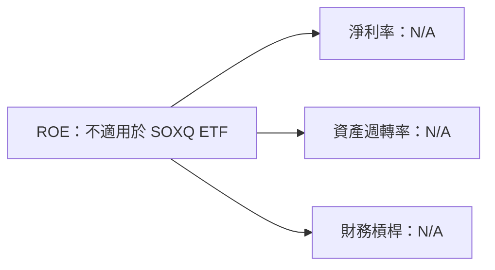

### 6.4 獲利能力儀表板

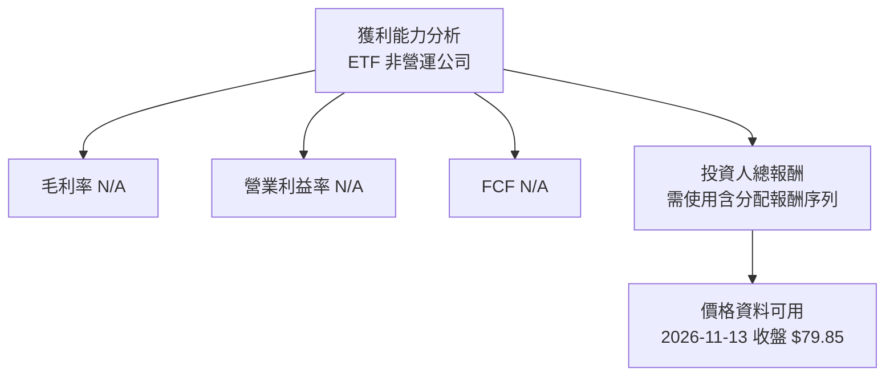

---

## 7. 相對估值分析

### 7.1 同業估值比較表格

SOXQ 的 Peer multiples 未提供。以下以半導體 ETF 同類產品 **SOXX、SMH、PSI** 作為比較對象，但不填入未經提供或未驗證的倍數。這些基金並非成分、權重或指數方法完全相同的替代品。

| 估值指標 | **SOXQ** | **SOXX** | **SMH** | **PSI** | SOXQ 評估 |
|----------|----------:|---------:|--------:|--------:|-----------|
| **Trailing P/E** | **33.909477x** | N/A | N/A | N/A | 🟡單一倍數不足以判斷便宜或昂貴 |
| **Forward P/E** | N/A | N/A | N/A | N/A | 缺少前瞻估值 |
| **P/S** | N/A | N/A | N/A | N/A | 基金與持倉資料不足 |
| **EV/EBITDA** | N/A | N/A | N/A | N/A | 不適用基金自身 |
| **費用率** | N/A | N/A | N/A | N/A | 費用比較不可計算 |
| **AUM** | N/A | N/A | N/A | N/A | 規模與流動性比較不可計算 |
| **追蹤誤差** | N/A | N/A | N/A | N/A | 無追蹤品質比較資料 |

> Peer multiples 未提供，因此沒有用估計倍數偽裝成即時市場資料。

### 7.2 歷史估值區間分析

「Valuation vs own history」未提供，不能估計歷史 P/E 百分位或估值區間。可觀察的只是市場價格，不等於估值倍數。

```text
╔══════════════════════════════════════════════════════════════╗
║               SOXQ 歷史估值區間：資料不足                    ║
╠══════════════════════════════════════════════════════════════╣
║ 歷史 P/E 中位數：N/A　　歷史區間：N/A　　當前百分位：N/A     ║
║ 可用價格參照：52 週低點 $48.32 ─ 收盤 $79.85 ─ 高點 $115.23  ║
║ 價格區間不能替代歷史估值倍數或 NAV 折溢價                    ║
╚══════════════════════════════════════════════════════════════╝
```

### 7.3 情境目標價（Bear / Base / Bull）

沒有基金 NAV、持倉權重與可靠的同業估值倍數，無法建立具可檢驗營運假設的內在價值目標。以下列出歷史價格參照而非預測目標。

| 情境參照 | 價格 | 相對 2026-11-13 收盤 $79.85 | 性質 |
|------|------:|------:|------|
| 🔴 52 週低點參照 | $48.32 | 約 -39.5% | 已發生的歷史低點，不是預測 |
| 🟡 現價參照 | $79.85 | 0.0% | 2026-11-13 收盤 |
| 🟢 52 週高點參照 | $115.23 | 約 +44.3% | 已發生的歷史高點，不是目標價 |

**倍數選擇說明：** 對 ETF 的相對估值，宜比較成分、費用率、追蹤誤差、AUM、流動性及 NAV 折溢價；ETF 本身沒有可直接套用的公司 EV/EBITDA 或 DCF。上述關鍵資料缺漏，故不給予同業倍數推算目標價。

### 7.4 相對估值隱含價格區間

```text
╔══════════════════════════════════════════════════════════════╗
║               相對估值方法可用性檢查                         ║
╠══════════════════════════════════════════════════════════════╣
║ Forward P/E 回推：N/A　　EV/EBITDA 回推：N/A                 ║
║ EV/Sales 回推：N/A　　　FCF Yield 回推：N/A                  ║
║ NAV 折溢價：N/A　　　　同類 ETF 估值倍數：N/A               ║
║                                                              ║
║ 52 週價格範圍：$48.32 ───── 現價 $79.85 ───── $115.23        ║
║ 注意：歷史價格範圍不是基本面估值區間                         ║
╚══════════════════════════════════════════════════════════════╝
```

---

## 8. DCF 內在價值評估（Discounted Cash Flow）

> **框架調整：** DCF 是公司自由現金流估值方法，不適合直接套用於 ETF。SOXQ 本身沒有營運 FCFF、公司 WACC 或稀釋股數；沒有完整持倉權重與成分股現金流，也無法建立穿透式 DCF。因此依數據完整性原則，不製造逐年現金流、WACC、終值、股數或每股內在價值。基金估值應優先使用持倉穿透估值、NAV 折溢價、費用率、追蹤品質與總報酬。

### 8.0 估值推理鏈（Thinking Logic）

**Step 1 — 價值來源與主導變數**

SOXQ 的經濟價值來自其持有的半導體證券價值，扣除基金負債與費用；基金說明稱通常至少 90% 資產投資於指數證券，但實際比例、持倉權重與 NAV 均未提供。估值主導變數應為成分股的未來盈餘與估值倍數，以及持倉集中度；現有資料只有基金 P/E **33.909477x**，不足以拆解上述因素。

**Step 2 — 模型選擇**

| 決策點 | 本報告採用 | 理由 | 曾考慮但否決 | 否決理由 |
|--------|-----------|------|--------------|----------|
| 現金流定義 | 不採 FCFF／FCFE | ETF 沒有可用公司現金流；TTM FCF N/A | FCFF DCF | 無基金或成分股現金流 |
| 估值方法 | NAV 與穿透持倉估值框架 | ETF 市場價應與 NAV、持倉價值比較 | 公司 DCF | 無基金營運 FCFF、WACC、股數 |
| 預測期 N | N/A | 沒有基金持倉財測資料 | 5 年 | 任意選 5 年會造成假精確 |
| 終值方法 | N/A | 無可估的基金現金流 | Gordon Growth | 分子與折現率皆缺漏 |
| EPS 基礎 | 基金報價系統的追蹤 P/E | 僅作描述性估值指標 | 成分股加總 EPS | 持倉及權重未提供 |

**Step 3 — 重要輸入的推導鏈**

- **營收 CAGR：** 錨點＝基金營收 TTM N/A → 無法依持倉營收或基金收入調整 → 採用 N/A → 否決自行用半導體產業成長率填入，因未提供可驗證來源與持倉權重。
- **期末營業利潤率：** 錨點＝SOXQ 營業利益率 N/A → ETF 不產生公司營業利潤 → 採用 N/A → 否決套用成分股某一家公司利潤率，因持倉資料缺漏。
- **永續成長率 g：** 無法以基金現金流、長期宏觀假設與 WACC 建立合理 g → 採用 N/A → 不任意指定 g。
- **預測期 N：** 無可辨認的基金現金流可預測 → N/A → 不為迎合 DCF 表格而虛構 5 年或 10 年期。
- **Capex／營收與 D&A／營收：** 基金不是營運公司，兩者不適用；成分股加權資料缺漏。
- **SBC 處理與股數稀釋：** 不適用於基金份額的公司式稀釋分析；基金流通單位數 N/A。
- **WACC：** 基金 Beta、計息負債、權益市值及資本結構資料不齊；數據包亦明示 ETF 沒有公司 WACC。

**Step 4 — 最脆弱的一環**

最大缺口是持倉及權重完全缺失；沒有持倉便無法穿透計算盈餘、估值或集中度，故合理價值與 MOS 均不能估計，不能用歷史價格代替。

**Step 5 — 計算路徑圖**

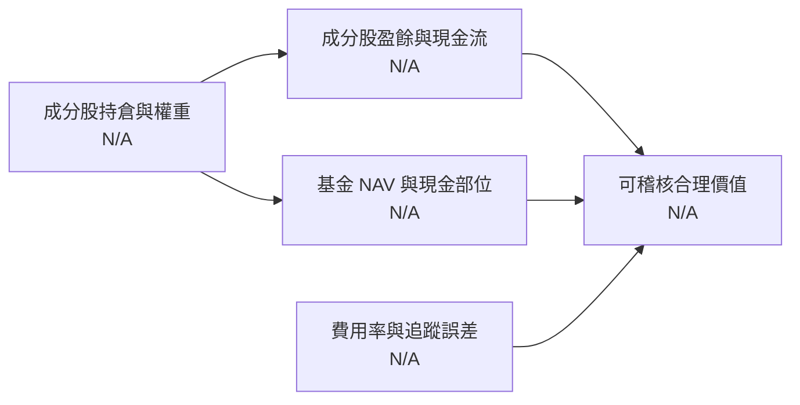

### 8.1 模型假設總表（Model Inputs）

| 假設項目 | 採用值 | 依據／來源 | 敏感度 |
|----------|--------|-------------|--------|
| 預測期長度 N | N/A | 無基金現金流可預測 | 🔴高 |
| 營收 CAGR | N/A | ETF 營收及成分持倉營收未提供 | 🔴高 |
| 期末營業利潤率 | N/A | 基金無公司營業利潤 | 🔴高 |
| 有效稅率 | N/A | 基金與持倉稅務資料缺漏 | 🟢低 |
| Capex／營收 | N/A | 基金無公司 Capex | 🟡中 |
| D&A／營收 | N/A | 基金無公司 D&A | 🟢低 |
| ΔWC／營收增額 | N/A | 基金無公司營運資金 | 🟢低 |
| EBIT 基礎 | 不適用 | SOXQ 為 ETF，無公司 EBIT | 🟡中 |
| SBC 處理 | 不適用 | 無基金公司層級 SBC 數據 | 🟡中 |
| 年稀釋率 | N/A | 基金流通單位數變動資料未提供 | 🟡中 |
| 永續成長率 g | N/A | 無 FCFF 或 WACC | 🔴高 |
| 終值方法 | 不適用 | 無預測期現金流 | 🔴高 |
| WACC | N/A | 基金沒有公司資本結構；輸入缺漏 | 🔴高 |

**FCFF 定義：** 若為營運公司，FCFF = NOPAT + D&A − Capex − ΔWC；SOXQ 無以上公司口徑項目，本報告不計算 FCFF。

### 8.2 折現率推導（WACC）

```text
╔══════════════════════════════════════════════════════════════╗
║                  WACC 推導：ETF 不適用                       ║
╠══════════════════════════════════════════════════════════════╣
║ 無風險利率 Rf：N/A　　ERP：N/A　　Beta：N/A                  ║
║ 債務成本 Kd：N/A　　基金計息負債：N/A                       ║
║ 股權市值 E：N/A　　基金流通單位數及市值資料不足             ║
║ 債務 D：N/A　　基金資產負債明細未提供                       ║
║ WACC：N/A　　無法建立可複算的公司折現率                     ║
╚══════════════════════════════════════════════════════════════╝
```

**逐步演算檢查：** CAPM 的 Rf、ERP、Beta 缺漏；Kd、計息負債、市值權重亦缺漏。這不是 D=0 的情況，而是資料不完整且分析對象不適用公司 WACC。故不填入假設數字，也不把此 N/A 用於第 6.2 節價值創造判斷。

### 8.3 逐年自由現金流預測（基準情境）

| 項目 | FY+1 | FY+2 | FY+3 | FY+4 | FY+5 |
|------|------|------|------|------|------|
| 基金營收 | N/A | N/A | N/A | N/A | N/A |
| 營收 YoY | N/A | N/A | N/A | N/A | N/A |
| 營業利潤率 | N/A | N/A | N/A | N/A | N/A |
| EBIT | N/A | N/A | N/A | N/A | N/A |
| 稅 | N/A | N/A | N/A | N/A | N/A |
| NOPAT | N/A | N/A | N/A | N/A | N/A |
| D&A | N/A | N/A | N/A | N/A | N/A |
| Capex | N/A | N/A | N/A | N/A | N/A |
| ΔWC | N/A | N/A | N/A | N/A | N/A |
| **FCFF** | **N/A** | **N/A** | **N/A** | **N/A** | **N/A** |
| 折現因子 | N/A | N/A | N/A | N/A | N/A |
| **FCFF 現值 PV** | **N/A** | **N/A** | **N/A** | **N/A** | **N/A** |

**預測期 FCF 現值合計：** N/A。由於每年 FCFF、WACC 與預測期皆缺漏，無法構成有效加總算式。

**代表年度演算：** FY+1 基金營收、利潤率及現金流均 N/A，因此無法執行「營收 → EBIT → 稅 → NOPAT → FCFF → PV」計算。這是資料缺漏，不以估計數字代填。

```text
╔══════════════════════════════════════════════════════════════╗
║       SOXQ：歷史 FCF 與模型預測均無公司口徑可比資料          ║
╠══════════════════════════════════════════════════════════════╣
║ 歷史 TTM FCF：N/A　　FY+1 FCFF：N/A　　FY+5 FCFF：N/A        ║
║ FCF CAGR：N/A　　　　FCF Yield：N/A                           ║
║ 結論：不適用公司 FCF 模型；不能拿價格漲幅代替 FCF 成長        ║
╚══════════════════════════════════════════════════════════════╝
```

### 8.4 終值計算（Terminal Value）

**適用性檢查：** `WACC N/A vs g N/A → 無法判定 WACC > g；Gordon Growth 不適用。`

| 方法 | 計算式 | 終值 TV | TV 現值 | 佔總 EV 比重 |
|---|---|---|---|---|
| Gordon Growth | N/A | N/A | N/A | N/A |
| 退出倍數法 | N/A | N/A | N/A | N/A |

缺少 FY+N FCFF、EBITDA、WACC、g 及基金企業價值，無法執行終值計算或交叉驗證。

### 8.5 企業價值 → 每股內在價值（Bridge）

```text
╔══════════════════════════════════════════════════════════════╗
║          企業價值 → 每股內在價值：資料橋接檢查               ║
╠══════════════════════════════════════════════════════════════╣
║ 預測期 FCF 現值合計：         N/A                             ║
║ 終值現值 PV(TV)：             N/A                             ║
║ 企業價值 EV：                 N/A                             ║
║ + 現金及短期投資：            N/A                             ║
║ − 總債務：                    N/A                             ║
║ 基金淨資產／NAV：             N/A                             ║
║ 流通單位數：                  N/A                             ║
║ 每單位 DCF 內在價值：         N/A                             ║
║ 最新收盤價（2026-11-13）：    $79.85                          ║
║ 折溢價（現價÷DCF價值−1）：    N/A                             ║
╠══════════════════════════════════════════════════════════════╣
║ 本節不計算 MOS；8.8 加權合理價值無法建立，MOS 維持 N/A        ║
╚══════════════════════════════════════════════════════════════╝
```

1. **EV**＝N/A + N/A＝N/A  
2. **基金淨資產**＝EV + 現金 − 債務：各輸入 N/A，故結果 N/A  
3. **每單位內在價值**＝基金淨資產 ÷ 流通單位數：N/A ÷ N/A，無法計算  
4. **折溢價**＝$79.85 ÷ DCF 內在價值 − 1：DCF 內在價值 N/A，無法計算  
5. **MOS**：本節不計算；MOS 僅以第 8.8 節加權合理價值為分母，但該值亦 N/A  

### 8.6 敏感性分析

沒有基準 WACC、g、FCFF、NAV 或流通單位數，不能建立 WACC × g 的每股價值矩陣。此時填入數字會形成無法複算的黑箱估值。

| g／WACC | WACC N/A |
|---|---|
| g N/A | N/A（無 FCFF、WACC 與 NAV 輸入） |

| 項目 | 結果 |
|------|------|
| g 每 +1pp 對價值影響 | N/A |
| WACC 每 +1pp 對價值影響 | N/A |
| 持倉利潤率每 +1pp 對價值影響 | N/A |
| 主導變數 | 持倉盈餘與估值倍數、集中度；沒有持倉資料，無法量化 |

#### 三情境 DCF

| 情境 | 營收 CAGR | 期末營業利潤率 | 永續成長 g | WACC | 每單位價值 | 相對現價 | 主觀機率 |
|------|-----------|----------------|------------|------|--------------|----------|----------|
| 🔴 悲觀 | N/A | N/A | N/A | N/A | N/A | N/A | N/A |
| 🟡 基準 | N/A | N/A | N/A | N/A | N/A | N/A | N/A |
| 🟢 樂觀 | N/A | N/A | N/A | N/A | N/A | N/A | N/A |
| **機率加權** | — | — | — | — | **N/A** | **N/A** | N/A |

### 8.7 反推 DCF（Reverse DCF：市場在預期什麼）

現價 $79.85 只能提供一條估值方程，但基金現金流、NAV、持倉權重與 WACC 輸入皆缺漏，不能用現價反推出單一營運變數。

| 求解變數 | 固定其餘變數 | 市場隱含值 | 公司或基金歷史實際 | 判斷 |
|------------------------|--------------|----------------|--------------|------|
| 未來 N 年營收 CAGR | 無法固定成分股資料 | N/A | N/A | 無解：持倉及營收缺漏 |
| 期末營業利潤率 | 無法固定持倉利潤率 | N/A | N/A | 不適用基金 |
| 永續成長率 g | WACC 與 FCFF 缺漏 | N/A | — | 無法反解 |
| 高成長持續年數 N | FCFF 序列缺漏 | N/A | — | 無法反解 |

**反推結論：** 僅憑 $79.85 市價及 33.909477x 追蹤 P/E，不能識別市場對營收、利潤率或成長年限的具體預期。

### 8.8 估值三角驗證與安全邊際

| 估值方法 | 隱含每單位價值 | 上行空間（÷現價） | 權重 | 說明 |
|----------|--------------|-------------------|------|------|
| DCF | N/A | N/A | N/A | ETF DCF 不適用 |
| 同類 ETF 相對估值 | N/A | N/A | N/A | 同業倍數未提供 |
| NAV 折溢價 | N/A | N/A | N/A | NAV 未提供 |
| FCF Yield 回推 | N/A | N/A | N/A | FCF Yield N/A |
| 分析師共識目標價 | N/A | N/A | N/A | 分析師目標價 N/A |
| **加權合理價值** | **N/A** | **N/A** | **無法配置** | **各方法均無可驗證數值，不能合成加權值** |

加權合理價值公式依定義應為「各方法價值 × 權重」之和，但目前沒有任何可靠方法價值，故不虛構權重或合計。MOS 公式為：

\[
\text{MOS}=\frac{\text{加權合理價值}-\$79.85}{\text{加權合理價值}}
\]

由於加權合理價值為 N/A，MOS 亦為 N/A；上行空間及 DCF 折溢價同樣無法計算。

```text
╔══════════════════════════════════════════════════════════════╗
║               估值區間與安全邊際：不可計算                   ║
╠══════════════════════════════════════════════════════════════╣
║ 52 週低點 $48.32 ───── 現價 $79.85 ───── 52 週高點 $115.23  ║
║ 歷史價格參照，不是悲觀／基準／樂觀估值                         ║
║                                                              ║
║ 安全邊際 MOS：N/A（加權合理價值 N/A）                         ║
║ 上行空間：N/A（合理價值 N/A）                                 ║
║ 折溢價：N/A（DCF 內在價值 N/A）                               ║
║                                                              ║
║ 建議買入區間：基本面估值 N/A；待取得 NAV 與持倉資料再評估     ║
║ 歷史價格觀察：$48.32、$63 左右、$82.52、$115.23 為已觀察價格   ║
║ 以上僅是歷史價位參考，不構成買入／持有／減碼估值區間          ║
╚══════════════════════════════════════════════════════════════╝
```

### 8.9 DCF 模型的局限與失效條件

- **終值依賴度：** N/A；無企業價值與終值，不能計算占比。
- **最脆弱假設：** 成分股清單與權重缺漏；其次為 NAV、費用率及追蹤誤差缺漏。
- **不適用情境：** SOXQ 為 ETF，應採 NAV、持倉穿透估值、同類 ETF 成本與追蹤品質分析，不應以單一公司 DCF 為主。
- **連結第 10 章風險：** 若半導體估值收縮或持倉集中度高於預期，基金價格可顯著偏離過往高點；缺少權重使衝擊無法量化。

### 8.10 複算檢核表（Audit Trail）

| # | 檢核項目 | 檢查方式 | 結果 |
|---|---|---|---|
| 1 | 高／中敏感度假設均有推導 | 逐項檢查；不適用項均明確標示 N/A | ✅ |
| 2 | 假設有資料來歷 | 不以空泛假設填入數字 | ✅ |
| 3 | WACC 五步算式與加權 | ETF WACC 不適用，未硬算 | ✅ |
| 4 | Kd 與 D 範圍一致 | 無基金計息負債資料，未建構 WACC | ✅ |
| 5 | WACC 與第 6.2 節一致 | 兩節均為 N/A | ✅ |
| 6 | 逐年表格與預測期 | 不存在有效公司 DCF 預測期；表格明確標示 N/A | ✅ |
| 7 | FY+1 九步算式可複算 | 輸入缺漏，明確記錄無法計算 | ✅ |
| 8 | 預測期 PV 加總 | FCFF 與 PV 均 N/A，無虛構合計 | ✅ |
| 9 | WACC > g | WACC、g 均 N/A，不適用 | ✅ |
| 10 | 終值基於 FY+N 現金流 | FCFF 缺漏，未計算終值 | ✅ |
| 11 | EV 至每單位價值橋接 | NAV、負債及流通單位數均 N/A | ✅ |
| 12 | SBC 組合一致 | SOXQ 無公司層級 EBIT／SBC，明確標為不適用 | ✅ |
| 13 | 敏感性基準格等於 DCF 價值 | 無有效 DCF，不建立矩陣 | ✅ |
| 14 | 矩陣有效格檢查 | 未填入虛構 WACC／g 數值 | ✅ |
| 15 | 三情境機率與加權 | 不建立無依據情境機率 | ✅ |
| 16 | 反推每列只放開一變數 | 因模型輸入不足，未宣稱反推結果 | ✅ |
| 17 | MOS 與 1.0 儀表板一致 | 兩處均為 N/A；折溢價亦為 N/A | ✅ |
| 18 | 報告完成至第 11 章 | 章節完整 | ✅ |
| 19 | 加權合理價值等於各項加權總和 | 無可靠方法值，未虛構加權總和 | ✅ |
| 20 | 評級符合 MOS 門檻 | MOS N/A，評級明示為資料不足下的觀望，非 MOS 評級 | ✅ |

---

## 9. 成長催化劑

SOXQ 的潛在成長不是基金營收成長，而是半導體持倉價格、盈餘與估值變化。以下催化劑是產業層級觀察框架，不代表數據包已證實 SOXQ 持倉對其有特定權重。

### 9.1 催化劑時間軸

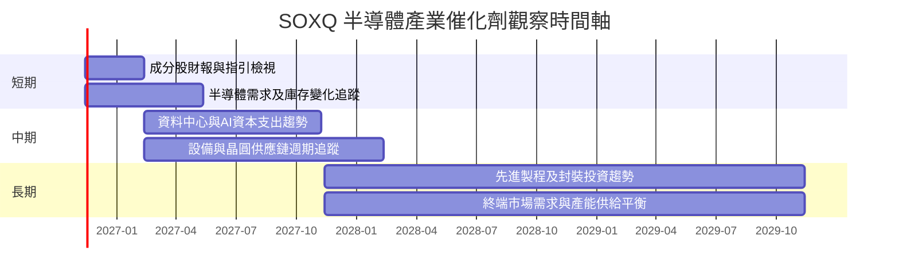

### 9.2 TAM 市場規模分析

本資料包沒有提供半導體 TAM、滲透率或 SOXQ 持倉對應營收，因此不填造市場金額。

```text
╔══════════════════════════════════════════════════════════════╗
║           TAM 與 SOXQ 收入貢獻：資料缺漏                     ║
╠══════════════════════════════════════════════════════════════╣
║ 半導體市場 TAM：N/A　　　　AI 加速器 TAM：N/A                ║
║ 設備／製造 TAM：N/A　　　　SOXQ 對應營收：不適用／N/A        ║
║ 持倉權重：N/A　　　　　　　市場滲透率：N/A                  ║
║                                                              ║
║ 催化劑判讀方式：取得持倉後，逐項追蹤成分股需求、訂單、庫存、  ║
║ 毛利率與資本支出，並以基金權重加權，而非直接套用總體 TAM。    ║
╚══════════════════════════════════════════════════════════════╝
```

### 9.3 成長驅動力結構圖

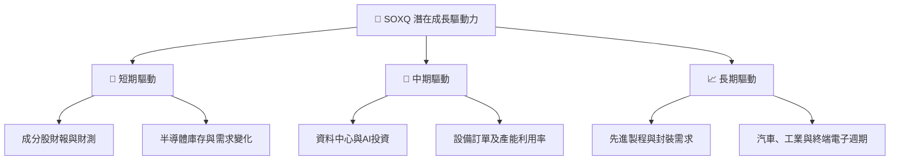

---

## 10. 風險矩陣

### 10.1 風險評分矩陣

以下機率與衝擊分數是研究框架上的定性評估，不是歷史統計機率；使用英文標籤以符合 quadrantChart 語法限制。

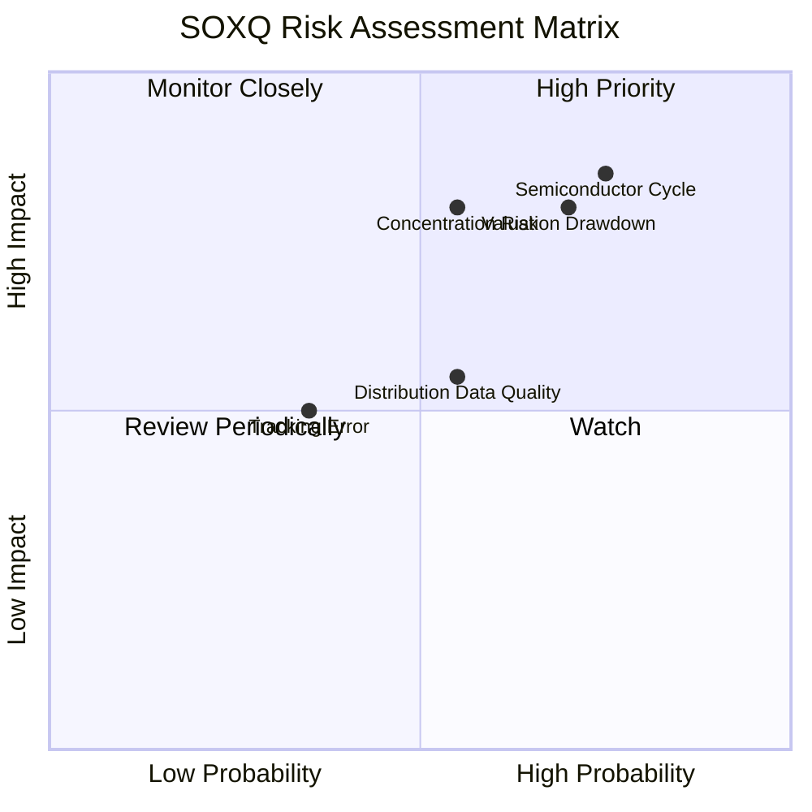

### 10.2 風險清單詳細分析

| # | 風險項目 | 發生機率 | 財務／價格衝擊 | 風險評分 | 緩解措施 |
|---|----------|----------|----------|----------|----------|
| 1 | 🔴 **半導體週期下行** | 中高；定性評估 | 基金價格可能因盈餘與估值同時下修而大幅波動；無法量化持倉衝擊 | 🔴 8.5/10 | 分批投入、限制單一產業配置、追蹤訂單與庫存 |
| 2 | 🔴 **估值回縮及回撤** | 中高；定性評估 | 由 $115.23 高點至 $79.85 收盤，已回落約 30.7% | 🔴 8.0/10 | 以風險承受度決定部位，勿以過往高點當目標價 |
| 3 | 🟠 **持倉集中度風險** | 中；非多元化特性明確 | 指數約 30 家企業且採修正市值加權；實際權重未提供 | 🟠 7.5/10 | 定期檢視前十大持倉及單一公司曝險 |
| 4 | 🟡 **追蹤誤差與費用不透明** | 資料不足 | 費用率與追蹤誤差 N/A，無法量化長期拖累 | 🟡 5.5/10 | 下單前核對最新基金說明書、NAV 及總費用 |
| 5 | 🟡 **配息資料品質** | 中；來源未驗證 | 數據包列示 35.0% 殖利率，無分配明細佐證 | 🟡 5.5/10 | 不依此欄位估算可持續現金收入；查核官方分配資料 |

---

## 11. 投資建議

### 11.1 最終綜合評級雷達圖

以下評分區分「策略特質」與「資料可用性」。未提供資料的維度保留 N/A，不以主觀分數替代。

```text
╔══════════════════════════════════════════════════════════════╗
║                  SOXQ 最終評估儀表板                         ║
╠══════════════════════════════════════════════════════════════╣
║ 半導體產業曝險  7.0  ▓▓▓▓▓▓▓▓▓▓▓▓▓▓░░░░░░  ★★★★☆         ║
║ 指數策略清晰度  6.0  ▓▓▓▓▓▓▓▓▓▓▓▓░░░░░░░░  ★★★☆☆         ║
║ 費用競爭力      N/A   費用率未提供                            ║
║ 追蹤品質        N/A   追蹤誤差未提供                          ║
║ 基金財務健康    N/A   NAV、AUM、資產負債明細未提供           ║
║ 估值可判讀性    3.0  ▓▓▓▓▓▓░░░░░░░░░░░░░░  ★★☆☆☆         ║
║ 資料完整性      2.0  ▓▓▓▓░░░░░░░░░░░░░░░░  ★☆☆☆☆         ║
╠══════════════════════════════════════════════════════════════╣
║ 綜合研究結論：🟡觀望／持有既有部位，等待補齊基金核心資料    ║
╚══════════════════════════════════════════════════════════════╝
```

### 11.2 目標價與隱含報酬率

| 情境 | 參考價格 | 相對 $79.85 | 機率權重 | 說明 |
|------|---------:|------------:|----------|------|
| 🔴 歷史低點參照 | $48.32 | 約 -39.5% | 不設定 | 52 週低點，不是預測 |
| 🟡 最新收盤 | $79.85 | 0.0% | 不設定 | 2026-11-13 收盤 |
| 🟢 歷史高點參照 | $115.23 | 約 +44.3% | 不設定 | 52 週高點，不是目標價 |
| **基本面目標價** | **N/A** | **N/A** | — | NAV、持倉、前瞻倍數及費用資料缺漏 |

**評級依據：** 依資料不足下的風險管理框架，本報告採觀望／持有既有部位；**不是**依 MOS 門檻得到的「持有」評級，因 MOS 無法計算。未來若取得官方持倉、NAV、費用率、追蹤誤差與分配資料，再重新評估基本面買入區間。

### 11.3 買入時機與觸發因素

```text
╔══════════════════════════════════════════════════════════════╗
║                  ✅ 買入觸發因素 Checklist                   ║
╠══════════════════════════════════════════════════════════════╣
║  進一步評估前應取得：                                         ║
║  ☐ 最新基金持倉、前十大權重與現金比例                         ║
║  ☐ 官方 NAV、收盤市價與 NAV 折溢價                            ║
║  ☐ 費用率、追蹤誤差、AUM、成交量與買賣價差                    ║
║  ☐ 官方分配金額與頻率；查清數據包 35.0% 殖利率來源             ║
║                                                              ║
║  加碼評估條件：                                               ║
║  ☐ 持倉估值相對成分股盈餘合理，且非僅依歷史價格下跌           ║
║  ☐ NAV 折溢價及追蹤品質符合投資人設定的門檻                   ║
║  ☐ 半導體庫存、訂單與成分股指引沒有同步惡化                   ║
║                                                              ║
║  減碼／重新檢視條件：                                         ║
║  ☐ 成分股盈餘與指引連續下修，產業景氣出現廣泛轉弱             ║
║  ☐ 持倉集中度或單一成分股曝險超出投資組合承受能力             ║
║  ☐ 費用、追蹤或流動性資料顯示持有成本顯著上升                 ║
║  ☐ 依賴未驗證的 35.0% 配息殖利率作投資決策                    ║
╚══════════════════════════════════════════════════════════════╝
```

歷史價格觀察可作為風險管理參考：52 週低點 $48.32、2026 年 1–2 月約 $62.84–$63.58、2026 年 4 月 $82.52、52 週高點 $115.23。這些是歷史收盤資料，不代表支撐位、合理價或建議買入區間。

### 11.4 投資人適配度分析

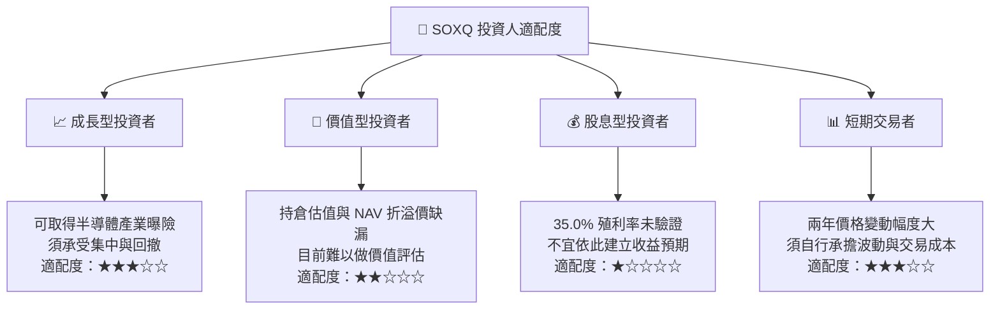

### 11.5 每季財報監控清單（Quarterly Watch List）

SOXQ 本身沒有季度財報；應監控基金資料及成分股財報，並使用最新官方基金文件更新。

| 監控項目 | 目前資料 | 觸發加碼／深入研究 | 觸發減碼／重新評估 |
|---|---|---|---|
| 前十大持倉與權重 | N/A | 持倉清楚且集中度符合組合風險限額 | 單一持倉權重或前十大集中度超出投資人限額 |
| NAV 與市價折溢價 | NAV N/A；收盤 $79.85 | 折價與估值條件符合投資政策 | 溢價偏離 NAV，或折溢價無法解釋 |
| 費用率 | N/A | 確認費用相對同類產品有競爭力 | 費用顯著高於可比基金 |
| 追蹤誤差 | N/A | 追蹤偏差維持在投資人可接受範圍 | 持續偏離追蹤指數 |
| AUM／成交量／價差 | N/A | 流動性足以容納部位規模 | 成交稀薄、買賣價差擴大或 AUM 明顯縮減 |
| 成分股營收及 EPS 指引 | 本資料包無持倉與財報明細 | 需求及指引改善且估值未過度擴張 | 多數核心成分股同步下修 |
| 半導體庫存與資本支出 | N/A | 庫存、訂單與資本支出趨勢改善 | 庫存上升且訂單／資本支出轉弱 |
| 配息及 35.0% 殖利率欄位 | 未驗證 | 以官方實際分配資料確認後再納入 | 無法核實或屬資料錯誤時，完全排除該欄位 |

### 11.6 反面論證：什麼會證明論點錯誤（What Would Change My Mind）

```text
╔══════════════════════════════════════════════════════════════╗
║          ⚠️ 論點失效條件（Disconfirming Evidence）            ║
╠══════════════════════════════════════════════════════════════╣
║ SOXQ 的產業曝險論點在下列情況出現時，應重新檢視：            ║
║  ☐ 核心成分股連續兩季普遍下修營收或 EPS 指引                 ║
║  ☐ 庫存上升、訂單轉弱，且成分股營業利潤率同步收縮            ║
║  ☐ 估值倍數下降但盈餘下修更快，造成價格與基本面雙重壓力      ║
║  ☐ 基金追蹤誤差、費用或交易流動性明顯惡化                    ║
║  ☐ 成分集中度超出投資人可承受的單一產業或個股風險            ║
║  ☐ 35.0% 配息殖利率無法由官方分配記錄驗證                    ║
║                                                              ║
║ 可量化評估仍需先取得持倉與基金資料；現階段不設定虛構門檻值。  ║
╚══════════════════════════════════════════════════════════════╝
```

> **免責聲明**：本報告依提供資料分析，僅供研究參考，不構成投資建議。SOXQ 屬集中於半導體產業的非多元化 ETF；投資人應核對最新基金說明書、持倉、費用率、NAV、追蹤資料及分配紀錄，並按自身風險承受能力決策。