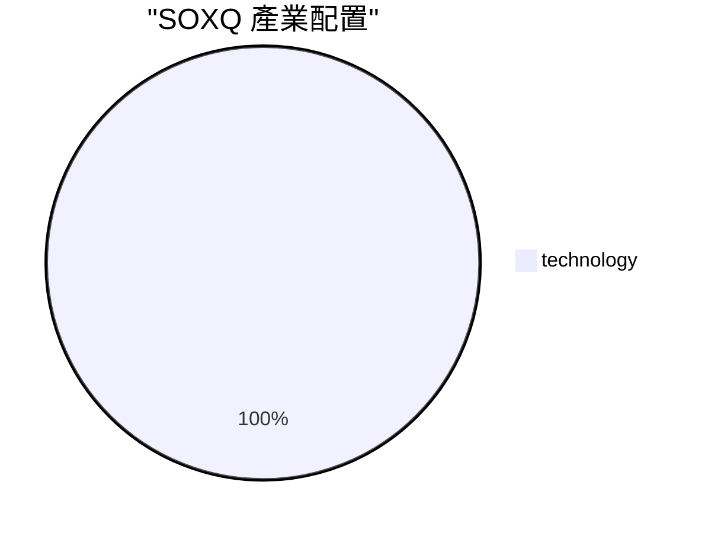

# SOXQ ETF 分析報告

> **報告日期**：2026-11-20 ｜ **語言**：繁體中文 ｜ **數據來源**：Yahoo Finance、Finviz ｜ **類型**：ETF／指數基金

## 目錄

| # | 章節 | 核心結論 |
|---|------|----------|
| 1 | 執行摘要 | 低費用的半導體主題 ETF，但持股集中、波動與回撤幅度大，較適合作為衛星配置。 |
| 2 | 基金概況 | 投資美國上市半導體企業，基金簡介指出其通常至少將總資產的 90% 投資於指數成分證券。 |
| 3 | 成本與規模 | 費用率低於同類平均，資產規模為 2.76B USD。 |
| 4 | 持股與集中度 | 前十大合計占資產 60.5%，集中度偏高。 |
| 5 | 產業配置 | 產業配置全部為科技，主題曝險集中於半導體產業。 |
| 6 | 績效與風險 | 長期期間相對 VTI 超額報酬為正，但波動率與最大回撤也高。 |
| 7 | 估值與配息 | 提供成分股加權 P/E、P/B 與配息殖利率；不代表基金合理價值。 |
| 8 | 適合對象、風險與觀察重點 | 適合能承受產業集中及大幅波動的投資人；需持續檢視持股集中與相對表現。 |

---

## 1. 執行摘要

SOXQ 是 Invesco 管理的半導體主題 ETF；基金簡介指出，其追蹤的指數旨在衡量由指數提供者認定、於美國上市的 30 家大型半導體企業表現。  
基金淨費用率為 0.19%，同類平均為 0.90%；前十大持股合計占資產 60.5%，最大持股 NVDA 為 12.01%。  
截至 2026-11-19，SOXQ 收盤價為 74.14 USD；截至 2026-11-18 的 1 年、3 年、5 年價格報酬分別為 +43.9%、+171.2%、+160.0%，相對 VTI 的超額報酬皆為正。  
另一方面，1 年年化波動率為 48.5%，歷史最大回撤為 -46.5%；整體較適合列為投資組合中的衛星配置，而非未經其他資產搭配的分散核心。

### 1.1 一頁式摘要

| 項目 | 內容 |
|------|------|
| 追蹤標的／類別 | Invesco PHLX Semiconductor ETF；半導體主題；基金類別為 Technology |
| 費用率（同類平均） | 0.19%（0.90%） |
| 資產規模 | 2.76B USD |
| 前十大合計權重／最大持股 | 前十大合計 60.5%；最大持股 NVDA 12.01%（集中度摘要列示最大持股 12.0%） |
| 1 年／3 年／5 年價格報酬 | +43.9%／+171.2%／+160.0% |
| 相對基準的超額報酬（1 年／3 年／5 年） | +33.8%／+105.8%／+110.0%（基準：VTI） |
| 年化波動率／最大回撤 | 48.5%／-46.5% |
| 折溢價 | -0.01%（相對 NAV 折價） |
| 定位 | 衛星配置 |

### 1.2 五項評分

| 評分項目 | 分數（0–10） | 依據（引用數字） |
|----------|-------------:|------------------|
| 成本 | 9 | 費用率為 0.19%，低於同類平均 0.90%；依費用水準評為高分。 |
| 規模與流動性 | 8 | 資產規模為 2.76B USD，具一定規模；成交量與買賣價差資料未提供，流動性仍不能只由資產規模判定。 |
| 分散度 | 3 | 前十大持股合計占 60.5%，最大單一持股為 NVDA 12.01%；資料標示 Concentrated，因此分數不高於 5 分。 |
| 相對績效 | 8 | 相對 VTI 的 1 年、3 年、5 年超額報酬分別為 +33.8%、+105.8%、+110.0%；分數反映已列期間的相對表現，不代表未來績效。 |
| 風險 | 2 | 1 年年化波動率為 48.5%，最大回撤為 -46.5%；兩項風險指標均顯示價格可能大幅波動。 |

## 2. 基金概況

| 項目 | 資料 |
|------|------|
| 基金名稱 | Invesco PHLX Semiconductor ETF |
| 代號 | SOXQ |
| 基金家族／類別 | Invesco／Technology |
| 基金類型 | ETF／指數基金 |
| 國家／產業欄位 | N/A（資料未提供）；另有產業配置資料列示科技權重 |
| 指數簡介 | Nasdaq 編製的修正市值加權指數，旨在衡量指數提供者認定、從事半導體業務且於美國上市的 30 家大型公司表現 |
| 基金投資方式 | 基金通常至少將總資產的 90% 投資於構成指數的證券 |
| 分散程度說明 | 基金簡介標示為 non-diversified |
| 追蹤誤差 | N/A（資料未提供） |

SOXQ 提供對半導體產業的集中曝險，與持有整體美國股市的廣泛型 ETF 不同。半導體是其投資主題，而非投資組合中分散配置的單一小型部位；因此，基金表現會較直接受到半導體企業景氣、成分股價格及科技股市場情緒影響。

在一般投資組合中，這類主題 ETF 通常可作為特定產業的衛星部位，用於增加半導體曝險。若投資人需要跨產業分散，仍應搭配涵蓋其他產業或資產類別的投資；SOXQ 本身不能取代廣泛市場配置。

## 3. 成本與規模

| 指標 | SOXQ 資料 | 解讀 |
|------|-----------|------|
| 淨費用率 | 0.19% | 持有基金的年度費用水準；實際投資成本亦可能受交易成本及追蹤差異影響。 |
| 同類平均費用率 | 0.90% | SOXQ 費用率低於提供的同類平均。 |
| 淨資產 | 2.76B USD | 可作為基金規模參考；不能單獨代表交易流動性或買賣價差。 |
| 年度持股週轉率 | 28.0% | 表示基金持股有一定調整；週轉率本身不等於投資人實際支付的交易成本。 |
| 折溢價 | -0.01% | 相對 NAV 為小幅折價；此數值反映所列資料時點，不保證其他交易時點相同。 |

**費用試算：**以 1,000,000 USD 為例，按現行費用率計算 10 年、假設沒有報酬，費用為 **19,000 USD**。這是區塊所列的簡化試算，不計投資報酬，也不代表投資人實際費用一定與試算相同。

資產規模可用來了解基金的體量，但不宜直接當作流動性的完整替代指標。成交量、買賣價差及各交易時段的市場深度均為 N/A（資料未提供）。年持股週轉率則可描述基金內部持股調整情況，不能據此推算基金未來報酬或投資人的交易成本。

## 4. 持股與集中度

| 代號 | 名稱 | 權重 |
|------|------|-----:|
| NVDA | NVIDIA Corp | 12.01% |
| AVGO | Broadcom Inc | 9.51% |
| MU | Micron Technology Inc | 7.97% |
| TXN | Texas Instruments Inc | 4.98% |
| ADI | Analog Devices Inc | 4.98% |
| AMD | Advanced Micro Devices Inc | 4.63% |
| TSM | Taiwan Semiconductor Manufacturing Co | 4.23% |
| QCOM | Qualcomm Inc | 4.18% |
| MRVL | Marvell Technology Inc | 4.01% |
| ASML | ASML Holding NV ADR | 3.99% |

前十大持股合計占基金資產 60.5%，資料列示的最大單一持股權重為 12.0%；持股表所列 NVDA 權重為 12.01%。兩者皆顯示，基金資產有相當部分集中於少數大型成分股。

這種集中度代表，基金報酬可能較容易受到前十大公司的股價變化影響，而不是只由半導體產業的平均表現決定。若大型持股出現明顯下跌，即使其他成分股表現較穩定，基金仍可能受到拖累；反之，少數大型持股上漲也可能對基金報酬帶來較大影響。

本報告僅列出資料提供的前十大持股。前十大以外持股、完整持股數量及各持股細節均為 N/A（資料未提供），不據此推測或補列。

## 5. 產業配置

| 產業 | 權重 |
|------|-----:|
| technology | 100.0% |

資料所列科技產業權重為 100.0%，為基金最大的產業曝險，也是唯一列示的產業配置。投資人持有 SOXQ，實際上是在承擔半導體主題集中所帶來的產業風險，而不是取得跨產業的市場分散。

## 6. 績效與風險

### 6.1 各期間價格報酬

| 期間 | SOXQ 價格報酬 | VTI 基準報酬 | 超額報酬 |
|------|--------------:|-------------:|---------:|
| 1 個月 | -14.4% | -4.7% | -9.7% |
| 3 個月 | -18.2% | -4.5% | -13.7% |
| 6 個月 | -18.3% | -1.3% | -17.0% |
| 1 年 | +43.9% | +10.1% | +33.8% |
| 3 年 | +171.2% | +65.4% | +105.8% |
| 5 年 | +160.0% | +50.0% | +110.0% |

以上為價格報酬，不含配息；比較基準為 VTI（美國整體市場）。表中超額報酬照列提供數值，不代表未來期間一定能維持相同相對表現。

各期間呈現不同方向：已列的 1 年、3 年及 5 年期間，SOXQ 相對 VTI 的超額報酬為正；1 個月、3 個月及 6 個月期間則為負。評估基金時，應同時看不同期間，而不宜只依單一較長期間的歷史報酬推論未來表現。

### 6.2 波動與回撤

| 指標 | 數值 | 說明 |
|------|------:|------|
| 年化波動率（1 年） | 48.5% | 反映所列期間價格波動程度；波動較高代表報酬路徑可能大幅起伏。 |
| 最大回撤（歷史資料期間 5.4 年） | -46.5% | 資料所列谷底日期為 2022-10-14。 |
| 儲存歷史期間 CAGR | 22.4% | 對應區塊所列儲存歷史期間；不能視為未來報酬預測。 |

以 1,000,000 USD 為例，區塊所列最大回撤對應的帳面減少金額為 **465,100 USD**。這是依提供的最大回撤試算之帳面變動示例，不是對未來最大損失的預測。

### 6.3 月末價格資料

以下列出提供的 24 個月價格歷史資料；收盤價照列，不將月末價格自行換算為報酬。

| 月份 | 收盤價（USD） |
|------|--------------:|
| 2024-11 | 38.37 |
| 2024-12 | 38.86 |
| 2025-01 | 39.14 |
| 2025-02 | 37.22 |
| 2025-03 | 33.41 |
| 2025-04 | 33.06 |
| 2025-05 | 37.20 |
| 2025-06 | 43.43 |
| 2025-07 | 43.95 |
| 2025-08 | 44.42 |
| 2025-09 | 49.93 |
| 2025-10 | 56.69 |
| 2025-11 | 55.10 |
| 2025-12 | 55.62 |
| 2026-01 | 62.84 |
| 2026-02 | 63.58 |
| 2026-03 | 59.61 |
| 2026-04 | 82.52 |
| 2026-05 | 100.87 |
| 2026-06 | 112.00 |
| 2026-07 | 88.97 |
| 2026-08 | 90.68 |
| 2026-09 | 99.40 |
| 2026-10 | 84.12 |
| 2026-11 | 74.14 |

## 7. 估值與配息

| 指標 | 數值 | 解讀 |
|------|------:|------|
| 投資組合 P/E | 35.7x | Yahoo Finance 提供的加權投資組合本益比。 |
| 投資組合 P/B | 10.8x | Yahoo Finance 提供的加權投資組合股價淨值比。 |
| 配息殖利率 | 0.35% | 區塊提供的基金配息殖利率。 |
| 配息紀錄 | N/A（資料未提供） | 未提供歷次配息資料，無法分析配息變化。 |

P/E 與 P/B 描述的是基金所持成分股的加權估值指標，不是 SOXQ 本身的合理價值，也不能單獨用來判斷基金價格高低。配息殖利率是所列資料中的殖利率資訊，不等於保證收益；未來配息與殖利率可能變動。

本報告不由投資組合倍數推算基金合理價值，亦不據此提供目標價。

## 8. 適合對象、風險與觀察重點

### 8.1 適合與不適合的投資人

| 投資人類型 | 適合度 | 原因（引用數字） |
|------------|--------|------------------|
| 尋求半導體產業主題曝險的投資人 | 較適合 | 科技產業權重為 100.0%，基金簡介說明其目標指向半導體企業。 |
| 能承受大幅價格波動的長期投資人 | 有條件適合 | 1 年年化波動率為 48.5%，歷史最大回撤為 -46.5%；須能承受顯著波動與帳面損失。 |
| 重視低基金費用的投資人 | 較適合 | 費用率為 0.19%，低於資料所列同類平均 0.90%。 |
| 需要跨產業分散的投資人 | 不適合作為唯一持有 | 科技產業占比為 100.0%，前十大持股合計占資產 60.5%。 |
| 需要穩定配息收入的投資人 | 不宜只依此基金規劃 | 配息殖利率為 0.35%；配息紀錄為 N/A（資料未提供）。 |
| 無法接受大幅回撤的投資人 | 不適合 | 歷史最大回撤為 -46.5%，並有對應的帳面減少示例。 |

### 8.2 主要風險

| 風險 | 與基金資料的關聯 | 投資人應留意 |
|------|------------------|--------------|
| 持股集中風險 | 前十大持股合計占 60.5%，最大持股 NVDA 為 12.01%。 | 少數成分股的價格變化可能對基金整體表現造成較大影響；前十大以外持股資料未提供。 |
| 單一產業風險 | 科技產業權重為 100.0%，基金主題為半導體。 | 基金缺乏跨產業配置；半導體相關企業共同面臨的產業變化，可能使基金價格同向波動。 |
| 市場波動與回撤風險 | 1 年年化波動率為 48.5%，歷史最大回撤為 -46.5%。 | 過往資料顯示可能出現大幅下跌；歷史回撤不是未來損失上限。 |
| 評價變動風險 | 投資組合 P/E 為 35.7x、P/B 為 10.8x。 | 成分股估值倍數可能隨價格或基本面預期變動；提供的倍數不是基金合理價值。 |
| 海外持股與匯率資訊不足 | 前十大包括 Taiwan Semiconductor Manufacturing Co 與 ASML Holding NV ADR；幣別曝險及避險資料為 N/A（資料未提供）。 | 投資人應留意海外持股可能涉及的市場與匯率因素，但無法由現有資料量化其影響或確認避險程度。 |

### 8.3 什麼情況下要重新評估

| 可查核條件 | 重新評估的原因 |
|------------|----------------|
| 最大持股權重相較目前披露水準明顯增加，或前十大合計權重上升 | 可能進一步提高少數成分股對基金報酬的影響。 |
| Yahoo Finance 顯示費用率有所調整，或同類基金成本出現明顯變化 | 費用是可持續影響基金持有成本的因素，應重新比較相對成本。 |
| SOXQ 相對 VTI 在後續可比期間持續落後 | 已列期間同時包含正、負超額報酬；持續性相對落後值得檢視。 |
| 淨資產相較目前資料明顯縮減，或交易流動性指標轉差 | 資產規模與交易條件可能改變；目前成交量及買賣價差資料為 N/A（資料未提供）。 |
| 年化波動率或回撤相較目前資料明顯擴大 | 可能代表基金價格風險升高，需重新衡量持有比重是否符合風險承受度。 |
| 持股、產業配置或基金追蹤方式有變動 | 基金曝險可能與原先投資目的不再一致；追蹤誤差及更細的指數規則資料為 N/A（資料未提供）。 |

**結論定位：衛星配置。** SOXQ 費用率為 0.19%，且截至 2026-11-18 的 1 年、3 年、5 年相對 VTI 超額報酬分別為 +33.8%、+105.8%、+110.0%；但前十大持股占資產 60.5%，科技產業占比為 100.0%，年化波動率為 48.5%，歷史最大回撤為 -46.5%。這些數字支持將其視為具集中產業曝險的衛星部位，而非單獨承擔分散配置功能。此定位不是買入或賣出建議。

---

> **免責聲明**：本報告為 AI 自動生成，僅供研究與教育參考，不構成投資建議。報酬為價格報酬，未計入配息、稅負與交易成本；投資有風險。

---

## 資料與來源

| 項目 | 內容 |
|------|------|
| 價格 | 74.14 USD，2026-11-19 收盤（Yahoo Finance 日線） |
| 基金資料 | Yahoo Finance（持股、費用率、規模）；績效與回撤由價格資料庫計算 |
| 有回應的資料來源 | Yahoo Finance、Finviz |
| 未回應的資料來源 | SEC 申報資料 (XBRL)、StockAnalysis、Roic.ai |
| 由程式計算 | 基金的集中度、績效、費用與回撤試算 |
| 撰寫模型 | openai / gpt-6-luna |

> 本區塊由產生報告的程式依實際取得的資料填寫，非模型撰寫。「由程式計算」的數字不是模型的估計；其餘判斷（評分、情境、策略）是模型的分析。
