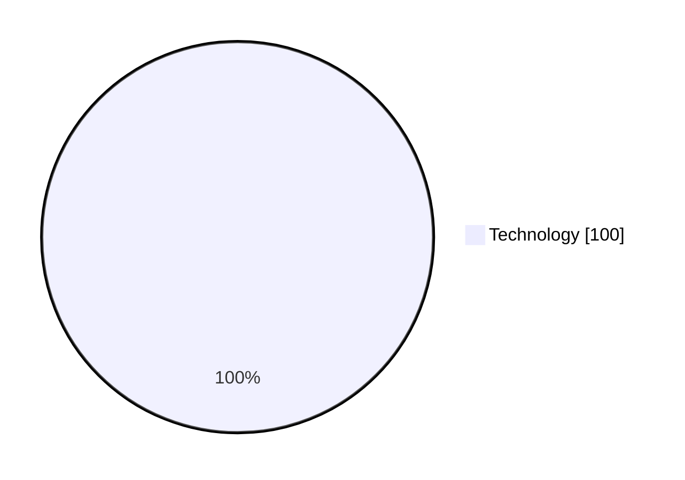

# SOXQ ETF 分析報告

> **報告日期**：2026-11-27 ｜ **語言**：繁體中文 ｜ **數據來源**：Yahoo Finance、Finviz ｜ **類型**：ETF／指數基金

## 目錄

| # | 章節 | 核心結論 |
|---|------|----------|
| 1 | 執行摘要 | 半導體主題集中配置；長期相對 VTI 報酬較高，但波動與回撤風險也高。 |
| 2 | 基金概況 | Invesco 發行的科技類 ETF，投資美國上市半導體相關公司。 |
| 3 | 成本與規模 | 費用率低於同類平均，資產規模為 2.76B USD。 |
| 4 | 持股與集中度 | 前十大持股占 60.5%，單一持股最大為 NVDA。 |
| 5 | 產業配置 | 資產全部配置於科技產業，實質曝險集中在半導體。 |
| 6 | 績效與風險 | 長期價格報酬高於 VTI，但年化波動與最大回撤均顯示風險偏高。 |
| 7 | 估值與配息 | 提供投資組合 P/E、P/B 與配息殖利率；不代表基金本身的合理價值。 |
| 8 | 適合對象、風險與觀察重點 | 較適合有意識配置半導體產業、且能承受大幅波動的投資人。 |

---

## 1. 執行摘要

SOXQ 是 Invesco 發行的半導體主題 ETF，基金通常至少將總資產的 90% 投資於其指數成分證券；2026-11-25 收盤價為 **69.07 USD**。  
基金費用率為 **0.19%**，同類平均為 **0.90%**；前十大持股合計占 **60.5%**，最大單一持股權重為 **12.0%**。  
相對 VTI，SOXQ 的 1 年、3 年及 5 年價格超額報酬分別為 **+23.4%**、**+73.3%**、**+82.1%**，但近期 1 個月、3 個月及 6 個月均落後基準。  
1 年年化波動率為 **51.8%**，歷史最大回撤為 **-46.5%**；因此長期相對報酬較高，並不代表短期波動或回撤風險較低。

### 1.1 一頁式摘要

| 項目 | 內容 |
|------|------|
| 追蹤標的／類別 | 半導體主題；Invesco／Technology |
| 費用率（同類平均） | 0.19%（0.90%） |
| 資產規模 | 2.76B USD |
| 前十大合計權重／最大持股 | 60.5%／12.0% |
| 1 年／3 年／5 年價格報酬 | +30.9%／+130.4%／+128.2% |
| 相對基準的超額報酬（1 年／3 年／5 年） | +23.4%／+73.3%／+82.1% |
| 年化波動率／最大回撤 | 51.8%／-46.5% |
| 折溢價 | -0.01% |
| 定位 | 衛星配置 |

### 1.2 五項評分

| 評分項目 | 分數（0–10） | 依據（引用數字） |
|----------|-------------:|------------------|
| 成本 | 9 | 費用率為 0.19%，低於 0.90% 的同類平均；依相對成本表現評分。 |
| 規模與流動性 | 8 | 資產規模為 2.76B USD，具一定基金規模；交易量、買賣價差等直接流動性資料為 N/A（資料未提供）。 |
| 分散度 | 3 | 前十大持股合計占 60.5%，最大單一持股權重為 12.0%；基金標示為 Concentrated，分數不高於 5 分。 |
| 相對績效 | 8 | 相對 VTI 的 1 年、3 年、5 年超額報酬為 +23.4%、+73.3%、+82.1%；較短期間則落後基準。 |
| 風險 | 2 | 1 年年化波動率為 51.8%，最大回撤為 -46.5%，顯示價格波動及下跌風險偏高。 |

## 2. 基金概況

| 項目 | 資料 |
|------|------|
| 基金名稱 | Invesco PHLX Semiconductor ETF |
| 代號 | SOXQ |
| 基金公司 | Invesco |
| 類別 | Technology |
| 基金性質 | ETF／指數基金 |
| 指數與投資範圍 | 指數由 Nasdaq 編製，旨在衡量美國上市、由指數提供者認定從事半導體業務的 30 家最大公司之表現。 |
| 投資方式 | 基金通常至少將總資產的 90% 投資於構成底層指數的證券。 |
| 多元化狀態 | 基金為 non-diversified。 |

SOXQ 提供的是半導體產業主題曝險，而非涵蓋整體美國股市的廣泛型配置。  
對投資組合而言，較常見的角色是補充性、產業型的衛星部位；是否適合作為核心配置，取決於投資人是否接受產業集中與較大的價格波動。

| 未提供資訊 | 狀態 |
|------------|------|
| 指數更完整的編製規則 | N/A（資料未提供） |
| 基金實際持有證券總數 | N/A（資料未提供） |
| 追蹤誤差 | N/A（資料未提供） |
| 基金的區域配置細節 | N/A（資料未提供） |

## 3. 成本與規模

| 指標 | SOXQ |
|------|------:|
| 費用率 | 0.19% |
| 同類平均費用率 | 0.90% |
| 淨資產規模 | 2.76B USD |
| 年度持股週轉率 | 28.0% |
| 市價 | 69.07 USD |
| NAV | 69.08 USD |
| 市價相對 NAV 折溢價 | -0.01% |

SOXQ 的費用率低於列示的同類平均；兩者皆依 Yahoo Finance 提供的數值呈現，不另行計算差額。  
基金規模可作為基金資產體量的參考，但這裡沒有每日成交量、買賣價差或其他交易流動性數據，因此不能僅憑資產規模判斷實際下單成本。

年度持股週轉率為 28.0%，代表持股有一定程度的更替；單憑此數字無法推論基金的實際交易成本或投資人的稅務結果。  
目前市價相對 NAV 為 -0.01%，表示列示時點的市價略低於 NAV；此數值是單一時點資料，不代表折溢價會固定維持在該水準。

**費用試算（簡化示例）**

| 試算項目 | 金額 | 說明 |
|----------|-----:|------|
| 1,000,000 USD 持有 10 年的費用 | 19,000 USD | 按目前費用率試算，不假設投資報酬；為簡化試算，實際費用可能隨資產價值及費用率變動。 |

## 4. 持股與集中度

| 代號 | 名稱 | 權重 |
|------|------|-----:|
| NVDA | NVIDIA Corp | 12.01% |
| AVGO | Broadcom Inc | 9.51% |
| MU | Micron Technology Inc | 7.97% |
| TXN | Texas Instruments Inc | 4.98% |
| ADI | Analog Devices Inc | 4.98% |
| AMD | Advanced Micro Devices Inc | 4.63% |
| TSM | Taiwan Semiconductor Manufacturing Co | 4.23% |
| QCOM | Qualcomm Inc | 4.18% |
| MRVL | Marvell Technology Inc | 4.01% |
| ASML | ASML Holding NV ADR | 3.99% |

| 集中度指標 | 數值 |
|------------|-----:|
| 前十大持股合計權重 | 60.5% |
| 最大單一持股權重 | 12.0% |

前十大持股合計占基金資產 60.5%，代表基金表現會明顯受到這些成分股影響；最大單一持股 NVDA 的列示權重為 12.01%。  
基金資料另以 12.0% 呈現最大持股權重；前十大合計與最大持股指標均照列示數值引用，不另行重算。

這類集中度可能讓基金在主要成分股上漲時受益，也會使少數大型持股走弱時對基金表現產生較大影響。  
此外，基金標示為非多元化基金；持有多檔股票不等於涵蓋多個不相關產業或形成廣泛市場分散。

前十大以外持股：N/A（資料未提供），本報告不列出前十大以外的成分股。

## 5. 產業配置

| 產業 | 權重 |
|------|-----:|
| Technology | 100.0% |

科技產業權重為 100.0%，而基金主題及列示持股均指向半導體相關公司，因此投資人承擔的是高度集中的科技／半導體產業曝險。  
這不是涵蓋多種產業的廣泛市場配置；半導體產業景氣、成分股表現及產業評價變化，都可能對基金造成顯著影響。

## 6. 績效與風險

以下為截至 2026-11-25 的價格報酬，不含配息。超額報酬及各項報酬均照列示數值呈現，不另行計算。

| 期間 | SOXQ 價格報酬 | VTI 基準報酬 | 超額報酬 |
|------|--------------:|-------------:|---------:|
| 1 個月 | -23.6% | -6.5% | -17.0% |
| 3 個月 | -26.2% | -7.2% | -19.0% |
| 6 個月 | -31.6% | -5.0% | -26.6% |
| 1 年 | +30.9% | +7.5% | +23.4% |
| 3 年 | +130.4% | +57.1% | +73.3% |
| 5 年 | +128.2% | +46.1% | +82.1% |

相對 VTI，SOXQ 在列示的 1 年、3 年及 5 年期間均有正超額報酬；較短的 1 個月、3 個月及 6 個月期間則均落後。  
因此，單看較長期間報酬可能忽略近期相對弱勢；不同期間的結果也不能視為未來報酬保證。

| 風險指標 | 數值 | 解讀 |
|----------|-----:|------|
| 1 年年化波動率 | 51.8% | 反映近期價格變動幅度高；不代表未來波動率必然相同。 |
| 歷史最大回撤 | -46.5% | 依存檔歷史資料計算，低點日期為 2022-10-14。 |
| 存檔期間年化報酬率（CAGR） | 20.2% | 依存檔歷史期間列示；不代表未來年化報酬。 |

**最大回撤情境示例**

| 試算項目 | 金額 | 說明 |
|----------|-----:|------|
| 1,000,000 USD 對應的帳面減少金額 | 465,100 USD | 依最大回撤試算；不是實際發生於所有投資人的損失金額。 |

上述示例凸顯高波動主題基金可能出現顯著帳面下跌；投資人應評估自身能否承受該類波動與回撤，而非只依較長期間報酬判斷風險。

## 7. 估值與配息

| 指標 | 數值 |
|------|-----:|
| 投資組合加權 P/E | 35.7x |
| 投資組合加權 P/B | 10.8x |
| 配息殖利率 | 0.35% |
| 配息紀錄 | N/A（資料未提供） |

P/E 與 P/B 是 Yahoo Finance 所列的投資組合加權指標，反映成分股整體評價，不是 SOXQ 作為基金的合理價值。  
配息殖利率為 0.35%；此數值不代表未來配息金額或殖利率固定不變。  
現有資料未提供配息紀錄，因此無法據此說明配息頻率、歷史穩定性或未來配息趨勢。  
本報告不以 P/E、P/B 或市價推導合理價值，也不提供目標價。

## 8. 適合對象、風險與觀察重點

### 8.1 適合與不適合的投資人

| 投資人類型 | 適合度 | 原因（引用數字） |
|------------|--------|------------------|
| 想配置半導體產業、並可接受較大波動的投資人 | 較適合 | 科技產業權重為 100.0%；1 年年化波動率為 51.8%。 |
| 希望用單一基金廣泛分散至多個產業的投資人 | 較不適合 | 產業配置為 Technology 100.0%，且基金標示為 non-diversified。 |
| 重視低費用的長期投資人 | 可納入比較 | 費用率為 0.19%，同類平均為 0.90%；仍須一併考量產業集中風險。 |
| 需要穩定配息作為主要現金流來源的投資人 | 較不適合 | 配息殖利率為 0.35%；配息紀錄為 N/A（資料未提供）。 |
| 無法接受大幅帳面回撤的投資人 | 較不適合 | 歷史最大回撤為 -46.5%，對應 1,000,000 USD 試算帳面減少 465,100 USD。 |
| 尋求廣泛美國市場核心曝險的投資人 | 不宜單獨視為廣泛市場配置 | 1 年、3 年及 5 年報酬雖高於 VTI，但基金集中於半導體主題，且科技產業權重為 100.0%。 |

### 8.2 主要風險

| 風險 | 與基金資料的連結 | 投資人可留意之處 |
|------|------------------|------------------|
| 持股集中風險 | 前十大持股合計占 60.5%；最大單一持股 NVDA 權重列示為 12.01%。 | 觀察大型成分股權重及其對基金報酬的影響，避免只看持股檔數判斷分散程度。 |
| 產業集中風險 | Technology 權重為 100.0%；基金主題為半導體。 | 半導體產業走勢可能與整體市場不同，應將產業曝險納入整體資產配置。 |
| 價格波動與回撤風險 | 年化波動率為 51.8%，歷史最大回撤為 -46.5%。 | 評估投資期間及可承受的帳面波動；過往報酬不代表未來回撤幅度。 |
| 國際成分股及貨幣資訊不足 | 前十大含 TSM 與 ASML Holding NV ADR；區域配置及貨幣曝險資料為 N/A（資料未提供）。 | 這些名稱顯示持股涉及非美國發行人，但本資料未量化區域或匯率曝險；避免將其視為已知的基金貨幣風險比例。 |
| 評價變動風險 | 投資組合加權 P/E 為 35.7x、P/B 為 10.8x。 | 成分股評價倍數變動可能影響基金價格；上述倍數不是基金合理價值或未來報酬的保證。 |

### 8.3 什麼情況下要重新評估

| 可查核條件 | 重新評估方向 |
|------------|--------------|
| 最大持股權重高於目前列示的 12.01%，或前十大合計權重高於目前列示的 60.5%。 | 檢視集中度是否與個人可承受風險及整體投資組合配置相符。 |
| 費用率不再是目前列示的 0.19%，或同類平均費用率出現變化。 | 重新比較基金成本與同類產品；本報告不推定未來費用率。 |
| 相對 VTI 的 1 年、3 年或 5 年超額報酬由目前列示的正值轉為負值。 | 重新檢視相對績效、產業循環及投資目的；不以單一期間結果作為唯一判斷。 |
| 基金資產規模相對目前的 2.76B USD 持續明顯縮減。 | 檢視基金規模變化及可取得的交易流動性資訊；「明顯縮減」沒有在本資料中設定固定門檻。 |
| 市價與 NAV 的折溢價相較目前 -0.01% 出現明顯變化。 | 檢視交易時點的折溢價；本資料沒有提供可作為固定警戒線的數值。 |
| 投資人無法承受與歷史最大回撤 -46.5% 相近的下跌情境。 | 重新評估持有比例與基金在投資組合中的角色。 |

> **結論定位：衛星配置。** SOXQ 的費用率為 0.19%，相對 VTI 的 1 年、3 年及 5 年超額報酬分別為 +23.4%、+73.3%、+82.1%；但前十大持股占 60.5%、科技產業權重為 100.0%，年化波動率為 51.8%，歷史最大回撤為 -46.5%。這些數字支持將它視為半導體主題曝險，而非廣泛市場分散工具；此定位不是買賣建議。

> **免責聲明**：本報告為 AI 自動生成，僅供研究與教育參考，不構成投資建議。報酬為價格報酬，未計入配息、稅負與交易成本；投資有風險。

---

## 資料與來源

| 項目 | 內容 |
|------|------|
| 價格 | 69.07 USD，2026-11-25 收盤（Yahoo Finance 日線） |
| 基金資料 | Yahoo Finance（持股、費用率、規模）；績效與回撤由價格資料庫計算 |
| 有回應的資料來源 | Yahoo Finance、Finviz |
| 未回應的資料來源 | SEC 申報資料 (XBRL)、StockAnalysis、Roic.ai |
| 由程式計算 | 基金的集中度、績效、費用與回撤試算 |
| 撰寫模型 | openai / gpt-6-luna |

> 本區塊由產生報告的程式依實際取得的資料填寫，非模型撰寫。「由程式計算」的數字不是模型的估計；其餘判斷（評分、情境、策略）是模型的分析。
